# DQN → SAC

## 학습 목표

- 칸마다 값을 적어 두는 표로는 막대 각도처럼 연속된 숫자를 보는 로봇의 Q 를 배울 수 없는 이유를 칸 수를 세어 설명할 수 있다
- 표 대신 몇 개의 weight 로 Q 를 계산하는 모델을 쓰면 한 자리를 고칠 때 다른 자리도 함께 바뀌어 학습이 흔들린다는 것을 작은
  숫자로 보일 수 있다
- 지난 경험을 쌓아 두고 섞어 꺼내 쓰는 방법과, target 을 계산할 때만 쓰는 weight 복사본을 따로 두는 방법이 그 흔들림을 어떻게
  줄이는지 한 단계씩 따라갈 수 있다
- 지금 policy 로 모은 데이터만 쓰는 학습과 예전 데이터까지 다시 쓰는 학습의 차이를 그림으로 비교하고, 실물 로봇에서 뒤쪽이
  중요한 이유를 설명할 수 있다
- 행동이 토크처럼 연속된 숫자일 때 행동을 내는 모델과 그 행동에 점수를 매기는 모델을 함께 학습하는 구조를 설명할 수 있다
- 행동을 얼마나 고르게 섞어 고르는지를 숫자 하나로 계산하고, 그 숫자를 reward 에 더해 주면 policy 가 어떻게 달라지는지 작은
  숫자로 보일 수 있다

## 표로 배우는 Q 의 한계

### Q 표와 Q-learning

[Bandits & MDPs](../bandit-mdp/README.md) 에서는 3×3 격자 위의 로봇 청소기가 충전기로 가는 길을 배웠다. agent(행동을 고르는
쪽)가 state(지금 상황, 여기서는 서 있는 칸)를 보고 action(위·아래·왼쪽·오른쪽)을 고르면, environment(agent 가 행동하는 세계)가
다음 state 와 reward(행동 뒤에 받는 점수)를 돌려준다. 충전기에 들어가면 +1, 계단에 빠지면 −1, 나머지 이동은 0 이었다.

$Q(s, a)$ 는 "state $s$ 에서 action $a$ 를 먼저 하고, 그다음부터 가장 좋게 행동할 때 앞으로 받을 reward 를 늦을수록 깎아 더한 값의
기댓값" 이다. 늦게 받는 reward 를 깎는 비율이 discount factor $\gamma$(gamma, 감마)이고, 이 강의에서도 0.9 를 쓴다. 기댓값은 운에
따라 결과가 달라질 때 아주 많이 되풀이하면 한 번에 평균적으로 얻는 값이다.

Q-learning 은 이 $Q$ 를 표에 적어 두고, 경험 하나 $(s, a, r, s')$ 를 겪을 때마다 표의 한 칸을 고친다. $s'$ 은 "에스 프라임" 이라고
읽고 도착한 다음 state 를 뜻한다.

$$
Q(s,a) \leftarrow Q(s,a) + \alpha\big[\,\underbrace{r + \gamma \max_{a'} Q(s',a')}_{\text{target}} - Q(s,a)\,\big]
$$

- $r + \gamma \max_{a'} Q(s', a')$ 가 target 이다. "이번에 받은 reward" 에 "도착한 칸에서 가장 좋은 action 의 $Q$ 를 $\gamma$ 로
  깎은 값" 을 더한 것이고, $\max_{a'}$ 는 다음 칸의 action $a'$ 을 모두 넣어 보고 가장 큰 값을 고르라는 뜻이다
- target 에서 지금 값 $Q(s, a)$ 를 뺀 차이가 TD error 다
- $\alpha$(alpha, 알파)는 TD error 의 몇 분의 일만큼 옮길지 정하는 learning rate 다
- 화살표 $\leftarrow$ 는 왼쪽 칸의 값을 오른쪽에서 계산한 값으로 바꿔 적으라는 뜻이다

$Q(s, a) = 0.5$, $r = 0$, 도착한 칸의 가장 큰 $Q$ 가 1.0, $\alpha = 0.1$ 이면 target 은 $0 + 0.9 \times 1.0 = 0.9$, TD error 는
$0.9 - 0.5 = 0.4$ 이고, 새 $Q$ 는 $0.5 + 0.1 \times 0.4 = 0.54$ 다.

이 update 에서 바뀌는 것은 표의 칸 하나뿐이다. 칸 7 에서 위로 간 경험을 배워도 칸 8 의 값은 그대로이고, target 에 쓴 다음 칸의
값도 그대로다. 표에서는 너무 당연한 이 성질이 neural network 로 넘어가면 깨지고, 그 때문에 학습이 흔들린다.

**확인 문제.** $Q(1, \text{오른쪽}) = 0.45$ 인 칸에서 오른쪽으로 가 reward 0 을 받고 칸 2 에 도착했다. 칸 2 의 $Q$ 가운데 가장 큰 값은
1, $\alpha = 0.5$ 다. 새 $Q(1, \text{오른쪽})$ 은 얼마이고, 표에서 값이 바뀐 칸은 몇 개일까?

답 보기

target 은 $0 + 0.9 \times 1 = 0.9$, TD error 는 $0.9 - 0.45 = 0.45$, 새 $Q$ 는 $0.45 + 0.5 \times 0.45 = 0.675$ 다. 바뀐 칸은
$Q(1, \text{오른쪽})$ 하나뿐이다.

### 연속된 숫자로 된 state

격자의 state 는 칸 번호라서 1 부터 9 까지 셀 수 있었지만, 로봇의 state 는 대개 그렇지 않다. 막대 세우기 문제로 많이 쓰는
`CartPole-v1` 환경을 예로 든다. 이 환경은 simulator(컴퓨터 안에서 물체의 움직임을 계산해 실제 세계를 흉내 내는 프로그램) 속의 세계이고, CartPole 은 레일 위의 수레에
막대를 경첩으로 세워 두고 수레를 왼쪽이나 오른쪽으로 밀어 막대가 쓰러지지 않게 하는 문제다.

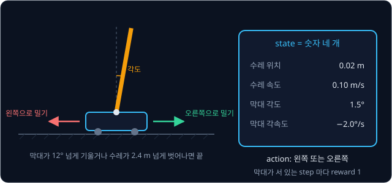

위 그림처럼 CartPole 의 state 는 숫자 네 개다.

| state 의 숫자 | 뜻 | 예 |
| --- | --- | --- |
| 수레 위치 | 레일 가운데에서 떨어진 거리 | 0.02 m |
| 수레 속도 | 1 초 동안 움직이는 거리 | 0.10 m/s |
| 막대 각도 | 똑바로 선 자세에서 기운 정도 | 1.5° |
| 막대 각속도 | 1 초 동안 각도가 바뀌는 양 | −2.0°/s |

action 은 왼쪽으로 밀기와 오른쪽으로 밀기 두 가지이고, 막대가 서 있는 step 마다 reward 1 을 받는다. step 은 action 을 한 번 하고
결과를 받는 것이며, CartPole 에서는 한 step 이 0.02 초다. 막대가 12° 넘게 기울거나 수레가 가운데에서 2.4 m 넘게 벗어나면
episode(시작부터 끝까지의 step 묶음)가 끝나고, 500 step 을 버티면 시간 제한으로 끊긴다.

이 네 숫자는 칸 번호와 달리 연속된 숫자다. 막대 각도는 1.5° 일 수도, 1.51° 일 수도, 1.505° 일 수도 있어서 가능한 값을 셀 수 없다.
그래서 state 마다 칸 하나를 만드는 표는 처음부터 만들 수 없다. 설령 만든다 해도, 각도가 1.5° 인 state 를 배운 표는 1.51° 인
state 에 대해서는 아무것도 모른다. 두 값은 거의 같은 상황인데도 표에서는 서로 다른 칸이기 때문이다. 같은 숫자가 정확히 다시 나오는
일은 거의 없으니, 표는 배운 것을 다시 쓸 기회를 얻지 못한다.

로봇 팔은 관절 각도 여섯 개와 각 관절의 속도가 모두 연속된 숫자라 사정이 더 나쁘고, 카메라를 보는 로봇이라면 state 는 화면
점(pixel) 수만 개의 밝기 값이다.

**확인 문제.** 표에서 state (0.02 m, 0.10 m/s, 1.5°, −2.0°/s) 의 $Q$ 를 배웠다. 막대 각도만 1.6° 로 다른 state (0.02 m, 0.10 m/s,
1.6°, −2.0°/s) 의 $Q$ 는 표에서 무엇일까?

답 보기

표에서는 두 state 가 서로 다른 칸이라 앞의 학습이 뒤 칸에 전혀 전해지지 않는다. 뒤 칸은 처음 값(보통 0) 그대로다.

### 칸으로 자른 표

연속된 숫자도 구간으로 잘라 칸을 만들면 표에 담을 수 있다. 막대 각도 −12° ~ 12° 를 2.4° 폭으로 자르면 칸이 10 개 생긴다.

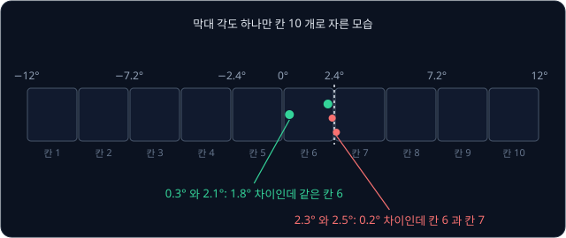

칸으로 자르면 경계가 문제를 만든다. 위 그림에서 0.3° 와 2.1° 는 1.8° 나 떨어져 있지만 같은 칸 6 이라 같은 $Q$ 를 쓰고, 2.3° 와 2.5° 는 0.2° 밖에
차이 나지 않지만 칸 경계 2.4° 를 사이에 두고 갈라져 서로 아무것도 나누지 못한다.

칸의 개수도 문제다. CartPole 의 숫자 네 개를 모두 10 칸씩 자르면 state 는 $10 \times 10 \times 10 \times 10$ 개가 된다. 같은
수를 여러 번 곱한 것은 오른쪽 위에 횟수를 적어 $10^4$ 으로 쓰고, 값은 10,000 이다. 칸 하나에 action 이 둘이므로 $Q$ 표는 20,000
칸이 된다.

| 문제 | 숫자 개수 | 숫자 하나를 자른 칸 수 | state 수 |
| --- | --- | --- | --- |
| 3×3 격자 | 칸 번호 1 개 | — | 9 |
| CartPole | 4 | 10 | $10^4 = 10{,}000$ |
| CartPole, 더 잘게 | 4 | 100 | $100^4 = 100{,}000{,}000$ |
| 관절 각도 6 개인 로봇 팔 | 6 | 10 | $10^6 = 1{,}000{,}000$ |

칸을 잘게 자를수록 경계 문제는 줄지만 칸 수는 곱으로 불어난다. 그리고 [Bandits & MDPs](../bandit-mdp/README.md) 에서 본 것처럼
Q-learning 은 칸마다 여러 번 겪어 target 을 평균해야 하는데, 한 번도 가 보지 않은 칸은 영영 처음 값에 머문다. 칸이 1 억 개면 대부분의
칸은 학습이 끝날 때까지 한 번도 겪지 못한다.

**확인 문제.** state 가 숫자 3 개이고 숫자마다 5 칸으로 자른다. action 이 2 개이면 $Q$ 표는 몇 칸일까?

답 보기

state 는 $5 \times 5 \times 5 = 5^3 = 125$ 개이고, action 이 2 개라 $125 \times 2 = 250$ 칸이다.

**요약**

- 표로 배우는 Q-learning 은 경험 하나마다 표의 한 칸만 고치고, 다른 칸과 target 은 건드리지 않는다
- 로봇의 state 는 막대 각도처럼 연속된 숫자라서 칸을 만들 수 없고, 거의 같은 두 state 도 표에서는 아무것도 나누지 못한다
- 구간으로 잘라 칸을 만들면 칸 수가 숫자 개수만큼 곱으로 불어나, CartPole 만 해도 $10^4$ 칸, 잘게 자르면 $100^4$ 칸이 된다

## neural network 로 계산하는 Q

### 표를 대신하는 계산식

표는 state 마다 답을 적어 두는 방식이다. 이와 달리 state 의 숫자를 넣으면 $Q$ 를 계산해 내는 식을 하나 두고, 그 식 안의 몇 개 안
되는 숫자만 학습할 수도 있다. 가장 단순한 식은 [Linear Regression](../linear-regression/README.md) 의 직선에서 y 절편을 뺀
꼴이다. 복도 위 로봇의 위치를 $x$ 라고 하면

$$
Q_w(x) = w \times x
$$

이고, "위치 $x$ 에 weight $w$ 를 곱한 값을 $Q$ 로 쓴다" 로 읽는다. $Q$ 의 아래첨자 $w$ 는 이 $Q$ 가 weight $w$ 로 계산된다는 표시다.
$w = 0.2$ 이면 $Q(1) = 0.2$, $Q(2) = 0.4$, $Q(3) = 0.6$ 이고, 한 번도 본 적 없는 $x = 2.5$ 에서도 $Q(2.5) = 0.5$ 를 바로 계산한다.
숫자 하나 $w$ 가 셀 수 없이 많은 칸의 표를 대신한다.

실제로는 직선 하나로는 모자라서 neural network 를 쓴다. neural network 는
"입력에 weight 를 곱해 더하는" 계산을 여러 겹으로 쌓고, 겹 사이에 값을 꺾는 계산을 끼워 넣은 모델이다. 한 겹을 layer 라고 하고,
여러 layer 를 거치면 직선으로는 나타낼 수 없는 휘어진 관계도 계산할 수 있다. weight 는 수천에서 수백만 개에 이르는데, 이 weight
전체를 한 기호 $\theta$(theta, 세타)로 묶어 부르고 그 network 가 계산한 $Q$ 를 $Q_\theta(s, a)$ 로 쓴다. 학습하는 방법은
[PyTorch Training Loop](../pytorch-mlp/README.md) 와 같다.

이렇게 값을 칸마다 정확히 적는 대신 weight 몇 개로 비슷하게 계산해 내는 것을 function approximation(함수 근사)이라고 한다. 함수는
값을 넣으면 값 하나가 정해져 나오는 규칙이고, 근사(approximation)는 정확히 같지는 않아도 가깝게 맞춘다는 뜻이다.

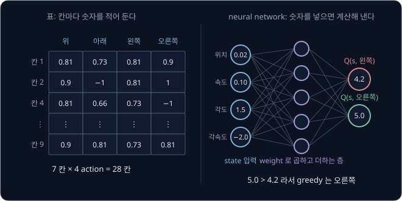

위 그림의 왼쪽은 [Bandits & MDPs](../bandit-mdp/README.md) 의 격자에서 구한 $Q$ 표 일부이고, 오른쪽은 CartPole 용 neural network 다.
state 숫자 네 개(0.02, 0.10, 1.5, −2.0)를 넣으면 가운데 layer 를 거쳐 action 마다 $Q$ 하나씩, $Q(s, \text{왼쪽}) = 4.2$ 와
$Q(s, \text{오른쪽}) = 5.0$ 이 한 번에 나온다. greedy policy(추정값이 가장 큰 action 을 고르는 규칙)는 5.0 이 더 크니 오른쪽으로
민다. action 마다 network 를 따로 돌리지 않고 출력 칸을 action 수만큼 두어 한 번에 계산하는 이 구조가 뒤에서 다룰 DQN 의 방식이다.

손으로 따라가는 이 강의의 계산에서는 weight 하나짜리 $Q_w(x) = w \times x$ 를 network 대신 쓴다. weight 는 하나뿐이지만, 몇 개 안
되는 weight 를 모든 state 가 함께 쓴다는 neural network 의 핵심 성질은 그대로라서, 다음 절부터 나오는 문제가 모두 똑같이
생긴다.

**확인 문제.** $Q_w(x) = w \times x$ 에서 $w = 0.3$ 이면 $Q(4)$ 는? 이 값을 얻으려고 표처럼 $x = 4$ 를 미리 배워 둬야 할까?

답 보기

$0.3 \times 4 = 1.2$ 다. $x = 4$ 를 배운 적이 없어도 식에 넣기만 하면 계산된다.

### target 을 정답으로 쓰는 regression

표에서는 $Q(s, a)$ 칸을 target 쪽으로 직접 옮겼다. 식으로 계산하는 $Q$ 는 칸이 없으니 $Q$ 를 직접 옮길 수 없고, $w$ 를 고쳐서
$Q$ 가 target 에 가까워지게 해야 한다. target $y$ 를 정답으로,
$Q_w(x)$ 를 예측으로 두고 오차의 제곱을 loss(모델이 얼마나 틀렸는지 나타내는 숫자)로 삼아 줄이면 된다. 이렇게 연속된 숫자인 정답에 예측을
맞추는 문제를 regression 이라고 한다.

$$
L(w) = \big(Q_w(x) - y\big)^2 = (w x - y)^2
$$

loss 를 줄이는 방법은 gradient descent 다. $w$ 를 아주 조금 늘렸을 때 loss 가 변하는 비율을 gradient 라고 하고, 그 반대쪽으로
learning rate $\eta$(eta, 에타)만큼 옮긴다. 이 loss 의
gradient 는 아래와 같다.

$$
\frac{\partial L}{\partial w} = 2\,(w x - y) \times x
\qquad
w \leftarrow w - \eta \times \frac{\partial L}{\partial w}
$$

왼쪽 식은 "loss 를 $w$ 로 미분한 값, 곧 $w$ 를 조금 늘렸을 때 loss 가 변하는 비율은 오차의 2 배에 $x$ 를 곱한 값" 이라고 읽는다.
오른쪽 식은 "$w$ 에서 learning rate 와 gradient 를 곱한 만큼을 뺀다" 는 뜻이다.

위치 $x = 2$ 에서 오른쪽으로 가 reward 0 을 받고, 도착한 자리의 가장 큰 $Q$ 가 1.0 이었다고 하자. target 은
$y = 0 + 0.9 \times 1.0 = 0.9$ 다. $w = 0.2$, $\eta = 0.1$ 에서 한 단계씩 계산한다.

| 단계 | 계산 | 값 |
| --- | --- | --- |
| 예측 $Q_w(2)$ | $0.2 \times 2$ | 0.4 |
| 오차 $Q - y$ | $0.4 - 0.9$ | $-0.5$ |
| gradient | $2 \times (-0.5) \times 2$ | $-2$ |
| update 크기 | $0.1 \times (-2)$ | $-0.2$ |
| 새 $w$ | $0.2 - (-0.2)$ | 0.4 |

gradient 가 음수이니 $w$ 를 늘리는 쪽이 loss 를 줄이는 쪽이고, $w$ 는 0.4 가 된다. 새 $Q_w(2) = 0.8$ 은 target 0.9 에 가까워졌다.

숫자만 바꿔 $w = 0.5$, $x = 1$, target $y = 0.9$ 로 해 본다. 예측은 0.5, 오차는 $-0.4$, gradient 는 $2 \times (-0.4) \times 1 = -0.8$,
새 $w$ 는 $0.5 - 0.1 \times (-0.8) = 0.58$ 이다. 두 계산 모두 "예측이 target 보다 작으면 $w$ 를 키운다" 는 같은 규칙을 따른다.

표 update 의 learning rate $\alpha$ 가 하던 일을 여기서는 gradient descent 의 learning rate $\eta$ 가 한다. 또 target $y$ 도 사실은 $Q$ 로 계산한 값이지만, gradient 를 구할 때는 $y$ 를 정답 자리에 놓인 고정된 숫자로 보고 $y$ 를 계산한
식은 따지지 않는다. 이 약속이 다음 절의 문제와 이어진다.

**확인 문제.** $w = 0.3$, $x = 2$, target $y = 1$, $\eta = 0.1$ 이면 gradient 와 새 $w$ 는?

답 보기

예측은 $0.3 \times 2 = 0.6$, 오차는 $0.6 - 1 = -0.4$, gradient 는 $2 \times (-0.4) \times 2 = -1.6$ 이다. 새 $w$ 는
$0.3 - 0.1 \times (-1.6) = 0.46$ 이다.

### 함께 바뀌는 다른 state 의 Q

앞의 계산에서 $w$ 는 $x = 2$ 의 경험 하나로 0.2 에서 0.4 로 바뀌었다. 그런데 $w$ 는 모든 위치가 함께 쓰는 숫자라서, 학습에 쓰지 않은
위치의 $Q$ 도 같이 바뀐다.

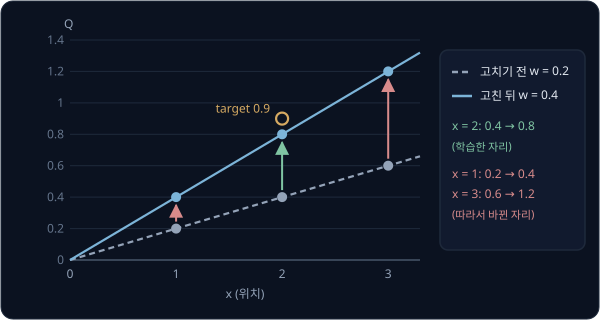

| 위치 $x$ | 고치기 전 $Q$ ($w = 0.2$) | 고친 뒤 $Q$ ($w = 0.4$) | 학습에 썼나 |
| --- | --- | --- | --- |
| 1 | 0.2 | 0.4 | 아니오 |
| 2 | 0.4 | 0.8 | 예 |
| 3 | 0.6 | 1.2 | 아니오 |

위 그림과 표처럼 $x = 2$ 만 배웠는데 $x = 1$ 과 $x = 3$ 의 $Q$ 도 두 배가 됐다. 이렇게 한 state 에서 배운 것이 다른 state 의 값에도
번지는 성질을 generalization(일반화)이라고 한다.

generalization 덕분에 표가 하지 못한 일을 할 수 있다. CartPole 에서 막대 각도 1.5° 인
state 를 배우면 1.51° 인 state 의 $Q$ 도 비슷하게 바뀌어, 거의 같은 상황을 처음부터 다시 배우지 않아도 된다. 하지만 원하지 않은
곳까지 바뀌기도 한다. 위 표에서 $Q(3)$ 은 0.6 에서 1.2 로 뛰었는데, 이 복도에서 받을 수 있는 reward 는 많아야 1 이라 $Q$ 가 1 을
넘을 수 없다. $x = 3$ 을 배운 적이 없으니 이 값을 바로잡을 정보도 없다.

**흔한 오해.** "state 하나만 학습했으니 다른 state 의 $Q$ 는 그대로다" 는 표에서만 맞는 말이다. weight 를 모든 state 가 함께 쓰면,
한 state 의 학습이 $w$ 를 바꾸고, 바뀐 $w$ 가 모든 state 의 $Q$ 를 바꾼다. 위 표에서 $x = 3$ 의 변화(+0.6)는 학습한 $x = 2$ 의
변화(+0.4)보다도 크다.

**확인 문제.** $w = 0.4$ 에서 $x = 1$, target $y = 0.9$ 인 경험 하나로 $\eta = 0.1$ 만큼 학습한다. 새 $w$ 와, 학습에 쓰지 않은
$Q(3)$ 의 변화는?

답 보기

예측 0.4, 오차 $-0.5$, gradient $2 \times (-0.5) \times 1 = -1$ 이라 새 $w$ 는 $0.4 + 0.1 = 0.5$ 다. $Q(3)$ 은
$0.4 \times 3 = 1.2$ 에서 $0.5 \times 3 = 1.5$ 로 0.3 늘어난다.

**요약**

- 표 대신 state 의 숫자를 넣으면 $Q$ 를 계산하는 식(neural network)을 두면, 몇 개의 weight 로 셀 수 없이 많은 state 를 다룰 수 있다
- 학습은 Q-learning 의 target 을 정답으로 두고 $(Q - y)^2$ 을 gradient descent 로 줄이는 regression 이다
- weight 를 모든 state 가 함께 쓰므로 한 state 를 배우면 다른 state 의 $Q$ 도 바뀐다(generalization). 비슷한 state 에 배운 것이
  번지는 장점과, 원하지 않은 곳까지 바뀌는 단점이 함께 있다

## 흔들리는 학습

### 따라 움직이는 target

generalization 의 단점이 가장 크게 드러나는 곳은 target 이다. 짧은 복도에서 로봇이 겪는 transition(state 에서 action 을 해 다음
state 로 옮겨 가는 일) 두 개를 쓴다. 이 절부터는 action 이 "오른쪽" 하나뿐이라 $Q(x)$ 로 줄여 쓴다.

| 이름 | 출발 위치 | 도착 위치 | reward | episode |
| --- | --- | --- | --- | --- |
| A | $x = 1$ | $x = 2$ | 0 | 계속된다 |
| B | $x = 2$ | 충전기 | 1 | 끝난다 |

진짜 값은 [Bandits & MDPs](../bandit-mdp/README.md) 의 격자와 같은 방식으로 구한다. $x = 2$ 에서는 바로 1 을 받고 끝나니
$Q(2) = 1$ 이고, $x = 1$ 에서는 한 step 뒤에 그 1 을 받으니 $Q(1) = 0 + 0.9 \times 1 = 0.9$ 다.

먼저 A 만 되풀이해 배워 본다. A 의 target 은 "reward 0 + $\gamma$ × 도착한 $x = 2$ 의 $Q$" 인데, $Q(2)$ 도 같은 $w$ 로 계산하므로

$$
y_A = 0 + 0.9 \times Q_w(2) = 0.9 \times 2w = 1.8\,w
$$

이다. $w = 1$, $\eta = 0.25$ 에서 출발한다. $x = 1$ 이라 gradient 는 $2 \times (Q - y) \times 1$ 이고, update 는
$w \leftarrow w - 0.25 \times 2 \times (Q - y) = w + 0.5 \times (y - Q)$ 가 된다. 아래 표의 "차이" 는 target 에서 $Q(1)$ 을 뺀 값이다.

| update | $w$ | $Q(1) = w$ | $Q(2) = 2w$ | target $0.9 \times Q(2)$ | 차이 | 새 $w$ |
| --- | --- | --- | --- | --- | --- | --- |
| 0 | 1 | 1 | 2 | 1.8 | 0.8 | $1 + 0.5 \times 0.8 = 1.4$ |
| 1 | 1.4 | 1.4 | 2.8 | 2.52 | 1.12 | $1.4 + 0.5 \times 1.12 = 1.96$ |
| 2 | 1.96 | 1.96 | 3.92 | 3.528 | 1.568 | $1.96 + 0.5 \times 1.568 = 2.744$ |
| 3 | 2.744 | 2.744 | 5.488 | 4.939 | 2.195 | 3.842 |

update 0 에서 $Q(1) = 1$ 을 target 1.8 쪽으로 옮겨 1.4 로 만들었다. 그런데 $w$ 가 커지면서 $Q(2)$ 도 2 에서 2.8 로 커졌고, 그 바람에
target 이 1.8 에서 2.52 로 달아났다. 차이는 0.8 에서 1.12 로 오히려 커졌고, 그 뒤로도 update 할 때마다 $w$ 가 1.4 배씩 커진다.
진짜 $Q(1)$ 은 0.9 이고 이 복도에서는 reward 를 1 넘게 받을 수 없는데도, $Q$ 는 끝없이 커진다. 값이 이렇게 한없이 커져 멈추지
않는 것을 발산이라고 부른다.

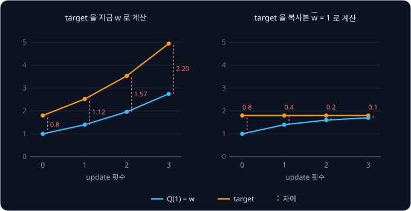

위 그림의 왼쪽이 이 표를 그린 것이다(오른쪽은 다음 절에서 다룬다). 파란 $Q(1)$ 이 주황 target 을 쫓아갈수록 target 은 더 빨리
멀어진다. 표에서는 이런 일이 없었다. $Q(1)$ 과 $Q(2)$ 가 서로 다른 칸이라 $Q(1)$ 을 고쳐도 target 에 쓰는 $Q(2)$ 칸은 2 그대로이고,
target 1.8 도 그대로라서 $Q(1)$ 은 1.8 에 다가가 멈춘다. network 에서는 학습하는 값과 target 을 같은 weight 로 계산하기 때문에,
학습할 때마다 target 도 함께 움직인다. 이 문제를 moving target 이라고 부른다. 그림자를 밟으려고 다가가면 그림자도 같이 물러나는
것과 같다.

**흔한 오해.** "target 쪽으로 고쳤으니 target 과의 차이는 줄어든다" 고 생각하기 쉽다. 위 표의 update 0 에서 차이는 0.8 이었고,
target 쪽으로 고친 뒤에는 1.12 였다. $Q(1)$ 이 0.4 늘 때 target 은 0.72 늘었기 때문이다. $w$ 가 0.4 늘면 $Q(2)$ 는 그 두 배인 0.8
늘고, target 은 거기에 0.9 를 곱한 0.72 만큼 는다.

**확인 문제.** 같은 A 를 $\gamma = 0.4$ 로 배운다. $w = 1$, update 는 $w \leftarrow w + 0.5 \times (y - Q)$ 다. 첫 update 뒤의 $w$
와, 그때의 target 과 $Q(1)$ 의 차이는? 차이가 커질까, 줄어들까?

답 보기

target 은 $0.4 \times 2w = 0.8w$ 라서 처음에는 0.8, 차이는 $0.8 - 1 = -0.2$ 다. 새 $w$ 는 $1 + 0.5 \times (-0.2) = 0.9$ 이고, 그때
target 은 $0.8 \times 0.9 = 0.72$, 차이는 $0.72 - 0.9 = -0.18$ 로 줄어든다. $Q(2)$ 가 $Q(1)$ 의 2 배로 움직여도 $\gamma$ 를 곱한
$0.4 \times 2 = 0.8$ 이 1 보다 작으면 target 이 $Q(1)$ 보다 느리게 움직여 따라잡을 수 있다. $\gamma = 0.9$ 에서는
$0.9 \times 2 = 1.8$ 이 1 보다 커서 따라잡지 못했다.

### 연달아 들어오는 비슷한 transition

앞의 계산은 A 만 계속 배웠다. 일부러 만든 상황 같지만, agent 가 겪는 대로 바로바로 배우면 실제로 비슷한 일이 생긴다. CartPole 에서
막대가 거의 서 있을 때 연달아 다섯 step 을 적어 보면 아래와 같다. 한 step 이 0.02 초라서, 속도 0.10 m/s 인 수레는 step 마다
$0.10 \times 0.02 = 0.002$ m 움직이고, 각속도 −2.0°/s 인 막대는 step 마다 $2.0 \times 0.02 = 0.04$° 씩 덜 기운다(값은 대략이다).

| step | 수레 위치 (m) | 막대 각도 (°) | action |
| --- | --- | --- | --- |
| 1 | 0.020 | 1.50 | 오른쪽 |
| 2 | 0.022 | 1.46 | 오른쪽 |
| 3 | 0.024 | 1.42 | 왼쪽 |
| 4 | 0.026 | 1.38 | 오른쪽 |
| 5 | 0.028 | 1.34 | 왼쪽 |

다섯 transition 이 거의 같은 상황이다. 이것들을 들어오는 순서대로 하나씩 배우면 network 는 한동안 "막대가 1.4° 쯤 기운 상황" 만
되풀이해 배우고, 복도의 A 만 계속 배운 것처럼 그 근처의 값에 휩쓸린다. generalization 때문에 그 변화는 막대가 크게 기운 상황
같은, 지금 겪지 않는 state 의 $Q$ 까지 끌고 간다.

겪는 대로 한 번 배우고 버리는 방식은 낭비이기도 해서, transition 하나가 학습에 딱 한 번만 쓰인다. simulator 에서는 다시 겪으면
그만이지만, 실물 로봇에서 transition 하나는 실제로 흐른 시간이다.

**확인 문제.** CartPole 은 한 step 이 0.02 초다. 1 초는 몇 step 이고, 각속도 −2.0°/s 인 막대는 5 step 동안 각도가 얼마나 바뀔까?

답 보기

$1 \div 0.02 = 50$ step 이다. 5 step 은 $5 \times 0.02 = 0.1$ 초라서 각도는 $2.0 \times 0.1 = 0.2$° 바뀐다.

**요약**

- network 는 학습하는 $Q$ 와 target 에 쓰는 $Q$ 를 같은 weight 로 계산해서, $Q$ 를 target 쪽으로 고치면 target 도 함께 움직인다.
  복도 예에서는 update 마다 $w$ 가 1.4 배씩 커져 발산했다
- 겪는 대로 바로 배우면 연달아 들어오는 거의 같은 transition 만 몰아서 배우게 되고, 한 번 쓴 transition 은 버려진다

## DQN

2013년 DeepMind 의 Volodymyr Mnih 등은 Atari 게임기 화면의 점(pixel)만 보고 게임 7 개를 배우는 agent 를 발표했고, 2015년
Nature 논문에서는 같은 방법으로 게임 49 개를 배웠다. 이 방법이 DQN(Deep Q-Network)이다. deep 은 layer 를 여러 겹 쌓은 neural
network 를 가리키고, 그런 network 로 $Q$ 를 계산한다는 뜻의 이름이다. DQN 은 앞 장의 두 문제를 장치 두 개로 줄였다.

### target network

moving target 은 target 을 학습 중인 weight 로 계산해서 생겼으므로, weight 의 복사본을 하나 더 두고 target 은 복사본으로만
계산한다. 이 복사본을 target network 라 하고, 학습하는 쪽은 online network 라고 부른다. 복도 예에서는 복사본 weight 를 $\bar w$
("더블유 바")로 쓰는데, 위에 그은 줄(bar)은 복사본이라는 표시이고 $\bar w$ 는 gradient descent 로 고치지 않는다.

$\bar w = 1$ 로 복사해 두고 A 를 다시 배운다. target 은 $0.9 \times 2\bar w = 1.8$ 이고, $w$ 가 바뀌어도 그대로다.

| update | $w$ | $Q(1) = w$ | target $0.9 \times 2\bar w$ | 차이 | 새 $w = w + 0.5 \times$ 차이 |
| --- | --- | --- | --- | --- | --- |
| 0 | 1 | 1 | 1.8 | 0.8 | 1.4 |
| 1 | 1.4 | 1.4 | 1.8 | 0.4 | 1.6 |
| 2 | 1.6 | 1.6 | 1.8 | 0.2 | 1.7 |
| 3 | 1.7 | 1.7 | 1.8 | 0.1 | 1.75 |

앞 절 그림의 오른쪽이 이 표다. target 이 멈춰 있으니 차이가 update 마다 절반으로 줄고, $w$ 는 1.8 에 다가간다. target 을 고정하면
한동안은 정답이 정해진 보통의 regression 문제가 된다.

일반적인 network 에서는 weight 전체 $\theta$ 의 복사본을 $\bar\theta$("세타 바")로 쓴다.

**확인 문제.** $\bar w = 1$ 로 고정한 채 $w = 1.75$ 에서 한 번 더 update 하면 $w$ 는?

답 보기

target 1.8, 차이 $1.8 - 1.75 = 0.05$ 라서 $1.75 + 0.5 \times 0.05 = 1.775$ 다.

### hard update 와 soft update

복사본을 영영 그대로 두면 target 이 처음의 엉터리 $Q$ 에 묶여 버리므로, 가끔은 online network 의 weight 를 복사본에 옮겨야 한다.
방법은 두 가지다.

- **hard update** — 정해진 step 마다 $\bar w \leftarrow w$ 로 통째로 복사한다. 알고리즘 하나를 파일 하나에 구현해 둔 공개 코드 모음 CleanRL 의 DQN 구현(`dqn.py`)은 기본으로
  500 step 마다 복사한다
- **soft update** — 매 step 복사본을 online network 쪽으로 조금씩 옮긴다

$$
\bar w \leftarrow \tau\, w + (1 - \tau)\, \bar w
$$

$\tau$(tau, 타우)는 0 과 1 사이의 작은 숫자로, 한 번에 얼마나 옮길지 정한다. 식은 "새 복사본은 online weight 의 $\tau$ 배와 옛
복사본의 $1 - \tau$ 배를 더한 값" 으로 읽는다. $w = 1.8$, $\bar w = 1$, $\tau = 0.1$ 이면 아래처럼 된다.

| step | 계산 | 새 $\bar w$ | 1.8 까지 남은 거리 |
| --- | --- | --- | --- |
| 1 | $0.1 \times 1.8 + 0.9 \times 1$ | 1.08 | 0.72 |
| 2 | $0.1 \times 1.8 + 0.9 \times 1.08$ | 1.152 | 0.648 |
| 3 | $0.1 \times 1.8 + 0.9 \times 1.152$ | 1.2168 | 0.5832 |

남은 거리는 처음 0.8 에서 0.72, 0.648 로 step 마다 $1 - \tau = 0.9$ 배가 된다.

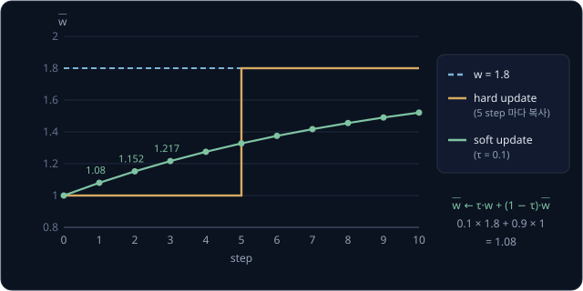

위 그림처럼 hard update 는 복사하는 순간 target 이 한꺼번에 뛰고, soft update 는 매 step 조금씩 부드럽게 따라간다. 뒤에서 다룰 SAC 는
$\tau = 0.005$ 의 soft update 를 쓰는데, 매 step 남은 거리의 0.5% 만 옮기므로 복사본은 최근 수백 step 동안의 weight 를 평균한
것처럼 천천히 움직인다.

**확인 문제.** $w = 1.8$, $\bar w = 1$ 에서 $\tau = 0.5$ 로 soft update 를 두 번 하면 $\bar w$ 는?

답 보기

첫 번째는 $0.5 \times 1.8 + 0.5 \times 1 = 1.4$, 두 번째는 $0.5 \times 1.8 + 0.5 \times 1.4 = 1.6$ 이다. 남은 거리가 0.8, 0.4,
0.2 로 매번 절반이 된다.

### target network 만으로 남는 문제

target network 로 A 만 배우면, 복사본이 고정된 동안 $w$ 는 target $1.8\bar w$ 에 다가간다. 충분히 배운 뒤 복사하기를 되풀이하면 $\bar w$ 는 아래처럼 바뀐다.

| 복사 횟수 | $\bar w$ | 그동안 $w$ 가 다가가는 값 $1.8\bar w$ |
| --- | --- | --- |
| 0 | 1 | 1.8 |
| 1 | 1.8 | 3.24 |
| 2 | 3.24 | 5.832 |
| 3 | 5.832 | 10.498 |

복사할 때마다 target 이 1.8 배가 되어, 발산이 느려졌을 뿐 멈추지 않는다. A 의 target 은 $Q(2)$ 에 기대는데, $Q(2)$ 의 진짜 값 1 을
알려 주는 B 를 한 번도 배우지 않았기 때문이다. target network 는 한 구간 안에서 target 이 달아나는 것을 막을 뿐이고,
학습 데이터가 한쪽으로 쏠린 문제는 따로 풀어야 한다.

**확인 문제.** 위 표에서 복사를 한 번 더 하면 $\bar w$ 와 그 구간의 target 은?

답 보기

$\bar w = 10.498$ 이고 target 은 $1.8 \times 10.498 \approx 18.9$ 다. 진짜 $Q(1) = 0.9$ 와는 점점 멀어진다.

### replay buffer

replay buffer 는 겪은 transition 을 바로 버리지 않고 쌓아 두는 저장소다. replay 는 "다시 틀기" 라는 뜻으로, 저장해 둔 경험을 다시
꺼내 학습한다는 데서 이름이 왔다. transition 은 $(s, a, r, s', d)$ 다섯 값으로 적는데, $d$ 는 done 의 첫 글자로 그 transition 에서
episode 가 진짜로 끝났으면 1, 아니면 0 이다. 복도의 A 는 $d = 0$, B 는 $d = 1$ 이다.

buffer 에는 담을 수 있는 최대 개수가 있고 이를 capacity 라고 한다. 꽉 차면 가장 오래된 transition 자리에 새 transition 을 덮어쓴다.
칸을 한 줄로 두고 쓰는 자리를 한 칸씩 돌려 가며 쓰는 이런 구조를 ring buffer 라고 한다(ring 은 고리라는 뜻으로, 끝 칸 다음이 다시
첫 칸이다).

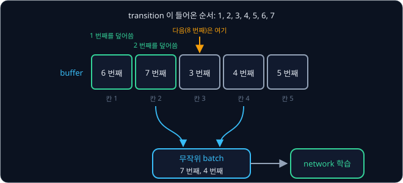

위 그림은 capacity 가 5 인 buffer 에 transition 을 7 개 넣은 모습이다. 1 ~ 5 번째가 칸 1 ~ 5 를 채운 뒤, 6 번째는 가장 오래된 1 번째가
있던 칸 1 에, 7 번째는 칸 2 에 들어갔다. 다음 8 번째는 칸 3 의 3 번째를 덮어쓴다.

학습할 때는 buffer 에서 transition 몇 개를 무작위로 뽑아 한꺼번에 쓴다. 한 번의 update 에 함께 쓰는 transition 묶음을 batch 라 하고,
묶음 안의 개수를 batch size 라고 한다. 무작위로 뽑으면 두 가지가 좋아진다.

- **섞인 batch** — 연달아 들어온 거의 같은 transition 들이 buffer 안에 흩어져 있어서, 한 batch 에 서로 다른 시점, 서로 다른 상황의
  transition 이 섞인다. 복도라면 A 와 B 가 한 batch 에 함께 들어온다
- **여러 번 쓰는 transition** — transition 하나가 buffer 에 머무는 동안 여러 번 뽑힌다

capacity 1000, batch size 4 이고 step 마다 update 를 한 번 한다고 하자. 새 transition 은 1000
step 뒤에 덮어써지므로 buffer 에 1000 step 머물고, 그동안 update 가 1000 번 있다. update 한 번이 1000 개 가운데 4 개를 뽑으니 이
transition 이 뽑힐 확률은 $\frac{4}{1000}$ 이고, 1000 번 동안 뽑히는 횟수의 기댓값은 $1000 \times \frac{4}{1000} = 4$ 번이다.
capacity 가 얼마든 계산이 같아서, step 마다 update 하면 transition 하나를 평균 batch size 만큼 다시 쓴다.

예전 transition 을 다시 써도 되는 것은 transition 이 "이 state 에서 이 action 을 했더니 이런 reward 와 다음 state 가 나왔다" 는
environment 의 기록이라서, 그 action 을 누가 골랐든 사실은 그대로이기 때문이다. Q-learning 의 target 은 다음 state 에서 실제로 고른
action 이 아니라 $\max_{a'}$ 로 가장 좋은 action 의 값을 쓰므로, 그 transition 을 모은 policy 와 상관없이 같은 target 이 나온다.
데이터를 모은 policy 와 배우는 policy 가 달라도 되는 이 성질을 off-policy 라고 하며, [Bandits & MDPs](../bandit-mdp/README.md) 에서
Q-learning 의 성질로 처음 봤다. capacity 에 상한을 두는 것은 메모리 때문이기도 하지만, 아주 오래된 transition 은 학습 초반의 엉성한
policy 가 가던 상황이라 지금 policy 가 거의 가지 않는 곳에 학습을 묶어 두기 때문이기도 하다.

**확인 문제.** capacity 가 5 인 buffer 에 transition 을 9 개 차례로 넣었다. 9 번째는 몇 번 칸에 들어가고, 그때 buffer 에 남은
transition 은 몇 번째들일까?

답 보기

6, 7, 8, 9 번째가 칸 1, 2, 3, 4 를 차례로 덮어쓰므로 9 번째는 칸 4 에 들어간다. 남은 것은 칸 1 ~ 5 의 6, 7, 8, 9, 5 번째다.

### A 와 B 를 섞은 학습

buffer 에 A 와 B 가 모두 있고, batch 에 둘이 함께 뽑힌다고 하자. loss 는 batch 안 transition 들의 오차 제곱을 평균한 값이다.

| transition | 위치 $x$ | $Q = w x$ | target | target 계산 |
| --- | --- | --- | --- | --- |
| A | 1 | $w$ | $y_A = 1.8\bar w$ | $0 + 0.9 \times 2\bar w$ |
| B | 2 | $2w$ | $y_B = 1$ | episode 가 끝나 reward 1 만 |

$$
L(w) = \frac{1}{2}\Big[(w - y_A)^2 + (2w - y_B)^2\Big]
$$

복사본 $\bar w$ 를 고정한 한 구간 동안 충분히 학습하면 $w$ 는 이 loss 가 가장 작은 곳, 곧 gradient 가 0 인 곳에 다다른다. 점 하나의
gradient 공식 $2(wx - y)x$ 를 두 transition 에 차례로 쓰면 그곳을 구할 수 있다.

1. A 항의 gradient 는 $x = 1$ 이라 $2(w - y_A) \times 1 = 2(w - y_A)$ 다
2. B 항의 gradient 는 $x = 2$ 라 $2(2w - y_B) \times 2 = 4(2w - y_B)$ 다
3. 평균이므로 둘을 더해 2 로 나누면 $(w - y_A) + 2(2w - y_B)$ 다
4. 괄호를 풀면 $w - y_A + 4w - 2y_B = 5w - y_A - 2y_B$ 다
5. 이 값이 0 이 되려면 $5w = y_A + 2y_B$, 곧 $w = \dfrac{y_A + 2y_B}{5}$ 다

$\bar w = 1$ 이면 $y_A = 1.8$, $y_B = 1$ 이라 $w = \frac{1.8 + 2}{5} = 0.76$ 이다. 이 값을 복사하고 다시 학습하기를 되풀이한다.

| 복사 횟수 | $\bar w$ | $y_A = 1.8\bar w$ | $y_B$ | 그 구간의 $w = (y_A + 2y_B) \div 5$ |
| --- | --- | --- | --- | --- |
| 0 | 1 | 1.8 | 1 | 0.76 |
| 1 | 0.76 | 1.368 | 1 | 0.6736 |
| 2 | 0.6736 | 1.2125 | 1 | 0.6425 |
| 3 | 0.6425 | 1.1565 | 1 | 0.6313 |
| 4 | 0.6313 | 1.1363 | 1 | 0.6273 |

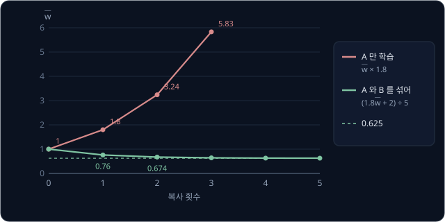

위 그림처럼 A 만 배우면 복사할 때마다 1.8 배씩 커지던 값이, B 를 섞자 0.625 에 다가가며 멈춘다. B 가 "$x = 2$ 에서는 1 이다" 라는
사실을 계속 알려 주니 $Q(2)$ 가 제멋대로 커지지 못하고, $Q(2)$ 에 기대는 A 의 target 도 붙잡힌다.

마지막 값 $w = 0.625$ 에서 $Q(1) = 0.625$, $Q(2) = 1.25$ 로 진짜 값 0.9 와 1 과는 조금 다르다. $Q = w x$ 꼴로 두 값을 정확히 맞추려면
$w$ 가 0.9 이면서 동시에 0.5 여야 해서 불가능하고, 0.625 는 그 사이의 타협이다. weight 가 많은 실제 network 는 훨씬 가깝게 맞춘다.
값이 아주 정확하지는 않아도 발산은 멈췄다.

**확인 문제.** $\bar w = 0.5$ 로 복사해 둔 구간에서 A 와 B 를 섞어 충분히 학습하면 $w$ 는 얼마에 다다를까?

답 보기

$y_A = 1.8 \times 0.5 = 0.9$, $y_B = 1$ 이라 $w = \frac{0.9 + 2 \times 1}{5} = \frac{2.9}{5} = 0.58$ 이다.

### DQN 의 loss

두 장치를 합친 DQN 의 loss 는 아래와 같다.

$$
\mathcal L(\theta) = \mathbb E_{(s,a,r,s',d)\sim\mathcal D}\Big[\big(\underbrace{r + \gamma(1-d)\max_{a'} Q_{\bar\theta}(s',a')}_{\text{target } y} - Q_\theta(s,a)\big)^2\Big]
$$

| 기호 | 읽는 법과 뜻 | 복도 예에서 |
| --- | --- | --- |
| $\mathcal L(\theta)$ | weight $\theta$ 일 때의 loss | $L(w)$ |
| $\mathcal D$ | replay buffer | A 와 B 가 든 buffer |
| $\sim \mathcal D$ | buffer 에서 무작위로 뽑은 | batch 의 A, B |
| $\mathbb E[\cdot]$ | 뽑은 batch 에 대한 평균 | $\frac{1}{2}[\cdots]$ |
| $Q_\theta$ | online network 의 $Q$ | $w x$ |
| $Q_{\bar\theta}$ | target network 의 $Q$ | $\bar w x$ |
| $(1 - d)$ | episode 가 끝났으면 0, 아니면 1 | A 는 1, B 는 0 |

$\mathbb E$ 는 기댓값을 나타내는 기호이고, 여기서는 buffer 에서 뽑은 batch 의
평균으로 그 기댓값을 대신한다. 식 전체는 "buffer 에서 transition 을 무작위로 뽑아, target network 로 계산한 target 과 online
network 의 $Q$ 의 차이를 제곱해 평균한다" 로 읽는다.

$(1 - d)$ 는 episode 가 끝난 transition 에서 미래 항을 지운다. 끝난 뒤에는 받을 reward 가 없기 때문이다. CartPole 의 transition
두 개로 이루어진 batch 를 계산해 본다.

| transition | $r$ | $d$ | $\max_{a'} Q_{\bar\theta}(s', a')$ | target $y$ | $Q_\theta(s, a)$ | 오차의 제곱 |
| --- | --- | --- | --- | --- | --- | --- |
| 1 | 1 | 0 | $\max(4.0, 5.0) = 5.0$ | $1 + 0.9 \times 1 \times 5.0 = 5.5$ | 4.5 | $(5.5 - 4.5)^2 = 1$ |
| 2 | 1 | 1 | — | $1 + 0.9 \times 0 \times (\cdots) = 1$ | 3.0 | $(1 - 3.0)^2 = 4$ |

loss 는 평균 $(1 + 4) \div 2 = 2.5$ 다. 둘째 transition 은 막대가 쓰러져 끝났으므로 target 이 reward 1 뿐이다.

episode 가 끝나는 경우는 막대가 쓰러져 진짜로 끝난 것(terminated)과 500 step 시간 제한에 걸려 중간에 끊긴 것(truncated)으로
나뉜다. 시간 제한으로 끊긴 순간에도 막대는 서 있고 그 뒤의 미래가 남아 있으므로, 이때는 $d = 0$ 으로 두어 미래 항을
지우지 않는다. 500 번째 step 에서 $r = 1$, $\max Q_{\bar\theta} = 5.0$ 이면 target 은 1 이 아니라 5.5 다. 강화학습 환경 모음인
gymnasium 은 두 경우를 `terminated` 와 `truncated` 로 나눠 알려 준다.

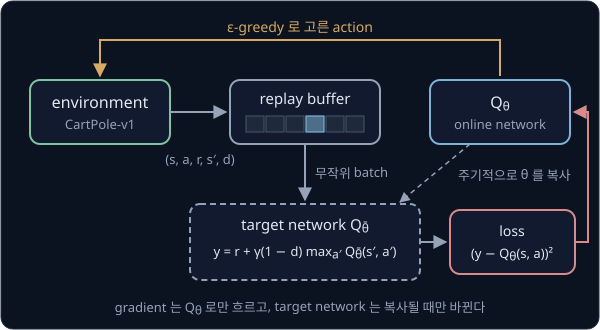

위 그림은 DQN 한 바퀴를 보여 준다. online network 가 고른 action 으로 environment 를 움직여 transition 을 buffer 에 쌓고, buffer 에서
뽑은 batch 로 target 을 target network 가, $Q_\theta(s, a)$ 를 online network 가 계산한다. 둘의 차이로 만든 loss 의 gradient 는 online
network 로만 흐르고, target network 는 복사할 때만 바뀐다.

**확인 문제.** $r = 1$, $\gamma = 0.9$, 다음 state 에서 target network 의 $Q$ 가 (6, 8) 이다. 막대가 서 있는 채로 계속되는 경우,
시간 제한으로 끊긴 경우, 막대가 쓰러진 경우의 target 은 각각 얼마일까?

답 보기

가장 큰 값은 8 이다. 계속되는 경우는 $d = 0$ 이라 $1 + 0.9 \times 8 = 8.2$ 다. 시간 제한으로 끊긴 경우도 미래가 남아 있으니
$d = 0$ 으로 두어 8.2 다. 쓰러진 경우만 $d = 1$ 이라 target 은 1 이다.

### 줄여 가는 ε

DQN 도 [Bandits & MDPs](../bandit-mdp/README.md) 의 ε-greedy 로 탐색한다. ε(epsilon, 엡실론)의 확률로는 action 을 무작위로 고르고,
나머지 $1 - \varepsilon$ 의 확률로는 $Q$ 가 가장 큰 action 을 고르는 방법이다. 학습 초반에는 network 가 엉터리라 $Q$ 를 믿을 수 없으니
거의 무작위로 움직이는 편이 낫고, 뒤로 갈수록 배운 $Q$ 를 믿어도 된다. 그래서 ε 을 처음에는 크게 두고 점점 줄인다.

CleanRL `dqn.py` 의 기본값은 전체 500,000 step 의 앞쪽 절반인 250,000 step 동안 ε 을 1.0 에서 0.05 까지 곧게 줄이고, 그 뒤로는
0.05 로 둔다. step $t$ 가 250,000 이하일 때

$$
\varepsilon(t) = 1.0 - 0.95 \times \frac{t}{250{,}000}
$$

이다. 1.0 에서 0.05 까지 줄어드는 폭이 0.95 이고, 250,000 step 가운데 지난 비율만큼 그 폭을 뺀다고 읽는다.

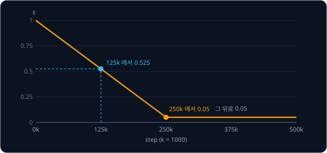

위 그림에서 k 는 1000 을 뜻한다. 125,000 step 이면 지난 비율이 $\frac{125{,}000}{250{,}000} = 0.5$ 라서
$\varepsilon = 1.0 - 0.95 \times 0.5 = 0.525$ 다.

**확인 문제.** 50,000 step 과 300,000 step 에서 ε 은 각각 얼마일까?

답 보기

50,000 step 은 비율이 0.2 라서 $1.0 - 0.95 \times 0.2 = 0.81$ 이다. 300,000 step 은 250,000 을 넘었으므로 0.05 다.

**요약**

- target network 는 target 을 weight 복사본 $\bar\theta$ 로 계산해 한동안 target 을 고정한다. 복사는 정해진 step 마다 통째로(hard
  update) 하거나 $\bar\theta \leftarrow \tau\theta + (1-\tau)\bar\theta$ 로 매 step 조금씩(soft update) 한다
- replay buffer 는 transition 을 capacity 까지 쌓아 두고 무작위 batch 로 뽑아, 서로 다른 시점의 transition 을 섞고 하나를 평균 batch
  size 만큼 다시 쓴다. 복도 예에서는 A 만 배우면 1.8 배씩 커지던 값이 B 를 섞자 0.625 에서 멈췄다
- DQN 의 loss 는 $\big(r + \gamma(1-d)\max_{a'} Q_{\bar\theta}(s', a') - Q_\theta(s, a)\big)^2$ 의 batch 평균이고, 시간 제한으로 끊긴
  transition 은 $d = 0$ 으로 둔다

## on-policy 와 off-policy

### 데이터를 모으는 policy 와 배우는 policy

policy 는 state 마다 action 을 정하는 규칙이다. [Bandits & MDPs](../bandit-mdp/README.md) 에서 Q-learning 은 ε-greedy 로 움직여
데이터를 모으면서도 target 에는 $\max$ 를 써서 greedy policy 의 값을 배웠다. 데이터를 모을 때 실제로 움직인 policy 를 behavior
policy 라고 하고, behavior policy 와 배우는 policy 가 다른 방법을 off-policy, 같은 방법을 on-policy 라고 한다.

replay buffer 에는 학습 초반의 거의 무작위인 policy, 중간의 ε-greedy policy, 지금의 policy 가 모은 transition 이 섞여 있다. 그런데도
DQN 이 이 transition 들로 학습할 수 있는 것은 target 이 behavior policy 와 상관없기 때문이다. 격자에서 칸 7 에서 위로 가 칸 4 에
도착한 transition $(7, \text{위}, 0, 4)$ 를 보자. 학습 첫날 무작위 policy 가 이 transition 을 만들었든, 사람이 조종기로 움직여 만들었든,
target 은 똑같이 $0 + 0.9 \times \max_{a'} Q(4, a')$ 이다. 누가 골랐는지는 이 식 어디에도 들어가지 않는다.

**확인 문제.** 사람이 로봇 청소기를 조종기로 움직여 모은 transition 을 DQN 의 replay buffer 에 넣어도 될까? 이유는?

답 보기

넣어도 된다. transition 은 environment 가 실제로 어떻게 반응했는지의 기록이고, DQN 의 target 은 다음 state 에서 가장 좋은 action 의
값을 쓰므로 그 action 을 사람이 골랐는지 agent 가 골랐는지와 상관없이 같다.

### 지금 policy 의 데이터만 쓰는 학습

on-policy 방법은 "지금 policy 가 얼마나 좋은가" 를 지금 policy 로 직접 움직여 얻은 return(앞으로 받을 reward 를 늦을수록 깎아 더한
값)으로 잰다. [Policy Gradient](../policy-gradient/README.md) 와 [PPO](../ppo/README.md) 가 이 방식이다. 이때 예전 policy 로 모은
데이터는 예전 policy 의 성적표라서 지금 policy 를 재는 데 쓸 수 없다.

격자에서 칸 7 을 출발하는 예로 본다. 예전 policy 는 $7 \to 4 \to 7 \to 4 \to 1 \to 2 \to 3$ 으로 돌아가서 return 이
$0.9^5 \approx 0.590$ 이었다. 지금 policy 는 $7 \to 4 \to 1 \to 2 \to 3$ 으로 곧장 가서 return 이 $0.9^3 = 0.729$ 다. 예전 episode 의
0.590 으로 지금 policy 를 평가하면 실제보다 나쁘게 잰다. 그래서 on-policy 방법은 policy 를 고칠 때마다 새 policy 로 데이터를 다시 모으고
예전 데이터는 버린다.

**확인 문제.** 예전 policy 로 모은 episode 세 개의 return 이 0.590, 0.590, 0.729 였다. 이 평균으로 지금 policy(항상 0.729)를 평가하면
얼마나 틀릴까?

답 보기

평균은 $(0.590 + 0.590 + 0.729) \div 3 \approx 0.636$ 이라 지금 policy 의 0.729 보다 약 0.093 작게 잰다.

### 두 방법의 비교

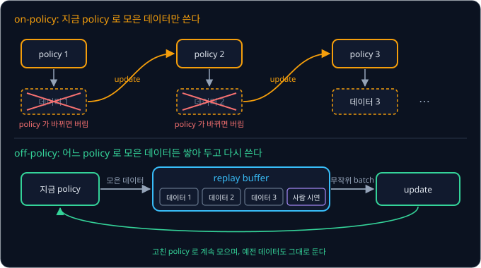

위 그림의 위쪽 on-policy 는 policy 가 바뀔 때마다 데이터를 버리고 새로 모은다. 아래쪽 off-policy 는 모은 데이터를 replay buffer 에
계속 쌓아 두고, 사람이 직접 조종해 보여 준 시연(demonstration)까지 같은 buffer 에 넣어 함께 쓸 수 있다.

| 항목 | on-policy | off-policy |
| --- | --- | --- |
| 학습에 쓰는 데이터 | 지금 policy 로 모은 것만 | 어느 policy 로 모은 것이든 |
| policy 를 고친 뒤 예전 데이터 | 버린다 | buffer 에 남겨 다시 쓴다 |
| 사람 시연 데이터 | 그대로 섞기 어렵다 | buffer 에 넣어 함께 쓴다 |
| 학습의 안정성 | 비교적 안정적이다 | target 이 움직이는 문제 등을 장치로 막아야 한다 |
| 대표 방법 | Policy Gradient, PPO | Q-learning, DQN, SAC |

같은 성능에 이르는 데 environment 의 step 이 얼마나 적게 드는지를 sample efficiency 라고 한다. sample 은 직접 겪어 얻은 경험 하나를
뜻한다. off-policy 는 transition 하나를 여러 번 쓰므로 sample efficiency 가 높다.

이 차이는 실물 로봇에서 크게 드러난다. 실물 로봇에서 한 step 이 0.1 초라면 1,000,000 step 은 $1{,}000{,}000 \times 0.1 = 100{,}000$ 초,
곧 약 27.8 시간이다. 그동안 모터가 닳고, 물건이 떨어지면 사람이 다시 놓아 줘야 한다. simulator 는 한 컴퓨터에서 환경 수천 개를
실제 시간보다 빨리 돌릴 수 있어서 step 이 싸고, 그래서 on-policy 인 PPO 가 simulator 에서 널리 쓰인다. 실물에서는 step 하나가 비싸서
데이터를 버리지 않는 off-policy 가 유리하다. 시연 데이터를 buffer 에 섞어 실물 로봇에서 바로 학습하는 RLPD(2023), SERL(2024),
HIL-SERL(2024) 이 모두 이 강의 뒤쪽의 SAC 를 바탕으로 한다.

**확인 문제.** 실물 로봇이 1 초에 20 step(한 step 0.05 초)을 한다. 100,000 step 은 몇 분일까?

답 보기

$100{,}000 \times 0.05 = 5{,}000$ 초이고, $5{,}000 \div 60 \approx 83$ 분이다.

**요약**

- 데이터를 모으는 behavior policy 와 배우는 policy 가 다르면 off-policy, 같으면 on-policy 다. DQN 의 target 은 behavior policy 와
  상관없어서 예전 데이터와 사람 시연을 그대로 쓸 수 있다
- on-policy 는 지금 policy 의 return 으로 학습하므로 policy 를 고칠 때마다 데이터를 새로 모은다
- off-policy 는 transition 하나를 여러 번 써서 sample efficiency 가 높고, step 이 비싼 실물 로봇에서 특히 유리하다

## 연속 action 과 actor-critic

### 연속 action

CartPole 의 action 은 왼쪽과 오른쪽 둘뿐이라 $\max_{a'}$ 를 두 값 비교로 구했지만, 로봇 관절에 주는 명령은 대개 연속된 숫자다.
`Pendulum-v1` 환경은 아래로 늘어진 진자를 돌려 세운 뒤 위에서 버티게 하는 문제로, action 이 −2 부터 2 사이의 토크(축을 돌리는 힘)
하나다. step 마다 reward 는 진자가 똑바로 선 자세에서 벗어난 각도의 제곱, 각속도 제곱의 0.1 배, 토크 제곱의 0.001 배를 더해 음수로
만든 값이다. 그래서 진자를 위에 세우고 힘을 거의 안 쓰면 0 에 가깝고, 가장 나쁠 때는 −16.27 이며, episode 는 200 step 이다.

action 이 연속된 숫자면 target 의 $\max_{a'} Q(s', a')$ 를 구하기 어렵다. 어떤 state 에서 critic 이 $Q(s, a) = 1 - (a - 0.5)^2$
꼴을 배웠다고 하자. action 몇 개를 골라 넣어 보면 아래와 같다.

| action $a$ | $a - 0.5$ | 제곱 | $Q = 1 - $ 제곱 |
| --- | --- | --- | --- |
| −2 | −2.5 | 6.25 | −5.25 |
| −1 | −1.5 | 2.25 | −1.25 |
| 0 | −0.5 | 0.25 | 0.75 |
| 1 | 0.5 | 0.25 | 0.75 |
| 2 | 1.5 | 2.25 | −1.25 |

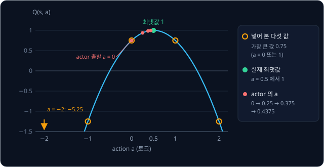

넣어 본 다섯 값 가운데 가장 큰 것은 0.75 지만, 위 그림처럼 실제로 가장 큰 값은 그 사이의 $a = 0.5$ 에서 1 이다. 더 잘게 넣어 보면
되지만, target 하나를 계산할 때마다 network 를 그만큼 여러 번 돌려야 한다. 관절이 6 개인 팔이라면 관절마다 값 5 개만 넣어 봐도
조합이 $5^6 = 15{,}625$ 개다.

**확인 문제.** $Q(s, a) = 2 - (a - 1.5)^2$ 일 때 $a = -2, -1, 0, 1, 2$ 가운데 가장 큰 $Q$ 와 실제 최댓값은?

답 보기

$a = 1$ 과 $a = 2$ 에서 $2 - 0.25 = 1.75$ 로 가장 크다. 실제 최댓값은 $a = 1.5$ 에서 2 다.

### actor 와 critic

$\max$ 를 매번 찾는 대신, $Q$ 를 크게 만드는 action 을 바로 내는 network 를 따로 학습한다. state 를 받아 action 을 내는 network 를
actor, state 와 action 을 함께 받아 그 action 의 $Q$ 값 하나를 내는 network 를 critic 이라고 한다. actor 는 "배우", critic 은
"평론가" 라는 뜻으로, 배우가 연기하면 평론가가 점수를 매긴다는 데서 온 이름이다. 둘을 함께 학습하는 구조를 actor-critic 이라고 부른다.
DQN 의 network 가 action 마다 출력 칸을 하나씩 두었던 것과 달리, critic 은 action 을 입력으로 받는다.

actor 는 critic 이 매기는 점수가 커지는 쪽으로 action 을 옮긴다. 이때 쓰는 것이 action 을 조금 늘렸을 때 $Q$ 가 변하는 비율이다.
$w^2$ 의 derivative(변하는 비율)가 $2w$ 인 것과 같은 계산으로,
$Q = 1 - (a - 0.5)^2$ 의 비율은 $-2(a - 0.5)$ 다. $a = 0$ 에서는 $-2 \times (-0.5) = 1$ 이라, $a$ 를 0.01 늘리면 $Q$ 가 약 0.01 늘어난다.
실제로 $Q(0.01) = 1 - 0.49^2 = 0.7599$ 로 0.75 보다 0.0099 크다.

loss 를 줄일 때는 gradient 의 반대쪽으로 갔지만, 이번에는 $Q$ 를 키워야 하므로 비율과 같은 쪽으로 간다.

$$
a \leftarrow a + \eta \times \frac{\partial Q}{\partial a}
$$

$\frac{\partial Q}{\partial a}$ 는 "$a$ 를 조금 늘렸을 때 $Q$ 가 변하는 비율" 이고, 식은 "$a$ 에 learning rate 와 그 비율을 곱한 만큼을 더한다" 로 읽는다. $\eta = 0.25$ 로 $a = 0$ 에서 출발한다.

| update | $a$ | $Q(s, a)$ | 비율 $-2(a - 0.5)$ | 새 $a$ |
| --- | --- | --- | --- | --- |
| 0 | 0 | 0.75 | 1 | $0 + 0.25 \times 1 = 0.25$ |
| 1 | 0.25 | 0.9375 | 0.5 | $0.25 + 0.25 \times 0.5 = 0.375$ |
| 2 | 0.375 | 0.9844 | 0.25 | $0.375 + 0.25 \times 0.25 = 0.4375$ |

앞 그림의 빨간 점이 이 표다. 꼭대기에 가까워질수록 비율이 작아져 걸음도 작아지고, $a$ 는 0.5 에 다가간다. 실제 actor 에서는 $a$ 가
actor 의 weight 로 계산되므로, 이 비율을 chain rule(변화가 여러 단계를 거쳐 전해질 때 단계마다의 비율을 곱하는 규칙)로 actor 의 weight 까지 전해
weight 를 고친다. 이 강의에서는 actor 의 weight 를 $\phi$(phi, 피)로 쓰고 actor 를 $\pi_\phi$ 로 쓴다. $\pi$(pi, 파이)는 policy 를
나타내는 기호다.

critic 은 DQN 과 같이 target 쪽으로 regression 한다. target 의 $\max_{a'} Q(s', a')$ 자리에는 actor 가 다음 state $s'$ 에서 고른 action
의 $Q$ 를 쓴다. actor 가 $Q$ 를 가장 크게 만드는 action 을 내도록 배우고 있으니, 그 action 의 $Q$ 가 $\max$ 를 대신한다. 이렇게 action 하나를
정해서 내는 actor 로 연속 action 을 푼 방법이 2015년 Lillicrap 등의 DDPG 이고, 탐색을 위해 actor 의 action 에 무작위 잡음(noise)을
더해 움직였다.

**확인 문제.** 같은 $Q = 1 - (a - 0.5)^2$ 에서 actor 가 $a = 1$ 을 냈다. 비율과 $\eta = 0.25$ 로 옮긴 새 $a$ 는?

답 보기

비율은 $-2 \times (1 - 0.5) = -1$ 이라 새 $a$ 는 $1 + 0.25 \times (-1) = 0.75$ 다. 꼭대기 0.5 보다 오른쪽에 있으니 왼쪽으로 옮겨 간다.

### Q 를 크게 잡는 쏠림

critic 의 $Q$ 는 추정값이라 잡음이 섞인다. 그런데 $\max$ 나 actor 는 늘 가장 큰 추정값을 찾아가므로, 마침 잡음이 위로 튄 값을 고르는
경향이 있다.

진짜 $Q$ 가 둘 다 1 인 action 두 개를 생각한다. 추정값마다 같은 확률로 0.3 높거나 0.3 낮게 나온다면 아래 네 경우가 똑같이 잘 나온다.

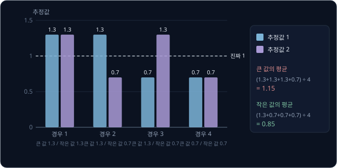

| 경우 | 추정값 1 | 추정값 2 | 큰 값 | 작은 값 |
| --- | --- | --- | --- | --- |
| 1 | 1.3 | 1.3 | 1.3 | 1.3 |
| 2 | 1.3 | 0.7 | 1.3 | 0.7 |
| 3 | 0.7 | 1.3 | 1.3 | 0.7 |
| 4 | 0.7 | 0.7 | 0.7 | 0.7 |
| 평균 | 1 | 1 | 1.15 | 0.85 |

추정값 하나하나의 평균은 진짜와 같은 1 인데, 둘 가운데 큰 값을 고르면 평균 $(1.3 + 1.3 + 1.3 + 0.7) \div 4 = 1.15$ 로 진짜보다 크다.
이렇게 실제보다 크게 잡는 것을 overestimation(과대평가)이라고 한다. 그 값이 target 에 들어가면 앞 state 의 $Q$ 도 커지고, 그 $Q$ 가
다시 더 앞 state 의 target 이 되면서 쏠림이 쌓인다.

2018년 Fujimoto 등의 TD3 는 critic 을 두 개 따로 학습하고 target 에는 두 critic 의 값 가운데 작은 쪽을 썼다. 두 critic 은 처음 weight 가
달라 잡음이 서로 다르게 섞인다. 위 표를 "critic 두 개가 같은 action 에 낸 추정값" 으로 읽으면, 작은 값의 평균은
$(1.3 + 0.7 + 0.7 + 0.7) \div 4 = 0.85$ 로 진짜보다 조금 작다. 작게 잡은 값은 actor 가 일부러 찾아가지 않으니 쌓이지 않고, 크게 잡은 값보다
덜 위험하다. 이 방법을 clipped double Q 라고 하며 SAC 도 그대로 쓴다.

**확인 문제.** 잡음이 ±0.3 대신 ±0.2 라면(추정값이 1.2 또는 0.8), 두 값 가운데 큰 값과 작은 값의 평균은 각각 얼마일까?

답 보기

네 경우의 큰 값은 1.2, 1.2, 1.2, 0.8 이라 평균 $4.4 \div 4 = 1.1$, 작은 값은 1.2, 0.8, 0.8, 0.8 이라 평균 $3.6 \div 4 = 0.9$ 다.
잡음이 작을수록 쏠림도 작다.

**요약**

- action 이 연속된 숫자면 $\max_{a'}$ 를 몇 개 넣어 보는 것으로 구하기 어렵다. $Q(s, a) = 1 - (a - 0.5)^2$ 에서 다섯 값만 넣으면 0.75 를
  찾지만 실제 최댓값은 1 이다
- actor 는 action 을 내고 critic 은 그 action 의 $Q$ 를 매긴다. actor 는 $\partial Q / \partial a$ 를 따라 $Q$ 가 커지는 쪽으로 움직인다
- 가장 큰 추정값을 고르면 잡음 때문에 실제보다 커지므로, critic 을 두 개 두고 작은 값을 target 에 쓴다(clipped double Q)

## entropy 와 SAC

### 로그

SAC 는 "행동을 얼마나 골고루 섞는가" 를 숫자로 재서 reward 에 더한다. 그 숫자를 계산하려면 로그가 필요하다.
$\ln t$(natural log, 자연로그)는 "$e \approx 2.718$ 을 몇 번 곱해야 $t$ 가 되는지"
를 나타낸다. $\ln 1 = 0$ 은 한 번도 곱하지 않은 상태가 1 이라는 뜻이다.

확률처럼 0 과 1 사이의 수에서는 로그가 음수가 된다. $e$ 를 "음수 번 곱한다" 는 것은 그만큼 $e$ 로 나눈다는 뜻이라, $e$ 로 한 번 나눈
$1 \div 2.718 \approx 0.368$ 의 로그는 −1 이다. 확률이 작을수록 더 여러 번 나눠야 하니 로그는 더 큰 음수가 된다.

| 확률 $p$ | 1 | 0.9 | 0.5 | 0.25 | 0.1 |
| --- | --- | --- | --- | --- | --- |
| $\ln p$ | 0 | −0.105 | −0.693 | −1.386 | −2.303 |
| $-\ln p$ | 0 | 0.105 | 0.693 | 1.386 | 2.303 |

로그에는 곱셈을 덧셈으로 바꾸는 성질이 있다. $0.25 = 0.5 \times 0.5$ 이므로 $\ln 0.25 = \ln 0.5 + \ln 0.5 = -0.693 \times 2 = -1.386$
이다. 마지막 줄의 $-\ln p$ 는 "그 결과가 나왔을 때 얼마나 놀라운가" 로 읽을 수 있다. 반드시 나오는 결과($p = 1$)는 놀랍지 않아 0 이고,
드문 결과($p = 0.1$)는 2.303 으로 크다. SAC 논문과 이 강의에서 $\log$ 는 모두 자연로그 $\ln$ 을 뜻한다.

**확인 문제.** $\ln 0.5 = -0.693$ 을 써서 $\ln 0.125$ 를 구하자.

답 보기

$0.125 = 0.5 \times 0.5 \times 0.5$ 라서 $\ln 0.125 = -0.693 \times 3 = -2.079$ 다.

### entropy

action 을 확률로 고르는 policy 에서 $\pi(a \mid s)$ 는 "state $s$ 에서 action $a$ 를 고를 확률" 이다. 이 policy 가 action 을 얼마나
골고루 섞는지를 entropy 로 잰다.

$$
\mathcal H\big(\pi(\cdot \mid s)\big) = -\sum_a \pi(a \mid s) \log \pi(a \mid s)
$$

$\mathcal H$ 는 entropy 를 나타내는 기호이고, $\pi(\cdot \mid s)$ 의 점은 "모든 action 에 대한 확률 묶음" 을 뜻한다. 식은 "action 마다
그 확률과 놀라움 $-\log \pi$ 를 곱해 모두 더한다" 로 읽는다. 확률을 곱해 더했으니 놀라움의 기댓값이다.

action 두 개(왼쪽, 오른쪽)로 세 policy 를 계산한다.

| policy | 왼쪽: $p \times (-\ln p)$ | 오른쪽: $p \times (-\ln p)$ | entropy |
| --- | --- | --- | --- |
| 0.5, 0.5 | $0.5 \times 0.693 = 0.347$ | $0.5 \times 0.693 = 0.347$ | 0.693 |
| 0.9, 0.1 | $0.9 \times 0.105 = 0.095$ | $0.1 \times 2.303 = 0.230$ | 0.325 |
| 1, 0 | $1 \times 0 = 0$ | 0 | 0 |

확률이 0 인 action 은 일어나지 않으니 더할 것이 없어 0 으로 둔다.

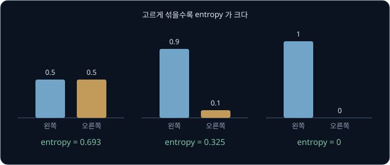

위 그림처럼 반반 섞으면 entropy 가 가장 크고, 한쪽으로 쏠릴수록 작아져 한 action 만 고르면 0 이다. action 이 네 개이고 모두 0.25 면
$4 \times 0.25 \times 1.386 = 1.386$ 으로, 고를 것이 많을수록 고르게 섞은 entropy 도 커진다. entropy 는 원래 열역학에서 무질서한
정도를 나타내던 말이고, 1948년 Claude Shannon 이 정보이론에서 같은 이름을 붙여 쓰면서 확률의 퍼진 정도를 재는 값이 됐다.

**확인 문제.** 확률이 0.8, 0.2 인 policy 의 entropy 는? ($\ln 0.8 = -0.223$, $\ln 0.2 = -1.609$)

답 보기

$0.8 \times 0.223 + 0.2 \times 1.609 = 0.178 + 0.322 = 0.500$ 이다. 0.9, 0.1 의 0.325 보다 크고 반반의 0.693 보다 작다.

### entropy 를 더한 목표

SAC(Soft Actor-Critic)는 2018년 Tuomas Haarnoja, Aurick Zhou, Pieter Abbeel, Sergey Levine 이 발표한 방법으로, reward 의 합에 policy
의 entropy 를 더한 값을 키우도록 목표를 바꾼다.

$$
J(\pi) = \sum_t \mathbb E\Big[\, r_t + \alpha\, \mathcal H\big(\pi(\cdot \mid s_t)\big) \,\Big]
$$

$J(\pi)$ 는 policy $\pi$ 의 점수이고, $r_t$ 와 $s_t$ 는 step $t$ 의 reward 와 state 다. 이 식은 "step $t$ 마다 받는 reward 에 그 state 에서의 entropy 를 $\alpha$ 배 해 더한 값의 기댓값을
모두 더한다" 로 읽는다. 이런 목표를 maximum entropy objective 라 하고, reward 에 덧붙는 $\alpha$ × entropy 를 entropy bonus 라고 부른다. 여기서 $\alpha$ 는 entropy 를 얼마나 쳐줄지 정하는 숫자로
temperature(온도)라고 부른다. 물리학에서 온도가 높을수록 입자가 무작위로 움직이는 것처럼, $\alpha$ 가 클수록 policy 가 무작위에
가까워진다.

**흔한 오해.** Q-learning 에서 $\alpha$ 는 learning rate 였지만, SAC 에서 $\alpha$ 는 temperature 다. 같은 글자가 강의마다 다른 뜻으로
쓰인다. 이 강의에서 learning rate 는 모두 $\eta$ 로 쓴다.

action 두 개의 $Q$ 가 $Q(s, \text{왼쪽}) = 1.0$, $Q(s, \text{오른쪽}) = 0.9$ 로 비슷한 state 에서, 왼쪽을 고를 확률 $p$ 마다 "Q 의
기댓값 + $\alpha$ × entropy" 를 $\alpha = 0.1$ 로 계산한다. Q 의 기댓값은 $p \times 1.0 + (1 - p) \times 0.9$ 다.

| $p$ | Q 의 기댓값 | entropy | $0.1 \times$ entropy | 합 |
| --- | --- | --- | --- | --- |
| 1 | 1.0 | 0 | 0 | 1.0 |
| 0.9 | 0.99 | 0.325 | 0.0325 | 1.0225 |
| 0.731 | 0.9731 | 0.582 | 0.0582 | 1.0313 |
| 0.5 | 0.95 | 0.693 | 0.0693 | 1.0193 |

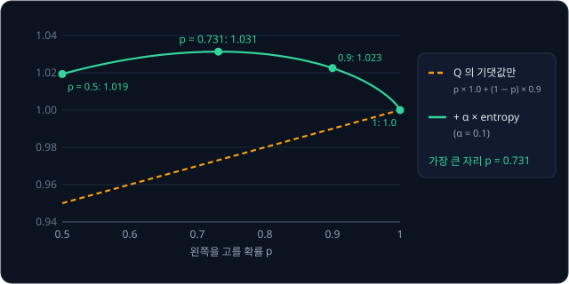

$Q$ 만 보면 왼쪽만 고르는 $p = 1$ 이 가장 좋다. entropy 를 더하면 $p = 0.731$ 에서 1.0313 으로 가장 커서, 왼쪽을 주로 고르되 거의 같은
오른쪽도 네 번에 한 번꼴로 섞는 policy 가 가장 좋은 policy 가 된다.

숫자를 바꿔 $Q$ 의 차이를 키우면 결과가 달라진다. $Q(s, \text{왼쪽}) = 1.0$, $Q(s, \text{오른쪽}) = 0.0$ 이면 $p = 1$ 이 1.0,
$p = 0.9$ 가 $0.9 + 0.0325 = 0.9325$ 로 $p = 1$ 쪽이 낫다. 오른쪽이 확실히 나쁘면 entropy bonus 로는 그 손해를 메울 수 없어서
policy 가 거의 한 action 에 몰린다. 반대로 $Q$ 가 1.0 과 0.9 이고 $\alpha = 1$ 로 크게 하면 가장 좋은 $p$ 는 0.525 로 거의 반반이 된다.
$\alpha$ 는 entropy 1 이 reward 몇 점만큼의 값어치를 갖는지 정한다.

entropy 를 쳐주면 탐색을 ε 같은 별도 규칙이 아니라 policy 가 스스로 맡는다. ε-greedy 의 무작위 선택은 거의 좋은 action 과 아주 나쁜
action 을 똑같은 확률로 고르지만, entropy 를 더한 policy 는 $Q$ 가 비슷한 action 은 자주, 확실히 나쁜 action 은 드물게 고른다.
좋은 길이 두 개면 둘 다 쓸 줄 알게 되어, 한쪽이 막혀도 다른 쪽으로 갈 수 있다.

**확인 문제.** 같은 state($Q$ 가 1.0 과 0.9, $\alpha = 0.1$)에서 $p = 0.8$ 의 "Q 의 기댓값 + $\alpha$ × entropy" 는? (0.8, 0.2 의
entropy 는 0.500)

답 보기

Q 의 기댓값은 $0.8 \times 1.0 + 0.2 \times 0.9 = 0.98$, bonus 는 $0.1 \times 0.500 = 0.05$ 라서 합은 1.03 이다. $p = 1$ 의 1.0
보다 크고, $p = 0.731$ 의 1.0313 보다 조금 작다.

### SAC 의 target

목표에 entropy 가 들어갔으니 critic 이 배우는 $Q$ 에도 앞으로 받을 entropy bonus 가 들어가야 한다. SAC 의 critic target 은 아래와 같다.

$$
y = r + \gamma(1-d)\Big(\min_{i=1,2} Q_{\bar\theta_i}(s',a') - \alpha\log\pi_\phi(a'\mid s')\Big),\qquad a'\sim\pi_\phi(\cdot\mid s')
$$

- $a' \sim \pi_\phi(\cdot \mid s')$ 는 "다음 state $s'$ 에서 지금 actor 로 action $a'$ 을 하나 뽑는다" 는 뜻이다. DQN 의 $\max_{a'}$ 자리에
  actor 가 뽑은 action 을 쓴다
- $\min_{i=1,2} Q_{\bar\theta_i}(s', a')$ 는 target network 두 개($\bar\theta_1$, $\bar\theta_2$)가 낸 값 가운데 작은 쪽이다. 앞 절의
  clipped double Q 다
- $-\alpha \log \pi_\phi(a' \mid s')$ 는 뽑은 action 의 놀라움에 $\alpha$ 를 곱한 entropy bonus 다. entropy 는 놀라움의 기댓값이라,
  action 을 여러 번 뽑아 이 값을 평균하면 $\alpha$ × entropy 가 된다

$r = 0$, $\gamma = 0.9$, $d = 0$, $\alpha = 0.1$ 이고, actor 가 뽑은 $a'$ 의 확률이 0.5, 두 target critic 의 값이 1.0 과 0.9 라고 하자.

| 단계 | 계산 | 값 |
| --- | --- | --- |
| 작은 critic 값 | $\min(1.0, 0.9)$ | 0.9 |
| entropy bonus | $-0.1 \times \ln 0.5 = -0.1 \times (-0.693)$ | 0.069 |
| 다음 state 의 값 | $0.9 + 0.069$ | 0.969 |
| target | $0 + 0.9 \times 1 \times 0.969$ | 0.872 |

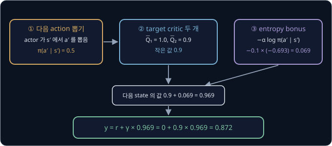

위 그림처럼 DQN 의 target 과 비교하면 $\max$ 대신 actor 가 뽑은 action 을 쓰고, critic 두 개 가운데 작은 값을 쓰고, entropy
bonus 를 더한다. SAC 이름의 soft 는 $\max$ 처럼 action 하나만 고르지 않고 entropy 를 더해 여러 action 을 부드럽게 섞는다는 뜻이다. 두 critic $Q_{\theta_1}$, $Q_{\theta_2}$ 는 이 같은
target $y$ 쪽으로 각자 regression 한다.

**확인 문제.** 위 예에서 actor 가 뽑은 $a'$ 의 확률만 0.25 로 바꾸면 target 은? ($\ln 0.25 = -1.386$)

답 보기

bonus 는 $-0.1 \times (-1.386) = 0.1386$, 다음 state 의 값은 $0.9 + 0.1386 = 1.0386$, target 은 $0.9 \times 1.0386 \approx 0.935$ 다.
드문 action 을 뽑을수록 bonus 가 크다.

### Gaussian policy

action 이 토크처럼 연속된 숫자면 "action 마다의 확률" 을 표로 적을 수 없다. 그래서 SAC 의 actor 는 종 모양의 확률분포인 Gaussian
(normal distribution, 정규분포라고도 한다)으로 action 을 고른다. 확률분포는 어떤 값이 얼마나 잘 나오는지를 모든 값에 대해 정해 둔 것이다. Gaussian 은 숫자 두 개로 모양이 정해진다.

- **$\mu$(mu, 뮤)** — 평균. 종의 가운데 위치다
- **$\sigma$(소문자 sigma, 시그마)** — standard deviation(표준편차). 종이 얼마나 넓게 퍼지는지를 나타낸다. 합을 뜻하는 대문자 $\Sigma$ 와 같은 글자의
  소문자다

평균 0, standard deviation 1 인 Gaussian 을 standard normal distribution(표준 정규분포)이라 하고 $\mathcal N(0, 1)$ 로 쓴다. 여기서 뽑은 값은 약 68% 가 −1 과 1 사이, 약 95% 가
−2 와 2 사이에 들어온다. 이 분포에서 뽑은 값 $\varepsilon$ 을 써서

$$
u = \mu + \sigma \times \varepsilon
$$

로 만들면, $u$ 는 평균 $\mu$, standard deviation $\sigma$ 인 Gaussian $\mathcal N(\mu, \sigma^2)$ 에서 뽑은 값이 된다. 식은 "가운데 $\mu$ 에서
standard deviation 의 $\varepsilon$ 배만큼 떨어진 곳" 으로 읽는다. actor 가 $\mu = 0.2$, $\sigma = 0.5$ 를 냈다면 아래와 같다.

| 뽑은 $\varepsilon$ | 계산 | $u$ |
| --- | --- | --- |
| 0.6 | $0.2 + 0.5 \times 0.6$ | 0.5 |
| −1 | $0.2 + 0.5 \times (-1)$ | −0.3 |
| 2 | $0.2 + 0.5 \times 2$ | 1.2 |

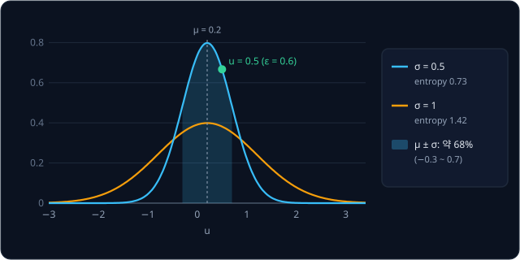

위 그림처럼 $\sigma$ 가 클수록 종이 넓게 퍼지고 뽑히는 값도 넓게 흩어지므로 entropy 도 크다. Gaussian 의 entropy 는
$\ln \sigma + 1.42$ 로 계산되고, 값은 아래와 같다.

| $\sigma$ | 0.25 | 0.5 | 1 | 2 |
| --- | --- | --- | --- | --- |
| entropy | 0.03 | 0.73 | 1.42 | 2.11 |

$\sigma$ 가 두 배가 될 때마다 entropy 가 $\ln 2 = 0.693$ 씩 는다. $\sigma = 0.1$ 이면 $\ln 0.1 + 1.42 = -0.88$ 로 entropy 가 음수가 되는데,
연속된 숫자의 분포에서는 $\pi(a \mid s)$ 가 확률이 아니라 확률이 얼마나 빽빽하게 몰렸는지를 나타내는 밀도(density)라서 1 보다 클 수
있기 때문이다. 밀도가 1 보다 크면 $\log \pi$ 가 양수가 되어 entropy 가 음수로 내려간다. 연속 action 에서는 entropy 의 부호보다
"더 넓게 퍼질수록 크다" 는 비교만 뜻이 있다.

$\varepsilon$ 을 따로 뽑아 $u = \mu + \sigma\varepsilon$ 으로 만들면 $u$ 가 $\mu$ 와 $\sigma$ 를 따라 매끄럽게 움직인다. $\varepsilon = 0.6$ 을 그대로 두고 actor 가 $\mu$ 를 0.2 에서
0.3 으로 바꾸면 $u$ 는 0.5 에서 0.6 으로 정확히 0.1 움직인다. 무작위성이 $\varepsilon$ 에만 있으니 $u$ 는 $\mu$ 와 $\sigma$ 의
식이 되고, critic 이 알려 주는 비율 $\partial Q / \partial a$ 를 앞 장의 actor 처럼 $\mu$ 와 $\sigma$ 까지 전할 수 있다. 이 방법을
reparameterization trick 이라고 한다.

**확인 문제.** actor 가 $\mu = -0.4$, $\sigma = 0.5$ 를 냈고 $\varepsilon = 1.2$ 를 뽑았다. $u$ 는? $\sigma$ 를 1 로 바꾸면 entropy 는
얼마나 커질까?

답 보기

$u = -0.4 + 0.5 \times 1.2 = 0.2$ 다. $\sigma$ 가 0.5 에서 1 로 두 배가 되면 entropy 는 $\ln 2 = 0.693$ 만큼 커진다(0.73 → 1.42).

### tanh 로 묶은 action

Gaussian 에서 뽑은 $u$ 는 드물지만 얼마든지 크게 나올 수 있는데, Pendulum 의 토크는 −2 부터 2 까지라서 범위를 묶어야 한다. 이때 쓰는
$\tanh$(hyperbolic tangent)는 어떤 수를 넣어도 −1 과 1 사이의 값을 내는 함수다.

| $u$ | −1 | 0 | 0.5 | 1 | 2 | 3 |
| --- | --- | --- | --- | --- | --- | --- |
| $\tanh u$ | −0.762 | 0 | 0.462 | 0.762 | 0.964 | 0.995 |

0 근처에서는 거의 $u$ 그대로이고, $u$ 가 커질수록 1 에 바짝 붙는다. 이렇게 묶은 값에 2 를 곱하면 Pendulum 의 범위 −2 ~ 2 가 된다.

위 그림은 앞 절의 숫자 그대로 action 하나를 뽑는 과정이다. $u = 0.2 + 0.5 \times 0.6 = 0.5$ 를 $\tanh$ 로 묶어 0.462 를 얻고, 2 를
곱한 0.924 를 토크로 낸다. 이런 actor 를 tanh-squashed Gaussian actor 라고 한다. squash 는 "눌러 찌그러뜨린다" 는 뜻이다.

$\tanh$ 는 구간의 폭도 바꾼다. $u = 0$ 근처에서는 폭 0.1 인 구간이 거의 그대로 폭 0.1 로 옮겨지지만, $u = 2$ 근처에서는 $\tanh$ 의
기울기가 $1 - \tanh^2 2 = 1 - 0.964^2 \approx 0.071$ 이라 폭 0.1 인 구간이 폭 0.007 정도로 좁아진다. 같은 확률이 좁은 구간에 몰리니
밀도는 그만큼 커진다. 그래서 묶은 action 의 $\log \pi$ 는 Gaussian 의 log 밀도에서 기울기의 log 를 빼서 보정한다.

$$
\log \pi(a \mid s) = \log \mathcal N(u;\, \mu, \sigma^2) - \log\big(1 - \tanh^2 u\big), \qquad a = \tanh u
$$

$\log \mathcal N(u; \mu, \sigma^2)$ 는 Gaussian 에서 $u$ 자리의 밀도에 로그를 씌운 값이고, 뒤의 항이 $\tanh$ 의 기울기 보정이다.
$u = 2$ 이면 $-\log 0.071 \approx 2.65$ 가 더해져, 끝으로 몰린 action 일수록 밀도가 높다는 것을 반영한다.

**확인 문제.** $u = 1$ 이 나오면 Pendulum 에 주는 토크는? ($\tanh 1 = 0.762$)

답 보기

$\tanh 1 = 0.762$ 에 2 를 곱해 1.524 다.

### temperature 자동 조정

$\alpha$ 를 손으로 정하면 환경마다 다시 맞춰야 한다. reward 가 0 ~ 1 인 환경과 0 ~ 1000 인 환경에서 같은 $\alpha$ 는 전혀 다른 무게를
갖기 때문이다. 그래서 SAC 의 후속 논문 *Soft Actor-Critic Algorithms and Applications*(2018)는 $\alpha$ 도 학습한다.

먼저 원하는 entropy 를 목표값 $\bar{\mathcal H}$("에이치 바")로 정해 둔다. 보통 $-\dim\mathcal A$ 를 쓰는데, $\dim\mathcal A$ 는 action
이 숫자 몇 개로 이루어졌는지다. Pendulum 은 토크 하나라 목표가 −1 이고, 로봇 simulator MuJoCo 에서 관절 6 개를 움직이는 HalfCheetah(두 다리
치타 모양 로봇) 환경은 −6 이다. 그리고 아래 loss 를 줄이도록 $\alpha$ 를 고친다.

$$
J(\alpha) = \mathbb E_{a\sim\pi_\phi(\cdot\mid s)}\big[-\alpha\,\big(\log\pi_\phi(a\mid s) + \bar{\mathcal H}\big)\big]
$$

$\log \pi$ 의 평균은 entropy 에 음수를 붙인 $-\mathcal H$ 라서, 이 loss 를 $\alpha$ 로 미분하면 $-(-\mathcal H + \bar{\mathcal H}) = \mathcal H - \bar{\mathcal H}$
가 된다. gradient descent 로 $\alpha \leftarrow \alpha - \eta(\mathcal H - \bar{\mathcal H})$ 이니, entropy 가 목표보다 낮으면($\mathcal H - \bar{\mathcal H} < 0$)
$\alpha$ 가 커지고 높으면 작아진다. 목표 −1, $\alpha = 0.2$, $\eta = 0.1$ 로 세 경우를 계산한다.

| 지금 entropy $\mathcal H$ | $\mathcal H - \bar{\mathcal H}$ | 새 $\alpha$ | 뜻 |
| --- | --- | --- | --- |
| −1.5 | $-1.5 - (-1) = -0.5$ | $0.2 - 0.1 \times (-0.5) = 0.25$ | 너무 한 action 에 몰려 entropy 를 더 쳐준다 |
| −1 | 0 | 0.2 | 목표 그대로 |
| −0.5 | $-0.5 - (-1) = 0.5$ | $0.2 - 0.1 \times 0.5 = 0.15$ | 너무 퍼져 있어 entropy 를 덜 쳐준다 |

$\alpha$ 가 커지면 다음 actor update 에서 entropy 가 늘고, 작아지면 줄어서 entropy 가 목표 근처로 모인다. 실제 구현은 $\alpha$ 가 음수가
되지 않도록 $\alpha$ 대신 $\log \alpha$ 를 같은 방식으로 고친다.

**확인 문제.** HalfCheetah 에서 목표가 −6 이고 지금 entropy 가 −5, $\alpha = 0.2$, $\eta = 0.1$ 이다. 새 $\alpha$ 는?

답 보기

$\mathcal H - \bar{\mathcal H} = -5 - (-6) = 1$ 이라 $0.2 - 0.1 \times 1 = 0.1$ 이다. 목표보다 많이 퍼져 있으니 entropy 를 덜 쳐준다.

### SAC update 의 순서

SAC 는 replay buffer 에서 뽑은 batch 하나로 아래 네 가지를 차례로 고친다. 학습을 시작하기 전 몇천 step 은 무작위 action 으로 움직여
buffer 를 먼저 채운다.

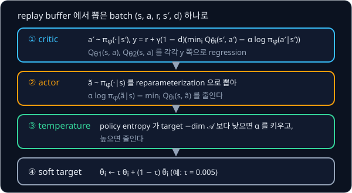

1. **critic** — 앞의 soft target $y$ 를 계산하고, 두 critic $Q_{\theta_1}$, $Q_{\theta_2}$ 를 각자 $y$ 쪽으로 regression 한다
2. **actor** — batch 의 state $s$ 마다 지금 actor 로 action $\tilde a$("에이 틸드", buffer 에 적힌 $a$ 와 구별하려고 물결을 얹었다)를
   reparameterization 으로 새로 뽑고, $\alpha \log \pi_\phi(\tilde a \mid s) - \min_i Q_{\theta_i}(s, \tilde a)$ 를 줄이도록 $\phi$ 를
   고친다. 이 값을 줄이는 것은 $Q$ 와 놀라움 $-\log \pi$ 의 $\alpha$ 배를 함께 키우는 것과 같다
3. **temperature** — 앞 절의 $J(\alpha)$ 로 $\alpha$ 를 고친다
4. **soft target** — 두 target critic 을 $\bar\theta_i \leftarrow \tau\theta_i + (1 - \tau)\bar\theta_i$ 로 조금씩 옮긴다. SAC 는
   $\tau = 0.005$ 를 쓴다

actor 단계를 숫자로 보면, 뽑은 $\tilde a$ 의 확률이 0.5 이고 두 critic 값 가운데 작은 것이 0.9, $\alpha = 0.1$ 일 때 줄일 값은
$0.1 \times (-0.693) - 0.9 = -0.969$ 다. 이 값이 작을수록 좋은 actor 이고, 이는 앞에서 계산한 "다음 state 의 값" 0.969 를 키우는 것과
같다. 네 단계 모두 buffer 의 transition 만으로 계산하므로 SAC 는 off-policy 다.

**확인 문제.** actor 단계에서 뽑은 $\tilde a$ 의 확률이 0.25 이고 작은 critic 값이 0.8, $\alpha = 0.1$ 이면 줄일 값은?
($\ln 0.25 = -1.386$)

답 보기

$0.1 \times (-1.386) - 0.8 = -0.1386 - 0.8 = -0.9386$ 이다.

**요약**

- entropy $-\sum_a \pi \log \pi$ 는 action 을 고르게 섞을수록 커서, 확률 (0.5, 0.5) 는 0.693, (0.9, 0.1) 은 0.325, 한 action 만 고르면 0 이다
- SAC 는 reward 에 $\alpha$ × entropy 를 더한 값을 키운다. $Q$ 가 1.0 과 0.9 로 비슷하면 $\alpha = 0.1$ 에서 $p = 0.731$ 로 섞는 policy 가
  가장 좋고, critic target 에는 두 target critic 의 작은 값과 $-\alpha \log \pi$ 가 들어간다
- actor 는 $u = \mu + \sigma\varepsilon$ 을 $\tanh$ 로 묶어 action 을 내고, $\alpha$ 는 entropy 가 목표 $-\dim\mathcal A$ 에 가까워지도록
  스스로 조정된다

## 정리

- 표로 배우는 Q-learning 은 칸 하나씩 고치므로 연속된 숫자 state 를 다룰 수 없다. CartPole 의 숫자 네 개를 10 칸씩만 잘라도
  $10^4$ 칸이 되고, 거의 같은 두 state 도 서로 아무것도 나누지 못한다
- neural network 는 몇 개의 weight 로 모든 state 의 $Q$ 를 계산해, 한 state 의 학습이 비슷한 state 로 번진다(generalization).
  학습은 Q-learning 의 target 을 정답으로 둔 regression 이다
- 학습하는 $Q$ 와 target 을 같은 weight 로 계산하면 target 이 따라 움직인다. 복도 예에서 A 만 배우면 $w$ 가 update 마다 1.4 배씩
  발산했다
- DQN 은 target 을 복사본 $\bar\theta$ 로 계산하는 target network 와, transition 을 쌓아 두고 무작위 batch 로 섞어 쓰는 replay buffer 로
  이 흔들림을 줄였다. A 와 B 를 섞으면 복사할 때마다 1.8 배씩 커지던 값이 0.625 에 멈췄다
- DQN·SAC 의 target 은 transition 을 모은 policy 와 상관없어서, 예전 데이터와 사람 시연을 다시 쓰는 off-policy 학습이 된다. policy 를
  고칠 때마다 데이터를 새로 모으는 on-policy 보다 sample efficiency 가 높아 실물 로봇에 유리하다
- action 이 연속된 숫자면 action 을 내는 actor 와 그 $Q$ 를 매기는 critic 을 함께 학습하고, 가장 큰 추정값을 고르며 생기는
  overestimation 은 critic 두 개 가운데 작은 값을 써서 줄인다
- SAC 는 reward 에 $\alpha$ × entropy 를 더해 탐색을 policy 안에 넣는다. actor 는 tanh 로 묶은 Gaussian 에서 action 을 뽑고,
  temperature $\alpha$ 는 entropy 가 목표값에 모이도록 스스로 조정된다

이 강의의 policy 는 수레 위치나 진자 각도 같은 state 숫자를 직접 보고, simulator 안에서만 학습했다. 카메라 영상을 보고 실물 팔에서 사람
시연과 개입을 섞어 학습하려면 SERL·HIL-SERL 같은 시스템이 필요하고, Hugging Face 의 로봇 학습 라이브러리 LeRobot 에 든 HIL-SERL 구현이 SO-101 같은 저가 팔에서 이를 돌린다.
value 를 거치지 않고 policy 를 직접 고치는 on-policy 방법은 [Policy Gradient](../policy-gradient/README.md) 와 [PPO](../ppo/README.md)
에서 다루고, 카메라 영상과 말로 된 지시를 받아 로봇 행동을 내는 큰 모델(VLA)에 off-policy 학습을 붙이는 방법은 [VLA + RL](../vla-rl/README.md) 에서 다룬다. 이 강의의 Pendulum 을
카메라 영상으로 다시 푸는 문제는 [World Model](../world-model/README.md) 에서 다룬다.

## 참고 자료

- Volodymyr Mnih 외, [Playing Atari with Deep Reinforcement Learning](https://arxiv.org/abs/1312.5602) (2013)·[Human-level control
  through deep reinforcement learning](https://www.nature.com/articles/nature14236) (2015) — replay buffer 와 target network 를 쓴 DQN
  논문. 2015 년 판의 Methods 절에 learning rate·buffer 크기 같은 설정값 표가 있다
- Tuomas Haarnoja 외, [Soft Actor-Critic](https://arxiv.org/abs/1801.01290) (2018)·[Soft Actor-Critic Algorithms and Applications](https://arxiv.org/abs/1812.05905)
  (2018) — maximum entropy objective, tanh 보정이 붙은 log-prob(앞 논문의 부록 C), temperature 자동 조정(뒤 논문 5절)
- Scott Fujimoto 외, [Addressing Function Approximation Error in Actor-Critic Methods](https://arxiv.org/abs/1802.09477) (2018)
  — TD3. critic 두 개 가운데 작은 값을 쓰는 clipped double Q 가 처음 나온 논문으로, 1 ~ 4 절이 overestimation 을 설명한다
- Timothy P. Lillicrap 외, [Continuous control with deep reinforcement learning](https://arxiv.org/abs/1509.02971) (2015) — DDPG.
  action 을 하나로 정해서 내는 actor 와 critic 으로 연속 action 을 푼 논문
- OpenAI Spinning Up, [DDPG](https://spinningup.openai.com/en/latest/algorithms/ddpg.html)·[TD3](https://spinningup.openai.com/en/latest/algorithms/td3.html)·[SAC](https://spinningup.openai.com/en/latest/algorithms/sac.html)
  — 세 알고리즘의 식과 의사코드를 같은 형식으로 정리한 문서. 이 강의를 마친 뒤 식을 다시 확인할 때 읽는다
- Lilian Weng, [A (Long) Peek into Reinforcement Learning](https://lilianweng.github.io/posts/2018-02-19-rl-overview/) — Q-learning 에서
  DQN 으로 넘어가는 이유와, function approximation, target 을 다시 $Q$ 로 계산하는 bootstrapping, off-policy 가 겹칠 때 학습이 불안정해지는 deadly triad 설명
- CleanRL [DQN 문서](https://docs.cleanrl.dev/rl-algorithms/dqn/)·[SAC 문서](https://docs.cleanrl.dev/rl-algorithms/sac/)
  — 이 강의의 ε 계획과 target network 복사 주기 같은 기본값, 환경별 학습 곡선이 있다
- Gymnasium [CartPole](https://gymnasium.farama.org/environments/classic_control/cart_pole/)·[Pendulum](https://gymnasium.farama.org/environments/classic_control/pendulum/)·[HalfCheetah](https://gymnasium.farama.org/environments/mujoco/half_cheetah/)
  문서 — 이 강의에서 쓴 환경의 state·action·reward·episode 종료 조건 정의
- UC Berkeley CS 285, [Deep Reinforcement Learning](https://rail.eecs.berkeley.edu/deeprlcourse/) — Q-learning 과 actor-critic 을 다루는
  대학원 강의. 강의 영상과 slide 가 공개돼 있다
- [SERL](https://serl-robot.github.io/)·[HIL-SERL](https://hil-serl.github.io/) 프로젝트 페이지 — SAC 계열 off-policy 학습을 실물 팔에서
  돌린 시스템과 영상
- LeRobot, [HIL-SERL guide](https://huggingface.co/docs/lerobot/hilserl) — SO-101 같은 저가 팔에서 SAC 기반 실물 RL 을 돌리는 절차
