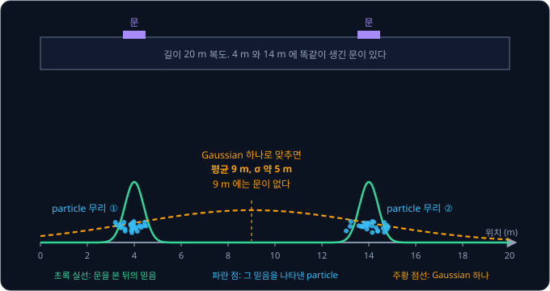
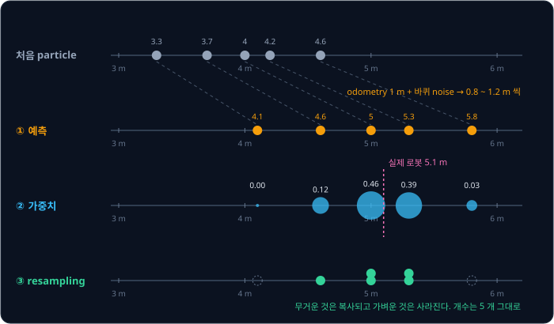
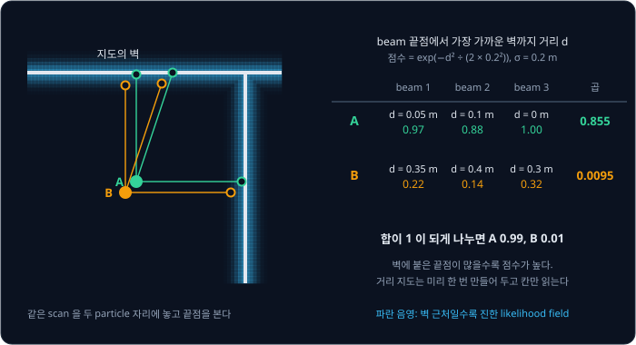
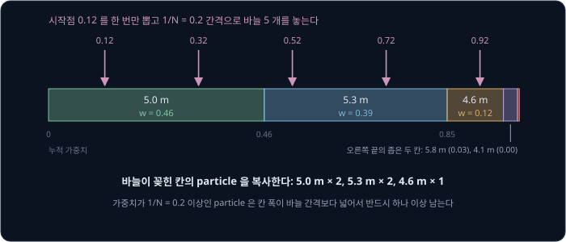
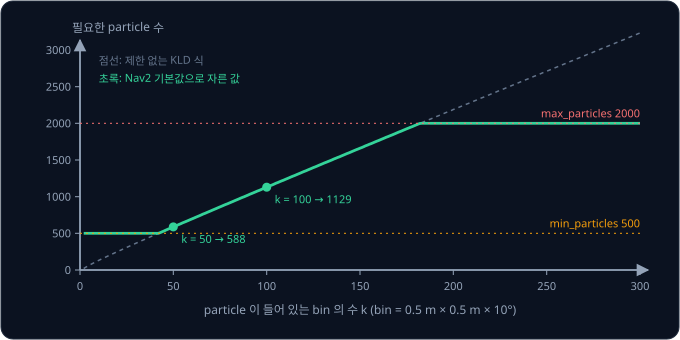
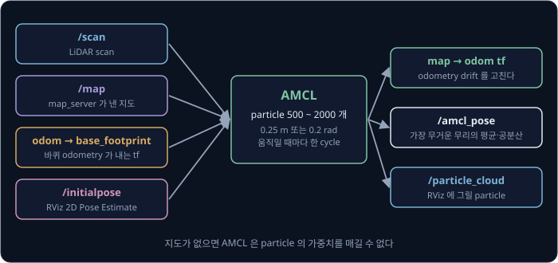

# Particle Filter

복도 양쪽 끝에 똑같이 생긴 회의실이 하나씩 있는 사무실에서 로봇을 켜면, 왼쪽 회의실 문 앞에서 찍은 LiDAR scan 과 오른쪽 회의실 문 앞에서
찍은 scan 이 똑같이 나온다. 로봇이 내릴 수 있는 맞는 답은 "왼쪽 문 앞이거나 오른쪽 문 앞" 인데, 평균 하나와 분산 하나로 위치를 기억하는
Kalman filter 로는 이 답을 적을 수 없다. 멀리 떨어진 두 후보를 모두 남겨 두었다가 조금 더 움직인 뒤 그중 하나를 고르려면, 위치를 어떤
모양으로 기억해야 할까?

Particle filter 는 위치의 후보를 점 수백 ~ 수천 개로 뿌려 두고, 로봇이 움직이면 점을 같이 옮기고 센서와 잘 맞는 점만 남기는 방법이다.
1999 년 Dellaert, Fox, Burgard, Thrun 은 이 방법을 로봇 위치 추정에 쓰고 Monte Carlo Localization(MCL)이라고 불렀다. 그 실험에서 박물관
안내 로봇 MINERVA 는 Smithsonian 의 National Museum of American History 를 75 분 동안 2200 m 넘게 달리는 내내 위치를 한 번도 잃지 않았다.
지금은 ROS 2 의 navigation stack 인 Nav2 가 지도 위에서 위치를 추정할 때, MCL 에 particle 수를 바꾸는 기능을 더한 AMCL 을 기본으로 쓴다.

## 학습 목표

- Gaussian 하나로는 나타낼 수 없는, 봉우리가 여럿인 위치의 믿음을 particle 로 나타내는 방법을 설명할 수 있다
- 예측(motion noise), 가중치(likelihood field), resampling 으로 이루어진 한 cycle 을 숫자 예시로 설명할 수 있다
- degeneracy 가 생기는 이유와 particle 수·계산량의 관계, KLD sampling 이 particle 수를 바꾸는 방식을 설명할 수 있다
- Nav2 AMCL 의 주요 parameter 와 초기 위치 설정, kidnapped robot 에 대처하는 방법을 설명할 수 있다

## 봉우리가 여럿인 믿음

로봇이 "지금 어디에 있을지" 를 위치마다 확률로 적은 분포를 **belief**(믿음)라고 한다. [Kalman Filter](../kalman-filter/README.md) 는 이
belief 가 늘 종 모양 하나라고 가정하고 평균과 분산만 고쳐 나간다.

길이 20 m 인 복도의 4 m 와 14 m 자리에 똑같이 생긴 문이 하나씩 있다고 하자. 자기 위치를 전혀 모르던 로봇이 LiDAR 로 바로 옆에 문이 있다는
것을 알아냈다면, 로봇은 4 m 근처이거나 14 m 근처에 있다. 이때의 belief 는 아래 그림의 초록 곡선처럼 두 문 앞에 봉우리가 하나씩 솟고 나머지
자리는 거의 0 인 모양이다.

이 belief 를 Gaussian 하나로 억지로 맞추면 평균은 두 봉우리의 가운데인 $(4 + 14) \div 2 = 9$ m 가 된다. 분산은 봉우리 하나의 분산에 두
봉우리가 평균에서 떨어진 거리 5 m 의 제곱을 더한 값이다. 그림의 봉우리는 σ = 0.4 m 라서 분산이 $0.4^2 + 5^2 \approx 25.2$ m² 이고, σ 는 약 5 m 다. 그러면 "9 m 근처가 가장
그럴듯하다" 는 답이 나오는데, 9 m 에는 문이 없으니 로봇이 거기 있을 리가 없다. 실제 로봇에서 이런 belief 가 생기는 상황은 아래와 같다.

| 상황 | belief 의 모양 |
| --- | --- |
| global localization: 켰을 때 위치를 전혀 모른다 | 지도 전체에 고르게 퍼졌다가, 센서를 볼 때마다 비슷하게 생긴 자리 여러 곳에 봉우리가 남는다 |
| 대칭인 환경: 똑같은 복도·문·선반이 되풀이된다 | 생김새가 같은 자리마다 봉우리가 하나씩 생긴다 |
| kidnapped robot: 사람이 로봇을 들어 다른 곳에 옮겼다 | 원래 자리에 뾰족했던 봉우리가 틀린 채로 남아, 새 자리에 봉우리를 다시 세워야 한다 |

Dellaert 등의 1999 년 실험이 이 모양을 그대로 보여 준다. 독일 Bonn 대학 건물에서 위치를 모르는 로봇 RHINO 에 sample 20,000 개를 지도의
빈 곳에 고르게 뿌렸더니, 복도를 지나 방에 들어설 즈음 sample 이 두 곳에 모였다. 하나는 실제 위치였고 다른 하나는 복도가 대칭이라 생긴
후보였는데, 두 방의 sonar 측정이 서로 다르게 나오자 후보가 하나로 좁혀졌다.

## Particle

**particle** 은 "로봇이 이 자리에 있을지도 모른다" 는 후보 하나다. 바닥을 다니는 로봇이라면 particle 하나는 위치 $x$, $y$ 와 바라보는 방향
$\theta$ 세 숫자에, 그 후보가 얼마나 그럴듯한지를 적은 **가중치**(weight) $w$ 를 붙인 것이다. particle 이 촘촘하게 모인 곳일수록, 또 가중치가 큰
particle 이 있는 곳일수록 로봇이 그 근처에 있을 확률이 높다. 위 그림의 파란 점처럼 particle 수백 개가 두 무리로 모여 있으면 그 자체가
봉우리 둘인 belief 이고, 무리가 셋이든 띠 모양이든 점의 배치만 바꾸면 어떤 모양의 belief 도 나타낼 수 있다. 값을 많이 뽑아 칸마다 개수를
세면 분포의 모양이 드러나는 것과 같다.

같은 일을 지도를 잘게 나눈 칸마다 확률을 적는 방식(grid)으로도 할 수 있지만 칸 수가 금방 커진다. 20 m × 20 m 공간을 5 cm 칸과 1° 방향으로
나누면 $400 \times 400 \times 360 \approx 5{,}800$ 만 칸인데, particle 2000 개는 숫자 $2000 \times 4 = 8000$ 개면 된다. particle 은 로봇이 있을 법한
곳에만 모이기 때문이다. Dellaert 등은 MCL 과 같은 정확도를 내려면 grid 방식이 4 cm 칸까지 잘게 나눠야 했다고 보고했다.

다만 particle filter 는 상태를 이루는 숫자가 적을 때 쓸 만하다. 같은 촘촘함으로 공간을 덮으려면 상태의 숫자가 하나 늘 때마다 그 축을 나눈 칸 수만큼
particle 이 곱으로 늘어나기 때문이다. 10 m × 10 m 를 0.5 m × 0.5 m × 10° 로 나누면 $20 \times 20 \times 36 = 14{,}400$ 칸이지만, 높이 10 m 를
0.5 m 씩 더 나누면 20 배인 288,000 칸이 된다. 그래서 particle filter 는 바닥 로봇의 $x$, $y$, $\theta$ 처럼 숫자가 적은 상태에 주로
쓰고, 상태가 수십 개면 Kalman filter 계열을 쓴다.

이렇게 확률분포를 무작위로 뽑은 sample 로 나타내 계산하는 방법을 Monte Carlo 방법이라고 부르는데, 이름은 Monaco 의 카지노 Monte Carlo
에서 왔다. 시간에 따라 바뀌는 상태를 sample 로 추정하는 particle filter 는 1993 년 Gordon, Salmond, Smith 가 bootstrap filter 라는
이름으로 발표했고, MCL 은 이 filter 를 로봇 위치 추정에 적용했다.

## 예측·가중치·resampling

particle filter 는 Kalman filter 의 예측과 보정에 대응하는 단계를 particle 마다 수행하고, 마지막에 particle 을 다시 뽑는 단계를 하나 더 둔다.
아래 그림은 실제 로봇이 5.1 m 에 있을 때 복도 위 particle 5 개가 한 cycle 동안 바뀌는 모습인데, 로봇 자신은 5.1 m 라는 값을 모른다.

**① 예측(predict).** 바퀴 odometry 로 잰 이동이 1 m 이면 particle 마다 1 m 에 각자 무작위로 뽑은 noise 를 더해 옮긴다. 이번에는
noise 를 더한 이동이 1.0, 1.1, 0.9, 1.2, 0.8 m 로 뽑혀서, 4.0, 4.2, 3.7, 4.6, 3.3 m 에 있던 particle 이 5.0, 5.3, 4.6, 5.8, 4.1 m 로 간다.
Kalman filter 는 바퀴가 미끄러졌을 수 있다는 불확실성을 분산에 $Q$ 를 더해 나타냈는데, particle filter 에서는 particle 이 퍼진 정도가
그 불확실성이다.

**② 가중치(weight).** 이제 LiDAR 가 복도 끝 벽(20 m)까지의 거리를 14.9 m 로 쟀다. 5.0 m 에 있는 particle 이 맞다면 벽까지 15.0 m 가
나와야 하니 측정과 0.1 m 차이가 난다. 센서 오차를 σ = 0.3 m 인 Gaussian 으로 보고 차이마다 점수 $\exp(-\text{차이}^2 \div (2 \times 0.3^2))$
를 매긴 뒤, 다섯 점수의 합이 1 이 되게 나누면 가중치가 된다.

| particle | 예상한 벽까지 거리 | 측정 14.9 m 와의 차이 | 점수 | 가중치 |
| --- | --- | --- | --- | --- |
| 5.0 m | 15.0 m | 0.1 m | 0.95 | 0.46 |
| 5.3 m | 14.7 m | 0.2 m | 0.80 | 0.39 |
| 4.6 m | 15.4 m | 0.5 m | 0.25 | 0.12 |
| 5.8 m | 14.2 m | 0.7 m | 0.07 | 0.03 |
| 4.1 m | 15.9 m | 1.0 m | 0.004 | 0.00 |

점수의 합은 $0.95 + 0.80 + 0.25 + 0.07 + 0.004 \approx 2.07$ 이고, 첫 particle 의 가중치는 $0.95 \div 2.07 \approx 0.46$ 이다. Bayes rule
에서 측정의 likelihood 를 곱하는 계산을 particle 마다 하는 단계다.

**③ resampling.** 가중치에 비례하는 확률로 particle 을 5 번 다시 뽑아 새 particle 5 개를 만들고 가중치를 모두 1/5 로 되돌린다. 이번에는
5.0 m 와 5.3 m 가 두 번씩, 4.6 m 가 한 번 뽑혀서 그럴듯한 후보는 늘고 4.1 m 처럼 측정과 어긋난 후보는 사라졌다. 개수는 그대로 5 개다.

로봇의 위치 하나가 필요하면 particle 의 가중 평균을 쓴다. resampling 전에 계산하면
$0.46 \times 5.0 + 0.39 \times 5.3 + 0.12 \times 4.6 + 0.03 \times 5.8 \approx 5.09$ m 로 실제 위치 5.1 m 에 가깝다. 다만 봉우리가 둘일 때 전체를
평균하면 앞 절의 9 m 처럼 아무것도 없는 자리가 나오기 때문에, 실제 구현은 particle 을 가까운 것끼리 무리로 묶고 가장 무거운 무리의 평균을
낸다.

| 단계 | Kalman filter | particle filter |
| --- | --- | --- |
| 예측 | 평균을 옮기고 분산에 $Q$ 를 더한다 | particle 마다 noise 를 섞어 옮긴다 |
| 보정 | Kalman gain 으로 평균과 분산을 고친다 | particle 마다 측정과 맞는 정도로 가중치를 매긴다 |
| 다시 뽑기 | 없다 | 가중치에 비례해 복사하고 지운다 |

**확인 문제.** particle 셋이 2.0 m, 2.5 m, 3.0 m 에 있고 가중치는 0.2, 0.5, 0.3 이다. 가중 평균 위치는 얼마이고, particle 10 개로 resampling 하면
각 particle 이 평균 몇 개씩 복사될까?

답 보기

가중 평균은 $0.2 \times 2.0 + 0.5 \times 2.5 + 0.3 \times 3.0 = 0.4 + 1.25 + 0.9 = 2.55$ m 다. resampling 은 가중치에 비례하는 확률로 뽑으므로
10 개 중 평균 $10 \times 0.2 = 2$ 개, $10 \times 0.5 = 5$ 개, $10 \times 0.3 = 3$ 개가 된다.

<b>심화: Bayes filter 와 importance sampling</b>

시각 $t$ 의 belief 를 $bel(x_t)$, 움직임 명령을 $u_t$, 측정을 $z_t$ 라고 하면 위치 추정은 아래 Bayes filter 식을 되풀이한다.

$$
bel(x_t) \propto p(z_t \mid x_t) \int p(x_t \mid u_t, x_{t-1})\, bel(x_{t-1})\, dx_{t-1}
$$

적분 부분이 예측이고 $p(z_t \mid x_t)$ 를 곱하는 부분이 보정이다. Kalman filter 는 모든 분포가 Gaussian 이라고 가정해 이 식을 평균과 공분산의
계산으로 바꾼다. particle filter 는 적분을 직접 계산하지 않고, 이전 particle 마다 움직임 모델 $p(x_t \mid u_t, x_{t-1})$ 에서 새 위치를 하나씩 뽑는다.
이렇게 뽑은 particle 은 예측 분포를 따르지만 구하려는 것은 보정 뒤의 분포라서, 두 분포의 비율인 $p(z_t \mid x_t)$ 를 가중치로 붙여 차이를
메운다. 구하려는 분포에서 직접 뽑기 어려울 때 뽑기 쉬운 분포에서 뽑고 두 분포의 비율을 가중치로 다는 방법을 importance sampling 이라고 한다. 앞의 ②단계에서 매긴 점수가
$p(z_t \mid x_t)$ 이고, resampling 은 가중치가 붙은 particle 을 같은 가중치의 particle 로 바꾸는 단계다.

## Motion model 과 noise

예측에서 noise 를 섞지 않으면 particle 이 퍼지지 않는다. resampling 으로 복사한 particle 은 처음에 같은 자리에 겹쳐 있는데, noise 없이 같은 1 m 를
더하면 끝까지 같은 자리에 겹친 채로 움직인다. 그러면 실제 로봇이 미끄러져 particle 무리 밖으로 벗어나는 순간 그 근처에 후보가 하나도 없어서
위치를 잃는다.

Nav2 의 AMCL 은 odometry 가 알려 준 움직임을 "제자리 회전 → 직진 → 제자리 회전" 세 동작으로 나누고, 각 동작에 Gaussian noise 를 더해
particle 을 옮긴다. noise 의 크기는 움직인 양에 비례하고 parameter 네 개가 비율을 정한다.

| parameter | 기본값 | 뜻 |
| --- | --- | --- |
| `alpha1` | 0.2 | 회전할 때 생기는 회전 noise |
| `alpha2` | 0.2 | 직진할 때 생기는 회전 noise |
| `alpha3` | 0.2 | 직진할 때 생기는 직진 noise |
| `alpha4` | 0.2 | 회전할 때 생기는 직진 noise |

직진 noise 의 표준편차는 `alpha3` 에 직진 거리의 제곱을 곱한 값의 제곱근이라, 똑바로 0.25 m 를 갔다면
$\sqrt{0.2 \times 0.25^2} \approx 0.11$ m 다. 방향 noise 도 `alpha2` 로 같은 계산을 해서 약 0.11 rad, 6.4° 가 나온다. 0.25 m 를 가는 동안 표준편차 0.11 m 의 noise 를 더하므로 꽤 넉넉한 값이고, 바퀴
odometry 가 정확한 로봇은 값을 줄여 particle 무리를 좁게 유지할 수 있다. 너무 줄이면 바퀴가 미끄러질 때 particle 이 따라가지 못하고, 너무 키우면
무리가 넓어져 추정이 흔들리고 particle 도 더 많이 필요하다. Kalman filter 에서 $Q$ 를 정할 때와 같은 trade-off 다.

AMCL 은 로봇이 `update_min_d` (기본 0.25 m) 이상 움직이거나 `update_min_a` (기본 0.2 rad, 약 11.5°) 이상 돌았을 때만 cycle 을 한 번 수행한다.
그래서 로봇을 세워 둔 채 RViz 에서 particle 이 모이기를 기다려도 아무 변화가 없고, 조금 움직여야 particle 이 모이기 시작한다. 움직이지 않은 채
한 번 갱신하려면 AMCL 의 `request_nomotion_update` service 를 부른다.

## Likelihood field

복도 예시는 거리 하나만 쟀지만 실제 LiDAR 는 scan 한 번에 점을 수백 개씩 낸다. 각 particle 자리에서 이 scan 이 지도와 얼마나 맞는지를 재야
하는데, beam 마다 지도 위에서 벽에 닿을 때까지 선을 그어 예상 거리를 구하는 방식은 particle 수 × beam 수만큼 선을 그어야 해서 계산이 많다.
**likelihood field** 는 선을 긋지 않고 beam 의 끝점만 본다. particle 자리에서 잰 거리만큼 beam 방향으로 나간 끝점을 지도 위에 찍고, 그 끝점에서
가장 가까운 벽까지의 거리 $d$ 로 점수를 매긴다. 끝점이 벽에 붙어 있으면 점수가 높고 벽에서 멀리 떨어진 빈 곳에 있으면 낮다.

"가장 가까운 벽까지의 거리" 는 지도가 바뀌지 않으므로 칸마다 미리 한 번 계산해 표로 만들어 두고, 끝점이 떨어진 칸의 값을 읽기만 한다.
그림에서는 이 표의 값을 점수로 바꿔 파란 음영으로 칠했다. beam 하나의 점수는 $\exp(-d^2 \div (2\sigma^2))$ 이고, Nav2 기본값 σ = 0.2 m(`sigma_hit`)로 계산하면
아래와 같다.

| 끝점에서 벽까지 $d$ | 0 m | 0.1 m | 0.2 m | 0.3 m | 0.4 m | 1.0 m |
| --- | --- | --- | --- | --- | --- | --- |
| beam 하나의 점수 | 1.00 | 0.88 | 0.61 | 0.32 | 0.14 | 0.000004 |

beam 마다 오차가 서로 독립이라고 보면 particle 의 점수는 beam 점수를 모두 곱한 값이다. 위 그림에서 A 는 $0.969 \times 0.883 \times 1 \approx 0.855$, 0.3 m 어긋난 B 는
$0.216 \times 0.135 \times 0.325 \approx 0.0095$ 라서, beam 셋만으로도 가중치가 A 0.99, B 0.01 로 갈린다. beam 이 수십 개면 조금 어긋난 particle
의 점수는 훨씬 빠르게 작아진다.

그런데 지도에 없는 사람이 로봇 앞에 서 있으면 그 사람에 맞은 beam 의 끝점은 벽에서 1 m 쯤 떨어지고, 이 beam 의 점수 0.000004 가 곱해져
올바른 particle 의 점수도 사실상 0 이 된다. 그래서 Nav2 의 AMCL 은 beam 점수를 $z_{hit} \times \text{Gaussian 점수} + z_{rand} \div (\text{최대 거리})$
로 섞어 바닥 값을 깔아 둔다. 최대 거리는 scan 메시지의 `range_max` 와 `laser_max_range`(기본 100 m) 중 작은 값이다. 기본값
$z_{hit} = z_{rand} = 0.5$ 에 LiDAR 의 최대 거리가 10 m 라고 가정하면, 벽에 정확히 닿은 beam 은
$0.5 \times 1 + 0.5 \div 10 = 0.55$, 사람에 맞은 beam 은 $0 + 0.05 = 0.05$ 다. 곱으로 합치면 beam 하나가 어긋나도 particle 점수가 0.000004 배가 아니라
$0.05 \div 0.55 \approx 0.09$ 배로만 줄어서, 다른 beam 들이 맞으면 올바른 particle 이 살아남는다.

σ 를 작게 잡는다고 더 정확해지지도 않는다. Kalman filter 는 측정 noise 를 작게 잡으면 측정을 더 세게 따를 뿐이다. 그런데 particle filter 에서
σ 가 너무 작으면 실제 위치에서 조금만 떨어진 particle 도 점수가 거의 0 이 되어, particle 이 몇 개밖에 살아남지 못한다. Labbe 의 책은 σ = 0.1
일 때 실제 위치에서 14σ 떨어진 particle 의 확률이 사실상 0 이 되어 filter 가 오히려 나빠지는 예를 보여 준다.

Nav2 에서 이 단계와 관련된 parameter 는 아래와 같다.

| parameter | 기본값 | 뜻 |
| --- | --- | --- |
| `laser_model_type` | `likelihood_field` | beam 점수 방식. 선을 긋는 `beam` 도 고를 수 있다 |
| `sigma_hit` | 0.2 | 끝점-벽 거리 Gaussian 의 σ (m) |
| `z_hit`, `z_rand` | 0.5, 0.5 | Gaussian 점수와 바닥 값을 섞는 비율 |
| `max_beams` | 60 | scan 에서 고르게 골라 쓰는 beam 수 |
| `laser_likelihood_max_dist` | 2.0 | 벽까지 거리를 미리 계산해 두는 최대 거리 (m) |

**확인 문제.** particle C 의 beam 셋이 모두 벽에서 0.2 m 떨어진 곳에서 끝난다. σ = 0.2 m 일 때 C 의 점수(beam 점수의 곱)는 얼마이고, 위 그림의 A 와
비교하면 어떤가?

답 보기

beam 하나의 점수는 $\exp(-0.2^2 \div (2 \times 0.2^2)) = \exp(-0.5) \approx 0.61$ 이고, 셋을 곱하면 $0.61^3 \approx 0.22$ 다. A 의 0.855 와
비교하면 약 4 분의 1 이라, C 는 A 보다 덜 그럴듯하지만 B(0.0095)보다는 훨씬 그럴듯하다.

<b>심화: Nav2 AMCL 이 beam 점수를 합치는 실제 방식</b>

본문은 beam 점수 $p_i$ 를 모두 곱해 particle 의 점수로 썼지만, Nav2 AMCL 의 코드(`likelihood_field_model.cpp`)는 곱하는 줄(`p *= pz`)을
주석으로 막아 두고 아래처럼 세제곱을 더한다.

$$
p = 1 + \sum_{i} p_i^3
$$

코드 주석은 이것을 "ad-hoc weighting scheme" 이라고 적고 경험상 잘 동작한다고 설명한다. 곱은 beam 60 개의 점수가 조금씩만 작아도 소수점 아래
수십 자리까지 작아지는데, 세제곱의 합은 맞는 beam 이 많을수록 커지는 성질은 유지하면서 particle 사이의 차이를 덜 극단적으로 만든다. 대신 이
값은 엄밀한 확률이 아니다. 기존 가중치에 이 $p$ 를 곱한 뒤 모든 particle 의 합이 1 이 되게 나눈다.

`beam` 모델은 beam 마다 지도 위에 선을 그어 예상 거리를 구하고, 지도에 없는 물체에 막혀 짧게 나온 측정(`z_short`)과 최대 거리 측정(`z_max`)을
따로 모델링한다.

## Resampling 과 degeneracy

resampling 없이 가중치만 계속 곱해 나가면 몇 cycle 만에 particle 하나가 가중치를 거의 다 차지하고 나머지는 0 에 가까워지는데, 이것을
**degeneracy** 라고 한다. Labbe 는 particle 5,000 개 중 의미 있는 가중치를 가진 것이 3 개뿐인 상황을 예로 드는데, 나머지 4,997 개를 옮기고
점수를 매기는 계산은 추정에 거의 보탬이 되지 않는다.

degeneracy 가 얼마나 진행됐는지는 가중치로 구한 **effective sample size** $N_{eff} = 1 \div \sum w_i^2$ 로 잰다. 가중치가 모두 같으면 $N_{eff}$ 는
particle 수 $N$ 이고, 하나가 전부를 가지면 1 이다. 앞 절의 다섯 가중치로 계산하면 $1 \div (0.46^2 + 0.39^2 + 0.12^2 + 0.03^2) = 1 \div 0.379 \approx 2.6$
이라, particle 5 개 중 추정에 실제로 보탬이 되는 것은 3 개가 안 된다. Labbe 의 예제는 $N_{eff}$ 가 $N / 2$ 아래로 떨어질 때만 resampling 하지만,
Nav2 AMCL 은 이 값을 보지 않고 `resample_interval` 로 정한 cycle 수마다 resampling 한다. 기본값이 1 이라서 cycle 마다 resampling 한다.

resampling 방법에 따라 결과가 얼마나 흔들리는지가 다르다. 가장 단순한 multinomial resampling 은 가중치 크기만큼 칸을 나눈 0 ~ 1 막대에서
난수를 $N$ 번 따로 뽑아, 각 난수가 떨어진 칸의 particle 을 복사한다. 그래서 운이 나쁘면 무거운 particle 이 한 번도 뽑히지 않는다. 앞 예시에서 가중치 0.39 인 particle 이 다섯 번 모두
뽑히지 않을 확률은 $(1 - 0.39)^5 \approx 0.084$ 로 약 8% 다.

**low-variance resampling**(systematic resampling 이라고도 한다)은 난수를 한 번만 뽑는다. 가중치를 누적해 0 ~ 1 막대 위에 칸으로 늘어놓고,
0 과 $1/N$ 사이에서 뽑은 시작점부터 $1/N$ 간격으로 바늘 $N$ 개를 꽂아 바늘이 꽂힌 칸의 particle 을 복사한다. 위 그림은 시작점 0.12 에서
0.12, 0.32, 0.52, 0.72, 0.92 에 바늘을 꽂아 5.0 m 와 5.3 m 를 두 개씩, 4.6 m 를 하나 복사했다. 바늘 간격이 $1/N$ 로 고정이라, 가중치가 $1/N$
이상인 particle 은 칸 폭이 바늘 간격 이상이어서 반드시 하나 이상 남는다. 복사 개수도 $N \times w$ 에서 1 개 넘게 벗어나지 않는다.

Nav2 AMCL 의 `pf.c` 에는 Probabilistic Robotics 의 low-variance resampling 코드가 들어 있지만 주석으로 막혀 있고, 실제로는 particle 을 하나씩
따로 뽑는 multinomial 방식을 쓴다. 코드 주석에 따르면 low-variance 방식은 KLD sampling(뒤 절)과 함께 쓰기 어렵다. low-variance 방식은 바늘 간격
$1/N$ 을 정하려면 뽑을 개수 $N$ 을 먼저 알아야 하는데, KLD sampling 은 뽑는 도중에 개수를 정하기 때문이다.

**흔한 오해.** "resampling 은 particle 을 더 정확한 자리로 옮긴다." resampling 은 이미 있는 particle 을 복사하거나 지울 뿐 새 자리를 만들지
않는다. 같은 측정으로 resampling 을 되풀이하면 몇몇 particle 의 복사본만 남아 후보의 다양성이 사라지는데, Dellaert 등은 이것을 sample
impoverishment 라고 불렀다. 복사본을 다시 여러 자리로 퍼뜨리는 것은 다음 예측의 motion noise 다. 로봇이 서 있는 동안에는 AMCL 이 cycle 을 수행하지 않으므로
같은 scan 으로 resampling 을 되풀이하지도 않는다.

## Particle 수와 계산량

AMCL 은 cycle 마다 particle 하나에 beam `max_beams` 개의 끝점을 계산하고 거리 표를 읽는다. 기본값으로 계산하면 particle 500 개일 때
$500 \times 60 = 30{,}000$ 번, 2000 개일 때 $2000 \times 60 = 120{,}000$ 번이다. particle 이 많을수록 belief 를 촘촘하게 나타내지만 한 cycle 이
길어진다.

particle 을 무작정 늘린다고 정확해지지도 않는다. Dellaert 등은 sample 수를 늘리면 처음에는 오차가 줄다가, 한 번 계산하는 시간이 길어져 그사이
들어온 측정을 버리게 되면서 다시 커진다고 보고했다. Fox 의 실험에서도 particle 이 너무 적으면 로봇이 자주 위치를 찾지 못했고, 너무 많으면 한
번 고치는 데 몇 초가 걸려 센서 데이터를 버려야 했다. 필요한 수도 상황마다 달라서, Dellaert 등은 건물 전체에서 위치를 처음 찾을 때 sample
20,000 개를 썼지만 위치를 이미 아는 MINERVA 를 따라갈 때는 5000 개로 충분했다.

**KLD sampling** 은 particle 수를 cycle 마다 다시 정한다. 공간을 작은 칸(bin)으로 나누고, resampling 하면서 particle 이 하나라도 들어간 bin 의
수 $k$ 를 센다. particle 이 넓게 퍼져 있으면 $k$ 가 크고 한곳에 모이면 작은데, 뽑은 particle 수가 $k$ 로 정한 목표에 닿으면 그만 뽑는다. 이름은
sample 로 만든 분포와 실제 분포의 차이를 KL divergence(Kullback-Leibler)로 재서 그 차이가 정한 값 아래로 내려가도록 개수를 고르는 데서 왔다.

Nav2 AMCL 은 bin 을 0.5 m × 0.5 m × 10° 로 나누고, 기본값으로 계산한 목표를 `min_particles` 와 `max_particles` 사이로 자른다. 목표는
$k$ 에 거의 비례해서 bin 하나에 particle 이 약 11 개꼴이다.

| particle 이 든 bin 수 $k$ | KLD 식이 낸 개수 | AMCL 이 쓰는 개수 |
| --- | --- | --- |
| 2 | 20 | 500 (`min_particles`) |
| 50 | 588 | 588 |
| 100 | 1129 | 1129 |
| 183 이상 | 2009 이상 | 2000 (`max_particles`) |

Fox 의 실험에서 particle 수를 고정한 filter 는 sample 50,000 개를 써야 기준 분포와의 KL 거리가 0.25 아래로 내려갔지만, KLD sampling 은
평균 3,000 개로 같은 수준에 닿았다. 실시간 실험에서 얻은 가장 작은 평균 위치 오차도 KLD sampling 은 44 cm 였고 고정 개수 방식은 114 cm
였다. KLD sampling 을 쓰면 위치를 찾은 뒤 particle 이 몇백 개로 줄어든다.

<b>심화: KLD sampling 의 식과 Nav2 의 pf_z</b>

particle 이 든 bin 이 $k$ 개일 때, sample 로 만든 분포와 실제 분포의 KL 거리가 확률 $1 - \delta$ 로 $\varepsilon$ 보다 작으려면 particle 이 아래
$n$ 개 필요하다. Fox 는 chi-square 분포의 분위수를 Wilson-Hilferty 근사로 바꿔 이 식을 얻었다.

$$
n = \frac{k - 1}{2\varepsilon} \left( 1 - \frac{2}{9(k-1)} + \sqrt{\frac{2}{9(k-1)}}\, z_{1-\delta} \right)^3
$$

$z_{1-\delta}$ 는 표준 Gaussian 에서 위쪽 확률이 $\delta$ 인 경계값이고, $1 - \delta = 0.99$ 이면 2.33 이다. 괄호 안은 $k$ 가 커질수록 1 에 가까워지므로
$n$ 은 대략 $(k - 1) \div (2\varepsilon)$ 에 비례하고, $\varepsilon = 0.05$ 이면 bin 하나에 약 10 개다.

Nav2 에서 $\varepsilon$ 은 `pf_err` (기본 0.05), $z$ 는 `pf_z` (기본 0.99)다. 코드(`pf_resample_limit`)는 `pf_z` 값을 위 식의 $z$ 자리에 그대로
넣는데, 공식 문서는 `pf_z` 를 설명하며 "2.33 is the 99% percentile" 이라고 적고 있다. 기본값 0.99 를 그대로 $z$ 에 넣으면 $k = 100$ 일 때
1129 개가 나오고, `pf_z` 를 2.33 으로 두면 같은 $k$ 에서 1347 개가 나온다.

## Nav2 의 AMCL

**AMCL**(Adaptive Monte Carlo Localization)은 KLD sampling 으로 particle 수를 바꾸는(adaptive) MCL 이다. Nav2 의 `nav2_amcl` 은 ROS 1 의 amcl 을
알고리즘 변경 없이 옮긴 것이고, Nav2 를 지도와 함께 띄우면 `map_server` 와 `amcl` 이 함께 켜진다.

AMCL 은 `/scan` 의 LiDAR scan, `/map` 의 지도, 바퀴 odometry 가 내는 `odom` → `base_footprint` tf 를 받는다. `base_footprint` 는
`base_frame_id` 의 기본값이다. 결과는 가장 무거운 particle 무리의 평균과 공분산을 담은 `/amcl_pose` 와, RViz 에서 particle 을 그려 볼 수 있는
`/particle_cloud` 로 낸다. 위치 자체는 `map` → `odom` tf 로 내보내는데, odometry 에 쌓인 drift 만큼을 이 tf 로 바로잡는다. 매끄럽지만 오차가 쌓이는 `odom` frame 과 정확하지만 튈 수 있는 `map` frame 을 나누는
이 구성은 [Kalman Filter](../kalman-filter/README.md) 에서 본 `robot_localization` 의 구성과 같다.

`set_initial_pose` 의 기본값은 false 라서, AMCL 은 처음에 `/initialpose` topic 으로 초기 위치가 들어오기를 기다린다. RViz 의 "2D Pose Estimate"
도구로 지도 위를 클릭하고 끌어 방향을 정하면 이 topic 이 나가는데, RViz 는 공분산을 기본으로 x·y 표준편차 0.5 m, yaw 표준편차 15°
($(\pi/12)^2$)로 채운다. AMCL 은 그 Gaussian 에서 particle 을 뽑아 뿌리므로, 클릭한 자리가 실제 위치에서 표준편차의 2 ~ 3 배인
1 ~ 1.5 m 이상 벗어나면 실제 위치 근처에 particle 이 거의 없다.

초기 위치 없이 지도 전체에서 위치를 찾게 할 수도 있다. `reinitialize_global_localization` service 를 부르면 AMCL 이 지도의 빈 칸 전체에 particle
을 고르게 뿌린다. 그런데 10 m × 10 m 빈 공간만 해도 0.5 m × 0.5 m × 10° bin 이 $20 \times 20 \times 36 = 14{,}400$ 개라서, 기본
`max_particles` 2000 개로는 bin 7 개에 particle 하나꼴이다. Dellaert 등이 건물 전체의 global localization 에 sample 20,000 개를 썼던 것에
비하면 2000 개는 크게 모자라서, 넓은 지도에서는 RViz 로 초기 위치를 주는 것이 기본이다.

kidnapped robot 처럼 particle 이 모두 틀린 자리에 모여 있으면 resampling 은 틀린 후보끼리 서로 복사할 뿐이다. AMCL 은 이런 상황에 대비해 particle
점수의 평균을 짧은 기간(`w_fast`)과 긴 기간(`w_slow`) 두 가지로 따로 추적한다. 갑자기 측정이 particle 과 맞지
않아 짧은 기간 평균이 긴 기간 평균보다 떨어지면 $1 - w_{fast} / w_{slow}$ 의 확률로 particle 대신 지도 위 무작위 자리를 뽑아 새 후보를 넣는다.
두 평균을 갱신하는 비율이 `recovery_alpha_fast` 와 `recovery_alpha_slow` 인데, Nav2 기본값은 둘 다 0.0 이라 이 기능이 꺼져 있다. 켤 때는
`recovery_alpha_slow` 를 `recovery_alpha_fast` 보다 훨씬 작게 둬야 `w_slow` 가 긴 기간의 평균이 된다.

| parameter | 기본값 | 뜻 |
| --- | --- | --- |
| `min_particles`, `max_particles` | 500, 2000 | KLD sampling 이 고르는 particle 수의 하한·상한 |
| `update_min_d`, `update_min_a` | 0.25 m, 0.2 rad | 이만큼 움직여야 cycle 을 수행한다 |
| `resample_interval` | 1 | 몇 cycle 마다 resampling 하는지 |
| `recovery_alpha_slow`, `recovery_alpha_fast` | 0.0, 0.0 | 무작위 particle 을 넣는 복구 기능. 0 이면 꺼짐 |
| `set_initial_pose` | false | true 면 `initial_pose.x` 같은 parameter 로 시작하고, false 면 `/initialpose` 를 기다린다 |

**흔한 오해.** "AMCL 은 돌아다니며 지도도 고친다." AMCL 은 `/map` 을 읽기만 하고 바꾸지 않는다. 가구를 옮겨 지도와 실제가 조금 달라지면 그
자리에 닿는 beam 은 `z_rand` 의 바닥 값 덕분에 점수가 0 까지 떨어지지 않는다. 그러나 달라진 곳이 많으면 맞는 particle 의 점수도 낮아져
위치가 틀어지므로 지도를 새로 만들어야 한다.

**확인 문제.** 위치를 찾아 particle 이 bin 30 개에 모여 있고, KLD 식이 365 개를 냈다. 기본값의 AMCL 은 particle 을 몇 개 쓸까? 사람이
로봇을 들어 다른 방에 옮겼을 때, 기본값 그대로라면 AMCL 이 스스로 위치를 되찾을 수 있을까?

답 보기

365 는 `min_particles` 500 보다 작아서 500 개를 쓴다. 옮긴 뒤에는 모든 particle 이 원래 방에 있어서 새 방 근처에 후보가 없고, resampling 은
있는 particle 만 복사하므로 스스로 되찾기 어렵다. 기본값은 `recovery_alpha_slow`·`recovery_alpha_fast` 가 0.0 이라 무작위 particle 을 넣는
기능도 꺼져 있다. RViz 로 초기 위치를 다시 주거나, `reinitialize_global_localization` 을 부르거나, recovery alpha 를 켜야 한다.

## 정리

- particle filter 는 위치의 후보(particle)를 수백 ~ 수천 개 유지하며, 점의 배치로 봉우리가 여럿인 belief 까지 나타낸다. 20 m 복도의 4 m 와
  14 m 두 문 앞에 particle 이 두 무리로 모일 수 있는데, Gaussian 하나는 문이 없는 9 m 를 답으로 낸다
- 한 cycle 은 odometry 에 noise 를 섞어 particle 을 옮기는 예측, LiDAR beam 끝점이 지도의 벽에 얼마나 붙는지(likelihood field)로 매기는 가중치,
  가중치에 비례해 복사하고 지우는 resampling 이다. resampling 은 degeneracy 를 막지만 새 자리를 만들지 않아서 퍼뜨리는 일은 motion noise 가 맡는다
- Nav2 의 AMCL 은 KLD sampling 으로 particle 을 500 ~ 2000 개 사이에서 고르고, 0.25 m 나 0.2 rad 움직일 때마다 한 cycle 을 수행하며, 처음 위치는
  RViz 의 2D Pose Estimate 로 받는다

**면접에서 "particle filter 와 AMCL 을 설명해 보세요" 라고 물으면.** "particle filter 는 belief 를 가중치가 붙은 sample 집합으로 나타내는 recursive
Bayes filter 입니다. motion model 에서 noise 를 섞어 particle 을 옮기는 예측, measurement likelihood 로 가중치를 매기는 보정, 가중치에 비례해
다시 뽑는 resampling 을 반복합니다. Gaussian 가정이 없어서 대칭인 복도나 global localization 처럼 봉우리가 여럿인 분포를 다룰 수 있고, 대신 상태
차원이 커지면 필요한 particle 이 급격히 늘어납니다. Nav2 의 AMCL 은 LiDAR beam 끝점과 지도 장애물의 거리로 likelihood field 점수를 매기고, KLD
sampling 으로 particle 이 퍼진 정도에 맞춰 개수를 바꾸며, 결과를 map 에서 odom 으로 가는 tf 로 내보내 odometry drift 를 고칩니다. 초기 위치는
보통 RViz 로 주고, kidnapped robot 에 대비하려면 recovery alpha 로 무작위 particle 을 넣습니다."

AMCL 은 `map_server` 가 내는 지도가 있어야 particle 에 점수를 매길 수 있다. 그 지도는 누군가 로봇을 몰고 다니며 만들어야 하는데, 지도를 그리려면
매 순간의 위치를 알아야 하고 위치를 알려면 지도가 있어야 한다. 다음 강의에서는 이 둘을 동시에 추정하는 LiDAR SLAM 과, 그렇게 만든 지도를
저장해 AMCL 에 넘기는 과정을 다룬다.

## 참고 자료

- F. Dellaert, D. Fox, W. Burgard, S. Thrun, [Monte Carlo Localization for Mobile Robots](https://www.cvlibs.net/projects/autonomous_vision_survey/literature/Dellaert1999ICRA.pdf)
  (ICRA 1999) — MCL 을 제안한 논문. 대칭인 복도에서 sample 이 두 무리로 모이는 global localization 실험과 MINERVA 의 2200 m 추적 실험이 있다
- D. Fox, [KLD-Sampling: Adaptive Particle Filters](https://papers.nips.cc/paper_files/paper/2001/hash/c5b2cebf15b205503560c4e8e6d1ea78-Abstract.html)
  (NIPS 2001) — particle 수를 bin 개수로 정하는 식의 유도와, 고정 개수 방식과 비교한 실험
- Nav2, [AMCL configuration guide](https://docs.nav2.org/jazzy/configuration_and_development/configuration_guide/others/configuring_amcl/) —
  이 강의에서 쓴 AMCL parameter 의 기본값과 설명
- Nav2 소스, [`nav2_amcl/src`](https://github.com/ros-navigation/navigation2/tree/main/nav2_amcl/src) — `pf/pf.c` 의 resampling·KLD 개수 계산,
  `sensors/laser/likelihood_field_model.cpp` 의 beam 점수, `motion_model/differential_motion_model.cpp` 의 motion noise 를 직접 확인할 수 있다
- RViz, [`initial_pose_tool.cpp`](https://github.com/ros2/rviz/blob/rolling/rviz_default_plugins/src/rviz_default_plugins/tools/pose_estimate/initial_pose_tool.cpp) —
  2D Pose Estimate 가 `/initialpose` 에 채우는 기본 공분산
- Roger Labbe, [Kalman and Bayesian Filters in Python, 12장 Particle Filters](https://github.com/rlabbe/Kalman-and-Bayesian-Filters-in-Python/blob/master/12-Particle-Filters.ipynb) —
  예측·가중치·resampling 을 코드로 따라가고, effective N 과 multinomial·residual·stratified·systematic resampling 을 그림으로 비교한다
