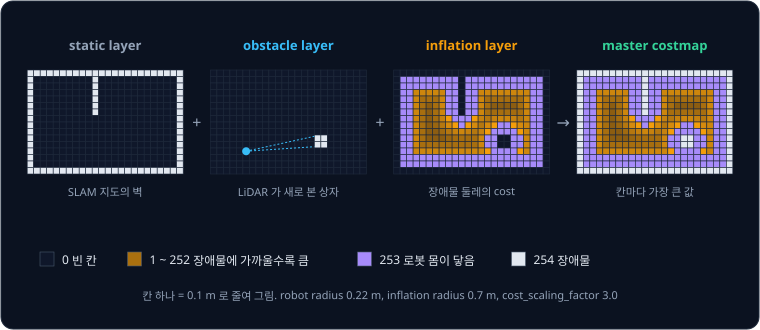
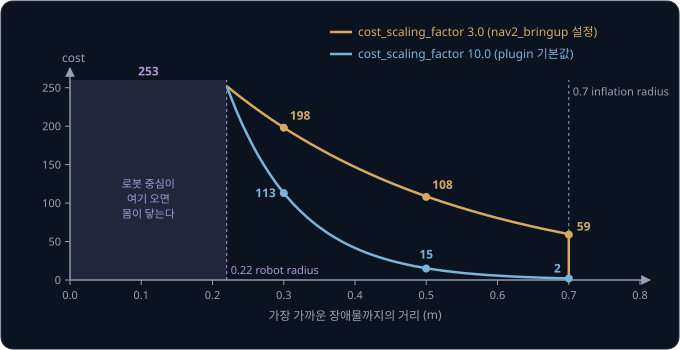
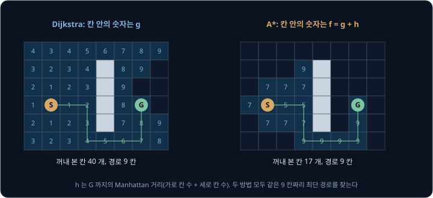
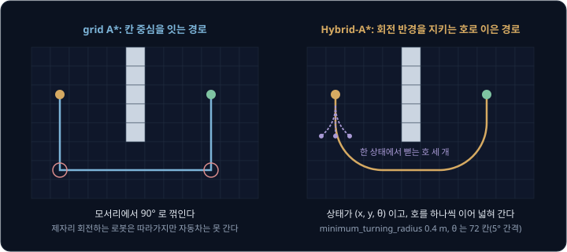
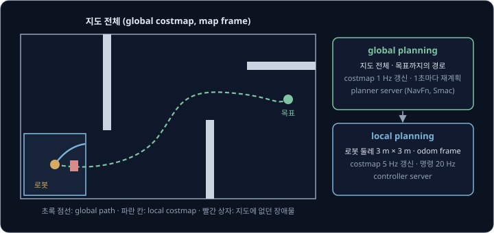
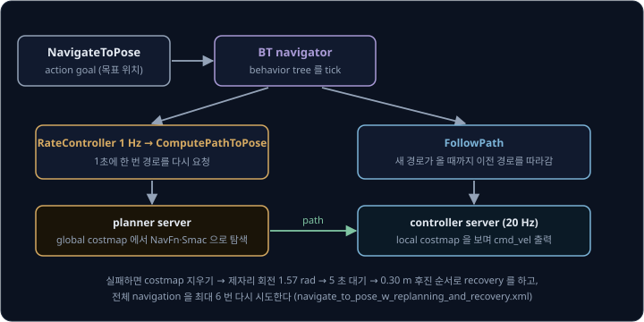

# Path Planning

사무실 지도를 만든 로봇에게 RViz 에서 목표 위치를 찍어 주면, 로봇은 잠깐 멈췄다가 책상과 벽 사이로 선을 하나 그리고 출발한다. 50 m × 50 m
층을 5 cm 칸으로 나눈 지도에는 칸이 1000 × 1000 = 100만 개 있는데, 로봇은 그중 어느 칸을 이어야 벽에 부딪히지 않고 가장 짧게 가는지를
어떻게 1초도 안 걸려 찾아낼까?

로봇은 지도를 칸마다 지나가는 위험을 숫자로 적은 costmap 으로 바꾸고, 출발 칸에서 그 숫자를 더해 가며 가장 싼 칸부터 넓혀 목표에 닿는
grid search 를 한다. 1959 년 Edsger Dijkstra 가 발표한 최단 경로 방법에 목표까지 남은 거리의 어림값을 더한 것이 1968 년
Hart·Nilsson·Raphael 의 A* 다. ROS 2 의 navigation stack 인 Nav2 는 이런 planner 로 경로를 1초마다 다시 계산한다. Nav2 를 발표한 논문에서는
Tiago 와 RB-1 두 로봇이 이 방식으로 학생들이 오가는 대학 건물을 사람 도움 없이 모두 37.4 mile(약 60 km) 달렸다.

## 학습 목표

- costmap 의 세 layer 가 각각 무엇을 적는지, robot radius 와 inflation radius 가 칸의 cost 를 어떻게 정하는지 숫자로 설명할 수 있다
- Dijkstra 와 A* 가 칸을 꺼내는 순서의 차이와, heuristic 이 실제 남은 비용보다 크지 않아야 최단 경로가 보장되는 이유를 설명할 수 있다
- 자동차형 로봇에 Hybrid-A* 가 필요한 이유와, 로봇 형태에 맞는 Nav2 planner 를 설명할 수 있다
- global planning 과 local planning 을 나누는 이유와, Nav2 의 behavior tree 가 경로를 다시 계산하고 실패를 복구하는 구조를 설명할 수 있다

## 칸으로 나눈 지도와 경로

[LiDAR SLAM](../lidar-slam/README.md) 에서 만든 occupancy grid 지도는 바닥을 같은 크기의 정사각형 칸으로 나누고, 칸마다 비었는지, 막혔는지,
아직 모르는지를 적은 표다. 경로 계획(path planning)은 이 표 위에서 출발 칸부터 목표 칸까지 이어지는 칸의 줄을 찾는 일이다.

칸 하나에서 옮겨 갈 수 있는 이웃은 상하좌우 4 칸(4-connected)이거나 대각선까지 8 칸(8-connected)이고, 대각선 한 칸은 가로 한 칸보다
$\sqrt{2} \approx 1.41$ 배 길다. 칸 하나를 점으로 보고 이웃 칸으로 옮겨 가는 것을 선으로 보면 지도는 점과 선으로 된 **graph** 가 되고,
경로 계획은 선마다 붙은 비용의 합이 가장 작은 길을 찾는 최단 경로 문제가 된다.

Nav2 예제 설정(`nav2_bringup`)처럼 칸 한 변을 0.05 m 로 두면 50 m × 50 m 층 하나에 칸이 1000 × 1000 = 100만 개라서 가능한 길을 모두 비교할
수는 없다. 그래서 비용이 싼 칸부터 넓혀 가는 search 를 쓰는데, 그 전에 칸마다 지나가는 비용부터 정해야 한다.

## costmap 과 layer

Nav2 는 SLAM 지도를 **costmap** 으로 바꿔 쓴다. costmap 은 지도와 같은 칸마다 0 ~ 255 사이의 숫자 하나를 적은 2D grid 로,
숫자가 클수록 그 칸에 로봇 중심을 두기 위험하다는 뜻이다. 값의 뜻은 Nav2 소스의 `cost_values.hpp` 에 정해져 있다.

| 값 | 이름 | 뜻 |
| --- | --- | --- |
| 0 | `FREE_SPACE` | 장애물에서 충분히 멀다 |
| 1 ~ 252 | | 장애물에 가까울수록 크다 |
| 253 | `INSCRIBED_INFLATED_OBSTACLE` | 로봇 중심이 여기 오면 몸이 장애물에 닿는다 |
| 254 | `LETHAL_OBSTACLE` | 장애물이 있는 칸 |
| 255 | `NO_INFORMATION` | 아직 관측하지 못한 칸 |

costmap 은 **layer** 여러 개를 겹쳐 만드는데, layer 마다 한 가지 정보만 맡아 자기 칸을 채우고 마지막에 칸마다 값을 모아 master costmap
하나를 만든다. Nav2 예제의 global costmap 은 아래 세 layer 를 쓴다.

- static layer 는 map server 가 읽어 준 SLAM 지도를 옮겨 적어서, 지도를 만들 때 있던 벽과 기둥이 254 가 된다
- obstacle layer 는 LiDAR scan 으로 지도에 없던 장애물을 적는다. 빔이 끝난 칸은 254 로 표시하고(marking) 빔이 지나간 칸은 비워서(clearing),
  사람이 지나가고 나면 그 자리가 다시 빈 칸이 된다. 예제 설정은 2.5 m 안에서 끝난 빔만 표시하고 3.0 m 까지는 비우는데
  (`obstacle_max_range`, `raytrace_max_range`), 비우는 거리가 더 길어야 멀리 표시해 둔 장애물도 나중에 그 칸을 지나는 빔으로 지울 수 있다
- inflation layer 는 앞의 두 layer 가 적은 254 칸 둘레에 거리에 따라 줄어드는 cost 를 적는다(다음 절)

obstacle layer 는 기본으로 master 의 값과 자기 값 가운데 큰 쪽을 남긴다(`combination_method: 1`). 그래서 지도에서는 빈 칸인 곳에 LiDAR 가
상자를 보면 254 가 남고, 상자를 치우면 static layer 의 값으로 돌아간다. 반대로 지도를 만든 뒤 치운 책장은 static layer 에 254 로 남아 있어서
LiDAR 가 그 자리를 비어 있다고 봐도 경로가 그쪽으로 나지 않는다. 가구 배치가 바뀌면 지도를 다시 만드는 것도 이 때문이다.

## inflation 과 robot radius

planner 는 로봇을 점 하나로 보고 칸을 잇지만, 반지름 0.22 m 인 원형 로봇은 중심이 벽에서 0.22 m 안으로 들어오는 순간 몸이 벽에 닿는다.
장애물을 로봇 반지름만큼 부풀려 두면 점 하나로 계획한 경로가 실제 로봇에게도 부딪히지 않는 경로가 된다. 이렇게 로봇의 몸 전체 대신 로봇
중심이 놓일 수 있는 자리만 따지도록 바꿔 놓은 공간을 **configuration space**(C-space)라고 한다.

inflation layer 는 이 부풀리기를 두 단계로 나눠 한다. 가장 가까운 장애물까지의 거리 $d$ 가 로봇 반지름 $r$ 이하인 칸은 253 으로 두어 지나갈 수
없게 하고, 그 바깥부터 `inflation_radius` 까지는 거리에 따라 지수적으로 줄어드는 cost 를 적는다.

$$
\text{cost}(d) = 252 \times e^{-k\,(d - r)}
$$

$k$ 는 `cost_scaling_factor` 로, 클수록 cost 가 빨리 줄어든다. `nav2_bringup` 의 예제 설정은 $r = 0.22$ m, `inflation_radius` 0.7 m, $k = 3.0$ 을
쓰고, 설정을 비워 두면 plugin 기본값인 `inflation_radius` 0.55 m, $k = 10.0$ 이 들어간다. 반경은 0.7 m 로 두고 $k$ 만 바꿔 계산하면 아래와
같다.

| 장애물까지 거리 | cost ($k = 3$) | cost ($k = 10$) |
| --- | --- | --- |
| 0.22 m 이하 | 253 | 253 |
| 0.30 m | 198 | 113 |
| 0.40 m | 146 | 41 |
| 0.50 m | 108 | 15 |
| 0.60 m | 80 | 5 |
| 0.70 m | 59 | 2 |
| 0.70 m 초과 | 0 | 0 |

0.30 m 의 198 은 $252 \times e^{-3 \times (0.30 - 0.22)} = 252 \times 0.787 = 198.2$ 를 내림한 값이다.

이 cost 를 경로 비용에 넣는 방식은 planner 마다 다르다. Nav2 의 NavFn planner 는 253 이상인 칸을 지나갈 수 없는 칸으로 두고, 나머지 칸의
costmap 값 $c$ 는 그 칸을 지나는 비용 $50 + 0.8c$ 로 바꿔 쓴다(소스의 `COST_NEUTRAL` 50, `COST_FACTOR` 0.8). 장애물에서 먼 빈 칸은 50 이고
벽에서 0.30 m 떨어진 칸은 $50 + 0.8 \times 198 = 208$ 이라서, $k = 3$ 이면 벽 가까운 칸 하나가 빈 칸 네 개만큼 비싸다. 폭 1.2 m 복도의
한가운데는 양쪽 벽에서 0.6 m 라 cost 가 80 이고 지나는 비용은 $50 + 0.8 \times 80 = 114$ 로 0.30 m 칸의 절반쯤이어서, planner 는 조금 돌더라도
통로 가운데로 길을 낸다. $k = 10$ 이면 0.40 m 칸도 cost 가 41, 지나는 비용이 82 로 빈 칸과 별 차이가 없어서 경로가 벽 쪽으로 붙는다.

[Nav2 tuning guide](https://docs.nav2.org/rolling/configuration_and_development/tuning_guide/) 는 inflation 을 벽 둘레에만 얇게 두는 설정을
흔한 실수로 꼽고, 복도와 통로 전체에 완만하게 줄어드는 cost 가 깔리도록 반경과 cost 를 키우라고 권한다. 그래야 경로가 통로 가운데로 나고
다가오는 사람에게도 여유가 생긴다.

**흔한 오해.** "inflation_radius 를 robot radius 와 같게 두면 충분하다." 그러면 벽에서 0.23 m 떨어진 칸과 복도 한가운데가 모두 cost 0 이라서,
planner 는 벽을 스치는 경로를 가장 싸다고 본다. 위치 추정이나 경로 추종이 몇 cm 만 어긋나도 로봇이 253 칸에 들어가 멈추거나 벽에 닿는다.

**확인 문제.** robot radius 0.3 m, `inflation_radius` 1.0 m, `cost_scaling_factor` 3 이다. 벽에서 0.25 m 떨어진 칸과 0.5 m 떨어진 칸의 cost 는?

답 보기

0.25 m 는 robot radius 0.3 m 이하라서 253 이고, 로봇 중심이 이 칸에 오면 몸이 벽에 닿으므로 지나갈 수 없다. 0.5 m 는 $r$ 바깥이라 식에
$d = 0.5$, $r = 0.3$, $k = 3$ 을 넣어 $252 \times e^{-3 \times (0.5 - 0.3)} = 252 \times e^{-0.6} = 252 \times 0.549 = 138.3$, 내림해서 138 이다.

<b>심화: 원형이 아닌 로봇의 footprint</b>

로봇이 원이 아니면 반지름이 하나로 정해지지 않는다. footprint(위에서 본 로봇 윤곽) 안에 들어가는 가장 큰 원의 반지름은 inscribed radius 라고
하고, footprint 를 감싸는 가장 작은 원의 반지름은 circumscribed radius 라고 한다. 장애물까지의 거리가 inscribed radius 이하면 로봇이 어느 방향을
보든 부딪히고, circumscribed radius 보다 크면 어느 방향이든 안전하며, 그 사이에서는 로봇이 바라보는 방향에 따라 부딪히기도 하고 안 부딪히기도
한다. inflation layer 는 inscribed radius 까지만 253 으로 두므로, 그 사이의 칸은 planner 나 controller 가 실제 footprint 를 그 방향으로 놓고
따로 검사해야 한다.

Nav2 tuning guide 는 원형이 아닌 로봇이면 `robot_radius` 대신 실제 `footprint` 를 주라고 권한다. 길고 좁은 로봇을 원으로 근사하면 로봇이 길이
방향으로는 충분히 들어가는 좁은 통로도 원이 들어가지 않아 막힌 것으로 계산되기 때문이다. 반지름을 써도 되는 경우로는 환경에 비해 로봇이 아주
작을 때, 계산 자원이 부족할 때, 방향을 고려하지 않는 planner(NavFn, Smac 2D, Theta*)를 쓸 때를 든다.

## Dijkstra

Dijkstra 의 방법은 출발 칸에서 각 칸까지 가는 데 든 비용 $g$ 를 기록하면서, 아직 꺼내 보지 않은 칸 가운데 $g$ 가 가장
작은 칸을 하나씩 꺼내 그 이웃의 $g$ 를 고친다. 꺼낼 후보 칸을 모아 둔 목록은 open list 라고 하고, 이미 꺼내 본 칸의 모음은 closed set 이라고
한다. 칸을 꺼내 이웃을 살피는 일은 그 칸을 **확장**(expand)한다고 한다. $g$ 가 작은 칸부터 꺼내므로 어떤 칸을 꺼내는 순간 그 칸의 $g$ 는 더
줄어들 수 없는 값으로 확정된다. 목표 칸을 꺼내면 멈추고, 칸마다 적어 둔 직전 칸(parent)을 목표에서 거꾸로 따라가면 경로가 나온다.

위 그림은 가로 8 칸, 세로 6 칸 grid 에서 가운데 벽(회색 4 칸)을 돌아 S 에서 G 로 가는 문제다. 상하좌우로만 움직이고 한 칸에 비용 1 이라,
벽이 없으면 5 칸이지만 벽 때문에 아래로 돌아 9 칸이 걸린다. Dijkstra(왼쪽)는 S 에서 1 칸 떨어진 칸들, 2 칸 떨어진 칸들 순서로 넓혀 가서,
G 의 $g$ 가 9 로 확정될 때까지 빈 칸 44 개 가운데 40 개를, G 반대편인 왼쪽 끝 칸까지 꺼내 본다.

비용이 0 이상이기만 하면 Dijkstra 는 언제나 최단 경로를 찾지만, 목표가 어느 쪽에 있는지 쓰지 않고 모든 방향을 똑같이 살피기 때문에 100만 칸
지도에서는 목표가 가까워도 출발점 둘레를 넓게 확장한다. Nav2 예제 설정의 NavFn planner 도 `use_astar: false` 라서 이 Dijkstra 방식으로 넓히고, `true` 로 바꾸면
다음 절의 A* 를 쓴다.

## A* 와 heuristic

A* 는 Dijkstra 에서 칸을 꺼내는 순서만 바꾼다. 출발점에서 그 칸까지 든 비용 $g$ 에, 그 칸에서 목표까지 남은 비용의 어림값인
**heuristic** $h$ 를 더한 값이 가장 작은 칸을 먼저 꺼낸다.

$$
f(n) = g(n) + h(n)
$$

$f(n)$ 은 칸 $n$ 을 거쳐 목표까지 갈 때 드는 전체 비용의 어림값이다. 상하좌우로만 움직이는 grid 에서는 벽을 무시하고 목표까지의 가로 칸
수와 세로 칸 수를 더한 **Manhattan 거리**를 $h$ 로 쓴다.

같은 grid 에서 A*(위 그림 오른쪽)는 S 의 $f = 0 + 5 = 5$ 에서 시작해 $f$ 가 5 인 칸을 따라 벽 앞까지 바로 간다. 벽에 막혀 $f$ 가 5 인 칸이
더 없으면 $f = 7$ 인 칸들을 살피고, 그다음 $f = 9$ 인 칸들 가운데 아래로 돌아가는 길을 따라 G 에 닿는다. 꺼낸 칸은 17 개로 Dijkstra 의 40 개보다
훨씬 적지만 찾은 경로는 똑같이 9 칸이고, 벽을 없앤 grid 에서 비교하면 차이가 더 커진다.

| 지도 | Dijkstra 가 꺼낸 칸 | A* 가 꺼낸 칸 | 경로 길이 |
| --- | --- | --- | --- |
| 벽 없는 8 × 6 grid | 28 | 6 | 5 칸 |
| 가운데 벽이 있는 8 × 6 grid | 40 | 17 | 9 칸 |

표의 숫자는 값이 같은 칸이 여럿일 때 A* 는 $g$ 가 큰 칸을 먼저 꺼내고 Dijkstra 는 open list 에 먼저 들어온 칸을 먼저 꺼내도록 해서 셌다. 이
규칙을 바꾸면 꺼내는 칸 수도 조금 달라진다.

A* 가 Dijkstra 와 같은 최단 경로를 보장하려면 $h$ 가 실제로 남은 비용보다 크지 않아야 한다. Hart·Nilsson·Raphael 의 1968 년 논문은 이 조건을
만족하는 $h$ 를 쓰면 A* 가 반드시 최단 경로를 찾는다는 것을 증명했고, 이렇게 최단 경로가 보장되는 성질을 **admissible** 이라고 불렀다. 지금은
이 조건을 만족하는 $h$ 자체를 admissible heuristic 이라고 부른다. Manhattan 거리는 벽을 무시하고 잰 거리라서 벽을 돌아가는 실제 거리보다 길 수
없으므로 이 조건을 만족한다. 논문은 도시 사이의 도로 길이를 직선 거리로 어림하는 예를 드는데, 어떤 도로도 직선보다 짧을 수는 없다.

$h$ 의 크기에 따라 A* 의 동작은 아래처럼 달라진다.

| heuristic | 꺼내는 칸 | 경로 |
| --- | --- | --- |
| $h = 0$ | Dijkstra 와 같다 | 최단 |
| 실제 남은 비용 이하(실제 값에 가까울수록) | 대체로 줄어든다 | 최단 |
| 실제 남은 비용보다 클 수 있음 | 더 줄어들 수 있다 | 최단이 아닐 수 있다 |

대각선 이동을 허용하는 8-connected grid 에서는 Manhattan 거리가 대각선 한 칸($\sqrt{2} \approx 1.41$)을 2 로 세서 실제보다 커질 수 있으니,
직선 거리(Euclidean distance)처럼 실제 거리를 넘지 않는 $h$ 를 쓴다.

**흔한 오해.** "A* 는 Dijkstra 보다 더 짧은 경로를 찾는다." admissible 한 $h$ 를 쓰면 둘이 찾는 경로의 비용은 같고, 그 경로를 찾기까지 꺼내
보는 칸의 수와 계산 시간만 다르다. Nav2 가 낸 경로가 가장 짧은 길이 아닌 것도 A* 탓이 아니라, inflation cost 를 더한 비용이 가장 작은 길을
찾기 때문이다.

**확인 문제.** open list 에 칸 A($g = 3$, $h = 6$)와 칸 B($g = 5$, $h = 2$)가 있다. Dijkstra 와 A* 는 각각 어느 칸을 먼저 꺼낼까?

답 보기

Dijkstra 는 $g$ 만 보므로 $g$ 가 3 으로 더 작은 A 를 먼저 꺼낸다. A* 는 $f = g + h$ 를 보는데, A 는 $3 + 6 = 9$, B 는 $5 + 2 = 7$ 이라 B 를 먼저
꺼낸다. B 는 출발점에서 더 멀리 왔지만 목표에 훨씬 가까워서, A* 는 B 를 거치는 길이 더 쌀 것으로 어림한다.

<b>심화: A* 의 절차와 최단 경로 보장</b>

A* 의 절차는 아래와 같다. $h = 0$ 으로 두면 그대로 Dijkstra 다.

1. 출발 칸의 $g$ 를 0 으로 두고 open list 에 넣는다
2. open list 에서 $f = g + h$ 가 가장 작은 칸 $n$ 을 꺼내 closed set 에 넣는다. $n$ 이 목표면 parent 를 거꾸로 따라가 경로를 만들고 끝낸다
3. $n$ 의 이웃 $m$ 마다 $g(n) + (n \to m \text{ 비용})$ 을 계산해, $m$ 의 지금 $g$ 보다 작으면 $g(m)$ 과 parent 를 고치고 open list 에 넣는다
4. 2 로 돌아간다. open list 가 비면 경로가 없다

본문의 벽이 있는 grid 에서 칸을 (열, 행)으로 적고 왼쪽 위 칸을 (0, 0)으로 두면 S 는 (1, 3), G 는 (6, 3)이다. A* 가 꺼낸 17 칸을 $f$ 로 묶으면
아래와 같다.

| $f$ | 꺼낸 칸 | 개수 |
| --- | --- | --- |
| 5 | S(1, 3), (2, 3), (3, 3) | 3 |
| 7 | (3, 2), (3, 4), (2, 2), (2, 4), (1, 2), (1, 4), (0, 3) | 7 |
| 9 | (3, 1), (3, 5), (4, 5), (5, 5), (6, 5), (6, 4), G(6, 3) | 7 |

$f$ 가 5, 7, 9 로 2 씩 뛰는 것은 상하좌우 한 칸을 움직이면 $g$ 가 1 늘고 $h$ 가 1 늘거나 1 줄어서, 목표에서 멀어지는 한 칸마다 $f$ 가 2 씩
커지기 때문이다.

최단 경로의 비용을 $C^*$ 라고 하자. 목표를 꺼내기 전에는 최단 경로 위의 칸 가운데 하나가 늘 open list 에
있고, 그 칸 $n'$ 의 $g$ 는 최단 경로를 따라온 값이며 $h$ 는 실제 남은 비용 이하라서 $f(n') \le C^*$ 다. 만약 비용이 $C^*$ 보다 큰 경로로 목표에
닿았다면 그 목표의 $f$ 는 $C^*$ 보다 크므로, A* 는 그 목표를 $f(n') \le C^*$ 인 $n'$ 보다 먼저 꺼낼 수 없다. 그래서 A* 가 목표를 처음 꺼낼 때
그 비용은 $C^*$ 다.

## 자동차형 로봇과 Hybrid-A*

grid 위의 A* 경로는 칸 중심을 이은 꺾은선이라 모서리에서 90° 로 방향을 바꾼다. 두 바퀴를 반대 방향으로 돌려 제자리에서 회전할 수 있는
differential drive 로봇은 모서리에서 멈춰 돌면 되지만, 앞바퀴를 꺾어 도는 자동차형(Ackermann) 로봇은 최소 회전 반경보다 작게 돌 수 없어서
이 경로를 따라가지 못한다. Nav2 논문도 실험에 쓴 A* planner 의 한계로, 원형이 아닌 로봇과 자동차형 로봇이 따라갈 수 있는 경로를 만들지
못한다고 적었다.

**Hybrid-A*** 는 로봇의 위치 $(x, y)$ 에 로봇이 바라보는 방향 $\theta$ 를 더한 $(x, y, \theta)$ 를 상태로 두고, 한 상태에서 최소 회전 반경으로
왼쪽으로 꺾는 호, 직진, 오른쪽으로 꺾는 호를 그려 다음 상태를 만든다. 호 끝의 실제 좌표를 그대로 기억하고 칸은 이미 와 본 상태인지 가리는
데만 쓰기 때문에, 경로가 칸 중심에 묶이지 않고 자동차가 달릴 수 있는 곡선이 된다. 이름의 hybrid 는 연속 좌표와 칸을 함께 쓴다는 뜻이다.
2007 년 DARPA Urban Challenge 에서 Stanford Racing Team 의 차량 Junior 가 이 방법으로 주차장을 다니고 막힌 도로에서 U-turn 을 했다. Dolgov
등은 2010 년 논문에서 이 방법을 정리하면서, 실제 주차장에서 경로를 한 번 다시 계획하는 데 50 ~ 300 ms 가 걸렸다고 보고했다.

방향까지 상태에 넣으면 탐색할 공간이 크게 늘어나서, 칸이 100만 개인 지도에서 방향을 72 칸(5° 간격, Nav2 Smac Hybrid-A* 의 기본값)으로 나누면
상태가 $10^6 \times 72 = 7200$만 개가 된다. 그래서 heuristic 이 더 중요해지는데, Nav2 의 Smac Hybrid-A* 는 장애물을 고려한 2D 거리와, 장애물을 무시하고
회전 반경만 지킨 거리 가운데 큰 값을 $h$ 로 쓴다. 둘 다 실제 남은 비용을 넘지 않으니 큰 쪽을 골라도 admissible 하다.

앞으로만 가는 차가 회전 반경을 지키며 갈 수 있는 가장 짧은 곡선은 Dubins 경로라고 하고, 후진까지 허용한 가장 짧은 곡선은 Reeds-Shepp 경로라고 한다. Smac Hybrid-A*
는 `motion_model_for_search` 로 둘 중 하나를 고르는데 기본값은 `DUBIN` 이고, `minimum_turning_radius` 의 기본값은 0.4 m 다. Reeds-Shepp 에서는
후진하는 호의 비용에 `reverse_penalty`(기본 2.0)를 곱해 꼭 필요할 때만 후진하게 한다.

Smac 에는 같은 $(x, y, \theta)$ 상태를 미리 계산해 둔 motion primitive(짧은 움직임) 묶음으로 잇는 State Lattice planner 도 있다.
방향까지 따지는데도 두 planner 의 계산 시간은 2D planner 와 비슷한데, Nav2 문서는 이를 최적화한 heuristic 과 효율적인 구현 덕분이라고
설명한다. 문서의 예에서 약 75 m 경로를 계획하는 데 걸린 시간은 아래와 같다.

| planner | 탐색하는 상태 | 75 m 경로 계획 시간 |
| --- | --- | --- |
| NavFn | $(x, y)$ | 146 ms |
| Smac 2D (A*) | $(x, y)$ | 243 ms |
| Smac Hybrid-A* | $(x, y, \theta)$ | 144 ms |
| Smac State Lattice | $(x, y, \theta)$ | 113 ms |

Nav2 tuning guide 는 로봇 형태에 따라 planner 를 아래처럼 고르라고 권한다. 표의 Theta* 는 두 칸 사이에 장애물이 없으면 칸 중심을 따라가지
않고 임의 각도의 직선으로 바로 잇는 grid planner 다.

| planner | 맞는 로봇 |
| --- | --- |
| NavFn, Smac 2D, Theta* | 원형 differential drive, 원형 omnidirectional |
| Smac Hybrid-A* | 자동차형(Ackermann), 다리 로봇(원형·비원형 모두) |
| Smac State Lattice | 원형이 아닌 differential drive·omnidirectional, 임의의 형태 |

관절이 6 ~ 7 개인 로봇 팔처럼 상태의 차원이 높으면 칸으로 나누는 방법은 칸 수가 감당할 수 없이 늘어나므로, 무작위로 뽑은 자세를 이어 가는
RRT·PRM 같은 sampling-based planner 를 쓴다. 이 내용은 Manipulation 쪽에서 다룬다.

**확인 문제.** 제자리 회전이 되는 원형 청소 로봇과, 최소 회전 반경이 1.5 m 인 자동차형 배송 로봇이 있다. 각각에 Nav2 의 어떤 planner 가 맞을까?

답 보기

원형 청소 로봇은 방향을 고려하지 않아도 모서리에서 제자리 회전으로 방향을 바꿀 수 있으니 NavFn 이나 Smac 2D 로 충분하다. 자동차형 배송 로봇은
90° 로 꺾이는 경로를 따라갈 수 없으므로, `minimum_turning_radius` 를 1.5 m 로 둔 Smac Hybrid-A* 를 써야 실제로 달릴 수 있는 경로가 나온다.

## global planning 과 local planning

global planner 의 경로에는 지도와 경로를 계산하던 순간에 보인 장애물만 들어 있다. 계산에 100 ms 넘게 걸리는 일을 1초에 20 번 할 수는
없는데, 그사이에도 사람이 앞을 막아설 수 있다. 그래서 navigation 은 일을 두 층으로 나눠, **global planning** 은 지도 전체에서 목표까지의
경로를 드물게 계산하고 **local planning** 은 로봇 둘레의 좁은 영역만 보며 그 경로를 따라갈 속도 명령을 자주 계산한다.

Nav2 는 costmap 도 두 개를 따로 두는데, `nav2_bringup` 예제 설정의 값은 아래와 같다.

| 항목 | global costmap | local costmap |
| --- | --- | --- |
| 범위 | 지도 전체 | 로봇 둘레 3 m × 3 m, 로봇과 함께 움직임(`rolling_window`) |
| 기준 frame | `map` | `odom` |
| 갱신 주기 | 1 Hz | 5 Hz |
| layer | static, obstacle, inflation | voxel, inflation |
| 쓰는 곳 | planner server | controller server (20 Hz) |

local costmap 은 3 m 를 0.05 m 칸으로 나눈 60 × 60 = 3600 칸으로, 100만 칸짜리 global costmap 보다 훨씬 작아서 1초에 5 번 갱신할 수 있다.
voxel layer 는 obstacle layer 를 높이 방향으로 넓힌 것이다. 예제 설정처럼 높이를 0.05 m 씩 16 칸으로 나누면 depth camera 처럼 3D 점을 주는
센서로 책상 상판같이 바닥에서 떠 있는 장애물도 적을 수 있다.

지도 위 로봇 위치는 [Particle Filter](../particle-filter/README.md) 에서 본 AMCL 이 LiDAR scan 을 지도에 맞춰 고치는데, 고칠 때마다 `map` frame
에서 본 로봇 위치가 몇 cm 씩 바뀐다. 1초에 20 번 속도를 정하는 controller 가 이 위치로 장애물을 보면 장애물이 갑자기 옮겨 간 것처럼 보이므로, local
costmap 은 오차는 쌓이지만 매끄럽게 이어지는 `odom` frame 기준으로 둔다.

예제 설정의 velocity smoother 최고 속도인 0.5 m/s 로 달리면, global 경로를 다시 받기까지(1 s) 로봇은
$0.5 \times 1 = 0.5$ m 를 가고 controller 의 다음 명령까지(0.05 s) $0.5 \times 0.05 = 0.025$ m 를 간다. 그사이 앞에 사람이 나타나면 5 Hz 로
갱신하는 local costmap 이 $1 \div 5 = 0.2$ s 안에 그 사람을 적고 controller 가 피해 간다. 길이 아예 막혔으면 다음 global 계획이 돌아가는 길을 낸다.

## Nav2 의 planner server 와 behavior tree

Nav2 는 경로 계획, 경로 추종, 복구 동작을 각각 별도의 server node 로 나누고, 이들을 언제 어떤 순서로 부를지는 **behavior tree**(BT)로 정한다.
behavior tree 는 실제 일을 하는 leaf node 와 실행 순서를 정하는 control node 로 이루어진 tree 다. 일정 주기로 위에서부터 node 를 실행(tick)하면
각 node 는 성공(SUCCESS), 실패(FAILURE), 진행 중(RUNNING) 가운데 하나를 돌려준다. Sequence node 는 자식을 차례로 실행하다 하나라도 실패하면
멈추고, Fallback node 는 자식 하나가 성공할 때까지 다음 자식을 시도한다. Nav2 문서에 따르면 같은 일을 finite state machine 으로 짜면 상태가
수십 개, 전이가 수백 개로 늘어나지만, BT 는 경로 계산·제자리 회전 같은 동작을 node 로 만들어 다시 쓸 수 있어서 Nav2 는 BT 를 골랐다.

[ROS 2 Basics](../ros2-basics/README.md) 에서 본 `NavigateToPose` action 으로 목표가 들어오면 BT navigator 가 기본 tree
(`navigate_to_pose_w_replanning_and_recovery.xml`)를 tick 하는데, 이 tree 는 아래 일을 한다.

- `RateController` 가 `ComputePathToPose` 를 1초에 한 번만 통과시키면 planner server 가 global costmap 에서 경로를 새로 계산하는데, 이때
  `GridBased` 같은 이름으로 등록한 plugin(NavFn, Smac 등)을 불러 쓴다
- `FollowPath` 는 그동안 가장 최근 경로를 controller server 에 넘겨 1초에 20 번 속도 명령(`cmd_vel`)으로 바꾸게 한다
- 경로 계산이 실패하면 global costmap 을 지우고, 경로 추종이 실패하면 local costmap 을 지운 뒤 한 번 더 해 본다. 지나간 사람이 지워지지 않고
  남은 칸 같은 잘못된 측정을 없애기 위해서다
- 그래도 실패하면 두 costmap 지우기, 제자리 회전 1.57 rad, 5 초 대기, 0.15 m/s 로 0.30 m 후진 순서로 recovery 동작을 하나씩 시도한다. 하나를
  할 때마다 navigation 을 처음부터 다시 시도하고, 이것을 최대 6 번 되풀이한다

재계획 주기는 너무 길어도 너무 짧아도 문제다. 경로를 한 번만 계산하고 끝내면 길을 막은 닫힌 문이나 짐을 피해 돌아가는 길을 찾지 못하고,
너무 자주 계산하면 계산 자원을 그만큼 쓰면서 비용이 비슷한 두 길 사이에서 경로가 자주 바뀔 수 있다. Nav2 논문의 37.4 mile 실험도 1 Hz 로
global planner 를 불렀다. Nav2 에는 경로가 막혔거나 목표가 바뀌었거나 10 초가 지났을 때만 다시 계산하는 tree
(`nav_to_pose_with_consistent_replanning_and_if_path_becomes_invalid`)도 있어서, 경로가 자주 바뀌는 것이 문제면 그쪽을 쓴다. planner server 의 `expected_planner_frequency`(예제 20 Hz)는 재계획 주기를 정하는 값이 아니라, 실제 계산이 그
주기보다 느릴 때 경고를 띄우는 기준이다.

**확인 문제.** planner 가 경로 하나를 계산하는 데 0.3 s 가 걸린다. BT 의 `RateController` 를 5 Hz 로 올리면 1초에 경로를 5 번 받을 수 있을까?

답 보기

5 번 계산하려면 $5 \times 0.3 = 1.5$ 초가 필요하므로 1초에 5 번은 받을 수 없다. 계산이 끝나는 대로 다시 요청해도 1초에 받을 수 있는 경로는
$1 \div 0.3 \approx 3.3$ 번이 상한이라서, 더 빠른 planner 로 바꾸거나 costmap 해상도를 낮추지 않으면 주기만 올려서는 소용이 없다.

## 정리

- costmap 은 지도 칸마다 0 ~ 255 의 cost 를 적은 grid 로, static layer(SLAM 지도), obstacle layer(LiDAR 가 본 장애물), inflation layer 를 겹쳐 만든다.
  inflation layer 는 장애물에서 robot radius 0.22 m 안을 253 으로 막고 그 밖은 $252 e^{-k(d - r)}$ 로 줄여서($k = 3$ 이면 0.3 m 에서 198), planner 가 벽에서 떨어진
  길을 고르게 한다
- Dijkstra 는 출발점에서 든 비용 $g$ 가 작은 칸부터, A* 는 $f = g + h$ 가 작은 칸부터 꺼낸다. $h$ 가 실제 남은 비용을 넘지 않으면 둘은 같은 최단
  경로를 찾고, A* 가 꺼내는 칸이 적다(8 × 6 grid 에서 40 칸 대 17 칸)
- global planner 는 지도 전체에서 1초마다 경로를 다시 계산하고, controller 는 로봇 둘레 3 m × 3 m local costmap 을 보며 1초에 20 번 속도 명령을
  낸다. 자동차형 로봇은 $(x, y, \theta)$ 를 탐색하는 Smac Hybrid-A* 로 회전 반경을 지키는 경로를 만든다

planner 가 내놓는 경로는 지도 위 좌표를 이은 점들의 목록이라서, 이것을 두 바퀴의 속도로 바꾸는 일이 남는다. 다음 강의에서는 controller server
가 경로를 1초에 20 번 속도 명령으로 바꾸는 path tracking 을 다룬다. 경로 위 앞쪽의 한 점을 겨냥해 곡률을 계산하는 pure pursuit 와, 앞으로 몇
초를 예측해 가장 좋은 명령을 고르는 MPC 가 그 예다.

## 참고 자료

- Red Blob Games, [Introduction to the A* Algorithm](https://www.redblobgames.com/pathfinding/a-star/introduction.html) — Dijkstra 와 A* 가
  grid 를 넓혀 가는 순서를 움직이는 그림으로 비교하는 글로, [A* 와 heuristic](#a-와-heuristic) 절과 흐름이 같다
- Nav2 문서, [Tuning Guide](https://docs.nav2.org/rolling/configuration_and_development/tuning_guide/) — inflation 을 통로 전체에 까는 이유,
  footprint 와 radius, 로봇 형태별 planner 선택
- Nav2 문서, [Inflation Layer](https://docs.nav2.org/rolling/configuration_and_development/configuration_guide/core_servers/costmap_2d/costmap_plugins/inflation/)
  와 [Costmap 2D](https://docs.nav2.org/rolling/configuration_and_development/configuration_guide/core_servers/costmap_2d/) —
  inflation·costmap parameter 와 기본값
- Nav2 문서, [Smac Planner](https://docs.nav2.org/rolling/configuration_and_development/configuration_guide/planners_plugins/smac/) 와
  [NavFn Planner](https://docs.nav2.org/rolling/configuration_and_development/configuration_guide/planners_plugins/configuring_navfn/) — Smac 세
  planner 의 차이·계획 시간·parameter 와 NavFn 의 `use_astar`
- Nav2 문서, [Navigate To Pose](https://docs.nav2.org/rolling/getting_started/nav2_behavior_trees/trees/nav_to_pose_recovery/) 와
  [Behavior Trees](https://docs.nav2.org/rolling/getting_started/navigation_concepts/behavior_trees/) — 기본 tree 의 재계획·recovery
  순서와 Nav2 가 behavior tree 를 쓰는 이유
- `nav2_bringup`, [nav2_params.yaml (Jazzy)](https://github.com/ros-navigation/navigation2/blob/jazzy/nav2_bringup/params/nav2_params.yaml) — 이
  강의에서 쓴 예제 설정 값이 모두 들어 있는 파일
- E. W. Dijkstra, [A note on two problems in connexion with graphs](https://doi.org/10.1007/BF01386390) (1959) — 세 쪽짜리 논문의 "Problem 2" 가
  두 점 사이의 최단 경로다
- P. E. Hart, N. J. Nilsson, B. Raphael, [A Formal Basis for the Heuristic Determination of Minimum Cost Paths](https://doi.org/10.1109/TSSC.1968.300136)
  (1968) — $f = g + h$ 와, $h$ 가 실제 비용의 하한이면 A* 가 최단 경로를 찾는다는 Theorem 1 을 읽으면 된다
- D. Dolgov, S. Thrun, M. Montemerlo, J. Diebel, [Path Planning for Autonomous Vehicles in Unknown Semi-structured Environments](https://doi.org/10.1177/0278364909359210)
  (2010) — Hybrid-A* 논문. 초록에 방법의 두 단계(A* 변형 탐색, 비선형 최적화)와 재계획 시간이 있다
- D. Dolgov et al., [Practical Search Techniques in Path Planning for Autonomous Driving](https://cdn.aaai.org/Workshops/2008/WS-08-10/WS08-10-006.pdf)
  (2008) — Stanford Racing Team 의 Junior 가 Urban Challenge 에서 이 planner 를 썼다고 초록에 적은 workshop 논문
- S. Macenski et al., [The Marathon 2: A Navigation System](https://arxiv.org/abs/2003.00368) (2020) — Nav2 의 구조와 behavior tree, 대학 건물에서
  37.4 mile 을 달린 실험과 A* planner 의 한계를 적은 논문
- S. Macenski et al., [Open-Source, Cost-Aware Kinematically Feasible Planning for Mobile and Surface Robotics](https://arxiv.org/abs/2401.13078) (2024)
  — Smac planner 의 cost-aware heuristic 과 Hybrid-A*·State Lattice 구현을 설명하는 논문
