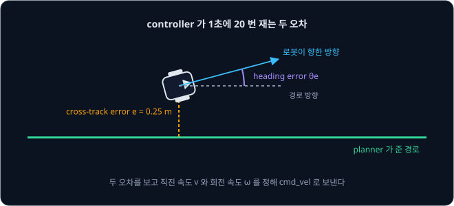
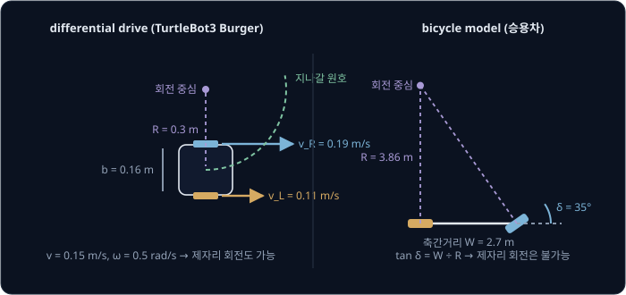
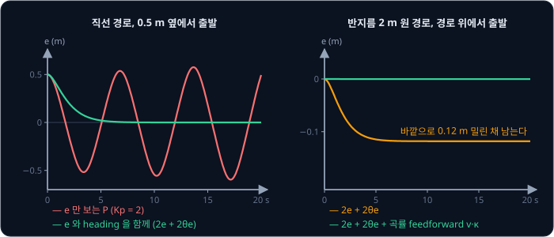
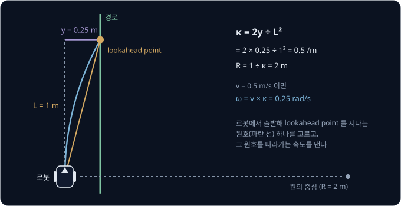
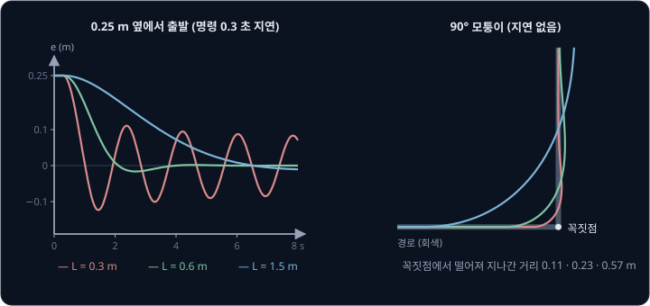
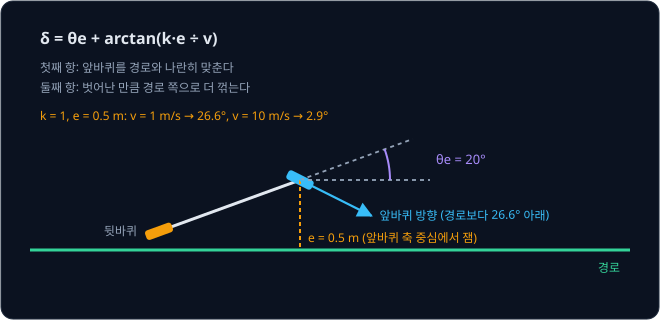
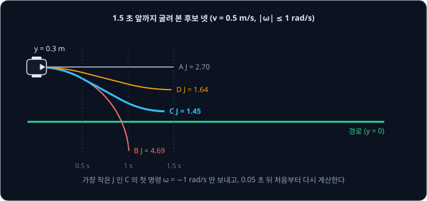
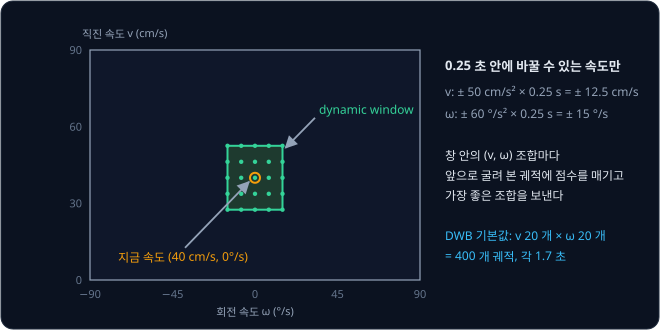

# Path Tracking

Nav2 에서 목표를 찍으면 planner 가 지도 위에 경로를 그려 주지만, 로봇이 받는 명령은 직진 속도와 회전 속도 두 숫자뿐이다. 로봇이 경로에서
왼쪽으로 벗어났을 때 벗어난 거리만큼 오른쪽으로 돌게 하면, 로봇은 경로를 지나쳐 오른쪽으로 넘어갔다가 다시 왼쪽으로 넘어오기를 되풀이한다.
옆으로 곧장 움직이지 못하는 로봇을 흔들림 없이 경로 위로 되돌리려면 1초에 20 번 보내는 속도를 어떻게 정해야 할까?

경로를 따라가도록 그 속도를 정하는 일을 **path tracking** 이라고 한다. CMU 는 1980 년대부터 Terregator 와 Navlab 같은 자율주행 차량에서
경로 앞쪽의 한 점을 향해 원호를 그리는 pure pursuit 를 썼다. 2005 년 DARPA Grand Challenge 사막 코스를 6 시간 53 분 만에 가장 먼저 완주한
Stanford 의 Stanley 는 앞바퀴와 경로 사이의 거리로 핸들 각도를 1초에 20 번 정했다. 지금 Nav2 에서는 controller server 가 이 일을 맡는다.

## 학습 목표

- differential drive 와 bicycle model 로 직진·회전 속도와 바퀴 속도·조향각의 관계를 계산하고, cross-track error 에만 PID 를 걸면 왜 흔들리는지
  설명할 수 있다
- pure pursuit 가 곡률 $2y/L^2$ 로 원호를 고르는 방식과 lookahead 거리가 짧을 때·길 때 생기는 일을 숫자로 설명할 수 있다
- Stanley 방법과 MPC 의 horizon·제약·비용이 각각 무엇을 정하는지 설명할 수 있다
- Nav2 의 DWB·Regulated Pure Pursuit·MPPI 가 속도를 고르는 방식과 controller 주기의 관계를 설명할 수 있다

## 경로와 controller

[Path Planning](../path-planning/README.md) 에서 다루는 planner 는 출발점에서 목표까지 이어진 점의 목록을 내고, Nav2 의 기본 behavior tree
는 이 경로를 1초에 한 번 다시 계산한다. 경로를 받아 매 주기 로봇이 낼 속도를 정하는 쪽이 **controller** 다.
Nav2 에서는 `controller_server` node 가 이 일을 맡고, 기본 설정(`controller_frequency: 20.0`)에서 1초에 20 번 직진 속도 $v$ 와 회전 속도
$\omega$ 를 정해 `cmd_vel` topic 으로 보낸다.

로봇이 경로에서 옆으로 벗어난 거리를 **cross-track error** $e$ 라고 하고, 로봇이 향한 방향과 그 자리에서 경로가 뻗은 방향의 각도 차이를
**heading error** $\theta_e$ 라고 하는데, controller 는 이 두 오차를 매 주기 잰다.

두 오차를 0 으로 만드는 명령은 바퀴 두 개로 도는 실내 로봇과 앞바퀴를 꺾는 차에서 서로 다르다.

## Differential drive

TurtleBot3 나 물류 로봇처럼 좌우 바퀴를 따로 돌리는 구동 방식을 **differential drive** 라고 한다. 두 바퀴를 같은 속도로 돌리면 곧게 가고,
오른쪽 바퀴를 더 빨리 돌리면 왼쪽으로 돈다. 바퀴 간격을 $b$, 오른쪽·왼쪽 바퀴의 속도를 $v_R$, $v_L$ 이라고 하면 로봇 중심의 직진 속도와 회전
속도는 아래와 같다.

$$
v = \frac{v_R + v_L}{2}, \qquad \omega = \frac{v_R - v_L}{b}
$$

TurtleBot3 Burger 는 바퀴 간격이 0.160 m 라서, controller 가 $v = 0.15$ m/s, $\omega = 0.5$ rad/s 를 보내면 driver 는 위 식을 거꾸로 풀어
$v_R = v + \omega b/2 = 0.15 + 0.5 \times 0.08 = 0.19$ m/s, $v_L = 0.15 - 0.04 = 0.11$ m/s 로 바퀴를 돌린다. 이때 로봇은 반지름
$R = v / \omega = 0.15 \div 0.5 = 0.3$ m 의 원을 그린다.

| 명령 $(v, \omega)$ | $v_R$ | $v_L$ | 움직임 |
| --- | --- | --- | --- |
| (0.15, 0) | 0.15 | 0.15 | 직진 |
| (0.15, 0.5) | 0.19 | 0.11 | 반지름 0.3 m 로 왼쪽으로 돈다 |
| (0, 1.0) | 0.08 | −0.08 | 제자리에서 돈다 |
| (0.22, 0.5) | 0.26 | 0.18 | 바퀴가 0.22 m/s 까지만 돌면 낼 수 없다 |

TurtleBot3 의 teleop 예제는 Burger 의 직진 속도를 0.22 m/s 까지로 제한한다. 바퀴도 이 속도까지만 돈다면 직진과 회전이 바퀴 속도의 한계를
나눠 쓰므로, 최고 속도로 달리는 동안에는 돌 수 없고 0.5 rad/s 로 돌려면 직진 속도를 $0.22 - 0.04 = 0.18$ m/s 로 줄여야 한다.

differential drive 는 제자리에서 돌 수 있지만 옆으로는 움직이지 못한다. 바퀴가 옆으로 미끄러지지 않는 한 로봇의 속도는 늘 로봇이 향한
방향이라서, 경로 옆 0.25 m 에 있는 로봇은 몸을 돌려 비스듬히 다가가야 한다. 이처럼 어디로든 갈 수는 있지만 그 순간 움직일 수 있는 방향이
제한된 로봇을 nonholonomic 하다고 한다.

## Bicycle model

차는 앞바퀴를 꺾은 각도 $\delta$ 로 정해지는 원을 그리며 나아갈 뿐 제자리에서 돌지 못한다. 좌우 바퀴를 하나로 합쳐 앞바퀴 하나와
뒷바퀴 하나로 그린 모델을 **bicycle model** 이라고 한다. 바퀴가 옆으로 미끄러지지 않는다고 가정하면 뒷바퀴 축 중심이 그리는 원의 반지름
$R$ 은 축간거리 $W$ 와 조향각으로 정해진다.

$$
\tan\delta = \frac{W}{R}
$$

승용차 크기로 정한 예시 값인 축간거리 2.7 m, 최대 조향각 35° 를 넣으면 가장 작은 회전 반지름은 $2.7 \div \tan 35° = 2.7 \div 0.700 = 3.86$ m
다. 이보다 급하게 꺾이는 경로는 controller 가 어떻게 해도 따라갈 수 없으므로, 차에 쓰는 planner 는 처음부터 이 회전 반지름을 지키는 경로를
그려야 한다. 반대로 controller 가 곡률 $\kappa = 1/R$ 을 정하면 조향각은 $\delta = \arctan(W\kappa)$ 로 구하는데, $\kappa = 0.1$ /m(반지름
10 m)이면 $\arctan(0.27) = 15.1°$ 다.

differential drive 는 곡률을 $\omega = v\kappa$ 로 바꿔 보내고 차는 $\delta = \arctan(W\kappa)$ 로 바꿔 보내면 되므로, pure pursuit 처럼
어떤 곡률로 돌지를 정하는 방법은 두 로봇에 모두 쓸 수 있다.

**확인 문제.** 바퀴 간격 0.4 m 인 로봇의 오른쪽 바퀴가 0.6 m/s, 왼쪽 바퀴가 0.4 m/s 로 돈다. 직진 속도, 회전 속도, 회전 반지름은?

답 보기

$v = (0.6 + 0.4) \div 2 = 0.5$ m/s, $\omega = (0.6 - 0.4) \div 0.4 = 0.5$ rad/s 이고, 반지름은 $R = v / \omega = 0.5 \div 0.5 = 1$ m 다.
오른쪽 바퀴가 빠르므로 왼쪽으로 돈다.

## Cross-track error 에 건 PID

가장 단순한 방법은 cross-track error 에 PID 를 거는 것이다. $v = 0.5$ m/s 로 달리는 differential drive 로봇이 직선 경로
왼쪽 0.5 m 에서 경로와 나란히 출발하고, 회전 속도를 $\omega = -K_p e$ ($K_p = 2$)로 정했다고 하자. 아래는 이 조건에서 controller 를 20 Hz 로
계산하며 직접 시뮬레이션한 결과다.

로봇은 3.4 초 뒤 경로 오른쪽 0.52 m, 6.8 초 뒤 왼쪽 0.54 m, 10.2 초 뒤 오른쪽 0.56 m 에 가 있어서, 흔들림이 줄기는커녕 조금씩 커진다.
경로 위에 도착한 순간 $e = 0$ 이라 회전 명령도 0 이지만, 로봇은 이미 경로를 비스듬히 가로지르는 방향을 향하고 있어서 그대로 반대편으로
넘어간다. [PID Control](../pid-control/README.md) 에서 P 만 쓴 카트가 목표 위치에서 힘이 0 인데도 속도 때문에 지나친 것과 같은 일이다.

카트에서는 힘이 속도를 거쳐 위치를 바꿨는데, 로봇에서는 회전 속도가 방향을 바꾸고 그 방향이 옆으로 움직이는 속도 $v \sin\theta_e$ 를 정한
뒤에야 $e$ 가 바뀐다. heading error 를 보면 $e$ 가 얼마나 빨리 변하는지 알 수 있으므로, heading error 항을 더하면 D 항을 넣은 것과 같은
효과가 난다. $\omega = -2e - 2\theta_e$ 로 바꾸면 로봇은 넘치지 않고 3.9 초 만에 경로 5 cm 안으로 들어온다.

직선에서는 이것으로 충분하지만, 반지름 2 m 원 경로에서는 경로 위에서 출발해도 로봇이 원 바깥쪽 0.12 m 에 머문다. 이 원을 0.5 m/s 로
돌려면 늘 $\omega = v\kappa = 0.5 \times 0.5 = 0.25$ rad/s 가 필요한데, 오차에 비례하는 항만으로 0.25 rad/s 를 내려면 $e$ 가
$0.25 \div 2 \approx 0.12$ m 만큼 남아 있어야 하기 때문이다. PID 강의에서 gravity 가 카트를 당겨 남긴 steady-state error 와 같은 구조라서,
경로 곡률로 구한 회전 속도 $v\kappa$ 를 미리 더하는 feedforward 를 넣으면 남는 오차가 0 이 된다.

$e$ 에 PID 를 거는 방식은 경로가 앞에서 어떻게 휘는지 보지 않는다. 경로의 앞쪽을 보고 명령을 정하는 방법이 pure pursuit 다.

<b>심화: heading 항이 damping 이 되는 이유</b>

$\theta_e$ 가 작으면 $\sin\theta_e \approx \theta_e$ 라서 로봇의 움직임을 아래 두 식으로 쓸 수 있다.

$$
\dot e = v\,\theta_e, \qquad \dot\theta_e = \omega = -K_p e - K_\theta \theta_e
$$

첫 식을 한 번 더 미분해 둘째 식을 넣으면 $\ddot e = v\dot\theta_e = -vK_p\,e - K_\theta\,\dot e$ 가 되는데, 질량 1 인 카트에 spring $vK_p$ 와
damper $K_\theta$ 를 단 식과 같은 꼴이다. 그래서 $K_\theta = 0$ 이면 끝없이 진동하고, 넘치지 않으면서 가장 빨리 닿는 값은
$K_\theta = 2\sqrt{vK_p} = 2\sqrt{0.5 \times 2} = 2$ 다. 본문의 $-2e - 2\theta_e$ 가 이 값을 쓴 것이다. $vK_p$ 에 속도가 들어 있으므로, 같은
gain 이라도 속도가 바뀌면 응답이 달라진다.

## Pure pursuit

**pure pursuit** 는 경로 위에서 로봇으로부터 거리 $L$ 만큼 떨어진 점(lookahead point)을 고르고, 로봇의 지금 위치에서 출발해 지금 향한 방향에
접하면서 그 점을 지나는 원호를 따라간다. 원호를 정하는 데 필요한 값은 lookahead point 가 로봇 기준으로 옆으로 떨어진 거리 $y$ 하나이고,
그 원의 곡률은 아래와 같다.

$$
\kappa = \frac{2y}{L^2}
$$

$L = 1$ m 앞의 점이 옆으로 $y = 0.25$ m 에 있으면 $\kappa = 2 \times 0.25 \div 1^2 = 0.5$ /m, 반지름은 2 m 이고, 로봇이 0.5 m/s 로 달리면
$\omega = v\kappa = 0.5 \times 0.5 = 0.25$ rad/s 를 보낸다. 다음 주기에는 2.5 cm 나아간 자리에서 다시 $L$ 앞의 점을 고르므로,
로봇은 늘 $L$ 만큼 앞서 경로를 따라 움직이는 점을 쫓아간다. pursuit(추격)라는 이름이 여기서 나왔다.

식을 다시 보면 pure pursuit 도 P 제어인데, 오차가 로봇 옆이 아니라 $L$ 앞의 경로가 옆으로 떨어진 거리 $y$ 이고 gain 이 $2/L^2$ 다. 그 오차를
경로 앞쪽에서 재기 때문에 로봇이 경로를 향해 몸을 돌리면 $y$ 가 먼저 줄어들고, 곡선이 다가오면 $y$ 가 먼저 커진다. heading 과 곡률 정보가
$y$ 하나에 들어 있어서 앞 절에서 따로 더한 heading 항과 곡률 feedforward 가 필요 없다. 운전자가 바로 옆 차선이 아니라 몇십 m 앞의 길을 보고
핸들을 돌리는 것과 같다.

Coulter 의 1992 년 보고서에 따르면, 그가 Navlab II 의 tracker 코드를 다시 쓰다 보니 기존 코드의 한 부분은 lookahead 를 18 m 로, 다른 부분은
4.5 m 로 쓰고 있었다. 그 상태로도 석 달 동안 대부분의 경로를 따라갔을 만큼 pure pursuit 는 parameter 오차에 크게 흔들리지
않는다. 같은 보고서에는 한계도 적혀 있다. pure pursuit 는 차와 actuator 의 능력을 모델에 넣지 않으므로, 빠른 속도에서 곡률이 갑자기 바뀌면
뒷바퀴가 미끄러질 수 있고 조향이 늦게 따라오는 만큼 경로에 늦게 붙는다.

<b>심화: 곡률 식 유도</b>

로봇의 뒷바퀴 축 중심(differential drive 는 두 바퀴 사이)을 원점으로, 앞을 $x$, 왼쪽을 $y$ 로 둔다. lookahead point $(x, y)$ 는 원점에서 $L$ 만큼
떨어져 있으니 $x^2 + y^2 = L^2$ 이다. 로봇이 지금 향한 방향에 접하는 원은 중심이 $y$ 축 위의 $(0, R)$ 에 있고, 그 원이 $(x, y)$ 를 지나려면
중심까지의 거리가 $R$ 이어야 한다.

$$
x^2 + (R - y)^2 = R^2 \;\Rightarrow\; x^2 + y^2 = 2Ry \;\Rightarrow\; R = \frac{L^2}{2y}, \quad \kappa = \frac{2y}{L^2}
$$

$y$ 대신 로봇이 향한 방향과 lookahead point 사이의 각도 $\alpha$ 로 쓰면 $y = L\sin\alpha$ 라서 $\kappa = 2\sin\alpha / L$ 이고, bicycle model 에
넣으면 조향각은 $\delta = \arctan(2W\sin\alpha / L)$ 다. Nav2 의 Regulated Pure Pursuit 코드도 lookahead point 를 로봇 좌표로 옮긴 뒤
$2y \div (x^2 + y^2)$ 로 곡률을 계산한다.

## Lookahead 거리

pure pursuit 에서 정해야 할 parameter 는 사실상 $L$ 하나인데, gain 이 $2/L^2$ 라서 $L$ 이 짧으면 작은 오차에도 크게 돌고 길면 천천히 돈다.
$L = 0.3$ m 이면 gain 이 $2 \div 0.09 = 22.2$, $L = 1.5$ m 이면 $2 \div 2.25 = 0.89$ 로 25 배 차이다. 아래 그림과 표는 $v = 0.5$ m/s 로 달리는
로봇에서 $L$ 만 바꿔 계산한 결과다. 왼쪽은 경로 0.25 m 옆에서 출발하고 명령이 0.3 초 늦게 바퀴에 반영된다고 가정한 경우이고, 오른쪽은 지연
없이 90° 모퉁이를 도는 경우다.

| $L$ | gain $2/L^2$ | 5 cm 안에 들어오는 시간 (0.5 m/s, 0.3 초 지연) | 모퉁이 꼭짓점과의 거리 (0.5 m/s, 지연 없음) |
| --- | --- | --- | --- |
| 0.3 m | 22.2 | 25 초가 지나도 ±5 cm 넘게 흔들린다 | 0.11 m |
| 0.6 m | 5.6 | 1.7 초 | 0.23 m |
| 1.5 m | 0.89 | 4.5 초 | 0.57 m |

짧은 $L$ 은 경로에 바짝 붙지만 지연이 있으면 경로를 사이에 두고 흔들리는데, 0.3 초 전에 정한 큰 회전 명령이 로봇이 경로에 거의 다 왔을 때
반영되기 때문이다. 긴 $L$ 은 흔들리지 않지만 경로에 늦게 붙고, 모퉁이에서는 멀리 앞의 점을 향해 원호를 그리므로 안쪽을 가로지른다(corner
cutting). 지연이 없더라도 측위 결과가 몇 cm 씩 튀면, 짧은 $L$ 에서는 gain 이 큰 만큼 회전 명령도 크게 튄다.

Coulter 는 lookahead 가 길수록 로봇이 경로에 천천히, 덜 흔들리며 붙는다는 점에서 $L$ 이 2차 시스템의 damping 처럼 작용한다고 적었다. 같은
경로에서 여러 controller 를 비교한 Snider(2009)도 $L$ 을 줄이면 정확해지다가 결국 진동하고, 늘리면 안정해지지만 덜 정확해진다고 정리했다.
그래서 $L$ 을 속도에 비례하게 바꾸는 구현이 흔한데, 빠를수록 같은 시간에 더 멀리 가므로 더 먼 곳을 보게 하는 이 변형을 adaptive pure
pursuit 라고 한다. Snider 는 승용차에서 $L$ 을 3 ~ 25 m 로 제한해 썼다.

Nav2 의 Regulated Pure Pursuit 는 기본값으로 고정 거리 `lookahead_dist: 0.6` m 를 쓰고, `use_velocity_scaled_lookahead_dist` 를 켜면
$L = v \times$ `lookahead_time`(기본 1.5 초)를 `min_lookahead_dist` 0.3 m ~ `max_lookahead_dist` 0.9 m 로 자른 값을 쓴다. 0.5 m/s 면
$0.5 \times 1.5 = 0.75$ m 이고, 1.0 m/s 면 1.5 m 가 아니라 최댓값 0.9 m 다. 이 package 의 README 는 로봇이 좌우로 흔들리면 거리를 늘리고,
경로에 원하는 만큼 빨리 붙지 않으면 줄이라고 권한다.

**흔한 오해.** "lookahead 를 짧게 할수록 경로를 정확히 따라간다." 지연이 없고 측위가 완벽한 simulator 에서만 그렇다. 위 계산처럼 0.5 m/s 에서
0.3 초 지연만 넣어도 $L = 0.3$ m 는 경로에 들어오지 못하므로, $L$ 은 로봇의 속도·지연·제어 주기에 맞춰 정확도와 안정성 사이에서 골라야 한다.

**확인 문제.** 로봇이 0.4 m/s 로 달리고, 경로 위 $L = 0.8$ m 앞의 점이 옆으로 0.16 m 에 있다. pure pursuit 가 보낼 회전 속도는?

답 보기

곡률은 $\kappa = 2y / L^2 = 2 \times 0.16 \div 0.8^2 = 0.32 \div 0.64 = 0.5$ /m 이고, 회전 속도는 $\omega = v\kappa = 0.4 \times 0.5 = 0.2$ rad/s
다. 반지름 $1 \div 0.5 = 2$ m 의 원호를 따라간다.

## Stanley

Stanford 의 Stanley 는 오차를 앞쪽 경로가 아니라 앞바퀴 축 중심에서 잰다. 앞바퀴 축 중심에서 가장 가까운 경로 점까지의 거리를 $e$ 라 하고
그 점의 경로 방향과 차의 방향 차이를 $\theta_e$ 라 하면, 앞바퀴 각도는 아래 식으로 정한다.

$$
\delta = \theta_e + \arctan\frac{k\,e}{v}
$$

첫째 항은 앞바퀴를 경로와 나란하게 맞추고, 둘째 항은 벗어난 만큼 경로 쪽으로 더 꺾는다. 그림처럼 차가 경로 왼쪽 0.5 m 에서 경로보다 20°
왼쪽을 향하면 첫째 항이 오른쪽으로 20° 를 돌리고, $k = 1$, 1 m/s 이면 둘째 항이 $\arctan(1 \times 0.5 \div 1) = 26.6°$ 를 더
돌린다. 합친 46.6° 는 앞에서 예로 든 최대 조향각 35° 를 넘으므로 실제로는 한계 각도에서 잘린다.

빠를수록 같은 각도로 꺾어도 옆으로 더 빨리 움직이므로 둘째 항은 분모에 속도를 두었고, 그래서 같은 0.5 m 오차라도 10 m/s 에서는
$\arctan(0.05) = 2.9°$ 만 더 꺾는다. Stanley 논문은 오차가 작을 때 이 식을 쓰면 오차가 $e(t) \approx e(0)\exp(-kt)$ 로 줄어든다고 보였다. 이
감소율은 속도와 상관없어서 $k = 1$ 이면 1 초마다 오차가 $\exp(-1) \approx 0.37$ 배가 되고, 0.5 m 오차는 1 초 뒤 0.18 m, 3 초 뒤 0.025 m 가
된다. 오차가 크면 arctan 이 90° 에 가까워지면서 앞바퀴가 경로를 똑바로 향한다.

Stanley 의 steering controller 는 이 식을 1초에 20 번 계산했고, 실제 차에 맞춰 항을 더 붙였다. 제어 loop 의 지연과
steering column 의 관성 때문에 명령한 각도와 실제 핸들 각도의 차이를 줄이는 damping 항을 넣었고, 타이어가 옆으로 미끄러지는 만큼은 경로 곡률과 속도로 구한 yaw
보정을 미리 더했다. 이 yaw 보정은 앞에서 본 곡률 feedforward 와 같은 역할을 한다.

Snider(2009)의 비교에서 Stanley 는 대부분 pure pursuit 보다 잘 따라갔지만, 크게 벗어났거나 경로가 매끄럽지 않을 때는 성능이 더 떨어졌다. 잘 맞춘
Stanley 는 앞을 보지 않으므로 모퉁이에서 안쪽을 가로지르지 않고 바깥으로 넘친다.

| | pure pursuit | Stanley |
| --- | --- | --- |
| 오차를 재는 곳 | $L$ 앞의 경로 점 | 앞바퀴 축 중심 |
| 조정할 값 | lookahead $L$ | gain $k$ |
| 모퉁이에서 | 안쪽을 가로지른다 | 바깥으로 넘친다 |
| 크게 벗어났을 때 | 잘 돌아온다 | 상대적으로 약하다 |

## MPC

pure pursuit 와 Stanley 는 지금의 오차 하나로 명령을 정하고, 로봇이 낼 수 있는 속도의 한계는 계산이 끝난 뒤에 자른다. **MPC**(Model Predictive
Control)는 로봇의 움직임 모델로 앞으로 몇 초 동안의 움직임을 미리 계산해 보고, 그동안의 오차와 명령의 크기를 합친 비용이 가장 작은 명령의
순서를 고른다. MPC 는 아래 세 가지로 정해진다.

- horizon: 얼마나 앞까지 계산해 볼지. 몇 step 을 몇 초 간격으로 볼지로 정한다
- 제약: 명령과 상태가 넘으면 안 되는 범위. 바퀴 속도·가속도의 한계, 차의 최대 조향각, 장애물과의 거리가 여기에 들어간다
- 비용: horizon 동안의 cross-track error, heading error, 명령의 크기, 명령의 변화량에 각각 weight 를 곱해 더한 값

$v = 0.5$ m/s 로 달리는 로봇이 경로 왼쪽 0.3 m 에서 경로와 나란히 있고, 회전 속도는 $|\omega| \le 1$ rad/s 로 제한된다고 하자. horizon 은
0.5 초 간격 3 step(1.5 초)이고, 비용은 step 마다 $10e^2 + \theta_e^2$ 와 $0.1\omega^2$ 를 계산해 모두 더한 값이다. weight 10, 1, 0.1 은 이
예를 위해 정한 값으로, cross-track error 를 가장 중요하게 보겠다는 뜻이다. 후보 넷을 시뮬레이션한 결과는 아래와 같다.

| 후보 | $\omega$ 순서 (rad/s) | step 마다의 $e$ (m) | 비용 $J$ |
| --- | --- | --- | --- |
| A | 0, 0, 0 | 0.30, 0.30, 0.30 | 2.70 |
| B | −1, −1, −1 | 0.24, 0.07, −0.16 | 4.69 |
| C | −1, 0, +1 | 0.24, 0.12, 0.06 | 1.45 |
| D | −0.5, 0, +0.5 | 0.27, 0.21, 0.18 | 1.64 |

A 는 오차를 그대로 두고, B 는 경로를 넘어가면서 heading error 까지 키운다. C 는 세게 돌았다가 되돌아와 경로와 나란해진다. pure pursuit 는 원호
하나만 보지만 MPC 는 지금 돌고 나중에 펴는 것 같은 명령의 순서를 통째로 비교할 수 있다. 실제 MPC 는 후보 몇 개가
아니라 최적화 solver 로 가장 좋은 순서를 찾는데, 이 예에서 0.1 rad/s 간격의 $21^3 = 9261$ 개 조합을 모두 계산하면 $(-1, 0.3, 0.4)$ 의
비용 1.33 이 가장 작다.

MPC 는 고른 순서 가운데 첫 명령만 보내고, 다음 주기(20 Hz 면 0.05 초 뒤)에 새로 잰 위치에서 horizon 전체를 다시 계산한다. horizon 이 로봇과
함께 앞으로 밀려 가므로 이 방식을 receding horizon 이라고 하는데, 매 주기 실제 위치에서 다시 출발하므로 모델이 틀렸거나 바닥이 미끄러워도
오차가 쌓이지 않는다. 그 대가로 매 주기 최적화 문제를 풀어야 해서 계산이 pure pursuit 보다 훨씬 많고, 결과가 모델과 weight 에 크게
좌우된다.

**확인 문제.** 위 비용 식에서 후보 A 의 비용이 2.70 이 되는 계산을 적어 보라.

답 보기

A 는 직진만 하므로 세 step 모두 $e = 0.3$ m, $\theta_e = 0$, $\omega = 0$ 이다. step 마다 $10 \times 0.3^2 + 0^2 = 0.9$ 이고 세 step 을 더하면
$0.9 \times 3 = 2.7$, 명령 항은 $0.1 \times 0 = 0$ 이라 $J = 2.70$ 이다.

<b>심화: MPC 의 최적화 문제와 MPPI 의 가중 평균</b>

상태 $\mathbf{x}_k$(위치·방향), 명령 $\mathbf{u}_k$(속도), 움직임 모델 $f$, horizon $N$ 으로 MPC 가 매 주기 푸는 문제는 아래와 같다.

$$
\min_{\mathbf{u}_0, \dots, \mathbf{u}_{N-1}} \sum_{k=1}^{N} \ell(\mathbf{x}_k) + \sum_{k=0}^{N-1} \mathbf{u}_k^\top R\,\mathbf{u}_k
\quad \text{s.t.} \quad \mathbf{x}_{k+1} = f(\mathbf{x}_k, \mathbf{u}_k), \;\; \mathbf{u}_{\min} \le \mathbf{u}_k \le \mathbf{u}_{\max}
$$

$\ell$ 은 위 예의 $10e^2 + \theta_e^2$ 처럼 상태가 경로에서 벗어난 정도에 매기는 비용이다. $f$ 가 linear 하고 비용이 제곱 꼴이면 빠르게 푸는
solver 가 있지만, 장애물 비용처럼 매끄럽지 않은 항이 들어가면 풀기 어려워진다.

MPPI(Model Predictive Path Integral)는 이 문제를 미분 없이 푼다. 직전 주기의 답에 Gaussian noise 를 더한 명령 순서를 수천 개 뽑아 모두
시뮬레이션하고, 비용 $J_i$ 가 작은 후보일수록 큰 weight $w_i \propto \exp(-(J_i - J_{\min})/\lambda)$ 를 주어 명령을 가중 평균한다. $\lambda$
는 temperature 라고 부르는데, 0 에 가까우면 가장 좋은 후보만 남기고 크면 모든 후보를 고르게 섞는다. 위 표의 네 후보에 $\lambda = 0.3$ 을 쓰면
weight 는 A 0.01, B 0.00, C 0.65, D 0.34 이고, 첫 명령은 $0.65 \times (-1) + 0.34 \times (-0.5) + 0.01 \times 0 \approx -0.82$ rad/s 다. 가장
좋은 후보 하나만 고를 때보다 명령이 덜 튀고, 비용 함수에 장애물처럼 끊긴 항이 있어도 그대로 쓸 수 있다.

## Nav2 controller

Nav2 의 `controller_server` 에는 DWB, Regulated Pure Pursuit, MPPI 같은 controller 를 plugin 으로 끼운다. 기본 설정(`nav2_bringup` 의
`nav2_params.yaml`)은 ROS 2 Humble 과 Iron 에서는 DWB 를 쓰고, Jazzy 부터는 MPPI 를 쓴다.

DWB 는 Fox, Burgard, Thrun 이 1997 년에 발표한 **dynamic window approach**(DWA)를 바탕으로 한 controller 다. DWA 는 직진 속도와 회전 속도를 두
축으로 하는 평면에서, 지금 속도에서 출발해 가속도 한계 안에서 다음 주기까지 닿을 수 있는 사각형(dynamic window)만 후보로 삼는다.

DWA 논문의 로봇 RHINO 는 0.25 초마다 계산했고 가속도 한계가 50 cm/s², 60°/s² 여서, 후보는 지금 속도에서 $\pm 50 \times 0.25 = \pm 12.5$ cm/s,
$\pm 60 \times 0.25 = \pm 15$ °/s 안에 있다. 이 방법으로 RHINO 는 사람이 많은 곳에서 95 cm/s 까지 충돌 없이 달렸다. DWB 는 기본 설정에서 이 창
안의 직진 속도 20 개와 회전 속도 20 개를 짝지은 400 개의 조합마다 1.7 초(`sim_time`) 동안 같은 속도로 달렸을 때의 궤적을 만든다. 궤적마다
경로와의 거리(PathDist), 경로 방향과의 정렬(PathAlign), costmap 위 장애물 비용(BaseObstacle) 같은 critic 점수를 더해 가장 좋은 조합을 보낸다.
horizon 동안 속도를 바꾸지 않는 궤적만 비교하므로 앞 절의 MPC 를 아주 단순하게 만든 것으로 볼 수 있다.

Regulated Pure Pursuit(RPP)는 pure pursuit 에 속도를 정하는 규칙을 더한 controller 다. 기본 pure pursuit 는 곡률만 정하고 직진 속도는 고정해
두는 경우가 대부분이라서 급한 곡선에서도 같은 속도로 돌다가 넘친다. RPP 는 곡률로 구한 반지름 $R$ 이 `regulated_linear_scaling_min_radius`
(기본 0.9 m)보다 작으면 직진 속도를 $R / 0.9$ 배로 줄인다.

| lookahead 원호의 반지름 | 직진 속도 (`desired_linear_vel` 0.5 m/s) | 회전 속도 $v / R$ |
| --- | --- | --- |
| 1.2 m | 0.5 m/s (줄이지 않음) | 0.42 rad/s |
| 0.6 m | $0.5 \times 0.6 \div 0.9 = 0.33$ m/s | 0.56 rad/s |
| 0.3 m | $0.5 \times 0.3 \div 0.9 = 0.17$ → 최솟값 0.25 m/s | 0.83 rad/s |

마지막 줄에서는 계산한 0.17 m/s 가 `regulated_linear_scaling_min_speed`(기본 0.25 m/s)보다 작아서 0.25 m/s 로 올라간다. RPP 는 장애물에 가까울
때도 속도를 줄이고, 지금 명령으로 앞으로 1 초(`max_allowed_time_to_collision_up_to_carrot`) 동안 갈 원호에 장애물이 있는지 검사한다. 논문은
TurtleBot3 simulation 에서 1.0 m/s 로 계단 모양 경로를 따라가게 했을 때 경로와의 평균 거리가 pure pursuit 0.19 m, adaptive pure pursuit
0.10 m, RPP 0.03 m 였다고 보고했다. 계산도 가벼워서 README 에 따르면 최신 Intel CPU 에서 1 kHz 넘는 주기로 계산할 수 있다.

MPPI 는 Williams 등이 2016 년에 발표한 sampling 기반 MPC 로, 원 논문에서는 GPU 로 계산해 1/5 크기 자율주행 차 AutoRally 를 공격적으로 몰았다.
Nav2 의 MPPI controller 는 이 방법을 CPU 에서 vector 연산으로 계산한다. Jazzy 의 `nav2_params.yaml` 은 한 주기에 후보 궤적
2000 개(`batch_size`)를 0.05 초 간격 56 step(`time_steps`, `model_dt`)씩 시뮬레이션한다. horizon 은 $56 \times 0.05 = 2.8$ 초이고, 최고 속도
0.5 m/s(`vx_max`)로 1.4 m 앞까지 본다. 한 주기에 $2000 \times 56 = 112{,}000$ 개의 상태를 계산하므로 20 Hz 면 1초에 224 만 개다. 점수는 경로
추종·장애물·목표에 대한 critic 으로 매기고, `motion_model` 로 differential drive, 전방향 로봇, Ackermann(차)을 고른다. 장애물을
피해 경로를 잠시 벗어나는 궤적도 후보에 들어 있으므로 회피와 추종을 비용 하나로 함께 다룰 수 있지만, 계산이 많고 맞춰야 할 critic weight 도
많다.

RPP 는 반대로 장애물이 경로를 막아도 피해 가지 않고, 지금 명령으로 갈 원호에 장애물이 있으면 명령을 보내지 않고 실패를 알린다. 그래서 RPP
README 는 원형으로 볼 수 있는 로봇이 아니면 Smac Planner 처럼 로봇이 실제로 따라갈 수 있는 경로를 그리는 planner 와 함께 쓰라고 권한다.

## 제어 주기

controller 주기가 길수록 로봇은 한 번 정한 명령으로 오래 달리는데, 명령 하나를 유지하는 동안 가는 거리는 아래와 같다.

| 상황 | 속도 | 주기 | 한 주기 동안 가는 거리 |
| --- | --- | --- | --- |
| Nav2 기본, 실내 로봇 | 0.5 m/s | 20 Hz | $0.5 \div 20 = 2.5$ cm |
| 같은 로봇, 주기를 낮춤 | 0.5 m/s | 5 Hz | $0.5 \div 5 = 10$ cm |
| Stanley 가 직선 사막길에서 낸 31.4 mph | 14.0 m/s | 20 Hz | $14.0 \div 20 = 0.70$ m |

한 주기 동안 가는 거리가 lookahead 나 경로의 폭에 비해 커지면, [PID Control](../pid-control/README.md) 에서 계산 주기가 길 때 같은 gain 이
발산한 것처럼 흔들리기 시작한다. 실제 로봇에서는 여기에 측위 결과가 늦게 오는 시간, controller 의 계산 시간, motor driver 가 명령을 받아
바퀴를 돌리기까지의 시간이 지연으로 더해진다.

그렇다고 주기를 무작정 높일 수도 없다. MPPI 의 한 주기 계산이 50 ms 를 넘으면 20 Hz 를 지키지 못하는데, 이때 `controller_server` 는 주기를
놓쳤다는 경고를 남긴다. MPPI README 는 `model_dt` 를 제어 주기와 같게(20 Hz 면 0.05 초) 두고 그보다 크게 두지 말라고 권한다. 또 horizon
동안 최고 속도로 가는 거리가 local costmap 크기의 절반보다 길면 costmap 밖을 보지 못해 속도가 제한된다고 적었는데, README 의 예처럼 3 초를
0.5 m/s 로 내다보면 costmap 은 반지름 1.5 m, 폭 3 m 이상이어야 한다. 그래서 주기와 horizon, 최고 속도, costmap 크기는 함께 정해야 한다.

**확인 문제.** Nav2 기본 설정으로 1.0 m/s 로 달리는 로봇이 있다. controller 의 한 주기 동안 몇 cm 를 가는가? MPPI 의 horizon(56 step × 0.05 초)
동안에는 몇 m 를 내다보는가?

답 보기

기본 `controller_frequency` 는 20 Hz 라서 한 주기는 $1 \div 20 = 0.05$ 초이고, 그동안 $1.0 \times 0.05 = 0.05$ m, 5 cm 를 간다. horizon 은
$56 \times 0.05 = 2.8$ 초라서 $1.0 \times 2.8 = 2.8$ m 를 내다본다. local costmap 은 반지름 2.8 m, 폭 5.6 m 이상이어야 이 horizon 을 다 쓸 수
있다.

## 정리

- path tracking 은 경로를 따라가도록 매 주기 $v$ 와 $\omega$(차는 조향각)를 정하는 일이다. differential drive 는 제자리에서 돌지만 옆으로 못
  가고, 차는 $\tan\delta = W/R$ 이라서 예로 든 축간거리 2.7 m, 최대 35° 로는 반지름 3.86 m 보다 작게 돌지 못한다
- cross-track error 에만 P 제어를 걸면 로봇이 비스듬히 향한 채 경로를 넘어가 ±0.5 m 로 계속 흔들린다. heading 항이 D 항 역할을 하고, 곡선에서는
  곡률 feedforward $v\kappa$ 가 있어야 0.12 m 의 남는 오차가 사라진다
- pure pursuit 는 $L$ 앞의 점으로 곡률 $2y/L^2$ 의 원호를 고르고($L = 1$, $y = 0.25$ 면 0.5 /m), $L$ 이 짧으면 지연에 흔들리고 길면 모퉁이를
  가로지른다. Stanley 는 앞바퀴에서 잰 오차로 명령을 정하고, MPC 는 horizon 동안의 비용이 가장 작은 명령을 고른다

지금까지 본 controller 는 로봇이 자기 위치를 정확히 알고 장애물이 costmap 에 이미 그려져 있다고 가정했는데, 자율주행 차에서는 위치를 아는
일과 장애물을 찾는 일이 각각 별도 module 의 몫이다. 다음 강의에서는 센서에서 localization, perception, prediction, planning 을 거쳐
control 까지 이어지는 자율주행 stack 과, 각 단계의 지연이 시속 수십 km 로 달리는 차에서 몇 m 가 되는지를 다룬다.

## 참고 자료

- R. Craig Coulter, [Implementation of the Pure Pursuit Path Tracking Algorithm](http://www.enseignement.polytechnique.fr/profs/informatique/Eric.Goubault/MRIS/coulter_r_craig_1992_1.pdf) (1992) —
  곡률 식의 유도, lookahead 거리가 경로 복귀와 유지에 주는 영향, Navlab 에서의 경험을 15 쪽에 담은 CMU 보고서
- Jarrod M. Snider, [Automatic Steering Methods for Autonomous Automobile Path Tracking](https://www.ri.cmu.edu/pub_files/2009/2/Automatic_Steering_Methods_for_Autonomous_Automobile_Path_Tracking.pdf) (2009) —
  pure pursuit, Stanley, kinematic controller, LQR 계열 controller 를 같은 차 모델과 코스에서 비교한 보고서. 2 장의 tuning 결과와 결론 장을 읽으면 된다
- Sebastian Thrun et al., [Stanley: The Robot that Won the DARPA Grand Challenge](https://doi.org/10.1002/rob.20147) (2006) — 9.2 절에 Stanley
  steering controller 의 식과 실제 차에 더한 항이 있다
- Steve Macenski et al., [Regulated Pure Pursuit for Robot Path Tracking](https://arxiv.org/abs/2305.20026) (2023) — pure pursuit 계열의 정리와
  RPP 의 곡률·장애물 기반 속도 조절, TurtleBot3 실험 결과
- Nav2, [Regulated Pure Pursuit README](https://github.com/ros-navigation/navigation2/blob/jazzy/nav2_regulated_pure_pursuit_controller/README.md) —
  parameter 목록과 기본값, lookahead 를 고르는 요령
- Nav2, [MPPI Controller README](https://github.com/ros-navigation/navigation2/blob/jazzy/nav2_mppi_controller/README.md) — MPPI 의 동작,
  critic 목록, `model_dt`·horizon·costmap 크기를 맞추는 요령
- Dieter Fox, Wolfram Burgard, Sebastian Thrun, [The Dynamic Window Approach to Collision Avoidance](https://doi.org/10.1109/100.580977) (1997) —
  속도 공간에서 dynamic window 를 정하고 목적 함수로 고르는 원 논문
- Grady Williams et al., [Aggressive Driving with Model Predictive Path Integral Control](https://doi.org/10.1109/ICRA.2016.7487277) (2016) —
  GPU 에서 계산하는 sampling 기반 MPC 인 MPPI 를 1/5 크기 AutoRally 차의 공격적 주행에 적용한 논문
