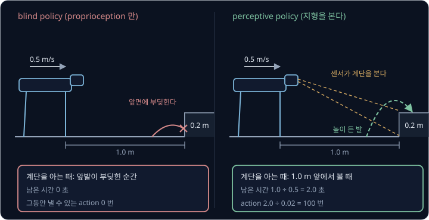
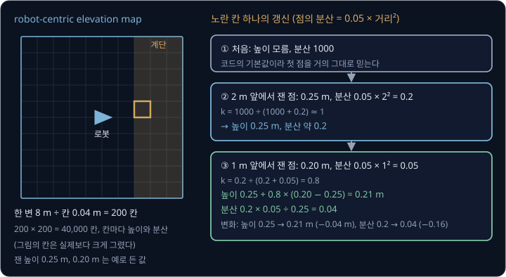
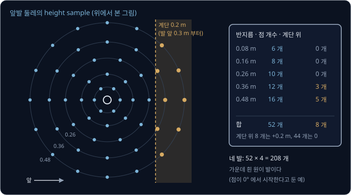
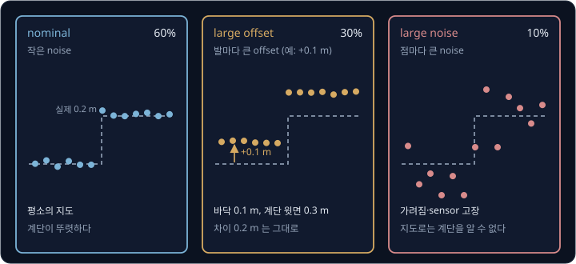
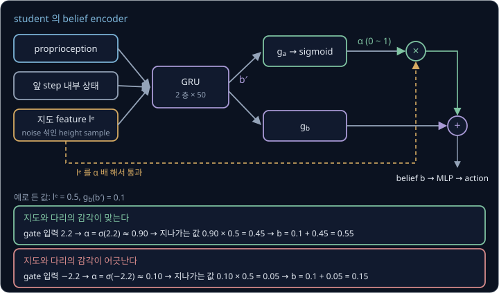
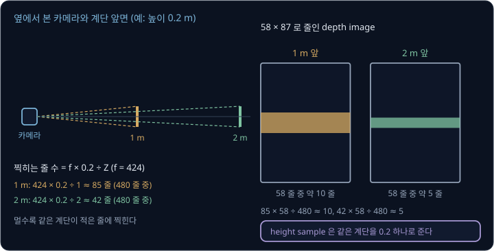
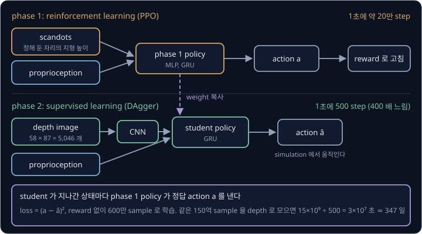
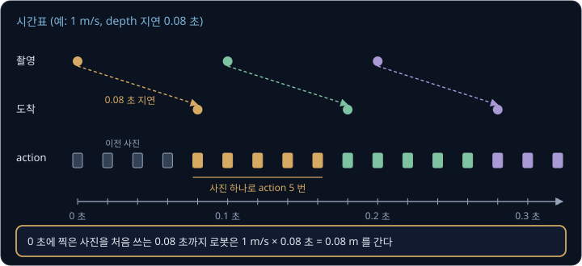
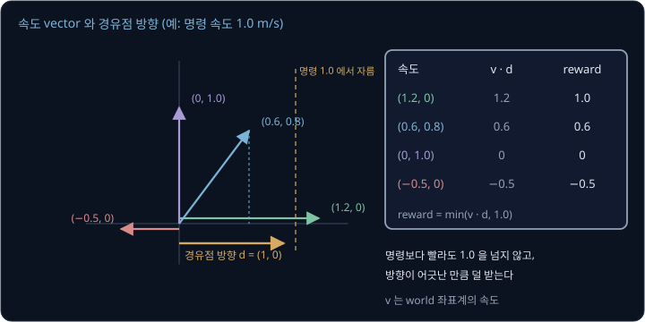
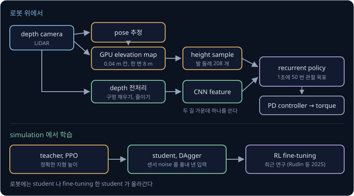

# Perceptive Locomotion

[Sim-to-Real Locomotion](../sim2real-locomotion/README.md#teacher-student-학습) 의 student policy 는 관절 각도와 IMU(몸통의 회전과 가속도를 재는 센서) 값의 최근 이력만 보고 걷는다.
이렇게 몸 안의 센서(proprioception)만 쓰는 policy 를 blind policy 라고 하는데, blind policy 는 앞발이 계단 앞면에 부딪힌 뒤에야 계단이 있다는
것을 안다. Miki 등(2022)이 blind policy 로 4족 로봇 ANYmal 을 나무 단 앞에서 걷게 하자, 단 높이가 20 cm 에 이르면서 앞발이 단에 자주 걸려 성공률이
떨어졌다. 발이 닿기 전에 계단을 알아채려면 policy 에 무엇을 어떤 모양으로 보여 주어야 할까?

이 문제는 로봇 둘레 지형의 높이를 policy 의 observation 에 넣어 풀 수 있다. 몸 밖을 재는 센서(exteroception)로 지형을 보고 걷는 보행을
**perceptive locomotion** 이라고 하고, 지형을 넣는 방법은 두 갈래다. 하나는 레이저로 거리를 재는 LiDAR 나 pixel 마다 거리를 재는 depth camera 가 잰 점을 로봇 주변의 높이 지도로 모아 발
주변의 높이를 읽어 주는 방법이고, 다른 하나는 depth camera 사진을 그대로 neural network 에 넣는 방법이다. Miki 등의 ANYmal 은 첫째 방법으로
30.5 cm 단까지 안정적으로 올랐고, 스위스 Etzel 산의 2.2 km 등산로를 78 분에 걸어 등산 계획 서비스가 제시한 76 분과 거의 같은 시간에 마쳤다.
Agarwal 등(2022)의 Unitree A1 은 둘째 방법으로 머리의 depth camera 한 대만 보고 높이 17 cm 계단 13 칸을 성공률 100% 로 올랐는데, 같은 계단에서
blind policy 는 한 번도 끝까지 오르지 못했다.

## 학습 목표

- 몸 안의 센서만 쓰는 blind policy 가 계단과 틈에서 막히는 이유를, 발이 닿기 전에 남은 시간과 그동안 낼 수 있는 action 수로 설명할 수 있다
- 로봇을 따라 움직이는 높이 지도(robot-centric elevation map)에서 발 주변 높이를 읽는 과정과, 일부러 틀린 지도로 학습한 student 가 gate 로
  지도를 믿을 정도를 정하는 이유를 설명할 수 있다
- depth 사진을 받는 student 가 지형 높이 몇 개만 받는 teacher 의 action 을 따라 배우게 하는 이유와, 두 방법의 지연·계산량·실패 방식을 숫자로 비교할 수 있다
- parkour 연구가 더한 세 가지(장애물을 뚫고 지나가도 되는 학습 초반, policy 가 스스로 정하는 진행 방향, 속도 가운데 진행 방향 성분만큼
  주는 reward)가 각각 무엇을 푸는지 설명할 수 있다

## blind policy 와 계단

blind policy 는 발이 무언가에 닿은 뒤 관절 각도와 torque 가 평소와 달라지는 것으로 지형을 짐작한다. 낮은 턱은 부딪힌 뒤 다리를 더 들어 넘을
수 있지만, 높은 계단에서는 부딪히는 순간 앞발이 걸리고 틈에서는 발이 빠지는 순간 이미 늦다.

예로 로봇이 0.5 m/s 로 걷고 계단 앞면이 앞발에서 1.0 m 앞에 있다고 두자. policy 는 앞 강의의 보행 policy 처럼 0.02 초마다(1초에 50 번) action 을
내고, 두 policy 가 계단을 처음 알아채는 때는 아래와 같다.

| policy | 계단을 처음 아는 때 | 발이 닿기까지 남은 시간 | 그동안 낼 수 있는 action |
| --- | --- | --- | --- |
| perceptive | 센서가 1.0 m 앞의 계단을 볼 때 | $1.0 \div 0.5 = 2.0$ 초 | $2.0 \div 0.02 = 100$ 번 |
| blind | 앞발이 계단 앞면에 닿을 때 | 0 초 | 0 번 |

perceptive policy 는 100 번의 action 동안 보폭을 계단에 맞추고 앞발을 높이 들 준비를 하지만, blind policy 는 부딪힌 다음 action 부터 고칠 수
있다. 실제 로봇의 결과도 이 차이를 보인다.

| 실험 | blind policy | perceptive policy |
| --- | --- | --- |
| ANYmal, 높이 12 ~ 36.5 cm 나무 단, 높이마다 10 번 (Miki 등) | 20 cm 부터 성공률이 떨어진다 | 30.5 cm 까지 안정적으로 오른다 |
| ANYmal, 20 cm 단과 17 cm 계단이 있는 장애물 코스 (Miki 등) | 세 장애물에서 모두 걸려 사람이 들어 옮겼고 75 초 | 도움 없이 33 초 |
| A1, 높이 17 cm·깊이 30 cm 계단 13 칸 오르기 (Agarwal 등) | 성공률 0%, 평균 2.2 칸 | 성공률 100%, 13 칸 |
| A1, 26 cm 틈과 디딤돌 (Agarwal 등) | 둘 다 0% | 100% 와 94% |

Miki 등에 따르면 perceptive policy 는 단에 닿기 전에 다리를 더 높이 들고 몸을 앞으로 기울여 뒷다리가 넘어올 자리를 만들었다. Agarwal 등의 blind
policy 는 틈을 만나자마자 떨어졌는데, 발이 빠지기 전에는 틈의 단서가 관절 값에 남지 않기 때문이다.

> **오해** blind policy 는 계단을 오르내리지 못한다.
>
> **사실** Agarwal 등의 blind A1 은 높이 17 cm 계단 13 칸을 내려가는 시험에서 성공률 100% 였다. 다만 칸마다 떨어지듯 내려가는 큰 충격의 걸음이라 실험 중 오른쪽 뒷다리 hip 이 빠졌고, 같은 계단을 오르는 시험에서는 평균 2.2 칸에서 멈췄다.

**확인 문제.** 1.2 m/s 로 걷는 로봇의 센서가 0.6 m 앞의 계단을 처음 보았다. 1초에 50 번 action 을 내는 policy 가 발이 닿기 전에 낼 수 있는
action 은 몇 번일까?

답 보기

1. 남은 시간: $0.6 \div 1.2 = 0.5$ 초
2. action 한 번의 간격: $1 \div 50 = 0.02$ 초
3. action 수: $0.5 \div 0.02 = 25$ 번

답: 25 번이다. 빨리 걸을수록 같은 거리에서 준비할 action 이 줄어든다.

## robot-centric elevation map

depth camera 한 장에 찍힌 점은 지형의 일부일 뿐이다. 앞에 있는 단이 그 뒤쪽을 가리고, 몸 바로 아래와 뒤는 카메라 시야 밖이다. 그래서 장마다 받은
점을 로봇이 추정한 자기 위치와 자세(pose)로 한 좌표계에 옮겨 쌓고, 지금 보이지 않는 곳의 높이는 지난 장에서 가져온다. 바닥을 같은 간격의
칸(cell)으로 나누고 칸마다 높이 하나를 적은 지도를 **elevation map** 이라고 하며, 2D 지도와 3D 지도 사이라는 뜻에서 2.5D 지도라고도 부른다.
지도의 가운데를 로봇에 맞춰 함께 옮기면 robot-centric elevation map 이 된다.

Miki 등이 GPU 로 다시 짠 공개 코드 `elevation_mapping_cupy` 는 칸 한 변을 기본 0.04 m 로 두고, 지도 한 변을 8 m 로 둔다. 한 변에
$8 \div 0.04 = 200$ 칸이라서 칸은 $200 \times 200 = 40{,}000$ 개이고, 칸마다 높이와 그 분산을 적는다.

칸의 높이는 새 점이 들어올 때마다 [Kalman Filter](../kalman-filter/README.md#kalman-gain) 의 보정 단계와 같은 식으로 고친다. 칸 높이의 분산과
새 점의 분산으로 gain 을 정하고, 그 gain 만큼 새 점 쪽으로 옮긴다. 점의 분산은 sensor 와의 거리의 제곱에 비례하게 두는데,
[Camera Geometry](../camera-geometry/README.md#stereo-camera-와-depth-오차) 에서 본 stereo depth 오차가 거리의 제곱으로 커지는 것과 같은 꼴이다.
코드의 기본 비례 상수가 0.05 라서 2 m 떨어진 점의 분산은 $0.05 \times 2^2 = 0.2$ 이고, 1 m 떨어진 점은 $0.05 \times 1^2 = 0.05$ 다.

로봇이 다가가며 계단 윗면의 한 칸을 두 번 잰다고 하자. 처음 분산 1000 은 코드의 기본값이고, 잰 높이는 예로 든 값이다.

| 단계 | 칸의 높이와 분산 | 새 점 | gain $k$ | 고친 높이와 분산 |
| --- | --- | --- | --- | --- |
| ① 처음 | 모름, 1000 | 2 m 앞에서 잰 0.25 m, 분산 0.2 | $1000 \div 1000.2 \approx 1$ | 0.25 m, 약 0.2 |
| ② 다가간 뒤 | 0.25 m, 0.2 | 1 m 앞에서 잰 0.20 m, 분산 0.05 | $0.2 \div (0.2 + 0.05) = 0.8$ | 0.21 m, 0.04 |

②의 분산은 $0.2 \times 0.05 \div 0.25 = 0.04$ 다. 가까이서 잰 점은 분산이 작아서 gain 0.8 로 크게 반영되고, 높이는 0.20 m 쪽으로 옮겨 간다.

| 이 예의 값 | 기호로 쓴 값 |
| --- | --- |
| 칸의 높이 0.25 m, 분산 0.2 | $h$, $\sigma_m^2$ |
| 1 m 앞에서 잰 점의 높이 0.20 m | 점의 높이 $p_z$, sensor 와의 거리 $d$ |
| 점의 분산 $0.05 \times 1^2 = 0.05$ | $\sigma_p^2 = \alpha_d\, d^2$ |
| $0.2 \div (0.2 + 0.05) = 0.8$ | $k = \sigma_m^2 \div (\sigma_m^2 + \sigma_p^2)$ |
| $0.25 + 0.8 \times (0.20 - 0.25) = 0.21$ | $h \leftarrow h + k\,(p_z - h)$ |

점이 많으면 CPU 로는 늦어서 이 계산을 GPU 로 병렬 처리한다. 로봇에 싣는 GPU 컴퓨터 Jetson Xavier 는 LiDAR 점 43,017 개를 6.857 ms 에 처리했고, Miki 등의
ANYmal 은 지도를 1초에 20 번 갱신했다. 이 지도는 추정한 pose 에 기대고 칸마다 높이 하나만 적어서, 두 논문이 현장에서 본 것처럼 아래와 같이 틀린다.

| 현장에서 생긴 일 | 지도에 생긴 오류 |
| --- | --- |
| 발이 미끄러져 pose 추정 오차가 위아래로 쌓임(drift) | 평평한 바닥에 턱이 생긴다 |
| 나뭇가지나 낮은 천장 | 바닥에서 솟은 벽으로 들어간다 |
| 반사하는 금속 바닥, 질감 없는 눈 | 도랑처럼 꺼지거나 지도가 빈다 |
| 풀, 깊은 눈 | 발이 빠지는 높이가 아니라 윗면이 들어간다 |

<b>심화: elevation map 의 갱신 식과 정리 단계</b>

GPU elevation mapping 논문의 칸 갱신 식은 본문 표의 $h + k(p_z - h)$ 에 $k$ 를 넣어 정리한 꼴이고, 둘째 식은 보정 뒤 분산이다.

$$
h \leftarrow \frac{\sigma_p^2\, h + \sigma_m^2\, p_z}{\sigma_m^2 + \sigma_p^2}, \qquad \sigma_m^2 \leftarrow \frac{\sigma_m^2\, \sigma_p^2}{\sigma_m^2 + \sigma_p^2}
$$

- 평평한 칸에 떨어진 새 점과 지도의 높이 차이를 평균한 만큼 지도 전체를 옮겨 drift 를 줄인다(drift compensation). 코드는 0.1 m 보다 큰 보정은
  하지 않는다
- 로봇 가까이의 높은 점은 버려 머리 위 물체가 벽이 되지 않게 한다(exclusion area)
- 오래 갱신되지 않은 칸은 분산을 계속 더해 덜 믿게 한다. 코드는 1초에 5 번 0.0001 을 더한다
- 칸 높이와의 차이가 그 분산에 비해 너무 큰 점(Mahalanobis distance 가 기본 2.0 을 넘는 점)은 outlier 로 버린다
- sensor 에서 점까지 광선을 따라가며 광선이 칸의 높이보다 아래로 지나간 칸은 지운다(ray casting). 지나간 사람처럼 사라진 물체를 지도에서 빼는 단계다

Jetson Xavier 에서 RealSense 점 407,040 개를 그대로 넣으면 지도를 1초에 16.1 번 갱신했고, 공간을 작은 정육면체로 나눠 칸마다 점을 하나만 남기는 voxel filter 로
6,276 개로 줄이면 49.4 번 갱신했다. 다리 관절 각도로 계산한 pose 는 로봇이 크게 미끄러질 때 위아래로 drift 해서, IMU 와 LiDAR SLAM(LiDAR 로 지도를
만들며 자기 위치를 구하는 방법)을 합친 pose 에 drift compensation 을 더하자 이 문제가 더 줄었다.

**확인 문제.** 높이 0.21 m(분산 0.04)인 칸에 1 m 앞에서 잰 0.30 m 의 점이 들어왔다. 점의 분산은 $0.05 \times 1^2 = 0.05$ 다. 고친 높이와 분산은?

답 보기

1. gain: $0.04 \div (0.04 + 0.05) = 0.04 \div 0.09 \approx 0.44$
2. 높이: $0.21 + 0.44 \times (0.30 - 0.21) = 0.21 + 0.04 = 0.25$ m
3. 분산: $0.04 \times 0.05 \div 0.09 \approx 0.022$

답: 약 0.25 m, 분산 약 0.022 다. 칸의 분산이 점보다 조금 작아서 차이 0.09 m 의 절반이 안 되게 옮긴다.

## 발 주변 height sample

policy 에는 지도의 칸 $200 \times 200 = 40{,}000$ 개를 다 넣지 않고 정해 둔 자리의 높이만 넣는다. [Sim-to-Real Locomotion](../sim2real-locomotion/README.md#보행-policy-의-observation-과-action)
의 legged_gym 계단 설정은 몸통 둘레 앞뒤 1.6 m, 좌우 1.0 m 를 0.1 m 간격으로 나눈 $17 \times 11 = 187$ 개 점을 읽는다. Miki 등은 발마다 그 둘레의
원 다섯 개 위에서 높이를 읽고, 높이는 발 높이를 기준으로 적었다. 반지름 0.08, 0.16, 0.26, 0.36, 0.48 m 원 위에 점을 6, 8, 10, 12, 16 개씩 두어
발 하나에 $6 + 8 + 10 + 12 + 16 = 52$ 개, 네 발에 $52 \times 4 = 208$ 개다. 이웃한 점 사이 거리(원 둘레 ÷ 점 개수)는 가장 안쪽 원이
$2\pi \times 0.08 \div 6 \approx 0.084$ m, 가장 바깥 원이 $2\pi \times 0.48 \div 16 \approx 0.188$ m 라서, 디딜 자리가 될 발 바로 둘레는 자세히 보고 먼
곳은 대강 본다. 점이 발을 따라 움직여서 카메라가 보지 못하는 뒷발 둘레도 지도에 남아 있는 한 들어오고, 지도에 정보가 없는 자리에는 무작위 값을
채운다.

앞발 바로 앞 0.3 m 에 높이 0.2 m 계단 앞면이 있다고 하자. 원마다 점이 발 바로 앞(0°)에서 시작해 같은 각도 간격으로 놓였다고 두면, 계단 위에
떨어지는 점은 발에서 앞쪽으로 0.3 m 넘게 떨어진 점이다.

| 원 | 앞쪽 거리가 0.3 m 를 넘는 점 | 개수 |
| --- | --- | --- |
| 0.08 ~ 0.26 m | 반지름이 0.3 m 보다 작아 없다 | 0 |
| 0.36 m (30° 간격) | 0° 의 0.36 m, ±30° 의 $0.36 \times \cos 30° \approx 0.31$ m | 3 |
| 0.48 m (22.5° 간격) | 0° 의 0.48 m, ±22.5° 의 0.44 m, ±45° 의 0.34 m | 5 |

52 개 가운데 8 개가 +0.2 m 를 읽고 나머지 44 개는 0 을 읽어서, policy 는 어느 방향으로 얼마나 먼 곳부터 계단이 시작되는지를 숫자로 받는다.

Miki 등의 network 는 발마다 52 개를 같은 MLP encoder 에 따로 넣어 24 개 숫자(feature)로 줄이고, 네 발을 이어 $24 \times 4 = 96$ 개로 만든다.

**확인 문제.** 같은 앞발에서 계단 앞면이 0.4 m 앞에 있으면, 52 개 가운데 몇 개가 +0.2 m 를 읽을까? 점의 배치는 위와 같다.

답 보기

1. 반지름 0.36 m 이하의 원은 앞쪽 거리가 최대 0.36 m 라서 0.4 m 를 넘는 점이 없다
2. 0.48 m 원: 0° 는 0.48 m, ±22.5° 는 $0.48 \times \cos 22.5° \approx 0.44$ m 라서 넘고, ±45° 는 $0.48 \times \cos 45° \approx 0.34$ m 라서 넘지 않는다

답: 3 개다. 계단이 멀수록 바깥 원의 몇 점만 계단을 본다.

## 지도 noise 와 student 학습

Miki 등도 [Sim-to-Real Locomotion](../sim2real-locomotion/README.md#teacher-student-학습) 의 teacher-student 학습을 썼다. teacher 는 simulation 의
정확한 height sample 과 privileged information(발 접촉 상태와 힘, 마찰 계수, 몸통에 가한 외력)을 받아 PPO 로 배우고, student 는 실제 로봇에서
얻을 수 있는 값만 받아 teacher 를 따라 배운다. 앞 강의의 Lee 등(2020)의 student 는 지형 높이를 아예 받지 않았지만, Miki 등의 student 는 일부러
noise 를 섞은 height sample 을 받는다. 틀린 지도를 한 번도 겪지 않은 policy 는 실제 지도가 틀려도 그대로 믿고 디디기 때문이다.

noise 는 점의 자리를 옆으로 옮기는 것과 높이를 바꾸는 것 두 종류다. 각각을 점마다 매 step 뽑는 값, 발마다 매 step 뽑는 값, 발마다 episode
동안 고정하는 값으로 나눠 더하고, 가끔 아주 큰 값(outlier)도 더한다. 지도 상태는 episode 시작과 중간에 아래 셋 가운데 하나로 바꾼다.

| 지도 상태 | 고르는 확률 | 흉내 내는 실제 상황 |
| --- | --- | --- |
| nominal: 작은 noise | 60% | 평소의 지도 |
| large offset: 발마다 큰 offset | 30% | pose drift 로 밀린 지도, 발이 빠지는 바닥 |
| large noise: 점마다 큰 noise | 10% | 가려지거나 sensor 가 고장 나 지형 정보가 없는 지도 |

noise 의 크기는 student 학습 초반에 0 에서 시작해 점점 키운다.

예로 앞발의 sample 에 episode 동안 +0.1 m offset 이 붙었다고 하자.

| 자리 | 실제 높이 | +0.1 m offset 이 붙은 sample |
| --- | --- | --- |
| 앞발 아래 바닥 | 0 m | 0.1 m |
| 계단 윗면 | 0.2 m | 0.3 m |
| 둘의 차이 | 0.2 m | 0.2 m |

offset 은 높이 차이를 바꾸지 않아서 계단의 모양은 남는다. 앞발이 바닥을 디디는 순간 다리 관절로 잰 발 높이가 sample 보다 0.1 m 낮다는 것이
드러나므로, 이 차이를 기억하면 나머지 sample 도 0.1 m 를 빼서 읽을 수 있다. student 가 이 일을 배우는 구조는 [belief encoder 의
gate](#belief-encoder-의-gate) 에서 다룬다.

student 의 loss 는 teacher 와 student 의 action 차이 제곱(behavior cloning loss)에, noise 없는 height sample 과 privileged information 을 student
내부 값에서 되살린 값과의 차이 제곱(reconstruction loss)을 0.5 배 해서 더한 것이다. 학습 데이터는 [DAgger](../dagger/README.md) 처럼 student 가
직접 움직이며 모아서, student 가 실수로 들어간 상태에서도 teacher 의 정답을 배운다.

**확인 문제.** 발마다 episode 동안 고정된 offset 이 +0.15 m 다. 실제로는 바닥이 0 m, 계단 윗면이 0.2 m 일 때 student 가 받는 두 sample 과 그
차이는?

답 보기

1. 바닥: $0 + 0.15 = 0.15$ m
2. 계단 윗면: $0.2 + 0.15 = 0.35$ m
3. 차이: $0.35 - 0.15 = 0.2$ m

답: 0.15 m 와 0.35 m 이고 차이는 실제와 같은 0.2 m 다. offset 이 높이를 통째로 밀어도 계단의 모양은 남는다.

## belief encoder 의 gate

지도가 맞으면 계단을 미리 보고 디디는 편이 낫고, 지도가 틀리면 발의 감각을 따라야 한다. Miki 등은 이 판단을 사람이 정한 규칙 대신 network 안의
gate 로 배우게 했다. student 의 belief encoder 는 아래 순서로 계산한다.

1. GRU(앞 step 의 정보를 내부 상태로 기억해 두는 recurrent network)가 proprioception, height sample 의 feature, 앞 step 의 내부 상태를 받아 중간
   belief $b'$ 을 낸다. belief 는 지금 지형과 로봇 상태에 대한 짐작을 숫자로 적은 vector 다
2. $b'$ 으로 지도 feature 마다 0 과 1 사이의 숫자 $\alpha$ 를 계산한다. 이것이 gate 다
3. 최종 belief 는 $b'$ 에서 온 값에 지도 feature 의 $\alpha$ 배를 더한 값이다

0 과 1 사이 숫자는 sigmoid $\sigma(x) = 1 \div (1 + e^{-x})$ 로 만든다. $\sigma(0) = 0.5$ 이고, $\sigma(2.2) \approx 0.90$, $\sigma(-2.2) \approx 0.10$
이다. 예로 지도에서 온 feature 하나가 0.5 이고 $b'$ 에서 온 값이 0.1 이라고 하자.

| 상황 | gate 입력 | $\alpha$ | 지나가는 지도 정보 $\alpha \times 0.5$ | 최종 belief $0.1 + \alpha \times 0.5$ |
| --- | --- | --- | --- | --- |
| 지도와 다리의 감각이 맞는다 | 2.2 | 0.90 | 0.45 | 0.55 |
| 지도와 다리의 감각이 어긋난다 | $-2.2$ | 0.10 | 0.05 | 0.15 |

$\alpha$ 가 1 에 가까우면 지도 정보가 거의 그대로 들어가고, 0 에 가까우면 막혀서 belief 는 GRU 가 proprioception 이력으로 만든 짐작에 기댄다.

| 이 예의 값 | 기호로 쓴 값 |
| --- | --- |
| 지도에서 온 feature 0.5 | $l^e$ (발마다 24 개, 네 발 96 개) |
| GRU 의 중간 belief 로 계산한 gate 입력 2.2 | $g_a(b')$ |
| $\sigma(2.2) \approx 0.90$ | $\alpha = \sigma(g_a(b'))$ |
| 중간 belief 에서 온 값 0.1 | $g_b(b')$ |
| $0.1 + 0.90 \times 0.5 = 0.55$ | $b = g_b(b') + \alpha \odot l^e$ |

$g_a$ 와 $g_b$ 는 작은 MLP 이고, $\odot$ 는 같은 자리의 성분끼리 곱한다는 뜻이다. 최종 belief $b$ 와 proprioception 이 MLP 에 들어가 action 이 나온다.

Miki 등은 학습에만 쓰는 decoder 로 belief 에서 지형 높이를 되살려 policy 의 짐작을 들여다보았다. 지도에 단단해 보이는 스펀지 블록에서는 지도를
믿다가 발이 빠지자 짐작을 아래로 고쳤고, 센서에 잡히지 않는 투명 아크릴 블록에서는 발이 닿은 뒤 위로 고쳤다. 센서를 덮었을 때는 첫 계단 앞면에
부딪힌 뒤 짐작을 고쳐 계단을 올랐다. 이 controller 로 지하 탐사 로봇 대회인 DARPA Subterranean Challenge 결선의 ANYmal 네 대는 1700 m 넘게 탐사하는 동안 한 번도
넘어지지 않았다.

> **오해** gate 는 지도가 틀렸는지 판정하는 사람이 정한 규칙이다.
>
> **사실** $\alpha$ 는 GRU 의 중간 belief 로 계산하는 MLP 의 출력이고, behavior cloning loss 와 reconstruction loss 로 network 의 나머지와 함께 학습한다. Miki 등은 지도와 proprioception 을 합치는 데 손으로 짠 규칙이 없다고 밝혔다.

<b>심화: gate 의 효과와 Miki 등의 network 크기</b>

표준 계단 지형에서 teacher 와 student 의 action 차이(작을수록 잘 따라 함)는 지도 noise 가 작을 때 gate 가 있으면 0.854, 없으면 0.961 이었고,
noise 가 클 때는 1.387 과 1.438 이었다. gate 의 이득이 noise 가 작을 때 0.107, 클 때 0.051 이라서, 저자들은 gate 가 믿을 만한 지도는 더 잘 쓰고
믿을 수 없는 지도 앞에서는 proprioception 만 쓰는 policy 처럼 동작한다고 해석했다.

| 부분 | 크기 |
| --- | --- |
| height sample encoder | 발마다 52 → (80, 60) → 24, 네 발 96 |
| privileged information encoder | → (64, 32) → 24 |
| belief encoder | GRU 2 층, 층마다 50 unit, gate $\alpha$ 는 96 개 |
| belief | $96 + 24 = 120$ 개. teacher 의 두 feature 를 이은 크기와 같다 |
| 마지막 MLP | (256, 160, 128). teacher 와 같은 구조라서 teacher 의 weight 로 시작한다 |

action 은 legged_gym 처럼 관절 목표 각도를 그대로 내지 않는다. 다리마다 발끝이 정해진 궤적(공중에서 0.2 m 까지 올렸다 내리는 곡선)을 따르도록
걸음의 위상을 두고, policy 는 다리마다 위상을 얼마나 당기거나 늦출지와 관절 목표에 더할 작은 보정값을 낸다.

**확인 문제.** gate 입력이 0 이고, 지도 feature 가 0.4, $g_b(b')$ 가 0.2 다. 최종 belief 는? gate 입력이 크게 음수라 $\alpha$ 가 0.05 가 되면?

답 보기

1. gate 입력 0: $\alpha = \sigma(0) = 0.5$ 라서 $0.2 + 0.5 \times 0.4 = 0.4$
2. $\alpha = 0.05$: $0.2 + 0.05 \times 0.4 = 0.22$

답: 0.4 와 0.22 다. $\alpha$ 가 작으면 belief 는 $g_b(b')$ 의 0.2 근처에 머문다.

## egocentric depth image

Agarwal 등은 elevation map 을 만드는 단계가 noise 와 가짜 형상(artifact)을 만들고 비싼 하드웨어를 요구한다고 보고, 로봇에 달린 카메라가 본 사진(egocentric
depth image)을 policy 에 바로 넣었다. 이들의 Unitree A1 은 작은 GPU 인 Jetson NX 와 보드 컴퓨터 하나로 계산하고, 지형은 머리의 RealSense D435 한
대로만 본다. ANYmal C 는 같은 카메라 네 대와 dome LiDAR 두 대를 싣는다.

| 단계 | Agarwal 등의 값 |
| --- | --- |
| 촬영 | 480 × 848, 100 ± 20 ms 마다 |
| 전처리 | 왼쪽 200 pixel 을 자르고, 빈 pixel 을 가장 가까운 값으로 채우고, 58 × 87 로 줄인다 |
| image encoder | [CNN](../cnn/README.md#로봇-policy-의-image-encoder) 을 Jetson NX 의 GPU 에서 계산해 feature 를 policy 쪽 컴퓨터로 보낸다. 지연 10 ± 10 ms |
| policy | GRU, 1초에 50 번 관절 목표 각도를 낸다 |
| 관절 제어 | PD controller, 1초에 400 번, $K_p = 40$, $K_d = 0.5$ |

58 × 87 사진의 숫자는 $58 \times 87 = 5{,}046$ 개로 height sample 208 개의 24 배쯤이고, 숫자의 뜻도 다르다. height sample 에는 계단 높이 0.2 m
가 숫자로 바로 들어 있지만, depth image 의 pixel 에는 카메라에서 그 방향으로 잰 거리만 있다. [Camera Geometry](../camera-geometry/README.md#pinhole-projection)
에서 구한 D435 의 $f = 424$(가로 848 pixel)를 세로에도 쓰고 카메라가 수평으로 계단 앞면을 마주 본다고 두면, 높이 0.2 m 인 앞면은
$424 \times 0.2 \div Z$ 줄에 찍힌다.

| 계단까지 거리 $Z$ | 원래 사진 (세로 480 줄) | 58 줄로 줄인 사진 |
| --- | --- | --- |
| 1 m | $424 \times 0.2 \div 1 \approx 85$ 줄 | $85 \times 58 \div 480 \approx 10$ 줄 |
| 2 m | $424 \times 0.2 \div 2 \approx 42$ 줄 | $42 \times 58 \div 480 \approx 5$ 줄 |

policy 는 10 줄 남짓에서 거리가 끊기는 모양과 자기 자세로 계단 높이를 알아내야 하고, 그 계산을 CNN 이 학습으로 익혀야 한다. 카메라가 앞만 보므로
기억도 필요하다. Cheng 등(2023)에 따르면 A1 의 앞발과 뒷발 사이는 약 0.4 m 라서, Agarwal 등이 학습 때 지형 위에서 준 명령 속도 0.35 m/s 로
걸으면 뒷발은 앞발이 디딘 자리에 $0.4 \div 0.35 \approx 1.14$ 초 뒤, action 으로 약 57 번 뒤에 닿는다. 그 자리는 이미 시야 밖이라 GRU 가 앞서 본
장면과 자기 움직임으로 기억해야 한다. 저자들도 로봇이 기억에 기대다 가끔 계단 한 칸을 헛디뎠다가 균형을 되찾았다고 적었다.

A1 은 높이 24 cm 까지의 계단과 26 cm 연석에 올랐다. hip 관절 높이가 28 cm 인 작은 로봇이라 몸과 계단 사이에 다리를 올릴 공간이 없어서, 정해 둔
걸음 궤적 없이 학습하는 동안 다리를 옆으로 벌려 올리는 걸음이 저절로 나왔다.

**확인 문제.** 같은 계산으로 1.5 m 앞의 높이 0.2 m 계단 앞면은 58 줄로 줄인 사진에서 몇 줄을 차지할까?

답 보기

1. 원래 사진: $424 \times 0.2 \div 1.5 \approx 56.5$ 줄
2. 줄인 사진: $56.5 \times 58 \div 480 \approx 6.8$ 줄

답: 약 7 줄이다. 계단이 멀수록 몇 줄 안 되는 pixel 로 높이를 알아내야 한다.

## scandots 와 2 단계 학습

depth image 를 받는 policy 를 처음부터 reinforcement learning 으로 학습하기에는 simulation 이 너무 느리다. Agarwal 등은 depth 를 그리면(rendering) simulation 이 열 배쯤
느려진다고 적었고, memory 도 많이 들어 환경 수까지 줄여야 했다. 이들이 잰 처리량으로 지형 높이만 읽는 simulation 은 RTX 3090 한 장에서 로봇
4096 대로 1초에 약 $2 \times 10^5$ step 을 만들었고, depth 를 그리는 simulation 은 256 개 환경으로 1초에 500 step 을 만들어
$2 \times 10^5 \div 500 = 400$ 배 차이가 났다. 첫 단계에서 쓴 150억($15 \times 10^9$) sample 을 depth 를 그리며 모으면 $15 \times 10^9 \div 500 = 3 \times 10^7$ 초, 약 347 일이 걸린다.

그래서 학습을 두 단계로 나눈다.

1. phase 1 policy 는 depth 대신 **scandots** 를 받는다. scandots 는 로봇 좌표계에 정해 둔 $(x, y)$ 자리마다 simulation 의 지형 높이를 읽은 값으로,
   legged_gym 의 187 개 점과 같은 종류다. 계산이 싸서 이 policy 를 PPO 로 150억 sample 동안 학습했다
2. phase 2 policy 는 phase 1 의 weight 를 복사하고 depth image 를 받는 CNN 을 붙인다. student 가 simulation 에서 24 step 을 움직이면 지나간 상태마다
   phase 1 policy 의 action 을 정답으로 붙이고 두 action 의 차이 제곱을 줄인다. [DAgger](../dagger/README.md) 와 같은 방식이고, 600만 sample 로
   충분했다

이렇게 한 policy 의 action 을 다른 policy 가 따라 배우게 해 옮기는 것을 distillation 이라고 한다.

scandots 의 개수는 Agarwal 등의 논문에 나오지 않는다. 같은 연구실의 후속작인 Cheng 등의 공개 코드는 로봇 뒤 0.45 m 부터 앞 1.2 m 까지 12 줄,
좌우로 11 줄을 0.15 m 간격으로 두어 $12 \times 11 = 132$ 개를 쓴다. scandots 가 카메라로는 알 수 없는 정보(몸 뒤 멀리의 높이 같은 것)를 담으면
phase 1 policy 가 그 정보에 기대어 걷고 phase 2 student 는 그것을 흉내 낼 수 없어서, Agarwal 등은 phase 2 loss 가 낮게 나오도록 scandots 의 자리와
카메라 시야를 맞춰 골랐다. 저자들은 한계로 simulation 과 실제의 겉모습이나 지형이 다르면 그 상황을 simulation 에 다시 만들어 학습하는 수밖에
없다는 점을 들었다.

> **오해** phase 2 에서도 depth image 로 reinforcement learning 을 한다.
>
> **사실** phase 2 에는 reward 가 쓰이지 않는다. student 가 simulation 에서 움직이고 지나간 상태마다 phase 1 policy 의 action 과의 차이 제곱을 줄이는 supervised learning 이라서, 600만 sample 로 끝난다.

<b>심화: simulation 의 지형별 결과</b>

simulation 평가에서 phase 2 policy 는 계단에서 평균 42.4 m 를 갔고 blind policy 는 16.64 m 를 갔다. Miki 등의 noise model 을 넣은 elevation map
을 받는 baseline 은 6.74 m 로 blind policy 보다 짧았고, 디딤돌에서는 셋이 20.72 m, 1.02 m, 1.09 m 였다. 저자들은 큰 noise 의 지도로 supervised
learning 만 한 student 가 proprioception 으로 계단을 짐작하는 법을 배우지 못했다고 보았고, Miki 등에서 같은 방식이 잘 된 것은 정해 둔 발 궤적이
phase 2 를 쉽게 했기 때문일 수 있다고 덧붙였다.

**확인 문제.** scandots 를 로봇 뒤 0.45 m 부터 앞 1.2 m 까지 0.15 m 간격으로, 좌우는 $-0.75$ m 부터 $0.75$ m 까지 0.15 m 간격으로 두면 점은
몇 개일까?

답 보기

1. 앞뒤: 길이 $1.2 - (-0.45) = 1.65$ m 를 0.15 m 로 나누면 간격 11 개라서 점은 $11 + 1 = 12$ 줄
2. 좌우: 길이 $0.75 - (-0.75) = 1.5$ m 를 0.15 m 로 나누면 간격 10 개라서 점은 $10 + 1 = 11$ 줄
3. 모두: $12 \times 11 = 132$ 개

답: 132 개다. 앞쪽을 뒤쪽보다 길게 두어 다가올 지형을 더 많이 본다.

## 지연과 센서 실패

지형 정보는 잰 순간보다 늦게 policy 에 닿고, 그사이 로봇은 앞으로 간다. Zhuang 등(2023)이 든 예로 1 m/s 로 달리는 로봇에게 0.2 초의 지연은
지형이 0.2 m 어긋나 보인다는 뜻이다. 각 논문의 갱신 간격과 지연으로 그동안 간 거리를 계산하면 아래와 같다.

| 시스템 | 속도 | 지연이나 갱신 간격 | 그동안 간 거리 |
| --- | --- | --- | --- |
| Miki 등, 1초에 20 번 갱신하는 지도 | 1.2 m/s (평지 최고 속도) | $1 \div 20 = 0.05$ 초 | $1.2 \times 0.05 = 0.06$ m |
| Agarwal 등, 100 ms 마다 오는 depth | 0.35 m/s (지형 위 명령) | 0.1 초 | $0.35 \times 0.1 = 0.035$ m |
| Cheng 등, 고정한 depth 지연 | 예로 1 m/s | 지연 0.08 초 | $1 \times 0.08 = 0.08$ m |

1초에 50 번 action 을 내는 policy 가 1초에 10 번 오는 depth 를 쓰면 사진 하나를 action 5 번에 걸쳐 쓴다. Agarwal 등은 simulation 에서 지형 높이의
갱신 간격을 80 ~ 120 ms, 지연을 10 ~ 30 ms 로 무작위로 바꿔 학습했다. Cheng 등은 사진 처리가 0.08 초 안에 끝나면 남은 시간만큼 기다려 지연을
늘 0.08 초로 맞췄는데, 지연이 매번 흔들리는 것(jitter)을 막으려는 장치였다.

| 항목 | elevation map 과 height sample | egocentric depth image |
| --- | --- | --- |
| policy 입력 크기 | 208 개 (Miki 등) | $58 \times 87 = 5{,}046$ 개 (Agarwal 등) |
| 몸 아래·뒤 지형 | 지도에 남아 있다 | policy 의 GRU 가 기억해야 한다 |
| simulation 비용 | 높이만 읽어서 싸다 | depth rendering 이 비싸다 (Agarwal 등의 측정으로 400 배) |
| 센서를 바꿀 때 | LiDAR 와 stereo camera 를 다시 학습하지 않고 바꿔 썼다 (Miki 등) | 카메라 위치마다 phase 2 를 따로 학습했다 (Agarwal 등) |
| 주된 실패 | pose drift 로 밀린 지도, 벽이 된 나뭇가지 | 시야 밖의 지형, 기억의 오류, simulation 과 다른 실제 depth |

반사하는 바닥이나 질감 없는 눈에서 depth 가 틀리는 것은 두 방법이 함께 겪는다. depth image 를 쓰는 policy 는 깨끗한 simulation depth 와 구멍 난
실제 depth 의 차이도 메워야 해서, Zhuang 등은 simulation 사진에 Gaussian noise 와 무작위 artifact 를 더하고 실제 사진은 구멍을 채운 뒤 공간·시간
smoothing 을 했다.

> **오해** depth image 를 policy 에 바로 넣으면 지도를 만들지 않으니 pose 추정 오차와 상관이 없다.
>
> **사실** 지도가 밀리는 문제는 없어지지만, 지도가 하던 일을 policy 의 기억이 맡는다. 카메라가 보지 못하는 뒷발 아래 지형은 GRU 가 앞서 본 장면과 자기 움직임으로 짐작해야 해서, Agarwal 등의 A1 도 계단에서 가끔 한 칸을 헛디뎠다.

**확인 문제.** policy 는 1초에 50 번 action 을 내고, depth 는 1초에 10 번 오며 지연이 0.08 초로 고정돼 있다. 0.8 m/s 로 걷는 로봇은 사진을 찍은 뒤
그 사진을 처음 쓰기까지 얼마나 갈까? 사진 하나는 action 몇 번에 쓰일까?

답 보기

1. 처음 쓰기까지 간 거리: $0.8 \times 0.08 = 0.064$ m
2. 사진 간격: $1 \div 10 = 0.1$ 초, action 간격: $1 \div 50 = 0.02$ 초
3. 사진 하나를 쓰는 action 수: $0.1 \div 0.02 = 5$ 번

답: 약 6.4 cm 를 가고, 사진 하나를 action 5 번에 쓴다.

## parkour

parkour 는 로봇 키보다 높은 상자에 오르고 몸 길이보다 넓은 틈을 뛰어넘는 일이라, 지형을 더 정확하게 보고 정해진 순간에 힘을 몰아 써야 한다.
2023 년의 세 연구는 앞 절들의 방법에 각자 새 장치를 더했다.

Zhuang 등(2023)은 오르기·뛰어넘기·기어가기·몸 기울여 틈 지나기·달리기 다섯 기술을 따로 학습했다. 높은 상자 앞에서 처음부터 실제 물리로 학습하면
policy 가 장애물 앞에서 막혀 더 나아지지 않는 local minimum 에 빠진다. 그래서 학습 초반에는 장애물을 뚫고 지나갈 수 있게 하고, 뚫고 들어간
부피와 깊이만큼 penalty 를 주었다. 이 방법을 **soft dynamics constraint** 라고 한다. 오르기 기술의 상자 높이는 잘 지날수록 0.05 씩 오르는
난이도 점수 $s$ 로 정하고, 아래 표의 $s = 0.5$ 는 예로 든 값이다.

| 이 예의 값 | 기호로 쓴 값 |
| --- | --- |
| 쉬운 끝 0.2 m, 어려운 끝 0.45 m | $l_{\text{easy}}$, $l_{\text{hard}}$ |
| 난이도 점수 0.5 | $s$ (0 에서 시작해 1 까지) |
| $(1 - 0.5) \times 0.2 + 0.5 \times 0.45 = 0.325$ m | $(1 - s)\, l_{\text{easy}} + s\, l_{\text{hard}}$ |

그 뒤 실제 물리로 다시 학습하고, 다섯 기술을 DAgger 로 depth 를 받는 GRU policy 하나에 모았다. A1 은 0.40 m 상자(로봇 키의 1.53 배)와 0.60 m
틈(몸 길이의 1.5 배)에 각각 80% 성공했다. simulation 에서 soft dynamics 단계를 뺀 teacher 는 오르기와 뛰어넘기에서 0% 였고, 기억이 없는 MLP
student 도 오르기 0%, 뛰어넘기 1% 였다. 앞발을 상자에 올린 뒤 뒷다리를 끌어올리려면 이미 시야를 지나간 상자의 크기를 기억해야 하기 때문이다.

Cheng 등(2023)은 하나의 reward 로 높이뛰기·멀리뛰기·물구나무 걷기를 함께 배우게 했다. 지형 위에 경유점(waypoint)을 두고, 다음 경유점을 향한 단위
vector $\hat d$ 와 world 좌표계의 속도 $v$ 의 inner product(성분끼리 곱해 더한 값)를 명령 속도에서 자른다. 예로 경유점이 앞쪽 $(1, 0)$ 에 있고 명령
속도가 1.0 m/s 라면 아래와 같다.

| 속도 $v$ (m/s) | inner product $v \cdot \hat d$ | reward $\min(v \cdot \hat d,\ 1.0)$ |
| --- | --- | --- |
| $(1.2, 0)$, 경유점 쪽으로 빠르게 | 1.2 | 1.0 |
| $(0.6, 0.8)$, 비스듬히 | 0.6 | 0.6 |
| $(0, 1.0)$, 옆으로 | 0 | 0 |
| $(-0.5, 0)$, 뒤로 | $-0.5$ | $-0.5$ |

명령보다 빨라도 reward 가 늘지 않고 방향이 어긋난 만큼 덜 받는다. world 좌표계의 속도를 쓴 것은 장애물 둘레를 돌아가는 꼼수를 막으려는 것이다.
발이 지형 모서리 5 cm 안을 디디면 penalty 도 주었다. 진행 방향은 phase 1 에서 경유점으로 계산해 주고, phase 2 student 는 depth 로 그 방향을 예측한다.
경사진 판을 연달아 뛰어 건너려면 방향을 순간적으로 바꿔야 해서, 사람이 joystick 으로 방향을 주면 실패가 잦았다. A1 은 0.5 m 상자(서 있을 때 thigh
관절 높이 0.26 m 의 약 2 배)에 뛰어오르고 0.8 m 틈(앞발과 뒷발 사이의 2 배)을 건넜다.

Hoeller 등(2023)은 ANYmal D 로 계층 구조를 만들었다. 센서가 잰 3D 점의 모음(point cloud)을 3D 장면으로 복원하는 network 가 2.5D 지도로는 나타낼 수 없는 테이블 아래까지 담고,
걷기·틈 뛰기·상자 오르기·내려오기·웅크려 지나가기 다섯 기술 policy 가 1초에 50 번 action 을 내며, navigation policy 가 1초에 5 번 어느 기술로 어디까지
갈지 정한다. 실제 로봇은 최대 2 m/s 로 장애물 코스를 지났다. simulation 의 세 코스에서 navigation policy 의 성공률은 98.2%, 96.3%, 97.6% 로, 사람이
경로와 기술을 정해 준 경우의 95.3%, 60.9%, 75.3% 보다 높았다.

<b>심화: penetration reward 와 방향 섞기</b>

Zhuang 등은 로봇 몸에 충돌 확인용 점 $p$ 를 뿌려 두고, 장애물 안에 들어간 점의 수와 깊이 $d(p)$ 로 penalty 를 준다.

$$
r_{\text{penetrate}} = -\sum_p \big(\alpha_5\, \mathbb 1[p] + \alpha_6\, d(p)\big)\, v_x
$$

$\mathbb 1[p]$ 는 점이 장애물 안에 있으면 1, 아니면 0 이고, $v_x$ 는 앞으로 가는 속도다. 속도를 곱하지 않으면 장애물을 빨리 뚫고 지나가 penalty
를 받는 시간을 줄이는 꼼수가 생긴다.

Cheng 등의 phase 2 student 가 처음부터 자기가 예측한 방향을 받으면, 학습 초반의 엉터리 방향 때문에 teacher 가 겪어 보지 못한 상태로 흘러가 정답
label 이 쓸모없어진다. 그래서 예측 방향이 정답과 0.6 rad 안으로 가까우면 예측을 주고, 아니면 정답 방향을 준다. 정답이 0.3 rad 일 때 예측 0.7 rad
는 차이 0.4 라서 그대로 주고, 예측 1.0 rad 는 차이 0.7 이라서 0.3 rad 를 준다. simulation 에서 경유점 진행도(0 ~ 1)는 이 방식이 0.92 로 정답 방향을
늘 주는 경우의 0.94 에 가까웠고, 예측만 준 경우는 0.12, 방향을 아예 주지 않은 경우는 0.05 였다.

**확인 문제.** 경유점 방향이 $\hat d = (0.6, 0.8)$ 이고 명령 속도가 1.0 m/s 다. 로봇의 속도가 $(0.8, 0.6)$ m/s 이면 inner product reward 는?

답 보기

1. inner product: $0.8 \times 0.6 + 0.6 \times 0.8 = 0.48 + 0.48 = 0.96$
2. 명령 속도에서 자르기: $\min(0.96,\ 1.0) = 0.96$

답: 0.96 이다. 속도의 크기는 $\sqrt{0.8^2 + 0.6^2} = 1.0$ m/s 지만 방향이 경유점에서 조금 어긋나 그만큼 덜 받는다.

## 최근 perceptive locomotion stack

이 강의의 논문들을 모으면 perceptive locomotion 은 세 층이다. 센서는 depth camera(RealSense D435 계열)와 LiDAR 이고, 지형 표현은 GPU elevation
map(기본 0.04 m 칸, 한 변 8 m)에서 읽은 height sample 이거나 전처리해 CNN 에 넣는 depth image 다. 학습은 정확한 지형을 받는 teacher 를 PPO 로
학습하고 실제 센서의 noise 를 흉내 낸 student 를 DAgger 로 학습하는데, 최근에는 그 student 를 reinforcement learning 으로 다시 fine-tuning 하기도 한다.

2024 ~ 2025 년의 후속 연구는 이 틀을 humanoid 로 옮기거나 두 지형 표현을 섞었다. Long 등(2024)은 humanoid 가 몸이 불안정해서 blind policy 로
다양한 지형을 걷기 어렵다고 보고, Unitree H1 에 Mid-360 LiDAR 로 만든 지도에서 로봇 둘레 0.8 m × 1.2 m 의 96 점을 읽어 넣었다. 저자들에 따르면 계단을
이어 오르는 시험의 성공률이 90% 를 넘었다. Zhuang 등(2024)은 scandots teacher 를 머리의 depth 를 받는 student 로 옮겨, H1 이 0.42 m 단에 뛰어오르게 했다.

Rudin 등(2025)은 ANYmal D 로 지형 하나씩만 잘 걷는 expert policy 아홉 개를 elevation map 으로 학습한 뒤, 앞뒤에 두 대씩 단 depth camera 의 48 × 32 사진을 받는 student
하나에 DAgger 로 모으고, 실제 잔해 더미의 3D scan 15 개를 더한 지형에서 reinforcement learning 으로 fine-tuning 했다. simulation 의 depth 에는
모서리 둘레의 흐트러짐과 천천히 변하는 구멍을 넣어 실제 stereo depth 의 결함을 흉내 냈다.

| 지형 | 그 지형의 expert | DAgger 로 모은 student | RL fine-tuning 뒤 |
| --- | --- | --- | --- |
| 상자 내려오기 | 99.9% | 84.3% | 99.7% |
| 테이블 아래 지나기 | 99.4% | 78.9% | 100.0% |
| 디딤돌 | 98.8% | 73.0% | 98.8% |

DAgger 로 모은 student 는 과제를 직접 풀도록 학습한 것이 아니라 어느 expert 를 흉내 낼지 짐작하도록 학습해서 expert 보다 낮았고, reward 로 다시
학습하자 expert 수준으로 올라왔다. 저자들에 따르면 fine-tuning 한 policy 는 장애물이 카메라 시야에 더 잘 들어오도록 몸을 움직이는 법도 새로
배웠다.

**확인 문제.** Rudin 등의 student 는 매 step 48 × 32 depth image 네 장을 받는다. depth 숫자는 모두 몇 개이고, Miki 등의 height sample 208 개의 몇 배일까?

답 보기

1. 한 장: $48 \times 32 = 1{,}536$ 개
2. 네 장: $1{,}536 \times 4 = 6{,}144$ 개
3. 비교: $6{,}144 \div 208 \approx 29.5$ 배

답: 6,144 개로 약 30 배다.

## 정리

- blind policy 는 부딪힌 뒤에야 지형을 알아서, 0.5 m/s 로 걷다 1.0 m 앞의 계단을 보는 perceptive policy 가 가진 action 100 번의 준비를 하지 못한다.
  ANYmal 의 blind policy 는 20 cm 단부터 막혔고 perceptive policy 는 30.5 cm 까지 올랐다
- elevation map 은 point cloud 를 pose 로 쌓아 칸마다 높이를 Kalman 식으로 고친다. Miki 등은 208 개 height sample 을 일부러 틀린 지도(60% 평소,
  30% 큰 offset, 10% 큰 noise)로 학습한 student 에 넣고 gate $\alpha$ 로 지도를 믿을 정도를 배우게 해, 등산로 2.2 km 를 넘어지지 않고 걸었다
- depth image 를 받는 policy 는 depth rendering 이 400 배 느려서, scandots 로 PPO 학습한 policy 를 DAgger 로 따라 배운다. A1 은 이렇게 카메라 한 대로
  17 cm 계단 13 칸을 성공률 100% 로 올랐지만, 시야 밖 지형은 GRU 의 기억에 맡긴다
- parkour 연구는 soft dynamics constraint, inner product reward 와 스스로 정하는 진행 방향, 기술을 고르는 계층 구조를 더해 A1 이 0.5 m 상자에 오르고
  0.8 m 틈을 건너게 했다

이 강의의 teacher-student 학습은 두 발로 서는 humanoid 에서도 같은 모양으로 쓰인다. 사람의 동작을 따라 하는 humanoid 의 전신 policy 를 privileged
teacher 에서 student 로 옮기는 방법은 [Humanoid Whole-Body Control](../humanoid-wbc/README.md) 에서 다룬다.

## 참고 자료

- Takahiro Miki 외, [Learning robust perceptive locomotion for quadrupedal robots in the wild](https://arxiv.org/abs/2201.08117) (2022) — blind policy
  와의 비교(Fig. 4), 지도 noise model(부록 S8), gate 비교(부록 S9)
- Takahiro Miki 외, [Elevation Mapping for Locomotion and Navigation using GPU](https://arxiv.org/abs/2204.12876) (2022) — 칸 높이의 Kalman 갱신 식과
  처리 시간(Table I, II). 코드 [elevation_mapping_cupy](https://github.com/leggedrobotics/elevation_mapping_cupy) 의 `core_param.yaml` 에 기본값이 있다
- Ananye Agarwal 외, [Legged Locomotion in Challenging Terrains using Egocentric Vision](https://arxiv.org/abs/2211.07638) (2022) — 2 단계 학습과 A1 의
  실제 결과(Fig. 4), simulation 처리량(부록 C)
- Ziwen Zhuang 외, [Robot Parkour Learning](https://arxiv.org/abs/2309.05665) (2023) — soft dynamics constraint 와 다섯 기술의 distillation
- Xuxin Cheng 외, [Extreme Parkour with Legged Robots](https://arxiv.org/abs/2309.14341) (2023) — inner product reward 와 방향 예측.
  [공개 코드](https://github.com/chengxuxin/extreme-parkour)의 `legged_robot_config.py` 에 scandots 132 개의 자리가 있다
- David Hoeller 외, [ANYmal Parkour](https://arxiv.org/abs/2306.14874) (2023) — 3D 복원과 기술 선택의 계층 구조(Table I)
- [legged_gym](https://github.com/leggedrobotics/legged_gym) — `legged_robot_config.py` 의 `measured_points_x`, `measured_points_y` 가 187 개 점의 자리다
- Junfeng Long 외, [Learning Humanoid Locomotion with Perceptive Internal Model](https://arxiv.org/abs/2411.14386) (2024) — humanoid 의 LiDAR elevation map
- Ziwen Zhuang 외, [Humanoid Parkour Learning](https://arxiv.org/abs/2406.10759) (2024) — humanoid 의 scandots teacher 와 depth student
- Nikita Rudin 외, [Parkour in the Wild](https://arxiv.org/abs/2505.11164) (2025) — expert distillation, depth noise model, RL fine-tuning 전후 성공률(Table 4)
