# Perceptron

로봇 집게의 두 손가락 끝에 접촉 센서가 하나씩 있어서 닿으면 1, 안 닿으면 0 을 낸다. 두 값이 모두 1 이면 물체를 잡은 것이고 한쪽만 1 이면
물체가 비스듬히 걸친 것이다. 이 판단 규칙을 사람이 적어 주지 않고 예시 네 줄만 보여 주어 기계가 찾게 하면, "둘 다 닿았나" 는 몇 번 만에
배우는데 "한쪽만 닿았나" 는 아무리 오래 학습해도 배우지 못한다. 같은 센서 두 개짜리 문제에서 왜 이런 차이가 날까?

예시에서 규칙을 찾는 이 기계가 1958 년 Frank Rosenblatt 가 뇌의 신경세포를 본떠 발표한 perceptron 이다. perceptron 은 입력에 숫자를 곱해
더한 값이 0 을 넘는지만 보기 때문에 평면에 직선 하나를 긋는 일밖에 하지 못하는데, "한쪽만 닿음" 은 직선 하나로 가를 수 없다. perceptron 을
여러 층으로 쌓고 계산을 조금 바꾼 것이 지금 로봇 policy 에 쓰는 MLP 다. ETH Zurich 와 NVIDIA 가 공개한 legged_gym 에서 사족 보행 로봇 ANYmal C 의 평지 보행 policy 는 몸의 상태를
나타내는 숫자 48 개를 받아 unit 128, 64, 32 개짜리 층을 거쳐 관절 12 개의 목표 각도를 낸다.

## 학습 목표

- perceptron 이 weighted sum 과 step function 으로 0 또는 1 을 내는 계산과, 그 계산이 평면에 직선(decision boundary)을 긋는 일이라는 것을 설명할 수 있다
- 틀린 sample 에서만 숫자를 고치는 학습 규칙을 손으로 따라가고, online update 와 learning rate 가 학습 경로에 주는 영향을 설명할 수 있다
- XOR 를 perceptron 하나로 풀 수 없는 이유와, 두 층으로 쌓으면 표현은 되지만 step function 으로는 학습할 수 없는 이유를 설명할 수 있다
- 로봇 policy 의 MLP 가 perceptron 과 무엇이 같고 무엇이 다른지 설명할 수 있다

## binary classification 과 truth table

집게 센서 두 개의 값을 $x_1$, $x_2$ 로 적고, 둘을 묶어 $x = [x_1, x_2]$ 로 적는다. $x = [1, 0]$ 은 $x_1 = 1$, $x_2 = 0$ 이라는 뜻이다. 이
입력을 보고 내야 하는 답은 3.7 같은 숫자가 아니라 "예(1)" 아니면 "아니오(0)" 다. 입력을 정해진 몇 개의 무리(class) 중 하나로 나누는
문제를 **classification** 이라 하고, class 가 둘뿐이면 **binary classification** 이라고 한다. 정답은 $y$ 로 적는다. 이 강의는 정답을 정하는
규칙으로 아래 세 가지를 쓴다.

- AND 는 두 입력이 모두 1 일 때만 1 이다. "물체를 잡았나" 가 AND 다
- OR 는 둘 중 하나라도 1 이면 1 이다. "무언가에 닿았나" 가 OR 다
- XOR(exclusive OR)는 두 입력이 서로 다를 때만 1 이다. "한쪽 손가락만 닿았나" 가 XOR 다

| $x_1$ | $x_2$ | AND | OR | XOR |
| --- | --- | --- | --- | --- |
| 0 | 0 | 0 | 0 | 0 |
| 0 | 1 | 0 | 1 | 1 |
| 1 | 0 | 0 | 1 | 1 |
| 1 | 1 | 1 | 1 | 0 |

이 표를 **truth table** 이라 하고, 입력과 정답을 짝지은 한 줄을 **sample** 이라고 부른다. 입력 $[x_1, x_2]$ 를
좌표평면의 점 $(x_1, x_2)$ 로 찍으면 네 입력은 한 변이 1 인 정사각형의 네 꼭짓점이 된다.

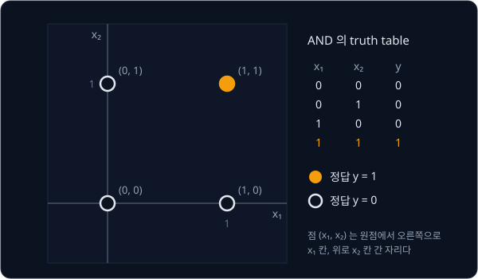

위 그림은 AND 의 네 sample 을 찍고 정답이 1 인 $(1, 1)$ 만 주황색으로 칠한 것이다. 같은 네 점을 OR 로 칠하면 원점 $(0, 0)$ 하나만 비어
있다.

## weighted sum 과 bias

perceptron 은 입력마다 숫자를 하나씩 정해 두고 입력에 곱한다. 이 숫자를 **weight** 라 하고 $w_1$, $w_2$ 로 적는데, $w_1 = 3$ 이면 첫째
입력이 1 일 때 3 을 보태고 $w_1 = -2$ 처럼 음수면 오히려 2 를 깎는다. 곱해 더한 값에는 입력과 상관없이 늘 더하는 숫자 $b$ 가 붙는데, 이것이
**bias** 다. 입력이 $[0, 0]$ 이면 weight 가 무엇이든 곱해 더한 값이 0 이지만 bias 가 있으면 이때도 결과를 옮길 수 있다. 입력에 weight 를 곱해
더하고 bias 까지 더한 값을 **weighted sum** $z$ 라고 한다.

$$
z = w_1 x_1 + w_2 x_2 + b
$$

$w_1 x_1$ 처럼 문자 둘을 붙여 쓰면 곱하기라는 뜻이다. $w = [1, 1]$, $b = -1.5$ 로 네 입력의 $z$ 를 구하면 아래와 같다.

| 입력 $x$ | 곱해 더한 값 $w_1 x_1 + w_2 x_2$ | bias 를 더한 $z$ |
| --- | --- | --- |
| $[0, 0]$ | $1 \times 0 + 1 \times 0 = 0$ | $0 + (-1.5) = -1.5$ |
| $[0, 1]$ | $1 \times 0 + 1 \times 1 = 1$ | $1 + (-1.5) = -0.5$ |
| $[1, 0]$ | $1 \times 1 + 1 \times 0 = 1$ | $1 + (-1.5) = -0.5$ |
| $[1, 1]$ | $1 \times 1 + 1 \times 1 = 2$ | $2 + (-1.5) = 0.5$ |

## step function 과 예측

perceptron 은 $z$ 가 0 보다 크면 1 을 답하고, 0 보다 크지 않으면 0 을 답한다. 이 답을 예측이라 하고 $\hat y$("와이 햇")로 적는다. 위 표의 $z$ 는
$[1, 1]$ 에서만 0 보다 커서 예측이 $0, 0, 0, 1$ 이고, 네 예측이 모두 AND 의 정답과 같다.

![w = [1, 1], b = −1.5 인 perceptron 이 입력 [1, 0] 과 [1, 1] 을 예측하는 계산. 곱해 더하고 bias 를 더한 z 가 0 보다 크면 1 을 낸다](figures/predict-flow.svg)

위 그림은 입력 $[1, 0]$ 과 $[1, 1]$ 이 곱해 더하기, bias 더하기, 판정을 차례로 거쳐 예측이 되는 과정이다. $z$ 를 넣으면 0 또는 1 을 내는 이
판정을 **step function** 이라고 부르는데, $z$ 가 0 을 넘는 순간 출력이 계단처럼 뛰어서 붙은 이름이다. weighted sum 을 출력으로 바꾸는 함수를
통틀어 **activation function** 이라 하고, perceptron 의 activation function 이 step function 이다.

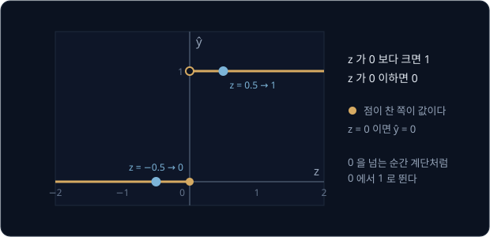

같은 계산에서 $b$ 만 $-0.5$ 로 바꾸면 $z$ 는 $-0.5, 0.5, 0.5, 1.5$ 이고 예측은 $0, 1, 1, 1$ 이라 OR 가 된다. 계산 틀은 그대로 두고 숫자만
바꿔 다른 규칙을 만들었으니, perceptron 을 학습시킨다는 것은 원하는 규칙이 나오는 $w_1, w_2, b$ 를 데이터에서 찾는 일이다.

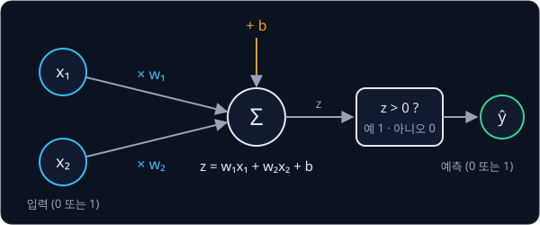

위 그림은 이 계산을 한 장에 모은 것이다. 원 안의 $\Sigma$("시그마")는 모두 더한다는 기호이고, 입력이 백 개여도 곱해 더하는 계산은 같다.
$z$ 가 정확히 0 이면 "0 보다 크다" 가 거짓이라 0 을 낸다. "$z$ 가 0 이상이면 1" 로 약속하는 구현도 있지만 이 강의는 끝까지 "$z$ 가 0 보다 클
때만 1" 을 쓴다.

## threshold 와 bias

Rosenblatt 의 1958 년 논문은 bias 대신 threshold(문턱값) $\theta$("세타")를 써서, 들어온 신호를 모은 값이 문턱을 넘으면 반응하게 했다.
$w = [1, 1]$ 이면 곱해 더한 값 $x_1 + x_2$ 는 네 입력에서 0, 1, 1, 2 다. 문턱이 0.5 면 1 이 하나만 있어도 넘으니 OR 가 되고, 1.5 면 둘 다 1
이어야 넘으니 AND 가 된다. 문턱이 2.5 면 어느 입력도 넘지 못해 늘 0 이다.

"합이 1.5 를 넘는가" 는 "합에서 1.5 를 뺀 값이 0 을 넘는가" 와 같은 질문이다. 1.5 를 빼는 것은 $-1.5$ 를 더하는 것이므로, 이 질문은
bias $b = -1.5$ 를 더한 $z$ 가 0 을 넘는지 묻는 것과 같다. 그래서 bias 는 문턱에 마이너스를 붙인 수 $b = -\theta$ 다.

$b$ 를 줄이면(더 큰 음수로) 문턱이 높아져 1 을 내기 어려워지고, $b$ 를 키우면 쉬워진다. bias 로 쓰면 어떤 perceptron 이든 0 과
비교하면 된다. 또 bias 는 늘 1 인 가짜 입력의 weight 로 볼 수 있어서, 뒤의 학습 규칙은 weight 를 고치는 방식 그대로 bias 도 고친다.

**흔한 오해.** 문턱 1.5 를 그대로 $b = 1.5$ 로 옮기는 실수가 흔하다. $w = [1, 1]$, $b = +1.5$ 로 계산하면 $[0, 0]$ 의 $z$ 부터
$0 + 1.5 = 1.5$ 라서 네 입력을 모두 1 로 예측하므로 AND 와 전혀 다르다. 문턱을 bias 로 옮길 때는 부호가 바뀐다.

<b>심화: 문턱 비교와 bias 비교를 같은 그림으로</b>

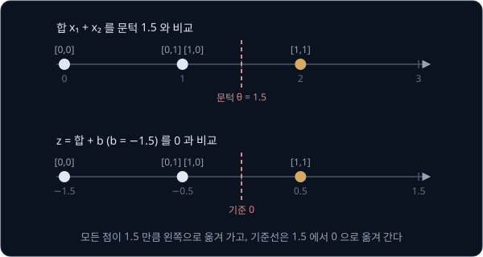

위 그림의 윗줄은 네 입력의 합을 문턱 1.5 와 비교했고, 아랫줄은 같은 점을 1.5 만큼 왼쪽으로 옮긴 $z$ 를 0 과 비교했다. 두 줄 모두 기준
오른쪽에는 $[1, 1]$ 하나만 있다. 식으로는 $x_1 + x_2 > 1.5$ 의 양쪽에서 1.5 를 빼 $x_1 + x_2 + (-1.5) > 0$ 으로 쓴 것이다. bias 를 가짜 입력의
weight 로 보면 $z = w_1 x_1 + w_2 x_2 + b \times 1$ 이다.

## decision boundary

$z = w_1 x_1 + w_2 x_2 + b$ 가 0 이 되는 점들은 좌표평면에서 직선을 이룬다. $w = [1, 1]$, $b = -1.5$ 이면 $x_1 + x_2 = 1.5$ 가 그 직선이고,
$(0, 1.5)$, $(0.5, 1)$, $(1, 0.5)$ 처럼 $x_1$ 이 0.5 늘 때마다 $x_2$ 가 0.5 씩 줄어드는 점들이 그 위에 늘어선다. 직선 한쪽에서는 $z > 0$
이라 1 로 예측하고 반대쪽에서는 $z < 0$ 이라 0 으로 예측한다. 이렇게 예측이 바뀌는 경계를 **decision boundary** 라고 부른다.

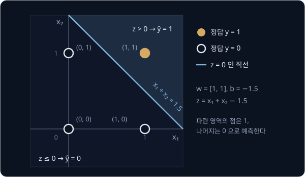

위 그림에서 파란 영역에 있는 점은 $(1, 1)$ 하나다. 어느 쪽이 1 인지는 점 하나를 넣어 보면 알 수 있는데, $(1, 1)$ 은 $z = 0.5 > 0$
이라 이쪽이 1 이다. 직선 바로 위의 점은 $z = 0$ 이라 0 쪽으로 친다.

![w = [1, 1] 로 두고 b 만 바꾼 세 decision boundary. b = −0.5 는 OR, b = −1.5 는 AND, b = −2.5 는 네 점을 모두 0 으로 예측한다](figures/bias-shift.svg)

위 그림은 $w = [1, 1]$ 을 그대로 두고 $b$ 만 $-0.5$, $-1.5$, $-2.5$ 로 바꾼 decision boundary $x_1 + x_2 = 0.5$, $1.5$, $2.5$ 다. 세 직선은
평행하고, $b$ 를 줄일수록 직선이 원점에서 멀어져 1 쪽에 남는 점이 세 개, 한 개, 0 개로 줄어든다. weight 는 직선의 방향을 정하고 bias 는 직선의 위치를 정한다.
$b = 0$ 이면 원점의 $z$ 가 늘 0 이라 직선이 원점을 지나는데, AND 를 가르는 직선은 원점을 지날 수 없어서 bias 없이는 AND 를 풀 수 없다.

$w, b$ 에 같은 양수를 곱해도 직선은 그대로다. $w = [1, 1]$, $b = -1.5$ 를 2 배 한 $w = [2, 2]$, $b = -3$ 의 $z$ 는 $-3, -1, -1, 1$ 로 정확히
2 배지만 부호는 하나도 바뀌지 않아 예측이 같다. $2x_1 + 2x_2 - 3 = 0$ 의 양쪽을 2 로 나누면 원래 직선 $x_1 + x_2 = 1.5$ 가 된다. 음수를 곱하면 부호가 뒤집혀 1
과 0 이 서로 바뀐다. 이 성질은 [learning rate 의 영향](#learning-rate-의-영향) 에서 다시 쓴다.

<b>심화: bias 없이 AND 를 풀 수 없는 이유</b>

$b = 0$ 이라고 하자. $[0, 1]$ 을 0 으로 예측하려면 $z = w_2$ 가 0 이하여야 하고, $[1, 0]$ 을 0 으로 예측하려면 $z = w_1$ 이 0 이하여야
한다. 그러면 $[1, 1]$ 의 $z = w_1 + w_2$ 는 0 이하인 수 둘의 합이라 역시 0 이하이고, 정답 1 을 낼 수 없다.

입력이 $n$ 개면 decision boundary 는 $w_1 x_1 + \cdots + w_n x_n + b = 0$ 이다. 입력이 셋이면 이 경계는 공간을 둘로 나누는
평면이고, 넷 이상이면 평면을 더 많은 차원으로 넓힌 hyperplane 이다. 어느 경우든 경계 한쪽은 1 로 예측하고 반대쪽은 0 으로 예측한다.

**확인 문제.** $w = [1, 1]$, $b = -0.5$ 의 decision boundary 는 어떤 직선이고, 네 점 중 1 쪽에 있는 점은?

답 보기

주어진 값은 $w_1 = 1$, $w_2 = 1$, $b = -0.5$ 다.

① decision boundary 는 $z = 0$ 인 점들이다.

$$
x_1 + x_2 - 0.5 = 0 \quad\Rightarrow\quad x_1 + x_2 = 0.5
$$

② 네 점의 $z$ 를 계산해 어느 쪽에 있는지 본다.

| 점 | $z = x_1 + x_2 - 0.5$ | $\hat y$ |
| --- | --- | --- |
| $(0, 0)$ | $0 + 0 - 0.5 = -0.5$ | 0 |
| $(0, 1)$ | $0 + 1 - 0.5 = 0.5$ | 1 |
| $(1, 0)$ | $1 + 0 - 0.5 = 0.5$ | 1 |
| $(1, 1)$ | $1 + 1 - 0.5 = 1.5$ | 1 |

답: decision boundary 는 $x_1 + x_2 = 0.5$ 이고, 1 쪽에 있는 점은 $(0, 1)$, $(1, 0)$, $(1, 1)$ 이다. 원점만 0 쪽에 남으니 이 perceptron 은
OR 를 계산한다.

## perceptron 학습 규칙

이제 $w_1, w_2, b$ 를 데이터에서 찾는다. 학습은 $w = [0, 0]$, $b = 0$ 에서 시작해 sample 을 하나씩 보며, 예측이 틀렸으면 숫자를 조금 고친다.
시작 숫자로 AND 의 $[1, 1]$ 을 보면 $z = 0$ 이라 0 으로 예측하는데 정답은 1 이다. 1 이어야 할 입력의 $z$ 가 너무 작았으니, 한 번에 고치는
크기를 0.1 로 정하고 이번 입력에서 1 이었던 자리의 weight 와 bias 에 0.1 씩 더한다.

| 값 | 계산 | 결과 |
| --- | --- | --- |
| 오차 (정답 − 예측) | $1 - 0$ | $+1$ |
| 새 $w_1$ | $0 + 0.1 \times (+1) \times 1$ | $0.1$ |
| 새 $w_2$ | $0 + 0.1 \times (+1) \times 1$ | $0.1$ |
| 새 $b$ | $0 + 0.1 \times (+1)$ | $0.1$ |

이 계산을 수식으로 쓴 것이 perceptron 학습 규칙이다.

$$
w_1 \leftarrow w_1 + \eta\,(y - \hat y)\,x_1, \qquad w_2 \leftarrow w_2 + \eta\,(y - \hat y)\,x_2, \qquad b \leftarrow b + \eta\,(y - \hat y)
$$

화살표 $\leftarrow$ 는 오른쪽에서 계산한 값으로 왼쪽을 바꿔 넣는다는 뜻이다. $\eta$("에타")는 한 번에 얼마나 고칠지 정하는 양수인
**learning rate** 로, 위 예에서는 0.1 이었다. $y - \hat y$ 는 정답에서 예측을 뺀 오차다. bias 의 식에는 입력이 곱해져 있지 않은데, bias 를
늘 1 인 입력의 weight 로 보면 곱할 입력이 1 이기 때문이다. $y$ 와 $\hat y$ 가 모두 0 또는 1 이라 오차는 $-1$, 0, $+1$ 세 값뿐이다.

| 경우 | 정답 $y$ | 예측 $\hat y$ | 오차 $y - \hat y$ | 숫자의 변화 |
| --- | --- | --- | --- | --- |
| 맞힘 | 0 또는 1 | $y$ 와 같음 | 0 | 바뀌지 않는다 |
| 1 을 0 으로 틀림 | 1 | 0 | $+1$ | $w_1, w_2$ 에 $\eta \times$ 입력을 더하고 $b$ 에 $\eta$ 를 더한다 |
| 0 을 1 로 틀림 | 0 | 1 | $-1$ | $w_1, w_2$ 에서 $\eta \times$ 입력을 빼고 $b$ 에서 $\eta$ 를 뺀다 |

맞힌 sample 에서는 오차가 0 이라 아무것도 바뀌지 않으므로, "틀린 sample 에서만 고친다" 는 따로 붙인 조건이 아니라 식에서 그대로 나온다. 입력이
0 인 자리의 weight 도 바뀌지 않는데, 0 인 입력은 $z$ 에 아무 영향을 주지 않았으니 그 weight 를 고칠 이유가 없다.

![학습 규칙 한 번의 계산. [1, 1] 을 0 으로 틀려 오차가 +1 이고, w₁, w₂, b 에 각각 0.1 을 더하자 같은 입력의 z 가 0 에서 0.3 으로 커졌다](figures/update-rule.svg)

고친 뒤 같은 입력 $[1, 1]$ 의 $z$ 를 다시 구하면 $0.1 \times 1 + 0.1 \times 1 + 0.1 = 0.3$ 이라, 0 이던 $z$ 가 0.3 커져 이번에는 1 로 예측한다.
숫자를 한 번 고치는 것을 update 라고 하는데, update 한 번에 같은 입력의 $z$ 는 늘 정답 쪽으로 움직인다. 앞 강의에서 본 gradient descent 도
예측과 정답의 차이에 입력을 곱한 만큼 숫자를 고쳤는데, perceptron 학습 규칙도 같은 모양이다.

**흔한 오해.** "한 번 고치면 그 입력은 맞힌다." 위 예에서는 $z$ 가 0 에서 출발해 0.3 을 더하자 0 을 넘었지만, $z$ 가 $-1$ 이었다면 0.3 을
더해도 $-0.7$ 이라 여전히 틀린다. 같은 sample 을 여러 번 틀리며 $z$ 를 조금씩 옮겨 가야 할 때도 있다.

<b>심화: update 한 번이 z 를 바꾸는 양</b>

update 한 번에 $w_1$ 은 $0.1 \times x_1$ 만큼 커지고 $w_2$ 는 $0.1 \times x_2$ 만큼 커지며, $b$ 는 0.1 만큼 커진다. 같은 입력으로 $z$ 를 다시 계산하면 커진 양에 그 자리의
입력이 한 번 더 곱해져 더해진다.

| 바뀐 부분 | $z$ 가 커진 양 |
| --- | --- |
| $w_1$ 이 $0.1 \times x_1$ 커짐 | $0.1 \times x_1 \times x_1 = 0.1 \times 1 \times 1 = 0.1$ |
| $w_2$ 가 $0.1 \times x_2$ 커짐 | $0.1 \times x_2 \times x_2 = 0.1 \times 1 \times 1 = 0.1$ |
| $b$ 가 $0.1$ 커짐 | $0.1$ |
| 합 | $0.3$ |

일반적으로 오차가 $+1$ 이면 같은 입력의 $z$ 는 $\eta \times (x_1^2 + x_2^2 + 1)$ 만큼 커지고, 오차가 $-1$ 이면 같은 양만큼 작아진다. 괄호
안은 늘 1 이상이라 $z$ 는 반드시 정답 쪽으로 움직인다. 입력이 $[0, 1]$ 이면 $0.1 \times (0 + 1 + 1) = 0.2$ 만 움직이는데, $x_1 = 0$ 인 자리는
update 할 때와 $z$ 를 다시 계산할 때 두 번 0 이 곱해지기 때문이다.

그래서 정답이 1 인 $[0, 1]$ 의 $z$ 가 $-0.5$ 였다면, 그 사이에 다른 sample 이 숫자를 바꾸지 않는다고 할 때 틀릴 때마다 $z$ 가 0.2 씩 커져
$-0.5 \to -0.3 \to -0.1 \to 0.1$ 로 update 세 번째에야 맞힌다.

**확인 문제.** $w = [0.2, 0.1]$, $b = 0$, $\eta = 0.1$ 에서 AND 의 $[0, 1]$ 을 봤다. (1) 예측과 고친 뒤의 $w, b$ 는? (2) 고친 뒤 같은 입력
$[0, 1]$ 의 $z$ 는?

답 보기

**1 번 풀이**

주어진 값은 $w_1 = 0.2$, $w_2 = 0.1$, $b = 0$, $\eta = 0.1$ 이고, 입력은 $x_1 = 0$, $x_2 = 1$ 이다. AND 는 두 입력이 모두 1 일
때만 1 이므로 $[0, 1]$ 의 정답은 $y = 0$ 이다.

① $z$ 계산. 입력마다 weight 를 곱해 더하고 bias 를 더한다.

$$
z = w_1 x_1 + w_2 x_2 + b = 0.2 \times 0 + 0.1 \times 1 + 0 = 0 + 0.1 + 0 = 0.1
$$

② 예측. $z = 0.1$ 은 0 보다 크므로 $\hat y = 1$ 이다. 정답은 0 이라 틀렸다.

③ 오차. 오차는 정답 − 예측이다.

$$
y - \hat y = 0 - 1 = -1
$$

④ 숫자 고치기. 학습 규칙 $w_i \leftarrow w_i + \eta\,(y - \hat y)\,x_i$, $b \leftarrow b + \eta\,(y - \hat y)$ 에 숫자를 넣는다. $w_i$
는 $w_1$ 또는 $w_2$ 를 뜻한다.

| 숫자 | 고치기 전 | 더하는 양 $\eta \times$ 오차 $\times$ 입력 | 고친 뒤 |
| --- | --- | --- | --- |
| $w_1$ | 0.2 | $0.1 \times (-1) \times 0 = 0$ | $0.2 + 0 = 0.2$ |
| $w_2$ | 0.1 | $0.1 \times (-1) \times 1 = -0.1$ | $0.1 - 0.1 = 0$ |
| $b$ | 0 | $0.1 \times (-1) = -0.1$ (bias 는 입력을 곱하지 않는다) | $0 - 0.1 = -0.1$ |

$w_1$ 은 입력 $x_1$ 이 0 이라 더하는 양이 0 이 되어 바뀌지 않는다. 이 예측에 $w_1$ 은 아무 영향도 주지 않았으니 고칠 이유가
없다.

답: 예측은 1(틀림)이고, 고친 뒤 $w = [0.2, 0]$, $b = -0.1$ 이다.

**2 번 풀이**

고친 숫자 $w_1 = 0.2$, $w_2 = 0$, $b = -0.1$ 로 같은 입력 $[0, 1]$ 의 $z$ 를 다시 계산한다.

$$
z = 0.2 \times 0 + 0 \times 1 + (-0.1) = 0 + 0 - 0.1 = -0.1
$$

$z = -0.1$ 은 0 보다 크지 않으므로 이번에는 $\hat y = 0$ 으로 예측하고, 정답 0 을 맞힌다.

| | $z$ | 예측 $\hat y$ | 정답 $y$ | 결과 |
| --- | --- | --- | --- | --- |
| 고치기 전 | 0.1 | 1 | 0 | 틀림 |
| 고친 뒤 | $-0.1$ | 0 | 0 | 맞힘 |

$z$ 는 0.1 에서 $-0.1$ 로 0.2 줄었다. 정답이 0 이라 $z$ 를 0 아래로 내려야 했고, 한 번의 update 가 $z$ 를 정답 쪽으로 옮겼다.
줄어든 0.2 는 $w_2$ 가 줄어든 0.1 과 $b$ 가 줄어든 0.1 을 합한 값이다.

## epoch 와 online update

truth table 의 네 sample 을 처음부터 끝까지 한 번 보는 것을 **epoch** 하나라 하고, sample 하나를 보는 것을 step 이라고 한다. 한 epoch 동안
하나도 틀리지 않았다면 그 epoch 내내 숫자가 바뀌지 않았고, 그 숫자로 네 sample 을 모두 맞혔다는 뜻이다. 이때 학습을 멈추고
수렴(converge)했다고 말한다.

perceptron 은 틀린 sample 을 보면 그 자리에서 숫자를 고치므로 같은 epoch 안에서도 뒤의 sample 은 고친 숫자로 예측하는데, 이 방식을
**online update** 라고 한다. 네 sample 을 모두 같은 숫자로 예측하고 고칠 양만 모았다가 epoch 끝에 한꺼번에 더하는 방식은
**batch update** 다.

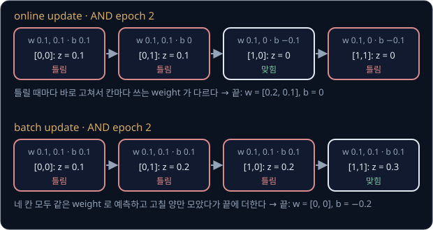

위 그림은 다음 절에서 계산할 AND 학습의 epoch 2 를 두 방식으로 비교한 것이다. online(윗줄)은 셋째 step 의 $[1, 0]$ 을 앞에서 두 번 고친 숫자
덕분에 맞히고, batch(아랫줄)는 네 step 이 모두 epoch 시작 때의 숫자를 써서 셋째 step 을 틀린다. 고치는 시점만 달라도 틀리는 sample 과 그 뒤의
경로가 갈려서, AND 를 batch update 로 학습하면 4 epoch 에 직선 $x_1 + x_2 = 1$ 을 찾고 online update 로는 6 epoch 에 다른 직선을 찾는다.

틀린 수는 고치기 전의 예측으로 센다. 고친 뒤 다시 예측해 세면 방금 고친 입력은 대개 맞기 때문에, 다른 입력을 다 틀리는 숫자에서도 틀린 수가
0 이 되어 학습이 멈출 수 있다.

<b>심화: batch update 로 학습한 AND 와 틀린 수를 세는 시점</b>

$\eta = 0.1$ 로 AND 를 batch update 하면, 각 epoch 의 네 예측은 모두 그 epoch 시작 때의 숫자로 하고 바뀐 양은 모았다가 끝에 더한다.

| epoch | 시작 $w_1, w_2, b$ | 네 입력의 $z$ | 틀린 수 | 모은 바뀐 양 | 끝 $w_1, w_2, b$ |
| --- | --- | --- | --- | --- | --- |
| 1 | $0, 0, 0$ | $0, 0, 0, 0$ | 1 | $+0.1, +0.1, +0.1$ | $0.1, 0.1, 0.1$ |
| 2 | $0.1, 0.1, 0.1$ | $0.1, 0.2, 0.2, 0.3$ | 3 | $-0.1, -0.1, -0.3$ | $0, 0, -0.2$ |
| 3 | $0, 0, -0.2$ | $-0.2, -0.2, -0.2, -0.2$ | 1 | $+0.1, +0.1, +0.1$ | $0.1, 0.1, -0.1$ |
| 4 | $0.1, 0.1, -0.1$ | $-0.1, 0, 0, 0.1$ | 0 | 없음 | $0.1, 0.1, -0.1$ |

epoch 2 에서 $[0, 0]$, $[0, 1]$, $[1, 0]$ 을 틀려 모은 양은 $w_1$ 과 $w_2$ 가 각각 $-0.1$ 이고 $b$ 가 $-0.1 \times 3 = -0.3$ 이다. epoch 3
끝에 얻은 decision boundary $0.1x_1 + 0.1x_2 - 0.1 = 0$ 의 양쪽에 10 을 곱하면 $x_1 + x_2 = 1$ 이고, 이 직선 위의 $(0, 1)$ 과 $(1, 0)$ 은 $z = 0$ 이라 0 으로
예측해 맞힌다.

틀린 수를 고친 뒤의 예측으로 세면 생기는 일을 $\eta = 1$ 로 따라가 보자. 첫 epoch 의 $[1, 1]$ 에서 틀려 $w = [1, 1]$, $b = 1$ 로
고친 뒤 $[1, 1]$ 을 다시 예측하면 $z = 1 + 1 + 1 = 3$ 이라 맞으므로, 틀린 수가 0 이 되어 학습이 멈춘다. 그런데 이 숫자로는 $z = x_1 + x_2 + 1$ 이 네
입력에서 1, 2, 2, 3 으로 모두 양수라 네 입력을 모두 1 로 예측해 세 개를 틀린다.

## AND 학습 결과

$w = [0, 0]$, $b = 0$, $\eta = 0.1$ 에서 AND 를 truth table 순서로 online update 하면 아래처럼 6 epoch 에 수렴한다. 24 step 을 모두 적은 표는
이 절의 심화에 있다.

| epoch | 1 | 2 | 3 | 4 | 5 | 6 |
| --- | --- | --- | --- | --- | --- | --- |
| 틀린 수 | 1 | 3 | 3 | 2 | 1 | 0 |
| epoch 끝의 $w_1, w_2, b$ | $0.1, 0.1, 0.1$ | $0.2, 0.1, 0$ | $0.2, 0.1, -0.1$ | $0.2, 0.2, -0.1$ | $0.2, 0.1, -0.2$ | $0.2, 0.1, -0.2$ |

epoch 끝의 $b$ 는 $0.1$ 에서 $-0.2$ 까지 내려간다. AND 는 네 점 중 셋이 0 이라 문턱이 높아야(bias 가 음수여야) 하기 때문이다. epoch 5
끝의 숫자가 이미 최종 답이지만 그 epoch 에 한 번 고쳤으므로, 그 숫자로 네 sample 을 모두 맞히는지는 epoch 6 을 끝까지 거쳐야 확인할 수 있다.

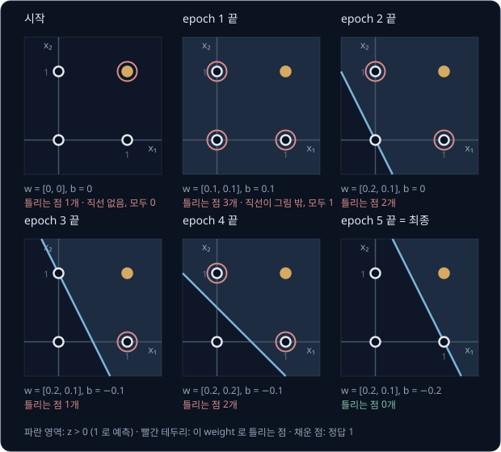

위 그림은 시작과 epoch 1 ~ 5 끝의 숫자로 네 점을 예측한 결과를 차례로 보여 준다. 직선이 오른쪽 위로 옮겨 가며 틀리는 점(빨간 테두리)이 줄어든다.
틀리는 점은 epoch 끝의 숫자로 센 것이라 epoch 동안 센 틀린 수와 다를 수 있다.

학습이 찾은 숫자는 $w = [0.2, 0.1]$, $b = -0.2$ 이고, decision boundary $0.2x_1 + 0.1x_2 - 0.2 = 0$ 의 양쪽에 10 을 곱하면 $2x_1 + x_2 = 2$ 다.

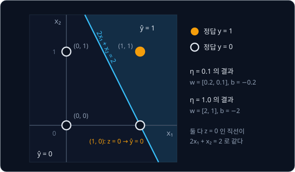

손으로 정한 $x_1 + x_2 = 1.5$ 와 다른 직선이지만 네 점을 가르기만 하면 되므로 이것도 AND 의 답이다. 다만 $(1, 0)$ 이 직선 바로 위에 있어
$z = 0.2 - 0.2 = 0$ 이고, $z = 0$ 을 0 으로 예측하는 약속 덕분에 맞힌다. perceptron 학습은 네 점을 다 맞히는 직선을 찾으면 멈출 뿐 점들에서
멀리 떨어진 직선을 고르지는 않는다. 실제 센서 값은 0 과 1 에서 조금씩 흔들리는데, 직선이 점에 붙어 있으면 그 점에서 noise 로 조금만 벗어난
입력도 반대쪽으로 예측할 수 있다. 같은 규칙을 OR 에 적용하면($\eta = 1$) 4 epoch 에 $w = [1, 1]$, $b = 0$ 을 찾는데, 이번에는 원점이 직선 위에 놓인다.

<b>심화: AND 와 OR 의 step 별 손계산</b>

표의 $z$ 는 그 step 이 시작될 때의 숫자로 계산한 값이고, 바뀐 양은 $\eta \times$ 오차 $\times x_1$, $\eta \times$ 오차 $\times x_2$,
$\eta \times$ 오차를 차례로 적은 것이다. 고친 뒤의 숫자는 다음 step 에서 쓴다. 아래 표는 AND($\eta = 0.1$)의 계산이다.

| step | 입력 $x$ | 정답 $y$ | $z$ | $\hat y$ | 오차 | 바뀐 양 | 고친 뒤 $w_1, w_2, b$ |
| --- | --- | --- | --- | --- | --- | --- | --- |
| 1 | $[0, 0]$ | 0 | $0$ | 0 | 0 | 없음 | $0, 0, 0$ |
| 2 | $[0, 1]$ | 0 | $0$ | 0 | 0 | 없음 | $0, 0, 0$ |
| 3 | $[1, 0]$ | 0 | $0$ | 0 | 0 | 없음 | $0, 0, 0$ |
| 4 | $[1, 1]$ | 1 | $0$ | 0 | $+1$ | $+0.1, +0.1, +0.1$ | $0.1, 0.1, 0.1$ |
| 5 | $[0, 0]$ | 0 | $0 + 0 + 0.1 = 0.1$ | 1 | $-1$ | $0, 0, -0.1$ | $0.1, 0.1, 0$ |
| 6 | $[0, 1]$ | 0 | $0 + 0.1 + 0 = 0.1$ | 1 | $-1$ | $0, -0.1, -0.1$ | $0.1, 0, -0.1$ |
| 7 | $[1, 0]$ | 0 | $0.1 + 0 - 0.1 = 0$ | 0 | 0 | 없음 | $0.1, 0, -0.1$ |
| 8 | $[1, 1]$ | 1 | $0.1 + 0 - 0.1 = 0$ | 0 | $+1$ | $+0.1, +0.1, +0.1$ | $0.2, 0.1, 0$ |
| 9 | $[0, 0]$ | 0 | $0 + 0 + 0 = 0$ | 0 | 0 | 없음 | $0.2, 0.1, 0$ |
| 10 | $[0, 1]$ | 0 | $0 + 0.1 + 0 = 0.1$ | 1 | $-1$ | $0, -0.1, -0.1$ | $0.2, 0, -0.1$ |
| 11 | $[1, 0]$ | 0 | $0.2 + 0 - 0.1 = 0.1$ | 1 | $-1$ | $-0.1, 0, -0.1$ | $0.1, 0, -0.2$ |
| 12 | $[1, 1]$ | 1 | $0.1 + 0 - 0.2 = -0.1$ | 0 | $+1$ | $+0.1, +0.1, +0.1$ | $0.2, 0.1, -0.1$ |
| 13 | $[0, 0]$ | 0 | $0 + 0 - 0.1 = -0.1$ | 0 | 0 | 없음 | $0.2, 0.1, -0.1$ |
| 14 | $[0, 1]$ | 0 | $0 + 0.1 - 0.1 = 0$ | 0 | 0 | 없음 | $0.2, 0.1, -0.1$ |
| 15 | $[1, 0]$ | 0 | $0.2 + 0 - 0.1 = 0.1$ | 1 | $-1$ | $-0.1, 0, -0.1$ | $0.1, 0.1, -0.2$ |
| 16 | $[1, 1]$ | 1 | $0.1 + 0.1 - 0.2 = 0$ | 0 | $+1$ | $+0.1, +0.1, +0.1$ | $0.2, 0.2, -0.1$ |
| 17 | $[0, 0]$ | 0 | $0 + 0 - 0.1 = -0.1$ | 0 | 0 | 없음 | $0.2, 0.2, -0.1$ |
| 18 | $[0, 1]$ | 0 | $0 + 0.2 - 0.1 = 0.1$ | 1 | $-1$ | $0, -0.1, -0.1$ | $0.2, 0.1, -0.2$ |
| 19 | $[1, 0]$ | 0 | $0.2 + 0 - 0.2 = 0$ | 0 | 0 | 없음 | $0.2, 0.1, -0.2$ |
| 20 | $[1, 1]$ | 1 | $0.2 + 0.1 - 0.2 = 0.1$ | 1 | 0 | 없음 | $0.2, 0.1, -0.2$ |
| 21 | $[0, 0]$ | 0 | $0 + 0 - 0.2 = -0.2$ | 0 | 0 | 없음 | $0.2, 0.1, -0.2$ |
| 22 | $[0, 1]$ | 0 | $0 + 0.1 - 0.2 = -0.1$ | 0 | 0 | 없음 | $0.2, 0.1, -0.2$ |
| 23 | $[1, 0]$ | 0 | $0.2 + 0 - 0.2 = 0$ | 0 | 0 | 없음 | $0.2, 0.1, -0.2$ |
| 24 | $[1, 1]$ | 1 | $0.2 + 0.1 - 0.2 = 0.1$ | 1 | 0 | 없음 | $0.2, 0.1, -0.2$ |

step 7 에서 online update 의 효과가 보인다. epoch 시작 때의 숫자 $0.1, 0.1, 0.1$ 로 $[1, 0]$ 을 예측했다면 $z = 0.2$ 라 틀렸을 텐데, step 5·6 에서
$b$ 와 $w_2$ 를 먼저 줄인 덕분에 $z = 0$ 이 되어 맞혔다. step 14 의 $[0, 1]$ 도 $z$ 가 정확히 0 이라 맞혔는데, "$z$ 가 0 이상이면 1" 이라는
약속이었다면 여기서도 틀렸을 것이다. step 17·18 은 고치기 전 숫자 $0.2, 0.2, -0.1$ 로 예측했으므로, 최종 숫자로 $[0, 0]$ 과 $[0, 1]$ 을
예측한 것은 step 21·22 가 처음이다. 24 step 동안 모두 10 번 틀렸고, 틀릴 때마다 한 번씩 고쳤다.

아래 표는 OR($\eta = 1$)의 계산이다. 계산이 정수로 떨어지도록 $\eta = 1$ 을 썼는데, [learning rate 의 영향](#learning-rate-의-영향) 에서 보듯 $\eta = 0.1$
이어도 모든 숫자가 0.1 배가 될 뿐 틀리는 step 은 같다.

| step | 입력 $x$ | 정답 $y$ | $z$ | $\hat y$ | 오차 | 바뀐 양 | 고친 뒤 $w_1, w_2, b$ |
| --- | --- | --- | --- | --- | --- | --- | --- |
| 1 | $[0, 0]$ | 0 | $0$ | 0 | 0 | 없음 | $0, 0, 0$ |
| 2 | $[0, 1]$ | 1 | $0$ | 0 | $+1$ | $0, +1, +1$ | $0, 1, 1$ |
| 3 | $[1, 0]$ | 1 | $0 + 0 + 1 = 1$ | 1 | 0 | 없음 | $0, 1, 1$ |
| 4 | $[1, 1]$ | 1 | $0 + 1 + 1 = 2$ | 1 | 0 | 없음 | $0, 1, 1$ |
| 5 | $[0, 0]$ | 0 | $0 + 0 + 1 = 1$ | 1 | $-1$ | $0, 0, -1$ | $0, 1, 0$ |
| 6 | $[0, 1]$ | 1 | $0 + 1 + 0 = 1$ | 1 | 0 | 없음 | $0, 1, 0$ |
| 7 | $[1, 0]$ | 1 | $0 + 0 + 0 = 0$ | 0 | $+1$ | $+1, 0, +1$ | $1, 1, 1$ |
| 8 | $[1, 1]$ | 1 | $1 + 1 + 1 = 3$ | 1 | 0 | 없음 | $1, 1, 1$ |
| 9 | $[0, 0]$ | 0 | $0 + 0 + 1 = 1$ | 1 | $-1$ | $0, 0, -1$ | $1, 1, 0$ |
| 10 ~ 12 | 나머지 셋 | 1 | $1, 1, 2$ | 1 | 0 | 없음 | $1, 1, 0$ |
| 13 ~ 16 | 네 입력 | $0, 1, 1, 1$ | $0, 1, 1, 2$ | $0, 1, 1, 1$ | 0 | 없음 | $1, 1, 0$ |

epoch 별 틀린 수는 1, 2, 1, 0 이다. step 3 의 $[1, 0]$ 은 $w_1$ 이 아직 0 인데도 맞혔는데, step 2 에서 $b$ 를 1 로 올려 $z = 1$ 이 되었기
때문이다.

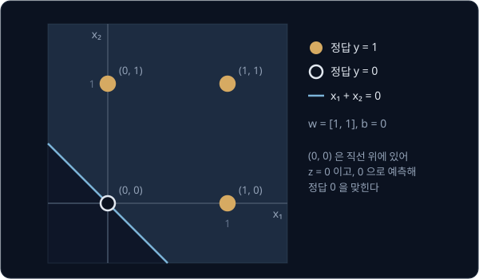

AND 는 bias 없이 풀 수 없었는데 OR 는 $b = 0$ 으로 풀렸다. 원점이 직선 위에 있어 $z = 0$ 이고, $z = 0$ 을 0 으로 예측하는 약속 덕분에
정답 0 을 맞히기 때문이다.

## learning rate 의 영향

learning rate 를 키우면 한 번에 더 크게 고치니 빨리 배울 것 같다. 그런데 같은 AND 학습을 $\eta = 1.0$ 으로 10 배 키워 다시 해도 틀리는 step
과 수렴 epoch, decision boundary 가 그대로다.

| 비교 항목 | $\eta = 0.1$ | $\eta = 1.0$ |
| --- | --- | --- |
| 틀린 step | 4, 5, 6, 8, 10, 11, 12, 15, 16, 18 | 같음 |
| 수렴 epoch | 6 | 6 |
| 마지막 $w, b$ | $[0.2, 0.1]$, $-0.2$ | $[2, 1]$, $-2$ (정확히 10 배) |
| decision boundary | $2x_1 + x_2 = 2$ | $2x_1 + x_2 = 2$ |

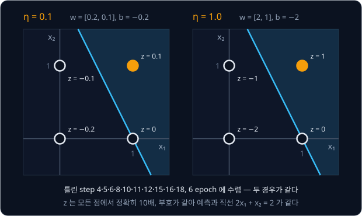

위 그림처럼 네 점의 $z$ 는 $\eta = 1.0$ 쪽이 정확히 10 배지만 직선은 같은 자리에 있다. 시작 숫자가 모두 0 이면 두 학습의 숫자는 처음부터
10 배 관계다. 숫자가 10 배이면 $z$ 도 10 배라 예측과 오차가 같고, 고치는 양만 10 배라서 이 관계가 학습 내내 이어진다. 직접 계산해 보면 $\eta = 0.01, 0.1, 1, 10$ 에서 AND 는 모두 6 epoch 에 수렴하고 OR 는 모두 4 epoch 에 수렴한다. gradient descent
에서는 learning rate 가 너무 크면 답을 지나쳐 점점 멀어졌지만, perceptron 의 예측은 $z$ 의 부호만 보므로 모든 숫자가 같은 배율로 커져도
예측이 달라지지 않는다.

이 결론은 $w, b$ 를 0 에서 시작할 때만 성립한다. 시작 숫자가 0 이 아니면 두 학습이 같은 숫자에서 출발하므로 10 배 관계가 처음부터 깨진다. 그러면
시작 숫자에 비해 한 번에 고치는 크기가 $\eta$ 에 따라 달라져 학습 경로와 수렴 epoch 가 바뀐다. 실제 neural network 는 weight 를 0 이 아닌 작은 무작위
숫자로 시작하므로 learning rate 가 경로를 바꾼다.

<b>심화: 10 배 관계가 이어지는 단계와 0 이 아닌 시작점</b>

$\eta = 0.1$ 과 $\eta = 1.0$ 의 학습을 step 마다 나란히 놓고 따라간다.

1. 시작할 때 $w_1, w_2, b$ 는 두 학습 모두 0 이다. 0 의 10 배는 0 이니 "$\eta = 1.0$ 쪽이 10 배" 가 이미 성립한다
2. 숫자가 10 배이면 $z$ 도 10 배다. $z$ 는 숫자에 입력을 곱해 더한 값이기 때문이다
3. $z$ 가 10 배이면 부호가 같아 예측이 같다
4. 예측이 같으면 오차도 같다. 고치는 양은 $\eta \times$ 오차 $\times$ 입력이라 $\eta = 1.0$ 쪽이 정확히 10 배다
5. 10 배인 숫자에 10 배인 양을 더하면 고친 뒤의 숫자도 10 배다. 그러면 다음 step 에서 다시 2 번부터 같은 일이 일어난다

이 가운데 1 번은 시작 숫자가 0 일 때만 맞는다. AND 를 $w = [0.5, -0.3]$, $b = 0.2$ 에서 시작해 직접 계산하면 결과가 아래처럼 갈린다.

| $\eta$ | 수렴 epoch | 틀린 총횟수 | 마지막 $w, b$ |
| --- | --- | --- | --- |
| 0.01 | 62 | 102 | $[0.2, 0.01]$, $-0.2$ |
| 0.1 | 8 | 12 | $[0.2, 0.1]$, $-0.2$ |
| 1 | 4 | 6 | $[1.5, 0.7]$, $-1.8$ |

$\eta = 0.01$ 이면 한 번에 0.01 씩만 움직여서 시작 숫자 $b = 0.2$ 를 음수로 끌어내리는 데만 여러 번 고쳐야 한다. 반대로 $\eta = 1$ 이면 첫 몇
번의 update 가 시작 숫자보다 훨씬 커서 0 에서 시작한 것과 비슷해진다.

## linearly separable 과 XOR

0 인 점과 1 인 점을 직선 하나로 완전히 가를 수 있는 데이터를 **linearly separable** 하다고 한다. AND 와 OR 는 linearly separable 하다.
perceptron 의 예측은 점이 직선 하나의 어느 쪽에 있느냐로 정해지므로, perceptron 이 모두 맞힐 수 있는 데이터는 linearly separable 한 데이터뿐이다.

거꾸로 데이터가 linearly separable 하면 perceptron 학습 규칙은 유한한 횟수만 틀린 뒤 반드시 수렴한다. 1962 년 Novikoff 가 이것을 짧게
증명했다. 가르는 직선이 하나라도 있으면 틀릴 때마다 지금의 숫자가 그 직선의 숫자 쪽으로 일정량 이상 다가가는데, 숫자 전체의 크기는 그만큼
빨리 커질 수 없어서 틀리는 횟수에 상한이 생긴다. 이 상한은 learning rate 나 sample 순서와 상관없이 성립하고, 점들이 직선에서 멀리 떨어져 있을수록 작아진다.

XOR 에서는 $(0, 1)$ 과 $(1, 0)$ 이 1 이고 $(0, 0)$ 과 $(1, 1)$ 이 0 이라 1 인 두 점과 0 인 두 점이 정사각형의 두 대각선에 엇갈려 놓인다.

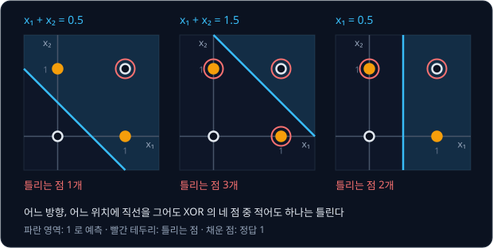

위 그림은 직선 세 개를 시험해 본 결과다. OR 의 직선 $x_1 + x_2 = 0.5$ 는 $(1, 1)$ 까지 1 쪽에 넣어 하나를 틀리고, AND 의 직선
$x_1 + x_2 = 1.5$ 는 셋을 틀린다. 세로선 $x_1 = 0.5$ 는 둘을 틀린다.

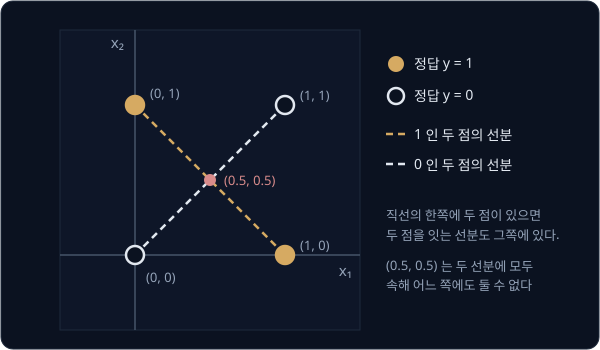

직선의 한쪽에 두 점이 있으면 그 둘을 잇는 선분 전체도 같은 쪽에 있다. 그래서 1 인 두 점을 잇는 선분은 통째로 1 쪽에 있어야 하고, 0 인 두
점을 잇는 선분은 통째로 0 쪽에 있어야 한다. 그런데 위 그림처럼 두 선분이 $(0.5, 0.5)$ 에서 만나므로, 이 점은 1 쪽이면서 동시에 0 쪽이어야 한다.
그런 직선은 없으니 어떤 숫자로도 XOR 를 계산하는 perceptron 을 만들 수 없다.

<b>심화: 네 조건을 더해 보이는 모순과 수렴 상한</b>

XOR 를 맞히는 $w_1, w_2, b$ 가 있다고 하면 네 점에서 아래가 모두 성립해야 한다.

| 입력 | 정답 | $z$ | 필요한 조건 |
| --- | --- | --- | --- |
| $[0, 0]$ | 0 | $b$ | $b$ 가 0 이하 |
| $[0, 1]$ | 1 | $w_2 + b$ | $w_2 + b$ 가 0 보다 큼 |
| $[1, 0]$ | 1 | $w_1 + b$ | $w_1 + b$ 가 0 보다 큼 |
| $[1, 1]$ | 0 | $w_1 + w_2 + b$ | $w_1 + w_2 + b$ 가 0 이하 |

1 인 두 줄을 더하면 0 보다 큰 수 둘의 합이라 $w_1 + w_2 + 2b$ 는 0 보다 크다. 0 인 두 줄을 더하면 0 이하인 수 둘의 합이라 같은 값
$w_1 + w_2 + 2b$ 가 0 이하다. 같은 값이 0 보다 크면서 0 이하일 수는 없으니 네 조건을 모두 만족하는 숫자는 없다. 같은 계산을 AND 에 하면
조건이 "$b$, $w_2 + b$, $w_1 + b$ 가 0 이하이고 $w_1 + w_2 + b$ 가 0 보다 큼" 인데, $w = [1, 1]$, $b = -1.5$ 를 넣으면 $-1.5$, $-0.5$,
$-0.5$ 가 0 이하이고 $0.5$ 가 0 보다 커서 모두 성립한다.

요즘 쓰는 꼴로 적은 Novikoff 의 정리에 따르면, 모든 입력의 크기가 $R$ 이하이고 가르는 직선과 가장 가까운 점 사이의 여유(margin)가 $\gamma$
일 때 틀리는 횟수는 $(R / \gamma)^2$ 이하다. 증명에는 부등식 두 개를 쓴다. update 마다 지금 숫자와 정답 직선의 숫자를 곱한 값은 일정량
이상씩 커지는데, 숫자의 크기 제곱은 일정량 이하씩만 커진다. 두 부등식을 함께 놓으면 update 횟수에 상한이 생긴다.

## XOR 학습의 순환

XOR 에 학습 규칙을 그대로 적용하면($\eta = 1$) epoch 별 틀린 수가 2, 3, 4, 4, … 로 이어지고, epoch 3 부터는
숫자가 epoch 마다 같은 네 상태를 거쳐 처음 상태로 돌아온다.

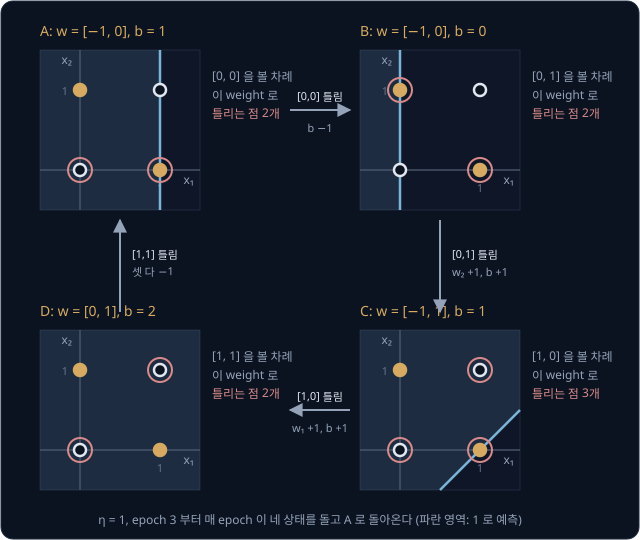

위 그림의 A 는 epoch 2 가 끝났을 때의 숫자 $w = [-1, 0]$, $b = 1$ 이다. A 에서 $[0, 0]$ 을 틀려 $b$ 를 1 내리면 B 가 되고, 이어서 $[0, 1]$ 과 $[1, 0]$ 을 틀릴 때마다 C 와 D 가 된다. D 에서
$[1, 1]$ 을 틀려 $w_1, w_2, b$ 를 모두 1 씩 내리면 다시 A 다. 한 점을 맞히려고 직선을 옮기면 다른 점이 반대쪽으로 넘어가서
매 epoch 네 sample 을 모두 틀린다. 1,000 epoch 를 학습하면 틀린 총횟수는 $2 + 3 + 4 \times 998 = 3997$ 이다.
learning rate 를 줄여도 모든 숫자가 같은 배율로 작아질 뿐 같은 순환이 일어난다.

**흔한 오해.** "충분히 오래 학습하면 언젠가 풀린다." XOR 를 맞히는 숫자가 아예 없으니 몇 epoch 를 학습해도 풀리지 않는다. 학습 코드에 epoch
상한을 두는 것도 이 때문이다.

<b>심화: XOR 의 step 별 손계산</b>

| epoch | step | 입력 $x$ | 정답 $y$ | $z$ | $\hat y$ | 오차 | 고친 뒤 $w_1, w_2, b$ |
| --- | --- | --- | --- | --- | --- | --- | --- |
| 1 | 1 | $[0, 0]$ | 0 | $0$ | 0 | 0 | $0, 0, 0$ |
| 1 | 2 | $[0, 1]$ | 1 | $0$ | 0 | $+1$ | $0, 1, 1$ |
| 1 | 3 | $[1, 0]$ | 1 | $0 + 0 + 1 = 1$ | 1 | 0 | $0, 1, 1$ |
| 1 | 4 | $[1, 1]$ | 0 | $0 + 1 + 1 = 2$ | 1 | $-1$ | $-1, 0, 0$ |
| 2 | 5 | $[0, 0]$ | 0 | $0 + 0 + 0 = 0$ | 0 | 0 | $-1, 0, 0$ |
| 2 | 6 | $[0, 1]$ | 1 | $0 + 0 + 0 = 0$ | 0 | $+1$ | $-1, 1, 1$ |
| 2 | 7 | $[1, 0]$ | 1 | $-1 + 0 + 1 = 0$ | 0 | $+1$ | $0, 1, 2$ |
| 2 | 8 | $[1, 1]$ | 0 | $0 + 1 + 2 = 3$ | 1 | $-1$ | $-1, 0, 1$ |
| 3 | 9 | $[0, 0]$ | 0 | $0 + 0 + 1 = 1$ | 1 | $-1$ | $-1, 0, 0$ |
| 3 | 10 | $[0, 1]$ | 1 | $0 + 0 + 0 = 0$ | 0 | $+1$ | $-1, 1, 1$ |
| 3 | 11 | $[1, 0]$ | 1 | $-1 + 0 + 1 = 0$ | 0 | $+1$ | $0, 1, 2$ |
| 3 | 12 | $[1, 1]$ | 0 | $0 + 1 + 2 = 3$ | 1 | $-1$ | $-1, 0, 1$ |

epoch 4 부터는 epoch 3 의 네 줄이 숫자 하나 다르지 않게 되풀이된다. epoch 1 에서도 online update 의 효과가 보이는데, $[0, 1]$ 에서 틀려
$w = [0, 1]$, $b = 1$ 이 된 덕분에 바로 다음 $[1, 0]$ 은 $z = 1$ 이라 맞힌다. batch update 였다면 $[1, 0]$ 도 시작 숫자로 예측해 $z = 0$ 이
되고, 0 으로 예측해 틀렸을 것이다.

## 두 층으로 만든 XOR

perceptron 을 여러 개 이어 붙이면 직선 여러 개를 조합할 수 있다. XOR 는 "둘 중 하나라도 1 이다(OR)" 와
"둘 다 1 은 아니다" 가 동시에 참일 때 1 이다. "둘 다 1 은 아니다" 는 AND 의 반대라 NAND(NOT AND)라고 부른다. NAND 는 AND 의 숫자
$w = [1, 1]$, $b = -1.5$ 에 모두 $-1$ 을 곱한 $w = [-1, -1]$, $b = 1.5$ 로 만든다.

$$
\text{XOR} = \text{AND}\big(\text{OR},\ \text{NAND}\big)
$$

이 식은 OR($w = [1, 1]$, $b = -0.5$)의 결과와 NAND 의 결과를 AND($w = [1, 1]$, $b = -1.5$)에 넣으면 XOR 가 나온다는 뜻이다.

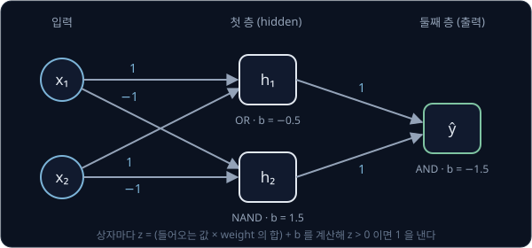

위 그림은 perceptron 세 개를 두 층으로 쌓은 모습이다. perceptron 하나하나를 unit 이라 부르고, unit 을 이어 붙인 전체를 network 라고 한다.
첫 층의 $h_1$(OR)과 $h_2$(NAND)는 입력을 받아 0 또는 1 을 내고, 둘째 층의 unit 은 그 두 값을 입력으로 받아 최종 예측을 낸다. 첫 층은 입력과
출력 사이에 있어 바깥에서 직접 보이지 않으므로 **hidden layer** 라고 부른다.

| 입력 $x$ | $h_1$ 의 $z$ ($x_1 + x_2 - 0.5$) | $h_1$ | $h_2$ 의 $z$ ($-x_1 - x_2 + 1.5$) | $h_2$ | 출력의 $z$ ($h_1 + h_2 - 1.5$) | $\hat y$ |
| --- | --- | --- | --- | --- | --- | --- |
| $[0, 0]$ | $0 + 0 - 0.5 = -0.5$ | 0 | $0 - 0 + 1.5 = 1.5$ | 1 | $0 + 1 - 1.5 = -0.5$ | 0 |
| $[0, 1]$ | $0 + 1 - 0.5 = 0.5$ | 1 | $0 - 1 + 1.5 = 0.5$ | 1 | $1 + 1 - 1.5 = 0.5$ | 1 |
| $[1, 0]$ | $1 + 0 - 0.5 = 0.5$ | 1 | $-1 - 0 + 1.5 = 0.5$ | 1 | $1 + 1 - 1.5 = 0.5$ | 1 |
| $[1, 1]$ | $1 + 1 - 0.5 = 1.5$ | 1 | $-1 - 1 + 1.5 = -0.5$ | 0 | $1 + 0 - 1.5 = -0.5$ | 0 |

네 출력이 모두 XOR 의 정답 $0, 1, 1, 0$ 과 같다. $[1, 1]$ 은 OR 로는 1 이지만 NAND 가 0 을 내서, 두 값이 모두 1 이어야 1 을 내는 AND 에서
걸러진다.

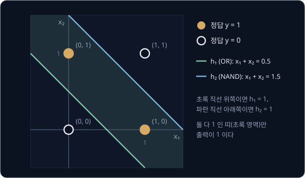

위 그림은 이 network 가 평면을 나누는 모습이다. $h_1$ 의 decision boundary 는 $x_1 + x_2 = 0.5$(초록)이고 $h_2$ 의 decision boundary 는
$x_1 + x_2 = 1.5$(파랑)이며, 출력 unit 은 두 직선 사이의 띠 모양 영역만 1 로 예측한다. XOR 가 1 인 $(0, 1)$ 과 $(1, 0)$ 은 그 띠 안에 있다.
직선 하나로는 이런 띠를 만들 수 없지만 직선 두 개를 조합하면 만들 수 있다.

## hidden layer 학습과 activation function

앞 절 network 의 숫자는 사람이 논리식을 보고 손으로 정한 것이다. 이 숫자를 데이터에서 찾을 때는 perceptron 학습 규칙을 쓸 수 없다. 학습 규칙
$w_i \leftarrow w_i + \eta(y - \hat y)x_i$ 는 그 unit 의 정답 $y$ 를 알아야 쓸 수 있는데, 정답이 있는 것은 출력 unit 뿐이기 때문이다. truth
table 에는 XOR 의 정답만 있고, $h_1$ 이 OR 를 맡아야 한다는 것은 어디에도 적혀 있지 않다. 출력이 틀렸을 때 그 책임이 어느 unit 의 숫자에
있는지 정하는 이 문제를 **credit assignment** 문제라고 한다.

gradient descent 는 정답이 없는 숫자도 고칠 수 있다. 숫자 하나를 아주 조금 바꿨을 때 출력의 틀린 정도가 바뀌는 비율(derivative)을 구해서,
틀린 정도가 줄어드는 쪽으로 고치면 되기 때문이다. 그런데 activation function 이 step function 이면 이 방법을 쓸 수 없다. 앞에서 학습한 AND
의 숫자 $w = [0.2, 0.1]$, $b = -0.2$ 에서 $[1, 1]$ 의 $z$ 는 0.1 이고 예측은 1 인데, $w_1$ 을 0.01 늘려 0.21 로 해도 예측은 그대로 1 이다.

| $w_1$ | $z$ | step function 의 출력 | sigmoid 의 출력 |
| --- | --- | --- | --- |
| 0.20 | 0.10 | 1 | 0.5250 |
| 0.21 | 0.11 | 1 | 0.5275 |
| 변화 | $+0.01$ | 0 | $+0.0025$ |

step function 은 $z$ 의 부호가 그대로인 한 출력이 전혀 변하지 않으므로, 출력이 뛰는 $z = 0$ 을 빼면 어디서든 derivative 가 0 이다. 그러면
gradient descent 는 숫자를 어느 쪽으로 고쳐야 할지 알 수 없다. 그래서 activation function 을 매끄러운 함수로 바꾼다. **sigmoid** 는 0 과 1 사이를
부드럽게 잇는 함수로, $z = 0$ 에서 0.5 이고 $z$ 가 아주 작으면 0 에 가까워지며 아주 크면 1 에 가까워진다. 출력이 끊기지 않고 이어지므로 위
표처럼 $z$ 가 0.01 바뀌면 출력도 0.0025 바뀐다.

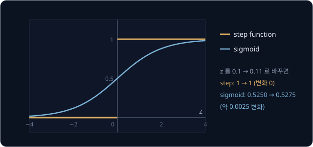

hidden layer 숫자의 derivative 는 그 숫자가 출력에 영향을 주는 길을 거꾸로 따라가며 단계별 비율을 곱해 구한다. 예를 들어 $h_1$ 에 들어가는
weight 가 1 늘 때마다 $h_1$ 의 출력이 2 늘고, $h_1$ 의 출력이 1 늘 때마다 최종 출력이 3 는다고 하자. weight 를 1 늘리면 $h_1$ 의 출력은
$1 \times 2 = 2$ 늘고, 그 2 때문에 최종 출력은 $2 \times 3 = 6$ 는다. 단계별 비율을 곱해 잇는 이 규칙을 chain rule 이라고 한다. chain rule
로 출력에서부터 층을 거슬러 올라가며 모든 숫자의 derivative 를 구하는 계산이 **backpropagation** 이다.

1969 년 Minsky 와 Papert 가 책 *Perceptrons* 에서 한 층 perceptron 의 이런 한계를 수학적으로 정리한 뒤, neural network 연구에 쏠리던 관심과
연구비가 크게 줄었다. 여러 층을 학습시키는 backpropagation 은 1986 년 Rumelhart, Hinton, Williams 의 논문 이후 널리 쓰이게 되었다.

## 로봇 policy 의 MLP

perceptron 의 step function 을 매끄러운 activation function 으로 바꾼 unit 을 여러 층 쌓은 network 를 **MLP**(multi-layer perceptron)라고
한다. unit 하나는 perceptron 처럼 입력마다 weight 를 곱해 더하고 bias 를 더한 $z$ 를 activation function 에 넣는다. 다만 출력이 0 과 1 이 아닌
실수이고, 숫자를 perceptron 학습 규칙 대신 backpropagation 으로 고친다.

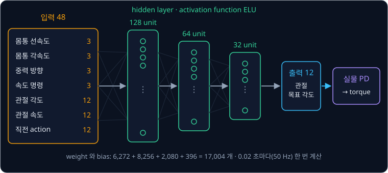

위 그림은 legged_gym 의 [ANYmal C 평지 설정](https://github.com/leggedrobotics/legged_gym/blob/master/legged_gym/envs/anymal_c/flat/anymal_c_flat_config.py)
에 적힌 보행 policy 다. 입력 48 개는 몸통의 선속도 3 개와 각속도 3 개, 몸통 기준 중력 방향 3 개, 따라갈 속도 명령 3 개, 관절 각도 12 개,
관절 속도 12 개, 직전에 낸 action 12 개다. 이 숫자들이 unit 128, 64, 32 개짜리 hidden layer 를 차례로 거치고, 출력 unit 12 개가 다리 네 개의
관절 12 개 목표 각도를 낸다. policy 는 0.02 초마다 한 번, 1초에 50 번 목표 각도를 내는데, 0.02 초는 simulation step 0.005 초를 네 번 묶은
간격이다. 논문에 따르면 실제 로봇에서는 이 목표 각도를 motor 안의 PD controller 가 torque 로 바꾼다. 다만 legged_gym 의 ANYmal C
simulation 에서는 PD 식 대신, 실제 motor 의 복잡한 반응을 흉내 내도록 학습한 neural network(actuator network)가 목표 각도에서 torque 를
계산한다.

| 층 | weight 수 + bias 수 | 합 |
| --- | --- | --- |
| 입력 48 → 128 | $48 \times 128 + 128$ | 6,272 |
| 128 → 64 | $128 \times 64 + 64$ | 8,256 |
| 64 → 32 | $64 \times 32 + 32$ | 2,080 |
| 32 → 출력 12 | $32 \times 12 + 12$ | 396 |
| 전체 | | 17,004 |

층마다 입력 수 × unit 수 만큼의 weight 와 unit 수 만큼의 bias 가 있어서, 첫 층은 입력이 48 개인 perceptron 128 개와 같은 계산을 한다.
Rudin et al. 은 legged_gym 논문에서 GPU 하나로 로봇 수천 대를 동시에 simulation 해 평지 policy 를 4 분 안에 학습했다.

이 policy 의 activation function 은 ELU 인데, $z$ 가 양수면 $z$ 를 그대로 내고 0 이하면 $e^z - 1$ 을 낸다.

<b>심화: 많이 쓰는 activation function 비교</b>

같은 $z$ 에서 네 함수의 출력을 비교하면 아래와 같다.

| $z$ | $-2$ | $-0.5$ | $0$ | $0.5$ | $2$ |
| --- | --- | --- | --- | --- | --- |
| step function | 0 | 0 | 0 | 1 | 1 |
| sigmoid | 0.119 | 0.378 | 0.5 | 0.622 | 0.881 |
| ReLU (음수를 0 으로) | 0 | 0 | 0 | 0.5 | 2 |
| ELU | $-0.865$ | $-0.393$ | 0 | 0.5 | 2 |

step function 만 $z = 0$ 에서 끊기고 나머지 셋은 이어져 있어서 숫자를 조금 바꾸면 출력도 조금 바뀐다. sigmoid 는 $z$ 가 크면 1 에 가까워져 거의
변하지 않지만, ReLU 와 ELU 는 양수 쪽에서 $z$ 를 그대로 내보내 변화가 줄지 않는다.

**흔한 오해.** "층만 많이 쌓으면 activation function 없이도 직선 아닌 경계를 만든다." activation function 이 없으면 weighted sum 을 몇 번
거듭해도 결과는 weighted sum 하나다. 예를 들어 첫 층이 $h = 2x + 1$ 이고 둘째 층이 $\hat y = 3h - 1$ 이면 $\hat y = 3(2x + 1) - 1 = 6x + 2$ 로 한 층과 같아서,
경계는 여전히 직선 하나다.

**확인 문제.** 입력 6 개를 받는 unit 32 개짜리 층의 weight 와 bias 는 모두 몇 개인가?

답 보기

unit 하나는 입력 6 개에 weight 를 하나씩 곱하고 bias 하나를 더하므로 weight 6 개와 bias 1 개를 쓴다.

① weight 수는 $6 \times 32 = 192$ 다.

② bias 수는 unit 수와 같은 32 다.

③ 합은 $192 + 32 = 224$ 다.

답: 224 개다. 입력이 6 개인 perceptron 32 개의 숫자를 모두 센 것과 같다.

## 정리

- perceptron 은 weighted sum $z = w_1 x_1 + w_2 x_2 + b$ 가 0 보다 크면 1 을 내고 그렇지 않으면 0 을 내는데, 이 판정은 평면에 decision
  boundary 라는 직선 하나를 그어 양쪽을 가르는 것과 같다. weight 는 직선의 방향을 정하고, bias(문턱 $\theta$ 의 부호를 바꾼 $b = -\theta$)는 위치를 정한다
- 학습 규칙 $w_i \leftarrow w_i + \eta(y - \hat y)x_i$ 는 틀린 sample 에서만 숫자를 고친다. sample 마다 바로 고치는 online update 로 AND 를
  학습하면 6 epoch 만에 $2x_1 + x_2 = 2$ 를 찾는다. 0 에서 시작하면 learning rate 는 모든 숫자의 배율만 바꿀 뿐 경로를 바꾸지 않는다
- linearly separable 한 데이터에서는 학습이 반드시 수렴하지만 XOR 는 직선 하나로 가를 수 없어 순환에 빠진다. 두 층으로 쌓으면 XOR 를
  표현할 수 있다. step function 을 sigmoid·ELU 같은 매끄러운 activation function 으로 바꾸고 backpropagation 으로 학습한 여러 층 network 가 로봇
  policy 에 쓰는 MLP 다

다음 강의 [Backpropagation](../autograd/README.md) 에서는 chain rule 로 hidden layer 의 숫자까지 derivative 를 구하는 계산을 한 단계씩
따라가며, XOR 를 푸는 두 층 network 의 hidden unit 이 gradient 를 받는 과정을 숫자로 확인한다.

## 참고 자료

- Frank Rosenblatt, [The Perceptron: A Probabilistic Model for Information Storage and Organization in the Brain](https://doi.org/10.1037/h0042519) (1958) —
  perceptron 을 처음 제안한 논문. 문턱(threshold)을 넘으면 반응하는 unit 을 설명한 부분만 찾아 읽어도 된다
- A. B. J. Novikoff, [On Convergence Proofs for Perceptrons](https://cs.uwaterloo.ca/~y328yu/classics/novikoff.pdf) (1962) — linearly
  separable 데이터에서 유한 번 고친 뒤 수렴한다는 짧은 증명
- Cornell CS4780, [The Perceptron](https://www.cs.cornell.edu/courses/cs4780/2018fa/lectures/lecturenote03.html) — update 가 직선을 옮기는
  그림과 margin 으로 적은 수렴 증명을 정리한 강의 노트
- Michael Nielsen, [Neural Networks and Deep Learning — Chapter 1](http://neuralnetworksanddeeplearning.com/chap1.html) — perceptron 으로
  NAND 를 만드는 예부터 sigmoid neuron 으로 넘어가는 이유까지
- Rudin et al., [Learning to Walk in Minutes Using Massively Parallel Deep Reinforcement Learning](https://arxiv.org/abs/2109.11978) (2021) —
  ANYmal 보행 policy 를 GPU 하나에서 학습한 논문. 3.2 절은 policy 의 입력과 action, 실제 로봇의 PD controller 를 설명하고, 3.3 절은 simulation 의 actuator network 를 설명한다
- [legged_gym](https://github.com/leggedrobotics/legged_gym) — 위 논문의 코드. 설정 파일의 `actor_hidden_dims` 와 `activation` 이 policy
  MLP 의 층 크기와 activation function 이다
- [Wikipedia — Perceptron](https://en.wikipedia.org/wiki/Perceptron) — Mark I perceptron 하드웨어, Minsky 와 Papert 의 책이 남긴 영향, 수렴
  정리를 요약한 글
