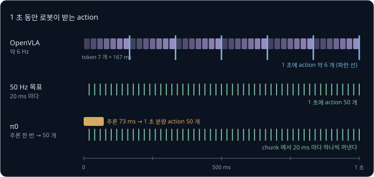
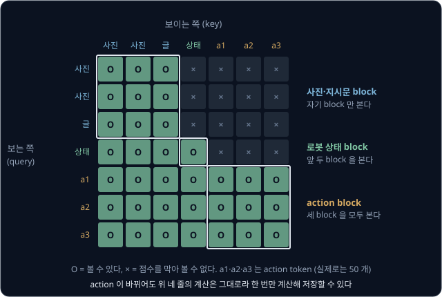
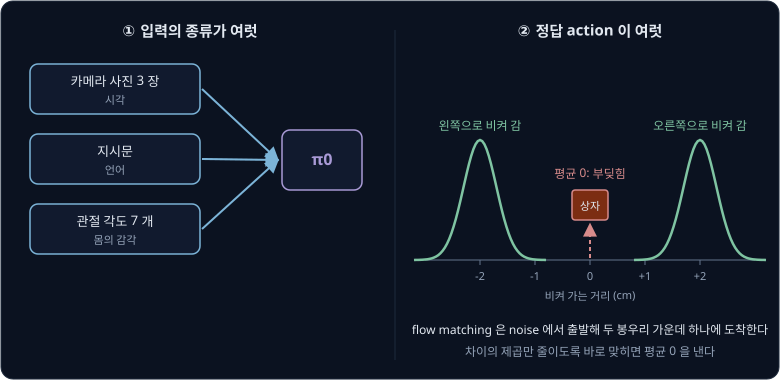
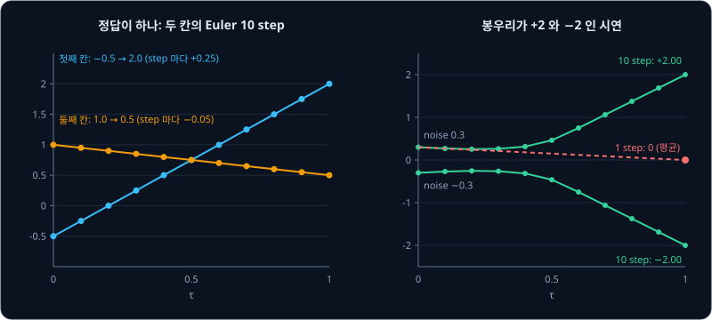
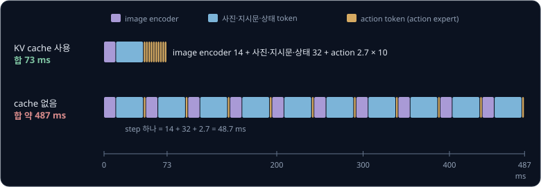
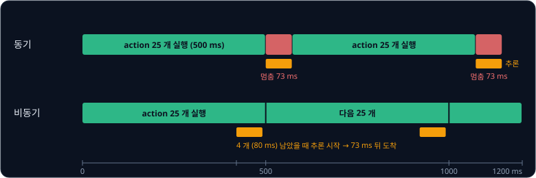
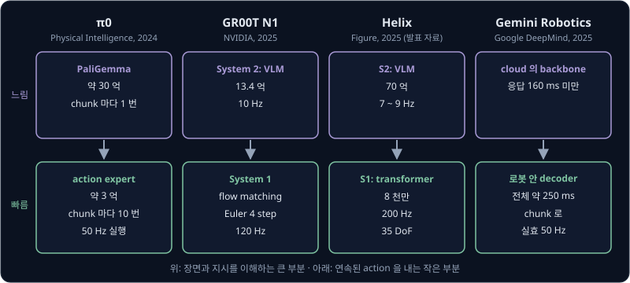
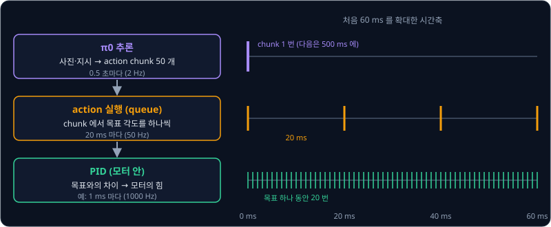
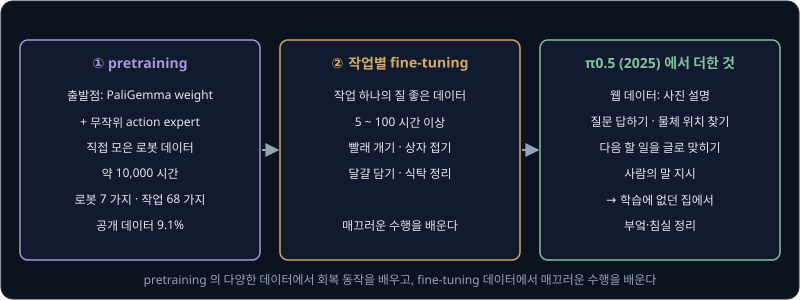

# π0

## 학습 목표

- 사진과 글을 읽는 큰 모델 옆에 행동만 만드는 작은 모델을 따로 붙인 π0 의 구조를 그림으로 설명하고, 그 작은 모델이 글을 쓰는
  언어 모델이 아닌 이유를 말할 수 있다
- 두 모델이 weight(학습으로 정하는 숫자)는 따로 쓰면서 서로의 정보를 어떻게 주고받는지, 어느 입력이 어느 입력을 볼 수 있는지를
  표로 그릴 수 있다
- 무작위 숫자에서 출발해 10 번 조금씩 고쳐 앞으로 1 초 동안의 행동 50 개를 만드는 계산을 작은 숫자로 따라갈 수 있다
- 큰 모델의 계산은 행동 묶음 하나에 한 번만 하고 작은 모델만 10 번 돌리는 이유와, 그 덕분에 줄어드는 시간을 계산할 수 있다
- 느린 큰 모델, 빠른 행동 생성기, 그보다 훨씬 빠른 모터 제어기로 나뉜 층 구조를 다른 로봇 모델들과 비교해 설명할 수 있다
- 여러 로봇의 데이터로 먼저 학습한 뒤 작업마다 더 학습하는 과정과, 노트북에서 이 모델을 돌릴 때의 조건을 설명할 수 있다

## action token 방식의 두 약점

### 칸으로 자른 각도

[RT-2 → OpenVLA](../vla-tokens/README.md) 에서는 VLA(Vision-Language-Action model)를 배웠다. VLA 는 인터넷의 사진과 글로 미리 학습한
VLM(Vision-Language Model, 사진과 글을 함께 읽는 모델)을 몸통으로 삼아, 카메라 사진과 지시문을 받아 로봇의 action(행동 명령)을 내는
모델이다. 그 강의의 로봇 팔은 관절 6 개와 집게 하나라서 action 이 숫자 7 개였고, 이 강의에서도 같은 팔을 쓴다.

RT-2 와 OpenVLA 는 각도를 칸 256 개 가운데 하나로 바꿔 token(언어 모델이 한 번에 하나씩 내는 출력 단위)으로 냈다. 관절 1 의 10.3° 는
138 번 칸이 되고, 되돌릴 때는 칸의 가운데 값 10.5° 가 된다. 칸 폭이 1° 라서 관절마다 최대 0.5° 가 어긋나고, 관절에서 손끝까지
30 cm 인 팔이면 손끝이 약 2.6 mm 어긋난다. 구멍에 핀을 꽂는 일처럼 1 mm 안쪽으로 맞춰야 하는 작업에는 부족하다.

**확인 문제.** 칸 256 개로 범위 $-128$° ~ $+128$° 를 나눌 때 각도 $-5.6$° 는 몇 번 칸이고, 되돌리면 몇 도일까?

답 보기

$-5.6 - (-128) = 122.4$ 이고 칸 폭이 1° 라 내리면 122 번 칸이다. 되돌리면 칸의 가운데 $-128 + 122.5 = -5.5$° 라서 0.1° 어긋난다.

### 하나씩 내는 token

token 7 개는 한 번에 나오지 않는데, 관절 2 의 token 은 관절 1 의 token 을 보고 골라야 해서, 70 억 개짜리 모델을 7 번 차례로 돌려야
action 하나가 나온다. OpenVLA 는 RTX 4090 GPU(곱셈·덧셈 수천 개를 동시에 하는 계산 칩) 한 장에서 1 초에 약 6 번 action 을 냈다.
1 초에 몇 번 일어나는지를 세는 단위가 Hz(헤르츠)라서 약 6 Hz 다.

| 모델 | 한 번의 추론으로 나오는 것 | 걸리는 시간 |
| --- | --- | --- |
| OpenVLA | action 1 개 (모델을 7 번 차례로 돌린다) | 약 167 ms |
| π0 | action 50 개 (1 초 분량) | 약 73 ms |

ms 는 1000 분의 1 초이고, 추론(inference)은 학습이 끝난 모델에 입력을 넣어 출력을 계산하는 일이다. 표의 π0 숫자는 π0 논문이 같은
RTX 4090 에서 잰 값이고, 이 강의에서 그 이유를 하나씩 따라간다.

위 그림의 위 줄에서 작은 칸 7 개가 token 하나씩이고, 7 개가 모여야 action 하나가 된다. 아래 줄의 π0 는 추론 한 번으로 50 개를
받아 20 ms 마다 하나씩 꺼내 쓴다.

**확인 문제.** 모델을 한 번 돌리는 데 0.03 초가 걸리고 action 하나에 token 7 개가 필요하다면, 1 초에 action 을 몇 개 낼 수 있을까?

답 보기

action 하나에 $7 \times 0.03 = 0.21$ 초가 걸리므로 $1 \div 0.21 \approx 4.8$, 4 개 남짓이다.

### 50 Hz 에 필요한 action 수

빨래 개기처럼 손을 빠르고 섬세하게 움직이는 작업은 50 Hz, 곧 20 ms 마다 새 목표를 보내는 경우가 많다. [ACT](../act/README.md) 의
ALOHA 도 50 Hz 였다. 50 Hz 로 1 초를 움직이려면 action 이 50 개 필요하고, OpenVLA 의 6 개로는 $50 \div 6 \approx 8.3$ 배가 모자란다.

[ACT](../act/README.md) 는 이 문제를 action chunk 로 풀었다. action chunk 는 앞으로 여러 step 동안의 action 을 한꺼번에 묶은 덩어리이고,
추론 한 번이 덩어리 하나를 실행하는 시간 안에만 끝나면 로봇은 기다리지 않는다. π0 는 VLM 의 상식을 그대로 쓰면서 이 덩어리를 숫자
그대로 만드는 방법을 찾은 모델이다.

**확인 문제.** 50 Hz 로봇이 action 50 개짜리 덩어리를 받았다. 이 덩어리로 몇 초를 움직일 수 있을까?

답 보기

action 하나가 $1 \div 50 = 0.02$ 초라서 $50 \times 0.02 = 1$ 초다.

**요약**

- action 을 칸 token 으로 내면 칸 폭 때문에 각도가 최대 0.5° 어긋나고, token 을 하나씩 내느라 OpenVLA 는 약 6 Hz 에 머문다
- 50 Hz 로 움직이려면 1 초에 action 50 개가 필요하고, π0 는 추론 한 번에 1 초 분량 50 개를 숫자 그대로 만든다

## VLM 몸통과 action expert

### 두 부분의 역할

π0("파이 제로")는 Physical Intelligence 라는 회사가 2024 년에 발표한 VLA 로, 아래 두 부분으로 되어 있다.

- **VLM 몸통** — 카메라 사진과 지시문을 읽는다. Google 이 공개한 VLM 인 PaliGemma 의 weight 를 가져와 출발점으로 쓴다. PaliGemma 는
  사진을 token 으로 바꾸는 image encoder 와 글을 다루는 언어 모델 Gemma 를 이어 붙인 모델이다
- **action expert** — 로봇의 관절 각도(로봇 상태)와, 무작위 숫자(noise)에서 출발해 조금씩 고쳐 가는 action 덩어리를 받아 그 덩어리를
  어느 쪽으로 얼마나 고칠지를 숫자로 낸다. 이 숫자는 덩어리가 움직일 방향과 빠르기라서 속도(velocity)라고 부른다

VLM 몸통이 "빨간 컵이 상자 왼쪽에 있고 지시는 컵을 상자에 넣으라는 것" 같은 내용을 숫자로 정리해 두면, action expert 는 그 정리를
참고해 관절을 어떻게 움직일지를 만든다. VLM 옆에 붙어 action 을 내는 이런 부분을 넓게 action head 라고 부르고, π0 논문은 자기 모델의
action head 를 action expert 라고 부른다. expert 라는 이름은 mixture of experts 에서 왔는데, 입력마다 여러 weight 묶음(expert) 가운데
하나로 보내 처리하는 구조를 그렇게 부른다. π0 는 사진·글 token 을 VLM 의 weight 로, 로봇 상태·action token 을 action expert 의 weight 로
보내므로 expert 가 둘인 경우다.

위 그림은 π0 에 들어가는 token 한 줄과, 그 token 들을 처리하는 두 weight 묶음을 보여 준다. 파란 token 은 VLM 몸통이, 초록과 주황
token 은 action expert 가 맡는다. 두 묶음 사이의 양쪽 화살표는 두 묶음이 서로의 정보를 주고받는 길이다.

**확인 문제.** 아래 입력은 각각 VLM 몸통과 action expert 가운데 어느 weight 로 처리될까? (가) 손목 카메라 사진 (나) "put the cup in
the box" (다) 지금 관절 각도 7 개 (라) noise 가 섞인 action 덩어리

답 보기

(가) 와 (나) 는 VLM 이 미리 학습한 종류의 입력이라 VLM 몸통이, (다) 와 (라) 는 VLM 이 본 적 없는 로봇 입력이라 action expert 가 맡는다.

### parameter 수

parameter 는 모델 안에서 학습으로 정하는 숫자이고, B 는 billion(10 억), M 은 million(100 만)이다. π0 논문에 따르면 PaliGemma 는
parameter 가 약 30 억(3B) 개이고, 여기에 약 3 억(300M) 개짜리 action expert 를 더해 모두 약 33 억(3.3B) 개다.

| 부분 | parameter 수 | 처음 값 |
| --- | --- | --- |
| VLM 몸통 (PaliGemma) | 약 30 억 | 인터넷 사진·글로 학습한 PaliGemma 의 weight |
| action expert | 약 3 억 | 무작위 값에서 출발 |
| 합 | 약 33 억 | |

action expert 는 VLM 의 10 분의 1 크기다. 한 token 을 나타내는 숫자의 개수(width)가 VLM 은 2048 개, action expert 는 1024 개이고,
층 안의 계산 크기도 action expert 쪽이 훨씬 작다. 논문은 행동을 만들 때 action expert 를 여러 번 돌려야 해서 추론을 빠르게 하려고
작게 만들었다고 적었다. π0 는 덩어리 하나를 만드는 동안 action expert 를 10 번 돌린다.

**확인 문제.** VLM 몸통이 30 억, action expert 가 3 억 개일 때 action expert 는 전체 33 억 개의 몇 % 일까?

답 보기

$3 \div 33 \approx 0.091$ 이라 약 9% 다.

### LLM 이 아닌 action expert

action expert 는 Gemma 와 같은 transformer 구조로 만들었다. [Transformer](../transformer/README.md) 는 token 목록을 받아 token 끼리
서로를 참고하게 하는 계산을 여러 층 쌓은 neural network(숫자를 곱하고 더하는 계산을 여러 층 쌓아 학습하는 모델) 구조이고, LLM(large language model, 글로 학습한 큰 언어 모델)도 이 구조로
만든다. 그래서 "action expert 도 작은 LLM 이다" 라고 오해하기 쉽다.

구조가 같아도 무엇을 배웠는지가 다르다. LLM 은 글을 보고 vocabulary(쓸 수 있는 token 의 목록)의 token 마다 다음에 올 확률을 낸다.
action expert 는 무작위 weight 에서 출발해 로봇 시연만으로 학습했고, vocabulary 가 없으며 단어를 한 번도 내지 않는다. action token
하나가 층을 다 지나면 맨 끝의 계산 하나가 그 token 을 숫자 7 개(관절 6 개와 집게의 속도)로 바꾼다.

| | LLM (Gemma) | action expert |
| --- | --- | --- |
| 구조 | transformer | transformer (더 작다) |
| 학습 데이터 | 인터넷의 글 | 로봇 시연 |
| 출력 | vocabulary 의 token 마다 확률 | action 마다 숫자 7 개 |
| 처음 weight | 글로 학습한 값 | 무작위 값 |

같은 구조가 무엇을 하는지는 학습 데이터와 출력 모양이 정한다. 같은 공장 설비로 빵도 과자도 굽는 것과 같다.

**확인 문제.** action expert 가 action token 50 개를 받아 마지막에 낸 출력은 숫자 모두 몇 개일까? 이 중에 단어가 있을까?

답 보기

token 마다 숫자 7 개라 $50 \times 7 = 350$ 개다. 출력은 모두 연속된 숫자이고 단어는 없다.

### attention 으로 주고받는 정보

weight 묶음이 따로여도 action expert 는 사진 내용을 알 수 있는데, 두 묶음이 transformer 의 attention 계산에서 만나기 때문이다. attention 은
[Transformer](../transformer/README.md) 에서 본 것처럼, token 마다 다른 token 들과의 관련도 점수를 매겨 합이 1 인 비율로 바꾸고, 그
비율대로 다른 token 들의 내용을 섞어 가져오는 계산이다. 점수를 매길 때 쓰는 표지를 key, 가져오는 내용을 value 라고 불렀다.

action token 하나가 token 세 개를 본다고 하자. 관련도 비율과 value 가 아래와 같다면, 이 action token 이 가져오는 내용은 비율대로
섞은 값이다.

| 보는 대상 | 관련도 비율 | value | 비율 × value |
| --- | --- | --- | --- |
| 컵이 찍힌 image token | 0.7 | 10 | 7.0 |
| 지시문의 "cup" token | 0.2 | 4 | 0.8 |
| 로봇 상태 token | 0.1 | 2 | 0.2 |
| 합 | 1.0 | | 8.0 |

image token 의 key 와 value 는 VLM 의 weight 로, action token 의 query(찾는 기준)는 action expert 의 weight 로 만든다. 서로 다른 weight
로 만들었어도 attention 에서 주고받는 숫자의 길이만 맞춰 두면 계산할 수 있다. π0 논문은 두 weight 묶음이 "transformer 의
self-attention 층에서만 만난다" 고 적었다. 그래서 층을 하나 지날 때마다 action token 은 사진과 지시문에서 필요한 내용을 가져온다.

**확인 문제.** 위 표에서 관련도 비율이 0.1, 0.6, 0.3 으로 바뀌면 action token 이 가져오는 값은?

답 보기

$0.1 \times 10 + 0.6 \times 4 + 0.3 \times 2 = 1 + 2.4 + 0.6 = 4.0$ 이다. 지시문 token 을 많이 볼수록 그 value 4 에 가까워진다.

### attention mask 의 세 block

모든 token 이 모든 token 을 볼 수 있는 것은 아니다. [GPT-2](../gpt/README.md) 의 causal mask 는 뒤쪽 token 의 점수를 막아 앞쪽만
보게 했다. 이렇게 어떤 token 이 어떤 token 을 볼 수 있는지 정한 표를 attention mask 라고 한다. π0 는 token 을 세 묶음(block)으로
나누고 뒤쪽 block 만 앞쪽 block 을 보게 한다.

| 보는 쪽 \ 보이는 쪽 | 사진·지시문 | 로봇 상태 | noise 가 섞인 action |
| --- | --- | --- | --- |
| 사진·지시문 | 본다 | 못 본다 | 못 본다 |
| 로봇 상태 | 본다 | 본다 | 못 본다 |
| noise 가 섞인 action | 본다 | 본다 | 본다 |

같은 block 안에서는 앞뒤 없이 서로를 다 보고, 그래서 action token 50 개는 서로를 보며 덩어리 전체를 함께 맞춘다. 논문이 밝힌 이유는
block 마다 다르다.

- **사진·지시문** — PaliGemma 가 미리 학습할 때 본 적 없는 로봇 입력을 보지 않게 막아, 미리 배운 계산이 흐트러지지 않게 한다
- **로봇 상태** — 덩어리를 고치는 동안 계속 바뀌는 action token 을 보지 않으므로, 한 번 계산한 결과를 저장해 다시 쓸 수 있다
- **action** — 앞의 모든 정보를 보고 덩어리를 고칠 속도를 낸다

**확인 문제.** 로봇 상태 token 이 action token 을 볼 수 있게 바꾸면, action 덩어리를 고칠 때마다 로봇 상태 token 의 계산은 어떻게 될까?

답 보기

action token 이 바뀔 때마다 로봇 상태 token 이 가져오는 내용도 바뀌므로, 고칠 때마다 로봇 상태 token 을 다시 계산해야 한다. 지금처럼
막아 두면 한 번만 계산하면 된다.

**요약**

- π0 는 사진·지시문을 읽는 PaliGemma(약 30 억)와 로봇 상태·action 을 맡는 action expert(약 3 억)로 되어 있고, 합은 약 33 억 parameter 다
- action expert 는 transformer 구조지만 로봇 시연으로 처음부터 학습해 단어 대신 action 마다 숫자를 내므로 LLM 이 아니다
- 두 weight 묶음은 attention 에서만 만나고, attention mask 는 사진·지시문 → 로봇 상태 → action 순서로 뒤쪽 block 만 앞쪽을 보게 한다

## 두 가지 multimodal

### 여러 종류의 입력

modality 는 시각·언어처럼 정보를 받아들이는 감각의 종류이고, multi 는 "여럿" 이다. π0 는 사진(시각), 지시문(언어), 관절 각도(몸의
감각)를 함께 받으므로 multimodal 입력을 받는 모델이다. π0 논문에서 로봇 하나는 카메라 2 ~ 3 대의 사진을 함께 넣는다.
[RT-2 → OpenVLA](../vla-tokens/README.md) 의 OpenVLA 가 사진 한 장과 지시문만 받고 관절 각도는 받지 않았던 것과 다르다.

### 정답이 여럿인 행동

multimodal 은 행동 쪽에서도 쓰인다. 같은 장면에서 시연자가 상자를 오른쪽으로 2 cm 비켜 가기도 하고 왼쪽으로 2 cm 비켜 가기도 했다면,
정답 action 이 $+2$ 와 $-2$ 두 무리로 갈린다. 값이 몰린 자리를 봉우리라고 부르므로, 봉우리가 둘인 이 분포도 multimodal 이다. 여기서
modal 은 통계에서 가장 자주 나온 값을 뜻하는 mode 에서 왔다.

[ACT](../act/README.md) 와 [Flow Matching](../flow-matching/README.md) 에서 본 것처럼, 차이의 제곱을 줄이도록 action 을 바로 맞히면
모델은 두 정답의 평균 $(+2 - 2) \div 2 = 0$ 을 낸다. 0 은 상자 정면으로 곧장 가는 길이라 두 시연 어디에도 없는 실패다. flow matching
은 noise 에서 출발해 봉우리 하나에 도착하므로, 평균 대신 $+2$ 나 $-2$ 가운데 하나를 고른다.

| 쓰는 곳 | 뜻 | π0 에서의 예 |
| --- | --- | --- |
| multimodal 입력 | 입력의 종류가 여럿이다 | 사진 3 장, 지시문, 관절 각도 |
| multimodal 행동 분포 | 같은 장면에 정답 action 이 여럿이다 | 상자를 오른쪽 또는 왼쪽으로 비켜 간다 |

[RT-2 → OpenVLA](../vla-tokens/README.md) 는 첫째 뜻으로만, [ACT](../act/README.md) 는 둘째 뜻으로만 이 단어를 썼다. π0 는 둘 다에
해당하는 모델이라 문장마다 어느 뜻인지 가려 읽어야 한다.

**확인 문제.** (가) "π0 는 multimodal 모델이라 손목 카메라와 지시문을 함께 받는다" (나) "시연이 multimodal 이라 차이의 제곱을 줄이도록
학습하면 평균 action 이 나온다" 에서 multimodal 은 각각 어느 뜻일까?

답 보기

(가) 는 입력의 종류가 여럿이라는 뜻이고, (나) 는 같은 장면의 정답 action 이 봉우리 여럿으로 갈렸다는 뜻이다.

**요약**

- π0 는 사진·지시문·관절 각도를 함께 받으므로 입력 쪽으로 multimodal 이다
- 같은 장면에 정답 action 이 여럿인 분포도 multimodal 이라고 부르고, π0 는 flow matching 으로 평균 대신 봉우리 하나를 고른다

## flow matching 으로 만드는 action chunk

### Flow Matching 강의 기호와 π0 기호

[Flow Matching](../flow-matching/README.md) 에서는 noise $\epsilon$("엡실론", 표준 정규분포 $\mathcal N(0, 1)$ 에서 뽑은 무작위 숫자)을
$x_0$, 데이터를 $x_1$ 로 두고 둘을 잇는 직선 위의 점을 $x_t = (1 - t)\,\epsilon + t\,x_1$ 로 정했다. 시각 $t$ 가 0 이면 noise, 1 이면
데이터다. network 는 그 직선 위의 속도(velocity) $x_1 - \epsilon$ 을 맞히고, 만들 때는 Euler 법으로 지금 자리의 속도대로 조금씩
직진하기를 되풀이한다.

π0 논문은 같은 식을 다른 글자로 쓴다. 시각을 $\tau$("타우")로 쓰고, 데이터 자리에 시연의 action 덩어리 $A_t$ 를 넣는다.

$$
A_t^\tau = \tau\,A_t + (1 - \tau)\,\epsilon, \qquad
\text{target velocity} = A_t - \epsilon, \qquad
A_t^{\tau + \delta} = A_t^\tau + \delta\,v_\theta(A_t^\tau, o_t)
$$

첫 식은 "시연 덩어리에 $\tau$ 를, noise 에 $1 - \tau$ 를 곱해 더한 점" 이고, 둘째는 그 직선 위의 정답 속도, 셋째는 Euler step 한 번이다.
$\delta$("델타")는 한 step 의 길이로 Flow Matching 강의의 $\Delta t$ 자리이고, $v_\theta$ 는 weight 가 $\theta$("세타")인 network 가 낸
속도, $o_t$ 는 사진·지시문·관절 각도를 합친 관측(observation)이다.

| 뜻 | Flow Matching 강의 | π0 논문 |
| --- | --- | --- |
| noise | $x_0 = \epsilon$ | $A_t^0 = \epsilon$ |
| 데이터 | $x_1$ | $A_t$ (시연의 action 덩어리) |
| 섞는 시각 | $t$ | $\tau$ |
| 섞은 점 | $x_t = (1 - t)\,\epsilon + t\,x_1$ | $A_t^\tau = \tau\,A_t + (1 - \tau)\,\epsilon$ |
| target velocity | $x_1 - \epsilon$ | $A_t - \epsilon$ |
| Euler step | $x \leftarrow x + \Delta t \times v$ | $A_t^{\tau + \delta} = A_t^\tau + \delta\,v_\theta$ |
| 로봇의 시각 | 없다 | 아래첨자 $t$ |

**흔한 오해.** π0 논문의 아래첨자 $t$ 는 flow matching 의 시각이 아니라 로봇이 몇 번째 step 에 있는지다. $A_t$ 는 "로봇 step $t$ 에서
만든 덩어리" 이고, 덩어리를 noise 에서 데이터 쪽으로 옮기는 시각은 위첨자 $\tau$ 다. Flow Matching 강의의 $t$ 는 π0 의 $\tau$ 에
해당한다. 공개 구현 openpi 의 코드는 반대로 1 을 noise, 0 을 데이터로 두므로 코드를 읽을 때는 방향부터 확인한다.

**확인 문제.** 시연 값 $A = 2.0$, noise $\epsilon = -0.5$ 일 때 $\tau = 0.3$ 의 점 $A^{0.3}$ 과 target velocity 는?

답 보기

$A^{0.3} = 0.3 \times 2.0 + 0.7 \times (-0.5) = 0.6 - 0.35 = 0.25$ 이고, target velocity 는 $2.0 - (-0.5) = 2.5$ 다. Flow Matching 강의의
식에 $x_1 = 2.0$, $t = 0.3$ 을 넣어도 같은 값이 나온다.

### action chunk 의 모양

π0 는 덩어리 길이를 $H = 50$ 으로 둔다. 이 강의의 팔은 action 하나가 숫자 7 개이므로 덩어리 하나는 50 줄 × 7 칸의 표, 숫자로는
$50 \times 7 = 350$ 개다. action 하나마다 action token 이 하나 있어서 action expert 는 action token 50 개를 받는다.

$$
A_t = [a_t,\ a_{t+1},\ \ldots,\ a_{t+49}]
$$

"로봇 step $t$ 부터 $t + 49$ 까지의 action 50 개를 묶은 것" 으로 읽는다. 50 Hz 로봇에서는 1 초 분량이다.

로봇마다 action 의 숫자 개수가 다르므로 π0 는 모두 가장 큰 로봇에 맞춘 18 칸으로 넣는다. 논문의 가장 큰 로봇은 6 관절 팔 둘, 집게 둘,
움직이는 바닥, 위아래로 움직이는 몸통을 가져 18 칸이 필요했고, 칸이 모자란 로봇은 남는 칸을 0 으로 채운다. 이 강의의 7 칸 팔이면
$18 - 7 = 11$ 칸이 0 이다.

action expert 는 noise 가 섞인 action 과 함께 시각 $\tau$ 도 받는다. 같은 자리라도 $\tau$ 에 따라 맞는 속도가 다르기 때문이고,
[Transformer](../transformer/README.md) 의 positional encoding 이 위치를 sin·cos 값의 숫자 묶음으로 바꾼 것처럼 $\tau$ 도 그런 숫자 묶음으로 바꿔
action token 마다 섞어 넣는다.

**확인 문제.** 관절 6 개와 집게 하나짜리 팔이 둘인 로봇(숫자 14 개)의 action 덩어리는 숫자 몇 개이고, 18 칸에 맞추려면 action 마다 0 을
몇 칸 채울까?

답 보기

$50 \times 14 = 700$ 개이고, action 마다 $18 - 14 = 4$ 칸을 0 으로 채운다.

### Euler 10 step 의 손 계산

π0 는 $\tau = 0$ 의 noise 에서 출발해 $\delta = 0.1$ 로 Euler step 을 10 번 밟는다. 덩어리 350 개를 다 적을 수 없으니 두 칸만 떼어
계산한다. 첫째 칸은 step $t$ 의 관절 1, 둘째 칸은 step $t+1$ 의 관절 1 이라고 하자. 시연 값이 $A = (2.0,\ 0.5)$ 이고 뽑은 noise 가
$\epsilon = (-0.5,\ 1.0)$ 이다. 학습이 잘 된 action expert 가 정답 속도 $A - \epsilon = (2.5,\ -0.5)$ 를 그대로 낸다고 하면 아래와 같다.

| step | $\tau$ | 지금 값 | 속도 $v$ | $0.1 \times v$ | 새 값 |
| --- | --- | --- | --- | --- | --- |
| 1 | 0 | $(-0.5,\ 1.0)$ | $(2.5,\ -0.5)$ | $(0.25,\ -0.05)$ | $(-0.25,\ 0.95)$ |
| 2 | 0.1 | $(-0.25,\ 0.95)$ | $(2.5,\ -0.5)$ | $(0.25,\ -0.05)$ | $(0,\ 0.9)$ |
| 3 | 0.2 | $(0,\ 0.9)$ | $(2.5,\ -0.5)$ | $(0.25,\ -0.05)$ | $(0.25,\ 0.85)$ |
| 4 | 0.3 | $(0.25,\ 0.85)$ | $(2.5,\ -0.5)$ | $(0.25,\ -0.05)$ | $(0.5,\ 0.8)$ |
| 5 | 0.4 | $(0.5,\ 0.8)$ | $(2.5,\ -0.5)$ | $(0.25,\ -0.05)$ | $(0.75,\ 0.75)$ |
| 6 | 0.5 | $(0.75,\ 0.75)$ | $(2.5,\ -0.5)$ | $(0.25,\ -0.05)$ | $(1.0,\ 0.7)$ |
| 7 | 0.6 | $(1.0,\ 0.7)$ | $(2.5,\ -0.5)$ | $(0.25,\ -0.05)$ | $(1.25,\ 0.65)$ |
| 8 | 0.7 | $(1.25,\ 0.65)$ | $(2.5,\ -0.5)$ | $(0.25,\ -0.05)$ | $(1.5,\ 0.6)$ |
| 9 | 0.8 | $(1.5,\ 0.6)$ | $(2.5,\ -0.5)$ | $(0.25,\ -0.05)$ | $(1.75,\ 0.55)$ |
| 10 | 0.9 | $(1.75,\ 0.55)$ | $(2.5,\ -0.5)$ | $(0.25,\ -0.05)$ | $(2.0,\ 0.5)$ |

10 step 뒤에 시연 값 $(2.0,\ 0.5)$ 에 정확히 닿았다. 4 번째 step 이 시작할 때의 값 $(0.25,\ 0.85)$ 는 섞는 식에 $\tau = 0.3$ 을 넣은
$0.3 \times (2.0,\ 0.5) + 0.7 \times (-0.5,\ 1.0) = (0.25,\ 0.85)$ 와 같다. 속도가 바뀌지 않는 직선 위를 걸었기 때문이다. 기호와 맞추면
$\epsilon$ 은 첫 줄의 $(-0.5,\ 1.0)$, $\delta$ 는 0.1, $v_\theta$ 는 속도 열, $A_t^1$ 은 마지막 열의 $(2.0,\ 0.5)$ 다.

숫자를 바꿔 $\epsilon = (1.0,\ -1.0)$, $A = (-1.0,\ 0)$ 으로 해 보면 속도는 $(-2.0,\ 1.0)$ 이고 step 마다 $(-0.2,\ 0.1)$ 씩 움직여
$(1.0,\ -1.0) \to (0.8,\ -0.9) \to \cdots \to (-1.0,\ 0)$ 에 닿는다. 실제 action expert 는 이 두 칸만이 아니라 350 칸의 속도를 한꺼번에
내고, step 하나마다 action expert 를 한 번 돌린다.

**확인 문제.** $\epsilon = (0,\ 2.0)$, $A = (1.0,\ 1.0)$ 이고 network 가 정답 속도를 낸다. Euler 3 step 뒤의 값은?

답 보기

속도는 $(1.0 - 0,\ 1.0 - 2.0) = (1.0,\ -1.0)$ 이고 step 마다 $(0.1,\ -0.1)$ 씩 움직인다. 3 step 뒤는 $(0.3,\ 1.7)$ 이다. 섞는 식에
$\tau = 0.3$ 을 넣은 $0.3 \times (1.0,\ 1.0) + 0.7 \times (0,\ 2.0) = (0.3,\ 1.7)$ 과 같다.

### 봉우리가 둘인 시연의 Euler 계산

앞 절은 정답이 하나뿐이라 속도가 줄곧 같았다. 시연이 $+2$ 와 $-2$ 반반으로 갈리면 network 는 [Flow Matching](../flow-matching/README.md)
의 "가능성을 무게로 둔 평균" 에서 본 대로, 그 자리를 지나는 두 정답의 속도를 가능성만큼 섞어 낸다. 처음에는 두 봉우리 어느 쪽인지
모르니 속도가 0 근처이다가, 값이 한쪽으로 조금 기울면 그쪽 봉우리의 속도가 커진다. 그 평균 식으로 계산한 속도를 noise 0.3 에서 따라가면
아래와 같다.

| step | $\tau$ | 지금 값 | 속도 | 새 값 |
| --- | --- | --- | --- | --- |
| 1 | 0 | 0.30 | $-0.30$ | 0.27 |
| 3 | 0.2 | 0.26 | 0.08 | 0.26 |
| 5 | 0.4 | 0.31 | 1.49 | 0.46 |
| 6 | 0.5 | 0.46 | 2.88 | 0.75 |
| 8 | 0.7 | 1.06 | 3.12 | 1.38 |
| 10 | 0.9 | 1.69 | 3.12 | 2.00 |

중간 step 은 줄였다. 처음 세 step 동안은 거의 제자리에 있다가 $\tau = 0.4$ 무렵부터 $+2$ 쪽으로 빠르게 움직여 2.00 에 닿는다. noise 가
$-0.3$ 이었다면 같은 계산이 부호만 바뀌어 $-2.00$ 에 닿는다. 그런데 Euler step 을 1 번만 밟으면 $0.3 + 1 \times (-0.3) = 0$ 이 되어 두
정답의 평균, 곧 상자에 부딪히는 길에 머문다. step 수가 너무 적으면 봉우리를 고르지 못하고, π0 는 10 step 을 쓴다.

**확인 문제.** 위 계산에서 Euler step 을 1 번만 밟으면 noise 0.3 은 어디에 도착하고, 그 값은 시연의 어느 쪽 행동일까?

답 보기

$\tau = 0$ 의 속도 $-0.3$ 으로 시간 1 동안 직진해 $0.3 - 0.3 = 0$ 에 도착한다. 0 은 $+2$ 와 $-2$ 의 평균이라 시연 어디에도 없는 행동이다.

### 학습 한 step 의 loss 와 τ 뽑기

학습 한 step 은 Flow Matching 강의와 같다. 시연에서 관측 $o_t$ 와 덩어리 $A_t$ 를 꺼내고, noise $\epsilon$ 과 시각 $\tau$ 를 뽑아 섞은
점 $A_t^\tau$ 를 만든 뒤, network 의 속도와 target velocity $A_t - \epsilon$ 의 차이를 자리마다 제곱해 더한 값을 loss(얼마나 틀렸는지를
나타내는 숫자)로 줄인다.

$$
L = \big\lVert v_\theta(A_t^\tau, o_t) - (A_t - \epsilon) \big\rVert^2
$$

$\lVert \ \rVert^2$ 는 "자리마다 차이를 제곱해 모두 더한다" 는 기호다. 두 칸짜리 예 $A = (2.0,\ 0.5)$, $\epsilon = (-0.5,\ 1.0)$ 에서
$\tau = 0.3$ 이 뽑혔다면 $A^{0.3} = (0.25,\ 0.85)$, target 은 $(2.5,\ -0.5)$ 다. network 가 $(2.0,\ -0.5)$ 를 냈다면 차이는
$(0.5,\ 0)$ 이고 loss 는 $0.5^2 + 0^2 = 0.25$ 다.

$\tau$ 는 0 과 1 사이에서 고르게 뽑지 않는다. π0 는 noise 쪽, 곧 $\tau$ 가 작은 쪽을 더 자주 뽑는 beta 분포(0 과 1 사이 값의 뽑힐
가능성을 정하는 분포의 한 종류)를 써서, $\tau = 0.1$ 근처가 $\tau = 0.9$ 근처보다 약 3 배 자주 나온다. 논문은 관측이 정답 행동을 상당히
좁혀 주기 때문에 noise 가 많은 자리에서 맞는 방향을 잡는 일이 이미지 생성보다 어렵고, 그래서 그 자리를 더 많이 연습시킨다고 적었다.

**확인 문제.** 같은 예에서 network 가 $(2.5,\ 0.5)$ 를 냈다면 loss 는?

답 보기

target $(2.5,\ -0.5)$ 와의 차이는 $(0,\ 1.0)$ 이라 loss 는 $0^2 + 1.0^2 = 1.0$ 이다.

**요약**

- π0 의 $A_t^\tau = \tau A_t + (1 - \tau)\epsilon$ 은 Flow Matching 강의의 $x_t = (1 - t)\epsilon + t x_1$ 과 같고, π0 의 $\tau$ 가 강의의 $t$,
  아래첨자 $t$ 는 로봇 step 이다
- 덩어리는 action 50 개(이 팔이면 숫자 350 개)이고, $\delta = 0.1$ 로 Euler 10 step 을 밟아 noise 에서 시연 쪽으로 옮긴다
- 봉우리가 둘인 시연에서 10 step 은 한 봉우리에 닿고 1 step 은 평균에 머문다. 학습은 $\tau$ 를 noise 쪽에서 더 자주 뽑는다

## 한 번의 VLM 계산과 KV cache

### 10 번 바뀌는 것과 안 바뀌는 것

Euler step 10 번 동안 매번 바뀌는 것은 action token 50 개뿐이다. 사진·지시문·로봇 상태 token 은 action token 을 보지 않으므로(attention mask 의
세 block), action 이 어떻게 바뀌어도 그 token 들의 계산 결과는 10 번 모두 같다.

token 수로 보면 차이가 크다. PaliGemma 는 사진 한 장을 image token 256 개로 만드므로 카메라 3 대면 $3 \times 256 = 768$ 개이고, 지시문이
20 token 이라면 로봇 상태 1 개까지 789 개다. 반면 매번 다시 계산해야 하는 action token 은 50 개다.

**확인 문제.** 카메라가 2 대이고 지시문이 16 token 이면, 10 번의 step 동안 바뀌지 않는 token 은 몇 개일까?

답 보기

$2 \times 256 + 16 + 1 = 512 + 16 + 1 = 529$ 개다.

### KV cache

attention 에서 action token 이 다른 token 을 보려면 그 token 의 key 와 value 가 층마다 있어야 한다. 바뀌지 않는 789 개의 key·value 는
처음 한 번만 계산해 저장해 두고, 10 번의 step 에서는 action token 50 개만 action expert 로 계산한 뒤 저장해 둔 key·value 를 꺼내 쓴다.
이렇게 key 와 value 를 저장해 다시 쓰는 것을 KV cache 라고 한다. K 와 V 는 key 와 value 의 첫 글자이고, cache 는 "다시 쓰려고 가까이
저장해 두는 곳" 이다.

π0 논문은 RTX 4090 에서 카메라 3 대일 때 덩어리 하나를 만드는 시간을 아래처럼 적었다.

| 계산 | 시간 |
| --- | --- |
| image encoder (사진 → image token) | 14 ms |
| 사진·지시문·상태 token 의 계산 (한 번) | 32 ms |
| action token 의 계산 × 10 번 | 27 ms |
| 합 | 73 ms |

cache 없이 step 마다 사진부터 다시 계산한다고 어림하면 step 하나에 $14 + 32 + 2.7 = 48.7$ ms, 10 번이면 487 ms 다. 2.7 ms 는 27 ms 를
10 으로 나눈 action 계산 한 번이다. cache 를 쓰면 73 ms 라서 약 6.7 배 빠르다.

같은 사진을 10 번 다시 읽을 필요가 없으니, 한 번 읽고 정리해 둔 메모를 10 번 꺼내 보는 것과 같다.

**흔한 오해.** "VLM 이 덩어리마다 한 번만 계산되니 action 을 만들 때 사진을 덜 본다" 고 생각하기 쉽다. action token 은 10 번의 step 마다
층마다 저장된 key·value 전체를 attention 으로 다시 보므로, 사진에서 가져오는 정보는 그대로다. 줄어든 것은 같은 계산을 되풀이하는 시간뿐이다.

**확인 문제.** image encoder 가 20 ms, 사진·지시문·상태 계산이 40 ms, action 계산 한 번이 3 ms 인 모델이 Euler 10 step 을 밟는다. KV
cache 를 쓸 때와 안 쓸 때 덩어리 하나에 걸리는 시간은?

답 보기

쓰면 $20 + 40 + 10 \times 3 = 90$ ms, 안 쓰면 $10 \times (20 + 40 + 3) = 630$ ms 다.

**요약**

- Euler step 마다 바뀌는 것은 action token 뿐이고, 사진·지시문·상태 token 은 action 을 보지 않아 10 번 모두 같다
- 그 token 들의 key·value 를 한 번만 계산해 저장하는 KV cache 덕분에 덩어리 하나가 RTX 4090 에서 73 ms 다. cache 없이 어림하면 약 487 ms 다

## 실시간 실행 구조

### 50 step 덩어리와 25 step 실행

덩어리 하나는 50 Hz 로봇에서 1 초 분량이지만 π0 는 끝까지 쓰지 않는다. 논문에 따르면 50 Hz 로봇은 action 25 개(0.5 초)를 실행할
때마다, 20 Hz 로봇은 16 개(0.8 초)를 실행할 때마다 새로 추론했다. [ACT](../act/README.md) 에서 본 것처럼 덩어리를 실행하는 동안은 새
사진을 보지 않으므로, 덩어리를 짧게 끊어 쓸수록 바뀐 상황에 빨리 반응한다. 덩어리끼리 겹치는 예측을 평균하는 ACT 의 temporal
ensembling 은 π0 에서 오히려 성능을 떨어뜨려서, 논문은 평균 없이 덩어리를 그대로 실행했다.

| 로봇 | 제어 주기 | 한 번에 실행하는 action | 다음 추론까지 |
| --- | --- | --- | --- |
| 50 Hz 로봇 | 20 ms | 25 개 | 0.5 초 |
| 20 Hz 로봇 (UR5e, Franka 팔) | 50 ms | 16 개 | 0.8 초 |

**확인 문제.** 20 Hz 로봇이 덩어리 50 개를 모두 실행한다면 몇 초 분량일까? 논문처럼 16 개만 실행하면?

답 보기

action 하나가 $1 \div 20 = 0.05$ 초라서 50 개는 2.5 초, 16 개는 $16 \times 0.05 = 0.8$ 초다.

### 추론 동안의 멈춤과 비동기 추론

action 25 개를 다 실행한 뒤에야 추론을 시작하면, 그 73 ms 동안 로봇은 새 목표가 없어 멈춘다. 73 ms 는 $73 \div 20 = 3.65$, 약 4 step
이다. 이렇게 추론이 끝날 때까지 실행을 멈추는 방식을 동기(synchronous) 추론이라고 하고, π0 논문의 실험이 이 방식이었다.

[Real Robot](../real-robot/README.md) 에서 본 비동기(asynchronous) 추론은 덩어리가 다 끝나기 전에 다음 추론을 시작해, 실행하는 동안
다음 덩어리를 계산한다. 남은 action 이 4 개일 때 시작하면 $4 \times 20 = 80$ ms 안에 73 ms 짜리 추론이 끝나므로 멈춤이 없다.

| 방식 | 0.5 초 실행 한 번에 걸리는 시간 | 멈춘 시간 |
| --- | --- | --- |
| 동기 | $500 + 73 = 573$ ms | 73 ms |
| 비동기 (4 개 남았을 때 시작) | 500 ms | 0 ms |

새 덩어리는 73 ms 전의 사진으로 계산했으므로 앞쪽 약 4 개는 이미 지나간 step 의 몫이다. Physical Intelligence 는 2025 년의 real-time
chunking 연구에서, 그사이 실행될 것이 확실한 앞쪽 action 은 이전 덩어리 값으로 고정해 두고 나머지를 그에 이어지게 만드는 방식으로 이
문제를 다뤘다.

**확인 문제.** 추론이 150 ms 걸리는 모델을 50 Hz 로봇에서 비동기로 쓴다. action 이 몇 개 이상 남았을 때 다음 추론을 시작해야 할까?

답 보기

남은 개수 × 20 ms 가 150 ms 이상이어야 하므로 $150 \div 20 = 7.5$, 곧 8 개 이상이다.

### 느린 큰 모델과 빠른 행동 생성기

π0 처럼 사진과 글을 읽는 큰 부분은 드물게, action 을 만드는 작은 부분은 자주 돌리는 설계는 다른 로봇 모델에도 공통으로 나온다.
NVIDIA 의 GR00T N1 과 Figure 의 Helix 는 두 부분을 System 2 와 System 1 이라고 부른다. 이 이름은 심리학자 Daniel Kahneman 이 사람의
생각을 천천히 따져 보는 System 2 와 빠르고 자동으로 반응하는 System 1 로 나눈 데서 왔다.

| 모델 | 느린 큰 부분 | 빠른 작은 부분 | 출처 |
| --- | --- | --- | --- |
| π0 (Physical Intelligence, 2024) | PaliGemma 약 30 억, 덩어리마다 1 번 | action expert 약 3 억, 덩어리마다 10 번, 50 Hz 실행 | 논문 |
| GR00T N1 (NVIDIA, 2025) | System 2: VLM 13.4 억, L40 GPU 에서 10 Hz | System 1: flow matching 으로 학습한 transformer, 120 Hz 로 action, 덩어리 16 개를 Euler 4 step 으로 | 논문 |
| Helix (Figure, 2025) | S2: VLM 70 억, 7 ~ 9 Hz | S1: 8 천만 parameter transformer, 200 Hz, 상체 35 DoF | 회사 발표 자료 |
| Gemini Robotics (Google DeepMind, 2025) | cloud 의 큰 몸통, 응답 160 ms 미만 | 로봇 안의 local decoder, 사진에서 action 덩어리까지 약 250 ms, 덩어리로 실효 50 Hz | 기술 보고서 |

GR00T N1 은 전체 22 억 parameter 가운데 13.4 억이 VLM 이고, 덩어리 16 개를 만드는 데 L40 GPU 에서 63.9 ms 가 걸렸다고 적었다.

Helix 의 S1 은 손목·손가락·몸통·머리를 합쳐 상체의 35 DoF 를 움직인다. DoF(degree of freedom, 자유도)는 따로 움직일 수 있는
방향의 수이고, 관절 하나가 한 방향으로 돌면 1 DoF 다. S2 는 장면과 지시를 숫자 묶음 하나(latent vector)로 정리해 S1 에 넘기고, 두
부분은 로봇 안의 GPU 두 장에서 따로 돈다고 발표했다.

Gemini Robotics 의 cloud 는 로봇 밖의 데이터센터 컴퓨터를 뜻한다. 큰 몸통을 그곳에서 돌리는 동안, 로봇 안에서 도는 작은 action
생성 부분(local decoder)이 몸통의 늦은 응답을 메운다. latency(입력을 넣고 출력을 받기까지 걸리는 시간)가 250 ms 여도 덩어리 하나에 action 이 여러 개라 50 Hz 로 움직인다.

π0 는 두 부분이 한 transformer 안에서 층마다 attention 으로 만나는 한 모델이고, Helix 와 Gemini Robotics 는 따로 도는 두 부분이 정리된
결과를 주고받는다는 점이 다르다. 그래도 "느린 큰 모델이 장면과 지시를 이해하고, 빠른 작은 생성기가 연속된 action 을 낸다" 는 나눔은 같다.

**확인 문제.** Helix 의 S2 가 8 Hz, S1 이 200 Hz 로 돈다면 S2 가 한 번 결과를 낼 때 S1 은 몇 번 action 을 낼까?

답 보기

S2 는 $1 \div 8 = 0.125$ 초마다, S1 은 $1 \div 200 = 0.005$ 초마다 돌므로 $0.125 \div 0.005 = 25$ 번이다.

### 맨 아래층의 PID

π0 의 action 은 관절의 다음 목표 각도이지 모터에 넣는 힘이 아니다. [PID Control](../pid-control/README.md) 에서 본 것처럼 모터 안의
PID controller 가 목표와 지금 각도의 차이를 보고 힘을 계산하며, 보통 1 초에 수백 ~ 수천 번 돈다. 그래서 π0 를 실물 로봇에 올리면
주기가 다른 세 층이 생긴다.

| 층 | 하는 일 | 주기 |
| --- | --- | --- |
| π0 추론 | 사진과 지시를 보고 action 덩어리를 만든다 | 0.5 초마다 (2 Hz) |
| action 실행 | 덩어리를 대기 줄(queue)에 담아 두고 목표 각도를 하나씩 꺼내 보낸다 | 20 ms 마다 (50 Hz) |
| PID | 목표 각도를 따라가도록 모터의 힘을 계산한다 | 예를 들어 1 ms 마다 (1000 Hz) |

PID 가 1000 Hz 면 목표 하나(20 ms) 동안 20 번, 덩어리를 새로 받는 0.5 초 동안 500 번 계산한다. 위층이 느려도 되는 것은 아래층이 그
사이를 빠르게 메우기 때문이다.

**확인 문제.** PID 가 500 Hz 로 돌고 action 이 50 Hz 로 나온다. 목표 각도 하나 동안 PID 는 몇 번 계산할까?

답 보기

action 하나는 $1 \div 50 = 0.02$ 초, PID 는 $1 \div 500 = 0.002$ 초마다 돌므로 $0.02 \div 0.002 = 10$ 번이다.

**요약**

- π0 는 50 Hz 로봇에서 덩어리 50 개 가운데 25 개(0.5 초)만 실행하고 다시 추론한다. 동기 추론이면 73 ms 씩 멈추고, 비동기 추론은 남은
  action 이 4 개일 때 미리 시작해 멈춤을 없앤다
- GR00T N1, Helix, Gemini Robotics 도 느린 큰 부분과 빠른 작은 부분으로 나눈다
- 맨 아래에서는 PID 가 action 보다 훨씬 빠르게 돌며 목표 각도를 따라간다

## 사전학습과 fine-tuning

### 여러 로봇의 데이터로 하는 사전학습

π0 의 학습은 두 단계다. 먼저 여러 로봇과 여러 작업의 데이터를 섞어 학습하는 사전학습(pre-training)을 하고, 그다음 한 작업의 질 좋은
데이터로 조금 더 학습하는 fine-tuning 을 한다. 논문은 뒤 단계를 post-training 이라고도 부른다.

사전학습 데이터는 Physical Intelligence 가 직접 모은 로봇 데이터 약 10,000 시간이 중심이다. 로봇 구성 7 가지, 작업 68 가지이고, 팔
하나짜리 로봇부터 팔 둘에 바퀴 달린 바닥까지 있다. 여기에 [RT-2 → OpenVLA](../vla-tokens/README.md) 에서 본 Open X-Embodiment(여러
연구실의 로봇 데이터를 모은 공개 데이터) 등 공개 데이터를 섞었고, 그 비중은 학습 예시의 9.1% 였다. 사전학습 동안에는 action expert 만이
아니라 PaliGemma 의 weight 도 함께 고친다.

사전학습만 마친 모델도 지시를 받아 셔츠 개기나 식탁 정리 같은 작업을 어느 정도 해냈고, 같은 데이터로 학습시킨 OpenVLA 보다 훨씬 좋았다.
논문은 OpenVLA 가 action 덩어리를 지원하지 못해 이 작업들에서 고전했다고 적었다.

**확인 문제.** 학습 예시 1000 개를 뽑으면 그중 공개 데이터에서 온 것은 대략 몇 개일까?

답 보기

$1000 \times 0.091 = 91$ 개 정도다. 나머지 약 909 개는 직접 모은 로봇 데이터다.

### 작업별 fine-tuning

복잡한 작업은 사전학습만으로 부족해서 그 작업의 데이터로 fine-tuning 한다. 논문에서 가장 쉬운 작업은 5 시간, 가장 복잡한 작업은
100 시간 이상의 데이터를 썼고, 빨래를 꺼내 개어 쌓기, 상자 접기, 달걀을 판에 담기 같은 작업을 해냈다.

두 단계로 나누는 이유는 데이터의 성격이 다르기 때문이다. 질 좋은 fine-tuning 데이터만으로 학습하면 실수에서 회복하는 장면이 거의 없어
작은 실수에도 무너지고, 다양하지만 거친 사전학습 데이터만으로는 작업을 매끄럽고 빠르게 하지 못한다. 둘을 함께 쓰면 평소에는 질 좋은
데이터처럼 움직이고, 실수하면 사전학습에서 본 회복 동작을 꺼내 쓴다.

**확인 문제.** fine-tuning 데이터 5 시간을 50 Hz 로 기록했다면 기록된 step 은 몇 개일까?

답 보기

$5 \times 3600 \times 50 = 900{,}000$ 개다. 1 시간은 3600 초다.

### π0.5 의 웹 데이터 co-training

Physical Intelligence 는 2025 년에 π0 를 바탕으로 한 π0.5 를 발표했다. 여러 종류의 데이터를 한 모델에 함께 섞어 학습하는 것을
co-training 이라고 하는데, π0.5 는 로봇 데이터에 아래 데이터를 함께 섞었다.

- **웹 데이터** — 사진 설명 쓰기, 사진에 대한 질문에 답하기, 사진에서 물체 위치 찾기
- **다음 할 일 맞히기** — "부엌을 치워" 같은 큰 지시를 받고 "접시를 집어" 같은 다음 작은 작업을 글로 맞히기
- **사람의 말 지시** — 사람이 로봇에게 다음 작은 작업을 말로 골라 준 기록

논문에 따르면 첫 학습 단계의 예시 가운데 97.6% 는 집안일을 하는 이동 로봇의 데이터가 아니라 다른 로봇이나 웹에서 온 것이었다. 그런데도
π0.5 는 학습에 없던 집에서 부엌이나 침실을 치웠다. 실행할 때는 먼저 다음 작은 작업을 글로 내고, 그 글을 보고 action 덩어리를 만든다.

웹 데이터를 빼고 학습한 비교 실험에서는 학습에 없던 종류의 물체를 가리키는 지시를 따르는 성능이 크게 떨어졌다. 논문은 웹 데이터에 담긴
물체에 대한 넓은 지식이 처음 보는 물체 이름을 알아듣게 해 준다고 추측했다. 학습 방법도 달라서, 첫 단계에서는 action 을 FAST 라는 방법으로
압축한 token 으로 학습하고 뒤 단계에서 π0 와 같은 action expert 를 붙여 flow matching 으로 action 을 만든다. FAST 는 action 덩어리를 적은
수의 token 으로 압축하는 방법이다.

| | π0 | π0.5 |
| --- | --- | --- |
| 로봇 데이터 | 여러 로봇·작업 | 여러 로봇·작업, 여러 집 |
| 웹 데이터 | 섞지 않는다 (VLM 의 출발점에만 담겨 있다) | 사진 설명·질문 답하기·물체 위치 찾기를 섞는다 |
| 실행할 때 | 지시를 보고 바로 action 덩어리 | 다음 작은 작업을 글로 낸 뒤 action 덩어리 |
| action 을 만드는 방법 | action expert + flow matching | 첫 단계는 FAST token, 뒤 단계에서 action expert + flow matching |

**확인 문제.** π0.5 의 첫 학습 단계 예시가 1000 개라면, 집안일을 하는 이동 로봇의 데이터는 대략 몇 개일까?

답 보기

다른 데이터가 97.6% 이므로 이동 로봇의 집안일 데이터는 $100 - 97.6 = 2.4$%, 곧 약 24 개다.

**요약**

- π0 는 직접 모은 약 10,000 시간(7 가지 로봇, 68 가지 작업)과 공개 데이터로 사전학습한 뒤, 작업마다 5 ~ 100 시간 이상의 질 좋은 데이터로
  fine-tuning 한다
- 사전학습 데이터는 실수와 회복을, fine-tuning 데이터는 매끄러운 수행을 가르친다
- π0.5 는 웹 데이터와 다음 할 일 맞히기를 함께 학습해 처음 보는 집과 물체로 더 잘 넓혀 간다

## 노트북에서의 π0 추론

### 메모리와 읽기 시간

[Real Robot](../real-robot/README.md) 에서 계산했듯이 π0 의 약 33 억 parameter 를 숫자 하나에 2 byte 인 bf16 으로 올리면
$3.3 \times 2 = 6.6$ GB 다. byte 는 컴퓨터의 저장 단위이고 1 GB 는 10 억 byte 다. 메모리 36 GB 노트북에는 충분히 들어간다.

추론 한 번은 parameter 를 적어도 한 번씩 읽어야 하므로, 1 초에 400 GB 를 읽는 노트북이라면 모델 전체를 한 번 읽는 데
$6.6 \div 400 = 0.0165$ 초, 곧 16.5 ms 가 걸린다. KV cache 를 쓰면 덩어리 하나에 VLM 은 한 번, action expert 는 10 번 읽는다.

| 읽는 부분 | 크기 | 횟수 | 시간 |
| --- | --- | --- | --- |
| VLM (30 억 × 2 byte) | 6 GB | 1 번 | $6 \div 400 = 15$ ms |
| action expert (3 억 × 2 byte) | 0.6 GB | 10 번 | $10 \times 0.6 \div 400 = 15$ ms |
| 합 | | | 30 ms |

cache 없이 매번 전체를 읽는다면 $10 \times 16.5 = 165$ ms 다. 이 값들은 읽기만 센 가장 빠른 경우라서 실제 추론은 몇 배 더 걸리지만,
action expert 를 작게 만든 이유가 여기서도 보인다.

**확인 문제.** action expert 가 VLM 과 같은 30 억 개였다면, 위 표의 방식으로 덩어리 하나를 만드는 읽기 시간은?

답 보기

VLM 15 ms 에 action expert 도 한 번에 15 ms 씩 10 번이라 $15 + 10 \times 15 = 165$ ms 다. 3 억 개일 때의 30 ms 보다 5.5 배 길다.

### 공개 구현 openpi 의 조건

메모리에 들어가도 돌릴 수 있는지는 프로그램이 그 칩을 지원하느냐에 달렸다. π0 의 공식 공개 구현 openpi 는 NVIDIA GPU 를 기준으로
만들어졌고, 저장소의 안내는 아래와 같다.

| 할 일 | 필요한 GPU 메모리 | 예 |
| --- | --- | --- |
| 추론 | 8 GB 초과 | RTX 4090 |
| LoRA fine-tuning | 22.5 GB 초과 | RTX 4090 |
| 전체 fine-tuning | 70 GB 초과 | A100 (80 GB), H100 |

LoRA 는 원래 weight 를 고정하고 옆에 붙인 작은 행렬만 학습해 고칠 숫자를 크게 줄이는 방법이다([RT-2 → OpenVLA](../vla-tokens/README.md)).
저장소는 Linux 운영체제의 한 판본인 Ubuntu 22.04 에서만 시험했다고 밝혀서, Apple 칩 노트북에서 그대로 돌리기는 어렵다. 대신 openpi 는 모델을 GPU 가 있는 다른
컴퓨터에서 돌리고 로봇 쪽으로 action 을 보내 주는 원격 추론을 지원한다. Gemini Robotics 가 큰 몸통을 cloud 에 둔 것과 같은 나눔이다.

노트북에서 실시간으로 돌리려면 같은 구조를 줄인 모델을 쓰는 방법도 있다. Hugging Face 의 SmolVLA(2025)는 π0 처럼 VLM 옆에 action expert
를 붙이고 flow matching 으로 action 덩어리를 만들되, 전체를 약 4 억 5 천만 parameter 로 줄였다. [Real Robot](../real-robot/README.md)
에서 본 것처럼 이 크기는 노트북에서도 비동기 추론으로 실시간 실행이 가능하다.

**흔한 오해.** "6.6 GB 라 노트북 메모리에 들어가니 노트북에서 실시간으로 돌릴 수 있다" 고 생각하기 쉽다. 메모리는 필요 조건일 뿐이고,
읽기 속도와 공개 구현이 그 칩을 지원하는지가 함께 맞아야 한다.

**확인 문제.** 메모리 16 GB 노트북에서 π0(bf16 6.6 GB)를 올리면 남는 메모리는 대략 몇 GB 일까? 이 노트북에서 openpi 로 전체 fine-tuning
을 할 수 있을까?

답 보기

$16 - 6.6 = 9.4$ GB 가 남는다(운영체제가 쓰는 몫은 빼야 한다). 전체 fine-tuning 은 70 GB 를 넘는 GPU 메모리가 필요해서 할 수 없다.

**요약**

- π0 는 bf16 으로 6.6 GB 이고, KV cache 덕분에 덩어리 하나의 읽기 시간은 VLM 한 번 + 작은 action expert 10 번이다
- openpi 는 NVIDIA GPU(추론 8 GB 초과)와 Ubuntu 22.04 를 기준으로 해서, 노트북에서는 원격 추론이나 SmolVLA 같은 작은 모델을 쓴다

## 정리

- RT-2·OpenVLA 처럼 action 을 칸 token 으로 내면 각도가 최대 0.5° 어긋나고 token 을 하나씩 내느라 약 6 Hz 에 머문다. π0 는 추론 한 번에
  1 초 분량의 action 50 개를 숫자 그대로 만든다
- π0 는 사진·지시문을 읽는 PaliGemma(약 30 억)와 로봇 상태·action 을 맡는 action expert(약 3 억)로 된 약 33 억 parameter 모델이다.
  action expert 는 transformer 구조지만 로봇 시연으로 처음부터 학습해 action 마다 숫자를 내므로 LLM 이 아니다
- 두 weight 묶음은 attention 에서만 만나고, attention mask 는 사진·지시문 → 로봇 상태 → action 순서로 뒤쪽 block 만 앞쪽을 보게 한다
- π0 는 입력이 여러 종류라는 뜻과 정답 행동이 여럿이라는 뜻, 두 뜻 모두로 multimodal 이다
- $A_t^\tau = \tau A_t + (1 - \tau)\epsilon$ 은 Flow Matching 강의의 $x_t$ 와 같은 식이고, $\delta = 0.1$ 로 Euler 10 step 을 밟아
  $(-0.5,\ 1.0)$ 이 $(2.0,\ 0.5)$ 에 닿는다. 봉우리가 둘인 시연에서 10 step 은 한 봉우리에, 1 step 은 평균에 머문다
- KV cache 로 VLM 쪽 계산은 덩어리마다 한 번만 해서 RTX 4090 에서 덩어리 하나가 73 ms 이고, 50 Hz 로봇은 25 개(0.5 초)를 실행할 때마다
  다시 추론한다. 비동기 추론은 실행하는 동안 다음 덩어리를 계산한다
- GR00T N1·Helix·Gemini Robotics 도 느린 큰 부분과 빠른 작은 부분으로 나누고, 맨 아래에서는 PID 가 훨씬 빠르게 목표 각도를 따라간다
- 학습은 약 10,000 시간의 여러 로봇 데이터로 사전학습한 뒤 작업마다 fine-tuning 하고, π0.5 는 웹 데이터를 함께 학습해 처음 보는 물체와
  집으로 넓혔다

π0 는 시연을 따라 하도록 학습하므로 시연보다 잘할 수 없고, 시연에 없던 실패에서 스스로 회복하는 법도 시연에 담긴 만큼만 안다. 실제로
시도해 받은 reward(잘했는지 못했는지를 나타내는 점수)로 이런 VLA 를 더 학습하는 방법은 [VLA + RL](../vla-rl/README.md) 에서 다룬다.
action 을 token 으로 내는 방식은 [RT-2 → OpenVLA](../vla-tokens/README.md), 덩어리를 실물 팔에 올리는 추론 loop 는
[Real Robot](../real-robot/README.md) 에서 다시 볼 수 있다.

## 참고 자료

- K. Black 외, [π0: A Vision-Language-Action Flow Model for General Robot Control](https://arxiv.org/abs/2410.24164) (2024) — IV 장이
  VLM 과 action expert, flow matching 식이다. 부록 A-B 에 attention mask·action expert 크기·$\tau$ 분포가, A-D 에 KV cache 와 73 ms 의
  추론 시간표, 25 개씩 실행하는 방식이 있다. Physical Intelligence 의 [π0 blog](https://www.pi.website/blog/pi0) 에 실물 영상이 있다
- Physical Intelligence, [π0.5: a Vision-Language-Action Model with Open-World Generalization](https://arxiv.org/abs/2504.16054) (2025) —
  IV 장이 웹 데이터·다음 할 일 맞히기를 섞는 학습, V-C 절이 웹 데이터를 뺀 비교 실험이다
- K. Black, M. Galliker, S. Levine, [Real-Time Execution of Action Chunking Flow Policies](https://arxiv.org/abs/2506.07339) (2025) —
  추론하는 동안 멈추는 문제와, 실행하면서 다음 덩어리를 만드는 real-time chunking
- K. Pertsch 외, [FAST: Efficient Action Tokenization for Vision-Language-Action Models](https://arxiv.org/abs/2501.09747) (2025) —
  action 덩어리를 적은 token 으로 압축하는 방법. [FAST research page](https://www.pi.website/research/fast)
- NVIDIA, [GR00T N1: An Open Foundation Model for Generalist Humanoid Robots](https://arxiv.org/abs/2503.14734) (2025) — 2.1 절이 System 2
  (10 Hz VLM)와 System 1(120 Hz flow matching action 부분)의 구조와 63.9 ms 추론 시간이다
- Figure, [Helix: A Vision-Language-Action Model for Generalist Humanoid Control](https://www.figure.ai/news/helix) (2025) — 7B VLM 인 S2 와
  80M transformer 인 S1 을 로봇 안 GPU 두 장에서 돌리는 구조를 설명한 회사 발표 글
- Gemini Robotics Team, [Gemini Robotics: Bringing AI into the Physical World](https://arxiv.org/abs/2503.20020) (2025) — 3.1 절이 cloud 의
  몸통과 로봇 안의 local decoder, 160 ms·250 ms·실효 50 Hz 의 수치다
- M. Shukor 외, [SmolVLA: A Vision-Language-Action Model for Affordable and Efficient Robotics](https://arxiv.org/abs/2506.01844) (2025) —
  π0 의 구조를 약 4 억 5 천만 parameter 로 줄인 모델과 비동기 추론. Hugging Face blog [SmolVLA](https://huggingface.co/blog/smolvla)
- Hugging Face blog, [π0 and π0-FAST](https://huggingface.co/blog/pi0) — 두 모델을 LeRobot 에서 쓰는 법
- Hugging Face blog, [KV Cache from scratch in nanoVLM](https://huggingface.co/blog/kv-cache) — key·value 를 저장해 다시 쓰는 원리를 작은
  모델로 설명한다
- Physical Intelligence, [openpi](https://github.com/Physical-Intelligence/openpi) — π0·π0.5 의 공식 구현. README 에 GPU 메모리 요구와 원격
  추론 안내가 있다
