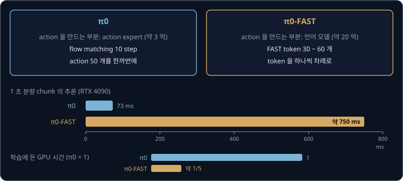

# π0

π0 논문에서 빨래를 개는 로봇 팔은 1 초에 관절 목표를 50 번 받는다. 그런데 VLM(Vision-Language Model, 인터넷의 사진과 글로 학습해 둘을
함께 읽는 모델)에게 action 을 단어처럼 token 으로 말하게 만든 OpenVLA 는 RTX 4090 GPU 한 장에서 1 초에 action 을 약 6 개밖에 내지 못한다.
VLM 이 인터넷에서 배운 지식을 그대로 쓰면서 1 초에 50 개씩 필요한 관절 목표를 제때 만들 수는 없을까?

Physical Intelligence 가 2024 년에 발표한 π0 는 PaliGemma 라는 VLM 옆에 action 만 만드는 작은 network 를 붙이고, flow matching 으로
1 초 분량의 action 50 개를 RTX 4090 에서 73 ms 만에 한꺼번에 만든다. 저자들은 이 모델을 fine-tuning 해서
건조기에서 빨래를 꺼내 바구니에 담고 테이블로 옮겨 한 벌씩 개는 이동 로봇을 움직였다.

## 학습 목표

- PaliGemma backbone 과 action expert 가 token 을 나눠 맡고 attention 에서만 정보를 주고받는 구조와, attention mask 의 세 block 을
  설명할 수 있다
- noise 에서 출발해 Euler 10 step 으로 action chunk 50 개를 만드는 계산을 따라가고, KV cache 덕분에 chunk 하나가 73 ms 에 나오는 이유를
  설명할 수 있다
- chunk 를 실행하는 주기와 비동기 추론을 설명하고, pretraining 과 fine-tuning 으로 나눈 학습 방법이 실험에서 낸 결과를 말할 수 있다
- π0-FAST 가 π0 에서 무엇을 바꿨고 그 결과 학습 시간과 추론 시간이 어떻게 달라지는지 비교할 수 있다

## action token 방식의 한계

[RT-2 → OpenVLA](../vla-tokens/README.md) 에서 본 VLA(Vision-Language-Action model)는 관절 각도 같은 action 값을 칸 256 개 가운데 하나로
바꾸고, 칸 번호를 vocabulary 의 token 하나로 냈다. 칸의 가운데 값으로 되돌릴 때 관절마다 칸 폭의 절반까지 각도가 어긋나는데, 그 강의의
계산으로는 30 cm 팔 끝에서 약 2.6 mm 다. token 을 고르는 방식은 느리기도 하다. 다음 token 은 앞에서 고른 token 을 보고 골라야 해서
70 억 parameter 모델을 action 의 숫자 개수만큼 차례로 계산해야 하는데, 관절 6 개와 집게 하나인 팔이면 7 번이다. OpenVLA 논문에 따르면
그 결과 RTX 4090 한 장에서 1 초에 action 을 약 6 개 냈다. 1 초에 몇 번 일어나는지 세는 단위가 Hz(헤르츠)라서 약 6 Hz 다.

π0 논문의 로봇은 대부분 1 초에 명령을 50 번(50 Hz) 받고, UR5e·Franka 팔만 20 번(20 Hz) 받는다. 50 Hz 로봇에 필요한 action 50 개는
OpenVLA 의 6 개보다 $50 \div 6 \approx 8.3$ 배 많다. [ACT](../act/README.md) 에서 본 action chunk 는 앞으로 여러 step 의
action 을 한 번에 묶어 낸 것이라서, 추론(학습이 끝난 모델에 입력을 넣어 출력을 계산하는 일)이 chunk 하나를 실행하는 시간 안에 끝나기만
하면 로봇이 기다리지 않는다.

| 모델 | 추론 한 번의 출력 | 걸리는 시간 (RTX 4090) |
| --- | --- | --- |
| OpenVLA | action 1 개 (모델을 7 번 차례로 계산한다) | 약 167 ms |
| π0 | action 50 개 (50 Hz 로 1 초 분량) | 73 ms |

ms 는 1000 분의 1 초다. π0 의 73 ms 는 π0 논문이 카메라 3 대로 잰 값이고, OpenVLA 의 167 ms 는 약 6 Hz 를 $1 \div 6$ 초로 바꾼 값이다.

**확인 문제.** 모델을 한 번 계산하는 데 0.03 초가 걸리고 action 하나에 token 7 개가 필요하다면, 1 초에 action 을 몇 개 낼 수 있을까?

답 보기

① action 하나에 모델을 7 번 계산하므로 $7 \times 0.03 = 0.21$ 초가 걸린다.

② 1 초 동안은 $1 \div 0.21 \approx 4.8$ 개다.

답: 4 개 남짓이다. 50 Hz 로봇에 필요한 50 개의 10 분의 1 에도 못 미친다.

## PaliGemma backbone 과 action expert

π0 는 transformer 하나 안에 weight 묶음 두 개를 둔다. [Transformer](../transformer/README.md) 는 token 목록을 받아 token 끼리 서로를
참고하게 하는 계산을 여러 층 쌓은 구조이고, weight 는 학습으로 정하는 숫자다.

- 첫째 묶음은 Google 이 공개한 VLM 인 PaliGemma 의 weight 를 그대로 가져온 VLM backbone 이다. PaliGemma 는 사진을 token 으로 바꾸는
  SigLIP image encoder 와 언어 모델 Gemma 2B 를 이은 모델로, [ViT](../vit/README.md) 의 표에서처럼 224×224 사진 한 장을 image token
  256 개로 바꾼다. 사진과 지시문 token 을 이 묶음이 처리한다
- 둘째 묶음은 무작위 값에서 출발해 학습한 **action expert** 다. 로봇의 관절 각도(로봇 상태)와 noise 가 섞인 action token 을 이 묶음이
  처리한다

expert 라는 이름은 mixture of experts 에서 왔다. mixture of experts 는 token 마다 여러 weight 묶음(expert) 가운데 하나를 골라 처리하는
구조인데, 저자들은 π0 를 expert 가 둘인 mixture of experts 에 견주었다.

논문 부록에 적힌 두 묶음의 크기는 아래와 같다.

| | PaliGemma backbone | action expert |
| --- | --- | --- |
| 처음 weight | 인터넷 사진·글로 pretraining 한 값 | 무작위 값 |
| token 하나를 나타내는 숫자 수 (width) | 2048 | 1024 |
| 층 안 MLP 의 크기 (mlp_dim) | 16,384 | 4096 |
| parameter 수 | 약 30 억 | 약 3 억 |

width 와 mlp_dim 은 언어 모델 Gemma 2B 부분의 값이고, 30 억은 image encoder 까지 합친 PaliGemma 전체의 값이다. action expert 의 3 억까지
더하면 π0 는 약 33 억 parameter 다. chunk 하나를 만들 때 여러 번 계산하는 쪽은 action expert 라서, 저자들은 이쪽을 줄여 추론을 빠르게
했다. 두 묶음은 attention 에서만 만나므로 width 가 달라도 되고, openpi 는 attention head 하나의 길이를 두 묶음 모두 256 으로 맞춘다.

action expert 는 Gemma 와 같은 transformer 구조지만 LLM(large language model)처럼 vocabulary 의 token 마다 확률을 내지 않는다. action
token 마다 마지막 출력에 행렬 하나를 곱해 action 의 숫자 개수만큼(관절 6 개와 집게인 팔이면 7 개) 숫자를 낸다. 이 숫자는 noise 가 섞인
action 을 어느 쪽으로 얼마나 고칠지 나타내는 속도(velocity)이고, 이 출력 행렬은 로봇 시연만으로 학습한다.

**확인 문제.** 아래 입력은 각각 PaliGemma backbone 과 action expert 가운데 어느 weight 로 처리될까? (가) 손목 카메라 사진 (나) "put the
cup in the box" (다) 지금 관절 각도 7 개 (라) noise 가 섞인 action

답 보기

(가) 와 (나) 는 PaliGemma 가 pretraining 에서 다뤄 본 사진과 글이라 PaliGemma backbone 이 처리한다. (다) 와 (라) 는 PaliGemma 가 본 적
없는 로봇 입력이라 action expert 가 처리한다.

## attention 으로 이어진 두 weight 묶음

weight 묶음이 따로여도 action expert 가 사진 내용을 쓸 수 있는 것은 두 묶음이 attention 계산에서 만나기 때문이다. attention 은 token
마다 다른 token 들과의 관련도 점수를 합이 1 인 비율로 바꾸고, 그 비율대로 다른 token 들의 내용(value)을 섞어 가져오는 계산이다.

예를 들어 action token 하나가 token 세 개를 본다고 하자. 아래 표의 관련도 비율과 value 는 설명을 위해 정한 값이다.

| 보는 대상 | 관련도 비율 | value | 비율 × value |
| --- | --- | --- | --- |
| 컵이 찍힌 image token | 0.7 | 10 | 7.0 |
| 지시문의 "cup" token | 0.2 | 4 | 0.8 |
| 로봇 상태 token | 0.1 | 2 | 0.2 |
| 합 | 1.0 | | 8.0 |

image token 의 key(점수를 매길 때 쓰는 표지)와 value 는 PaliGemma 의 weight 로 만들고, action token 의 query(찾는 기준)는 action expert 의
weight 로 만든다. 서로 다른 weight 로 만든 값이어도 길이만 같으면 점수를 매겨 섞을 수 있다. 이런 attention 층이 18 개라서, action token 은
층을 하나 지날 때마다 사진과 지시문에서 필요한 내용을 다시 가져온다.

## attention mask 의 세 block

어떤 token 이 어떤 token 을 볼 수 있는지 정한 표를 attention mask 라고 한다. 글을 한 token 씩 만드는 언어 모델은 뒤쪽 token 의 점수를
막아 앞쪽만 보게 하는 causal mask 를 쓰고, π0 는 token 을 세 묶음(block)으로 나눠 뒤쪽 block 만 앞쪽 block 을 보게 하는 **blockwise
causal attention mask** 를 쓴다.

| 보는 쪽 \ 보이는 쪽 | 사진·지시문 | 로봇 상태 | noise 가 섞인 action |
| --- | --- | --- | --- |
| 사진·지시문 | 본다 | 못 본다 | 못 본다 |
| 로봇 상태 | 본다 | 본다 | 못 본다 |
| noise 가 섞인 action | 본다 | 본다 | 본다 |

같은 block 안에서는 앞뒤 없이 서로를 다 보므로, action token 50 개는 서로를 보며 chunk 전체를 함께 맞춘다. 논문 부록은 block 을 이렇게 나눈
이유를 아래처럼 밝혔다.

- 사진·지시문 block 이 뒤의 로봇 입력을 보지 못하게 막아서, PaliGemma 가 pretraining 에서 배운 계산이 처음 보는 입력 때문에 흐트러지는 일을
  줄인다
- 로봇 상태 block 은 chunk 를 고치는 동안 계속 바뀌는 action token 을 보지 않아서, 한 번 계산한 결과를 저장해 다시 쓸 수 있다
- action block 은 앞의 모든 정보를 보고 chunk 를 고칠 속도를 낸다

**확인 문제.** 로봇 상태 token 이 action token 을 볼 수 있게 바꾸면, chunk 를 고칠 때마다 로봇 상태 token 의 계산은 어떻게 될까?

답 보기

action token 이 바뀔 때마다 로봇 상태 token 이 attention 으로 가져오는 내용도 바뀌므로, 고칠 때마다 로봇 상태 token 을 다시 계산해야 한다.
지금처럼 막아 두면 chunk 하나에 한 번만 계산하면 된다.

## action chunk 의 모양

π0 는 chunk 길이를 $H = 50$ 으로 둔다.

$$
A_t = [a_t,\ a_{t+1},\ \ldots,\ a_{t+49}]
$$

$A_t$ 는 로봇 step $t$ 부터 $t + 49$ 까지의 action 50 개를 묶은 것이고, $a_t$ 하나가 그 step 의 관절 목표다. 50 Hz 로봇에서는 1 초
분량이고, 20 Hz 로봇에서는 $50 \times 0.05 = 2.5$ 초 분량이다. action 하나마다 action token 이 하나 있어서 action expert 는 action token
50 개를 받는다.

로봇마다 action 의 숫자 개수가 달라서, π0 는 모든 로봇의 action 과 로봇 상태를 가장 큰 로봇(6 관절 팔 둘, 집게 둘, 움직이는 바닥, 위아래로
움직이는 몸통)에 맞춘 숫자 18 개로 넣고 남는 자리를 0 으로 채운다. 관절 6 개와 집게 하나인 팔은 $18 - 7 = 11$ 자리를 0 으로 채우므로,
chunk 하나의 숫자 $50 \times 18 = 900$ 개 가운데 뜻이 있는 것은 $50 \times 7 = 350$ 개뿐이다. openpi 와 Hugging Face 의 LeRobot 은 이 자리
수를 32 로 둔다.

action expert 는 noise 가 섞인 action 과 함께 flow matching 의 시각 $\tau$ 도 받는다. 같은 값이라도 $\tau$ 에 따라 맞는 속도가 다르기
때문이다. 논문 부록에 따르면 $\tau$ 를 sin·cos 값의 숫자 묶음으로 바꿔 action token 마다 이어 붙이고, 작은 MLP 로 섞어 transformer 에
넣는다.

## flow matching 으로 만드는 chunk

[Flow Matching](../flow-matching/README.md) 에서는 noise $\epsilon$ 과 데이터 $x_1$ 을 직선 $x_t = (1 - t)\,\epsilon + t\,x_1$ 로 잇고,
network 가 그 직선의 속도 $x_1 - \epsilon$ 을 맞히게 학습했다. π0 논문은 같은 식을 시각 $\tau$("타우")와 시연의 action chunk $A_t$ 로
적는다.

$$
A_t^\tau = \tau\,A_t + (1 - \tau)\,\epsilon, \qquad
\text{target velocity} = A_t - \epsilon, \qquad
A_t^{\tau + \delta} = A_t^\tau + \delta\,v_\theta(A_t^\tau, o_t)
$$

첫 식은 시연 chunk 에 $\tau$ 를 곱하고 noise 에 $1 - \tau$ 를 곱해 더한 점이고, 둘째 식은 그 직선 위의 정답 속도다. 셋째 식은 Euler step 한
번인데, $\delta$("델타")는 한 step 의 길이이고 $v_\theta$ 는 weight 가 $\theta$("세타")인 network 가 낸 속도다. $o_t$ 는 사진·지시문·관절
각도를 합친 관측(observation)이라서, 같은 noise 에서 출발해도 장면과 지시가 다르면 다른 chunk 가 나온다.

> **오해** π0 식의 아래첨자 $t$ 는 flow matching 의 시각이다.
>
> **사실** 아래첨자 $t$ 는 로봇이 몇 번째 step 에 있는지를 나타내고, chunk 를 noise 에서 시연 쪽으로 옮기는 시각은 위첨자 $\tau$ 다. Flow Matching 강의의 $t$ 가 이 $\tau$ 에 해당한다. openpi
> 의 코드는 시각의 방향과 정답 속도의 부호를 함께 뒤집어 `time` 이 1 일 때를 noise 로 두므로, 코드를 읽을 때는 [π0 의 action expert](../flow-matching/README.md#π0-의-action-expert)
> 절의 심화처럼 방향부터 확인한다.

학습 한 step 에서는 시연에서 $o_t$ 와 $A_t$ 를 꺼내고 $\epsilon$ 과 $\tau$ 를 뽑아 $A_t^\tau$ 를 만든 뒤, network 의 속도와 $A_t - \epsilon$
의 차이를 제곱한 loss 를 줄인다. $\tau$ 는 noise 쪽($\tau$ 가 작은 쪽)을 더 자주 뽑는데, 논문의 beta 분포로 계산하면 $\tau = 0.1$ 근처가
$\tau = 0.9$ 근처보다 약 3 배 자주 나온다. 저자들은 로봇의 관측이 가능한 action 을 글 한 줄이 가능한 그림을 좁히는 것보다 훨씬 많이 좁히기
때문에, noise 가 많은 $\tau$ 에서 평균 action 을 맞히는 일이 이미지 생성보다 어렵다고 보고 그 구간을 더 많이 학습시켰다.

chunk 를 만들 때는 $\tau = 0$ 의 noise 에서 출발해 $\delta = 0.1$ 로 Euler step 을 10 번 밟는다. step 마다 action expert 로 한 번 계산해 action
token 50 개의 속도를 한꺼번에 받고, 속도에 0.1 을 곱해 chunk 에 더한다.

**확인 문제.** 시연 값 $A = 2.0$, noise $\epsilon = -0.5$ 일 때 $\tau = 0.3$ 의 점 $A^{0.3}$ 과 target velocity 는?

답 보기

① $A^{0.3} = 0.3 \times 2.0 + 0.7 \times (-0.5) = 0.6 - 0.35 = 0.25$ 다.

② target velocity 는 $A - \epsilon = 2.0 - (-0.5) = 2.5$ 다.

Flow Matching 강의의 식에 $x_1 = 2.0$, $t = 0.3$ 을 넣어도 같은 값이 나온다.

<b>심화: 두 숫자짜리 chunk 의 Euler 10 step 과 τ 분포</b>

chunk 의 숫자 900 개를 다 적을 수는 없으니 두 숫자만 떼어 계산한다. 첫째는 step $t$ 의 관절 1 이고, 둘째는 step $t+1$ 의 관절 1 이다. 아래 값은
설명을 위해 정한 것으로, 시연 값이 $A = (2.0,\ 0.5)$ 이고 뽑은 noise 가 $\epsilon = (-0.5,\ 1.0)$ 이다. 학습이 잘 된 action expert 가 정답
속도 $A - \epsilon = (2.5,\ -0.5)$ 를 그대로 낸다고 하면, step 마다 $0.1 \times (2.5,\ -0.5) = (0.25,\ -0.05)$ 씩 움직인다.

| step | $\tau$ | 지금 값 | 새 값 |
| --- | --- | --- | --- |
| 1 | 0 | $(-0.5,\ 1.0)$ | $(-0.25,\ 0.95)$ |
| 2 | 0.1 | $(-0.25,\ 0.95)$ | $(0,\ 0.9)$ |
| 3 | 0.2 | $(0,\ 0.9)$ | $(0.25,\ 0.85)$ |
| 4 | 0.3 | $(0.25,\ 0.85)$ | $(0.5,\ 0.8)$ |
| 5 | 0.4 | $(0.5,\ 0.8)$ | $(0.75,\ 0.75)$ |
| 6 | 0.5 | $(0.75,\ 0.75)$ | $(1.0,\ 0.7)$ |
| 7 | 0.6 | $(1.0,\ 0.7)$ | $(1.25,\ 0.65)$ |
| 8 | 0.7 | $(1.25,\ 0.65)$ | $(1.5,\ 0.6)$ |
| 9 | 0.8 | $(1.5,\ 0.6)$ | $(1.75,\ 0.55)$ |
| 10 | 0.9 | $(1.75,\ 0.55)$ | $(2.0,\ 0.5)$ |

10 step 뒤에 시연 값 $(2.0,\ 0.5)$ 에 정확히 닿는다. 4 번째 step 이 시작할 때의 값 $(0.25,\ 0.85)$ 는 섞는 식에 $\tau = 0.3$ 을 넣은
$0.3 \times (2.0,\ 0.5) + 0.7 \times (-0.5,\ 1.0)$ 과 같다. 속도가 바뀌지 않는 직선 위를 걸었기 때문이다.

정답이 여럿이면 속도가 step 마다 바뀐다. 그림 오른쪽은 시연이 $+2$ 와 $-2$ 반반일 때 network 가 그 자리를 지나는 정답 속도의 평균을 정확히
낸다고 두고 계산한 경로다. noise 0.3 은 처음 세 step 동안 0.25 ~ 0.27 근처에 있다가 $\tau = 0.4$ 부터 빠르게 움직여 2.00 에 닿는다.
반면 Euler step 을 1 번만 밟으면 $\tau = 0$ 의 속도 $-0.3$ 으로 직진해 $0.3 - 0.3 = 0$ 에 닿는다.

$\tau$ 를 뽑는 분포는 $s = 0.999$ 로 둔 $p(\tau) = \text{Beta}\big(\tfrac{s - \tau}{s};\ 1.5,\ 1\big)$ 이다. $\text{Beta}(x;\ 1.5,\ 1)$ 의
높이는 $\sqrt{x}$ 에 비례하므로, $\tau = 0.1$ 에서는 $\sqrt{0.8999} \approx 0.949$, $\tau = 0.9$ 에서는 $\sqrt{0.0991} \approx 0.315$ 라서
비가 약 3.0 이다. $\tau > s$ 인 값은 뽑지 않는데, 저자들은 Euler step 의 길이가 $1 - s = 0.001$ 보다 크기만 하면 그 구간이 필요 없다고
적었다.

학습의 loss 는 아래와 같다.

$$
L = \big\lVert v_\theta(A_t^\tau, o_t) - (A_t - \epsilon) \big\rVert^2
$$

$\lVert \ \rVert^2$ 는 숫자마다 차이를 제곱해 모두 더하라는 기호다. 위의 두 숫자 예에서 $\tau = 0.3$ 이 뽑히고 network 가 $(2.0,\ -0.5)$ 를
냈다면 target $(2.5,\ -0.5)$ 와의 차이가 $(0.5,\ 0)$ 이라 loss 는 $0.5^2 + 0^2 = 0.25$ 다.

## 정답이 여럿인 시연

π0 는 카메라 2 ~ 3 대의 사진(시각), 지시문(언어), 관절 각도(몸의 감각)를 함께 받으므로 입력의 종류가 여럿이라는 뜻에서 multimodal 모델이다.

multimodal 에는 같은 장면의 정답 action 이 여럿이라는 뜻도 있다. 예를 들어 시연자가 상자를 오른쪽으로 2 cm 비켜 가기도 하고 왼쪽으로 2 cm
비켜 가기도 했다면 정답이 $+2$ 와 $-2$ 두 봉우리(값이 몰린 곳)로 갈린다. 차이의 제곱을 줄이도록 action 을 바로 맞히는 모델은 두 정답의 평균 0 을
내는데, 0 은 상자 정면으로 곧장 가는 길이라 두 시연 어디에도 없고 상자에 부딪힌다.

flow matching 은 noise 에서 출발해 network 가 배운 속도를 따라가므로, 출발한 noise 에 따라 봉우리 하나에 도착한다. 그 속도가 정답 속도들을
가능성으로 가중한 평균이라는 계산은 [엇갈리는 경로와 marginal velocity field](../flow-matching/README.md#엇갈리는-경로와-marginal-velocity-field) 에서
다뤘다. Euler step 을 1 번만 밟으면 데이터의 평균이 나오는 이유는 [step 수와 sample 품질](../flow-matching/README.md#step-수와-sample-품질) 에서
설명했다. 저자들은 flow matching 을 쓴 이유로 높은 정밀도와, 봉우리가 여럿인 분포를 나타내는 능력을 들었다.

## KV cache 와 추론 시간

Euler step 10 번 동안 바뀌는 것은 action token 50 개뿐이고, 사진·지시문·로봇 상태 token 은 attention mask 때문에 action token 을
보지 않으므로 계산 결과가 10 번 모두 같다. 카메라 3 대의 image token 은 $3 \times 256 = 768$ 개이고
openpi 는 지시문을 최대 48 token 으로 맞추므로, 로봇 상태 1 개까지 더하면 바뀌지 않는 token 은 최대 $768 + 48 + 1 = 817$ 개다.

action token 이 다른 token 을 보려면 층마다 그 token 의 key 와 value 가 있어야 한다. 바뀌지 않는 token 의 key·value 는 처음 한 번만
계산해 저장해 두고, 10 번의 step 에서는 action token 50 개만 action expert 로 계산한 뒤 저장해 둔 key·value 를 꺼내 쓴다. 이렇게 key 와
value 를 저장해 다시 쓰는 것을 **KV cache** 라고 하는데, K 와 V 는 key 와 value 의 첫 글자이고 cache 는 다시 쓰려고 가까이 저장해 두는
곳을 뜻한다. π0 논문 부록이 RTX 4090 에서 카메라 3 대로 잰 시간은 아래와 같다.

| 계산 | 시간 |
| --- | --- |
| image encoder (사진 → image token) | 14 ms |
| 사진·지시문·상태 token 의 계산 (한 번) | 32 ms |
| action token 의 계산 × 10 번 | 27 ms |
| 합 (로봇 안 GPU) | 73 ms |
| 이동 로봇처럼 Wi-Fi 로 다른 컴퓨터에서 계산할 때 | 73 + 13 = 86 ms |

cache 없이 step 마다 사진부터 다시 계산한다고 어림하면 step 하나에 $14 + 32 + 2.7 = 48.7$ ms(2.7 ms 는 27 ms 를 10 으로 나눈 값)이고,
10 번이면 487 ms 라서 cache 를 쓴 73 ms 보다 약 6.7 배 길다.

> **오해** VLM 쪽 계산을 chunk 하나에 한 번만 하니 action 을 만들 때 사진을 덜 본다.
>
> **사실** action token 은 step 마다 모든 층에 저장된 key·value 전체를 attention 으로 다시 보므로 사진에서 가져오는 정보는 그대로이고, 줄어든 것은 같은 계산을 되풀이하는 시간뿐이다.

**확인 문제.** image encoder 가 20 ms, 사진·지시문·상태 계산이 40 ms, action 계산 한 번이 3 ms 인 모델이 Euler 10 step 을 밟는다. KV
cache 를 쓸 때와 안 쓸 때 chunk 하나에 걸리는 시간은?

답 보기

① 쓰면 앞의 두 계산을 한 번만 하므로 $20 + 40 + 10 \times 3 = 90$ ms 다.

② 안 쓰면 step 마다 셋을 다 하므로 $10 \times (20 + 40 + 3) = 630$ ms 다.

## chunk 실행과 비동기 추론

chunk 하나는 50 Hz 로봇에서 1 초 분량이지만 π0 는 끝까지 쓰지 않고, 논문에 따르면 아래 표의 개수만큼 실행한 뒤 새로 추론했다. chunk 를
실행하는 동안은 새 사진을 보지 않으므로, chunk 를 짧게 끊어 쓸수록 바뀐 상황에 빨리 반응한다. 저자들은 [ACT](../act/README.md) 에서 본
temporal ensembling(겹치는 chunk 의 예측을 평균하는 방법)도 시험했는데 성능이 떨어져서, 평균 없이 chunk 를 그대로 실행했다.

| 로봇 | 제어 주기 | 한 번에 실행하는 action | 다음 추론까지 |
| --- | --- | --- | --- |
| 50 Hz 로봇 | 20 ms | 25 개 | 0.5 초 |
| 20 Hz 로봇 (UR5e, Franka) | 50 ms | 16 개 | 0.8 초 |

action 25 개를 다 실행한 뒤에야 추론을 시작하면 그 73 ms 동안 로봇은 새 목표가 없어 멈춘다. step 하나가 20 ms 이므로 $73 \div 20 = 3.65$,
약 4 step 동안이다. 이렇게 추론이 끝날 때까지 실행을 멈추는 방식을 동기(synchronous) 추론이라고 한다. 비동기(asynchronous) 추론은 chunk 가 다 끝나기
전에 다음 추론을 시작해 실행하는 동안 다음 chunk 를 계산하는데, 실행할 action 이 4 개 남았을 때 시작하면 $4 \times 20 = 80$ ms 안에
73 ms 짜리 추론이 끝나서 멈추지 않는다.

| 방식 | 0.5 초 실행 한 번에 걸리는 시간 | 멈춘 시간 |
| --- | --- | --- |
| 동기 | $500 + 73 = 573$ ms | 73 ms |
| 비동기 (4 개 남았을 때 시작) | 500 ms | 0 ms |

비동기 추론의 새 chunk 는 73 ms 전의 사진으로 계산해서 앞쪽 약 4 개는 이미 지나간 step 의 몫이고, 두 chunk 의 경계에서 목표가 갑자기 바뀔
수 있다. Black 등이 2025 년에 발표한 real-time chunking 은 추론하는 동안 실행될 것이 확실한 앞쪽 action 을 이전 chunk 값으로 고정하고
나머지를 그에 이어지게 채운다. 다시 학습할 필요 없이 sampling 방법만 바꾸면 된다.

LeRobot 의 π0 설정은 chunk 길이 50 과 Euler step 10 번을 논문과 같게 두지만, 한 번에 실행하는 action 수 `n_action_steps` 의 기본값은
50 이라 chunk 를 끝까지 쓴다. 논문처럼 50 Hz 로봇에서 25 개마다 다시 추론하려면 이 값을 25 로 바꿔야 한다.

**확인 문제.** 추론이 150 ms 걸리는 모델을 50 Hz 로봇에서 비동기로 쓴다. action 이 몇 개 이상 남았을 때 다음 추론을 시작해야 할까?

답 보기

① 남은 action 을 실행하는 시간(남은 개수 × 20 ms)이 150 ms 이상이어야 한다.

② $150 \div 20 = 7.5$ 라서 7 개로는 140 ms 로 모자라고, 8 개면 160 ms 다.

답: 8 개 이상 남았을 때 시작한다.

## 느린 큰 모델과 빠른 행동 생성기

π0 의 action 은 관절의 다음 목표 각도이지 모터에 넣는 힘이 아니다. [PID Control](../pid-control/README.md) 에서 본 것처럼 모터 안의 PID
controller 가 목표와 지금 각도의 차이를 보고 힘을 계산하는데, 보통 1 초에 수백 ~ 수천 번 계산한다. 그래서 π0 를 실물 로봇에 올리면 주기가
다른 세 층이 생긴다.

| 층 | 하는 일 | 주기 |
| --- | --- | --- |
| π0 추론 | 사진과 지시를 보고 action chunk 를 만든다 | 0.5 초마다 (2 Hz) |
| action 실행 | chunk 를 대기 줄(queue)에 담아 두고 목표 각도를 하나씩 꺼내 보낸다 | 20 ms 마다 (50 Hz) |
| PID | 목표 각도를 따라가도록 모터의 힘을 계산한다 | 예를 들어 1 ms 마다 (1000 Hz) |

PID 가 1000 Hz 라면 목표 하나(20 ms) 동안 20 번 계산하므로, π0 추론이 0.5 초에 한 번뿐이어도 그사이를 PID 가 1 ms 주기로 채운다.

사진과 글을 읽는 큰 부분은 드물게 계산하고 action 을 만드는 작은 부분은 자주 계산하도록 나누는 방식은 다른 로봇 모델에도 있다. NVIDIA 의 GR00T N1 과
Figure 의 Helix 는 두 부분을 System 2 와 System 1 이라고 부르는데, 이 이름은 심리학자 Daniel Kahneman 이 사람의 생각을 천천히 따져 보는
System 2 와 빠르고 자동으로 반응하는 System 1 로 나눈 데서 왔다. GR00T N1 의 구조는 [GR00T N1](../groot/README.md) 에서 다룬다.

<b>심화: GR00T N1·Helix·Gemini Robotics 의 두 부분</b>

| 모델 | 느린 큰 부분 | 빠른 작은 부분 | 출처 |
| --- | --- | --- | --- |
| π0 (2024) | PaliGemma 약 30 억, chunk 마다 1 번 | action expert 약 3 억, chunk 마다 10 번, 50 Hz 실행 | 논문 |
| GR00T N1 (2025) | VLM 13.4 억, L40 GPU 에서 10 Hz | flow matching transformer, action 16 개를 Euler 4 step 으로, 120 Hz | 논문 |
| Helix (2025) | VLM 70 억, 7 ~ 9 Hz | 8 천만 parameter transformer, 200 Hz, 상체 35 DoF | 회사 발표 글 |
| Gemini Robotics (2025) | cloud 의 VLA backbone, 응답 160 ms 미만 | 로봇 안의 local decoder, 사진에서 chunk 까지 약 250 ms, 실효 50 Hz | 기술 보고서 |

DoF(degree of freedom)는 따로 움직일 수 있는 방향의 수다. Helix 는 두 부분을 로봇 안의 GPU 두 장에서 따로 계산하고, 큰 부분이 장면과 지시를
숫자 묶음 하나(latent vector)로 정리해 작은 부분에 넘긴다. Gemini Robotics 는 데이터센터 컴퓨터(cloud)에서 큰 부분을 계산하는 동안 로봇 안의
작은 부분이 늦은 응답을 메운다. π0 의 두 부분은 한 transformer 안에서 층마다 attention 으로 만나지만, 이 두 모델에서는 따로 계산하는
network 두 개가 정리된 결과를 주고받는다. 그래도 느린 큰 모델이 장면과 지시를 읽고 빠른 작은 생성기가 연속된 action 을 내는 나눔은 같다.

**확인 문제.** PID 가 500 Hz 로 계산하고 action 이 50 Hz 로 나온다. 목표 각도 하나 동안 PID 는 몇 번 계산할까?

답 보기

action 하나는 $1 \div 50 = 0.02$ 초, PID 는 $1 \div 500 = 0.002$ 초마다 계산하므로 $0.02 \div 0.002 = 10$ 번이다.

## pretraining 과 fine-tuning

π0 는 두 단계로 학습한다. 먼저 여러 로봇과 여러 작업의 데이터를 섞어 학습하는 pretraining 을 하고, 그다음 한 작업의 질 좋은 데이터로 조금 더
학습하는 fine-tuning 을 한다. 논문은 뒤 단계를 post-training 이라고도 부른다.

pretraining 데이터는 Physical Intelligence 가 직접 모은 로봇 시연 약 10,000 시간이 중심이고, 로봇 구성 7 가지와 작업 68 가지로 되어 있다.
학습 예시 하나가 관측 하나와 그 뒤 chunk 하나의 짝이라서 저자들은 데이터를 step 수로 셌다. 직접 모은 데이터는 9 억 300 만 step 이고,
그중 1 억 600 만 step 은 팔 하나짜리 로봇에서, 7 억 9,700 만 step 은 두 팔 로봇에서 나왔다. 여기에 [RT-2 → OpenVLA](../vla-tokens/README.md) 에서 본
Open X-Embodiment 와 DROID·Bridge 같은 공개 데이터를 섞었는데, 이 데이터는 대개 2 ~ 10 Hz 로 기록돼 있고 학습 예시의 9.1% 를 차지했다.
pretraining 동안에는 action expert 만이 아니라 PaliGemma 의 weight 도 함께 고친다.

빨래 개기처럼 데이터를 많이 모은 작업이 학습의 대부분을 차지하지 않도록, 저자들은 작업과 로봇의 조합마다 예시 수 $n$ 대신 $n^{0.43}$ 에 비례하게
뽑았다. 예시가 100 배 많은 조합도 $100^{0.43} \approx 7.3$ 배만 더 자주 뽑힌다.

복잡한 작업은 pretraining 만으로 부족해서 그 작업의 데이터로 fine-tuning 한다. 저자들에 따르면 가장 단순한 작업에는 5 시간의 데이터를
썼고, 가장 복잡한 작업에는 100 시간 이상을 썼다. 질 좋은 fine-tuning 데이터에는 실수가 거의 없어서 그것만으로 학습하면 실수에서 회복하는 법을
배우지 못하고, 다양하지만 거친 pretraining 데이터만으로는 작업을 매끄럽고 빠르게 하지 못한다. 둘을 함께 쓰면 평소에는 질 좋은 데이터처럼
움직이고, 실수하면 pretraining 에서 본 회복 동작을 쓴다.

**확인 문제.** fine-tuning 데이터 5 시간을 50 Hz 로 기록했다면 학습 예시(step)는 몇 개일까?

답 보기

1 시간은 3600 초이므로 $5 \times 3600 \times 50 = 900{,}000$ 개다.

## 실험 결과

저자들은 실물 로봇에서 작업마다 10 번씩 시도해, 완전히 성공하면 1.0 을 주고 일부만 해내면 해낸 비율만큼(물건 12 개 중 6 개를 바르게
치우면 0.5) 점수를 주었다.

| 실험 | 비교한 것 | 저자들이 보고한 결과 |
| --- | --- | --- |
| pretraining 만 한 모델 (셔츠 개기, 식탁 정리 등 5 가지) | π0, π0-small, 같은 데이터로 학습한 OpenVLA·Octo | π0 는 셔츠 개기와 쉬운 식탁 정리에서 거의 완벽했고, 16 만 step 만 학습한 π0 도 모든 비교 모델보다 높았다 |
| 말로 준 중간 지시 따르기 | π0 와 π0-small | π0 가 지시를 훨씬 정확히 따랐고, 사람이나 상위 VLM 이 준 중간 지시로 점수가 더 올랐다 |
| 새 작업 fine-tuning (그릇 쌓기, 서랍에 물건 넣기 등 5 가지) | pretraining 한 π0, 처음부터 학습한 π0, OpenVLA, Octo, ACT, Diffusion Policy | π0 가 대개 가장 높았고, pretraining 한 π0 가 처음부터 학습한 π0 보다 많게는 2 배 높았다 |
| 긴 작업 (빨래 개기, 상자 접기 등 7 가지, 한 번에 5 ~ 20 분) | pretraining 후 fine-tuning, pretraining 만, fine-tuning 데이터만 | pretraining 후 fine-tuning 한 π0 가 모든 작업에서 최고 점수의 50% 넘게 받았고, 어려운 작업일수록 차이가 컸다 |

π0-small 은 저자들이 VLM 의 효과를 보려고 PaliGemma 없이 처음부터 학습한 4 억 7 천만 parameter 모델이다. 저자들은 π0 를 70 만 step
학습했지만 OpenVLA 와 Octo 는 시간이 모자라 16 만 ~ 32 만 step 만 학습해서, 16 만 step 만 학습한 π0 도 함께 비교했다. OpenVLA 가 크게
뒤진 이유로는 action chunk 를 내지 못하는 점을 들었다. 새 작업 실험에서는 OXE 로 pretraining 한 OpenVLA·Octo 보다 그 작업 데이터만으로
학습한 ACT 와 Diffusion Policy 의 점수가 더 높았다.

## π0-FAST 와 π0.5

FAST 논문(2025)의 저자들은 π0 의 action expert 를 빼고, PaliGemma 가 action 을 token 으로 말하게 하는 π0-FAST 를 만들었다.
[Tokenizer](../tokenizer/README.md) 에서 본 FAST 는 1 초 분량 chunk 를 DCT 로 바꿔 반올림한 뒤 BPE 로 압축하는 방법이다. 저자들은 이렇게
얻은 action token 을 VLM vocabulary 에서 가장 드물게 쓰이는 token 자리에 덮어쓰고, 다음 token 을 맞히도록 π0-FAST 를 학습했다. 50 Hz 두 팔
로봇(숫자 14 개)의 1 초 분량을 값마다 token 하나로 바꾸면 700 개인데, FAST 로는 평균 53 개다.

| | π0 | π0-FAST |
| --- | --- | --- |
| action 을 만드는 부분 | action expert (약 3 억) | PaliGemma 의 언어 모델 (약 20 억) |
| 만드는 방식 | flow matching 10 step 으로 50 개를 한꺼번에 | FAST token 30 ~ 60 개를 하나씩 |
| 1 초 분량 chunk 의 추론 (RTX 4090) | 73 ms | 약 750 ms |
| 학습에 든 GPU 시간 | 1 | 약 5 분의 1 |

FAST 논문에 따르면 π0-FAST 는 가장 어려운 빨래 개기를 포함해 π0 와 비슷한 점수를 냈다. DROID 데이터로 학습해 처음 보는 장소에서 시험했을
때는 π0 가 지시문을 자주 무시한 반면 π0-FAST 는 지시를 더 잘 따랐다. 대신 token 을 하나 낼 때마다 20 억 parameter 언어 모델 전체를 거쳐야
해서, 추론에 π0 논문의 73 ms 보다 $750 \div 73 \approx 10$ 배 긴 약 750 ms 가 걸린다. 저자들은 이동하지 않는 팔로 시험한 작업에서는 이 느린
추론이 성능을 떨어뜨리지 않았지만, 빠르게 바뀌는 작업에는 추론을 빠르게 하는 연구가 필요하다고 적었다.

Physical Intelligence 가 2025 년에 발표한 π0.5 는 두 방식을 단계별로 나눠 쓴다. pretraining 단계에서는 action 을 FAST token 으로 학습하고,
post-training 단계에서 π0 와 같은 action expert 를 더해 실행할 때 flow matching 으로 action 을 빠르게 만들게 한다. pretraining 데이터에는
사진 설명·질문 답하기·물체 위치 찾기 같은 웹 데이터와, "접시를 집어" 같은 다음 작은 작업을 글로 맞히는 예시도 섞었다. 이렇게 학습한 π0.5 는
실행할 때 다음 작은 작업을 먼저 글로 낸 뒤 action chunk 를 만든다. 논문에 따르면 첫 단계 예시의 97.6% 가 집안일을 하는 이동 로봇의 데이터가 아니었는데도,
π0.5 는 학습에 없던 집에서 부엌과 침실을 치웠다.

**확인 문제.** π0-FAST 의 추론이 750 ms 걸린다. 50 Hz 로봇이 그동안 지나가는 step 은 몇 개이고, 새 chunk 50 개 가운데 앞쪽 몇 개는 이미 지난
시점의 몫일까?

답 보기

① step 하나가 20 ms 이므로 $750 \div 20 = 37.5$ step 이 지나간다.

② 새 chunk 는 750 ms 전의 사진으로 만들었으므로 앞쪽 약 38 개가 이미 지난 시점의 몫이고, 쓸 수 있는 것은 뒤쪽 12 개 남짓이다.

π0 의 73 ms 는 약 4 step 이라서 앞쪽 4 개만 버리면 된다.

## openpi 와 LeRobot 의 π0

π0 의 공식 구현 openpi 저장소에는 로봇 데이터 10,000 시간 넘게 pretraining 한 π0·π0-FAST·π0.5 의 base checkpoint 가 공개돼 있고, JAX 판과
함께 π0·π0.5 의 PyTorch 판도 있다. 저장소에 적힌 NVIDIA GPU 메모리 요구는 아래와 같다.

| 할 일 | 필요한 GPU 메모리 | 예 |
| --- | --- | --- |
| 추론 | 8 GB 초과 | RTX 4090 |
| LoRA fine-tuning | 22.5 GB 초과 | RTX 4090 |
| 전체 fine-tuning | 70 GB 초과 | A100 (80 GB), H100 |

LoRA 는 원래 weight 를 고정하고 옆에 붙인 작은 행렬만 학습하는 방법이다. 저장소에 따르면 Ubuntu 22.04 에서만 시험해서 Apple 칩 노트북에서
그대로 실행하기는 어렵다. 대신 GPU 가 있는 다른 컴퓨터에서 추론해 websocket 연결로 로봇에 action 을 보내는 원격 추론을 지원한다.

Hugging Face 의 SmolVLA(2025)는 π0 처럼 VLM 옆에 action expert 를 붙이고 flow matching 으로 action chunk 를 만들되, 전체를 4 억 5 천만
parameter 로 줄이고 그중 약 1 억을 action expert 에 두었다. 이 크기를 노트북에 올리는 계산은 [Real Robot](../real-robot/README.md) 에서
다룬다.

> **오해** π0 는 bf16(숫자 하나에 2 byte)으로 약 6.6 GB 라서 메모리가 넉넉한 노트북이면 실시간으로 실행할 수 있다.
>
> **사실** 메모리에 들어가는 것은 필요 조건일 뿐이고, 메모리를 읽는 속도와 공개 구현이 그 칩을 지원하는지도 함께 따져야 한다.

<b>심화: 메모리 읽기 시간으로 본 action expert 의 크기</b>

약 33 억 parameter 를 bf16 으로 올리면 $3.3 \times 2 = 6.6$ GB 다. byte 는 컴퓨터의 저장 단위이고 1 GB 는 10 억 byte 다. 추론 한 번은
parameter 를 적어도 한 번씩 읽어야 하므로, 예를 들어 1 초에 400 GB 를 읽는 노트북이라면 모델 전체를 한 번 읽는 데 $6.6 \div 400 = 0.0165$
초가 걸린다. KV cache 를 쓰면 chunk 하나에 VLM 은 한 번, action expert 는 10 번 읽는다.

| 읽는 부분 | 크기 | 횟수 | 시간 |
| --- | --- | --- | --- |
| VLM (30 억 × 2 byte) | 6 GB | 1 번 | $6 \div 400 = 15$ ms |
| action expert (3 억 × 2 byte) | 0.6 GB | 10 번 | $10 \times 0.6 \div 400 = 15$ ms |
| 합 | | | 30 ms |

cache 없이 매번 전체를 읽는다면 $10 \times 16.5 = 165$ ms 다. 이 값들은 읽기만 센 가장 빠른 경우라서 실제 추론은 몇 배 더 걸린다. action
expert 가 VLM 과 같은 30 억 개였다면 $15 + 10 \times 15 = 165$ ms 라서, 3 억 개일 때의 30 ms 보다 5.5 배 길다.

## 정리

- π0 는 사진과 지시문을 읽는 PaliGemma backbone(약 30 억)과 로봇 상태·action 을 맡는 action expert(약 3 억)를 한 transformer 에 두고,
  두 weight 묶음은 attention 에서만 만난다. 사진·지시문 → 로봇 상태 → action 순서의 blockwise causal attention mask 덕분에 앞의 두 block 은
  action 이 바뀌어도 다시 계산할 필요가 없다
- action expert 는 noise 에서 출발해 $\delta = 0.1$ 의 Euler 10 step 으로 action chunk 50 개를 만든다. KV cache 로 VLM 쪽 계산을 chunk 하나에
  한 번만 해서 RTX 4090 에서 73 ms 가 걸리고, 50 Hz 로봇은 25 개(0.5 초)를 실행할 때마다 다시 추론한다
- 약 10,000 시간의 여러 로봇 데이터로 pretraining 한 뒤 작업마다 5 ~ 100 시간 이상의 데이터로 fine-tuning 하고, 두 단계를 모두 거친 모델이
  긴 작업에서 가장 높은 점수를 냈다. π0-FAST 는 action 을 FAST token 으로 내서 학습에 든 GPU 시간이 5 분의 1 로 줄었지만 추론은 약 750 ms 로 느려졌다

사람 몸 모양 로봇을 위한 [GR00T N1](../groot/README.md) 은 π0 와 달리 VLM 과 action 을 만드는 network 를 따로 두고 cross-attention 으로
이으며, action 기록이 없는 사람 영상까지 학습 데이터로 쓴다. 시연을 따라 하도록 학습한
π0 를 실제로 시도해 받은 reward 로 더 학습하는 방법은 [VLA + RL](../vla-rl/README.md) 에서 다룬다.

## 참고 자료

- K. Black 외, [π0: A Vision-Language-Action Flow Model for General Robot Control](https://arxiv.org/abs/2410.24164) (2024) — VLM 과 action
  expert, flow matching 식(IV 장)과 attention mask·action expert 크기·$\tau$ 분포(부록 A-B), 73 ms 의 추론 시간표와 25 개씩 실행하는
  방식(부록 A-D)을 본다. 실물 영상은 [π0 blog](https://www.pi.website/blog/pi0) 에 있다
- K. Pertsch 외, [FAST: Efficient Action Tokenization for Vision-Language-Action Models](https://arxiv.org/abs/2501.09747) (2025) — π0-FAST 와
  π0 의 비교. 750 ms 의 추론 시간은 VI-E 절에, 5 분의 1 의 학습 시간은 VI-F 절에 있다
- Physical Intelligence, [π0.5: a Vision-Language-Action Model with Open-World Generalization](https://arxiv.org/abs/2504.16054) (2025) — FAST
  token 으로 pretraining 하고 action expert 로 post-training 하는 학습(IV 장)과 웹 데이터를 뺀 비교 실험(V-C 절)
- K. Black, M. Y. Galliker, S. Levine, [Real-Time Execution of Action Chunking Flow Policies](https://arxiv.org/abs/2506.07339) (2025) — 실행이
  확실한 앞쪽 action 을 고정하고 다음 chunk 를 만드는 real-time chunking
- Physical Intelligence, [openpi](https://github.com/Physical-Intelligence/openpi) — 공식 구현과 checkpoint. README 에 GPU 메모리 요구와 원격
  추론 안내가 있고, `src/openpi/models/pi0.py` 에 KV cache 와 10 step sampling 코드가 있다
- Hugging Face blog, [π0 and π0-FAST](https://huggingface.co/blog/pi0) — LeRobot 에서 두 모델을 쓰는 법. 기본값은
  [`configuration_pi0.py`](https://github.com/huggingface/lerobot/blob/main/src/lerobot/policies/pi0/configuration_pi0.py) 에서 확인한다
- M. Shukor 외, [SmolVLA](https://arxiv.org/abs/2506.01844) (2025) — π0 의 구조를 4 억 5 천만 parameter 로 줄인 모델과 비동기 추론
- NVIDIA, [GR00T N1](https://arxiv.org/abs/2503.14734) (2025), Figure, [Helix](https://www.figure.ai/news/helix) (2025), Gemini Robotics Team,
  [Gemini Robotics](https://arxiv.org/abs/2503.20020) (2025) — 느린 큰 부분과 빠른 작은 부분의 크기와 주기. Gemini Robotics 는 3.1 절을 본다
