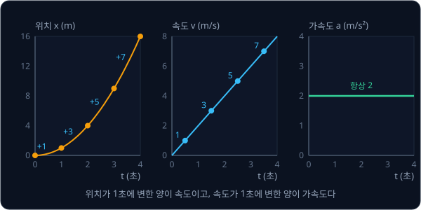
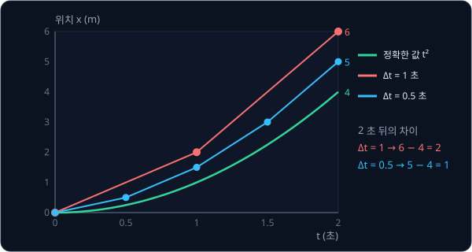
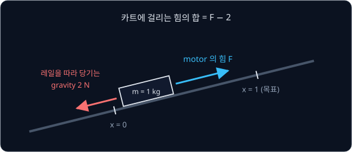
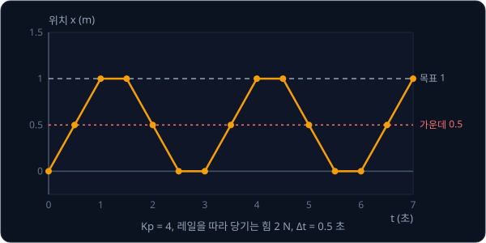
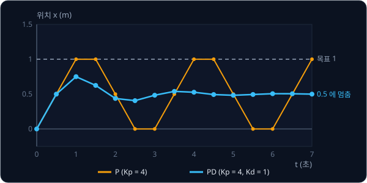
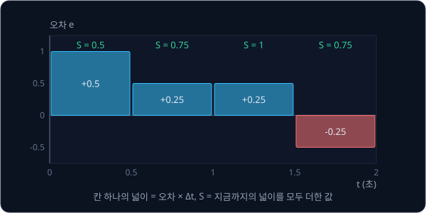
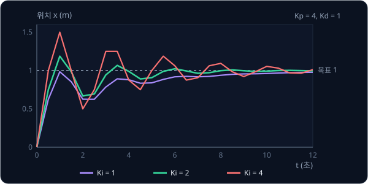
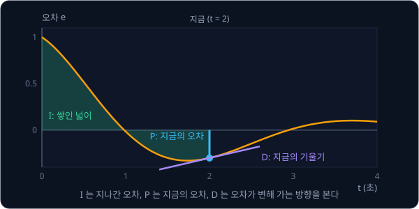

# PID Control

## 학습 목표

- motor 로 물체를 밀면 위치가 곧바로 바뀌지 않고 가속도, 속도, 위치 순서로 바뀐다는 것을 짧은 시간 간격마다 한 칸씩
  계산하는 표로 설명할 수 있다
- 목표와 지금 위치의 차이에 비례하는 힘으로만 밀면 왜 목표를 지나쳐 끝없이 흔들리는지, 한쪽으로 당기는 힘이 있으면 왜
  목표에 못 미친 채 멈추는지 계산할 수 있다
- 그 차이가 변하는 빠르기를 보고 힘을 고치면 흔들림이 줄고, 그 차이를 시간에 따라 쌓아 더하면 남은 차이가 사라지는 과정을
  한 칸씩 계산하는 표로 따라갈 수 있다
- motor 가 낼 수 있는 힘의 한계, 필요한 힘을 미리 계산해 더하는 방법, 부드러운 목표 경로가 왜 필요한지 설명할 수 있다
- 카메라를 보고 다음 동작을 정하는 학습한 모델이 "다음 관절 각도" 를 내면, 그 각도를 실제로 따라가게 만드는 맨 아래층
  계산이 무엇이고 왜 훨씬 빠른 주기로 도는지 설명할 수 있다

## 목표값을 따라가는 문제

### 목표 각도와 motor 명령

로봇 팔은 joint 여러 개로 이어져 있다. joint 는 사람의 팔꿈치나 어깨처럼 두 부품을 이어 주면서 돌거나 미끄러질 수 있게 한
연결부이고, joint 마다 motor 가 하나씩 달려 그 joint 를 돌린다. 팔에게 "컵을 집어라" 를 시키려면 결국 joint 마다 "지금
30° 로 가라", "다음에는 32° 로 가라" 같은 목표 각도를 줘야 한다.

그런데 motor 가 직접 받는 명령은 각도가 아니라 "얼마나 세게 돌릴지" 다. motor 에 전류를 많이 흘리면 세게 돌리고 적게
흘리면 약하게 돌리는데, 세게 돌린다고 joint 가 곧바로 30° 에 가 있지는 않는다. 팔에는 무게가 있어서 천천히 출발했다가
점점 빨라지고, 30° 에 닿는 순간 힘을 끊어도 그때까지 붙은 빠르기 때문에 30° 를 지나쳐 버린다. gravity(중력)는 팔을 늘
아래로 당기고, joint 의 마찰은 움직임을 방해한다.

그래서 목표 각도와 motor 명령 사이에는 계산이 하나 더 필요하다. 지금 각도를 재서 목표와 얼마나 다른지 보고, 그 차이를
줄이려면 motor 를 얼마나 세게 돌려야 하는지를 짧은 시간마다 다시 정하는 계산이다.

**확인 문제.** 팔이 목표 각도 30° 에 처음 닿는 순간 motor 의 힘을 0 으로 끊으면 팔은 30° 에 멈출까?

답 보기

멈추지 않는다. 닿는 순간까지 붙은 빠르기가 남아 있어서 30° 를 지나쳐 계속 움직인다. 멈추게 하려면 목표에 닿기 전부터
힘을 줄이거나 반대 방향으로 밀어야 한다.

### controller 와 feedback

목표값과 지금 측정한 값을 받아 motor 에 줄 명령을 계산하는 규칙을 controller 라고 한다. controller 는 한 번 계산하고 끝나지
않는다. motor 를 조금 돌린 뒤 각도를 다시 재고, 새로 잰 각도로 다시 계산하는 일을 1초에 수백에서 수천 번 되풀이한다.

이처럼 움직인 결과를 다시 재서 다음 명령에 반영하는 구조를 feedback 이라고 한다. feed 는 "넣어 준다", back 은 "되돌려" 라는
뜻으로, 출력(움직인 결과)을 입력 쪽으로 되돌려 넣는다는 이름이다. PID 는 목표와 측정값의 차이(오차)에 비례하는 항(P),
오차를 시간에 따라 쌓은 항(I), 오차가 변하는 빠르기에 비례하는 항(D) 세 개를 더해 motor 명령을 정하는 feedback controller 다.
가장 널리 쓰이는 controller 로, 산업용 기계부터 목표 각도를 받아 스스로 따라가는 작은 로봇 팔의 servo motor 까지 수많은
motor 안에서 돈다.

PID 를 이해하려면 먼저 "힘을 주면 위치가 시간에 따라 어떻게 바뀌는가" 를 계산할 수 있어야 한다. 그다음 controller 를 하나씩
붙여 가며 무엇이 좋아지고 무엇이 남는지 숫자로 본다.

**요약**

- motor 는 각도가 아니라 돌리는 힘을 명령으로 받고, 팔은 무게 때문에 힘을 받아도 위치가 곧바로 바뀌지 않는다
- 목표와 측정값의 차이를 보고 motor 명령을 계속 다시 정하는 규칙이 controller 이고, 결과를 다시 재서 쓰는 구조가 feedback 이다

## 시간에 따라 변하는 양

### 위치와 속도

레일 위에 놓인 카트 하나를 생각한다. 카트는 레일을 따라 앞뒤로만 움직이므로 위치를 숫자 하나로 적을 수 있다. 출발점을 0 으로
하고, 앞으로 간 거리를 m(미터) 단위로 적은 값을 위치 $x$ 라고 하자. 이 카트를 1초마다 사진으로 찍어 위치를 적었더니 아래와
같았다. $t$ 는 출발한 뒤 지난 시간(초)이다.

| 시간 $t$ (초) | 0 | 1 | 2 | 3 | 4 |
| --- | --- | --- | --- | --- | --- |
| 위치 $x$ (m) | 0 | 1 | 4 | 9 | 16 |
| 1초 동안 변한 위치 (m) | | 1 | 3 | 5 | 7 |

셋째 줄은 바로 앞 시각에서 위치가 얼마나 늘었는지를 적은 것이다. 0 초에서 1 초 사이에 1 m, 1 초에서 2 초 사이에 3 m 를
움직였다.

1초 동안 위치가 변한 양을 속도라고 하고, 기호 $v$ 와 단위 m/s(미터 매 초)로 적는다. velocity 의 첫 글자다. 위 표에서
0 초와 1 초 사이의 속도는 1 m/s, 3 초와 4 초 사이는 7 m/s 다. 속도가 점점 커지니 이 카트는 점점 빨라지고 있다.

엄밀히 말하면 1, 3, 5, 7 은 1초 구간 동안의 평균 속도다. 사진을 0.1 초, 0.01 초마다 더 촘촘히 찍어 같은 계산을 하면 특정
순간의 속도에 다가가는데, 이것은 [Linear Regression](../linear-regression/README.md) 에서 늘리는 양을 0 에 가깝게 줄여 가며
구한 derivative(변하는 비율)와 같은 생각이다. 이 카트에서는 구간 평균 속도 1, 3, 5, 7 이 각각 구간 한가운데 시각 0.5, 1.5,
2.5, 3.5 초의 순간 속도와 같고, 순간 속도는 $v = 2t$ 로 0 초에 0, 1 초에 2, 2 초에 4 m/s 다.

**확인 문제.** 어떤 카트의 위치가 2 초에 6 m, 3 초에 10 m 였다. 그 사이의 속도는?

답 보기

1초 동안 $10 - 6 = 4$ m 움직였으므로 4 m/s 다.

### 가속도

속도도 시간에 따라 변한다. 1초 동안 속도가 변한 양을 가속도라고 하고, 기호 $a$ 와 단위 m/s²(미터 매 초 제곱)로 적는다.
acceleration 의 첫 글자이고, 단위의 제곱은 "1초마다 m/s 가 얼마씩 변하는가" 라서 초로 두 번 나눴다는 표시다.

위 카트의 속도 1, 3, 5, 7 은 1초마다 2 씩 늘었으므로 가속도는 늘 2 m/s² 다. 가속도가 일정하면 속도는 일정하게 늘고, 속도가
늘면 위치는 점점 더 크게 늘어서 0, 1, 4, 9, 16 처럼 휘어진 모양이 된다.

위 그림은 같은 카트의 위치, 속도, 가속도를 나란히 그린 것이다. 왼쪽 위치 그래프의 하늘색 숫자가 1초 동안의 변화이고, 가운데
그래프는 그 값들을 구간 한가운데 시각에 찍은 속도다. 속도 점들은 일정한 기울기의 직선 위에 있고, 그 기울기 2 가 오른쪽
가속도 그래프에 그대로 나온다.

세 양은 차례로 이어져 있다. 가속도가 1초 동안 쌓이면 속도가 되고, 속도가 1초 동안 쌓이면 위치가 된다. 거꾸로
위치가 변하는 빠르기가 속도이고, 속도가 변하는 빠르기가 가속도다.

**확인 문제.** 속도가 0 초에 5 m/s, 2 초에 1 m/s 였다. 그동안 가속도가 일정했다면 얼마일까?

답 보기

2초 동안 속도가 $1 - 5 = -4$ m/s 변했으므로 1초에 $-4 \div 2 = -2$ m/s² 다. 가속도가 음수이면 속도가 줄어든다는 뜻이다.

### 힘과 가속도

motor 가 할 수 있는 일은 카트를 미는 것이다. 미는 세기를 힘이라고 하고, 기호 $F$ 와 단위 N(뉴턴)으로 적는다. force 의 첫
글자다. 같은 힘으로 밀어도 무거운 물체는 덜 빨라지는데, 물체가 얼마나 무거운지를 나타내는 양이 질량 $m$ 이고 단위는
kg(킬로그램)이다.

Newton 은 힘, 질량, 가속도 사이에 아래 관계가 있다는 것을 밝혔다.

$$
F = m \times a \qquad \text{또는} \qquad a = \frac{F}{m}
$$

"가속도는 힘을 질량으로 나눈 값" 이라고 읽는다. 1 N 은 질량 1 kg 인 물체에 가속도 1 m/s² 를 내는 힘으로 정해 둔 단위다.

| 힘 $F$ (N) | 질량 $m$ (kg) | 가속도 $a = F \div m$ (m/s²) |
| --- | --- | --- |
| 2 | 1 | 2 |
| 4 | 1 | 4 |
| 4 | 2 | 2 |
| −3 | 1 | −3 |

힘이 두 배면 가속도도 두 배이고, 질량이 두 배면 가속도는 절반이다. 힘이 음수이면 뒤로 민다는 뜻이고, 그때 가속도도 음수가
된다.

motor 가 바꿀 수 있는 것은 힘, 곧 가속도뿐이다. 위치는 가속도가 속도로 쌓이고 속도가 다시 위치로 쌓인 뒤에야 바뀌어서, 목표
위치에 정확히 멈추기가 어려운 것도 이렇게 두 번 쌓이는 동안 늦음이 생기기 때문이다.

**확인 문제.** 질량 2 kg 인 카트를 6 N 으로 밀면 가속도는? 같은 힘으로 1초 동안 밀면 속도는 얼마나 늘까?

답 보기

$a = 6 \div 2 = 3$ m/s² 이다. 1초 동안 속도는 3 m/s 늘어난다.

**요약**

- 위치가 1초에 변한 양이 속도, 속도가 1초에 변한 양이 가속도다
- $F = m \times a$ 라서 motor 의 힘은 가속도를 정하고, 위치는 가속도가 두 번 쌓인 뒤에야 바뀐다

## 한 step 씩 계산하는 simulation

### Δt 와 step

컴퓨터로 카트의 움직임을 미리 계산해 보는 것을 simulation 이라고 한다. 실제 카트를 움직이지 않고도 "이 힘으로 밀면 3 초 뒤에
어디 있을까" 를 알 수 있다.

컴퓨터는 시간이 매끄럽게 흐르는 것을 그대로 계산할 수 없어서 시간을 짧은 간격으로 잘라 한 칸씩 계산한다. 이 간격을
$\Delta t$ 라고 적는다. $\Delta$ 는 그리스 문자 delta(델타)이고 "변화량" 을 나타낼 때 쓰므로, $\Delta t$ 는 "시간의 변화량",
곧 한 칸의 길이다. 한 칸을 계산하는 일을 step 이라고 하고, 몇 번째 step 인지를 아래첨자 $k$ 로 적는다. $x_0$ 은 처음 위치,
$x_1$ 은 한 step 뒤의 위치, $x_k$ 는 $k$ 번째 step 의 위치다. $\Delta t = 0.5$ 초이면 step $k$ 의 시각은 $t = 0.5 \times k$
초다.

**확인 문제.** $\Delta t = 0.1$ 초로 계산할 때 $x_{30}$ 은 몇 초의 위치일까?

답 보기

$0.1 \times 30 = 3$ 초의 위치다.

### 한 step 의 계산

한 step 동안에는 힘이 바뀌지 않는다고 보고 아래 순서로 계산한다.

1. 힘을 질량으로 나눠 가속도를 구한다
2. 가속도 × $\Delta t$ 만큼 속도를 고친다. 가속도는 1초에 늘어나는 속도이므로 $\Delta t$ 초 동안에는 그만큼만 는다
3. 고친 속도 × $\Delta t$ 만큼 위치를 옮긴다

질량 1 kg 인 카트가 위치 0 에 멈춰 있고, motor 가 2 N 으로 계속 민다고 하자. $\Delta t = 1$ 초로 첫 step 을 계산한다.

위 그림은 이 계산을 상자 넷으로 나눠 보여 준다. 가속도는 $2 \div 1 = 2$, 새 속도는 $0 + 2 \times 1 = 2$, 새 위치는
$0 + 2 \times 1 = 2$ 다. 같은 계산을 step 마다 되풀이하면 아래 표가 된다.

| step $k$ | 시각 $t$ | 위치 $x_k$ | 속도 $v_k$ | 가속도 $a$ | 새 속도 $v_k + a\Delta t$ | 새 위치 $x_k + (\text{새 속도})\Delta t$ |
| --- | --- | --- | --- | --- | --- | --- |
| 0 | 0 | 0 | 0 | 2 | $0 + 2 = 2$ | $0 + 2 = 2$ |
| 1 | 1 | 2 | 2 | 2 | $2 + 2 = 4$ | $2 + 4 = 6$ |
| 2 | 2 | 6 | 4 | 2 | $4 + 2 = 6$ | $6 + 6 = 12$ |
| 3 | 3 | 12 | 6 | 2 | $6 + 2 = 8$ | $12 + 8 = 20$ |

같은 계산을 기호로 쓰면 아래 두 줄이다.

$$
v_{k+1} = v_k + a_k \, \Delta t
$$

$$
x_{k+1} = x_k + v_{k+1} \, \Delta t
$$

첫 줄은 "다음 속도는 지금 속도에 가속도 × 한 칸의 시간을 더한 값" 이고, 둘째 줄은 "다음 위치는 지금 위치에 다음 속도 × 한
칸의 시간을 더한 값" 이다. 위 표와 맞추면 $a_k$ 는 늘 2, $\Delta t$ 는 1 이고, step 0 의 $v_{k+1}$ 은 2, $x_{k+1}$ 은 2 다.
둘째 줄에는 $v_k$ 가 아니라 방금 고친 $v_{k+1}$ 을 쓰는데, 이 순서가 왜 중요한지는 뒤의 "계산 순서와 energy" 에서 숫자로
본다.

이렇게 변하는 빠르기를 이용해 작은 칸을 하나씩 쌓아 가며 값을 구하는 방법을 numerical integration 이라고 한다.
integration 은 "쌓아서 합친다" 는 뜻이다. 속도를 먼저 고치고 그 새 속도로 위치를 옮기는 위 방법에는 semi-implicit Euler 라는
이름이 붙어 있다. Euler 는 이런 계산법을 처음 정리한 18세기 수학자의 이름이다.

**확인 문제.** 질량 1 kg 인 카트가 위치 0, 속도 0 에서 출발해 3 N 으로 계속 밀린다. $\Delta t = 1$ 초로 두 step 을 계산하면
위치는?

답 보기

가속도는 $3 \div 1 = 3$ 이다. step 0: 새 속도 $0 + 3 = 3$, 새 위치 $0 + 3 = 3$. step 1: 새 속도 $3 + 3 = 6$, 새 위치
$3 + 6 = 9$. 두 step 뒤 위치는 9 m 다.

### Δt 의 크기와 오차

이 카트는 가속도가 늘 2 이므로 처음 표의 카트와 같고, 실제 위치는 $t$ 를 제곱한 $x = t^2$ 이다. 2 초 뒤 실제 위치는 4 m 인데
위 표는 6 m 를 냈다. step 하나 동안 속도가 변하지 않는다고 보고, 그것도 구간 끝의 속도로 계산했기 때문이다. 0 초에서 1 초
사이의 실제 속도는 0 에서 2 로 서서히 늘어 평균이 1 인데, 계산은 그 1초 내내 속도 2 로 달린 것으로 쳤다.

$\Delta t$ 를 0.5 초로 줄여 같은 계산을 하면 오차가 줄어든다.

| step $k$ | 시각 $t$ | 새 속도 $v_k + 2 \times 0.5$ | 새 위치 $x_k + (\text{새 속도}) \times 0.5$ | 실제 위치 $t^2$ (다음 시각) |
| --- | --- | --- | --- | --- |
| 0 | 0 | 1 | 0.5 | 0.25 |
| 1 | 0.5 | 2 | 1.5 | 1 |
| 2 | 1 | 3 | 3 | 2.25 |
| 3 | 1.5 | 4 | 5 | 4 |

위 그림의 초록 곡선이 실제 위치 $t^2$ 이고, 빨간 점과 하늘색 점이 두 $\Delta t$ 로 계산한 위치다. 2 초 뒤의 차이가
$\Delta t = 1$ 에서는 2, $\Delta t = 0.5$ 에서는 1 로 절반이 됐다. 이 경우 차이는 $t \times \Delta t$ 와 같아서,
$\Delta t = 0.1$ 이면 $2 \times 0.1 = 0.2$, $\Delta t = 0.001$ 이면 0.002 로 줄어든다.

$\Delta t$ 를 작게 할수록 정확하지만 같은 시간을 계산하는 데 step 이 더 많이 든다. 2 초를 계산하는 데 $\Delta t = 1$ 이면
2 step, $\Delta t = 0.001$ 이면 2000 step 이 필요하다.

**흔한 오해.** simulation 결과를 실제와 같다고 믿기 쉽지만, simulation 은 $\Delta t$ 동안 힘과 속도가 변하지 않는다고 보고
계산한 근삿값이다. $\Delta t$ 가 너무 크면 위 표처럼 틀리고, 뒤에서 보듯 아예 값이 튀어 오르기도 한다.

**확인 문제.** 가속도 2 인 카트를 $\Delta t = 0.25$ 초로 계산하면 2 초 뒤 위치는 실제 4 m 보다 얼마나 클까?

답 보기

차이는 $t \times \Delta t = 2 \times 0.25 = 0.5$ 이므로 4.5 m 가 나온다. 직접 8 step 을 계산하면 속도가 0.5, 1, 1.5, …, 4
로 늘고 위치는 $0.125 + 0.25 + \cdots + 1 = 0.125 \times (1 + 2 + \cdots + 8) = 0.125 \times 36 = 4.5$ 로 같다.

**요약**

- simulation 은 시간을 $\Delta t$ 칸으로 잘라 step 마다 "가속도 → 새 속도 → 새 위치" 를 계산한다
- 식은 $v_{k+1} = v_k + a_k \Delta t$, $x_{k+1} = x_k + v_{k+1} \Delta t$ 이고, $\Delta t$ 가 작을수록 실제에 가깝다

## feedback 과 오차

### 목표 위치와 오차

이제 카트를 목표 위치에 세우는 문제로 넘어간다. 질량 1 kg 인 카트가 위치 0 에 멈춰 있고, 목표 위치는 $x_{\text{목표}} = 1$ m
다. 이 절부터 끝까지 따로 말하지 않으면 $\Delta t = 0.5$ 초로 계산한다.

목표에서 지금 위치를 뺀 값을 오차(error)라고 하고 $e$ 로 적는다.

$$
e = x_{\text{목표}} - x
$$

지금 $x = 0$ 이면 $e = 1 - 0 = 1$ 이고, 카트가 1.5 까지 지나쳐 가면 $e = 1 - 1.5 = -0.5$ 다. 오차가 양수면 카트가 목표보다
뒤에 있으니 앞으로 밀어야 하고, 음수면 지나쳤으니 뒤로 밀어야 한다. [Linear Regression](../linear-regression/README.md) 의
오차는 "예측 − 정답" 이었는데, 제어에서는 "목표 − 지금" 으로 순서를 바꿔 쓰는 것이 관례다. 그래야 오차가 양수일 때 양수 힘을
내는 식이 자연스럽게 나온다.

**확인 문제.** 목표가 2 이고 지금 위치가 2.5 다. 오차는 얼마이고, 어느 쪽으로 밀어야 할까?

답 보기

$e = 2 - 2.5 = -0.5$ 다. 음수이므로 목표를 지나친 것이고, 뒤로(음수 방향으로) 밀어야 한다.

### feedback loop

controller 는 step 마다 오차를 보고 힘을 정한다. 정한 힘으로 카트가 $\Delta t$ 만큼 움직이면 위치를 다시 재서 새 오차를
계산하고, 다시 힘을 정한다.

위 그림은 이 되풀이를 고리 모양으로 그린 것이다. 왼쪽의 원에서 목표 1 에 측정한 위치 0 을 빼 오차 1 을 만들고, controller 가
힘 4 N 을 정해 카트를 민다. 오른쪽 끝에서 아래로 내려가 왼쪽으로 돌아오는 선이 "움직인 결과를 다시 재서 되돌려 보내는"
feedback 이다. controller 안의 $4 \times e$ 가 무엇인지는 바로 다음 절에서 다룬다.

**요약**

- 오차는 $e = x_{\text{목표}} - x$ 이고, 부호가 밀어야 할 방향을 알려 준다
- controller 는 step 마다 오차로 힘을 정하고, 움직인 위치를 다시 재서 다음 오차를 계산한다

## P 제어

### 오차에 비례하는 힘

가장 단순한 controller 는 오차가 클수록 세게 미는 것이다. 오차에 정해 둔 수 $K_p$ 를 곱해 힘으로 쓴다.

$$
F = K_p \times e
$$

$K_p$ 는 "케이 피" 라고 읽고, 오차 1 m 당 몇 N 으로 밀지를 정하는 수라서 단위는 N/m 다. 이렇게 controller 의 세기를 정하는
곱셈 계수를 gain 이라고 하고, $K_p$ 는 proportional gain 이다. proportional 은 "비례하는" 이라는 뜻이고, 오차에 비례하는 이 항을
P 항, P 항만 쓰는 제어를 P 제어라고 부른다. PID 의 P 가 이 proportional 이다.

$K_p = 4$ 이면 오차 1 에서 4 N, 오차 0.5 에서 2 N, 오차 −1 에서 −4 N 으로 민다. 목표에 가까워질수록 힘이 줄고, 지나치면
뒤로 민다. 이것만 보면 목표에 사뿐히 멈출 것 같다.

**확인 문제.** $K_p = 6$ 이고 목표가 1, 지금 위치가 0.25 다. P 제어의 힘은?

답 보기

오차는 $1 - 0.25 = 0.75$ 이고 힘은 $6 \times 0.75 = 4.5$ N 이다.

### P 제어의 진동

마찰이 없는 평평한 레일에서 $K_p = 4$ 로 카트를 1 로 옮겨 본다. 앞 절의 한 step 계산에 "힘 = $4 \times e$" 만 끼워 넣으면
된다.

| step | $t$ | 위치 $x$ | 속도 $v$ | 오차 $e = 1 - x$ | 힘 $F = 4e$ | 새 속도 $v + F \times 0.5$ | 새 위치 $x + (\text{새 속도}) \times 0.5$ |
| --- | --- | --- | --- | --- | --- | --- | --- |
| 0 | 0 | 0 | 0 | 1 | 4 | 2 | 1 |
| 1 | 0.5 | 1 | 2 | 0 | 0 | 2 | 2 |
| 2 | 1 | 2 | 2 | −1 | −4 | 0 | 2 |
| 3 | 1.5 | 2 | 0 | −1 | −4 | −2 | 1 |
| 4 | 2 | 1 | −2 | 0 | 0 | −2 | 0 |
| 5 | 2.5 | 0 | −2 | 1 | 4 | 0 | 0 |

질량이 1 kg 이라 가속도는 힘과 같은 값이어서 표에서는 가속도 열을 생략했다. step 1 에서 카트는 정확히 목표 1 에 있고 오차가
0 이라 힘도 0 이다. 하지만 속도가 2 m/s 나 붙어 있어서 그대로 2 까지 지나간다. 지나친 뒤에는 뒤로 미는 힘이 속도를 0 으로
되돌리지만 그때는 이미 2 에 가 있고, 거기서 다시 뒤로 돌아와 0 까지 간다. step 6 에서는 처음과 똑같이 위치 0, 속도 0 이 되어
같은 움직임이 끝없이 되풀이된다.

위 그림의 주황 선이 표의 위치를 이은 것이다. 목표 1 을 가운데 두고 0 과 2 사이를 3 초마다 오간다. 이렇게 같은 움직임이
되풀이되며 왔다 갔다 하는 것을 진동이라 하고, 목표를 지나쳐 넘어간 양을 overshoot 라고 한다. 이 카트는 목표 1 을 1 만큼
넘어 2 까지 가므로 overshoot 가 100% 다.

진동이 생기는 이유는 P 항이 "지금 어디 있는지" 만 보고 "얼마나 빨리 다가오는지" 는 보지 않기 때문이다. 오차가 0 인 순간에도
속도가 크면 계속 가는데, P 항은 그 순간 힘을 0 으로 낼 뿐 속도를 줄이려 하지 않는다. 이 카트에는 마찰도 없으니 움직임을
줄여 줄 것이 아무것도 없다. 용수철 끝에 매단 추가 출렁이는 것과 같다.

**확인 문제.** 위 표에서 step 6 다음 두 step 의 위치는? 표를 이어 계산해 보자.

답 보기

step 6 은 위치 0, 속도 0 으로 step 0 과 같다. 그래서 오차 1, 힘 4, 새 속도 2, 새 위치 1 이고, 다음 step 은 오차 0, 힘 0,
새 속도 2, 새 위치 2 다. 처음과 똑같이 1, 2 로 간다.

### Kp 의 크기

$K_p$ 를 바꾸면 무엇이 달라지는지 본다. $K_p = 1$ 로 줄이면 첫 step 의 힘이 $1 \times 1 = 1$ N 이라 새 속도는 0.5, 새 위치는
0.25 다. 다음 step 은 오차 0.75, 힘 0.75, 새 속도 $0.5 + 0.375 = 0.875$, 새 위치 $0.25 + 0.4375 = 0.6875$ 로, $K_p = 4$ 보다
훨씬 천천히 출발한다.

위 그림의 보라 선이 $K_p = 1$ 이다. 약 6 초에 한 번씩 반복해 $K_p = 4$ 보다 두 배 느리게 오가지만, 0 과 약 2 사이를 오가는 폭은
같다. $K_p$ 를 키우면 목표 쪽으로 더 세게 당겨 더 빨리 출렁일 뿐이고 진동 자체는 사라지지 않는다.

**흔한 오해.** "목표에 빨리 가려면 $K_p$ 를 크게 하면 된다" 고 생각하기 쉽다. $K_p$ 를 키우면 출발은 빨라지지만, 마찰이 없는
카트에서는 $K_p$ 가 1 이든 4 든 목표를 같은 폭으로 지나쳐 영원히 진동한다. P 항만으로는 진동을 멈출 방법이 없다.

**확인 문제.** $K_p = 2$ 이고 위치 0, 속도 0 에서 출발하면 첫 step 뒤의 속도와 위치는? ($\Delta t = 0.5$, 질량 1 kg, 목표 1)

답 보기

오차 1, 힘 2 N, 가속도 2 라서 새 속도는 $0 + 2 \times 0.5 = 1$, 새 위치는 $0 + 1 \times 0.5 = 0.5$ 다.

### 계산 순서와 energy

한 step 의 계산에서 속도를 먼저 고치고 그 새 속도로 위치를 옮겼다. 순서를 바꿔 지금 속도로 위치를 먼저 옮기고 속도는 나중에
고치는 방법도 있는데, 이것을 explicit Euler 라고 한다. 식으로는 $x_{k+1} = x_k + v_k \Delta t$ 처럼 둘째 줄의 $v_{k+1}$ 이
$v_k$ 로 바뀐 것뿐이다.

같은 P 제어($K_p = 4$)를 explicit Euler 로 계산한다.

| step | 위치 $x$ | 속도 $v$ | 오차 $e$ | 힘 $4e$ | 새 위치 $x + v \times 0.5$ (지금 속도) | 새 속도 $v + 4e \times 0.5$ |
| --- | --- | --- | --- | --- | --- | --- |
| 0 | 0 | 0 | 1 | 4 | 0 | 2 |
| 1 | 0 | 2 | 1 | 4 | 1 | 4 |
| 2 | 1 | 4 | 0 | 0 | 3 | 4 |
| 3 | 3 | 4 | −2 | −8 | 5 | 0 |
| 4 | 5 | 0 | −4 | −16 | 5 | −8 |

위치가 0, 0, 1, 3, 5, 5 로 2 를 훌쩍 넘어간다. 같은 카트, 같은 controller 인데 계산 순서만 바꿨더니 진동의 폭이 점점 커진다.

어느 쪽이 맞는지는 energy 로 판단한다. energy 는 물체가 가진 "일을 할 수 있는 능력" 의 양이고 단위는 J(줄)다. 움직이는
물체는 $\frac12 m v^2$ 만큼의 energy 를 가진다. 질량 1 kg, 속도 2 m/s 이면 $\frac12 \times 1 \times 4 = 2$ J 다. P 제어는
오차에 비례해 당기므로 늘어난 용수철과 똑같이 힘을 내고, 용수철처럼 $\frac12 K_p e^2$ 의 energy 를 담아 둔다. 오차가 1 이면
$\frac12 \times 4 \times 1 = 2$ J 다.

마찰이 없으면 두 energy 의 합 $E = \frac12 m v^2 + \frac12 K_p e^2$ 은 실제로는 시간이 지나도 변하지 않는다. 카트가 빨라지면
그만큼 용수철 쪽 energy 가 줄고, 반대도 마찬가지다. 그러니 계산 결과에서 합이 저절로 커진다면 그것은 계산이 만든 오차다.

| step | 0 | 1 | 2 | 3 | 4 | 5 |
| --- | --- | --- | --- | --- | --- | --- |
| semi-implicit Euler 의 $E$ | 2 | 2 | 4 | 2 | 2 | 4 |
| explicit Euler 의 $E$ | 2 | 4 | 8 | 16 | 32 | 64 |

explicit Euler 의 step 1 은 위치 0, 속도 2 이므로 $E = \frac12 \times 1 \times 2^2 + \frac12 \times 4 \times 1^2 = 2 + 2 = 4$
이고, step 2 는 위치 1, 속도 4 라서 $8 + 0 = 8$ 이다. step 마다 정확히 두 배가 된다. 반면 semi-implicit Euler 는 2 와 4 사이를
오갈 뿐 커지지 않는다. $\Delta t = 0.5$ 가 거칠어서 2 로 딱 고정되지는 않지만 늘어나지는 않는다.

위 그림 왼쪽은 두 방법의 위치, 오른쪽은 energy 다. explicit Euler 는 지금 속도로 위치를 옮기므로, 용수철이 이미 속도를 줄이기
시작한 순간에도 줄기 전의 큰 속도로 한 칸을 더 가 버린다. 그 결과 step 마다 실제보다 조금씩 더 멀리 가서 energy 가 쌓인다.
semi-implicit Euler 는 방금 고친 속도로 위치를 옮기므로 이 어긋남이 다음 칸에서 반대로 상쇄된다.

$\Delta t$ 를 줄이면 explicit Euler 의 증가도 느려지지만 사라지지는 않는다. 이 카트에서는 step 마다 energy 가
$1 + K_p \Delta t^2 / m$ 배가 되는데, $\Delta t = 0.5$ 이면 $1 + 4 \times 0.25 = 2$ 배, $\Delta t = 0.1$ 이면
$1 + 4 \times 0.01 = 1.04$ 배다. 1.04 배도 100 step 이 쌓이면 50 배가 넘는다. 막대 끝에 추를 매단 pendulum(진자)을 마찰 없이 60° 에서 놓고
$\Delta t$ = 1 ms(1000 분의 1 초)로 10 초를 계산해도 explicit Euler 는 energy 가 약 18% 늘어나고, semi-implicit Euler 는 0.2% 안에서
오르내린다.

더 정확한 방법으로 RK4(Runge–Kutta 4차)가 널리 쓰인다. 한 step 안의 네 지점에서 변하는 빠르기를 계산하고 그 평균으로 한
번에 나아가는 방법이라, 같은 pendulum 을 같은 $\Delta t$ 로 계산하면 energy 가 1조 분의 1 정도밖에 변하지 않는다. 한 step 에
계산을 네 번 해야 하지만 그만큼 훨씬 정확하다. 이 강의의 표는 손으로 따라가기 쉽게 모두 semi-implicit Euler 로 계산한다.

**확인 문제.** 질량 1 kg 인 카트가 속도 3 m/s 로 움직이고, $K_p = 2$ 인 P 제어의 오차가 1 이다. $E$ 는?

답 보기

$\frac12 \times 1 \times 3^2 + \frac12 \times 2 \times 1^2 = 4.5 + 1 = 5.5$ J 다.

### 기울어진 레일과 steady-state error

이번에는 레일이 조금 기울어 있다고 하자. 카트에는 gravity 가 아래로 작용하는데, 레일이 기울면 그중 일부가 레일을 따라
카트를 아래쪽으로 당긴다. 이 레일에서는 그 힘이 2 N 이고, 카트의 위치 $x$ 는 레일을 따라 위쪽을 양수로 잰다. 로봇 팔의
joint 도 gravity 때문에 늘 아래로 당겨지므로 이 상황과 같다.

위 그림처럼 카트에 걸리는 힘의 합은 motor 의 힘에서 2 를 뺀 $F - 2$ 이고, 가속도는 이 합을 질량 1 로 나눈 값이다. P 제어
($K_p = 4$)로 목표 1 에 보내 본다.

| step | $t$ | 위치 $x$ | 속도 $v$ | 오차 $e$ | 힘 $4e$ | 힘의 합 $4e - 2$ | 새 속도 | 새 위치 |
| --- | --- | --- | --- | --- | --- | --- | --- | --- |
| 0 | 0 | 0 | 0 | 1 | 4 | 2 | 1 | 0.5 |
| 1 | 0.5 | 0.5 | 1 | 0.5 | 2 | 0 | 1 | 1 |
| 2 | 1 | 1 | 1 | 0 | 0 | −2 | 0 | 1 |
| 3 | 1.5 | 1 | 0 | 0 | 0 | −2 | −1 | 0.5 |
| 4 | 2 | 0.5 | −1 | 0.5 | 2 | 0 | −1 | 0 |
| 5 | 2.5 | 0 | −1 | 1 | 4 | 2 | 0 | 0 |

위 그림에서 카트는 여전히 진동하는데, 이번에는 0 과 1 사이를 오가고 진동의 가운데가 목표 1 이 아니라 0.5 다. 이유는 표의
step 1 에 있다. 위치 0.5 에서 오차는 0.5, P 항의 힘은 $4 \times 0.5 = 2$ N 이고, 이것이 레일이 당기는 2 N 과 정확히 맞서서
힘의 합이 0 이 된다. 이 카트에게 "힘의 합이 0 인 자리" 는 목표 1 이 아니라 0.5 다.

카트가 어딘가에 완전히 멈춰 있으려면 힘의 합이 0 이어야 한다. P 제어로는 $K_p \times e = 2$ 여야 하므로

$$
e = \frac{2}{K_p} = \frac{2}{4} = 0.5
$$

이다. 멈춰 있는 카트를 계속 붙잡아 두려면 2 N 이 필요한데, P 항은 오차가 있어야만 힘을 내므로 그 2 N 을 만들 만큼의 오차가
반드시 남는다. 이렇게 움직임이 다 가라앉은 뒤에도 남는 오차를 steady-state error 라고 한다. steady-state 는 "더 이상 변하지
않는 상태" 라는 뜻이다.

$K_p$ 를 키우면 줄어든다. $K_p = 8$ 이면 $2 \div 8 = 0.25$, $K_p = 40$ 이면 $2 \div 40 = 0.05$ 다. 하지만 $K_p$ 를 아무리
키워도 $2 \div K_p$ 는 0 이 되지 않는다.

**확인 문제.** 레일이 당기는 힘이 3 N 이고 $K_p = 6$ 이다. 카트가 멈춘다면 목표보다 얼마나 아래에 멈출까?

답 보기

$K_p \times e = 3$ 이어야 하므로 $e = 3 \div 6 = 0.5$ 다. 목표보다 0.5 m 아래에 멈춘다.

**요약**

- P 제어 $F = K_p e$ 는 오차에 비례해 목표 쪽으로 밀지만, 속도를 보지 않아 목표를 지나쳐 진동한다. $K_p$ 는 진동의 빠르기를
  바꿀 뿐 진동을 없애지 못한다
- 늘 당기는 힘이 있으면 그 힘을 버틸 만큼의 오차 $e = (\text{당기는 힘}) / K_p$ 가 steady-state error 로 남는다
- 계산 순서가 틀리면 계산 자체가 energy 를 만들어 진폭이 커진다. 속도를 먼저 고치는 semi-implicit Euler 는 그렇지 않다

## D 제어

### 오차가 변하는 빠르기

P 제어가 진동한 것은 카트가 빠르게 다가오는 중에도 그 빠르기를 보지 않았기 때문이다. 목표 근처에서 빠르게 다가오고 있으면
미리 힘을 빼거나 반대로 밀어 브레이크를 걸어야 한다.

"얼마나 빠르게 다가오는가" 는 오차가 변하는 빠르기로 잴 수 있다. 앞의 P 제어 표에서 오차는 step 1 에 0, step 2 에 −1 이었다.
0.5 초 동안 오차가 −1 변했으므로 변하는 빠르기는

$$
\frac{\Delta e}{\Delta t} = \frac{-1 - 0}{0.5} = -2
$$

이다. $\Delta e$ 는 "오차의 변화량" 이고, 이 값은 1초에 오차가 2 씩 줄어드는 빠르기를 뜻한다. $\Delta t$ 를 0 에 한없이
가깝게 줄였을 때 다가가는 값이 오차의 derivative 이고, $\frac{de}{dt}$ 로 적는다. 여기서는 step 사이의 변화로 계산한
$\frac{\Delta e}{\Delta t}$ 를 그대로 쓴다.

목표가 움직이지 않으면 이 값은 카트의 속도에 음수를 붙인 것과 같다. 오차 $e = 1 - x$ 에서 1 은 그대로이고 $x$ 만 변하므로,
$x$ 가 1초에 2 늘면 $e$ 는 1초에 2 준다. 표에서 step 2 의 속도가 2 이므로 $\frac{\Delta e}{\Delta t} = -2$ 가 맞다.

**확인 문제.** 오차가 step 3 에서 0.4, step 4 에서 0.1 이었다($\Delta t = 0.5$). 오차가 변하는 빠르기와, 그때 카트의
속도는? (목표는 움직이지 않는다)

답 보기

$\frac{0.1 - 0.4}{0.5} = -0.6$ 이다. 오차가 1초에 0.6 씩 줄고 있으므로 카트는 목표 쪽으로 0.6 m/s 로 다가오고 있다. 속도는
$+0.6$ 이다.

### D 항을 더한 계산

오차가 변하는 빠르기에 gain $K_d$ 를 곱한 항을 더한다.

$$
F = K_p \, e + K_d \, \frac{\Delta e}{\Delta t}
$$

$K_d$ 는 "케이 디" 라고 읽는 derivative gain 이고, 이 항을 D 항, P 항과 D 항을 함께 쓰는 제어를 PD 제어라고 한다. D 는
derivative 의 첫 글자다. 목표가 움직이지 않을 때는 $\frac{\Delta e}{\Delta t} = -v$ 이므로 D 항은 $-K_d \, v$ 로 쓸 수 있다.
"카트가 빠를수록 그 반대 방향으로 민다" 는 뜻이라, 목표를 향해 빠르게 다가가는 중이면 미리 브레이크를 건다.

평평한 레일에서 $K_p = 4$, $K_d = 1$ 로 계산한다.

| step | $t$ | 위치 $x$ | 속도 $v$ | 오차 $e$ | P 항 $4e$ | D 항 $-1 \times v$ | 힘 $F$ | 새 속도 | 새 위치 |
| --- | --- | --- | --- | --- | --- | --- | --- | --- | --- |
| 0 | 0 | 0 | 0 | 1 | 4 | 0 | 4 | 2 | 1 |
| 1 | 0.5 | 1 | 2 | 0 | 0 | −2 | −2 | 1 | 1.5 |
| 2 | 1 | 1.5 | 1 | −0.5 | −2 | −1 | −3 | −0.5 | 1.25 |
| 3 | 1.5 | 1.25 | −0.5 | −0.25 | −1 | 0.5 | −0.5 | −0.75 | 0.875 |
| 4 | 2 | 0.875 | −0.75 | 0.125 | 0.5 | 0.75 | 1.25 | −0.125 | 0.8125 |
| 5 | 2.5 | 0.8125 | −0.125 | 0.1875 | 0.75 | 0.125 | 0.875 | 0.3125 | 0.96875 |

P 제어와 갈리는 곳은 step 1 이다. 위치 1, 속도 2 에서 오차가 0 이라 P 항은 0 인데, D 항이 $-1 \times 2 = -2$ N 으로 뒤로
민다. 그래서 새 속도가 2 가 아니라 1 로 줄고, 카트는 2 가 아니라 1.5 까지만 간다. step 3 에서는 카트가 뒤로 −0.5 m/s 로
돌아오는 중이라 D 항이 $+0.5$ 로 앞으로 밀어 되돌아오는 것도 늦춘다.

위 그림에서 P 제어(주황)는 계속 0 과 2 를 오가지만 PD 제어(하늘색)는 1.5, 0.81, 1.08, 0.97 로 목표에서 벗어나는 폭이 매번
줄어 7 초 무렵에는 거의 1 에 머문다. D 항은 움직임에 맞서는 힘이라 마찰처럼 energy 를 덜어 내고, 덕분에 출렁임이 잦아든다.
이처럼 진동을 줄이는 효과를 damping 이라고 한다. 자동차의 shock absorber 가 차체의 출렁임을 잡는 것과 같은 역할이다.

**확인 문제.** 위 표의 step 6 을 계산해 보자. step 5 의 새 속도 0.3125, 새 위치 0.96875 에서 시작한다.

답 보기

오차 $1 - 0.96875 = 0.03125$, P 항 $4 \times 0.03125 = 0.125$, D 항 $-1 \times 0.3125 = -0.3125$ 라 힘은 $-0.1875$ 다. 새 속도는
$0.3125 - 0.1875 \times 0.5 = 0.21875$, 새 위치는 $0.96875 + 0.21875 \times 0.5 = 1.078125$ 다. 그림의 1.08 이 이 값이다.

### Kd 의 크기

$K_d$ 가 작으면 브레이크가 약해 여러 번 출렁이고, 크면 브레이크가 너무 세서 목표에 다가가는 것 자체가 느려진다. 아래 그림은
$\Delta t$ 를 0.01 초로 줄여 매끄럽게 계산한 세 경우다.

| $K_d$ | 가장 멀리 간 위치 | 6 초 뒤 위치 | 움직임 |
| --- | --- | --- | --- |
| 1 | 1.44 | 0.98 | 넘쳤다가 흔들리며 들어온다 |
| 4 | 1.00 | 1.00 | 넘치지 않고 2.4 초 만에 0.95 를 넘는다 |
| 10 | 0.91 | 0.91 | 넘치지 않지만 아주 느리다 |

넘치지 않으면서 가장 빨리 목표에 닿는 $K_d$ 는 아래 식으로 구한다.

$$
K_d = 2\sqrt{K_p \times m}
$$

$\sqrt{\ }$ 는 square root(제곱근)라고 읽고, 제곱해서 그 수가 되는 양수를 뜻한다. $2 \times 2 = 4$ 이므로 $\sqrt{4} = 2$ 다.
$K_p = 4$, $m = 1$ 이면 $K_d = 2 \times \sqrt{4} = 2 \times 2 = 4$ 로 그림의 초록 선이다. 이 값을 critical damping 이라고 하며,
gain 을 처음 고를 때 출발점으로 쓴다. 질량이 4 kg 으로 무거워지면 $2\sqrt{16} = 8$ 로 두 배가 필요하다.

**확인 문제.** $K_p = 9$, $m = 1$ 일 때 critical damping 의 $K_d$ 는?

답 보기

$2 \times \sqrt{9 \times 1} = 2 \times 3 = 6$ 이다.

### Δt 가 너무 클 때의 발산

같은 $K_p = 4$, $K_d = 4$ 를 $\Delta t = 0.5$ 초로 계산하면 결과가 전혀 다르다.

| step | 위치 $x$ | 속도 $v$ | 오차 $e$ | P 항 $4e$ | D 항 $-4v$ | 힘 | 새 속도 | 새 위치 |
| --- | --- | --- | --- | --- | --- | --- | --- | --- |
| 0 | 0 | 0 | 1 | 4 | 0 | 4 | 2 | 1 |
| 1 | 1 | 2 | 0 | 0 | −8 | −8 | −2 | 0 |
| 2 | 0 | −2 | 1 | 4 | 8 | 12 | 4 | 2 |
| 3 | 2 | 4 | −1 | −4 | −16 | −20 | −6 | −1 |

step 1 을 보면 속도 2 에 D 항 −8 N 이 걸려 0.5 초 동안 속도를 $8 \times 0.5 = 4$ 만큼 줄인다. 속도 2 를 0 으로 만들려던
브레이크가 2 를 더 줄여 −2 로 뒤집어 버린 것이다. 다음 step 에서는 −2 를 4 로, 그다음에는 4 를 −6 으로 뒤집으며 값이 점점
커진다. 이렇게 값이 끝없이 커지는 것을 발산이라고 한다.

D 항 하나가 한 step 동안 속도를 줄이는 양은 $K_d \times v \times \Delta t / m$ 인데, $K_d \Delta t / m = 4 \times 0.5 / 1 = 2$
라서 지금 속도의 두 배를 빼 버린다. $\Delta t = 0.01$ 이면 $4 \times 0.01 = 0.04$ 로 지금 속도의 4% 만 빼므로 매끄럽게 줄어든다.
controller 는 한 번 정한 힘을 다음 계산까지 $\Delta t$ 동안 그대로 유지하므로, 실제 로봇에서도 계산 주기가 느리면 같은 일이
생긴다. 강한 gain 을 쓰려면 controller 를 빠른 주기로 돌려야 하는 이유 하나가 여기 있다.

**확인 문제.** $K_d = 2$, $m = 1$, $\Delta t = 0.1$ 이면 D 항은 한 step 에 지금 속도의 몇 % 를 줄일까?

답 보기

$K_d \Delta t / m = 2 \times 0.1 / 1 = 0.2$ 라서 20% 를 줄인다.

### 목표가 갑자기 바뀔 때의 D 항

D 항을 "오차가 변하는 빠르기" 로 계산할지 "카트의 속도" 로 계산할지는 목표가 움직이지 않을 때는 같지만, 목표가 갑자기 바뀌면
달라진다. 카트가 위치 0 에 멈춰 있고 목표도 0 이라 오차가 0 이던 중에, $t = 1$ 초에 목표가 1 로 바뀌었다고 하자.

- **오차로 계산** — 오차가 0 에서 1 로 한 step 만에 뛰었으므로 $\frac{\Delta e}{\Delta t} = \frac{1 - 0}{0.5} = 2$ 이고, $K_d = 1$
  이면 D 항이 2 N 이다. 카트는 움직이지도 않았는데 D 항이 힘을 낸다
- **속도로 계산** — 카트의 속도가 0 이므로 D 항은 $-1 \times 0 = 0$ 이다

위 그림 오른쪽처럼 그 순간의 힘은 P 항 4 N 에 D 항이 더해져 6 N 과 4 N 으로 갈린다. $\Delta t$ 가 작을수록 차이는 커진다.
$\Delta t = 0.01$ 이면 $\frac{1}{0.01} = 100$ 이라 D 항이 한 step 동안 100 N 이 되고, motor 가 순간적으로 세게 튀며 기계에 충격을
준다. 이 현상을 derivative kick 이라고 부른다. kick 은 "걷어차기" 라는 뜻이다. 그래서 실제 controller 는 D 항을 오차가 아니라
측정한 위치가 변하는 빠르기, 곧 속도로 계산하는 경우가 많다. 이 강의의 표도 모두 속도로 계산한다.

**확인 문제.** $K_d = 2$, $\Delta t = 0.1$ 에서 목표가 한 step 만에 0 에서 3 으로 바뀌면, 오차로 계산한 D 항은 그 step 에 얼마일까?

답 보기

$\frac{\Delta e}{\Delta t} = \frac{3}{0.1} = 30$ 이고 D 항은 $2 \times 30 = 60$ N 이다. 속도로 계산하면 카트가 아직 멈춰 있으니 0 이다.

### 기울어진 레일의 PD 제어

레일이 2 N 으로 당기는 기울어진 레일에서도 D 항을 더해 $K_p = 4$, $K_d = 1$ 로 계산한다.

| step | $t$ | 위치 $x$ | 속도 $v$ | 오차 $e$ | P 항 $4e$ | D 항 $-v$ | 힘의 합 $4e - v - 2$ | 새 속도 | 새 위치 |
| --- | --- | --- | --- | --- | --- | --- | --- | --- | --- |
| 0 | 0 | 0 | 0 | 1 | 4 | 0 | 2 | 1 | 0.5 |
| 1 | 0.5 | 0.5 | 1 | 0.5 | 2 | −1 | −1 | 0.5 | 0.75 |
| 2 | 1 | 0.75 | 0.5 | 0.25 | 1 | −0.5 | −1.5 | −0.25 | 0.625 |
| 3 | 1.5 | 0.625 | −0.25 | 0.375 | 1.5 | 0.25 | −0.25 | −0.375 | 0.4375 |
| 4 | 2 | 0.4375 | −0.375 | 0.5625 | 2.25 | 0.375 | 0.625 | −0.0625 | 0.40625 |

흔들림은 줄었지만 카트는 목표 1 이 아니라 0.5 에 멈춘다. 멈춘 카트는 속도가 0 이라 D 항이 0 이고, 결국 P 항 혼자 2 N 을
버텨야 하므로 P 제어 때와 같은 $e = 2 / 4 = 0.5$ 가 남는다. D 항은 움직이는 동안에만 힘을 내므로 멈춘 뒤의 오차에는 아무
도움이 되지 않는다.

**확인 문제.** 기울어진 레일(2 N)에서 $K_p = 4$, $K_d = 10$ 으로 바꾸면 카트가 멈추는 위치는 달라질까?

답 보기

달라지지 않는다. 멈춘 뒤에는 D 항이 0 이라 $4e = 2$, $e = 0.5$ 로 여전히 0.5 에 멈춘다. $K_d$ 는 그 자리에 가는 동안의 흔들림과
빠르기만 바꾼다.

**요약**

- D 항 $K_d \frac{\Delta e}{\Delta t}$ 는 오차가 변하는 빠르기에 맞서 브레이크를 걸어 진동을 줄인다. 목표가 고정이면 $-K_d v$ 와 같다
- $K_d$ 가 작으면 출렁이고 크면 느리며, $K_d = 2\sqrt{K_p m}$ 이 넘치지 않으면서 가장 빠르다. $\Delta t$ 가 크면 강한 D 항이 발산한다
- 멈춘 상태에서는 D 항이 0 이라 steady-state error 는 그대로 남는다

## I 제어

### 오차의 누적

멈춘 뒤에도 오차가 남는 문제는 "오차가 오래 남아 있으면 점점 더 세게 민다" 로 풀 수 있다. 그러려면 지금까지 오차가 얼마나
있었는지를 숫자 하나로 모아 둬야 한다.

step 마다 오차에 $\Delta t$ 를 곱한 값을 계속 더한다. 이 누적값을 $S$ 라고 적는다.

$$
S_k = S_{k-1} + e_k \, \Delta t
$$

"이번 누적값은 지난 누적값에 이번 오차 × 한 칸의 시간을 더한 것" 이라고 읽는다. 처음 누적값은 0 이다. $\Delta t = 0.5$ 에서
오차가 1, 0.5, 0.5, −0.5 로 나왔다면 아래와 같다.

| step | 오차 $e$ | $e \times \Delta t$ | 누적 $S$ |
| --- | --- | --- | --- |
| 0 | 1 | 0.5 | $0 + 0.5 = 0.5$ |
| 1 | 0.5 | 0.25 | $0.5 + 0.25 = 0.75$ |
| 2 | 0.5 | 0.25 | $0.75 + 0.25 = 1$ |
| 3 | −0.5 | −0.25 | $1 - 0.25 = 0.75$ |

위 그림에서 막대 하나는 높이가 오차, 폭이 $\Delta t$ 인 직사각형이라 넓이가 $e \times \Delta t$ 다. 그래서 $S$ 는 오차 그래프
아래의 넓이를 지금까지 모두 더한 값이고, 오차가 음수인 칸은 넓이를 빼 준다. 오차가 작아도 오래 남아 있으면 $S$ 는 계속 커진다.

$\Delta t$ 를 0 에 한없이 가깝게 줄였을 때의 이 넓이를 오차의 integral 이라고 하고 $\int_0^t e \, dt$ 로 적는다. $\int$ 은 합(sum)의
S 를 위아래로 길게 늘인 기호이고, 아래의 0 과 위의 $t$ 는 "0 초부터 지금까지", $dt$ 는 아주 얇은 칸의 폭을 뜻한다.
[Linear Regression](../linear-regression/README.md) 의 $\Sigma$ 가 "여러 개를 모두 더하라" 였다면, $\int$ 은 아주 얇은 칸을 끝없이
많이 더한 합이다.

**확인 문제.** $\Delta t = 0.5$ 에서 오차가 0.4, 0.4, 0.2 로 나왔다. 누적 $S$ 는 차례로 얼마일까?

답 보기

$0.4 \times 0.5 = 0.2$, $0.2 + 0.2 = 0.4$, $0.4 + 0.2 \times 0.5 = 0.5$ 다.

### I 항을 더한 계산

누적 $S$ 에 gain $K_i$ 를 곱한 항을 더한다.

$$
F = K_p \, e + K_i \, S + K_d \, \frac{\Delta e}{\Delta t}
$$

$K_i$ 는 "케이 아이" 라고 읽는 integral gain 이고, 이 항을 I 항이라고 한다. 세 항을 모두 쓰는 이 controller 가 PID 다.
기울어진 레일(2 N)에서 $K_p = 4$, $K_i = 2$, $K_d = 1$ 로 계산한다. step 마다 오차를 구한 뒤 $S$ 를 먼저 고치고, 고친 $S$ 로
I 항을 계산한다.

| step | $t$ | 위치 $x$ | 속도 $v$ | 오차 $e$ | 누적 $S$ | P 항 $4e$ | I 항 $2S$ | D 항 $-v$ | 힘의 합 (−2 포함) | 새 속도 | 새 위치 |
| --- | --- | --- | --- | --- | --- | --- | --- | --- | --- | --- | --- |
| 0 | 0 | 0 | 0 | 1 | 0.5 | 4 | 1 | 0 | 3 | 1.5 | 0.75 |
| 1 | 0.5 | 0.75 | 1.5 | 0.25 | 0.625 | 1 | 1.25 | −1.5 | −1.25 | 0.875 | 1.1875 |
| 2 | 1 | 1.1875 | 0.875 | −0.1875 | 0.531 | −0.75 | 1.063 | −0.875 | −2.563 | −0.406 | 0.984 |
| 3 | 1.5 | 0.984 | −0.406 | 0.016 | 0.539 | 0.063 | 1.078 | 0.406 | −0.453 | −0.633 | 0.668 |

step 0 은 오차 1 로 $S = 0 + 1 \times 0.5 = 0.5$, I 항 $2 \times 0.5 = 1$ 이고, 힘의 합은 $4 + 1 + 0 - 2 = 3$ 이다. 새 속도
$0 + 3 \times 0.5 = 1.5$, 새 위치 $0 + 1.5 \times 0.5 = 0.75$ 다. 소수 셋째 자리에서 반올림한 칸이 있지만 계산은 반올림하지 않은
값으로 이어 간다.

위 그림의 초록 선이 PID 다. 처음에 1.19 까지 넘쳤다가 0.67 까지 내려오는 등 몇 번 흔들리지만, 10 초 무렵에는 목표 1 에
자리 잡는다. 같은 조건의 PD(하늘색)가 0.5 에 멈춘 것과 비교하면 I 항이 steady-state error 를 없앴다.

**확인 문제.** 위 표의 step 0 을 $K_i = 4$ 로 바꿔 계산하면 힘의 합과 새 위치는?

답 보기

$S = 0.5$ 는 같고 I 항은 $4 \times 0.5 = 2$ 다. 힘의 합은 $4 + 2 + 0 - 2 = 4$, 새 속도 $4 \times 0.5 = 2$, 새 위치
$2 \times 0.5 = 1$ 이다.

### 오차가 0 이 되는 이유

카트가 완전히 멈춰 더 이상 아무것도 변하지 않는 상태를 생각한다. 이때 누적 $S$ 도 변하지 않아야 하는데, $S$ 는 step 마다
$e \times \Delta t$ 씩 바뀌므로 $S$ 가 멈추려면 $e = 0$ 이어야 한다. 오차가 조금이라도 남아 있으면 $S$ 가 계속 커져 힘이 계속
세지고, 카트는 멈춰 있을 수 없다. 그래서 PID 로 멈춘 카트는 반드시 오차 0 인 자리, 곧 목표에 있다.

그 자리에서 힘을 계산해 보면 오차가 0 이라 P 항 0, 멈췄으니 D 항 0 이고, 레일의 2 N 을 버티는 것은 I 항 혼자다.

$$
K_i \times S = 2 \quad \Rightarrow \quad S = \frac{2}{2} = 1
$$

실제로 위 PID 를 오래 계산하면 $S$ 는 1 에 다가간다. I 항은 처음에는 0 이다가, 오차가 남아 있는 동안 조금씩 쌓여 마지막에는
"2 N 이 필요하다" 는 사실을 스스로 찾아 기억해 둔다. P 항이 오차를 남겨야만 힘을 낼 수 있었던 것과 달리, I 항은 오차가 0 이
된 뒤에도 쌓아 둔 값으로 힘을 계속 낸다.

**흔한 오해.** "오차가 0 이면 controller 의 힘도 0 이다" 라고 생각하기 쉽다. P 와 D 만 쓰면 맞지만, PID 에서는 오차가 0 일 때도
I 항이 쌓아 둔 값만큼 힘을 낸다. 위 카트는 목표에 멈춘 뒤에도 I 항으로 2 N 을 계속 내고 있다.

**확인 문제.** 레일이 3 N 으로 당기고 $K_i = 1.5$ 이다. PID 로 목표에 멈춘 뒤 누적 $S$ 는 얼마일까?

답 보기

멈춘 뒤에는 I 항 혼자 3 N 을 버티므로 $1.5 \times S = 3$, $S = 2$ 다.

### Ki 의 크기

I 항도 너무 크면 문제가 된다. 오차가 있는 동안 계속 쌓이므로, 목표에 닿을 때쯤에는 이미 너무 많이 쌓여 목표를 지나치고,
지나친 뒤에 반대로 쌓아 되돌리는 데 다시 시간이 걸린다.

| $K_i$ | 가장 멀리 간 위치 | 12 초 무렵 |
| --- | --- | --- |
| 1 | 0.98 | 0.977 로 아직 다가가는 중 |
| 2 | 1.19 | 1 에 자리 잡음 |
| 4 | 1.5 | 0.96 과 1.06 사이로 아직 흔들림 |

$K_i$ 가 작으면 남은 오차를 천천히 지우고, 크면 빨리 지우는 대신 넘치고 흔들린다. 보통은 P 와 D 로 먼저 빠르고 덜 흔들리게
맞춘 뒤, 남는 오차를 지울 만큼만 $K_i$ 를 작게 더한다.

**확인 문제.** 기울어진 레일에서 PID 를 쓰는데 카트가 목표 근처에서 오래 크게 흔들린다. $K_i$ 를 키워야 할까, 줄여야 할까?

답 보기

줄인다. $K_i$ 가 크면 오차가 있는 동안 너무 많이 쌓여 목표를 지나치고 되돌아오기를 반복한다.

### 힘의 한계와 integral windup

motor 가 낼 수 있는 힘에는 한계가 있다. controller 가 10 N 을 내라고 계산해도 motor 의 최대가 3 N 이면 3 N 만 나온다. 계산한
힘을 $[-3, 3]$ 범위로 자르는 것을 clip 이라 하고, 힘이 한계에 걸려 더 커지지 못하는 상태를 saturation(포화)이라고 한다.

포화된 동안에도 I 항의 누적 $S$ 는 계속 쌓인다. 기울어진 레일(2 N)에서 힘의 한계를 3 N 으로 두고, $K_p = 4$, $K_i = 2$,
$K_d = 1$ 로 목표 2 에 보내 본다.

| step | $t$ | 위치 | 속도 | 오차 | 누적 $S$ | 계산한 힘 | 실제 힘 (3 으로 자름) | 새 속도 | 새 위치 |
| --- | --- | --- | --- | --- | --- | --- | --- | --- | --- |
| 0 | 0 | 0 | 0 | 2 | 1 | $8 + 2 + 0 = 10$ | 3 | 0.5 | 0.25 |
| 1 | 0.5 | 0.25 | 0.5 | 1.75 | 1.875 | $7 + 3.75 - 0.5 = 10.25$ | 3 | 1 | 0.75 |
| 2 | 1 | 0.75 | 1 | 1.25 | 2.5 | $5 + 5 - 1 = 9$ | 3 | 1.5 | 1.5 |
| 3 | 1.5 | 1.5 | 1.5 | 0.5 | 2.75 | $2 + 5.5 - 1.5 = 6$ | 3 | 2 | 2.5 |
| 4 | 2 | 2.5 | 2 | −0.5 | 2.5 | $-2 + 5 - 2 = 1$ | 1 | 1.5 | 3.25 |

실제 힘이 3 N 으로 묶여 있으니 레일의 2 N 을 빼면 카트는 늘 1 m/s² 로만 빨라진다. 그동안 $S$ 는 1, 1.875, 2.5, 2.75 로
쌓였지만 어차피 힘은 3 N 이었으므로 쌓인 값이 그 순간에는 아무 일도 하지 않았다. 그런데 step 4 에서 카트는 이미 목표 2 를
지나 2.5 에 있고 오차가 −0.5 인데, I 항이 $2 \times 2.5 = 5$ N 이나 되어 여전히 앞으로 밀고 있다. 카트는 3.25 까지
넘어간다.

이렇게 포화된 동안 쓸모없이 쌓인 누적값이 나중에 목표를 크게 지나치게 만드는 현상을 integral windup 이라고 한다. windup 은
태엽을 감는다는 뜻으로, 태엽을 잔뜩 감아 둔 장난감이 한참 동안 멈추지 않는 것과 같다.

이를 막는 처리를 anti-windup 이라고 한다. 가장 간단한 방법은 계산한 힘이 한계를 넘는 동안에는 $S$ 를 쌓지 않는 것이다.

| step | $t$ | 위치 | 속도 | 오차 | 누적 $S$ | 계산한 힘 | 실제 힘 | 새 속도 | 새 위치 |
| --- | --- | --- | --- | --- | --- | --- | --- | --- | --- |
| 0 | 0 | 0 | 0 | 2 | 0 (멈춤) | $8 + 0 + 0 = 8$ | 3 | 0.5 | 0.25 |
| 1 | 0.5 | 0.25 | 0.5 | 1.75 | 0 (멈춤) | $7 + 0 - 0.5 = 6.5$ | 3 | 1 | 0.75 |
| 2 | 1 | 0.75 | 1 | 1.25 | 0 (멈춤) | $5 + 0 - 1 = 4$ | 3 | 1.5 | 1.5 |
| 3 | 1.5 | 1.5 | 1.5 | 0.5 | 0.25 | $2 + 0.5 - 1.5 = 1$ | 1 | 1 | 2 |
| 4 | 2 | 2 | 1 | 0 | 0.25 | $0 + 0.5 - 1 = -0.5$ | −0.5 | −0.25 | 1.875 |

step 0 ~ 2 는 쌓으면 힘이 3 을 넘으므로 쌓지 않고 $S = 0$ 을 유지한다. step 3 에서는 $S = 0 + 0.5 \times 0.5 = 0.25$ 로 쌓아도
힘이 1 이라 한계 안이므로 쌓는다. step 4 에서 카트는 정확히 2 에 있고, 쌓인 값이 작아 앞으로 밀지 않는다.

위 그림의 빨간 선은 쌓아 둔 값이 빠질 때까지 3.25, 1.125, 3.24 처럼 크게 오가며 15 초가 지나도 자리를 잡지 못한다. 초록 선은
2 에 닿은 뒤 1.52 까지 조금 내려왔다가 다시 2 로 돌아와 자리 잡는다.

**확인 문제.** 힘의 한계가 5 N 이고, 어떤 step 에서 $S$ 를 쌓으면 계산한 힘이 7 N, 쌓지 않으면 6 N 이다. 이 anti-windup 방식은
$S$ 를 쌓을까?

답 보기

쌓지 않는다. 쌓으면 7 N 으로 한계 5 N 을 넘기 때문이다. 쌓지 않아도 6 N 이라 실제 힘은 5 N 으로 잘린다.

**요약**

- I 항 $K_i S$ 는 오차의 누적(integral)에 비례하고, 오차가 남아 있는 한 계속 커지므로 멈춘 뒤의 steady-state error 를 0 으로 만든다
- $K_i$ 가 크면 넘치고 흔들린다. 힘이 한계에 걸린 동안 쌓인 값은 integral windup 을 일으키므로 anti-windup 으로 쌓기를 멈춘다

## PID 의 세 항

### PID 의 식

세 항을 모은 PID 의 식을 $\Delta t$ 가 0 에 한없이 가까운 형태로 쓰면 아래와 같다. 교과서와 논문에서 흔히 보는 모양이다.

$$
F = K_p \, e + K_i \int_0^t e \, dt + K_d \, \frac{de}{dt}
$$

첫째 항은 지금 오차에 $K_p$ 를 곱한 P 항, 둘째 항은 0 초부터 지금까지 오차 그래프 아래의 넓이에 $K_i$ 를 곱한 I 항, 셋째 항은
지금 오차가 변하는 빠르기에 $K_d$ 를 곱한 D 항이다. 이 강의의 표에서는 둘째 항의 넓이를 $S$, 셋째 항의 빠르기를
$\frac{\Delta e}{\Delta t}$(목표가 고정이면 $-v$)로 계산했다. 카트에서는 $F$ 가 힘이었고, 회전하는 joint 에서는 뒤에 나오는
torque 가 이 자리에 온다.

위 그림은 오차가 시간에 따라 변하는 곡선 하나에서 세 항이 각각 무엇을 읽는지 보여 준다. 하늘색 막대는 $t = 2$ 초의 오차 높이,
초록 영역은 0 초부터 그때까지 곡선 아래의 넓이(0 아래 부분은 빼는 넓이), 보라색 직선은 그 순간 곡선의 기울기다.

### 세 항의 역할

| 항 | 보는 것 | 하는 일 | 너무 크면 | 없으면 |
| --- | --- | --- | --- | --- |
| P | 지금의 오차 | 오차만큼 목표 쪽으로 민다 | 빠르게 진동한다 | 목표로 가지 않는다 |
| I | 지금까지 쌓인 오차 | 남은 오차를 지운다 | 넘치고 오래 흔들린다, windup | 당기는 힘이 있으면 오차가 남는다 |
| D | 오차가 변하는 빠르기 | 빠르게 다가올 때 브레이크를 건다 | 느려진다, $\Delta t$ 가 크면 발산한다 | 진동이 잘 줄지 않는다 |

시간 순서로 보면 I 는 지나간 오차, P 는 지금의 오차, D 는 앞으로 오차가 어떻게 변해 갈지를 본다. 그래서 세 gain 을 고르는
일은 "지금 얼마나 밀지", "과거의 오차를 얼마나 기억할지", "다가오는 빠르기에 얼마나 미리 대비할지" 의 균형을 맞추는 일이다.
이 균형을 맞추는 작업을 gain tuning 이라고 부른다.

**확인 문제.** 어떤 joint 가 목표 근처에서 멈추긴 하는데 늘 2° 모자란 자리에 멈춘다. 세 gain 중 무엇을 더하거나 키워야 할까?

답 보기

멈춘 뒤에도 오차가 남는 steady-state error 이므로 I 항($K_i$)을 더한다. $K_p$ 를 키워도 줄기는 하지만 0 이 되지는 않고,
$K_d$ 는 멈춘 뒤의 오차에 영향을 주지 않는다.

**요약**

- PID 는 $F = K_p e + K_i \int e\,dt + K_d \frac{de}{dt}$ 이고, 세 항은 각각 지금, 과거, 변해 가는 빠르기를 본다
- P 는 목표로 밀고, D 는 진동을 줄이며, I 는 남은 오차를 지운다

## 회전하는 joint 와 pendulum

### 각도와 radian

로봇 팔의 joint 는 대부분 레일 위를 미끄러지지 않고 축을 중심으로 돈다. 그래서 위치 대신 각도를 쓴다. 각도는 흔히 한 바퀴를
360° 로 나눈 단위로 재지만, 계산에서는 radian(라디안, rad)을 쓴다.

radian 은 반지름이 1 인 원에서 그 각도만큼 둘레를 따라 잰 길이다. 한 바퀴 둘레가 $2 \times 3.14159\ldots$ 이므로
360° 는 약 6.28 rad 이고, 반 바퀴 180° 는 약 3.14 rad 다. 3.14159… 는 원의 둘레를 지름으로 나눈 값으로, 그리스 문자 $\pi$
(pi, 파이)로 적는다.

| 도(°) | 0 | 30 | 60 | 90 | 180 |
| --- | --- | --- | --- | --- | --- |
| radian | 0 | 0.524 | 1.047 | 1.571 | 3.142 |

1 rad 은 약 57.3° 다. 각도는 그리스 문자 $\theta$(theta, 세타)로 적는다.

**확인 문제.** 0.1 rad 은 약 몇 도일까?

답 보기

$0.1 \times 57.3 \approx 5.7°$ 다.

### 각속도와 각가속도

카트의 속도와 가속도에 대응하는 회전의 양이 각속도와 각가속도다. 각도가 1초에 변한 양을 각속도라 하고 $\omega$(omega,
오메가)로 적으며 단위는 rad/s 다. 각속도가 1초에 변한 양을 각가속도라 하고 $\alpha$(alpha, 알파)로 적으며 단위는 rad/s² 다.
책에 따라 각속도를 $\dot\theta$, 각가속도를 $\ddot\theta$ 처럼 $\theta$ 위에 점을 하나, 둘 찍어 쓰기도 한다.

한 step 의 계산도 카트와 똑같다. $\omega_{k+1} = \omega_k + \alpha_k \Delta t$ 로 각속도를 먼저 고치고,
$\theta_{k+1} = \theta_k + \omega_{k+1} \Delta t$ 로 각도를 옮긴다.

**확인 문제.** 각속도 0 에서 출발해 각가속도 2 rad/s² 로 0.5 초 동안 돌면 각속도는?

답 보기

$0 + 2 \times 0.5 = 1$ rad/s 다.

### torque

문을 열 때 손잡이(경첩에서 먼 곳)를 밀면 쉽게 열리고, 경첩 가까이를 밀면 같은 힘으로도 잘 안 열린다. 축을 돌리는 효과는 힘의
크기뿐 아니라 축에서 얼마나 떨어진 곳을 미는지에도 달려 있다.

축을 돌리는 세기를 torque 라고 하고 $\tau$(tau, 타우)로 적는다. 힘이 팔과 직각으로 작용할 때 torque 는 힘 × 축까지의 거리이고,
단위는 N·m(뉴턴 미터)다. 10 N 으로 축에서 0.5 m 떨어진 곳을 밀면 $10 \times 0.5 = 5$ N·m, 0.25 m 떨어진 곳을 밀면
$10 \times 0.25 = 2.5$ N·m 다. joint 의 motor 가 내는 것은 힘이 아니라 torque 이므로, 회전하는 joint 의 PID 는 힘 대신 torque
를 계산한다.

**확인 문제.** 축에서 0.2 m 떨어진 곳을 팔과 직각으로 15 N 으로 밀면 torque 는?

답 보기

$15 \times 0.2 = 3$ N·m 다.

### gravity 가 만드는 torque

천장의 축(pivot)에 길이 $l = 0.5$ m 인 가벼운 막대를 달고, 막대 끝에 질량 $m = 1$ kg 인 추를 매단 장치를 pendulum 이라고 한다.
추에는 gravity 가 아래로 $m \times g$ 의 힘을 준다. $g$ 는 gravity 가 만드는 가속도로 약 9.81 m/s² 이고, 질량 1 kg 이면 힘은
9.81 N 이다.

이 힘은 늘 아래로 향하므로 팔이 어느 각도에 있느냐에 따라 축을 돌리는 효과가 다르다. 추가 축 바로 아래에 있으면 아래로
당겨도 축을 돌리지 못하고, 옆으로 멀리 떨어져 있을수록 세게 돌린다. 그래서 gravity 의 torque 는 9.81 N 에 축과 추 사이의
수평 거리를 곱한 값이다.

위 그림처럼 팔이 아래로 늘어진 0° 에서는 추가 축 바로 아래라 수평 거리가 0 이고 torque 도 0 이다. 팔을 수평으로 든 90° 에서는
수평 거리가 팔 길이 0.5 m 전부라 torque 가 $9.81 \times 0.5 = 4.905$ N·m 로 가장 크다. 30° 에서는 수평 거리가 0.25 m 다.

수평 거리를 팔 길이로 나눈 비율은 각도만으로 정해지는데, 이 비율을 $\sin\theta$(사인 세타)라고 부른다. 그래서 수평 거리는
$l \times \sin\theta$ 이고 gravity torque 는 $m g l \sin\theta$ 다.

| 각도 $\theta$ | 0° | 30° | 60° | 90° | 120° | 180° |
| --- | --- | --- | --- | --- | --- | --- |
| $\sin\theta$ | 0 | 0.5 | 0.866 | 1 | 0.866 | 0 |
| 수평 거리 $0.5 \sin\theta$ (m) | 0 | 0.25 | 0.433 | 0.5 | 0.433 | 0 |
| gravity torque $4.905 \sin\theta$ (N·m) | 0 | 2.45 | 4.25 | 4.905 | 4.25 | 0 |

표의 4.905 는 $m g l = 1 \times 9.81 \times 0.5$ 다. 기울어진 레일의 카트는 늘 2 N 으로 당겨졌지만, 회전하는 joint 는 각도에
따라 당기는 세기가 바뀐다. 그래서 로봇 팔을 앞으로 쭉 뻗을수록 어깨 motor 가 더 큰 torque 를 내야 한다.

**확인 문제.** 질량 2 kg, 길이 0.5 m 인 pendulum 이 30° 에 있다. gravity torque 는? ($g = 9.81$)

답 보기

$m g l \sin 30° = 2 \times 9.81 \times 0.5 \times 0.5 = 4.905$ N·m 다.

### moment of inertia

카트에서는 $a = F / m$ 이었다. 회전에서는 torque 를 moment of inertia 로 나눈 값이 각가속도다.

$$
\alpha = \frac{\tau}{I}
$$

moment of inertia $I$ 는 "얼마나 돌리기 어려운가" 를 나타내는 양으로, 끝에 추가 달린 pendulum 에서는 $I = m l^2$ 이다.
$m = 1$, $l = 0.5$ 이면 $I = 1 \times 0.25 = 0.25$ kg·m² 다. 같은 추를 1 m 막대 끝에 달면 $I = 1$ 로 네 배가 된다. 같은
torque 를 줘도 각가속도가 4 분의 1 이니, 무게가 끝에 멀리 있을수록 돌리기 어렵다.

**확인 문제.** $I = 0.25$ 인 pendulum 에 torque 1 N·m 를 주면 각가속도는?

답 보기

$1 \div 0.25 = 4$ rad/s² 다.

### pendulum 의 equation of motion

pendulum 에 걸리는 torque 를 모두 모으면 motor 의 torque $\tau$, 팔을 아래로 돌리는 gravity torque $m g l \sin\theta$, 그리고
joint 의 마찰이 있다. 마찰은 각속도에 비례해 움직임을 막는 torque $b\,\omega$ 로 쓰는데, 이렇게 속도에 비례하는 마찰을 viscous
friction 이라고 하고 $b$ 는 그 계수다. 이 pendulum 에서는 $b = 0.1$ 이다.

움직임을 정하는 이런 식을 equation of motion 이라고 한다.

$$
I \alpha = \tau - b\,\omega - m g l \sin\theta
$$

"돌리는 데 쓰이는 torque 는 motor 의 torque 에서 마찰과 gravity 의 torque 를 뺀 것" 이라고 읽는다. 항을 옮겨
$\tau = I\alpha + b\omega + m g l \sin\theta$ 로 쓰면 아래 그림의 식이 된다.

그림 제목의 1-DOF 는 one degree of freedom 으로, 움직일 수 있는 방향이 각도 하나뿐이라는 뜻이다.

두 상황에 숫자를 넣어 본다.

- **팔을 수평으로 붙잡아 두기** — 90° 에 멈춰 있으면 $\alpha = 0$, $\omega = 0$ 이라 $\tau = m g l \sin 90° = 4.905$ N·m 가
  필요하다
- **60° 에서 그냥 놓기** — $\tau = 0$, $\omega = 0$ 이면 $\alpha = -m g l \sin 60° / I = -4.905 \times 0.866 / 0.25 \approx -16.99$
  rad/s² 다. 음수이므로 각도가 줄어드는 쪽, 곧 아래로 떨어지기 시작한다

60° 에서 놓은 경우를 $\Delta t = 0.001$ 초로 한 step 계산하면 각속도는 $0 + (-16.99) \times 0.001 = -0.01699$ rad/s, 각도는
1.0472 rad 에서 $0.01699 \times 0.001 \approx 0.000017$ rad 줄어든다. 카트와 같은 계산을 각도로 할 뿐이다.

**확인 문제.** 같은 pendulum($I = 0.25$, $m g l = 4.905$)을 30° 에서 정지 상태로 놓으면 그 순간 각가속도는?

답 보기

$\alpha = -4.905 \times 0.5 / 0.25 = -2.4525 / 0.25 = -9.81$ rad/s² 다.

### pendulum 을 90° 에 멈추는 PD 제어

목표 각도 90°(1.571 rad)에 팔을 세우려고 PD 제어를 쓴다. 각도의 오차 $e = \theta_{\text{목표}} - \theta$ 에
$K_p = 50$ N·m/rad 를 곱한 P 항과 $-K_d\,\omega$ 인 D 항으로 torque 를 낸다. 멈춘 뒤에는 D 항이 0 이라 P 항 혼자 gravity 를
버텨야 하므로, 기울어진 레일과 같은 이유로 steady-state error 가 남는다.

멈춘 자리에서는 $K_p \times e = m g l \sin(\theta_{\text{목표}} - e)$ 여야 한다. 90° 근처에서는 각도가 조금 달라져도 $\sin$
값이 거의 1 이므로(84° 에서도 0.995), 오른쪽을 4.905 로 보고 계산하면

$$
e \approx \frac{4.905}{50} \approx 0.098 \text{ rad} \approx 5.6°
$$

다. 팔은 90° 가 아니라 약 84.4° 에 멈춘다. $\sin$ 이 정확히 1 이 아닌 것까지 따지면 0.0976 rad 로, 거의 같다.

| $K_p$ (N·m/rad) | 50 | 100 | 200 |
| --- | --- | --- | --- |
| steady-state error | 0.098 rad (5.6°) | 0.049 rad (2.8°) | 0.025 rad (1.4°) |

$K_p$ 를 두 배로 하면 오차가 절반이 되지만 0 이 되지는 않는다. I 항을 더하면 카트에서처럼 오차가 0 이 되고, 멈춘 뒤의 I 항은
4.905 N·m 를 기억하게 된다.

**확인 문제.** 같은 팔을 $K_p = 25$ 로 90° 에 세우면 steady-state error 는 대략 몇 rad 일까?

답 보기

$4.905 \div 25 \approx 0.196$ rad(약 11°)다. $K_p$ 가 절반이라 오차가 두 배쯤 된다. 이 정도 각도 차이에서는 $\sin$ 이 약 0.98
이라 정확한 값은 조금 작은 0.193 rad 근처다.

**요약**

- 회전하는 joint 는 각도 $\theta$, 각속도 $\omega$, 각가속도 $\alpha$, torque $\tau$, moment of inertia $I$ 로 카트와 같은 계산을 한다
- gravity torque $m g l \sin\theta$ 는 팔을 수평으로 들수록 커지고, PD 로만 붙잡으면 $e \approx m g l / K_p$ 의 오차가 남는다

## feedforward

### 미리 계산해 더하는 힘

기울어진 레일이 2 N 으로 당긴다는 것을 알고 있다면, 오차가 생길 때까지 기다릴 필요 없이 처음부터 2 N 을 더해 주면 된다. 이처럼
model 로 필요한 힘을 미리 계산해 더하는 것을 feedforward 라고 한다. 여기서 model 은 "이 장치를 움직이려면 어떤 힘이 필요한가"
를 계산하는 식, 예를 들어 레일이 2 N 으로 당긴다는 사실이나 pendulum 의 equation of motion 을 말한다. feedback 이 결과를 보고 뒤늦게
고친다면, feedforward 는 결과를 보기 전에 앞질러(forward) 넣는다.

PD 에 feedforward 2 N 을 더해 기울어진 레일에서 계산한다.

$$
F = K_p e - K_d v + F_{\text{ff}}, \qquad F_{\text{ff}} = 2
$$

$F_{\text{ff}}$ 의 ff 는 feedforward 의 줄임이다. 카트에 걸리는 힘의 합은 $F - 2 = K_p e - K_d v + 2 - 2 = K_p e - K_d v$ 로,
레일이 당기는 2 N 과 feedforward 2 N 이 정확히 지워진다. 그래서 계산 결과는 평평한 레일의 PD 표와 똑같다.

| step | 위치 | 속도 | 오차 | P 항 | D 항 | feedforward | 힘의 합 (−2 포함) | 새 속도 | 새 위치 |
| --- | --- | --- | --- | --- | --- | --- | --- | --- | --- |
| 0 | 0 | 0 | 1 | 4 | 0 | 2 | 4 | 2 | 1 |
| 1 | 1 | 2 | 0 | 0 | −2 | 2 | −2 | 1 | 1.5 |
| 2 | 1.5 | 1 | −0.5 | −2 | −1 | 2 | −3 | −0.5 | 1.25 |

위 그림의 초록 선처럼 I 항 없이도 목표 1 에 멈춘다. 멈춘 뒤의 2 N 을 I 항이 오차를 쌓아 찾아낼 필요 없이 feedforward 가 처음부터
내 주기 때문이다.

**확인 문제.** 레일이 3 N 으로 당기는 것을 알고 feedforward 3 N 을 더했다. PD($K_p = 4$, $K_d = 1$)로 목표 1 에 보내면 어디에 멈출까?

답 보기

feedforward 3 N 이 레일의 3 N 을 지우므로 평평한 레일과 같아져 목표 1 에 멈춘다.

### model 이 틀렸을 때

feedforward 는 model 이 맞는 만큼만 도움이 된다. 실제로는 레일이 2.5 N 으로 당기는데 2 N 이라고 잘못 알고 있으면, 남는 0.5 N
을 P 항이 버텨야 하므로 $4e = 0.5$, $e = 0.125$ 가 남아 0.875 에 멈춘다. 위 그림의 보라 선이다.

이 남은 오차는 I 항이 지운다. feedforward 2 N 에 I 항($K_i = 2$)을 더해 계산하면 카트는 목표 1 에 멈추고, I 항이 모자란 0.5 N
만 채운다. feedforward 가 큰 몫을 미리 내고, feedback 은 model 이 틀린 만큼만 고치는 분업이다.

**확인 문제.** 실제 당기는 힘이 2 N 인데 feedforward 를 2.4 N 으로 넣었다. PD($K_p = 4$)만 쓰면 어디에 멈출까?

답 보기

힘이 0.4 N 남아 위로 밀므로 P 항이 −0.4 N 을 내야 한다. $4e = -0.4$, $e = -0.1$ 이라 목표보다 0.1 위인 1.1 에 멈춘다.

### pendulum 의 gravity feedforward

pendulum 에서는 gravity torque 가 각도에 따라 바뀌므로, 목표 각도에서의 gravity torque 를 feedforward 로 쓴다.

$$
\tau_{\text{ff}} = m g l \sin\theta_{\text{목표}}
$$

목표가 90° 이면 $4.905 \times 1 = 4.905$ N·m, 목표가 30° 이면 $4.905 \times 0.5 = 2.4525$ N·m 를 미리 더한다. 이것을 gravity
feedforward 라고 하고, 앞의 PD 가 남기던 5.6° 의 오차가 사라진다.

**확인 문제.** 같은 pendulum 의 목표가 60° 일 때 gravity feedforward 는?

답 보기

$4.905 \times \sin 60° = 4.905 \times 0.866 \approx 4.25$ N·m 다.

**요약**

- feedforward 는 model 로 필요한 힘을 미리 계산해 더하고, feedback 은 model 이 틀린 만큼만 고친다
- 기울어진 레일에서는 당기는 힘, pendulum 에서는 $m g l \sin\theta_{\text{목표}}$ 가 feedforward 다

## minimum-jerk trajectory

### 계단 목표의 문제

지금까지는 목표를 한순간에 0 에서 1 로 바꿨다. 이런 목표를 계단 모양이라 계단 목표라고 하자. 계단 목표에서는 첫 step 의
오차가 갑자기 커서 P 항이 한꺼번에 큰 힘을 낸다. $K_p = 4$, 목표 1 이면 첫 step 에 4 N 이고, 목표가 2 면 8 N 이다. 앞의
windup 표에서 목표 2 로 보내자 계산한 힘이 10 N 이 되어 한계 3 N 에 걸린 것도 이 때문이다.

목표를 한 번에 바꾸지 않고, 시간에 따라 조금씩 움직이는 목표 경로를 주면 이 문제를 피할 수 있다. 시간마다 목표 위치를 정해 둔
경로를 trajectory 라고 한다. trajectory 를 따라가면 오차가 처음부터 작게 유지되어 힘이 갑자기 튀지 않는다.

**확인 문제.** $K_p = 4$, 힘의 한계 3 N 인 카트에 계단 목표 0.5 를 주면 첫 step 의 P 항은 한계에 걸릴까?

답 보기

$4 \times 0.5 = 2$ N 이라 한계 3 N 안이다. 목표 1 이면 4 N 이라 걸린다.

### jerk

가장 쉬운 trajectory 는 일정한 속도로 가는 것이다. 0° 에서 90° 로 1 초에 가려면 1 초 동안 90 °/s 로 돌면 된다. 하지만 출발하는
순간 속도가 0 에서 90 °/s 로 갑자기 바뀌어야 하는데, 0 초 동안 속도를 바꾸려면 가속도가 끝없이 커야 하고, 그러려면 torque 도
끝없이 커야 한다. 도착하는 순간에도 같은 일이 생긴다. 실제 motor 는 그런 torque 를 낼 수 없으니 출발과 도착에서 목표를 놓친다.

출발과 도착에서 속도와 가속도가 모두 0 이고, 그 사이에서 가속도가 부드럽게 변하는 trajectory 가 좋다. 가속도가 1초에 변하는
양을 jerk 라고 하고 단위는 m/s³ 다. jerk 는 "홱 잡아당김" 이라는 뜻이다. 0.5 초 동안 가속도가 0 에서 4 m/s² 로 늘면 jerk 는
$4 \div 0.5 = 8$ m/s³ 다. $F = m a$ 라서 가속도가 갑자기 변하면 힘도 갑자기 변하는데, 이것이 기계를 떨리게 하고 사람에게는
"덜컥" 하는 느낌을 준다. 버스가 급출발하거나 급정거할 때 몸이 휘청이는 것이 jerk 가 큰 경우다.

**확인 문제.** 가속도가 0.2 초 동안 6 m/s² 에서 2 m/s² 로 줄었다. jerk 는?

답 보기

$(2 - 6) \div 0.2 = -20$ m/s³ 다.

### minimum-jerk 식

출발 위치 $\theta_0$ 에서 도착 위치 $\theta_f$ 로 시간 $T$ 동안 가는 trajectory 중에서 jerk 를 가장 작게 만드는 것은 아래 식이다.

$$
\theta_{\text{목표}}(t) = \theta_0 + (\theta_f - \theta_0)\,(10 s^3 - 15 s^4 + 6 s^5), \qquad s = \frac{t}{T}
$$

$s$ 는 지난 시간을 전체 시간으로 나눈 비율로, 출발에서 0, 도착에서 1 이다. 괄호 안의 $10 s^3 - 15 s^4 + 6 s^5$ 은 0 에서 1 까지
가는 "진행률" 이고, 여기에 움직일 거리 $\theta_f - \theta_0$ 를 곱해 출발 위치에 더한다. $T$ 가 지난 뒤에는 $\theta_f$ 에 머문다.
정확히는 jerk 를 제곱해 이동 시간 전체에 대해 쌓은 값을 가장 작게 만드는 곡선이라 minimum-jerk trajectory 라고 부른다.
Flash 와 Hogan 은 1985년 사람이 팔을 뻗는 움직임이 이 곡선과 잘 맞는다는 것을 보였다.

0° 에서 90° 로 $T = 1$ 초에 가는 경우를 계산한다. $s^3$ 은 $s \times s \times s$ 다.

| $s$ | $10s^3$ | $15s^4$ | $6s^5$ | 진행률 | 목표 각도 (진행률 × 90°) |
| --- | --- | --- | --- | --- | --- |
| 0 | 0 | 0 | 0 | 0 | 0° |
| 0.25 | 0.15625 | 0.05859 | 0.00586 | 0.10352 | 9.3° |
| 0.5 | 1.25 | 0.9375 | 0.1875 | 0.5 | 45° |
| 0.75 | 4.21875 | 4.74609 | 1.42383 | 0.89648 | 80.7° |
| 1 | 10 | 15 | 6 | 1 | 90° |

중간 시각 0.5 초에 정확히 45° 를 지나고, 처음과 끝의 4 분의 1 동안에는 9.3° 씩만 움직인다. 천천히 출발해 가운데서 빠르고
끝에서 다시 천천히 멈춘다.

가운데에서 각속도를 재 보자. $s = 0.49$ 와 $0.51$ 에서 진행률은 0.481255 와 0.518745 라서, 0.02 초 동안 진행률이 0.03749
늘었다. 비율은 $0.03749 \div 0.02 \approx 1.875$ 이다. 이렇게 잰 변하는 비율을 정확히 구하면 진행률의 derivative 는
$30 s^2 (1 - s)^2$ 이고, $s = 0.5$ 에서 $30 \times 0.25 \times 0.25 = 1.875$ 다. 진행률이 1초에 1.875 씩 늘므로 각속도는
$90° \times 1.875 = 168.75$ °/s 로, 일정한 속도 90 °/s 의 약 1.9 배다. $T = 1$ 초라서 $s$ 가 1 늘어나는 데
꼭 1 초가 걸리므로 진행률이 변하는 비율이 곧 1초당 비율이 된다.

위 그림 왼쪽은 세 목표의 각도, 오른쪽은 각속도다. 계단(빨강)은 0 초에 각도가 한 번에 뛰므로 각속도가 끝없이 크고, 일정한 속도
(주황 점선)는 출발과 도착에서 각속도가 0 과 90 사이를 한 번에 뛴다. minimum-jerk(초록)는 각속도가 0 에서 출발해 종 모양으로
168.75 까지 올랐다가 0 으로 내려와, 가속도도 출발과 도착에서 0 이다. 가장 빠른 순간의 속도는 더 크지만 필요한 torque 가
급하게 바뀌지 않는다.

**확인 문제.** 0° 에서 60° 로 $T = 2$ 초에 가는 minimum-jerk trajectory 에서 1 초일 때의 목표 각도와 각속도는?

답 보기

$s = 1 / 2 = 0.5$ 라 진행률 0.5, 목표 각도는 $60 \times 0.5 = 30°$ 다. $s = 0.5$ 에서 진행률은 $s$ 가 1 늘 때 1.875 의 비율로
느는데, $T = 2$ 초라서 $s$ 는 1초에 $1 / T = 0.5$ 씩만 는다. 그래서 진행률은 1초에 $1.875 \times 0.5 = 0.9375$ 씩 늘고,
각속도는 $60° \times 0.9375 = 56.25$ °/s 다.

### 움직이는 목표의 추종과 full feedforward

trajectory 를 따라가는 동안에는 목표 자체가 움직이므로, 레일이 당기는 힘을 버티는 것 외에 목표의 가속도를 내는 힘도 필요하다.
목표 가속도가 $a_{\text{목표}}$ 이면 그 가속도를 내는 데 $m \times a_{\text{목표}}$ 의 힘이 든다. 이것까지 더한 feedforward 를
full feedforward 라고 한다.

$$
F_{\text{ff}} = m \, a_{\text{목표}} + 2
$$

pendulum 이면 equation of motion 에 목표값을 넣은 $\tau_{\text{ff}} = I \alpha_{\text{목표}} + b\,\omega_{\text{목표}} + m g l \sin\theta_{\text{목표}}$
가 full feedforward 다. 목표 trajectory 만 정해지면 이 값은 움직이기 전에 미리 계산할 수 있다.

기울어진 레일의 카트를 0 에서 1 로 2 초 동안 minimum-jerk 로 옮기며 세 방법을 비교한다. 움직이는 목표에서는 D 항도 목표 속도와의
차이 $K_d(v_{\text{목표}} - v)$ 로 계산하고, gain 은 critical damping 인 $K_p = 4$, $K_d = 4$ 를 쓴다.

| 방법 | 움직이는 동안 가장 큰 오차 | 4 초 뒤 위치 |
| --- | --- | --- |
| PD | 0.50 | 0.52 |
| PD + 2 N | 0.15 | 1.01 |
| PD + 2 N + $m \, a_{\text{목표}}$ | 0.003 | 1.00 |

PD 만 쓰면 처음에는 레일에 밀려 뒤로 내려가기까지 하고, 끝내 0.5 근처에 머문다. 2 N 을 더하면 도착 뒤의 오차는 거의 사라지지만
움직이는 동안 목표보다 뒤처진다. 목표의 가속도에 필요한 힘까지 미리 더하면 feedback 이 고칠 것이 거의 남지 않아 오차가 0.003
으로 줄어든다. 남은 0.003 은 시간을 $\Delta t = 0.01$ 초 칸으로 잘라 계산하며 생긴 늦음이라, $\Delta t$ 를 0.001 초로 줄이면
0.0003 으로 같이 준다. 이 그림만 $\Delta t = 0.01$ 초로 계산했다.

**확인 문제.** 질량 2 kg 인 카트가 평평한 레일에서 목표 가속도 0.5 m/s² 인 trajectory 를 따라간다. full feedforward 는?

답 보기

평평한 레일이라 당기는 힘이 없으므로 $m \, a_{\text{목표}} = 2 \times 0.5 = 1$ N 이다.

**요약**

- 계단 목표는 첫 순간 큰 힘을 요구해 한계에 걸리고, 일정한 속도 목표도 출발과 도착에서 끝없이 큰 가속도를 요구한다
- minimum-jerk trajectory 는 출발과 도착에서 속도와 가속도가 0 이고, 가운데에서 평균 속도의 1.875 배로 가장 빠르다
- full feedforward 는 목표의 가속도와 gravity 에 필요한 힘을 미리 더해, feedback 이 고칠 오차를 거의 없앤다

## policy 아래의 저수준 controller

### policy 와 VLA

지금까지는 목표 각도가 주어졌다고 했다. 실제 로봇에서 그 목표를 정하는 것은 policy 다. policy 는 지금 보이는 것(카메라 영상,
joint 각도 같은 관측)을 받아 다음에 할 행동을 정하는 규칙이고, 요즘은 사람의 시연이나 시행착오로 학습한 neural network 를 주로
쓴다. neural network 는 [Linear Regression](../linear-regression/README.md) 의 직선 같은 단순한 계산을 여러 겹 쌓아 만든 큰 모델이다.
사람의 시연을 따라 하도록 policy 를 학습하는 방법은 [Behavior Cloning](../behavior-cloning/README.md) 에서 다룬다.

policy 중에서도 카메라 영상(vision)과 "컵을 집어 상자에 넣어" 같은 글 지시(language)를 함께 받아 로봇의 행동(action)을 내는
큰 모델을 VLA(Vision-Language-Action model)라고 한다. [RT-2 → OpenVLA](../vla-tokens/README.md) 와 [π0](../pi0/README.md) 가
대표적인 VLA 다.

PID controller 와 policy 는 둘 다 "무언가를 보고 명령을 정한다" 는 점에서 같지만 맡는 일이 다르다. PID 는 오차 하나를 보고 gain
세 개로 torque 를 계산하는 손으로 쓴 식이다. policy 는 학습으로 정한 수많은 숫자(parameter)로 영상과 지시를 해석해 "어디로 팔을 움직일지" 를 정한다.
policy 가 내는 행동은 대개 torque 가 아니라 joint 마다의 다음 목표 각도다. 예를 들어 joint 다섯 개와 gripper(집게) 하나가 있는
팔이면 숫자 여섯 개를 낸다.

**확인 문제.** VLA 가 받는 입력 두 가지와 내는 출력은 무엇일까?

답 보기

입력은 카메라 영상과 글 지시이고, 출력은 로봇의 행동, 흔히 joint 마다의 다음 목표 각도다.

### 두 개의 주기

1초에 몇 번 되풀이하는지를 Hz(헤르츠)로 적는다. 30 Hz 는 1초에 30 번, 곧 $1 \div 30 \approx 0.033$ 초(33 ms)마다 한 번이다.
ms(밀리초)는 1000 분의 1 초다.

학습한 policy 는 보통 10~50 Hz 로 다음 joint 목표를 낸다. 큰 neural network 가 영상 한 장을 보고 행동을 계산하는 데 수십 ms 가
걸리기 때문이다. 반면 motor 를 직접 움직이는 저수준 controller 는 보통 수백에서 수천 Hz 로 돈다. policy 가 30 Hz, PID 가 1000 Hz
이면 policy 가 목표를 한 번 낼 때마다 PID 는 약 33 번 계산한다.

위 그림의 위쪽은 층 구조다. VLA policy 가 영상과 지시를 보고 "joint 2 는 30°" 같은 목표를 내면, 그 아래의 PID 가 joint 각도를
재며 motor torque 를 계산해 목표를 따라가게 만든다. 아래쪽 timeline 의 보라 막대가 policy 의 출력, 그 사이를 촘촘히 채운 하늘색
눈금이 PID 의 계산이다.

**확인 문제.** policy 가 20 Hz, PID 가 500 Hz 로 돈다. policy 출력 한 번 사이에 PID 는 몇 번 계산할까?

답 보기

policy 는 $1 / 20 = 0.05$ 초마다, PID 는 $1 / 500 = 0.002$ 초마다 계산하므로 $0.05 \div 0.002 = 25$ 번이다.

### 빠른 주기가 필요한 이유

두 층을 나누고 아래층을 훨씬 빠르게 돌리는 데에는 이 강의에서 본 이유들이 있다.

- **안정성** — "Δt 가 너무 클 때의 발산" 에서 같은 gain 이라도 $\Delta t = 0.5$ 초면 발산하고 0.01 초면 매끄러웠다. 무거운
  팔을 단단히 붙잡는 큰 gain 을 쓰려면 controller 의 주기가 짧아야 한다
- **빠르게 바뀌는 힘** — gravity 와 마찰, 물체에 부딪히는 힘은 ms 단위로 변한다. policy 의 다음 출력(33 ms 뒤)까지 기다리면 그사이에 팔이
  처지거나 튕긴다
- **분업** — policy 는 "어디로 갈지" 만 정하고, 그 목표를 따라가는 데 필요한 일, 곧 gravity 버티기, 마찰 이기기, 진동 줄이기는 PID 와
  feedforward 가 맡는다. policy 가 motor 의 세부 물리까지 배울 필요가 줄어든다

policy 가 낸 목표가 33 ms 마다 계단처럼 바뀌므로, 저수준 controller 는 그 사이를 앞에서 본 trajectory 처럼 부드럽게 이어 따라가기도
한다. 결국 policy 가 아무리 똑똑해도 그 출력이 실제 움직임이 되는 곳은 이 맨 아래층이고, 여기 gain 이 맞지 않으면 팔이 떨리거나
목표에 못 미친다.

**흔한 오해.** "학습한 policy 가 motor 를 직접 움직인다" 고 생각하기 쉽다. 대부분의 로봇에서 policy 는 목표 각도를 낼 뿐이고,
motor 에 들어가는 전류는 그보다 수십 배 빠르게 도는 저수준 controller 가 정한다.

### SO-101 servo 안의 PID

이 커리큘럼에서 쓰는 SO-101 로봇 팔은 joint 마다 STS3215 라는 servo motor 를 쓴다. servo motor 는 motor, 각도 센서, 작은 컴퓨터를
한 상자에 넣어 "목표 각도" 를 받으면 스스로 그 각도로 가는 motor 다. STS3215 도 안에서 각도를 목표에 맞추는 position PID 를 돌린다. 로봇 학습
라이브러리 LeRobot 은 팔을 연결할 때 그 P·I·D 계수를 servo 에 써 넣고, 학습한 policy 의 출력은 목표 각도로 servo 에 전달된다.
그래서 이 강의의 PID 는 학습한 policy 가 실제 팔을 움직이는 길의 마지막 단계에서 그대로 돌고 있다.

위 그림은 이 강의의 조각을 한데 모은 저수준 loop 다. 목표 trajectory 에서 feedforward torque 를 미리 계산하고, 측정한 각도와의 오차로
PID torque 를 계산해 더한 뒤, motor 의 한계 $\pm\tau_{\max}$ 로 잘라 joint 에 준다. joint 가 $\Delta t$ 만큼 움직이면 각도와 각속도를
다시 재서 다음 오차를 계산한다.

**요약**

- policy(VLA 포함)는 10~50 Hz 로 다음 joint 목표를 내고, 수백~수천 Hz 로 도는 PID 같은 저수준 controller 가 그 목표를 따라가게
  motor 를 움직인다
- 저수준 loop 를 빠르게 돌리는 이유는 큰 gain 에서의 안정성, 빠르게 바뀌는 힘에 대한 대응, 그리고 policy 와의 분업이다

## 정리

- motor 는 힘(torque)을 낼 뿐이고, 위치는 가속도 → 속도 → 위치로 두 번 쌓인 뒤에야 바뀐다. simulation 은 시간을 $\Delta t$ 로
  잘라 $v_{k+1} = v_k + a_k\Delta t$, $x_{k+1} = x_k + v_{k+1}\Delta t$ 를 되풀이하고, 속도를 먼저 고치는 semi-implicit Euler 는
  energy 를 저절로 늘리지 않는다
- P 항 $K_p e$ 는 목표 쪽으로 밀지만 속도를 보지 않아 진동하고, 늘 당기는 힘이 있으면 $e = (\text{당기는 힘}) / K_p$ 의
  steady-state error 를 남긴다
- D 항은 오차가 변하는 빠르기에 맞서 진동을 줄이고, $K_d = 2\sqrt{K_p m}$ 이 넘치지 않는 가장 빠른 값이다. $\Delta t$ 가 크면
  발산하고, 목표가 튈 때는 속도로 계산해야 derivative kick 을 피한다
- I 항은 오차를 쌓아 steady-state error 를 0 으로 만들지만, 너무 크면 흔들리고 힘이 한계에 걸린 동안 쌓으면 windup 이 생겨
  anti-windup 이 필요하다
- 회전하는 joint 는 torque, moment of inertia, gravity torque $m g l \sin\theta$ 로 같은 계산을 하고, PD 로 90° 를 잡으면
  $e \approx m g l / K_p$ 가 남는다
- feedforward 는 model 로 필요한 힘을 미리 더하고, minimum-jerk trajectory 는 출발과 도착이 부드러운 목표를 만들어 torque 가 튀지
  않게 한다. 둘을 함께 쓰면 feedback 이 고칠 오차가 거의 남지 않는다
- 학습한 policy 는 10~50 Hz 로 다음 joint 목표를 내고, 그 아래에서 훨씬 빠르게 도는 PID 가 실제로 motor 를 움직인다

이 강의의 pendulum 은 joint 가 하나라 equation of motion 을 손으로 쓸 수 있었다. joint 가 여러 개인 팔은 한 joint 가 움직이면 다른
joint 가 받는 inertia 와 gravity 가 바뀌고, gripper 가 물체에 닿으면 접촉하는 힘까지 생겨 손으로 식을 쓸 수 없다. 이런 계산을
대신해 주는 physics engine 위에서 이 controller 를 여러 joint 로 넓히는 내용은 [MuJoCo Simulation](../mujoco-sim/README.md) 에서
다룬다. minimum-jerk trajectory 로 중간에 거쳐 갈 지점(waypoint)들을 이어 물체를 집는 고전적인 방법은 [Classical Pick & Place](../classical-pick/README.md)
에서 다룬다.

## 참고 자료

- MATLAB, [Understanding PID Control, Part 1: What Is PID Control?](https://www.youtube.com/watch?v=wkfEZmsQqiA) — P·I·D 세 항이
  각각 하는 일을 그림으로 보여 주는 영상 연재의 첫 편. [PID 의 세 항](#pid-의-세-항) 절과 함께 보면 좋다
- Brett Beauregard, [Improving the Beginner's PID](http://brettbeauregard.com/blog/2011/04/improving-the-beginners-pid-introduction/) —
  derivative kick, windup, 실행 중 gain 변경 같은 실전 문제를 하나씩 고쳐 가는 연재. "목표가 갑자기 바뀔 때의 D 항" 과 "힘의
  한계와 integral windup" 절의 내용을 더 자세히 다룬다
- Glenn Fiedler, [Integration Basics](https://gafferongames.com/post/integration_basics/) — explicit Euler, semi-implicit Euler, RK4 를
  용수철 예제로 비교하는 짧은 글. [계산 순서와 energy](#계산-순서와-energy) 절을 읽은 뒤 보면 좋다
- Russ Tedrake, [Underactuated Robotics — Ch. 2 The Simple Pendulum](https://underactuated.mit.edu/pend.html) — 같은 pendulum 을
  energy 와 그래프로 분석하는 강의 노트
- Åström & Murray, [Feedback Systems (PDF)](http://www.cds.caltech.edu/~murray/books/AM08/pdf/am08-complete_22Feb09.pdf) — 10장이
  PID control 이다. feedback 의 원리를 수식으로 더 깊이 보고 싶을 때 읽는다
- Flash & Hogan, [The coordination of arm movements](https://doi.org/10.1523/JNEUROSCI.05-07-01688.1985) (1985) — minimum-jerk
  곡선이 사람 팔의 움직임과 맞는다는 것을 보인 논문
- Lynch & Park, [Modern Robotics](https://hades.mech.northwestern.edu/index.php/Modern_Robotics) — 11장 robot control 에서
  feedforward 와 PID 를 여러 joint 로 넓히는 방법을 다룬다
