# PID Control

로봇 팔에 30° 로 가라고 명령하면, 팔은 30° 를 지나쳤다가 되돌아오며 흔들리거나 29° 근처에서 멈춰 버리기도 한다. 명령도 맞고 motor 도
멀쩡한데 왜 정확히 30° 에서 서지 못할까?

팔이 곧바로 30° 가 되지 못하는 것은 motor 가 할 수 있는 일이 힘을 내는 것뿐이기 때문이다. 그 힘이 속도를 바꾸고 속도가 각도를 바꾼
뒤에야 팔이 움직이므로, 매 순간 지금 각도를 재서 목표와 비교하고 힘을 얼마나 낼지 정하는 계산이 따로 필요하다. 그 계산이 PID 이고, VLA
처럼 사진을 보고 움직이는 로봇도 관절마다 PID 로 motor 를 움직인다.

## 학습 목표

- controller 가 짧은 시간 간격 $\Delta t$ 마다 오차를 보고 힘을 정하는 과정을 표로 따라갈 수 있다
- P 만 쓰면 왜 흔들리고, D 가 왜 흔들림을 줄이고, I 가 왜 남은 오차를 없애는지, I 의 windup 이 왜 생기는지 설명할 수 있다
- gain 이 클수록 controller 를 더 짧은 주기로 돌려야 하는 이유를 숫자로 설명할 수 있다
- 로봇 팔 관절이 받는 gravity torque 를 계산하고, feedforward 와 minimum-jerk 목표가 오차를 줄이는 방식을 설명할 수 있다
- 학습한 policy 가 1초에 10 ~ 50 번 목표를 내는데 그 아래의 PID 는 1초에 수백 ~ 수천 번 계산하는 이유를 설명할 수 있다

## 한 step 씩 계산하는 제어

설명을 단순하게 하려고 로봇 관절 대신 레일 위의 카트(질량 1 kg)를 쓴다. motor 는 카트를 미는 힘 $F$ 를 낼 뿐이고, 힘을 질량으로 나눈
값이 가속도($a = F \div m$), 가속도가 쌓인 것이 속도, 속도가 쌓인 것이 위치다.

컴퓨터 안의 controller 는 시간을 짧은 간격 $\Delta t$ 로 잘라 한 칸씩 계산한다. 한 칸을 step 이라고 부르는데, step 마다 위치를 재서
힘을 정하고, 그 힘은 다음 계산까지 $\Delta t$ 동안 그대로 유지된다. 그동안 카트가 어떻게 움직이는지도 같은 간격으로 계산할 수 있다.

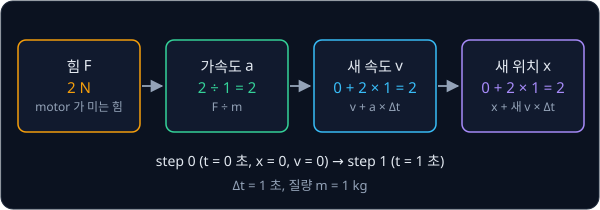

한 step 의 계산은 힘 → 가속도 → 새 속도 → 새 위치 순서다. 위 그림처럼 멈춰 있던 카트를 2 N 으로 1초 동안 밀면 가속도는 $2 \div 1 = 2$,
새 속도는 $0 + 2 \times 1 = 2$, 새 위치는 $0 + 2 \times 1 = 2$ 다. 이 강의의 표는 모두 이 순서로 계산하고, 따로 말하지 않으면
$\Delta t = 0.5$ 초다.

<b>심화: 계산 순서와 simulator</b>

위 계산은 속도를 먼저 고치고 그 새 속도로 위치를 옮긴다. 식으로는 아래 두 줄이다.

$$
v_{k+1} = v_k + a_k \, \Delta t, \qquad x_{k+1} = x_k + v_{k+1} \, \Delta t
$$

$k$ 는 몇 번째 step 인지를 뜻한다. 둘째 줄에서 $v_{k+1}$ 대신 지금 속도 $v_k$ 를 쓰는 방법도 있는데, 이것을 explicit Euler 라고 하고
위의 방법을 semi-implicit Euler 라고 한다. 차이는 작아 보이지만 결과는 크게 다르다. 뒤에서 볼 P 제어($K_p = 4$)를 explicit Euler 로
계산하면 카트의 운동 energy 와 P 항이 담아 둔 energy 의 합이 step 마다 2, 4, 8, 16 으로 두 배씩 커지는데, 마찰이 없으면 이 합은 실제로는
변하지 않으므로 계산이 없는 energy 를 만들어 낸 것이다. semi-implicit Euler 는 같은 합이 2 와 4 사이를 오갈 뿐 커지지 않는다.

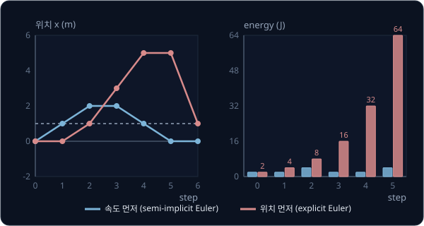

그래서 물리 simulator 는 semi-implicit 쪽을 쓴다. [MuJoCo 문서](https://mujoco.readthedocs.io/en/stable/computation/index.html#numerical-integration)는
explicit Euler 를 아예 지원하지 않는다고 적고, 기본 integrator 인 `Euler` 가 semi-implicit Euler 에 관절 damping 만 implicit 으로 계산하는
방식이다. 더 정확한 RK4(Runge–Kutta 4차)는 한 step 안에서 계산을 네 번 하는 대신 오차가 훨씬 작다.

## feedback 제어

카트는 0 m 에 서 있고 목표는 1 m 다. controller 는 step 마다 카트의 위치를 재서 목표에서 뺀 값, 곧 **오차** $e$ 를 구하고, 그 오차로
motor 가 낼 힘을 정한다. 힘을 낸 결과로 카트가 움직이면 위치를 다시 재서 다음 오차를 구하는데, 결과를 다시 재서 입력으로 되돌리는 이
고리를 **feedback loop** 라고 한다.

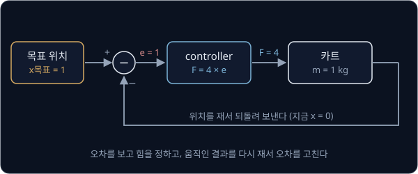

오차는 "목표 − 지금" 으로 정해서, 양수면 앞으로, 음수면 뒤로 밀어야 한다는 뜻이 된다. PID 는 이 오차 하나를 세 가지 방식으로 보고 그 결과를
더해 힘을 정한다. 지금 오차가 얼마나 큰지(P), 오차가 얼마나 빨리 변하는지(D), 지금까지 오차가 얼마나 쌓였는지(I)다.

## P 항

가장 먼저 떠오르는 방법은 오차가 클수록 세게 미는 것이다. 오차에 정해 둔 수 $K_p$ 를 곱해 힘으로 쓴다. 이렇게 오차에 곱하는 수를 gain
이라고 하고, 오차에 비례(proportional)하는 이 항이 P 항이다. $K_p = 4$ 로 마찰 없는 레일에서 계산하면 아래와 같다.

| step | 위치 | 속도 | 오차 $1 - x$ | 힘 $4e$ | 새 속도 | 새 위치 |
| --- | --- | --- | --- | --- | --- | --- |
| 0 | 0 | 0 | 1 | 4 | 2 | 1 |
| 1 | 1 | 2 | 0 | 0 | 2 | 2 |
| 2 | 2 | 2 | −1 | −4 | 0 | 2 |
| 3 | 2 | 0 | −1 | −4 | −2 | 1 |
| 4 | 1 | −2 | 0 | 0 | −2 | 0 |
| 5 | 0 | −2 | 1 | 4 | 0 | 0 |

step 1 에서 카트는 정확히 목표 1 에 있고 오차가 0 이라 힘도 0 인데, 이미 속도가 2 m/s 라서 그대로 2 까지 지나간다. 거기서 뒤로 밀려 0 까지
돌아오고, step 6 에서는 처음과 똑같이 위치 0, 속도 0 이 되어 같은 움직임을 끝없이 되풀이한다.

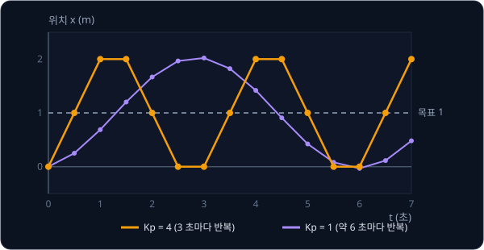

P 항은 "얼마나 멀리 있는지" 만 보고 "얼마나 빨리 다가오는지" 는 보지 않아서 진동한다. 위 그림처럼 $K_p$ 를 1 로 줄여도 더 느리게 같은 폭으로
흔들릴 뿐이다. 목표를 지나쳐 넘어간 양을 overshoot 라고 하는데, 이 카트는 목표 1 을 1 만큼 넘어 2 까지 가므로 overshoot 가 100% 다.

> **오해** $K_p$ 를 크게 하면 목표에 빨리, 정확하게 간다.
>
> **사실** 출발은 빨라지지만 그만큼 세게 지나치고, 마찰이 없으면 $K_p$ 가 1 이든 4 든 같은 폭으로 끝없이 진동한다.

## D 항

흔들림을 줄이려면 목표에 다가오는 속도를 보고 미리 힘을 줄여야 한다. D 항은 오차가 변하는 빠르기(derivative)에 gain $K_d$ 를 곱해 더한다.
목표가 움직이지 않으면 오차가 줄어드는 빠르기는 카트의 속도와 같으므로, D 항은 속도에 맞서는 힘 $-K_d \times v$ 가 된다.

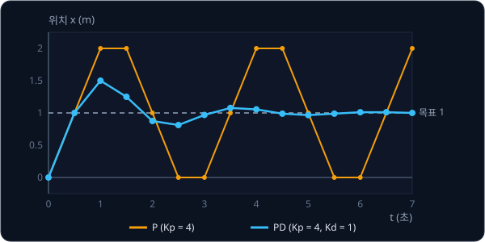

같은 $K_p = 4$ 에 $K_d = 1$ 을 더하자 카트는 1.5 m 까지 한 번 넘쳤다가 0.81, 1.08 로 흔들림이 줄며 목표에 자리 잡는다. $K_d$ 를 어떻게 고를지는
아래 표가 보여 준다($\Delta t$ 를 0.01 초로 줄여 매끄럽게 계산한 결과).

| $K_d$ | 가장 멀리 간 위치 | 6 초 뒤 위치 | 움직임 |
| --- | --- | --- | --- |
| 1 | 1.44 | 0.98 | 넘쳤다가 흔들리며 들어온다 |
| 4 | 1.00 | 1.00 | 넘치지 않고 2.4 초 만에 0.95 를 넘는다 |
| 10 | 0.91 | 0.91 | 넘치지 않지만 아주 느리다 |

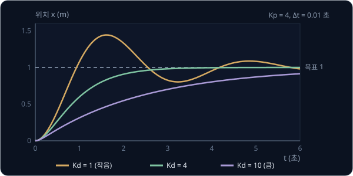

넘치지 않으면서 가장 빨리 닿는 값은 $K_d = 2\sqrt{K_p \times m}$ 이고, 이 카트에서는 $2\sqrt{4 \times 1} = 4$ 다. 이 값을 critical damping
이라고 부르는데, 새 관절의 gain 을 처음 고를 때 출발점으로 쓴다. 끝에 무거운 gripper 를 달아 질량이 4 배가 되면 $2\sqrt{4 \times 4} = 8$ 로
$K_d$ 도 두 배가 필요하다. 부하가 바뀌었는데 예전 gain 을 그대로 쓰면 팔이 떨리는 이유다.

D 항을 계산하는 방식에도 함정이 있다. 오차의 변화로 D 항을 계산하면, 목표가 0 에서 1 로 한순간에 바뀔 때 오차도 한 step 만에 1 만큼 뛰어서
D 항이 크게 튄다. $\Delta t = 0.01$ 초면 변화율이 $1 \div 0.01 = 100$ 이라 $K_d = 1$ 이어도 한 step 동안 100 N 이 나온다. 이것을 derivative
kick 이라고 하는데, 실제 controller 는 이를 피하려고 D 항을 오차 대신 측정한 속도로 계산하는 경우가 많다.

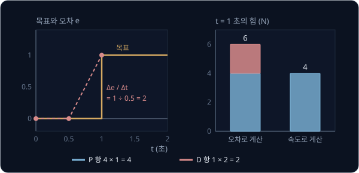

D 항은 센서 noise 에도 가장 민감하다. noise 는 짧은 시간에 크게 오르내려서, 기울기를 재는 D 항이 세 항 가운데 가장 크게 흔들린다. 그래서 D
항에는 low-pass filter 를 거친 값을 쓰는 경우가 많다.

**확인 문제.** $K_p = 9$ 이고 질량이 1 kg 이다. 넘치지 않으면서 가장 빠른 $K_d$ 는?

답 보기

$K_d = 2\sqrt{9 \times 1} = 2 \times 3 = 6$ 이다.

## 계산 주기와 gain

$\Delta t$ 는 controller 가 힘을 다시 정하기까지 걸리는 시간이다. 같은 $K_p = 4$, $K_d = 4$ 를 $\Delta t = 0.01$ 초로 계산하면 위 표처럼
매끄럽게 1 에 닿는데, $\Delta t = 0.5$ 초로 계산하면 결과가 전혀 다르다.

| step | 위치 | 속도 | P 항 $4e$ | D 항 $-4v$ | 힘 | 새 속도 | 새 위치 |
| --- | --- | --- | --- | --- | --- | --- | --- |
| 0 | 0 | 0 | 4 | 0 | 4 | 2 | 1 |
| 1 | 1 | 2 | 0 | −8 | −8 | −2 | 0 |
| 2 | 0 | −2 | 4 | 8 | 12 | 4 | 2 |
| 3 | 2 | 4 | −4 | −16 | −20 | −6 | −1 |

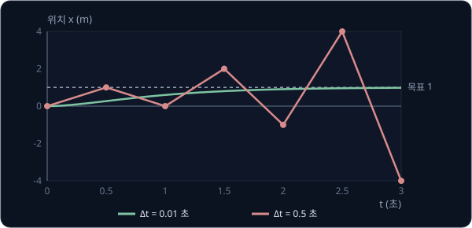

step 1 에서 속도는 2 인데 D 항이 −8 N 을 내고, 이 힘이 0.5 초 동안 유지되면서 속도를 $8 \times 0.5 = 4$ 만큼 줄인다. 속도 2 를 0 으로 만들려던
브레이크가 2 를 더 줄여 −2 로 뒤집어 버린 것이다. 다음 step 에서는 −2 를 4 로, 그다음에는 4 를 −6 으로 뒤집으며 값이 끝없이 커지는데, 이것을
발산이라고 한다.

D 항 하나가 한 step 동안 줄이는 속도는 지금 속도의 $K_d \times \Delta t \div m$ 배다. 이 값이 1 을 넘으면 브레이크가 속도를 0 에서 멈추지 못하고
반대로 뒤집는다.

| $K_d$ | $\Delta t$ | 한 step 에 줄이는 비율 $K_d \Delta t / m$ | 결과 |
| --- | --- | --- | --- |
| 4 | 0.5 초 | 2 (200%) | 속도를 뒤집으며 발산 |
| 4 | 0.01 초 | 0.04 (4%) | 매끄럽게 줄어듦 |
| 40 | 0.01 초 | 0.4 (40%) | 아직 괜찮음 |
| 40 | 0.05 초 | 2 (200%) | 발산 |

gain 을 10 배 키우면 같은 비율을 지키기 위해 $\Delta t$ 를 10 분의 1 로 줄여야 한다. 무거운 팔을 단단히 붙잡으려면 큰 gain 이 필요하고, 큰
gain 은 짧은 주기에서만 안정하다. 로봇 관절의 저수준 controller 가 1초에 수백 ~ 수천 번 계산하는 첫째 이유가 이것이다.

같은 이유로 계산 주기는 일정해야 한다. I 항은 오차 × $\Delta t$ 를 쌓고 D 항은 오차의 차이 ÷ $\Delta t$ 로 계산하므로, loop 가 들쭉날쭉
돌면 같은 gain 이라도 두 항의 크기가 매번 달라진다. 실제 코드에서는 일정한 주기의 timer 로 돌리거나, 매번 실제로 지난 시간을 재서 $\Delta t$
로 쓴다.

> **오해** gain 만 잘 맞추면 계산 주기는 상관없다.
>
> **사실** 위 표처럼 같은 gain 도 주기가 길면 발산하므로, gain 과 주기는 함께 정해야 한다.

**확인 문제.** $K_d = 2$, $m = 1$, $\Delta t = 0.1$ 이면 D 항은 한 step 에 지금 속도의 몇 % 를 줄일까? 발산할까?

답 보기

$K_d \Delta t / m = 2 \times 0.1 \div 1 = 0.2$ 라서 20% 를 줄인다. 1 보다 작으므로 속도를 뒤집지 않고 매끄럽게 줄인다.

## I 항과 windup

이번에는 레일이 기울어 있어서 gravity 가 카트를 늘 2 N 으로 아래쪽에 당긴다고 하자. 로봇 팔의 관절도 gravity 에 늘 아래로 당겨지므로
같은 상황이다. 같은 PD($K_p = 4$, $K_d = 1$)로 목표 1 m 에 보내면 카트는 0.5 m 에서 멈춘다.

0.5 m 에서는 오차가 0.5 m 라 P 항이 $4 \times 0.5 = 2$ N 으로 위로 미는데, 이 힘이 gravity 의 2 N 과 정확히 맞아서 카트가 서 있다. 카트가
멈췄으니 D 항은 0 이고, 오차가 남아 있는데도 아무도 더 밀지 않는다. 이렇게 멈춘 뒤에도 남는 오차를 **steady-state error** 라고 하고, 그
크기는 (당기는 힘) ÷ $K_p$ 다. $K_p$ 를 키우면 줄어들지만 0 이 되지는 않는다.

I 항은 오차를 시간에 따라 계속 쌓은 값(integral)에 gain $K_i$ 를 곱한다. 오차가 조금이라도 남아 있으면 쌓인 값이 계속 커지면서 힘이
점점 세지고, 결국 카트를 목표까지 밀어 올린다.

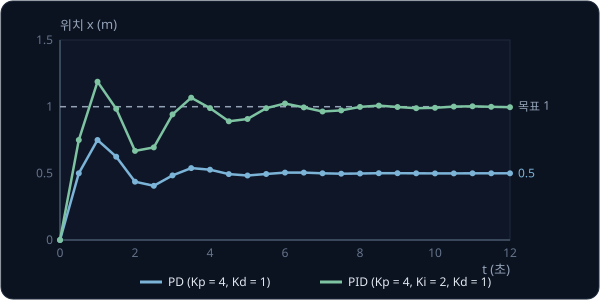

$K_i = 2$ 를 더하면 카트는 1.19 m 까지 넘쳤다가 목표 1 m 에 자리 잡는다. 목표에 도착했을 때 오차는 0 이지만, 그동안 쌓인 I 항이 gravity 의
2 N 을 대신 버텨 준다.

다만 motor 가 낼 수 있는 힘에는 한계가 있다. controller 가 10 N 을 내라고 계산해도 motor 의 최대가 3 N 이면 3 N 만 나오는데, 이렇게 힘이
한계에 걸린 상태를 saturation 이라고 한다. saturation 동안에도 I 항은 오차를 계속 쌓고, 그 값은 그 순간에는 아무 일도 하지 않다가 목표에
도착한 뒤에 한꺼번에 밀어서 목표를 크게 지나치게 만든다. 이것을 **integral windup** 이라고 한다.

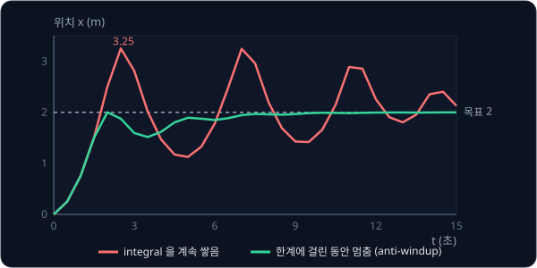

위 그림은 앞의 기울어진 레일(gravity 2 N, 질량 1 kg)에서 힘의 한계를 3 N 으로 두고 $K_p = 4$, $K_d = 3$, $K_i = 1$ 로 카트를 목표 5 m 에
보낸 결과다($\Delta t = 0.01$ 초로 계산). gravity 가 2 N 을 가져가서 위로 쓸 수 있는 힘은 1 N 뿐이라, 카트는 처음 3 초 동안 한계에 걸린
채 천천히 올라간다(색칠한 구간).

| | integral 을 계속 쌓음 (빨강) | 한계에 걸린 동안 멈춤 (초록) |
| --- | --- | --- |
| 목표에 도착할 때 I 항의 힘 | 10.5 N | 2 N 이하 |
| 가장 멀리 간 위치 | 7.02 m (2.02 m 넘침) | 5 m 를 넘지 않음 |
| 목표의 ±2%(4.9 ~ 5.1 m) 안에 들어온 시간 | 14.0 초 | 4.1 초 |

빨강은 한계에 걸린 3 초 동안에도 오차를 쌓아서, 목표에 도착하는 순간 I 항이 10.5 N 이 된다. gravity 를 버티는 데는 2 N 이면 되는데
I 항이 8.5 N 을 더 밀고 있어서, D 항이 브레이크를 걸어도 카트는 3 m/s 의 속도로 목표를 지나 7.02 m 까지 올라간다. 목표를 지나면 오차가
음수가 되어 I 항이 줄기 시작하지만 3 초 동안 쌓은 값을 빼는 데 시간이 걸려서, 14 초가 지나서야 목표 근처에 자리 잡는다.

초록은 힘이 한계를 넘는 동안 쌓기를 멈춰서 I 항이 2 N 을 넘지 않고, 카트는 목표를 넘지 않은 채 4.1 초 만에 자리 잡는다. 이런 처리를
anti-windup 이라고 하는데, 쌓기를 멈추는 대신 쌓인 값을 정해 둔 범위 안으로 자르는 방법도 있다.

I 항은 구현 방식에 따라 실행 중에 $K_i$ 를 바꿀 때도 문제가 생긴다. 쌓인 오차에 마지막에 $K_i$ 를 곱하면, $K_i$ 를 바꾸는 순간 지금까지 쌓인
값 전체에 새 $K_i$ 가 곱해져 출력이 계단처럼 튄다. 매 step 의 오차에 그때의 $K_i$ 를 곱해서 쌓아 두면 바꾼 뒤부터만 새 값이 적용된다.

**확인 문제.** 로봇 팔의 관절이 목표보다 늘 2° 아래에서 멈춘다. gain 을 어떻게 바꿔야 할까?

답 보기

멈춘 뒤에도 오차가 남는 steady-state error 다. gravity 를 P 항이 혼자 버티느라 생기므로 I 항을 더하거나 $K_i$ 를 키운다. 뒤에서 볼 gravity
feedforward 도 같은 문제를 푼다. $K_d$ 는 멈춘 상태에서 0 이라 남은 오차와는 관계없다.

## 회전하는 관절과 gravity

로봇 팔의 관절은 레일을 미끄러지지 않고 축을 중심으로 돈다. 그래서 위치 대신 각도 $\theta$, 힘 대신 torque $\tau$ 를 쓴다. torque 는 축을
돌리는 세기로, 힘이 팔과 직각으로 작용할 때 힘 × 축까지의 거리이고 단위는 N·m 다. 관절의 motor 가 내는 것은 torque 라서, 관절의 PID 는
torque 를 계산한다.

축에 길이 $l = 0.5$ m 인 가벼운 팔을 달고 끝에 질량 $m = 1$ kg 인 추를 매달면, gravity 가 추를 9.81 N 으로 당긴다(gravity 가속도
$g = 9.81$ m/s²). 이 힘이 축을 돌리는 세기는 추가 축에서 수평으로 얼마나 떨어져 있느냐에 달려 있다.

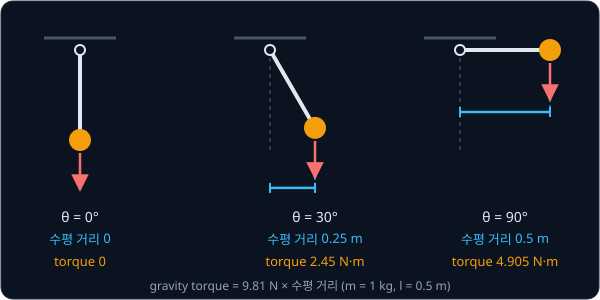

| 팔의 각도(아래로 늘어진 자세가 0°) | 0° | 30° | 60° | 90° | 120° | 180° |
| --- | --- | --- | --- | --- | --- | --- |
| 수평 거리 (m) | 0 | 0.25 | 0.433 | 0.5 | 0.433 | 0 |
| gravity torque (N·m) | 0 | 2.45 | 4.25 | 4.905 | 4.25 | 0 |

팔을 수평으로 든 90° 에서 torque 가 $9.81 \times 0.5 = 4.905$ N·m 로 가장 크다. 기울어진 레일은 늘 2 N 으로 당겼지만, 회전하는 관절은 각도에 따라
당기는 세기가 바뀐다. 로봇 팔을 앞으로 쭉 뻗을수록 어깨 motor 가 더 큰 torque 를 내야 하는 이유다.

이 팔을 90° 에 세우려고 PD($K_p = 50$ N·m/rad)를 쓰면, 멈춘 뒤에는 P 항 혼자 4.905 N·m 를 버텨야 하므로 오차가 $4.905 \div 50 \approx 0.098$
rad, 곧 약 5.6° 남는다. radian 은 각도의 단위로, 1 rad 이 약 57.3° 다.

| $K_p$ (N·m/rad) | 50 | 100 | 200 |
| --- | --- | --- | --- |
| 90° 에서 남는 오차 | 0.098 rad (5.6°) | 0.049 rad (2.8°) | 0.025 rad (1.4°) |

<b>심화: 관절의 equation of motion</b>

카트에서 $a = F / m$ 이었던 관계가 관절에서는 $\alpha = \tau / I$ 가 된다. $\alpha$ 는 각가속도, $I$ 는 moment of inertia 로 "얼마나 돌리기
어려운가" 를 나타내고, 끝에 추가 달린 팔에서는 $I = m l^2$ 이다. $m = 1$, $l = 0.5$ 이면 $I = 0.25$ kg·m² 이고, 같은 추를 1 m 끝에 달면 $I = 1$
로 네 배가 된다. 무게가 끝에 멀리 있을수록 돌리기 어렵다.

수평 거리를 팔 길이로 나눈 비율이 $\sin\theta$ 라서 gravity torque 는 $m g l \sin\theta$ 다. 관절의 마찰은 각속도 $\omega$ 에 비례하는
$b\,\omega$ 로 적고, 모두 모으면 관절의 움직임을 정하는 식이 된다.

$$
I \alpha = \tau - b\,\omega - m g l \sin\theta
$$

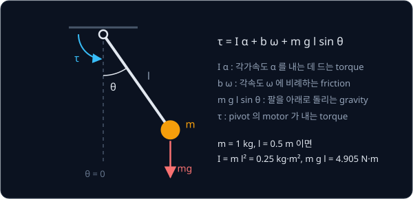

60° 에서 torque 없이 놓으면 $\alpha = -4.905 \times 0.866 \div 0.25 \approx -17$ rad/s² 로 아래로 떨어지기 시작한다. 계산은 카트와 같아서, 각속도를
먼저 고치고 그 각속도로 각도를 옮기는 step 을 되풀이한다. 관절이 여러 개인 팔은 한 관절이 움직이면 다른 관절이 받는 inertia 와 gravity 가 바뀌어
식이 훨씬 커지는데, 이 계산을 대신해 주는 것이 [MuJoCo Simulation](../mujoco-sim/README.md) 같은 physics engine 이다.

## feedforward

기울어진 레일이 2 N 으로 당긴다는 것을 알고 있다면, 오차가 생길 때까지 기다릴 필요 없이 처음부터 2 N 을 더해 주면 된다. 이처럼 장치의
model(움직이려면 어떤 힘이 필요한지 계산하는 식)로 필요한 힘을 미리 계산해 더하는 것을 feedforward 라고 한다. feedback 이 오차가 생긴 뒤에
고친다면, feedforward 는 오차가 생기기 전에 막는다.

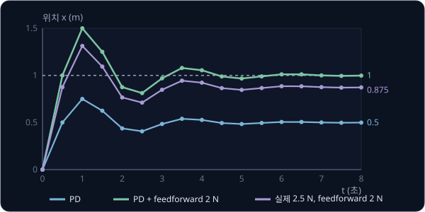

PD 에 2 N 을 더하면 레일의 2 N 이 정확히 지워져서 I 항 없이도 목표 1 에 멈춘다(초록). feedforward 는 model 이 맞는 만큼만 도움이 되어서,
실제로는 2.5 N 인데 2 N 으로 알고 있으면 남는 0.5 N 때문에 $0.5 \div 4 = 0.125$ 가 모자란 0.875 에 멈춘다(보라). 이 남은 오차는 I 항이
지운다. feedforward 가 큰 몫을 미리 내고 feedback 은 model 이 틀린 만큼만 고치는 분업이다.

회전하는 관절에서는 목표 각도에서의 gravity torque 를 미리 더하는데, 이것을 gravity feedforward(또는 gravity compensation)라고 한다. 목표가 90°
이면 4.905 N·m, 30° 이면 2.45 N·m 를 더하고, 앞의 PD 가 남기던 5.6° 의 오차가 사라진다. 로봇 팔 driver 의 "gravity compensation" 기능이 이
계산이고, 끝에 단 gripper 나 물체의 무게가 model 에 빠져 있으면 그 무게만큼 팔이 처진다.

**확인 문제.** 실제로 당기는 힘이 2 N 인데 feedforward 를 2.4 N 으로 넣었다. PD($K_p = 4$)만 쓰면 어디에 멈출까?

답 보기

0.4 N 이 남아 위로 밀므로 P 항이 −0.4 N 을 내야 한다. $4e = -0.4$, $e = -0.1$ 이라 목표보다 0.1 위인 1.1 에 멈춘다.

## minimum-jerk 목표

지금까지는 목표를 한순간에 0 에서 1 로 바꿨다. 이런 계단 목표에서는 첫 step 의 오차가 커서 P 항이 한꺼번에 큰 힘을 내고, 목표가 멀면 힘의
한계에 걸린다. 일정한 속도로 가는 목표도 출발하는 순간 속도가 0 에서 한 번에 바뀌어야 해서 끝없이 큰 가속도, 곧 끝없이 큰 torque 를 요구한다.

시간마다 목표 위치를 정해 둔 경로를 trajectory 라고 하는데, 출발과 도착에서 속도와 가속도가 모두 0 이고 그 사이에서 가속도가 부드럽게 변하는
trajectory 가 좋다. 가속도가 변하는 빠르기를 jerk 라고 하고, 버스가 급출발할 때 몸이 휘청이는 것이 jerk 가 큰 경우다. jerk 를 가장 작게
만드는 경로가 minimum-jerk trajectory 다.

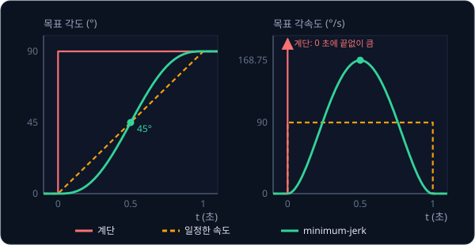

0° 에서 90° 로 1 초에 가는 minimum-jerk 목표는 천천히 출발해 0.5 초에 45° 를 지나고, 처음과 끝의 4 분의 1 동안에는 9.3° 씩만 움직인다.
가장 빠른 순간의 각속도는 168.75 °/s 로 일정한 속도(90 °/s)의 약 1.9 배지만, 필요한 torque 가 급하게 바뀌지 않는다. Flash 와 Hogan 은
1985 년 사람이 팔을 뻗는 움직임이 이 곡선과 잘 맞는다는 것을 보였다.

목표가 움직이는 동안에는 목표의 가속도를 내는 힘($m \times$ 목표 가속도)도 필요해서, 이것까지 미리 더한 것을 full feedforward 라고 한다.
기울어진 레일의 카트를 0 에서 1 로 2 초 동안 minimum-jerk 로 옮기며 비교하면 차이가 크다.

| 방법 | 움직이는 동안 가장 큰 오차 | 4 초 뒤 위치 |
| --- | --- | --- |
| PD | 0.50 | 0.52 |
| PD + gravity 2 N | 0.15 | 1.01 |
| PD + gravity 2 N + 목표 가속도에 필요한 힘 | 0.003 | 1.00 |

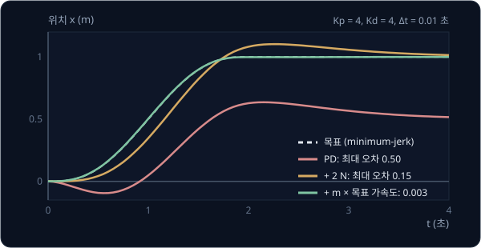

필요한 힘을 미리 모두 더하면 feedback 이 고칠 오차가 거의 남지 않는다.

<b>심화: minimum-jerk 식</b>

출발 각도 $\theta_0$ 에서 도착 각도 $\theta_f$ 로 시간 $T$ 동안 가는 minimum-jerk 목표는 아래와 같다.

$$
\theta_{\text{목표}}(t) = \theta_0 + (\theta_f - \theta_0)\,(10 s^3 - 15 s^4 + 6 s^5), \qquad s = \frac{t}{T}
$$

$s$ 는 지난 시간을 전체 시간으로 나눈 비율이고, 괄호 안은 0 에서 1 까지 가는 진행률이다. $s = 0.25$ 이면 $10 \times 0.015625 - 15 \times
0.0039 + 6 \times 0.00098 \approx 0.1035$ 라서 90° 의 10.35%, 곧 9.3° 다. 진행률이 변하는 빠르기는 $30 s^2 (1 - s)^2$ 이고, $s = 0.5$ 에서
$30 \times 0.25 \times 0.25 = 1.875$ 라 가운데 각속도가 평균의 1.875 배가 된다. 이 다항식은 jerk 를 제곱해 이동 시간 전체에 대해 쌓은 값을
가장 작게 만드는 곡선이다.

## 학습한 policy 아래의 PID

요즘 로봇에서 "다음에 어디로 갈지" 는 카메라 영상과 지시문을 보고 행동을 정하는 학습한 모델, 곧 policy 가 정한다. 그런데 policy 는 보통
motor 의 힘을 직접 내지 않고 관절마다 다음 목표 각도를 내고, 그 목표를 실제로 따라가게 motor 를 움직이는 것은 그 아래의 PID 다.

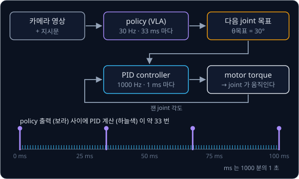

둘은 1초에 계산하는 횟수가 크게 다르다. 이 횟수를 Hz 로 적는데, 큰 neural network 는 사진 한 장을 보고 행동을 정하는 데 수십 ms 가 걸려서
policy 는 보통 10 ~ 50 Hz 로 계산한다. PID 는 수백 ~ 수천 Hz 로 계산해서, policy 가 30 Hz 이고 PID 가 1000 Hz 이면 policy 가 목표를 한 번 낼
때마다 PID 는 약 33 번 계산한다. 아래층을 이렇게 자주 계산하는 이유는 이 강의에서 본 내용 그대로다.

- 안정성: [계산 주기와 gain](#계산-주기와-gain) 에서 본 것처럼 큰 gain 은 짧은 주기에서만 안정하다
- 빠르게 바뀌는 힘: gravity torque 는 각도에 따라, 마찰과 접촉 힘은 ms 단위로 변하는데, policy 의 다음 출력까지 33 ms 를 기다리면 그사이에
  팔이 처지거나 튕긴다
- 역할 분담: policy 는 어디로 갈지만 정하고, gravity 버티기와 흔들림 줄이기는 PID 와 feedforward 가 맡는다. policy 가 motor 의 세부 물리까지
  배울 필요가 없다

policy 가 낸 목표는 33 ms 마다 계단처럼 바뀌므로, 저수준 controller 가 그 사이를 [minimum-jerk 목표](#minimum-jerk-목표) 처럼 부드럽게 이어
따라가기도 한다.

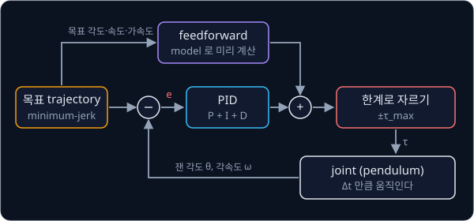

위 그림은 이 강의의 내용을 한데 모은 저수준 loop 다. 목표 trajectory 에서 feedforward torque 를 미리 계산하고, 측정한 각도와의 오차로 PID
torque 를 계산해 더한 뒤 motor 의 한계로 잘라 관절에 준다.

예를 들어 저가형 로봇 팔 SO-101 은 관절마다 STS3215 라는 servo motor 를 쓴다. servo motor 는 motor, 각도 센서, 작은 컴퓨터를 한 상자에 넣어
목표 각도를 받으면 스스로 그 각도로 가는 motor 인데, 그 안에서 각도를 목표에 맞추는 계산이 position PID 다. Hugging Face 의 로봇 학습
라이브러리 LeRobot 은 팔을 연결할 때 이 P·I·D 계수를 servo 에 써 넣고, 학습한 policy 의 출력은 목표 각도로 servo 에 전달된다. 그래서
[π0](../pi0/README.md) 같은 VLA 가 낸 행동도 마지막에는 이 PID 를 거쳐 실제 움직임이 된다.

> **오해** 학습한 policy 가 motor 를 직접 움직인다.
>
> **사실** 대부분의 로봇에서 policy 는 목표 각도를 낼 뿐이고, motor 에 들어가는 전류는 그보다 수십 배 자주 계산하는 저수준 controller 가 정한다. 그래서 policy 의 성능이 좋아도 아래층의 gain 이 맞지 않으면 팔이
> 떨리거나 목표에 못 미친다.

**확인 문제.** policy 가 20 Hz, PID 가 500 Hz 로 돈다. policy 출력 한 번 사이에 PID 는 몇 번 계산할까?

답 보기

policy 는 $1 / 20 = 0.05$ 초마다, PID 는 $1 / 500 = 0.002$ 초마다 계산하므로 $0.05 \div 0.002 = 25$ 번이다.

## 정리

- controller 는 $\Delta t$ 마다 오차(목표 − 지금)를 재서 힘을 정하고, 그 힘은 다음 계산까지 유지된다
- P 는 지금 오차에 비례해 밀지만 속도를 보지 않아 진동하고, D 는 속도에 맞서 흔들림을 줄이며 $K_d = 2\sqrt{K_p m}$ 이 넘치지 않는 가장 빠른 값이다.
  I 는 쌓인 오차로 gravity 때문에 남는 steady-state error 를 없애지만, saturation 동안 쌓이면 windup 이 생겨 anti-windup 이 필요하다
- D 항이 한 step 에 줄이는 속도의 비율 $K_d \Delta t / m$ 이 1 을 넘으면 발산하므로, gain 이 클수록 주기가 짧아야 한다
- 관절의 gravity torque 는 팔을 수평으로 뻗을수록 커지고, gravity feedforward 와 minimum-jerk 목표에 맞춘 full feedforward 를 더하면 feedback 이
  고칠 오차가 거의 남지 않는다
- 학습한 policy 는 10 ~ 50 Hz 로 목표 각도를 내고, 그 아래에서 수백 ~ 수천 Hz 로 계산하는 PID 가 motor 를 움직인다

PID 는 관절 하나가 목표 각도 하나를 따라가는 계산이다. 팔로 물체를 집으려면 먼저 손끝을 물체 위치에 두려면 관절마다 몇 도가 되어야 하는지를
구해야 하고, 다음 강의 [Inverse Kinematics](../inverse-kinematics/README.md) 에서 그 계산을 다룬다.

## 참고 자료

- MATLAB, [Understanding PID Control, Part 1: What Is PID Control?](https://www.youtube.com/watch?v=wkfEZmsQqiA) — P·I·D 세 항이
  각각 하는 일을 그림으로 보여 주는 영상 연재의 첫 편
- Brett Beauregard, [Improving the Beginner's PID](http://brettbeauregard.com/blog/2011/04/improving-the-beginners-pid-introduction/) —
  sample time, derivative kick, 실행 중 gain 변경, windup 같은 실전 문제를 코드로 하나씩 고쳐 가는 연재
- Glenn Fiedler, [Integration Basics](https://gafferongames.com/post/integration_basics/) — explicit Euler, semi-implicit Euler, RK4 를
  용수철 예제로 비교하는 짧은 글. [한 step 씩 계산하는 제어](#한-step-씩-계산하는-제어) 의 심화와 함께 읽는다
- Russ Tedrake, [Underactuated Robotics — Ch. 2 The Simple Pendulum](https://underactuated.mit.edu/pend.html) — 같은 pendulum 을
  energy 와 그래프로 분석하는 강의 노트
- Åström & Murray, [Feedback Systems (PDF)](http://www.cds.caltech.edu/~murray/books/AM08/pdf/am08-complete_22Feb09.pdf) — 10장이
  PID control 이다. feedback 의 원리를 수식으로 더 깊이 보고 싶을 때 읽는다
- Flash & Hogan, [The coordination of arm movements](https://doi.org/10.1523/JNEUROSCI.05-07-01688.1985) (1985) — minimum-jerk
  곡선이 사람 팔의 움직임과 맞는다는 것을 보인 논문
- Lynch & Park, [Modern Robotics](https://hades.mech.northwestern.edu/index.php/Modern_Robotics) — 11장 robot control 에서
  feedforward 와 PID 를 여러 관절로 넓히는 방법을 다룬다
