# Policy Gradient

## 학습 목표

- 상황마다 가장 좋아 보이는 행동 하나만 고르던 방법의 한계를 들고, 행동을 고를 확률을 직접 고치는 방법이 필요한 이유를 설명할 수 있다
- 행동마다 매긴 점수를 합이 1 인 확률로 바꾸는 계산을 숫자로 할 수 있다
- 확률에 로그를 씌운 값이 학습으로 고치는 숫자에 따라 변하는 비율을 계산하고, 이 비율이 "그 행동을 더 자주 고르게 하는 방향"
  이라는 뜻을 설명할 수 있다
- 슬롯머신 두 대에서 "좋은 결과가 나온 행동의 확률을 올리는" 학습을 한 단계씩 손으로 따라가며, 행동을 고를 확률이 단계마다 어떻게
  바뀌는지 표로 적을 수 있다
- 한 번 해 본 결과로 정한 학습 방향이 운에 따라 크게 흔들리는 문제를 숫자로 보이고, 받은 점수에서 평균 점수를 빼면 흔들림이 줄어드는
  이유를 설명할 수 있다
- "평균보다 얼마나 나았나" 를 앞으로 받을 점수의 예측값으로 바로 추정해 쓰는 방법의 장점과 위험을 설명할 수 있다

## value 를 거치지 않는 policy 학습

### 앞 강의의 policy

[Bandits & MDPs](../bandit-mdp/README.md) 에서는 행동을 고르는 쪽을 agent, 행동한 뒤에 받는 점수를 reward 라고 불렀다. agent 가 보는
지금 상황은 state, agent 가 고르는 행동 하나는 action 이다. 그 강의의 슬롯머신 두 대를 이 강의에서도 계속 쓰는데, 기계 A 는
레버를 당길 때마다 동전 1 개를 준다. 한편 기계 B 는 0.5 의 확률로 동전 4 개를, 나머지 0.5 의 확률로 0 개를 준다.

결과마다 "값 × 확률" 을 구해 모두 더한 값을 기댓값이라고 했다. 아주 많이 되풀이했을 때 한 번에 평균적으로 얻는 값으로, 기계 A 는
$1 \times 1 = 1$, 기계 B 는 $4 \times 0.5 + 0 \times 0.5 = 2$ 다. 그래서 오래 당길수록 B 가 낫다. 앞 강의처럼 기계 $a$ 의 진짜
기댓값을 $q_*(a)$ 로 쓰면 $q_*(A) = 1$, $q_*(B) = 2$ 이고, 이 값은 agent 에게 숨겨져 있다.

앞 강의의 agent 는 기계마다 받은 reward 의 평균을 추정값 $Q(a)$ 로 적어 두고, 추정값이 가장 큰 기계를 골랐다. 3×3 격자를 옮겨 다니는
문제에서도 칸마다 action 별 값 $Q(s, a)$ 를 표에 채운 뒤, 칸마다 값이 가장 큰 action 을 골랐다. "넣어 본 것 가운데 가장 큰 값을
내는 것" 을 $\arg\max$ 로 썼으므로, $Q(A) = 1.2$, $Q(B) = 1.9$ 이면 $\arg\max_a Q(a) = B$ 다.

state 를 받아 action 을 내는 규칙을 policy 라고 불렀다. 앞 강의의 policy 는 "값을 먼저 배우고, 값이 가장 큰 action 을 고른다" 는
두 단계로 만들어졌다. 이렇게 value(앞으로 받을 reward 의 기댓값)를 거쳐 policy 를 정하는 방법을 value-based 방법이라고 한다.

**확인 문제.** $Q(A) = 1.5$, $Q(B) = 0.7$ 이면 $\arg\max_a Q(a)$ 와 $\max_a Q(a)$ 는 각각 무엇일까?

답 보기

$\max$ 는 가장 큰 값 자체라서 1.5 이고, $\arg\max$ 는 그 값을 내는 action 이라서 A 다.

### argmax policy 의 한계

$\arg\max$ 로 고르는 policy 는 언제나 action 하나를 확률 1 로 고르고, 그래서 아래와 같은 문제가 생긴다.

첫째, 일부러 섞어서 행동해야 하는 문제를 풀지 못한다. 가위바위보에서 늘 바위만 내면 상대가 곧 알아채고 늘 보를 낸다. 셋을 $\frac{1}{3}$
씩 섞어 내야 상대가 노릴 틈이 없는데, $\arg\max$ 는 한 가지만 내므로 이런 policy 를 표현할 수 없다.

둘째, 숫자가 아주 조금 바뀌어도 고르는 action 이 통째로 바뀐다. $Q(A) = 1$ 로 두고 $Q(B)$ 만 바꾸면 아래와 같다.

| $Q(B)$ | 0.98 | 0.99 | 1.01 | 1.02 |
| --- | --- | --- | --- | --- |
| B 를 고를 확률 | 0 | 0 | 1 | 1 |

$Q(B)$ 가 0.99 에서 1.01 로 0.02 바뀌는 사이에 B 를 고를 확률은 0 에서 1 로 뛰고, 그 밖의 자리에서는 조금 바꿔도 전혀 변하지 않는다.
step function(문턱을 넘으면 1, 아니면 0 을 내는 계단 모양 함수)과 같은 모양이다.
gradient 는 숫자를 조금 바꿨을 때 결과가 변하는 비율인데, 계단 모양에서는 이 비율이 거의 모든 자리에서 0 이라 "숫자를 어느 쪽으로
고쳐야 좋아지는가" 를 알려 주지 못한다.

셋째, action 이 연속된 숫자이면 $\arg\max$ 를 구하기 어렵다. 로봇 팔 관절에 줄 힘이 $-2$ 부터 $2$ 사이의 아무 숫자나 될 수 있다면
0.37, 0.371, 0.3712 처럼 action 이 끝없이 많아서, 모든 action 의 값을 계산해 가장 큰 것을 고를 수 없다. 이 강의에서는 action 이 몇
개로 정해진 경우만 손으로 계산하지만, 같은 원리가 연속된 action 에도 쓰인다.

**확인 문제.** $Q(A) = 2$, $Q(B) = 1.9$ 인 $\arg\max$ policy 가 B 를 고를 확률은? $Q(B)$ 가 2.1 이 되면?

답 보기

$Q(B) = 1.9$ 이면 A 가 더 커서 B 를 고를 확률은 0 이다. $Q(B) = 2.1$ 이 되면 B 가 더 커서 확률이 1 로 뛴다. 그 사이의 확률은 없다.

### policy 를 직접 고치는 방법

policy gradient 는 value 를 거치지 않고 policy 자체에 학습으로 고칠 숫자를 둔다. 이 숫자를 parameter 라고 부르는데,
직선 $y = wx + b$ 의 기울기 $w$ 와 y 절편 $b$ 처럼 데이터를 보고 정하는 숫자다. policy 는 이
parameter 로 action 마다 고를 확률을 정하고, 학습은 reward 의 기댓값이 커지는 쪽으로 parameter 를 조금씩 고친다.

처음 policy 가 기계 A 와 B 를 0.5 씩 고른다고 하자. B 를 당겨 동전 4 개를 받았다면 B 를 고를 확률을 0.55 처럼
조금 올리고, B 를 당겨 0 개를 받았다면 조금 내린다. 결과가 좋았던 action 은 더 자주, 나빴던 action 은 덜 자주 고르게 고치는
것이다. 그 고치는 방향을 gradient 로 정하므로 policy gradient 라는 이름이 붙었다.

policy 라는 말은 일상의 "정책" 이 아니라 "상황을 받아 행동을 내는 규칙" 이다. 이 강의의 policy 는 언제나 action 마다 확률을 내는
규칙이고, 로봇 강의에서는 카메라 영상 같은 관측을 받아 모터 명령을 내는 neural network(숫자를 곱하고 더하는 층을 여러 겹 쌓은 큰
모델)가 policy 다.

**확인 문제.** B 를 당겨 0 개를 받은 뒤 policy gradient 는 B 를 고를 확률을 올릴까, 내릴까?

답 보기

결과가 나빴으므로 내린다. 0.5 였다면 0.45 처럼 조금 내려간다. 어느 정도 내리는지는 뒤에서 계산한다.

**요약**

- $\arg\max$ policy 는 action 하나만 골라서 섞어 내야 하는 문제를 표현하지 못하고, 숫자를 조금 바꾸면 선택이 계단처럼 뛰어 gradient 가 0 이다
- policy gradient 는 policy 에 parameter 를 두고, reward 의 기댓값이 커지는 쪽으로 parameter 를 직접 고친다
- 결과가 좋았던 action 의 확률은 올리고 나빴던 action 의 확률은 내린다

## 확률로 고르는 policy

### action 마다의 점수

policy 가 action 마다 확률을 내게 하려면 parameter 를 둘 자리를 정해야 하는데, 확률 자체를 parameter 로 두면 곤란하다. 확률은 0 과 1 사이에
있어야 하고 모두 더하면 1 이어야 하는데, B 의 확률 0.95 를 0.1 만큼 올리면 1.05 가 되어 확률이 아니게 된다. B 를 올릴 때마다 A 를
같은 만큼 내리는 것도 따로 챙겨야 한다.

그래서 action 마다 아무 숫자나 될 수 있는 점수 $z$ 를 두고, 이 점수를 확률로 바꾸는 계산을 따로 붙인다. 점수는 음수여도, 10 이
넘어도 괜찮다. 확률로 바뀌기 전의 이 점수를 logit 이라고 부른다.

점수를 확률로 바꾸는 가장 쉬운 방법은 점수를 점수의 합으로 나누는 것이다. 점수가 $[1, 3]$ 이면 합이 4 라서 $[0.25, 0.75]$ 가 되어
확률처럼 보인다. 그런데 점수가 $[-1, 2]$ 이면 합이 1 이라 $[-1, 2]$ 가 그대로 나와 확률이 음수가 되고, $[1, -1]$ 이면 합이 0 이라
나눌 수조차 없다. 점수를 먼저 언제나 양수인 값으로 바꾸는 단계가 필요하다.

**확인 문제.** 점수 $[2, 2]$ 를 합으로 나누면 확률은? 점수 $[3, -3]$ 이면?

답 보기

$[2, 2]$ 는 합이 4 라서 $[0.5, 0.5]$ 다. $[3, -3]$ 은 합이 0 이라 나눌 수 없다. 그래서 점수를 바로 나누지 않고 양수로 먼저 바꾼다.

### 지수 함수

$e$ 는 약 2.718 인 정해진 수다. 수의 오른쪽 위에 작게
쓴 숫자를 지수라고 하는데, 그 수를 몇 번 곱하는지를 나타낸다. $e^2 = e \times e \approx 7.389$ 이고, 지수에 마이너스가 붙으면 1 을
그만큼 곱한 수로 나눠서 $e^{-1} = 1 \div 2.718 \approx 0.368$ 이다. $e^0$ 은 1 로 정한다. 지수 자리에 점수 $z$ 를 넣어 $e^z$ 를
내는 함수를 지수 함수(exponential function)라고 한다.

| $z$ | $-2$ | $-1$ | $0$ | $1$ | $2$ |
| --- | --- | --- | --- | --- | --- |
| $e^z$ | 0.1353 | 0.3679 | 1 | 2.7183 | 7.3891 |

표에서 두 가지 성질이 보인다.

- **언제나 양수** — $z$ 가 음수여도 $e^z$ 는 0 보다 크다. $z$ 가 아주 작으면 0 에 가까워질 뿐 0 이나 음수가 되지 않는다
- **$z$ 가 1 늘 때마다 $e$ 배** — $z$ 가 0 에서 1 로 늘면 $e^z$ 는 1 에서 2.718 로, 1 에서 2 로 늘면 2.718 에서 7.389 로 2.718 배씩
  커진다. 그래서 점수가 큰 쪽이 언제나 더 큰 값을 받는다

**확인 문제.** $e^2 \approx 7.389$ 를 써서 $e^3$ 과 $e^{-2}$ 를 구해 보자.

답 보기

$e^3 = e^2 \times e \approx 7.389 \times 2.718 \approx 20.09$ 이고, $e^{-2} = 1 \div e^2 \approx 1 \div 7.389 \approx 0.135$ 다.

### softmax

softmax 는 점수를 지수 함수로 모두 양수로 바꾼 뒤, 그 합으로 나눠 확률을 만든다. 점수가 $z = [0, 1]$ 인 action 두 개로 한 단계씩
계산한다.

| 단계 | action 1 | action 2 |
| --- | --- | --- |
| 점수 $z$ | 0 | 1 |
| $e^z$ | 1 | 2.7183 |
| 합 | $1 + 2.7183 = 3.7183$ | |
| $e^z \div$ 합 | $1 \div 3.7183 = 0.2689$ | $2.7183 \div 3.7183 = 0.7311$ |

![점수 [0, 1] 이 e^z 로 [1, 2.7183] 이 되고, 합 3.7183 으로 나눠 확률 [0.2689, 0.7311] 이 되는 softmax 계산 흐름](figures/softmax-flow.svg)

위 그림은 점수가 지수 함수와 나눗셈을 거쳐 확률이 되는 과정이다. 나온 두 값은 모두 0 과 1 사이이고 더하면 1 이다.

숫자만 바꿔 action 세 개의 점수 $z = [1, 0, 0]$ 으로 해 본다. $e^z$ 는 $[2.7183, 1, 1]$, 합은 4.7183 이고, 나누면
$[0.5761, 0.2119, 0.2119]$ 다. 이 계산을 식으로 쓰면 아래와 같다.

$$
\pi(a) = \frac{e^{z_a}}{\sum_b e^{z_b}}
$$

$\pi$ 는 그리스 문자 pi(파이)이고 policy 의 첫 글자 p 에 해당한다. $\pi(a)$ 는 "action $a$ 를 고를 확률" 이다. $z_a$ 는 action $a$ 의
점수, 분모의 $\sum_b$ 는 $\Sigma$(sigma, 시그마, 모두 더하라는 기호)로 "모든
action $b$ 에 대해 $e^{z_b}$ 를 더한다" 는 뜻이다. 식 전체는 "action $a$ 의 $e^{\text{점수}}$ 를 모든 action 의 $e^{\text{점수}}$ 합으로
나눈다" 로 읽는다. 세 action 의 예에서 $a$ 가 첫째 action 이면 분자는 2.7183, 분모는 4.7183 이다.

점수 모두에 같은 수를 더해도 확률은 바뀌지 않는다. $z = [1, 2]$ 는 $[0, 1]$ 에 1 을 더한 것인데, $e^z$ 는 $[2.7183, 7.3891]$, 합은
10.1073 이고, 나누면 $[0.2689, 0.7311]$ 로 그대로다. 점수에 1 을 더하면 $e^z$ 가 모두 $e$ 배가 되어 분자와 분모가 같은 배수로 커지기
때문이다. 확률을 정하는 것은 점수의 절댓값이 아니라 점수끼리의 차이다.

이름의 soft 는 "부드러운" 이라는 뜻이다. $\arg\max$ 는 점수가 가장 큰 action 에 확률 1 을 몰아주지만, softmax 는 점수가 가장 큰
action 에 가장 큰 확률을 주면서도 다른 action 에도 확률을 조금씩 남긴다. 점수 $[3, 1]$ 이면 $[0.8808, 0.1192]$ 다.
손글씨 숫자 분류처럼 class(0 부터 9 까지 나눌 종류) 마다의 확률을 내는 분류 모델이
쓰는 softmax 와 같은 계산이고, 여기서는 class 대신 action 마다의 확률을 낸다.

**흔한 오해.** "점수가 두 배면 확률도 두 배" 라고 생각하기 쉽다. 점수 $[1, 2]$ 의 확률은 $1 : 2$ 가 아니라 $0.2689 : 0.7311$ 이다.
확률의 비는 점수 차이로 정해져서, 점수가 1 차이 나면 확률은 $e \approx 2.718$ 배 차이 난다($0.7311 \div 0.2689 \approx 2.718$).

**확인 문제.** 점수 $[2, 1, 0]$ 의 softmax 를 구해 보자. ($e^2 = 7.389$, $e^1 = 2.718$)

답 보기

$e^z$ 는 $[7.389, 2.718, 1]$, 합은 11.107 이다. 나누면 $[0.665, 0.245, 0.090]$ 이고 더하면 1 이다.

### 두 기계의 policy

기계 A, B 의 policy 를 softmax 로 만든다. 점수는 확률끼리의 차이만 정하므로 A 의 점수는 0 으로 고정하고 B 의 점수만 parameter 로
둔다. 이 parameter 를 $\theta$ 로 쓰는데, 그리스 문자 theta(세타)다. 점수 $[0, \theta]$ 에 softmax 를 쓰면 아래와 같다.

$$
\pi_\theta(B) = \frac{e^\theta}{e^0 + e^\theta} = \frac{e^\theta}{1 + e^\theta}, \qquad \pi_\theta(A) = \frac{1}{1 + e^\theta}
$$

$\pi$ 아래에 붙은 $\theta$ 는 "이 policy 는 $\theta$ 로 정해진다" 는 표시라서, $\pi_\theta(B)$ 는 "parameter 가 $\theta$ 일 때 B 를
고를 확률" 이라고 읽는다. 두 확률을 더하면 $\frac{1 + e^\theta}{1 + e^\theta} = 1$ 이다.

| $\theta$ | $-2$ | $-1$ | $0$ | $1$ | $2$ |
| --- | --- | --- | --- | --- | --- |
| $\pi_\theta(B)$ | 0.1192 | 0.2689 | 0.5 | 0.7311 | 0.8808 |
| $\pi_\theta(A)$ | 0.8808 | 0.7311 | 0.5 | 0.2689 | 0.1192 |

이 표의 $\pi_\theta(B)$ 는 아무 수나 0 과 1 사이로 눌러 주는 S 자 함수인 sigmoid $\sigma(z) = \frac{1}{1 + e^{-z}}$ 와 같은 값이다.
분자와 분모를 모두 $e^\theta$ 로 나누면 한 단계씩 아래처럼 바뀐다.

1. 분자는 $e^\theta \div e^\theta = 1$ 이다
2. 분모의 1 은 $1 \div e^\theta = e^{-\theta}$ 가 된다
3. 분모의 $e^\theta$ 는 $e^\theta \div e^\theta = 1$ 이 된다
4. 그래서 $\pi_\theta(B) = \frac{1}{e^{-\theta} + 1} = \sigma(\theta)$ 다

action 이 두 개인 softmax 는 sigmoid 와 같고, sigmoid 에 대해 배운 성질을 그대로 쓸 수 있다.

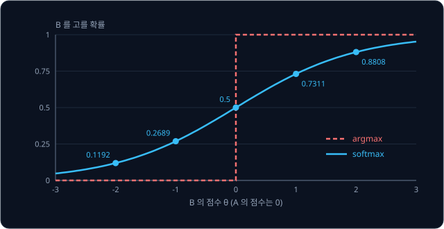

위 그림은 같은 점수로 $\arg\max$ policy 와 softmax policy 가 B 를 고를 확률을 겹쳐 그린 것이다. $\arg\max$ 는 $\theta = 0$ 에서 계단처럼
뛰지만, softmax 는 $\theta$ 를 조금 바꾸면 확률도 조금 바뀐다. 이렇게 매끄럽게 변해야 "$\theta$ 를 어느 쪽으로 고치면 좋아지는가" 를
gradient 로 계산할 수 있다.

로봇에서는 state 마다 확률이 달라야 하므로 $\pi_\theta(a \mid s)$ 로 쓰고 "state $s$ 에서 action $a$ 를 고를 확률" 이라고 읽는다. 막대를
세운 수레를 좌우로 밀어 막대가 쓰러지지 않게 하는 문제라면, 수레 위치·수레 속도·막대 각도·막대가 넘어가는 속도의 네 숫자가 state 다.
neural network 가 이 네 숫자를 받아 "왼쪽으로 밀기" 와 "오른쪽으로 밀기" 의 점수 두 개를 내고, softmax 가 그 점수를 확률로 바꾼다. 이때
$\theta$ 는 network 안의 숫자 전부다. 두 기계 문제는 state 가 하나뿐이라 $\pi_\theta(a)$ 로 줄여 쓴다.

**확인 문제.** $\theta = 3$ 이면 $\pi_\theta(B)$ 는? ($e^3 \approx 20.09$)

답 보기

$20.09 \div (1 + 20.09) = 20.09 \div 21.09 \approx 0.953$ 이다. A 는 $1 \div 21.09 \approx 0.047$ 이다.

### 확률로 action 뽑기

policy 가 $\pi_\theta(B) = 0.7311$ 을 냈다면, 실제로 고를 때는 0 과 1 사이의 수를 모든 값이 똑같이 잘 나오도록 하나 뽑는다. 이런
수를 난수라 하고 $u$ 로 쓴다. $u$ 가 0.7311 보다 작으면 B, 아니면 A 를 고른다. $u = 0.42$ 이면 B, $u = 0.85$ 이면 A 다. 0 부터
0.7311 까지의 구간은 전체 길이 1 가운데 0.7311 을 차지하므로, 이렇게 고르면 B 가 골라질 확률이 정확히 0.7311 이 된다.

action 이 셋이면 구간을 셋으로 나눈다. 확률이 $[0.5761, 0.2119, 0.2119]$ 이면 0 부터 0.5761 까지는 첫째, 0.5761 부터 0.788 까지는
둘째, 나머지는 셋째 action 이다.

softmax policy 는 확률이 가장 큰 action 만 고르지 않으므로 다른 action 도 가끔 해 본다. [Bandits & MDPs](../bandit-mdp/README.md)
에서는 추정값이 가장 큰 쪽을 고르는 greedy 선택에 무작위 선택을 섞는 ε-greedy 로 이런 exploration(정보를 얻으려고 덜 확실한 action 을 해 보는 것)을 따로 넣었지만,
확률로 고르는 policy 에서는 exploration 이 policy 안에 들어 있다.

**확인 문제.** 확률이 $[0.5761, 0.2119, 0.2119]$ 인 policy 에서 난수가 $u = 0.7$ 이면 몇 번째 action 을 고를까?

답 보기

0.7 은 0.5761 과 0.788 사이에 있으므로 둘째 action 이다.

**요약**

- action 마다 아무 숫자나 될 수 있는 점수(logit)를 두고, softmax $\pi(a) = e^{z_a} / \sum_b e^{z_b}$ 로 합이 1 인 확률을 만든다
- 확률은 점수끼리의 차이로 정해져서, 두 기계 문제는 A 의 점수를 0 으로 고정하고 B 의 점수 $\theta$ 하나로 $\pi_\theta(B) = \sigma(\theta)$ 를 쓴다
- action 은 난수로 확률에 맞춰 뽑으므로 exploration 이 policy 안에 들어 있다

## 기대 reward 와 그 gradient

### 기대 reward J(θ)

policy 가 좋은지 나쁜지는 그 policy 로 레버를 당길 때 한 번에 평균적으로 받는 reward, 곧 reward 의 기댓값으로 잰다. 이 값을
$J(\theta)$ 로 쓴다. 기댓값은 "값 × 확률" 을 더한 것이고, 여기서 확률은 policy 가 기계를 고를 확률과 기계가 동전을 주는 확률이 함께
들어간다. 기계마다의 기댓값 $q_*$ 를 쓰면 한 줄로 정리된다.

$$
J(\theta) = \pi_\theta(A)\, q_*(A) + \pi_\theta(B)\, q_*(B)
$$

이 식은 "A 를 고를 확률에 A 의 기댓값을 곱하고, B 를 고를 확률에 B 의 기댓값을 곱해 더한다" 로 읽는다. $\theta = 0$ 이면
$0.5 \times 1 + 0.5 \times 2 = 1.5$ 다. $\theta = 1$ 이면 $0.2689 \times 1 + 0.7311 \times 2 = 1.7311$ 이다.

| $\theta$ | $-2$ | $-1$ | $0$ | $1$ | $2$ |
| --- | --- | --- | --- | --- | --- |
| $\pi_\theta(B)$ | 0.1192 | 0.2689 | 0.5 | 0.7311 | 0.8808 |
| $J(\theta)$ | 1.1192 | 1.2689 | 1.5 | 1.7311 | 1.8808 |

$\pi_\theta(A) = 1 - \pi_\theta(B)$ 이므로 $J(\theta) = (1 - \pi_\theta(B)) \times 1 + \pi_\theta(B) \times 2 = 1 + \pi_\theta(B)$ 로
간단해진다. 표의 $J$ 가 언제나 $\pi_\theta(B)$ 보다 1 큰 것이 그 때문이다.

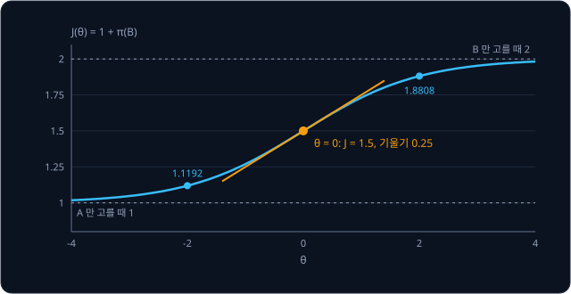

위 그림은 $J(\theta)$ 의 그래프다. $\theta$ 가 커질수록 B 를 더 자주 골라 $J$ 가 B 의 기댓값 2 에 다가가고, $\theta$ 가 작아질수록
A 의 기댓값 1 에 다가간다. 학습의 목표는 이 곡선을 따라 $J$ 가 커지는 쪽으로 $\theta$ 를 옮기는 것이다.

loss(모델이 얼마나 틀렸는지 나타낸 숫자)는 작을수록 좋아서 줄이는 쪽으로
parameter 를 고친다. $J$ 는 반대로
클수록 좋은 값이라서 키우는 쪽으로 고친다. 기댓값을 $\mathbb E[\cdot]$ 로 쓰면 $J(\theta) = \mathbb E_{a \sim \pi_\theta}[r]$ 로도
적는데, 아래첨자 $a \sim \pi_\theta$ 는 "action $a$ 를 $\pi_\theta$ 의 확률로 뽑을 때" 라는 뜻이다. 식 전체는 "policy $\pi_\theta$ 로
기계를 골랐을 때 받는 reward $r$ 의 기댓값" 으로 읽는다.

**확인 문제.** $\pi_\theta(B) = 0.8$ 이면 $J(\theta)$ 는?

답 보기

$0.2 \times 1 + 0.8 \times 2 = 0.2 + 1.6 = 1.8$ 이다. $1 + \pi_\theta(B) = 1.8$ 로도 같다.

### gradient ascent

$J$ 가 커지는 방향은 $\theta$ 를 조금 바꿔 보면 안다. $\theta = 0$ 에서 0.01 늘리면 $\pi_\theta(B) = 0.5025$, $J = 1.5025$ 라서 $J$ 가
0.0025 늘었다. 늘린 양 0.01 로 나눈 비율은 $0.0025 \div 0.01 = 0.25$ 다. 이 비율이 $\theta = 0$ 에서 $J$ 의 gradient 이고
$\nabla_\theta J$ 로 쓴다. $\nabla$ 는 nabla(나블라)라고 읽으며, 아래첨자 $\theta$ 는 "$\theta$ 를 바꿀 때의 비율" 이라는 뜻이다.
parameter 가 $\theta$ 하나뿐이라 gradient 도 숫자 하나다.

gradient 가 양수이면 $\theta$ 를 늘릴 때 $J$ 가 커지므로 $\theta$ 를 늘리고, 음수이면 줄인다. 그래서 gradient 를 그대로 더한다.

$$
\theta \leftarrow \theta + \eta\, \nabla_\theta J(\theta)
$$

$\leftarrow$ 는 "왼쪽 값을 오른쪽에서 계산한 값으로 바꿔 적는다" 는 뜻이고, $\eta$ 는 그리스 문자 eta(에타)로 한 번에 고치는 크기인
learning rate 다. 식은 "gradient 에 learning rate 를 곱해 $\theta$ 에 더한다" 로 읽는다. gradient descent 는
loss 를 줄이려고 gradient 를 빼고, 여기서는 $J$ 를 키우려고 더한다. 그래서 이름도 descent(내려감) 대신 gradient ascent(올라감)다.

$\eta = 1$ 로 네 번 고치면 아래와 같다.

| 횟수 | $\theta$ | $\pi_\theta(B)$ | $J$ | $\nabla_\theta J$ | 새 $\theta$ |
| --- | --- | --- | --- | --- | --- |
| 1 | 0 | 0.5 | 1.5 | 0.25 | 0.25 |
| 2 | 0.25 | 0.5622 | 1.5622 | 0.2461 | 0.4961 |
| 3 | 0.4961 | 0.6216 | 1.6216 | 0.2352 | 0.7314 |
| 4 | 0.7314 | 0.6751 | 1.6751 | 0.2193 | 0.9507 |

고칠 때마다 B 를 고를 확률과 $J$ 가 함께 오른다.

**확인 문제.** $\theta = 1$ 에서 $\nabla_\theta J = 0.1966$ 이고 $\eta = 2$ 이면 새 $\theta$ 는?

답 보기

$1 + 2 \times 0.1966 = 1.3932$ 다. gradient 가 양수이므로 $\theta$ 가 커졌다.

### J 의 gradient 공식

gradient 를 공식으로 구해 본다. $J = 1 + \pi_\theta(B)$ 이고 $\pi_\theta(B) = \sigma(\theta)$ 이므로, $J$ 의 gradient 는 sigmoid 의
기울기와 같다. sigmoid 의 기울기는 $\sigma(\theta)(1 - \sigma(\theta))$ 다.

$$
\nabla_\theta \pi_\theta(B) = \pi_\theta(B)\,\big(1 - \pi_\theta(B)\big) = \pi_\theta(B)\, \pi_\theta(A)
$$

$1 - \pi_\theta(B)$ 가 $\pi_\theta(A)$ 와 같아서 오른쪽처럼 쓸 수도 있다. $\theta = 0$ 이면 $0.5 \times 0.5 = 0.25$ 로, 0.01 늘려 잰 값과
같다. A 의 확률은 B 가 오른 만큼 내려가므로 $\nabla_\theta \pi_\theta(A) = -\pi_\theta(B)\,\pi_\theta(A)$ 다.

기계의 기댓값을 기호로 남겨 두고 정리하면 아래와 같다.

1. $J = \pi_\theta(A)\, q_*(A) + \pi_\theta(B)\, q_*(B)$ 다
2. $q_*$ 는 $\theta$ 와 상관없는 고정된 수라서, 각 확률의 gradient 에 그대로 곱해진다
3. $\nabla_\theta J = -\pi_\theta(A)\pi_\theta(B)\, q_*(A) + \pi_\theta(A)\pi_\theta(B)\, q_*(B)$ 다
4. 공통인 $\pi_\theta(A)\pi_\theta(B)$ 로 묶으면 $\nabla_\theta J = \pi_\theta(A)\pi_\theta(B)\,\big(q_*(B) - q_*(A)\big)$ 다

$\theta = 0$ 이면 $0.25 \times (2 - 1) = 0.25$ 이고, $\theta = 2$ 이면 $0.1192 \times 0.8808 \times 1 \approx 0.105$ 다. 식을 보면
$q_*(B) > q_*(A)$ 인 한 gradient 는 언제나 양수라서 $\theta$ 를 늘리라고 한다. B 가 더 좋은 기계라는 사실이 그대로 담겨 있다.

**확인 문제.** 기계 A 의 기댓값이 3 으로 바뀌었다면($q_*(A) = 3$, $q_*(B) = 2$) $\theta = 0$ 에서 $\nabla_\theta J$ 는? $\theta$ 를 어느
쪽으로 고치게 될까?

답 보기

$0.25 \times (2 - 3) = -0.25$ 다. 음수이므로 $\theta$ 를 줄여 A 를 더 자주 고르게 된다.

### q 를 모를 때의 문제

위의 공식에는 $q_*(A)$ 와 $q_*(B)$ 가 들어 있다. 하지만 agent 는 이 값을 모른다. agent 가 아는 것은 "B 를 골랐더니 4 개를 받았다"
처럼 직접 해 본 결과 하나하나뿐이고, 이렇게 실제로 해 보고 얻은 결과를 sample 이라고 한다.

$q_*$ 를 먼저 추정해서 공식에 넣으면 value-based 방법으로 돌아간다. 원하는 것은 sample 하나에서 바로 계산할 수 있고, 여러 sample 에서
평균을 내면 $\nabla_\theta J$ 가 되는 값이다. sample 의 평균은 횟수가 늘수록
기댓값에 다가가므로, $\nabla_\theta J$ 를 "무언가의 기댓값" 꼴로 바꿔 쓸 수 있으면 sample 평균으로 추정할 수 있다.

여러 칸을 옮겨 다니는 문제에서는 한 episode(시작부터 끝까지의 행동 기록)가 나올 확률에 바닥이 얼마나 미끄러운지 같은
environment(agent 가 행동하는 대상 세계)의 이동 확률도 들어가는데, agent 는 이것도 모른다. 두 문제 모두 확률에 로그를 씌워
계산하면 풀 수 있어서, 먼저 로그를 알아본다.

**확인 문제.** agent 가 B 를 두 번 당겨 4 개와 4 개를 받았다. 이 두 sample 만으로 $q_*(B) = 2$ 를 알 수 있을까?

답 보기

알 수 없다. 두 sample 의 평균은 4 라서 진짜 기댓값 2 와 크게 다르다. sample 이 적으면 운이 섞인다.

**요약**

- 기대 reward $J(\theta)$ 는 policy 로 받는 reward 의 기댓값이고, 두 기계 문제에서는 $J = 1 + \pi_\theta(B)$ 다
- gradient ascent $\theta \leftarrow \theta + \eta\,\nabla_\theta J$ 로 $J$ 를 키우며, 공식 $\nabla_\theta J = \pi_\theta(A)\pi_\theta(B)(q_*(B) - q_*(A))$ 는 $\theta = 0$ 에서 0.25 다
- 이 공식에는 agent 가 모르는 $q_*$ 가 들어 있어서, sample 로 계산할 수 있는 꼴로 바꿔야 한다

## log-probability

### 로그

$\ln x$ 는 "$e$ 를 몇 번 곱해야 $x$ 가 되는가" 를 나타내고,
natural log(자연로그)라고 읽는다. $e^2 \approx 7.389$ 이므로 $\ln 7.389 \approx 2$ 이고, $e^0 = 1$ 이므로 $\ln 1 = 0$ 이다. 지수 함수를
거꾸로 푸는 함수라서 $\ln(e^z) = z$ 다.

1 보다 작은 수의 $\ln$ 은 음수다. $e^{-1} \approx 0.368$ 이므로 $\ln 0.368 \approx -1$ 이다. 확률은 0 과 1 사이라서 확률에 $\ln$ 을
씌우면 0 이하의 값이 나온다. 확률에 $\ln$ 을 씌운 값을 log-probability 라고 한다.

| 확률 $p$ | 1 | 0.8 | 0.5 | 0.25 | 0.1 |
| --- | --- | --- | --- | --- | --- |
| $\ln p$ | 0 | $-0.2231$ | $-0.6931$ | $-1.3863$ | $-2.3026$ |

확률이 작을수록 log-probability 는 더 큰 음수가 된다. 확률 1 은 0 이고, 확률이 0 에 가까워지면 끝없이 작아진다.

**확인 문제.** $e^{-2} \approx 0.135$ 다. $\ln 0.135$ 는 얼마일까?

답 보기

$e$ 를 $-2$ 번 곱한 것이 0.135 이므로 $\ln 0.135 \approx -2$ 다.

### 곱을 합으로 바꾸는 성질

동전을 두 번 던져 두 번 모두 앞면이 나올 확률은 앞앞·앞뒤·뒤앞·뒤뒤의 네 경우 가운데 하나라서 $\frac{1}{4} = 0.25$ 다. 이 값은 한 번
앞면이 나올 확률 0.5 를 두 번 곱한 $0.5 \times 0.5$ 와 같다. 앞의 결과가 뒤의 결과에 영향을 주지 않는 일이 연달아 일어날 확률은 각
확률을 곱해 구한다.

$\ln$ 은 이 곱을 덧셈으로 바꾼다.

$$
\ln(p \times q) = \ln p + \ln q
$$

$e^2 \times e^3$ 은 $e$ 를 2 번 곱하고 이어서 3 번 더 곱한 것이라 $e^5$ 다. 곱하는 횟수끼리 더해지므로, "몇 번 곱했나" 를 세는 $\ln$
에서는 곱이 합이 된다. 숫자로 확인하면 $\ln(0.5 \times 0.5) = \ln 0.25 = -1.3863$ 이고, $\ln 0.5 + \ln 0.5 = -0.6931 - 0.6931 = -1.3862$
로 반올림 차이만 빼면 같다. 숫자만 바꿔 $\ln(0.6 \times 0.8) = \ln 0.48 = -0.7340$ 이고 $\ln 0.6 + \ln 0.8 = -0.5108 - 0.2231 = -0.7339$ 다.

episode 하나가 나올 확률은 step 마다의 확률을 수십, 수백 개 곱한 값이다. 합의 변화 비율은 항마다의 변화 비율을 더하기만 하면 되므로
곱보다 합이 미분하기 쉽고, 그래서 확률을 다룰 때는 $\ln$ 을 씌운 값으로 계산하는 경우가 많다.

**확인 문제.** $\ln 0.5 = -0.6931$ 을 써서 $\ln 0.125$ 를 구해 보자. ($0.125 = 0.5 \times 0.5 \times 0.5$)

답 보기

$\ln 0.5 + \ln 0.5 + \ln 0.5 = 3 \times (-0.6931) = -2.0793$ 이다.

### 로그의 기울기

$\ln x$ 가 $x$ 를 조금 바꿨을 때 얼마나 변하는지 잰다. 늘리는 양은 0.01 이다.

| $x$ | $\ln x$ | $\ln(x + 0.01)$ | 변화 ÷ 0.01 | $1 \div x$ |
| --- | --- | --- | --- | --- |
| 2 | 0.69315 | 0.69813 | 0.4988 | 0.5 |
| 0.5 | $-0.69315$ | $-0.67334$ | 1.9803 | 2 |
| 0.25 | $-1.38629$ | $-1.34707$ | 3.9221 | 4 |

비율이 $1 \div x$ 에 가깝고, 늘리는 양을 더 줄이면 정확히 $1 \div x$ 에 다가간다. 그래서 $\ln x$ 의 derivative(아주 조금 바꿨을 때의
변화 비율)는 $\frac{1}{x}$ 다.

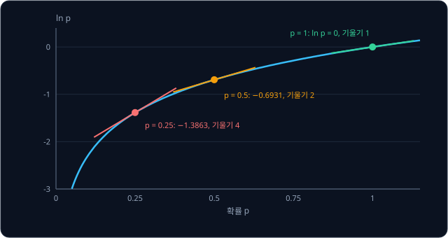

위 그림은 확률 $p$ 의 $\ln p$ 곡선에 세 점의 접선(곡선에 한 점에서만 닿는 직선)을 그린 것이다. $p$ 가 작을수록 곡선이 가팔라서,
확률이 작을 때는 확률을 조금만 올려도 log-probability 가 크게 오른다. 확률 0.25 를 0.26 으로 올리면 log-probability 는 약 0.039 오르지만,
확률 0.9 를 0.91 로 올리면 약 0.011 만 오른다.

**확인 문제.** $\ln x$ 의 $x = 0.1$ 에서의 기울기는?

답 보기

$1 \div 0.1 = 10$ 이다. 확률 0.1 에서는 확률을 0.001 만 올려도 log-probability 가 약 0.01 오른다.

### log-probability 의 gradient

이제 parameter $\theta$ 를 바꿀 때 log-probability $\ln \pi_\theta(B)$ 가 변하는 비율을 구한다. $\theta$ 가 바뀌면 먼저 $\pi_\theta(B)$
가 바뀌고, 그 확률이 바뀌어 $\ln$ 이 바뀐다. 이렇게 두 칸을 거치는 변화는
chain rule 에 따라 칸마다의 비율을 곱해 구한다.

- **$\theta$ → $\pi_\theta(B)$** — 비율은 앞에서 구한 $\pi_\theta(B)\,(1 - \pi_\theta(B))$ 다
- **$\pi_\theta(B)$ → $\ln \pi_\theta(B)$** — 비율은 $\ln$ 의 기울기 $\frac{1}{\pi_\theta(B)}$ 다

두 비율을 곱하면 $\pi_\theta(B)$ 가 약분된다.

$$
\nabla_\theta \ln \pi_\theta(B) = \frac{1}{\pi_\theta(B)} \times \pi_\theta(B)\,\big(1 - \pi_\theta(B)\big) = 1 - \pi_\theta(B)
$$

A 도 같은 방법이다. $\nabla_\theta \pi_\theta(A) = -\pi_\theta(A)\pi_\theta(B)$ 에 $\frac{1}{\pi_\theta(A)}$ 를 곱하면
$\nabla_\theta \ln \pi_\theta(A) = -\pi_\theta(B)$ 다.

$\theta = 0$ 에서 숫자로 확인한다. $\theta$ 를 0.01 늘리면 $\pi_\theta(B)$ 는 0.5 에서 0.5025 가 되어 $\ln$ 은 $-0.69315$ 에서
$-0.68816$ 으로 0.00499 늘고, 비율은 0.4988 로 공식의 $1 - 0.5 = 0.5$ 와 거의 같다. 같은 때 $\ln \pi_\theta(A)$ 의 비율은 $-0.5012$ 로
공식의 $-0.5$ 와 거의 같다.

| $\theta$ | $\pi_\theta(B)$ | $\nabla_\theta \ln \pi_\theta(B) = 1 - \pi_\theta(B)$ | $\nabla_\theta \ln \pi_\theta(A) = -\pi_\theta(B)$ |
| --- | --- | --- | --- |
| 0 | 0.5 | $+0.5$ | $-0.5$ |
| 2 | 0.8808 | $+0.1192$ | $-0.8808$ |

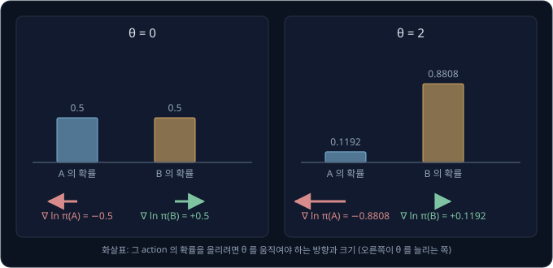

위 그림처럼 $\nabla_\theta \ln \pi_\theta(a)$ 의 부호는 "action $a$ 를 더 자주 고르게 하려면 $\theta$ 를 어느 쪽으로 움직여야 하는가"
를 알려 준다. B 의 확률은 $\theta$ 를 늘려야 오르고, A 의 확률은 $\theta$ 를 줄여야 오른다. 크기는 그 action 의 확률이 작을수록 크다.
$\theta = 2$ 에서 확률이 이미 0.8808 인 B 의 gradient 는 0.1192 로 작고, 확률이 0.1192 뿐인 A 의 gradient 는 $-0.8808$ 로 크다.

action 이 셋 이상이고 점수가 action 마다 따로 있으면, 고른 action $a$ 의 log-probability 를 점수 $z_b$ 로 미분한 값은 $b$ 가 $a$ 와
같을 때 $1 - \pi(b)$, 다를 때 $-\pi(b)$ 다. 점수 $[1, 0, 0]$, 확률 $[0.5761, 0.2119, 0.2119]$ 에서 첫째 action 을 골랐다면
$(0.4239, -0.2119, -0.2119)$ 로, 고른 action 의 점수는 올리고 나머지 점수는 그 확률만큼 내린다. 두 기계 문제에서 A 의 점수를 0 으로
고정하고 $\theta = z_B$ 만 두면 B 를 골랐을 때 $1 - \pi_\theta(B)$, A 를 골랐을 때 $-\pi_\theta(B)$ 로 위의 결과와 같다.

**흔한 오해.** "확률이 큰 action 일수록 크게 올려야 한다" 고 생각하기 쉽다. 그런데 $1 - \pi$ 는 확률이 1 에 가까울수록 0 에 가깝다.
이미 자주 고르는 action 은 더 올릴 여지가 적고, 드물게 고르는 action 을 골랐을 때 오히려 크게 움직인다.

**확인 문제.** $\pi_\theta(B) = 0.8$ 이다. B 를 골랐을 때와 A 를 골랐을 때의 $\nabla_\theta \ln \pi_\theta(a)$ 는?

답 보기

B 는 $1 - 0.8 = 0.2$, A 는 $-0.8$ 이다. 확률이 작은 A 쪽이 크기가 4 배 크다.

**요약**

- $\ln x$ 는 $e$ 를 몇 번 곱해야 $x$ 가 되는지이고, 곱을 합으로 바꾸며($\ln(pq) = \ln p + \ln q$), 기울기는 $\frac{1}{x}$ 다
- 두 기계 policy 에서 $\nabla_\theta \ln \pi_\theta(B) = 1 - \pi_\theta(B)$, $\nabla_\theta \ln \pi_\theta(A) = -\pi_\theta(B)$ 다
- 이 gradient 는 그 action 을 더 자주 고르게 하는 방향이고, 확률이 작은 action 일수록 크다

## log-derivative trick

### 확률의 gradient 와 log-probability 의 gradient

앞 절의 계산은 $\nabla_\theta \ln \pi_\theta(a) = \frac{1}{\pi_\theta(a)} \nabla_\theta \pi_\theta(a)$ 였다. 양쪽에 $\pi_\theta(a)$ 를 곱하면
아래 관계가 나온다.

$$
\nabla_\theta \pi_\theta(a) = \pi_\theta(a)\, \nabla_\theta \ln \pi_\theta(a)
$$

이 식은 "확률의 gradient 는 확률 × log-probability 의 gradient 와 같다" 로 읽는다. $\theta = 0$ 의 B 로 확인하면 왼쪽은
$\nabla_\theta \pi_\theta(B) = 0.25$, 오른쪽은 $0.5 \times 0.5 = 0.25$ 다. $\theta = 2$ 이면 왼쪽은 $0.8808 \times 0.1192 \approx 0.105$,
오른쪽은 $0.8808 \times 0.1192 \approx 0.105$ 로 같다.

이 바꿔 쓰기를 log-derivative trick 이라고 한다. derivative 를 log 의 derivative 로 바꾼다는 뜻이다. 식 자체는 당연해 보이지만, gradient
식 안의 확률 하나를 밖으로 꺼내 "확률 × 무언가" 꼴로 만든다는 점이 쓸모 있다. 확률을 곱해 더한 것은 바로 기댓값이기 때문이다.

**확인 문제.** $\pi_\theta(A) = 0.25$ 이고 $\nabla_\theta \ln \pi_\theta(A) = -0.75$ 이면 $\nabla_\theta \pi_\theta(A)$ 는?

답 보기

$0.25 \times (-0.75) = -0.1875$ 다. 두 기계 policy 라면 $-\pi_\theta(A)\pi_\theta(B) = -0.25 \times 0.75 = -0.1875$ 로 같다.

### 기댓값 꼴의 gradient

$J = \sum_a \pi_\theta(a)\, q_*(a)$ 의 gradient 에 이 식을 넣는다. 한 줄에 한 단계씩 바꾼다.

$$
\begin{aligned}
\nabla_\theta J &= \sum_a q_*(a)\, \nabla_\theta \pi_\theta(a) \\
&= \sum_a q_*(a)\, \pi_\theta(a)\, \nabla_\theta \ln \pi_\theta(a) \\
&= \sum_a \pi_\theta(a)\, \big[\, q_*(a)\, \nabla_\theta \ln \pi_\theta(a) \,\big] \\
&= \mathbb E_{a \sim \pi_\theta}\big[\, q_*(a)\, \nabla_\theta \ln \pi_\theta(a) \,\big]
\end{aligned}
$$

첫 줄은 $q_*$ 가 고정된 수라서 확률의 gradient 에만 곱해진다는 뜻이다. 둘째 줄에서 log-derivative trick 을 썼고, 셋째 줄은 곱하는 순서만
바꿔 $\pi_\theta(a)$ 를 앞으로 꺼냈다. 넷째 줄은 "확률 × 값" 을 모두 더한 것이 기댓값이라는 정의를 그대로 쓴 것이다. 결과는 "policy 로
action 을 뽑을 때, 그 action 의 기댓값 × 그 action 의 log-probability gradient 의 기댓값" 으로 읽는다.

$\theta = 0$ 에서 숫자로 확인한다.

| action $a$ | $\pi_\theta(a)$ | $q_*(a)$ | $\nabla_\theta \ln \pi_\theta(a)$ | $q_*(a) \times \nabla$ | $\pi_\theta(a) \times$ 앞 열 |
| --- | --- | --- | --- | --- | --- |
| A | 0.5 | 1 | $-0.5$ | $-0.5$ | $-0.25$ |
| B | 0.5 | 2 | $+0.5$ | $+1$ | $+0.5$ |
| 합 | | | | | $0.25$ |

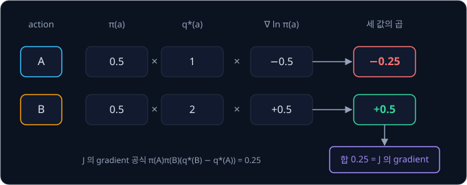

합 0.25 는 공식 $\pi_\theta(A)\pi_\theta(B)(q_*(B) - q_*(A)) = 0.25$ 와 같다. 숫자만 바꿔 $\theta = 2$ 이면 A 는
$0.1192 \times 1 \times (-0.8808) \approx -0.105$, B 는 $0.8808 \times 2 \times 0.1192 \approx 0.210$ 이고, 더하면 0.105 로 공식의 값과 같다.

**확인 문제.** $\theta = 0$ 이고 기계의 기댓값이 $q_*(A) = 3$, $q_*(B) = 2$ 라면 표의 마지막 열과 합은?

답 보기

A 는 $0.5 \times 3 \times (-0.5) = -0.75$, B 는 $0.5 \times 2 \times 0.5 = 0.5$ 이고 합은 $-0.25$ 다. 공식
$0.25 \times (2 - 3) = -0.25$ 와 같다.

### sample 하나로 낸 추정

기댓값 꼴이 되었으니 sample 로 추정할 수 있다. policy 로 action $a$ 를 뽑아 레버를 당기고, 받은 reward $r$ 로 아래 값을 계산한다.

$$
\hat g = r\, \nabla_\theta \ln \pi_\theta(a)
$$

$\hat g$ 는 "지 햇" 이라고 읽고 gradient 의 추정값이다. 모자(hat)는 예측값 $\hat y$ 처럼 "추정한 값" 이라는 표시다. 식에서
$q_*(a)$ 자리에 실제로 받은 $r$ 을 넣었는데, 같은 action 을 여러 번 하면 $r$ 의 평균이 $q_*(a)$ 가 되므로 $\hat g$ 의 평균도
$\nabla_\theta J$ 가 된다.

$\theta = 0$ 에서 일어날 수 있는 경우는 세 가지다.

| 경우 | 확률 | $r$ | $\nabla_\theta \ln \pi_\theta(a)$ | $\hat g$ |
| --- | --- | --- | --- | --- |
| A 를 고름 | 0.5 | 1 | $-0.5$ | $-0.5$ |
| B 를 골라 4 개 | $0.5 \times 0.5 = 0.25$ | 4 | $+0.5$ | $+2$ |
| B 를 골라 0 개 | $0.5 \times 0.5 = 0.25$ | 0 | $+0.5$ | $0$ |

$\hat g$ 의 기댓값은 $0.5 \times (-0.5) + 0.25 \times 2 + 0.25 \times 0 = -0.25 + 0.5 + 0 = 0.25$ 로 진짜 gradient 와 같다. 이렇게
추정값의 기댓값이 참값과 같은 추정을 unbiased(치우침 없는) 추정이라고 한다. $\hat g$ 는 agent 가 고른 action, 받은 reward, 그리고 자기
policy 만으로 계산하므로 $q_*$ 를 몰라도 된다.

**확인 문제.** $\theta = 2$ 에서 A 를 골라 1 개를 받았다. $\hat g$ 는?

답 보기

$\nabla_\theta \ln \pi_\theta(A) = -0.8808$ 이므로 $\hat g = 1 \times (-0.8808) = -0.8808$ 이다.

**요약**

- log-derivative trick $\nabla_\theta \pi_\theta(a) = \pi_\theta(a)\,\nabla_\theta \ln \pi_\theta(a)$ 로 gradient 를 기댓값 꼴 $\mathbb E[q_*(a)\,\nabla_\theta \ln \pi_\theta(a)]$ 로 바꾼다
- $q_*(a)$ 대신 받은 reward 를 넣은 $\hat g = r\,\nabla_\theta \ln \pi_\theta(a)$ 는 sample 하나로 계산되고, 평균이 진짜 gradient 와 같은 unbiased 추정이다
- $\theta = 0$ 에서 $\hat g$ 는 $-0.5$, $2$, $0$ 가운데 하나이고 기댓값은 0.25 다

## REINFORCE

### update 식

$\hat g$ 를 gradient ascent 에 넣으면 sample 하나마다 아래처럼 고친다.

$$
\theta \leftarrow \theta + \eta\, r\, \nabla_\theta \ln \pi_\theta(a)
$$

식은 "고른 action 의 log-probability gradient 에 받은 reward 와 learning rate 를 곱해 $\theta$ 에 더한다" 로 읽는다. reward 가 클수록
고른 action 의 확률을 크게 올리고, reward 가 0 이면 그대로 둔다.

이 방법은 1992년 Ronald Williams 가 REINFORCE 라는 이름으로 정리했다. 이름은 "REward Increment = Nonnegative Factor × Offset
Reinforcement × Characteristic Eligibility" 의 머리글자로, parameter 를 고치는 양(reward increment)이 learning rate(nonnegative
factor), 기준값을 뺀 reward(offset reinforcement), log-probability gradient(characteristic eligibility) 세 가지의 곱이라는 뜻이다.
위 식의 $\eta$, $r$, $\nabla_\theta \ln \pi_\theta(a)$ 가 차례로 그 셋이고, 여기서는 기준값을 0 으로 두었다.

**확인 문제.** $\theta = 0$, $\eta = 0.1$ 에서 A 를 골라 1 개를 받았다. 새 $\theta$ 와 $\pi_\theta(B)$ 는? ($e^{-0.05} \approx 0.9512$)

답 보기

$\theta = 0 + 0.1 \times 1 \times (-0.5) = -0.05$ 다. $\pi_\theta(B) = \frac{1}{1 + e^{0.05}} = \frac{1}{1 + 1.0513} \approx 0.4875$ 로
B 의 확률이 조금 내려갔다. ($e^{0.05} = 1 \div 0.9512 \approx 1.0513$)

### step 별 확률 변화

$\theta = 0$, $\eta = 0.1$ 에서 시작해 여덟 번 당긴다. 앞 강의처럼 action 을 한 번 하고 결과를 받는 것을 step 이라 하는데, 여기서는
레버를 한 번 당기고 곧바로 $\theta$ 를 한 번 고친다. step 마다 난수 $u$ 를 뽑아 $u < \pi_\theta(B)$ 이면 B 를 고르고, B 를 고르면 동전을
던져 앞면이면 4 개, 뒷면이면 0 개를 받는다. 난수와 동전이 아래처럼 나왔다고 하자.

| step | $\theta$ | $\pi_\theta(B)$ | $u$ | action | $r$ | $\nabla_\theta \ln \pi_\theta(a)$ | $\eta\, r\, \nabla$ | 새 $\theta$ |
| --- | --- | --- | --- | --- | --- | --- | --- | --- |
| 1 | 0 | 0.5 | 0.31 | B | 4 | $+0.5$ | $+0.2$ | 0.2 |
| 2 | 0.2 | 0.5498 | 0.83 | A | 1 | $-0.5498$ | $-0.0550$ | 0.1450 |
| 3 | 0.1450 | 0.5362 | 0.12 | B | 0 | $+0.4638$ | $0$ | 0.1450 |
| 4 | 0.1450 | 0.5362 | 0.47 | B | 4 | $+0.4638$ | $+0.1855$ | 0.3305 |
| 5 | 0.3305 | 0.5819 | 0.66 | A | 1 | $-0.5819$ | $-0.0582$ | 0.2723 |
| 6 | 0.2723 | 0.5677 | 0.25 | B | 4 | $+0.4323$ | $+0.1729$ | 0.4452 |
| 7 | 0.4452 | 0.6095 | 0.58 | B | 0 | $+0.3905$ | $0$ | 0.4452 |
| 8 | 0.4452 | 0.6095 | 0.09 | B | 4 | $+0.3905$ | $+0.1562$ | 0.6014 |

step 1 을 따라가 본다. $u = 0.31$ 이 0.5 보다 작아 B 를 골랐고 동전이 앞면이라 4 개를 받았다. B 의 log-probability gradient 는
$1 - 0.5 = 0.5$ 라서 $0.1 \times 4 \times 0.5 = 0.2$ 를 더해 $\theta = 0.2$, $\pi_\theta(B) = 0.5498$ 이 된다. step 2 는 $u = 0.83$ 이
0.5498 보다 커서 A 를 골랐고, A 의 gradient $-0.5498$ 에 $0.1 \times 1$ 을 곱한 $-0.0550$ 만큼 $\theta$ 가 줄었다.

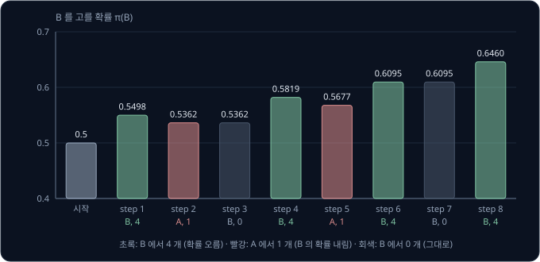

위 그림은 step 마다 B 를 고를 확률을 막대로 그린 것이다. 확률이 바뀌는 규칙은 세 가지다.

- **B 를 골라 4 개** — $r = 4$ 가 커서 B 의 확률이 크게 오른다(step 1, 4, 6, 8)
- **A 를 골라 1 개** — $r = 1$ 도 양수라서 A 의 확률이 조금 오르고, 그만큼 B 의 확률이 내려간다(step 2, 5)
- **B 를 골라 0 개** — $r = 0$ 이라 아무것도 바뀌지 않는다(step 3, 7)

여덟 step 뒤 B 를 고를 확률은 0.5 에서 0.6460 으로 올랐다. step 마다 오르기도 내리기도 하지만, $\theta$ 는 평균으로 한 step 에 $\eta \times \nabla_\theta J$
만큼씩, 곧 $J$ 가 커지는 쪽으로 움직인다.

**흔한 오해.** "REINFORCE 는 좋은 action 의 확률만 올린다" 고 생각하기 쉽다. step 2 와 5 에서는 더 나쁜 기계 A 를 골랐는데도 A 의
확률이 올랐다. reward 가 양수이면 고른 action 은 언제나 확률이 오르고, 좋은 action 이 더 많이 오를 뿐이다.

**확인 문제.** step 8 다음 step 9 에서 $\theta = 0.6014$, $\pi_\theta(B) = 0.6460$ 이고 A 를 골라 1 개를 받았다. $\theta$ 는 얼마나
바뀔까?

답 보기

A 의 gradient 는 $-0.6460$ 이라 $0.1 \times 1 \times (-0.6460) = -0.0646$ 만큼 줄어 $\theta = 0.5368$ 이 된다.

### 운이 나쁜 경우

같은 출발점에서 난수와 동전만 바뀌어 아래처럼 나왔다고 하자.

| step | $\theta$ | $\pi_\theta(B)$ | action | $r$ | $\nabla_\theta \ln \pi_\theta(a)$ | $\eta\, r\, \nabla$ | 새 $\theta$ |
| --- | --- | --- | --- | --- | --- | --- | --- |
| 1 | 0 | 0.5 | A | 1 | $-0.5$ | $-0.05$ | $-0.05$ |
| 2 | $-0.05$ | 0.4875 | B | 0 | $+0.5125$ | $0$ | $-0.05$ |
| 3 | $-0.05$ | 0.4875 | A | 1 | $-0.4875$ | $-0.0488$ | $-0.0988$ |
| 4 | $-0.0988$ | 0.4753 | B | 0 | $+0.5247$ | $0$ | $-0.0988$ |
| 5 | $-0.0988$ | 0.4753 | A | 1 | $-0.4753$ | $-0.0475$ | $-0.1463$ |
| 6 | $-0.1463$ | 0.4635 | B | 4 | $+0.5365$ | $+0.2146$ | $0.0683$ |

B 를 고를 때마다 동전이 뒷면이 나와서 다섯 step 동안 B 의 확률이 0.5 에서 0.4635 로 내려갔다. B 가 더 좋은 기계인데도 학습이 거꾸로
간 것이다. step 6 에서 처음 4 개를 받자 한 번에 0.5171 로 돌아왔다. sample 하나로 고치는 학습은 이렇게 운이 나쁜 동안 한참 거꾸로 갈
수 있다.

**확인 문제.** 위 표의 step 2 에서 B 를 골랐는데 $\theta$ 가 바뀌지 않은 이유는?

답 보기

받은 reward 가 0 이라 $\eta \times 0 \times 0.5125 = 0$ 이기 때문이다. REINFORCE 에서는 reward 0 을 받은 action 은 확률이 그대로다.

### loss 로 쓰는 방법

neural network 를 학습시키는 도구는 대부분 loss 를 줄이는 gradient descent 만 한다. 그래서 REINFORCE 를 쓸 때는 부호를 뒤집은 값을
loss 로 둔다.

$$
L = -\,r \ln \pi_\theta(a)
$$

$L$ 의 gradient 는 $-r\,\nabla_\theta \ln \pi_\theta(a)$ 이고, gradient descent 는 $\theta \leftarrow \theta - \eta \nabla_\theta L$ 이므로
$\theta \leftarrow \theta + \eta\, r\, \nabla_\theta \ln \pi_\theta(a)$ 가 되어 REINFORCE 와 같다. 여기서 $r$ 은 이미 받은 고정된 수라서
미분하지 않는다.

step 1 로 확인한다. B 를 골라 4 개를 받았으므로 $L = -4 \times \ln 0.5 = -4 \times (-0.6931) = 2.7726$ 이다. $L$ 의 gradient 는
$-4 \times 0.5 = -2$ 이고, $\theta \leftarrow 0 - 0.1 \times (-2) = 0.2$ 로 표의 step 1 과 같다.

**확인 문제.** A 를 골라 1 개를 받았고 $\pi_\theta(A) = 0.5$ 다. $L$ 은?

답 보기

$L = -1 \times \ln 0.5 = 0.6931$ 이다.

### 모은 데이터를 한 번만 쓰는 이유

$\nabla_\theta J = \mathbb E_{a \sim \pi_\theta}[\cdots]$ 는 지금의 $\pi_\theta$ 로 뽑은 action 에 대한 기댓값이다. 그래서 sample 은 지금
고치려는 그 policy 로 모은 것이어야 한다. 데이터를 모으는 policy 와 배우는 policy 가 같아야 하는 방법을 on-policy 라고 한다.
[Bandits & MDPs](../bandit-mdp/README.md) 의 Q-learning 은 둘이 달라도 되는 off-policy 방법이었다.

$\theta = 0$ 에서 모은 sample 들은 A 와 B 가 반씩 섞여 있다. $\theta$ 를 2 까지 고친 뒤에도 이 sample 들을 그대로 쓰면, A 가 반을
차지하는 데이터로 $\theta = 2$ 의 gradient 를 계산하게 된다. 그 평균은 아래와 같다.

| 경우 | 옛 데이터에서의 비율 | $r$ | $\theta = 2$ 의 $\nabla_\theta \ln \pi_\theta(a)$ | $\hat g$ |
| --- | --- | --- | --- | --- |
| A 를 고름 | 0.5 | 1 | $-0.8808$ | $-0.8808$ |
| B 를 골라 4 개 | 0.25 | 4 | $+0.1192$ | $+0.4768$ |
| B 를 골라 0 개 | 0.25 | 0 | $+0.1192$ | $0$ |

평균은 $0.5 \times (-0.8808) + 0.25 \times 0.4768 = -0.4404 + 0.1192 = -0.3212$ 로 음수다. 진짜 gradient 는 $+0.105$ 인데 부호가
반대로 나왔다. 지금의 policy 라면 A 를 0.1192 의 확률로만 고르는데, 옛 데이터에는 A 가 0.5 나 들어 있어 A 쪽 값이 지나치게 많이
더해졌기 때문이다. 그래서 REINFORCE 는 sample 을 모아 한 번 고치고 나면 그 sample 을 버리고 새로 모은다.

**확인 문제.** 위 표에서 sample 을 $\theta = 2$ 의 policy 로 새로 모았다면 A 를 고른 경우의 비율은 얼마였을까?

답 보기

$\pi_\theta(A) = 0.1192$ 다. 이 비율로 평균하면 $0.1192 \times (-0.8808) + 0.8808 \times 0.5 \times 0.4768 \approx -0.105 + 0.210 = 0.105$
로 진짜 gradient 와 같다.

**요약**

- REINFORCE 는 sample 하나마다 $\theta \leftarrow \theta + \eta\, r\, \nabla_\theta \ln \pi_\theta(a)$ 로 고른 action 의 확률을 reward 만큼 올린다
- reward 가 양수이면 고른 action 은 언제나 확률이 오르고, 운이 나쁘면 몇 step 동안 거꾸로 갈 수도 있다
- 지금 policy 로 모은 sample 만 쓰는 on-policy 방법이라, 한 번 고친 뒤에는 sample 을 새로 모은다

## episode 로의 확장

### trajectory 와 그 확률

슬롯머신은 한 번 당기면 끝나지만 로봇은 여러 step 에 걸쳐 움직이므로, [Bandits & MDPs](../bandit-mdp/README.md) 의 3×3 격자로
돌아간다. 칸 3 은 충전기라 들어가면 reward +1 을 받고 episode 가 끝나고, 칸 5 는 계단이라 들어가면 −1 을 받고 끝난다. 바닥이 미끄러워서
고른 방향으로는 0.8 의 확률로 가고, 고른 방향과 직각인 두 방향으로 0.1 씩 미끄러진다.

episode 하나의 기록 $(s_0, a_0, r_1, s_1, a_1, r_2, \ldots)$ 를 trajectory 라 하고 그리스 문자 tau(타우)로 $\tau$ 라고 쓴다. $r_1$ 은
첫 action $a_0$ 를 한 직후에 받는 reward 로, 앞 강의처럼 reward 의 아래첨자는 action 보다 1 크다. 칸 1 에서 오른쪽으로 두 번 가서
충전기에 닿는 trajectory 가 나올 확률을 구해 본다. policy 는 칸 1 에서 0.6, 칸 2 에서 0.7 의 확률로 오른쪽을 고른다고 하자.

| 순서 | 일어난 일 | 확률 | 정하는 쪽 |
| --- | --- | --- | --- |
| 1 | 칸 1 에서 오른쪽을 고름 | 0.6 | policy |
| 2 | 미끄러지지 않고 칸 2 에 도착 | 0.8 | environment |
| 3 | 칸 2 에서 오른쪽을 고름 | 0.7 | policy |
| 4 | 미끄러지지 않고 칸 3 에 도착 | 0.8 | environment |

네 일이 연달아 일어나야 하므로 확률은 곱해서 $0.6 \times 0.8 \times 0.7 \times 0.8 = 0.2688$ 이다. environment 는 agent 가 행동하는
대상 세계로, 여기서는 미끄러운 바닥이다.

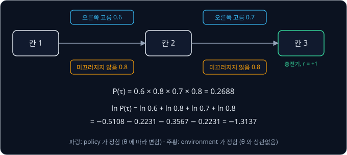

위 그림은 trajectory 의 확률이 policy 의 확률(파랑)과 environment 의 이동 확률(주황)을 번갈아 곱한 값이라는 것을 보여 준다.

**확인 문제.** policy 가 칸 1 에서 0.5, 칸 2 에서 0.9 의 확률로 오른쪽을 고른다면 같은 trajectory 의 확률은?

답 보기

$0.5 \times 0.8 \times 0.9 \times 0.8 = 0.288$ 이다.

### environment 확률이 빠지는 이유

trajectory 의 확률에 $\ln$ 을 씌우면 곱이 합이 된다.

$$
\ln 0.2688 = \ln 0.6 + \ln 0.8 + \ln 0.7 + \ln 0.8 = -0.5108 - 0.2231 - 0.3567 - 0.2231 = -1.3137
$$

$\theta$ 를 바꾸면 policy 의 확률 0.6 과 0.7 은 바뀌지만, 바닥이 미끄러운 정도 0.8 은 $\theta$ 와 아무 상관이 없어 그대로다. $\theta$
를 조금 바꿔 칸 1 의 확률이 0.6 에서 0.65 가 되면 첫째 항은 $\ln 0.65 - \ln 0.6 = 0.0800$ 만큼 바뀌지만, 둘째 항 $\ln 0.8$ 은 바뀌지
않는다. 바뀌지 않는 항의 변화 비율은 0 이므로 gradient 에서 사라진다.

$$
\nabla_\theta \ln P_\theta(\tau) = \nabla_\theta \ln \pi_\theta(a_0 \mid s_0) + \nabla_\theta \ln \pi_\theta(a_1 \mid s_1)
$$

$P_\theta(\tau)$ 는 policy $\pi_\theta$ 로 움직일 때 trajectory $\tau$ 가 나올 확률이다. 식은 "trajectory 확률의 log 의 gradient 는 step
마다 고른 action 의 log-probability gradient 를 더한 것" 으로 읽는다. environment 의 이동 확률은 식에 남지 않아서, agent 는 바닥이 얼마나
미끄러운지 몰라도 이 값을 계산할 수 있다.

두 기계 문제에서 한 log-derivative trick 을 trajectory 에 그대로 쓴다. 키우려는 값은 return(앞으로 받을 reward 를 늦을수록 discount
factor $\gamma$ 를 더 곱해 깎아 더한 값)의 기댓값이다. 앞 강의처럼 $\gamma$ 는 그리스 문자 gamma(감마)이고, 출발부터의 return 을 $G_0$
로 쓴다.

$$
\begin{aligned}
J(\theta) &= \sum_\tau P_\theta(\tau)\, G_0(\tau) \\
\nabla_\theta J &= \sum_\tau P_\theta(\tau)\, \nabla_\theta \ln P_\theta(\tau)\, G_0(\tau) \\
&= \mathbb E_{\tau \sim \pi_\theta}\Big[\, G_0 \sum_t \nabla_\theta \ln \pi_\theta(a_t \mid s_t) \,\Big]
\end{aligned}
$$

첫 줄은 "trajectory 마다 나올 확률 × 그 return" 을 모두 더한 기댓값이다. 둘째 줄은 두 기계 문제에서처럼 log-derivative trick 을 쓴
것이고, 셋째 줄은 $\nabla_\theta \ln P_\theta(\tau)$ 자리에 바로 위의 "step 마다의 합" 을 넣고 기댓값 기호로 바꿔 쓴 것이다. $\sum_t$ 는
episode 의 모든 step $t$ 에 대해 더한다는 뜻이다. 두 기계 문제는 step 이 하나뿐이고 $G_0 = r$ 인 특별한 경우다.

**확인 문제.** trajectory 확률 $0.5 \times 0.8 \times 0.9 \times 0.8$ 에서 $\theta$ 를 바꿔도 변하지 않는 인수는 어느 것일까?

답 보기

두 개의 0.8 이다. 바닥이 미끄러운 정도는 environment 가 정하므로 policy 의 parameter 와 상관없다.

### reward-to-go

위 식은 모든 step 의 log-probability gradient 에 똑같이 $G_0$ 를 곱한다. 이렇게 log-probability gradient 에 곱해 "얼마나, 어느 부호로
움직일지" 를 정하는 값을 weight 라고 부른다. 그런데 step $t$ 의 action 은 그 전에 이미 받은 reward 를
바꿀 수 없어서, step 5 에서 무엇을 고르든 step 1 에서 받은 reward 는 그대로다. 그래서 step $t$ 에는 그 뒤에 받는 reward 만 곱한다.

$$
G_t = r_{t+1} + \gamma\, r_{t+2} + \gamma^2 r_{t+3} + \cdots
$$

이 값을 reward-to-go 라고 한다. "앞으로 받을 reward" 라는 뜻이고, 앞 강의의 return $G_t$ 와 같은 식이다. weight 를 $G_0$
대신 $G_t$ 로 바꿔도 gradient 의 기댓값은 그대로이고, 상관없는 reward 가 빠진 만큼 흔들림만 줄어든다.

막대를 세운 수레(CartPole 이라고 부르는 문제)는 막대가 서 있는 동안 step 마다 reward 1 을 받고, 막대가 일정 각도 넘게 기울거나 수레가
트랙 밖으로 나가면 episode 가 끝난다. reward 가 1, 1, 1 로 들어오고 끝난 episode 를 $\gamma = 0.99$ 로 계산하면 아래와 같다.

| step $t$ | 그 뒤의 reward | 계산 | $G_t$ |
| --- | --- | --- | --- |
| 0 | 1, 1, 1 | $1 + 0.99 \times 1 + 0.99^2 \times 1$ | 2.9701 |
| 1 | 1, 1 | $1 + 0.99 \times 1$ | 1.99 |
| 2 | 1 | $1$ | 1 |

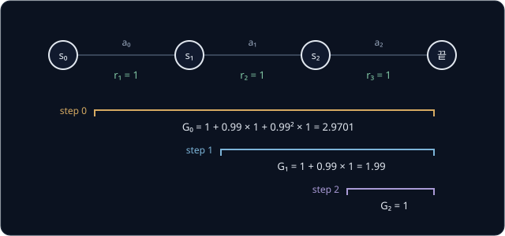

위 그림처럼 step 마다 자기 뒤의 reward 만 묶는다. 숫자만 바꿔 $\gamma = 0.9$ 이면 $G_0 = 1 + 0.9 + 0.81 = 2.71$, $G_1 = 1.9$,
$G_2 = 1$ 이다. 격자의 trajectory 칸 1 → 2 → 3 은 reward 가 0, 1 이라 $\gamma = 0.9$ 에서 $G_0 = 0 + 0.9 \times 1 = 0.9$, $G_1 = 1$ 이다.

CartPole 에서 step 마다 $G_t$ 를 weight 로 쓰면, 막대를 오래 세워 둔 episode 의 앞쪽 action 일수록 큰 weight 를 받아 확률이 많이 오른다.

**확인 문제.** reward 가 0, 0, 1 로 들어온 episode 의 $G_0$, $G_1$, $G_2$ 는? ($\gamma = 0.9$)

답 보기

$G_2 = 1$, $G_1 = 0 + 0.9 \times 1 = 0.9$, $G_0 = 0 + 0.9 \times 0 + 0.81 \times 1 = 0.81$ 이다. 뒤에서부터 $G_t = r_{t+1} + \gamma G_{t+1}$
로 계산하면 편하다.

**요약**

- trajectory 의 확률은 policy 의 확률과 environment 의 이동 확률의 곱이고, $\ln$ 을 씌워 미분하면 environment 의 항은 $\theta$ 와 상관없어 사라진다
- 그래서 $\nabla_\theta J = \mathbb E[\sum_t \nabla_\theta \ln \pi_\theta(a_t \mid s_t) \times \text{weight}]$ 를 environment 를 몰라도 계산한다
- step $t$ 의 weight 로는 그 뒤의 reward 만 더한 reward-to-go $G_t$ 를 쓴다. reward 1, 1, 1 과 $\gamma = 0.99$ 면 $2.9701, 1.99, 1$ 이다

## variance

### variance 의 뜻

두 묶음의 숫자 $\{1, 3\}$ 과 $\{-2, 6\}$ 은 평균이 모두 2 다. 그런데 앞의 묶음은 평균 근처에 모여 있고 뒤의 묶음은 넓게 퍼져 있다.
이 퍼진 정도를 숫자로 재는 값이 variance(분산)다.

| 묶음 | 평균 | 평균에서 떨어진 거리 | 거리의 제곱 | 제곱의 평균 |
| --- | --- | --- | --- | --- |
| $\{1, 3\}$ | 2 | $-1, +1$ | $1, 1$ | 1 |
| $\{-2, 6\}$ | 2 | $-4, +4$ | $16, 16$ | 16 |

variance 는 "평균에서 떨어진 거리를 제곱해 평균한 값" 이다. 거리를 제곱하는 이유는
MSE(오차를 제곱해 평균한 loss)와 같아서, 위아래로 떨어진 거리가 서로 지워지지 않게 하려는 것이다. 값이 확률로 나오면 평균 대신 기댓값을 쓴다.

$$
\mathrm{Var}[x] = \mathbb E\big[(x - \mathbb E[x])^2\big]
$$

Var 는 variance 의 앞 글자다. 식은 "$x$ 의 기댓값을 구하고, $x$ 가 거기서 떨어진 거리를 제곱한 값의 기댓값을 구한다" 로 읽는다. 기계
B 의 reward 는 4 와 0 이 0.5 씩이라 기댓값 2, 거리 $\pm 2$, 제곱 4 라서 variance 가 4 다. 기계 A 는 언제나 1 이라 variance 가 0 이다.

**확인 문제.** $\{0, 2, 4\}$ 의 variance 는?

답 보기

평균은 2, 거리는 $-2, 0, +2$, 제곱은 $4, 0, 4$ 이고 평균은 $8 \div 3 \approx 2.67$ 이다.

### 추정 한 번의 흔들림

REINFORCE 의 추정 $\hat g$ 는 $\theta = 0$ 에서 $-0.5$, $2$, $0$ 가운데 하나였고 기댓값은 0.25 였다. variance 를 계산한다.

| 경우 | 확률 | $\hat g$ | 0.25 에서 떨어진 거리 | 제곱 | 확률 × 제곱 |
| --- | --- | --- | --- | --- | --- |
| A 를 고름 | 0.5 | $-0.5$ | $-0.75$ | 0.5625 | 0.28125 |
| B 를 골라 4 개 | 0.25 | $2$ | $+1.75$ | 3.0625 | 0.765625 |
| B 를 골라 0 개 | 0.25 | $0$ | $-0.25$ | 0.0625 | 0.015625 |
| 합 | | | | | 1.0625 |

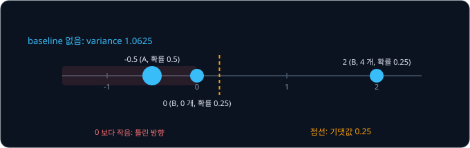

variance 는 1.0625 로, 추정하려는 값 0.25 에 비해 아주 크다. 위 그림처럼 추정 한 번이 진짜 gradient 0.25 근처에 오는 일은 없고, 절반의
확률(A 를 고른 경우)로는 부호까지 틀려 $\theta$ 를 줄이라고 한다. 운이 나쁜 경우의 표에서 다섯 step 동안 확률이 거꾸로 간 것이 이
때문이다.

**확인 문제.** $\hat g$ 가 0 보다 작아 $\theta$ 를 거꾸로 움직일 확률은?

답 보기

A 를 고른 경우만 $-0.5$ 로 음수이므로 0.5 다.

### 여러 sample 의 평균

흔들림을 줄이는 가장 쉬운 방법은 같은 $\theta$ 에서 sample 을 여러 개 모아 $\hat g$ 를 평균한 뒤 한 번 고치는 것이다. 한 번 고치는 데
쓰는 sample 묶음을 batch 라고 한다. batch 의 크기 $N$ 에 따라 평균의 variance 와 부호가 틀릴 확률을 정확히 계산하면 아래와 같다.

| batch 크기 $N$ | 평균의 기댓값 | 평균의 variance | 평균이 0 보다 작을 확률 |
| --- | --- | --- | --- |
| 1 | 0.25 | 1.0625 | 0.5 |
| 2 | 0.25 | 0.5313 | 0.5 |
| 4 | 0.25 | 0.2656 | 0.3125 |
| 8 | 0.25 | 0.1328 | 0.2524 |

기댓값은 그대로이고, variance 는 $N$ 이 두 배가 될 때마다 절반이 된다. sample $N$ 개의 평균은 variance 가 $\frac{1}{N}$ 배가 되는데,
서로 다른 sample 의 운이 평균하면서 일부 지워지기 때문이다. 그래도 $N = 8$ 에서도 넷 중 한 번은 부호가 틀린다. sample 을 많이 모을수록
정확해지지만, 로봇에서 sample 하나는 실제로 움직여 본 episode 하나라서 많이 모을수록 시간이 오래 걸린다.

**확인 문제.** $N = 16$ 이면 평균의 variance 는 대략 얼마일까?

답 보기

$N = 8$ 의 0.1328 에서 절반이 되어 약 0.0664 다. $1.0625 \div 16 \approx 0.0664$ 와 같다.

### parameter 가 여럿일 때의 variance

neural network policy 는 parameter 가 수없이 많아서 gradient 도 parameter 마다 하나씩 나온다. 이때는 parameter 마다 variance 를 구해
모두 더한 total variance 로 흔들림을 잰다. parameter 가 두 개이고 같은 $\theta$ 에서 batch 세 개로 낸 gradient 가 $(1, 2)$, $(3, 2)$,
$(2, 5)$ 라고 하자.

| | 첫째 parameter | 둘째 parameter |
| --- | --- | --- |
| 세 값 | 1, 3, 2 | 2, 2, 5 |
| 평균 | 2 | 3 |
| 거리의 제곱 | 1, 1, 0 | 1, 1, 4 |
| variance | $2 \div 3 \approx 0.667$ | $6 \div 3 = 2$ |

total variance 는 $0.667 + 2 = 2.667$ 이다. 같은 $\theta$ 에서 잰 이 값이 작을수록 batch 하나로 낸 gradient 를 믿을 만하다.

**확인 문제.** batch 두 개의 gradient 가 $(0, 4)$, $(2, 4)$ 이면 total variance 는?

답 보기

첫째 parameter 는 평균 1, 거리 $\pm 1$ 이라 variance 1, 둘째는 4, 4 로 같아 0 이다. total variance 는 1 이다.

**요약**

- variance 는 평균에서 떨어진 거리의 제곱을 평균한 값으로, 값이 얼마나 퍼져 있는지 잰다
- $\theta = 0$ 에서 REINFORCE 의 추정 한 번은 variance 가 1.0625 로 참값 0.25 에 비해 크고, 확률 0.5 로 부호까지 틀린다
- batch 크기 $N$ 만큼 평균하면 variance 가 $\frac{1}{N}$ 배가 되지만, 그만큼 sample 을 많이 모아야 한다

## baseline

### reward 가 모두 양수일 때의 문제

기계 A, B 의 reward 는 0, 1, 4 로 모두 0 이상이다. 그래서 고른 action 의 확률은 오르거나 그대로일 뿐 내려가지 않고, 평균보다 못한 A
를 골라도 A 의 확률이 오른다. 받은 reward 에서 평균적인 reward 를 빼면 이 문제가 사라진다.

$$
\theta \leftarrow \theta + \eta\, (r - b)\, \nabla_\theta \ln \pi_\theta(a)
$$

$b$ 를 baseline 이라고 한다. "기준선" 이라는 뜻으로, reward 가 이 기준보다 높으면 고른 action 의 확률을 올리고 낮으면 내린다.
REINFORCE 라는 이름의 offset reinforcement(기준값을 뺀 reward)가 바로 $r - b$ 다. $\theta = 0$
에서 policy 가 받는 reward 의 기댓값 $J = 1.5$ 를 baseline 으로 쓰면 세 경우는 아래와 같다.

| 경우 | $r$ | $r - b$ | $\nabla_\theta \ln \pi_\theta(a)$ | $(r - b) \times \nabla$ | 고른 action 의 확률 |
| --- | --- | --- | --- | --- | --- |
| A 를 고름 | 1 | $-0.5$ | $-0.5$ | $+0.25$ | 내려간다 |
| B 를 골라 4 개 | 4 | $+2.5$ | $+0.5$ | $+1.25$ | 올라간다 |
| B 를 골라 0 개 | 0 | $-1.5$ | $+0.5$ | $-0.75$ | 내려간다 |

이제 A 를 고르면 A 의 확률이 내려간다. 평균 1.5 보다 못한 1 을 받았기 때문이다.

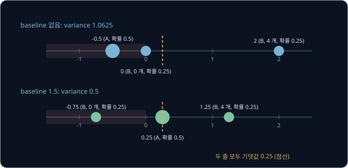

위 그림의 아래 줄은 baseline 을 뺀 추정의 세 값이다. 위 줄보다 0.25 근처로 모였고, 0 보다 작은 값은 B 에서 0 개를 받은 경우 하나뿐이라
부호가 틀릴 확률이 0.5 에서 0.25 로 줄었다.

**확인 문제.** baseline 이 1.5 일 때 $\theta = 0$ 에서 A 를 골랐다. $\eta = 0.1$ 이면 $\theta$ 는 얼마나 바뀌고, B 의 확률은 오를까 내릴까?

답 보기

$0.1 \times (1 - 1.5) \times (-0.5) = 0.1 \times 0.25 = +0.025$ 만큼 커진다. $\theta$ 가 커지므로 B 의 확률이 오르고 A 의 확률이 내린다.

### baseline 을 빼도 평균이 그대로인 이유

baseline 을 빼면 추정에 $-b\, \nabla_\theta \ln \pi_\theta(a)$ 가 더해진다. 이 항의 기댓값이 0 이면 평균은 바뀌지 않는다. 한 줄에 한
단계씩 계산한다.

$$
\begin{aligned}
\mathbb E_{a \sim \pi_\theta}\big[\nabla_\theta \ln \pi_\theta(a)\big] &= \sum_a \pi_\theta(a)\, \nabla_\theta \ln \pi_\theta(a) \\
&= \sum_a \nabla_\theta \pi_\theta(a) \\
&= \nabla_\theta \sum_a \pi_\theta(a) \\
&= \nabla_\theta 1 = 0
\end{aligned}
$$

둘째 줄은 log-derivative trick 을 거꾸로 쓴 것이다. 셋째 줄은 "gradient 를 더한 것은 더한 것의 gradient" 라는 성질이고, 넷째 줄은 모든
확률을 더하면 언제나 1 이라는 사실이다. $\theta$ 를 어떻게 바꿔도 1 은 1 이라서 변화 비율이 0 이다. 한 action 의 확률이 오르면 다른
action 의 확률이 꼭 그만큼 내려가기 때문이다.

$\theta = 0$ 에서 숫자로 보면 $0.5 \times (-0.5) + 0.5 \times 0.5 = 0$ 이고, $\theta = 2$ 에서도
$0.1192 \times (-0.8808) + 0.8808 \times 0.1192 = 0$ 이다. 그래서 $b$ 가 action 과 상관없는 수라면 $b \times 0 = 0$ 이 되어, baseline 을
빼도 추정의 기댓값은 그대로다. 앞 표의 세 값으로 확인하면 $0.5 \times 0.25 + 0.25 \times 1.25 + 0.25 \times (-0.75) = 0.125 + 0.3125 - 0.1875 = 0.25$
다.

**확인 문제.** action 이 셋이고 확률이 $[0.5, 0.3, 0.2]$ 다. 셋의 log-probability gradient 를 확률로 평균한 값은 얼마일까?

답 보기

action 이 몇 개든, 확률이 얼마든 0 이다. 확률의 합이 언제나 1 이라 그 gradient 가 0 이기 때문이다.

### variance 가 줄어드는 정도

baseline $b = 1.5$ 의 추정 $+0.25$, $+1.25$, $-0.75$ 는 기댓값 0.25 에서 각각 0, $+1$, $-1$ 떨어져 있다. variance 는
$0.5 \times 0 + 0.25 \times 1 + 0.25 \times 1 = 0.5$ 로, baseline 이 없을 때의 1.0625 보다 절반 넘게 줄었다. 다른 $b$ 로도 계산하면 아래와 같다.

| baseline $b$ | 0 | 0.5 | 1 | 1.5 | 2 | 2.5 | 3 |
| --- | --- | --- | --- | --- | --- | --- | --- |
| 추정의 기댓값 | 0.25 | 0.25 | 0.25 | 0.25 | 0.25 | 0.25 | 0.25 |
| 추정의 variance | 1.0625 | 0.75 | 0.5625 | 0.5 | 0.5625 | 0.75 | 1.0625 |

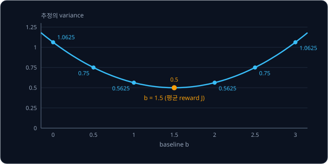

위 그림처럼 어떤 $b$ 를 써도 기댓값은 0.25 로 같고, variance 만 $b$ 에 따라 달라진다. 이 문제에서는 policy 가 받는 reward 의 평균
$J = 1.5$ 에서 variance 가 가장 작다. 그래서 baseline 으로는 보통 "평균적으로 받는 reward" 를 쓴다. agent 는 $J$ 를 모르므로 실제로는
지금까지 받은 reward 의 평균을 새 reward 가 들어올 때마다 고치는 incremental 평균 $b \leftarrow b + \frac{1}{n}(r - b)$ 로 구해 쓴다.

batch 와 함께 쓰면 효과가 겹친다. $N = 4$ 일 때 baseline 이 없으면 variance 0.2656, 부호가 틀릴 확률 0.3125 였는데, $b = 1.5$ 를 빼면
variance 0.125, 부호가 틀릴 확률 0.1445 로 줄어든다.

**흔한 오해.** "baseline 을 빼면 학습 방향이 바뀐다" 고 생각하기 쉽다. 표의 둘째 줄처럼 기댓값, 곧 평균적인 학습 방향은 $b$ 와
상관없이 0.25 다. baseline 이 바꾸는 것은 한 번 한 번의 추정이 흩어지는 정도뿐이다.

**확인 문제.** $b = 1$ 이면 세 경우의 추정 $(r - b)\nabla_\theta \ln \pi_\theta(a)$ 는 각각 얼마이고, 기댓값은?

답 보기

A 는 $0 \times (-0.5) = 0$, B 4 개는 $3 \times 0.5 = 1.5$, B 0 개는 $-1 \times 0.5 = -0.5$ 다. 기댓값은
$0.5 \times 0 + 0.25 \times 1.5 + 0.25 \times (-0.5) = 0.375 - 0.125 = 0.25$ 다.

### reward 를 모두 10 씩 올린 실험

기계마다 동전을 10 개씩 더 준다고 하자. A 는 11 개, B 는 14 개 또는 10 개다. 두 기계의 차이는 그대로 1 이라 같은 문제인데, reward
가 모두 크고 양수가 되면 baseline 이 없는 REINFORCE 는 크게 흔들린다. $\theta = 0$ 에서 추정의 세 값은 A 가 $11 \times (-0.5) = -5.5$,
B 14 개가 $14 \times 0.5 = 7$, B 10 개가 $10 \times 0.5 = 5$ 이고, 기댓값은 그대로 0.25 지만 variance 는 33.5625 다. baseline 으로 평균
reward 11.5 를 빼면 원래 문제와 같은 0.5 로 돌아간다.

$\eta = 0.1$ 로 네 step 을 손으로 따라가 본다. 두 판 모두 action 과 reward 는 A(11), B(14), B(10), A(11) 순서로 나왔다.

| step | baseline 없이: $\theta$ | $\pi_\theta(B)$ | weight $r$ | 새 $\theta$ | baseline 11.5: $\theta$ | $\pi_\theta(B)$ | weight $r - b$ | 새 $\theta$ |
| --- | --- | --- | --- | --- | --- | --- | --- | --- |
| 1 (A, 11) | 0 | 0.5 | 11 | $-0.55$ | 0 | 0.5 | $-0.5$ | 0.0250 |
| 2 (B, 14) | $-0.55$ | 0.3659 | 14 | 0.3377 | 0.0250 | 0.5062 | 2.5 | 0.1485 |
| 3 (B, 10) | 0.3377 | 0.5836 | 10 | 0.7541 | 0.1485 | 0.5371 | $-1.5$ | 0.0791 |
| 4 (A, 11) | 0.7541 | 0.6801 | 11 | 0.0060 | 0.0791 | 0.5198 | $-0.5$ | 0.1051 |

baseline 이 없으면 B 의 확률이 0.5 → 0.3659 → 0.5836 → 0.6801 → 0.5015 로 step 마다 크게 출렁인다. A 를 골라도 B 를 골라도 weight 가
10 이 넘어서 고른 action 쪽으로 확률을 세게 끌어당기기 때문이다. baseline 을 빼면 0.5 → 0.5062 → 0.5371 → 0.5198 → 0.5263 으로 조금씩만
움직인다.

같은 실험을 200 step 씩 4000 번 되풀이한 결과가 아래 그림이다. 각 판에서 baseline 은 지금까지 받은 reward 의 평균을 썼다.

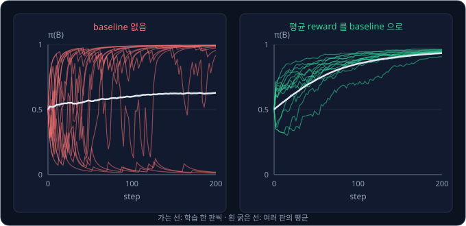

| 200 step 뒤 B 를 고를 확률 | 4000 번의 평균 | 하위 10% | 상위 10% | 0.5 아래로 끝난 비율 |
| --- | --- | --- | --- | --- |
| baseline 없음 | 0.636 | 0.008 | 0.995 | 35.8% |
| 지금까지의 평균 reward 를 baseline 으로 | 0.933 | 0.908 | 0.956 | 0% |

baseline 이 없으면 셋 중 한 번꼴로 더 나쁜 기계 A 쪽으로 굳어 버렸다. 초반에 A 를 몇 번 연달아 고르면 A 의 확률이 크게 올라 A 를 더
자주 고르고, 그러면 또 A 의 확률이 오르기 때문이다. CartPole 처럼 reward 가 늘 1 인 문제에서 $G_t$ 는 언제나 큰 양수라서 같은 일이
일어난다.

**확인 문제.** reward 에 10 을 더한 문제에서 baseline 없이 $\theta = 0$, $\eta = 0.1$ 에서 B 를 골라 10 개를 받았다. 새 $\theta$ 는?
원래 문제에서 B 를 골라 0 개를 받았을 때와 비교하면?

답 보기

$0.1 \times 10 \times 0.5 = 0.5$ 라서 $\theta = 0.5$ 다. 원래 문제의 0 개는 $\theta$ 를 바꾸지 않았는데, 10 을 더한 문제에서는 같은
결과(평균보다 1.5 못함)인데도 B 의 확률이 0.6225 로 크게 오른다.

### action 에 따라 달라지는 baseline

baseline 을 빼도 기댓값이 그대로인 계산에서 $b$ 를 기댓값 밖으로 꺼냈다. 이 단계는 $b$ 가 모든 action 에 같을 때만 쓸 수 있다. A 에는
$b(A) = 1$, B 에는 $b(B) = 2$ 처럼 action 마다 다른 baseline 을 빼면 어떻게 되는지 본다. 각 기계의 기댓값을 그대로 baseline 으로 쓴
경우다.

| 경우 | 확률 | $r - b(a)$ | $\nabla_\theta \ln \pi_\theta(a)$ | 추정 |
| --- | --- | --- | --- | --- |
| A 를 고름 | 0.5 | $1 - 1 = 0$ | $-0.5$ | 0 |
| B 를 골라 4 개 | 0.25 | $4 - 2 = 2$ | $+0.5$ | $+1$ |
| B 를 골라 0 개 | 0.25 | $0 - 2 = -2$ | $+0.5$ | $-1$ |

기댓값은 $0 + 0.25 - 0.25 = 0$ 이다. 진짜 gradient 0.25 가 사라져서, B 가 더 좋은 기계인데도 평균적으로 $\theta$ 가 움직이지 않는다.
action 마다 다른 baseline 은 "그 action 이 다른 action 보다 나은지" 라는 정보를 지워 버린다. 그래서 baseline 은 action 과 상관없는
값이어야 한다.

**확인 문제.** baseline 이 action 과 상관없어야 하는 이유를 한 문장으로 말해 보자.

답 보기

$\mathbb E[b\,\nabla_\theta \ln \pi_\theta(a)] = b \times 0 = 0$ 이 되려면 $b$ 를 기댓값 밖으로 꺼낼 수 있어야 하는데, $b$ 가 action
마다 다르면 꺼낼 수 없어 기댓값이 바뀌기 때문이다.

**요약**

- baseline 을 뺀 update $\theta \leftarrow \theta + \eta\,(r - b)\,\nabla_\theta \ln \pi_\theta(a)$ 는 평균보다 못한 action 의 확률을 내린다
- $\mathbb E[\nabla_\theta \ln \pi_\theta(a)] = 0$ 이라 action 과 상관없는 baseline 은 기댓값을 바꾸지 않고 variance 만 줄인다. 두 기계 문제에서는 $b = 1.5$ 일 때 1.0625 가 0.5 로 줄었다
- reward 가 모두 큰 양수이면 baseline 이 없는 REINFORCE 는 크게 흔들려 나쁜 action 쪽으로 굳을 수도 있다

## value baseline 과 advantage

### state 마다 다른 baseline

여러 state 를 거치는 문제에서는 state 마다 앞으로 받을 reward 가 크게 다르다. CartPole 에서 막대가 똑바로 서 있고 수레가 트랙 가운데에
있는 state 라면 앞으로 50 step 은 더 버틸 수 있지만, 막대가 이미 많이 기운 state 라면 3 step 뒤에 끝날 수도 있다. 앞의 state 에서는
$G_t$ 가 50 근처, 뒤의 state 에서는 3 근처라서, 숫자 하나짜리 baseline 으로는 두 state 를 함께 맞출 수 없다.

그래서 baseline 을 state 마다 다르게 둔다. state $s_t$ 에서 지금 policy 를 따를 때 return 의 기댓값, 곧 [Bandits & MDPs](../bandit-mdp/README.md)
의 value $V(s_t)$ 가 그 state 의 평균적인 $G_t$ 다. weight 를 $G_t - V(s_t)$ 로 쓰면 "이 state 에서 평균보다 얼마나 더 받았나" 가 된다.
같은 state 에서 시작한 두 episode 의 $G_t$ 가 30 과 50 이고 $V(s_t) = 40$ 이면 weight 는 $-10$ 과 $+10$ 이 되어, 더 받은 쪽 action 은
확률이 오르고 덜 받은 쪽은 내린다.

$V(s_t)$ 는 state 에 따라 달라지지만 그 state 에서 고른 action 과는 상관없다. 그래서 앞 절의 계산을 state 마다 하면 여전히
$\mathbb E[V(s_t)\,\nabla_\theta \ln \pi_\theta(a_t \mid s_t)] = 0$ 이고, 기댓값은 그대로다.

**확인 문제.** 같은 state 에서 세 episode 의 $G_t$ 가 20, 35, 50 이고 $V(s_t) = 35$ 다. 각 weight 는?

답 보기

$-15$, $0$, $+15$ 다. 가운데 episode 의 action 은 확률이 바뀌지 않는다.

### value network 학습

$V(s)$ 의 진짜 값은 모르므로 이것도 배운다. state 를 받아 value 를 내는 neural network 를 따로 두고 value network 라고 부른다. 이
network 의 parameter 를 $\phi$ 로 쓰고, network 가 내는 값을 $V_\phi(s)$ 로 쓴다. $\phi$ 는 그리스 문자 phi(파이 또는 피)로,
policy 의 $\pi$ 와는 다른 글자다.

value network 는 예측을 정답에 맞추는 regression 으로 학습한다. 예측은 $V_\phi(s_t)$, 정답은 실제로 받은
$G_t$ 이고, loss 는 둘의 차이를 제곱한 $(V_\phi(s_t) - G_t)^2$ 이다. $V_\phi(s_t) = 40$ 이고 $G_t = 30$ 이면 오차는 10, 오차의 제곱을
$V$ 로 미분한 값은 $2 \times 10 = 20$ 이다. network 의 출력을 learning rate 0.01 로 바로 고칠 수 있다고 보면 $40 - 0.01 \times 20 = 39.8$
로 정답 30 쪽으로 조금 내려간다. 다음 episode 에서 $G_t = 50$ 이면 오차는 $39.8 - 50 = -10.2$, gradient 는 $-20.4$ 라서
$39.8 + 0.204 = 40.004$ 로 다시 올라간다. 이렇게 30 과 50 이 번갈아 나오면 $V$ 는 둘의 평균 40 근처에 머문다.

policy 와 value network 는 같은 batch 로 함께 학습한다. policy 는 $G_t - V_\phi(s_t)$ 를 weight 로 써서 고치고, value network 는 같은
$G_t$ 를 정답으로 써서 고친다.

**확인 문제.** $V_\phi(s_t) = 10$, $G_t = 14$ 다. 오차의 제곱 loss 와 그 gradient 는?

답 보기

오차는 $10 - 14 = -4$, loss 는 16, gradient 는 $2 \times (-4) = -8$ 이다. gradient 가 음수이므로 $V$ 를 키워 14 쪽으로 고친다.

### advantage

state $s$ 에서 action $a$ 를 먼저 하고 그 뒤로 policy 를 따를 때 return 의 기댓값을 $Q(s, a)$ 로 쓴다. 앞 강의의 $Q$ 와 같은 뜻이다.
$V(s)$ 는 그 state 에서 policy 대로 action 을 뽑을 때의 평균이므로, 둘의 차이는 "action $a$ 가 이 state 의 평균보다 얼마나 나은가" 다.

$$
A(s, a) = Q(s, a) - V(s)
$$

이 값을 advantage 라고 한다. "이점, 우위" 라는 뜻이고, 기호 $A$ 는 advantage 의 첫 글자라 기계 A 와는 다른 뜻이다. 두 기계 문제는
state 가 하나라서 $Q$ 는 기계의 기댓값 $q_*$, $V$ 는 $\theta = 0$ policy 의 평균 $J = 1.5$ 다. 그래서 advantage 는 기계 A 가
$1 - 1.5 = -0.5$, 기계 B 가 $2 - 1.5 = +0.5$ 다. 양수인 기계 B 는 평균보다 나은 action 이라 확률을 올려야 하고, 음수인 기계 A 는
내려야 한다.

advantage 를 weight 로 쓴 gradient 는 $\sum_a \pi_\theta(a)\, A(a)\, \nabla_\theta \ln \pi_\theta(a)$ 이고, $\theta = 0$ 에서
$0.5 \times (-0.5) \times (-0.5) + 0.5 \times 0.5 \times 0.5 = 0.125 + 0.125 = 0.25$ 로 진짜 gradient 와 같다. $q_*(a)$ 에서 $V$ 를 뺀
것은 action 과 상관없는 baseline 을 뺀 것과 같기 때문이다.

episode 에서 $G_t$ 를 여러 번 평균하면 $Q(s_t, a_t)$ 가 되므로, $G_t - V_\phi(s_t)$ 는 advantage 를 sample 하나로 추정한 값이다. 이 추정을
$\hat A_t$ 로 쓴다. 정리하면 policy gradient 의 weight 로 쓸 수 있는 값은 아래처럼 바뀌어 왔다.

| weight | 뜻 | 기댓값 |
| --- | --- | --- |
| $G_0$ | episode 전체의 return | 진짜 gradient |
| $G_t$ | step $t$ 뒤의 return (reward-to-go) | 진짜 gradient |
| $G_t - V_\phi(s_t)$ | 평균보다 더 받은 만큼 (advantage 추정) | 진짜 gradient |

**확인 문제.** 어떤 state 에서 $V(s) = 5$, $Q(s, \text{왼쪽}) = 4$, $Q(s, \text{오른쪽}) = 7$ 이다. 두 action 의 advantage 는?

답 보기

왼쪽은 $4 - 5 = -1$, 오른쪽은 $7 - 5 = +2$ 다. 오른쪽의 확률을 올리고 왼쪽의 확률을 내리는 쪽으로 학습한다.

**요약**

- state 마다 앞으로 받을 return 이 달라서 baseline 으로 state 의 value $V(s_t)$ 를 쓰고, value network $V_\phi$ 는 $G_t$ 를 정답으로 MSE 로 학습한다
- advantage $A(s, a) = Q(s, a) - V(s)$ 는 action 이 그 state 의 평균보다 얼마나 나은지이고, $G_t - V_\phi(s_t)$ 가 그 sample 추정이다
- 두 기계 문제의 advantage 는 A 가 $-0.5$, B 가 $+0.5$ 이고, 이를 weight 로 써도 gradient 는 0.25 로 같다

## actor-critic

### 한 step 으로 낸 advantage

$G_t$ 를 계산하려면 episode 가 끝날 때까지 기다려야 하고, $G_t$ 에는 그 뒤의 모든 step 의 운이 섞여 있다. [Bandits & MDPs](../bandit-mdp/README.md)
의 Bellman 식에서 "한 칸의 value = reward + $\gamma$ × 다음 칸의 value" 였으므로, $G_t$ 대신 reward 하나와 다음 state 의 value 로
$Q(s_t, a_t)$ 를 어림할 수 있다. 여기서 $V(s_t)$ 를 빼면 advantage 의 추정이 된다.

$$
\hat A_t = r_{t+1} + \gamma\, V_\phi(s_{t+1}) - V_\phi(s_t)
$$

식은 "action 을 한 뒤 받은 reward 에 다음 state 의 value 를 $\gamma$ 로 깎아 더하고, 원래 state 의 value 를 뺀다" 로 읽는다. 앞
강의의 Q-learning 에서 target 에서 지금 값을 뺀 TD error(temporal difference, 지금의 추정과 한 step 뒤에 다시 본 추정의 차이)와 같은
모양이다.

CartPole 에서 $r_{t+1} = 1$, $\gamma = 0.99$, $V_\phi(s_t) = 10$, $V_\phi(s_{t+1}) = 9.5$ 라면 아래와 같다.

| 단계 | 계산 | 값 |
| --- | --- | --- |
| 다음 state 의 value 를 깎음 | $0.99 \times 9.5$ | 9.405 |
| reward 를 더함 | $1 + 9.405$ | 10.405 |
| 원래 value 를 뺌 | $10.405 - 10$ | 0.405 |

action 을 한 뒤의 결과 10.405 가 원래 예상 10 보다 0.405 나았으므로, 이 action 의 확률을 조금 올린다. 숫자만 바꿔
$V_\phi(s_{t+1}) = 8$ 이면 $1 + 0.99 \times 8 - 10 = 1 + 7.92 - 10 = -1.08$ 이라 예상보다 못했고 확률을 내린다. $s_{t+1}$ 이 episode 가
끝난 state 이면 그 뒤에 받을 reward 가 없으므로 $V_\phi(s_{t+1})$ 을 0 으로 둔다. 막대가 쓰러지는 step 에서 $r = 1$, $V_\phi(s_t) = 3$
이면 $1 + 0 - 3 = -2$ 다.

추정한 값 $V_\phi(s_{t+1})$ 을 써서 다른 추정의 정답을 만드는 방법을 bootstrap 이라고 한다. 부츠 뒤에 달린 고리(bootstrap)를 잡아당겨
제 몸을 들어 올린다는 영어 표현에서 온 이름으로, 남의 도움 없이 자기가 가진 것만으로 해낸다는 뜻이다.

**확인 문제.** $r_{t+1} = 0$, $\gamma = 0.9$, $V_\phi(s_t) = 0.5$, $V_\phi(s_{t+1}) = 1$ 이면 $\hat A_t$ 는?

답 보기

$0 + 0.9 \times 1 - 0.5 = 0.4$ 다. 예상보다 0.4 나은 state 로 옮겨 갔으므로 이 action 의 확률을 올린다.

### actor 와 critic

이 방법에서 policy 를 actor, value network 를 critic 이라고 부른다. actor 는 행동하는 쪽(배우), critic 은 그 행동을 평가하는 쪽(비평가)
이라는 뜻이다. 둘을 함께 쓰는 방법을 actor-critic 이라 하고, step 마다 아래 순서로 돈다.

1. actor 가 state $s_t$ 에서 $\pi_\theta(\cdot \mid s_t)$ 의 확률로 action $a_t$ 를 뽑는다
2. environment 가 reward $r_{t+1}$ 과 다음 state $s_{t+1}$ 을 돌려준다
3. critic 이 $\hat A_t = r_{t+1} + \gamma V_\phi(s_{t+1}) - V_\phi(s_t)$ 를 계산한다
4. actor 는 $\theta \leftarrow \theta + \eta\, \hat A_t\, \nabla_\theta \ln \pi_\theta(a_t \mid s_t)$ 로 고친다
5. critic 은 $V_\phi(s_t)$ 를 $r_{t+1} + \gamma V_\phi(s_{t+1})$ 쪽으로 고친다

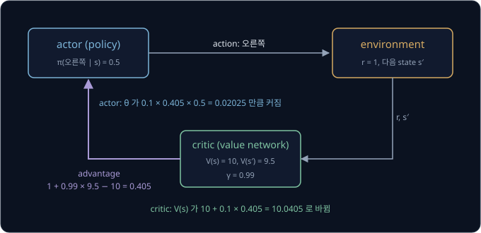

위 그림처럼 critic 의 advantage 가 actor 와 critic 양쪽을 고치는 데 쓰인다. episode 가 끝나기를 기다리지 않고 step 마다 고칠 수 있다.

5 번에서 critic 은 $r_{t+1} + \gamma V_\phi(s_{t+1})$ 을 정답으로 보고 다가간다. 이때 정답 쪽의 $V_\phi(s_{t+1})$ 은 고정된 수로 다루고,
$V_\phi(s_t)$ 만 고친다. 정답까지 함께 움직이면 critic 이 정답을 자기 쪽으로 끌어와 loss 를 줄이려 하기 때문이다.

state 가 하나뿐이고 한 번 당기면 끝나는 두 기계 문제에서는 $V_\phi(s_{t+1}) = 0$ 이라 $\hat A = r - V$ 다. 이때 critic 은 받은 reward 의
평균을 배우므로, "지금까지 받은 reward 의 평균을 baseline 으로 쓰는 REINFORCE" 가 곧 actor-critic 이다.

**확인 문제.** actor-critic 에서 advantage 가 음수로 나왔다. actor 는 고른 action 의 확률을 어떻게 바꿀까?

답 보기

$\eta \times (\text{음수}) \times \nabla_\theta \ln \pi_\theta(a_t \mid s_t)$ 를 더하므로, 고른 action 의 확률을 올리는 방향의 반대로
움직여 확률이 내려간다.

### 한 step 의 손 계산

action 이 왼쪽과 오른쪽 둘이고, 두 기계 문제처럼 state $s$ 에서 오른쪽의 점수를 $\theta_s$ 로 두었다. $\theta_s = 0$ 이라
$\pi(\text{오른쪽} \mid s) = 0.5$ 다. 오른쪽을 골라 $r = 1$ 을 받았고, $V_\phi(s) = 10$, $V_\phi(s') = 9.5$, $\gamma = 0.99$, actor 의
learning rate $\eta = 0.1$ 이다. critic 은 표처럼 칸마다 value 를 적어 두고 Q-learning 처럼 learning rate
$\alpha = 0.1$(alpha, 알파)로 고친다고 하자.

| 단계 | 계산 | 값 |
| --- | --- | --- |
| advantage | $1 + 0.99 \times 9.5 - 10$ | 0.405 |
| 오른쪽의 log-probability gradient | $1 - 0.5$ | 0.5 |
| actor 의 변화 | $0.1 \times 0.405 \times 0.5$ | $+0.02025$ |
| 새 $\theta_s$, 새 $\pi(\text{오른쪽} \mid s)$ | $0 + 0.02025$ | 0.02025, 0.5051 |
| critic 의 변화 | $0.1 \times 0.405$ | $+0.0405$ |
| 새 $V(s)$ | $10 + 0.0405$ | 10.0405 |

숫자만 바꿔 $V_\phi(s') = 8$ 이면 advantage 는 $-1.08$ 이다. actor 는 $0.1 \times (-1.08) \times 0.5 = -0.054$ 만큼 바뀌어
$\pi(\text{오른쪽} \mid s) = 0.4865$ 로 내려가고, critic 은 $10 + 0.1 \times (-1.08) = 9.892$ 로 내려간다.

**확인 문제.** advantage 가 0 이면 actor 와 critic 은 어떻게 바뀔까?

답 보기

둘 다 그대로다. 결과가 critic 의 예상과 정확히 같았으므로 고칠 것이 없다.

### bias 와 variance

actor-critic 의 advantage 는 reward 하나와 critic 의 추정만 쓰므로, 그 뒤의 수많은 step 의 운이 섞이지 않아 variance 가 훨씬 작다.
대신 critic 이 틀리면 추정이 틀린 쪽으로 치우친다. 추정값의 기댓값이 참값과 어긋난 정도를 bias(치우침)라고 한다. REINFORCE 의 추정이
unbiased 였던 것과 대비되는 말이다.

예를 들어 $s_{t+1}$ 의 진짜 value 가 9.5 인데 critic 이 12 라고 잘못 알고 있으면, advantage 는 $1 + 0.99 \times 12 - 10 = 2.88$ 로
진짜 0.405 보다 훨씬 크다. 이 state 로 이어지는 action 은 그때마다 실제보다 높은 평가를 받아 확률이 지나치게 오른다. 같은 일을 몇 번
되풀이해 평균해도 이 오차는 사라지지 않는다. 운이 아니라 critic 의 잘못된 값에서 온 오차이기 때문이다. REINFORCE 의 $G_t$ 는 실제로
받은 reward 의 합이라 이런 치우침이 없다.

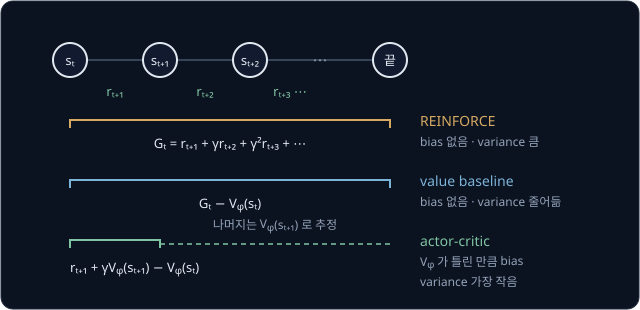

| 방법 | weight | bias | variance | 고치는 시점 |
| --- | --- | --- | --- | --- |
| REINFORCE | $G_t$ | 없음 | 크다 | episode 가 끝난 뒤 |
| value baseline | $G_t - V_\phi(s_t)$ | 없음 | 줄어든다 | episode 가 끝난 뒤 |
| actor-critic | $r_{t+1} + \gamma V_\phi(s_{t+1}) - V_\phi(s_t)$ | critic 이 틀린 만큼 | 가장 작다 | step 마다 |

위 그림과 표는 세 방법의 차이를 정리한 것이다. bias 를 조금 감수하고 variance 를 줄일지, variance 를 감수하고 bias 를 없앨지는
문제마다 골라야 한다. 2016년 Mnih 등은 reward 를 한 개가 아니라 몇 개($n$ 개) 더한 뒤 critic 의 추정을 붙이는 $n$-step advantage 로 둘
사이의 중간을 골랐고, 여러 학습 프로세스가 같은 network 를 서로 기다리지 않고(asynchronous) 동시에 고치는 A3C(Asynchronous Advantage Actor-Critic) 를
냈다.

**흔한 오해.** "critic 이 있으면 언제나 더 좋다" 고 생각하기 쉽다. 학습 초반의 critic 은 아직 엉터리라서, 그 값으로 만든 advantage 는
policy 를 엉뚱한 쪽으로 끌고 갈 수 있다. critic 이 정확해질수록 actor-critic 의 장점이 살아난다.

**확인 문제.** $r_{t+1} = 1$, $\gamma = 0.99$, $V_\phi(s_t) = 10$ 이고 진짜 $V(s_{t+1}) = 9.5$ 다. critic 이 $V_\phi(s_{t+1}) = 7$ 로 잘못
알고 있으면 advantage 는 얼마이고, 진짜 값과 비교해 어느 쪽으로 치우쳤을까?

답 보기

$1 + 0.99 \times 7 - 10 = 1 + 6.93 - 10 = -2.07$ 이다. 진짜 값 0.405 보다 작아서, 실제로는 조금 나았던 action 의 확률을 오히려 내리는
쪽으로 치우쳤다.

**요약**

- actor-critic 은 advantage 를 $r_{t+1} + \gamma V_\phi(s_{t+1}) - V_\phi(s_t)$ 로 한 step 만에 추정해 step 마다 actor(policy)와 critic(value network)을 함께 고친다
- reward 하나만 쓰므로 variance 가 작지만, critic 이 틀린 만큼 bias 가 생긴다
- REINFORCE 는 bias 가 없고 variance 가 크며, value baseline 은 bias 없이 variance 를 줄인다

## 정리

- $\arg\max$ policy 는 action 하나만 골라 계단처럼 바뀌므로 gradient 로 고칠 수 없다. policy gradient 는 점수를 softmax
  $\pi(a) = e^{z_a} / \sum_b e^{z_b}$ 로 확률로 바꾸고, 그 parameter 를 reward 의 기댓값 $J(\theta)$ 가 커지는 쪽으로 직접 고친다
- 두 기계 문제에서 $\pi_\theta(B) = \sigma(\theta)$, $J = 1 + \pi_\theta(B)$ 이고 $\theta = 0$ 의 gradient 는 0.25 다
- log-probability 의 gradient $\nabla_\theta \ln \pi_\theta(a)$ 는 action $a$ 를 더 자주 고르게 하는 방향으로, 두 기계 policy 에서는
  $1 - \pi_\theta(B)$ 와 $-\pi_\theta(B)$ 다. log-derivative trick 으로 $\nabla_\theta J = \mathbb E[q_*(a)\,\nabla_\theta \ln \pi_\theta(a)]$
  가 되어, $q_*$ 대신 받은 reward 를 넣은 sample 로 추정한다
- REINFORCE 는 $\theta \leftarrow \theta + \eta\, r\, \nabla_\theta \ln \pi_\theta(a)$ 로 고른 action 의 확률을 reward 만큼 올린다. 여러 step 의
  episode 에서는 environment 의 이동 확률이 gradient 에서 빠지고, step $t$ 의 weight 로 reward-to-go $G_t$ 를 쓴다
- REINFORCE 의 추정은 unbiased 지만 variance 가 크다. $\theta = 0$ 에서 variance 1.0625, 부호가 틀릴 확률 0.5 였다. action 과 상관없는
  baseline 을 빼면 기댓값은 그대로이고 variance 가 줄어 $b = 1.5$ 에서 0.5 가 된다
- state 마다의 baseline 으로 value $V_\phi(s_t)$ 를 쓰면 weight $G_t - V_\phi(s_t)$ 는 advantage $Q(s, a) - V(s)$ 의 추정이 된다. actor-critic
  은 이를 $r_{t+1} + \gamma V_\phi(s_{t+1}) - V_\phi(s_t)$ 로 한 step 만에 추정해 variance 를 더 줄이는 대신 critic 이 틀린 만큼 bias 를 받는다

policy gradient 는 지금 policy 로 모은 sample 로 한 번 고치고 나면 그 sample 을 버려야 해서, 같은 성능에 이르는 데 environment 와 많이
주고받아야 한다. 또 learning rate 를 조금만 키워도 한 번의 update 로 policy 가 크게 바뀌어 성능이 갑자기 떨어질 수 있다. 같은 데이터로
여러 번 고치면서도 policy 가 한 번에 너무 많이 바뀌지 않게 막는 방법은 [PPO](../ppo/README.md) 에서 다룬다. 환경이 어떻게 움직이는지를
따로 배워 실제로 움직여 보는 횟수를 줄이는 방법은 [World Model](../world-model/README.md) 에서, 지난 데이터를 다시 쓰는 off-policy 쪽의
actor-critic 은 [DQN → SAC](../off-policy/README.md) 에서 다룬다.

## 참고 자료

- OpenAI Spinning Up, [Part 3: Intro to Policy Optimization](https://spinningup.openai.com/en/latest/spinningup/rl_intro3.html)
  — log-derivative trick, reward-to-go, baseline 의 유도를 짧게 정리한 글. 이 강의를 마친 뒤 같은 내용을 수식으로 다시 따라가 볼 때 읽는다
- Richard S. Sutton, Andrew G. Barto, [Reinforcement Learning: An Introduction (2nd edition)](http://incompleteideas.net/book/the-book-2nd.html)
  — 13장이 REINFORCE, baseline, actor-critic 을 앞 강의와 같은 기호로 정리한다
- Andrej Karpathy, [Deep Reinforcement Learning: Pong from Pixels](http://karpathy.github.io/2016/05/31/rl/) — 화면을 보고 Pong 을 치는
  policy 를 policy gradient 로 학습시키며 "확률을 올리고 내린다" 는 직관을 그림으로 설명하는 글
- Lilian Weng, [Policy Gradient Algorithms](https://lilianweng.github.io/posts/2018-04-08-policy-gradient/) — REINFORCE 에서 A3C·PPO·SAC
  까지 한 기호 체계로 이어 본 글. 이 강의 뒤의 PPO 를 미리 훑어볼 때 좋다
- UC Berkeley CS 285, [Deep Reinforcement Learning](https://rail.eecs.berkeley.edu/deeprlcourse/) — policy gradient 와 actor-critic
  강의 영상과 slide
- Ronald J. Williams, [Simple Statistical Gradient-Following Algorithms for Connectionist Reinforcement Learning](https://doi.org/10.1007/BF00992696)
  (1992) — REINFORCE 원 논문
- Richard S. Sutton 외, [Policy Gradient Methods for Reinforcement Learning with Function Approximation](https://papers.nips.cc/paper/1999/hash/464d828b85b0bed98e80ade0a5c43b0f-Abstract.html)
  (1999) — 여러 step 의 MDP 에서 policy gradient 식(policy gradient theorem)과 critic 을 붙여도 되는 조건
- Volodymyr Mnih 외, [Asynchronous Methods for Deep Reinforcement Learning](https://arxiv.org/abs/1602.01783) (2016) — $n$-step
  advantage 를 쓰는 actor-critic(A3C)
