# PPO

## 학습 목표

- 한 번 모은 데이터로 행동 규칙을 한꺼번에 크게 고치면 규칙이 망가지고, 망가진 규칙은 다시 회복하기 어렵다는 것을 숫자로 보일 수 있다
- 데이터를 모을 때의 규칙과 지금 규칙이 같은 행동을 고를 확률이 몇 배가 되었는지 계산하고, 이 배수로 지난 데이터를 다시 쓰는 방법을
  설명할 수 있다
- 이 배수를 0.8 과 1.2 사이로 자르는 규칙이 한 번에 바뀌는 크기를 어떻게 막는지, "행동이 평균보다 나았는가" 와 배수의 조합마다 표를
  채워 설명할 수 있다
- 여러 번 이어진 행동의 예측 오차를 섞어 "평균보다 얼마나 나았는가" 를 계산하는 방법을 네 번의 행동으로 이뤄진 예시로 손 계산할 수 있다
- 데이터를 모으고, 같은 데이터를 여러 번 나눠 학습하고, 버리는 한 바퀴를 순서대로 설명할 수 있다

## 앞 강의의 두 기계 문제

### 두 기계와 softmax policy

[Policy Gradient](../policy-gradient/README.md) 에서는 슬롯머신 두 대로 행동 규칙을 직접 고치는 방법을 손으로 계산했다. 기계 A 는
레버를 당길 때마다 동전 1 개를 주고, 기계 B 는 0.5 의 확률로 동전 4 개를, 나머지 0.5 의 확률로 0 개를 준다. "값 × 확률" 을 모두 더한
기댓값은 A 가 1, B 가 $4 \times 0.5 + 0 \times 0.5 = 2$ 라서, 오래 당길수록 B 가 낫다.

행동을 고르는 쪽을 agent, agent 가 고르는 행동 하나를 action, 행동한 뒤에 받는 점수를 reward 라고 불렀다. 상황을 받아 action 을 고르는
규칙이 policy 다. 그 강의의 policy 는 A 의 점수를 0, B 의 점수를 $\theta$ 로 두고, 점수마다 $e^{\text{점수}}$ 를 구해 그 합으로 나누는
softmax 로 확률을 만들었다. $\theta$ 는 그리스 문자 theta(세타)이고, $e$ 는 약 2.718 인 정해진 수다.

$$
\pi_\theta(B) = \frac{e^\theta}{1 + e^\theta}, \qquad \pi_\theta(A) = \frac{1}{1 + e^\theta}
$$

$\pi$ 는 그리스 문자 pi(파이)로 policy 를 나타내고, $\pi_\theta(B)$ 는 "학습으로 고치는 숫자 $\theta$ 가 지금 값일 때 B 를 고를 확률" 이라고
읽는다. 학습으로 고치는 숫자를 parameter 라고 했다. 식 전체는 "B 의 $e^{\theta}$ 를, A 의 $e^0 = 1$ 과 B 의 $e^\theta$ 를 더한 값으로
나눈다" 는 뜻이다.

| $\theta$ | $-2$ | $-1$ | $0$ | $0.5$ | $1$ | $2$ |
| --- | --- | --- | --- | --- | --- | --- |
| $\pi_\theta(B)$ | 0.1192 | 0.2689 | 0.5 | 0.6225 | 0.7311 | 0.8808 |
| $\pi_\theta(A)$ | 0.8808 | 0.7311 | 0.5 | 0.3775 | 0.2689 | 0.1192 |

policy 가 좋은지는 그 policy 로 레버를 당길 때 받는 reward 의 기댓값 $J(\theta)$ 로 쟀다. 두 기계 문제에서는
$J = \pi_\theta(A) \times 1 + \pi_\theta(B) \times 2 = 1 + \pi_\theta(B)$ 라서, $\theta$ 를 키울수록 B 를 자주 골라 $J$ 가 2 에 다가간다.

**확인 문제.** $\theta = 1$ 이면 $J(\theta)$ 는 얼마일까?

답 보기

$\pi_\theta(B) = 0.7311$ 이라서 $J = 1 + 0.7311 = 1.7311$ 이다.

### advantage 로 고치는 update

action 을 더 자주 고르게 하려면 $\theta$ 를 어느 쪽으로 움직여야 하는지는 log-probability 의 gradient $\nabla_\theta \ln \pi_\theta(a)$ 가
알려 줬다. gradient 는 숫자를 아주 조금 바꿨을 때 결과가 변하는 비율이고, $\nabla$ 는 nabla(나블라), $\ln$ 은 "$e$ 를 몇 번 곱해야 그
수가 되는가" 를 나타내는 natural log 다. 확률에 $\ln$ 을 씌운 값을 log-probability 라고 했다. 두 기계 policy 에서
이 값은 B 가 $1 - \pi_\theta(B)$, A 가 $-\pi_\theta(B)$ 라서 $\theta = 0$ 이면 B 가 $+0.5$, A 가 $-0.5$ 다.

여기에 곱하는 weight 로는 advantage 를 썼다. advantage 는 "고른 action 이 그 상황의 평균보다 얼마나 나았나" 이고, 두 기계 문제에서는
받은 reward 에서 평균 reward 를 뺀 $\hat A = r - V$ 로 추정한다. 모자를 쓴 $\hat A$ 는 sample(실제로 해 보고 얻은 결과 하나)로 추정한
값이라는 표시이고, 기계 A 와는 다른 뜻의 글자다. $V$ 는 평균적으로 받는 reward 를 예측하는 critic(평가하는 쪽)의 값으로, $\theta = 0$
의 policy 라면 $J = 1.5$ 다. parameter 를 한 번 고치는 것을 update 라고 하고, 아래처럼 고친다.

$$
\theta \leftarrow \theta + \eta\, \hat A\, \nabla_\theta \ln \pi_\theta(a)
$$

$\leftarrow$ 는 "오른쪽에서 계산한 값으로 바꿔 적는다", $\eta$ 는 그리스 문자 eta(에타)로 한 번에 고치는 크기인 learning rate 다. 식은
"advantage 에 log-probability 의 gradient 와 learning rate 를 곱해 $\theta$ 에 더한다" 로 읽는다. $\theta = 0$, $V = 1.5$ 에서 일어날 수
있는 세 경우는 아래와 같다.

| 경우 | 확률 | $r$ | $\hat A = r - 1.5$ | $\nabla_\theta \ln \pi_\theta(a)$ | $\hat A \times \nabla$ |
| --- | --- | --- | --- | --- | --- |
| A 를 고름 | 0.5 | 1 | $-0.5$ | $-0.5$ | $+0.25$ |
| B 를 골라 4 개 | 0.25 | 4 | $+2.5$ | $+0.5$ | $+1.25$ |
| B 를 골라 0 개 | 0.25 | 0 | $-1.5$ | $+0.5$ | $-0.75$ |

마지막 열을 확률로 평균하면 $0.5 \times 0.25 + 0.25 \times 1.25 + 0.25 \times (-0.75) = 0.125 + 0.3125 - 0.1875 = 0.25$ 로, $J$ 의 진짜
gradient 0.25 와 같다. policy 를 actor(행동하는 쪽), 평균 reward 를 예측하는 쪽을 critic 이라 부르고 둘을 함께 고치는 방법을
actor-critic 이라고 했다.

**확인 문제.** $\theta = 0$ 에서 B 를 골라 4 개를 받았고 $\eta = 0.1$ 이다. 새 $\theta$ 는?

답 보기

$\hat A = 4 - 1.5 = 2.5$, $\nabla_\theta \ln \pi_\theta(B) = 0.5$ 라서 $\theta = 0 + 0.1 \times 2.5 \times 0.5 = 0.125$ 다.

### 한 번 쓰고 버리는 데이터

앞 강의에서 policy gradient 는 지금 policy 로 모은 sample 로만 계산해야 했다.
$\theta = 0$ 에서 모은 sample 을 $\theta = 2$ 까지 고친 뒤에도 그대로 쓰면, 진짜 gradient 는 $+0.105$ 인데 평균이 $-0.3212$ 로 부호까지
틀렸다. 지금의 policy 라면 A 를 0.1192 의 확률로만 고르는데, 옛 데이터에는 A 가 절반이나 들어 있었기 때문이다. 이렇게 데이터를 모으는
policy 와 배우는 policy 가 같아야 하는 방법을 on-policy 라고 하고, on-policy 방법은 sample 로 한 번 고친 뒤 그 sample 을 버린다.

로봇에서 sample 하나는 실제로 움직여 본 결과라서 모으는 데 시간이 든다. action 을 한 번 하고 결과를 받는 것을 step 이라고 하는데,
막대를 세운 수레(CartPole) 문제도 학습에 수만 번의 step 이 들고, 다리 넷 달린 로봇이 걷게 하려면 그보다 훨씬 많다. 모은 데이터로 여러 번 고칠 수 있으면 같은 데이터에서 더 많이 배울 수 있지만,
그러려면 고칠수록 데이터를 모은 policy 와 지금 policy 가 달라지는 문제와, 여러 번 고치는 사이에 policy 가 한 번에 너무 크게 바뀌는
문제를 풀어야 한다.

PPO(Proximal Policy Optimization)는 이 두 문제를 풀어, 한 번 모은 데이터로 여러 번 고치면서도 policy 가 한 번에 너무 많이 바뀌지 않게
막는 방법이다. 2017년 John Schulman 등이 냈고, 이 강의는 두 기계 문제로 그 계산을 하나씩 따라간다.

**확인 문제.** on-policy 방법에서 $\theta = 0$ 으로 모은 sample 로 $\theta$ 를 0.5 로 고쳤다. 다음 update 에는 어떤 sample 을 써야 할까?

답 보기

$\theta = 0.5$ 의 policy 로 새로 모은 sample 을 써야 한다. $\theta = 0$ 으로 모은 sample 은 버린다.

**요약**

- 두 기계 policy 는 $\pi_\theta(B) = e^\theta / (1 + e^\theta)$ 이고, advantage $\hat A = r - V$ 를 weight 로 $\theta \leftarrow \theta + \eta\,\hat A\,\nabla_\theta \ln \pi_\theta(a)$ 로 고친다
- on-policy 방법은 지금 policy 로 모은 sample 로 한 번 고치고 버려서, 같은 성능에 이르는 데 데이터가 많이 든다
- PPO 는 한 번 모은 데이터로 여러 번 고치면서 policy 가 한 번에 크게 바뀌지 않게 막는다

## 한 번에 크게 바꾼 update

### learning rate 를 키운 update

같은 데이터로 여러 번 고치는 것은 한 번에 크게 고치는 것과 비슷한 효과를 낸다. 그래서 먼저 learning rate 를 키워 한 번에 크게 고치면
무슨 일이 생기는지 본다.

$\theta = 0$ 에서 B 를 골랐는데 운이 나빠 동전 0 개를 받았다고 하자. B 는 더 좋은 기계지만 이번에는 결과가 평균 1.5 보다 나빴으므로
$\hat A = 0 - 1.5 = -1.5$ 이고, $\nabla_\theta \ln \pi_\theta(B) = 0.5$ 라서 update 는 $\eta \times (-1.5) \times 0.5 = -0.75\,\eta$ 다.
learning rate 만 바꿔 세 번 계산하면 아래와 같다.

| $\eta$ | $\theta$ 의 변화 | 새 $\theta$ | 새 $\pi_\theta(B)$ | 새 $J$ | 1000 번 당길 때 B 를 고르는 횟수 |
| --- | --- | --- | --- | --- | --- |
| 0.1 | $-0.075$ | $-0.075$ | 0.4813 | 1.4813 | 약 481 번 |
| 1 | $-0.75$ | $-0.75$ | 0.3208 | 1.3208 | 약 321 번 |
| 10 | $-7.5$ | $-7.5$ | 0.000553 | 1.0006 | 약 0.55 번 |

$\eta = 10$ 의 계산을 한 단계씩 따라가면, $\theta = -7.5$ 이고 $e^{-7.5} \approx 0.000553$ 이라서
$\pi_\theta(B) = 0.000553 \div 1.000553 \approx 0.000553$ 이다.

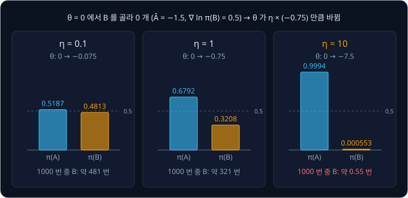

위 그림은 같은 sample 하나로 learning rate 만 바꿔 고친 결과다. $\eta = 0.1$ 이면 B 의 확률이 0.5 에서 0.4813 으로 조금 내려가고,
$\eta = 10$ 이면 sample 하나 때문에 B 를 거의 고르지 않는 policy 가 된다. 더 좋은 기계가 한 번 운이 나빴을 뿐인데 policy 가 B 를 통째로
버렸다.

**확인 문제.** 같은 sample 로 $\eta = 2$ 이면 새 $\theta$ 와 $\pi_\theta(B)$ 는? ($e^{-1.5} \approx 0.2231$)

답 보기

$\theta = 0 + 2 \times (-0.75) = -1.5$ 다. $\pi_\theta(B) = 0.2231 \div (1 + 0.2231) = 0.2231 \div 1.2231 \approx 0.1824$ 로, 1000 번 당기면
B 를 약 182 번 고른다.

### 망가진 policy 가 모으는 데이터

policy 가 한 번 망가지면 회복도 어렵다. $\pi_\theta(B) = 0.000553$ 인 policy 로 1000 번 당기면 B 는 평균 0.55 번만 고르고, 그 가운데
동전 4 개를 받는 것은 다시 절반이다. 다음 데이터는 거의 전부 A 의 결과라서, B 가 더 좋다는 정보가 데이터에 거의 들어오지 않는다.

진짜 gradient 를 정확히 안다고 해도 마찬가지다. 앞 강의의 공식 $\nabla_\theta J = \pi_\theta(A)\,\pi_\theta(B)\,(2 - 1)$ 에 넣으면
$\theta = -7.5$ 에서 $0.9994 \times 0.000553 \times 1 \approx 0.00055$ 라서, $\eta = 10$ 으로 고쳐도 한 번에 $\theta$ 가 0.0055 정도만
올라간다. $\theta$ 가 0 으로 돌아오려면 이런 update 가 186 번 필요하다. $\eta = 1$ 로 $\theta = -0.75$ 까지만 갔던 경우는 같은 방법으로
4 번이면 돌아온다.

정답이 붙은 데이터로 배우는 supervised learning 에서는 모델이 아무리 틀려도
학습 데이터는 그대로였다. reward 로 배우는 reinforcement learning(강화학습)에서는 policy 가 자기 데이터를 직접 모으므로, 나빠진 policy
는 나쁜 데이터를 모으고 그 데이터로는 좋아질 단서를 찾기 어렵다. 그래서 policy 를 한 번에 너무 크게 바꾸지 않는 것이 supervised
learning 보다 훨씬 중요하다.

**확인 문제.** $\pi_\theta(B) = 0.01$ 인 policy 로 1000 번 당기면 B 를 평균 몇 번 고르고, 그 가운데 동전 4 개를 받는 것은 평균 몇 번일까?

답 보기

$1000 \times 0.01 = 10$ 번 고르고, 그 절반인 5 번 정도 4 개를 받는다. 나머지 990 번은 언제나 1 개를 주는 A 의 결과다.

### θ 의 변화와 확률의 변화

learning rate 를 아주 작게 잡으면 안전하지만, 그러면 sample 하나하나가 policy 를 거의 바꾸지 못해 데이터를 모은 보람이 적다. 게다가
learning rate 가 정하는 것은 $\theta$ 가 움직이는 크기이지 policy 가 바뀌는 크기가 아니다. $\theta$ 를 똑같이 1 만큼 늘려도 어디서
출발하느냐에 따라 확률이 바뀌는 정도가 다르다.

| $\theta$ 의 변화 | $\pi_\theta(B)$ | $\pi_\theta(A)$ | A 의 확률이 몇 배가 되었나 |
| --- | --- | --- | --- |
| $0 \to 1$ | $0.5 \to 0.7311$ | $0.5 \to 0.2689$ | $0.2689 \div 0.5 = 0.5379$ |
| $4 \to 5$ | $0.9820 \to 0.9933$ | $0.0180 \to 0.0067$ | $0.0067 \div 0.0180 = 0.3721$ |

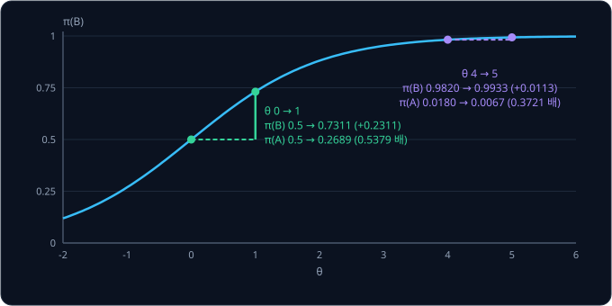

위 그림처럼 $\theta$ 를 4 에서 5 로 옮기면 B 의 확률은 0.0113 만 올라서 거의 그대로처럼 보인다. 그런데 A 쪽에서 보면 1000 번에 18 번
고르던 A 를 6.7 번만 고르게 되어, 확률이 0.3721 배로 줄었다. 0 에서 1 로 옮긴 경우의 0.5379 배보다 A 쪽은 더 크게 바뀌었다. 그래서 policy 가
얼마나 바뀌었는지는 $\theta$ 의 변화가 아니라 action 마다 확률이 몇 배가 되었는지로 재야 한다.

**흔한 오해.** "learning rate 만 작게 잡으면 policy 가 크게 바뀌는 일은 없다" 고 생각하기 쉽다. 위 표처럼 같은 $\theta$ 변화가 어떤
자리에서는 확률을 0.54 배, 어떤 자리에서는 0.37 배로 바꾼다. 어느 자리에서나 안전한 learning rate 하나를 미리 정하기는 어렵다.

**확인 문제.** $\theta$ 를 $-1$ 에서 0 으로 옮기면 B 의 확률은 몇 배가 될까?

답 보기

$\pi_\theta(B)$ 가 0.2689 에서 0.5 가 되므로 $0.5 \div 0.2689 \approx 1.859$ 배다. 0 에서 1 로 옮길 때의 $0.7311 \div 0.5 = 1.462$ 배보다
크다.

**요약**

- 운이 나쁜 sample 하나로 $\eta = 10$ 만큼 크게 고치면 $\pi_\theta(B)$ 가 0.5 에서 0.000553 으로 떨어진다
- 망가진 policy 는 B 의 데이터를 거의 모으지 못하고, 정확한 gradient 로도 되돌아오는 데 186 번의 update 가 걸린다
- learning rate 는 $\theta$ 가 움직이는 크기를 정할 뿐이라, policy 의 변화는 action 마다 확률이 몇 배가 되었는지로 잰다

## probability ratio

### 옛 policy 와 새 policy

같은 데이터로 여러 번 고치려면 두 policy 를 구분해서 불러야 한다. 데이터를 모을 때 쓴 parameter 를 $\theta_\text{old}$, 지금 고치고 있는
parameter 를 $\theta$ 라고 쓴다. old 는 "옛" 이라는 뜻이다. $\pi_{\theta_\text{old}}$ 로 데이터를 모으고, 그 데이터로 $\theta$ 를 여러 번
고친 뒤, 고친 $\theta$ 로 다음 데이터를 모을 때 그 값이 새 $\theta_\text{old}$ 가 된다.

$\theta_\text{old} = 0$ 으로 데이터를 모았고 지금까지 몇 번 고쳐 $\theta = 0.5$ 가 되었다면, 옛 policy 는 A 와 B 를 0.5 씩 고르고 새
policy 는 A 를 0.3775, B 를 0.6225 의 확률로 고른다. 고치기 시작하는 순간에는 아직 아무것도 바뀌지 않았으므로 $\theta = \theta_\text{old}$
이고 두 policy 는 같다.

**확인 문제.** $\theta_\text{old} = 0$ 으로 데이터를 모았다. 고치기 시작하는 순간 $\theta$ 와 $\pi_\theta(B)$ 는?

답 보기

$\theta = \theta_\text{old} = 0$ 이고 $\pi_\theta(B) = 0.5$ 다. 고치기 전이라 옛 policy 와 같다.

### ratio 의 계산

sample 하나에서 고른 action 에 대해, 새 policy 가 그 action 을 고를 확률을 옛 policy 가 고른 확률로 나눈 값을 probability ratio 라고
한다. ratio 는 "비율" 이라는 뜻이다.

$$
r_t(\theta) = \frac{\pi_\theta(a_t \mid s_t)}{\pi_{\theta_\text{old}}(a_t \mid s_t)}
$$

$a_t$ 는 $t$ 번째 sample 에서 고른 action, $s_t$ 는 그때의 state(agent 가 보는 지금 상황)이고, 세로선 $\mid$ 는 "state $s_t$ 에서" 라고
읽는다. 두 기계 문제는 state 가 하나뿐이라 $\pi_\theta(a_t)$ 로 줄여 쓴다. 식은 "새 policy 가 이 action 을 고를 확률을, 데이터를 모을 때
옛 policy 가 이 action 을 고른 확률로 나눈다" 는 뜻이다.

ratio 의 글자 $r$ 은 reward 의 $r_{t+1}$ 과 같지만 다른 값이다. 이 강의에서는 ratio 를 늘 $r_t(\theta)$ 처럼 괄호 안의 $\theta$ 를 붙여
써서 구분한다. $\theta_\text{old} = 0$, $\theta = 0.5$ 로 계산하면 아래와 같다.

| action | 옛 확률 $\pi_{\theta_\text{old}}$ | 새 확률 $\pi_\theta$ | ratio $r_t(\theta)$ |
| --- | --- | --- | --- |
| A | 0.5 | 0.3775 | $0.3775 \div 0.5 = 0.7551$ |
| B | 0.5 | 0.6225 | $0.6225 \div 0.5 = 1.2449$ |

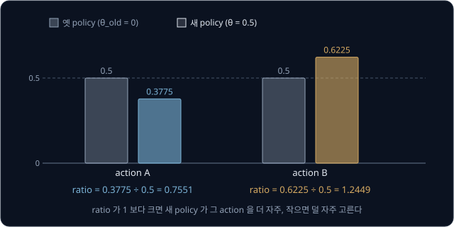

위 그림처럼 ratio 가 1 보다 크면 새 policy 가 그 action 을 더 자주 고르고, 1 보다 작으면 덜 자주 고른다. 1 이면 두 policy 가 그 action
을 같은 확률로 고른다. B 를 고른 sample 의 ratio 1.2449 는 "B 를 고를 확률이 약 1.24 배가 되었다" 는 뜻이다. 숫자만 바꿔
$\theta = -0.5$ 이면 A 와 B 가 뒤바뀌어 A 의 ratio 가 1.2449, B 의 ratio 가 0.7551 이다.

고치기 시작하는 순간에는 $\theta = \theta_\text{old}$ 라서 모든 sample 의 ratio 가 정확히 1 이다. 고칠수록 ratio 가 1 에서 멀어지므로,
ratio 는 action 하나하나에서 policy 가 얼마나 바뀌었는지를 재는 값이다.

**확인 문제.** 옛 policy 가 어떤 action 을 0.4 의 확률로, 새 policy 가 0.5 의 확률로 고른다. ratio 는? 새 policy 가 0.3 이면?

답 보기

$0.5 \div 0.4 = 1.25$ 이고, $0.3 \div 0.4 = 0.75$ 다.

### ratio 로 옛 데이터 다시 쓰기

ratio 를 쓰면 옛 데이터로도 새 policy 의 gradient 를 바르게 계산할 수 있다. 앞 강의에서 부호가 틀렸던 예를 그대로 다시 계산한다.
데이터는 $\theta_\text{old} = 0$ 으로 모았고, 지금 $\theta = 2$ 의 gradient 가 필요하다. 옛 데이터에는 A 가 0.5, "B 를 골라 4 개" 와
"B 를 골라 0 개" 가 0.25 씩 들어 있다. 새 policy 는 A 를 0.1192, B 를 0.8808 의 확률로 고르므로 ratio 는 A 가
$0.1192 \div 0.5 = 0.2384$, B 가 $0.8808 \div 0.5 = 1.7616$ 이다.

| 경우 | 옛 데이터의 비율 | ratio | 비율 × ratio | $r$ | $\theta = 2$ 의 $\nabla_\theta \ln \pi_\theta(a)$ | 비율 × ratio × $r$ × $\nabla$ |
| --- | --- | --- | --- | --- | --- | --- |
| A 를 고름 | 0.5 | 0.2384 | 0.1192 | 1 | $-0.8808$ | $-0.1050$ |
| B 를 골라 4 개 | 0.25 | 1.7616 | 0.4404 | 4 | $+0.1192$ | $+0.2100$ |
| B 를 골라 0 개 | 0.25 | 1.7616 | 0.4404 | 0 | $+0.1192$ | $0$ |

마지막 열을 더하면 $-0.1050 + 0.2100 + 0 = 0.105$ 로, $\theta = 2$ 의 진짜 gradient 0.105 와 같다. "비율 × ratio" 열을 보면 A 는 0.1192,
B 는 $0.4404 + 0.4404 = 0.8808$ 로 새 policy 가 고르는 비율과 정확히 같아졌다. 옛 데이터에 너무 많이 들어 있던 A 의 sample 은 0.2384 개
몫으로만 세고, 너무 적게 들어 있던 B 의 sample 은 1.7616 개 몫으로 센다.

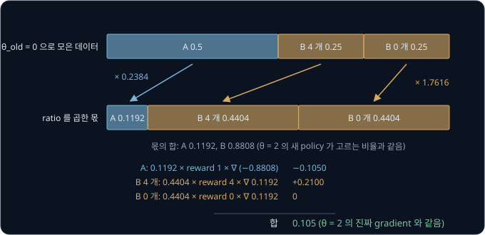

이렇게 다른 확률로 모은 sample 에 확률의 비를 곱해 원하는 확률의 평균을 구하는 방법을 importance sampling 이라고 한다. sample 마다
"중요도(importance)" 를 곱해 센다는 뜻이다. 식으로 쓰면 아래와 같다.

$$
\mathbb E_{a \sim \pi_\theta}\big[f(a)\big] = \mathbb E_{a \sim \pi_{\theta_\text{old}}}\Big[\frac{\pi_\theta(a)}{\pi_{\theta_\text{old}}(a)}\, f(a)\Big]
$$

$\mathbb E$ 는 기댓값이고 아래첨자 $a \sim \pi_\theta$ 는 "action $a$ 를 $\pi_\theta$ 의 확률로 뽑을 때" 라는 뜻이다. $f(a)$ 는 action 마다
정해지는 아무 값으로, 위 표에서는 $r \times \nabla_\theta \ln \pi_\theta(a)$ 였다. 식은 "새 policy 로 뽑았을 때의 평균은, 옛 policy 로
뽑은 sample 마다 ratio 를 곱해 평균한 것과 같다" 로 읽는다.

ratio 가 1 에서 아주 멀어지면 이 방법이 위험해진다. 옛 policy 가 0.01 의 확률로 고르던 action 을 새 policy 가 0.5 로 고르면 ratio 가
50 이라서, 그 action 의 sample 하나가 50 개 몫으로 세어진다. 그런데 옛 데이터에는 그 action 이 100 번에 1 번꼴로만 들어 있으니, 그 한
sample 이 운 좋게 좋았는지 나빴는지에 따라 평균이 크게 흔들린다. ratio 로 고친 계산은 새 policy 가 옛 policy 에서 많이 멀어지지 않았을
때만 믿을 만하다.

**확인 문제.** 옛 policy 가 어떤 action 을 0.5, 새 policy 가 0.75 의 확률로 고른다. 이 action 의 sample 하나는 몇 개 몫으로 세어질까?
새 policy 가 0.25 라면?

답 보기

ratio 가 $0.75 \div 0.5 = 1.5$ 라서 1.5 개 몫으로, 0.25 라면 $0.25 \div 0.5 = 0.5$ 라서 0.5 개 몫으로 센다.

### surrogate objective

ratio 를 쓰면 옛 데이터로 계산하면서 키울 목표를 하나 만들 수 있다. batch(한 번 고치는 데 쓰는 sample 묶음)에 sample 이 $n$ 개 있을 때,
sample 마다 ratio 와 advantage 를 곱해 평균한다.

$$
L(\theta) = \frac{1}{n}\sum_{t=1}^{n} r_t(\theta)\, \hat A_t
$$

$\sum$ 는 sigma(시그마)로 "모두 더하라" 는 기호이고, $\sum_{t=1}^{n}$ 은 "$t$ 를 1 부터 $n$ 까지 바꿔 가며 더한다" 로 읽는다. $\hat A_t$ 는
데이터를 모을 때 계산해 둔 $t$ 번째 sample 의 advantage 다. 식 전체는 "sample 마다 ratio 에 advantage 를 곱하고, 그 값들을 평균한다" 는
뜻이다. 이 값을 surrogate objective 라고 부른다. surrogate 는 "대리" 라는 뜻으로, 직접 키우기 어려운 $J(\theta)$ 대신 키우는 목표라는
이름이다.

$\theta = \theta_\text{old}$ 에서 $L$ 의 gradient 가 앞 강의의 policy gradient 와 같다는 것을 숫자로 확인한다. $\theta_\text{old} = 0$ 에서
B 를 골라 4 개를 받은 sample 이고 $\hat A = 2.5$ 다. 이 sample 의 항은 $r_t(\theta) \times 2.5 = \frac{\pi_\theta(B)}{0.5} \times 2.5$ 다.

| $\theta$ | $\pi_\theta(B)$ | ratio | ratio × 2.5 |
| --- | --- | --- | --- |
| 0 | 0.5 | 1 | 2.5 |
| 0.01 | 0.5025 | 1.005 | 2.5125 |

$\theta$ 를 0.01 늘렸더니 항이 0.0125 늘었으므로 변화 비율은 $0.0125 \div 0.01 = 1.25$ 다. advantage 로 고치는 update 의 표에서
"B 를 골라 4 개" 의 $\hat A \times \nabla = 2.5 \times 0.5 = 1.25$ 와 같다.

같아지는 이유는 ratio 의 분모 $\pi_{\theta_\text{old}}(a)$ 가 고정된 수이기 때문이다. ratio 의 gradient 는 $\nabla_\theta \pi_\theta(a) \div \pi_{\theta_\text{old}}(a)$
이고, $\theta = \theta_\text{old}$ 에서는 분모가 $\pi_\theta(a)$ 와 같으므로 앞 강의의 $\nabla_\theta \ln \pi_\theta(a) = \nabla_\theta \pi_\theta(a) \div \pi_\theta(a)$
가 된다. 그래서 $\theta_\text{old}$ 에서 $L$ 을 키우는 첫 걸음은 actor-critic 의 update 와 똑같고, 그다음 걸음부터는 ratio 가 옛 데이터의
비율을 새 policy 에 맞게 고쳐 준다.

**확인 문제.** $\theta_\text{old} = 0$ 에서 A 를 골라 $\hat A = -0.5$ 인 sample 이 있다. $\theta = 0$ 에서 이 sample 의 항 $r_t(\theta)\hat A_t$
가 $\theta$ 에 따라 변하는 비율은?

답 보기

$\hat A \times \nabla_\theta \ln \pi_\theta(A) = -0.5 \times (-0.5) = +0.25$ 다. 양수라서 $\theta$ 를 늘려 A 의 확률을 내리는 쪽이다.

### 제한 없는 surrogate 의 문제

surrogate objective 를 같은 batch 로 여러 번 키우면 어떻게 되는지 본다. 같은 batch 를 처음부터 끝까지 한 번 학습에 쓰는 것을 epoch 라고
한다. 10 epoch 는 같은 batch 로 10 번 고친다는 뜻이다.

batch 에 앞에서 본 운 나쁜 sample 하나, 곧 B 를 골라 0 개를 받아 $\hat A = -1.5$ 인 sample 만 있다고 하자. $\theta_\text{old} = 0$ 이므로
$L(\theta) = \frac{\pi_\theta(B)}{0.5} \times (-1.5) = -3\,\pi_\theta(B)$ 다. 이 값은 $\pi_\theta(B)$ 가 작을수록 커서, $\theta$ 를 줄일수록
끝없이 커진다. $\eta = 0.5$ 로 gradient ascent(gradient 를 더해 목표를 키우는 update)를 10 epoch 하면 아래와 같다.

| epoch | 고치기 전 $\theta$ | $\pi_\theta(B)$ | ratio | $L$ 의 gradient | 고친 뒤 $\theta$ |
| --- | --- | --- | --- | --- | --- |
| 1 | 0 | 0.5 | 1 | $-0.75$ | $-0.375$ |
| 2 | $-0.375$ | 0.4073 | 0.8147 | $-0.7242$ | $-0.7371$ |
| 3 | $-0.7371$ | 0.3236 | 0.6473 | $-0.6567$ | $-1.0655$ |
| 4 | $-1.0655$ | 0.2563 | 0.5125 | $-0.5718$ | $-1.3514$ |
| 5 | $-1.3514$ | 0.2056 | 0.4113 | $-0.4901$ | $-1.5964$ |
| 10 | $-2.2877$ | 0.0922 | 0.1843 | $-0.2510$ | $-2.4131$ |

$L$ 의 gradient 는 $-3 \times \pi_\theta(A)\,\pi_\theta(B)$ 로 계산했다. 첫 줄은 $-3 \times 0.5 \times 0.5 = -0.75$ 이고 $\theta$ 는
$0 + 0.5 \times (-0.75) = -0.375$ 가 된다. 10 epoch 뒤 $\theta = -2.4131$ 이고 $\pi_\theta(B) = 0.0822$ 라서, sample 하나로 B 의 확률이
처음의 6 분의 1 아래로 떨어졌다. epoch 를 더 늘리면 계속 떨어진다.

실제 batch 에는 sample 이 수백, 수천 개 있지만 sample 마다 같은 일이 일어난다. advantage 가 양수인 sample 은 그 action 의 ratio 를 끝없이
키우려 하고, 음수인 sample 은 0 쪽으로 끝없이 줄이려 한다. 그 사이에 ratio 는 1 에서 멀어지고, 앞 절에서 본 것처럼 ratio 가 1 에서 먼
계산은 믿을 수 없다. advantage 도 옛 policy 로 계산해 둔 값이라서 policy 가 많이 바뀌면 맞지 않게 된다. 그래서 같은 데이터로 여러 번
고치려면 $\theta$ 가 $\theta_\text{old}$ 에서 너무 멀어지지 않게 막는 장치가 필요하다.

**확인 문제.** 위 batch 에서 $\theta = -1$ 이면 $L(\theta) = -3\,\pi_\theta(B)$ 는 얼마일까? $\theta = 0$ 일 때보다 큰가?

답 보기

$\pi_\theta(B) = 0.2689$ 라서 $L = -3 \times 0.2689 = -0.8067$ 이다. $\theta = 0$ 의 $-1.5$ 보다 커서, $L$ 을 키우는 update 는 $\theta$ 를
계속 줄이는 쪽으로 간다.

**요약**

- probability ratio $r_t(\theta) = \pi_\theta(a_t \mid s_t) / \pi_{\theta_\text{old}}(a_t \mid s_t)$ 는 새 policy 가 그 action 을 고를 확률이 옛 policy 의 몇 배인지이고, 고치기 시작할 때는 1 이다
- 옛 데이터의 sample 에 ratio 를 곱하면(importance sampling) 새 policy 의 평균을 계산할 수 있고, $\theta = 2$ 의 gradient 0.105 를 바르게 얻는다
- surrogate objective $L(\theta) = \frac{1}{n}\sum_t r_t(\theta)\hat A_t$ 는 $\theta_\text{old}$ 에서 policy gradient 와 같은 방향이지만, 제한 없이 여러 epoch 키우면 policy 가 멀리 밀려난다

## KL divergence 와 TRPO

### 두 확률분포의 차이

action 마다의 확률을 늘어놓은 것, 예를 들어 "A 0.5, B 0.5" 를 확률분포라고 한다. 옛 policy 와 새 policy 가 얼마나 다른지를 action
하나가 아니라 확률분포 전체로 재는 값이 KL divergence 다. 이 값을 처음 정의한 두 사람 Kullback 과 Leibler 의 머리글자를 땄고,
divergence 는 "벌어진 정도" 라는 뜻이다.

$$
\mathrm{KL}(p \,\|\, q) = \sum_a p(a)\, \ln \frac{p(a)}{q(a)}
$$

$p$ 는 옛 확률분포, $q$ 는 새 확률분포다. 식은 "action 마다 옛 확률을 새 확률로 나눠 $\ln$ 을 씌우고, 거기에 옛 확률을 곱해 모두 더한다"
로 읽는다. A 0.5, B 0.5 에서 A 0.6, B 0.4 로 바뀌었다면 아래와 같다.

| action | $p(a)$ | $q(a)$ | $p \div q$ | $\ln(p \div q)$ | $p \times \ln(p \div q)$ |
| --- | --- | --- | --- | --- | --- |
| A | 0.5 | 0.6 | 0.8333 | $-0.1823$ | $-0.0912$ |
| B | 0.5 | 0.4 | 1.25 | $+0.2231$ | $+0.1116$ |
| 합 | | | | | $0.0204$ |

두 분포가 같으면 모든 $p \div q$ 가 1 이고 $\ln 1 = 0$ 이라서 KL 은 0 이다. 분포가 많이 다를수록 KL 이 커진다. 앞에서 본 update 들의
KL 을 재면 $\theta$ 를 0 에서 1 로 고친 경우가 0.1202, $\eta = 10$ 으로 0 에서 $-7.5$ 까지 밀린 경우가 3.06 이다.

**확인 문제.** 옛 분포가 A 0.5, B 0.5 이고 새 분포도 A 0.5, B 0.5 이면 KL 은? 새 분포가 A 0.4, B 0.6 이면?

답 보기

같은 분포라서 0 이다. A 0.4, B 0.6 은 위 표에서 A 와 B 만 바뀐 것이라 같은 0.0204 다.

### TRPO 의 제약

2015년 John Schulman 등의 TRPO(Trust Region Policy Optimization)는 surrogate objective 를 키우되, 옛 policy 와 새 policy 사이의 KL 이
정해 둔 작은 값(예를 들어 0.01)을 넘지 않게 하는 조건을 걸었다. trust region 은 "믿을 수 있는 구역" 이라는 뜻으로, ratio 로 고친
계산을 믿을 수 있는 범위, 곧 옛 policy 가까이에서만 policy 를 고친다는 이름이다.

이 조건을 지키면서 surrogate 를 가장 크게 키우는 방향을 찾으려면, gradient 만이 아니라 gradient 자체가 $\theta$ 에 따라 어떻게 바뀌는지
까지 계산해야 한다. 숫자를 곱하고 더하는 층을 여러 겹 쌓은 neural network 는 parameter 가 수십만 개를 넘기 쉬운데,
이런 network 에서는 이 계산이 무겁고 구현도 복잡해서 TRPO 는 보통의 gradient 기반 학습 도구로 바로 쓰기 어려웠다. 2017년 같은 연구진이 낸 PPO 는 KL 조건 대신 ratio 를 직접 잘라서, 보통의 gradient ascent 만으로 비슷한
효과를 낸다.

**확인 문제.** TRPO 가 KL 에 조건을 거는 이유를 한 문장으로 말해 보자.

답 보기

ratio 로 고친 surrogate 는 새 policy 가 옛 policy 가까이 있을 때만 믿을 수 있어서, 두 policy 의 차이(KL)가 작은 범위 안에서만
고친다.

**요약**

- KL divergence $\sum_a p(a) \ln \frac{p(a)}{q(a)}$ 는 두 확률분포가 얼마나 다른지 재며, 같으면 0 이고 [0.5, 0.5] 에서 [0.6, 0.4] 로 바뀌면 0.0204 다
- TRPO 는 KL 이 작은 값을 넘지 않는 범위에서 surrogate 를 키웠지만 계산이 무겁고 복잡했다
- PPO 는 KL 대신 ratio 를 직접 잘라 같은 목적을 보통의 gradient ascent 로 이룬다

## clipped surrogate

### clip 함수

$\operatorname{clip}(x, l, h)$ 는 $x$ 가 $l$ 보다 작으면 $l$, $h$ 보다 크면 $h$, 그 사이면 $x$ 그대로를 내는 함수다. clip 은 "잘라
낸다" 는 뜻이다. PPO 는 ratio 를 $1 - \epsilon$ 과 $1 + \epsilon$ 사이로 자르는데, $\epsilon$ 은 그리스 문자 epsilon(엡실론)이고 보통
0.2 를 쓴다. [Bandits & MDPs](../bandit-mdp/README.md) 의 ε-greedy 에서 ε 은 무작위로 고를 확률이었지만, 여기의 $\epsilon$ 은 ratio 를
1 에서 얼마나 벗어나게 둘지 정하는 다른 값이다.

$\epsilon = 0.2$ 이면 범위는 $[0.8, 1.2]$ 다. 데이터를 모을 때 0.5 였던 확률이 0.65 가 되면 ratio 는 1.3 인데, 1.2 보다 크므로
$\operatorname{clip}(1.3) = 1.2$ 다. $\operatorname{clip}(0.9) = 0.9$ 이고, $\operatorname{clip}(0.7) = 0.8$ 이다.

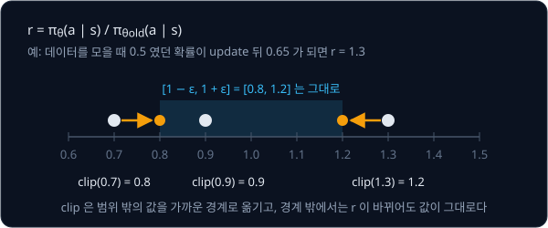

위 그림처럼 범위 밖의 값은 가까운 경계로 옮겨진다. 범위 밖에서는 ratio 가 1.3 에서 1.4 로 바뀌어도 잘린 값은 1.2 그대로라서, 잘린 값
쪽으로는 $\theta$ 를 바꿔도 변화가 없다. 변화 비율, 곧 gradient 가 0 이다.

**확인 문제.** $\epsilon = 0.2$ 일 때 $\operatorname{clip}(1.25)$, $\operatorname{clip}(0.5)$, $\operatorname{clip}(1.0)$ 은?

답 보기

1.2, 0.8, 1.0 이다. 1.0 은 범위 안이라 그대로다.

### 두 항 가운데 작은 값

PPO 의 목표는 sample 마다 두 값을 계산해 작은 쪽을 고른 뒤 평균한다. 하나는 surrogate 의 항 그대로인 $r_t(\theta)\hat A_t$ 이고, 다른
하나는 ratio 를 자른 $\operatorname{clip}(r_t(\theta), 1-\epsilon, 1+\epsilon)\,\hat A_t$ 다.

$$
L^{\text{CLIP}}(\theta) = \frac{1}{n}\sum_{t=1}^{n} \min\Big(r_t(\theta)\,\hat A_t,\ \operatorname{clip}\big(r_t(\theta), 1-\epsilon, 1+\epsilon\big)\,\hat A_t\Big)
$$

$\min(x, y)$ 는 두 값 가운데 작은 값이다. 위첨자 CLIP 은 clip 을 쓴 목표라는 표시이고, 이 값을 clipped surrogate objective 라고 부른다.
식은 "sample 마다 '자르지 않은 ratio × advantage' 와 '자른 ratio × advantage' 가운데 작은 값을 골라 평균한다" 로 읽는다.

ratio 가 1.3 이고 advantage 가 $+2$ 인 sample 이면 자르지 않은 항은 $1.3 \times 2 = 2.6$, 자른 항은 $1.2 \times 2 = 2.4$ 라서 2.4 를 고른다.
고른 값이 자른 항이고 ratio 가 범위 밖이면, $\theta$ 를 조금 바꿔도 이 sample 의 값은 2.4 그대로라서 이 sample 은 gradient 에 아무것도
보태지 않고, 그 자리에서 더 고치지 않는다.

PPO 의 첫 글자 proximal 은 "가까운" 이라는 뜻이다. 새 policy 를 옛 policy 가까이에 두면서 목표를 키운다는 이름이다.

**확인 문제.** ratio 0.9, advantage $+2$ 인 sample 의 두 항과 고르는 값은?

답 보기

자르지 않은 항은 $0.9 \times 2 = 1.8$, 0.9 는 범위 안이라 자른 항도 $0.9 \times 2 = 1.8$ 이다. 두 값이 같아서 1.8 을 고르고, gradient 는
그대로 흐른다.

### advantage 가 양수일 때

advantage 가 양수인 sample 은 평균보다 좋았던 action 이라서, surrogate 는 그 action 의 ratio 를 키우려 한다. $\hat A = +2$ 로 두고 ratio
를 바꿔 가며 표를 채운다.

| ratio $r$ | 0.7 | 0.9 | 1.0 | 1.1 | 1.3 | 1.5 |
| --- | --- | --- | --- | --- | --- | --- |
| $r \hat A$ | 1.4 | 1.8 | 2.0 | 2.2 | 2.6 | 3.0 |
| $\operatorname{clip}(r)$ | 0.8 | 0.9 | 1.0 | 1.1 | 1.2 | 1.2 |
| $\operatorname{clip}(r)\hat A$ | 1.6 | 1.8 | 2.0 | 2.2 | 2.4 | 2.4 |
| 작은 값 | 1.4 | 1.8 | 2.0 | 2.2 | 2.4 | 2.4 |
| gradient | 흐름 | 흐름 | 흐름 | 흐름 | 0 | 0 |

ratio 가 1.2 를 넘은 1.3, 1.5 에서는 자른 항 2.4 가 작아서 그것을 고르고, gradient 가 0 이 된다. 좋은 action 의 확률을 이미 1.2 배 넘게
올렸으니 이번 데이터로는 더 올리지 않는다. 0.7 에서는 자르지 않은 항 1.4 가 자른 항 1.6 보다 작아서 자르지 않은 항을 고른다. 좋은 action
인데 확률이 오히려 0.7 배로 내려간 경우라서, gradient 가 그대로 흘러 다시 올리게 한다.

**확인 문제.** $\hat A = +1$, ratio 1.4 인 sample 의 두 항과 고르는 값은? 이 sample 은 $\theta$ 를 움직일까?

답 보기

자르지 않은 항은 1.4, 자른 항은 $1.2 \times 1 = 1.2$ 라서 1.2 를 고른다. 자른 항이고 ratio 가 범위 밖이므로 gradient 가 0 이라
움직이지 않는다.

### advantage 가 음수일 때

advantage 가 음수인 sample 은 평균보다 나빴던 action 이라서, surrogate 는 그 action 의 ratio 를 줄이려 한다. $\hat A = -2$ 로 같은 표를
채운다. 음수끼리는 0 에서 먼 쪽이 더 작다는 점에 주의한다. $-2.6$ 은 $-2.4$ 보다 작다.

| ratio $r$ | 0.7 | 0.9 | 1.0 | 1.1 | 1.3 | 1.5 |
| --- | --- | --- | --- | --- | --- | --- |
| $r \hat A$ | $-1.4$ | $-1.8$ | $-2.0$ | $-2.2$ | $-2.6$ | $-3.0$ |
| $\operatorname{clip}(r)$ | 0.8 | 0.9 | 1.0 | 1.1 | 1.2 | 1.2 |
| $\operatorname{clip}(r)\hat A$ | $-1.6$ | $-1.8$ | $-2.0$ | $-2.2$ | $-2.4$ | $-2.4$ |
| 작은 값 | $-1.6$ | $-1.8$ | $-2.0$ | $-2.2$ | $-2.6$ | $-3.0$ |
| gradient | 0 | 흐름 | 흐름 | 흐름 | 흐름 | 흐름 |

이번에는 0.7 에서 자른 항 $-1.6$ 이 작은 값이라 gradient 가 0 이다. 나쁜 action 의 확률을 이미 0.8 배 아래로 내렸으니 더 내리지 않는다.
1.3, 1.5 에서는 자르지 않은 항이 더 작아서 그것을 고른다. 나쁜 action 인데 확률이 오히려 1.3 배, 1.5 배로 올라간 경우라서, gradient 가
흘러 다시 내리게 한다.

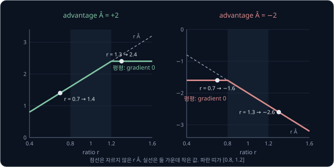

위 그림은 두 표를 그래프로 그린 것이다. 평평한 구간이 gradient 가 0 인 곳이다. advantage 가 양수이면 오른쪽(ratio 가 큰 쪽)만, 음수이면
왼쪽(ratio 가 작은 쪽)만 평평하다.

**확인 문제.** $\hat A = -1$, ratio 0.6 인 sample 의 두 항과 고르는 값은?

답 보기

자르지 않은 항은 $0.6 \times (-1) = -0.6$, 자른 항은 $0.8 \times (-1) = -0.8$ 이다. 작은 값은 $-0.8$ 이고 자른 항이라 gradient 는 0 이다.

### ratio·advantage 조합 정리

두 표를 ratio 의 구간과 advantage 의 부호로 묶으면 아래 여섯 칸이 된다.

| advantage | ratio 구간 | 그 action 에 일어난 일 | 고르는 항 | gradient |
| --- | --- | --- | --- | --- |
| 양수 | 0.8 아래 | 좋은 action 의 확률이 오히려 크게 내려감 | 자르지 않은 항 | 흐름, 다시 올림 |
| 양수 | 0.8 ~ 1.2 | 좋은 action 의 확률이 조금 바뀜 | 두 항이 같음 | 흐름, 올림 |
| 양수 | 1.2 위 | 좋은 action 의 확률을 이미 충분히 올림 | 자른 항 | 0, 멈춤 |
| 음수 | 0.8 아래 | 나쁜 action 의 확률을 이미 충분히 내림 | 자른 항 | 0, 멈춤 |
| 음수 | 0.8 ~ 1.2 | 나쁜 action 의 확률이 조금 바뀜 | 두 항이 같음 | 흐름, 내림 |
| 음수 | 1.2 위 | 나쁜 action 의 확률이 오히려 크게 올라감 | 자르지 않은 항 | 흐름, 다시 내림 |

멈추는 칸은 둘뿐이고, 둘 다 "advantage 가 가리키는 방향으로 이미 20% 넘게 간" 경우다. 반대 방향으로 벗어난 칸에서는 clip 이 아무것도
막지 않는다. 그쪽은 update 가 잘못 간 경우라서 되돌리는 gradient 는 살려 두어야 하기 때문이다. $\min$ 은 두 항 가운데 언제나 더 나쁜 쪽,
곧 더 비관적인 값을 고르므로, 좋아 보이는 쪽으로는 20% 까지만 믿고 나빠지는 쪽은 그대로 반영한다.

**흔한 오해.** "clip 은 ratio 를 늘 0.8 과 1.2 사이에 가둔다" 고 생각하기 쉽다. clip 은 ratio 를 경계 안으로 되돌리지 않는다. 한 번의
update 가 크면 ratio 가 경계를 넘어갈 수 있고, clip 은 그다음부터 그 방향으로 더 밀지 않을 뿐이다. 다음 절의 표에서 ratio 가
0.6473 까지 내려가는 것이 그 예다.

**확인 문제.** advantage 가 음수이고 ratio 가 1.4 인 sample 은 gradient 가 흐를까, 멈출까? 그 이유는?

답 보기

흐른다. 나쁜 action 의 확률이 오히려 1.4 배로 올라간 경우라서 자르지 않은 항 $1.4\hat A$ 가 자른 항 $1.2\hat A$ 보다 작고, 그 항을 골라
확률을 다시 내리게 한다.

### 여러 epoch 에서 clip 이 멈추는 지점

제한 없는 surrogate 에서 본 운 나쁜 sample($\hat A = -1.5$) 하나짜리 batch 를 같은 $\eta = 0.5$ 로 다시 학습하되, 이번에는 clip 을 쓴다.
advantage 가 음수이므로 B 의 ratio 가 0.8 아래로 내려가면 gradient 가 0 이 된다.

| epoch | clip 없음: $\pi_\theta(B)$ | ratio | gradient | clip 있음: $\pi_\theta(B)$ | ratio | gradient |
| --- | --- | --- | --- | --- | --- | --- |
| 1 | 0.5 | 1 | $-0.75$ | 0.5 | 1 | $-0.75$ |
| 2 | 0.4073 | 0.8147 | $-0.7242$ | 0.4073 | 0.8147 | $-0.7242$ |
| 3 | 0.3236 | 0.6473 | $-0.6567$ | 0.3236 | 0.6473 | 0 |
| 4 | 0.2563 | 0.5125 | $-0.5718$ | 0.3236 | 0.6473 | 0 |
| 10 | 0.0922 | 0.1843 | $-0.2510$ | 0.3236 | 0.6473 | 0 |
| 10 epoch 뒤 | 0.0822 | 0.1644 | | 0.3236 | 0.6473 | |

epoch 1, 2 는 두 판이 같다. ratio 가 1 과 0.8147 로 아직 범위 안이라 두 항이 같기 때문이다. epoch 2 의 update 로 ratio 가 0.6473 까지
내려가면서 0.8 을 넘어섰고, epoch 3 부터 clip 있는 판은 자른 항 $0.8 \times (-1.5) = -1.2$ 를 골라 gradient 가 0 이 된다. 그 뒤로는 epoch
를 몇 번 더 돌아도 $\theta$ 가 움직이지 않는다. clip 없는 판은 10 epoch 뒤 B 의 확률이 0.0822 까지 떨어지지만, clip 있는 판은 0.3236 에서
멈춘다.

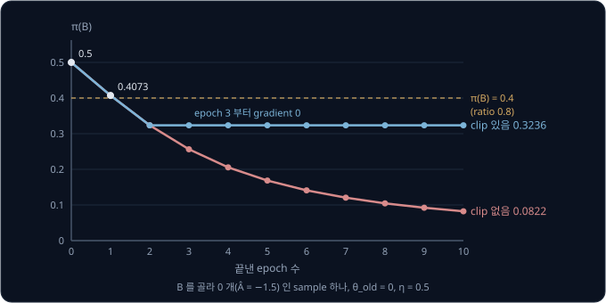

B 를 0.3236 의 확률로 고르는 policy 는 다음 데이터에서 B 를 세 번에 한 번꼴로 골라, 동전 4 개를 받는 결과를 곧 다시 보게 된다. 그러면
B 의 advantage 가 양수인 sample 이 들어와 B 의 확률을 다시 올린다. 반대로 결과가 좋은 batch 에서는 B 의 ratio 가 1.2 를 넘는 순간 멈추므로,
한 iteration(데이터를 모으고 고치는 한 바퀴)에 B 의 확률은 대략 1.2 배 안쪽으로 오른다. 대신 iteration 을 거듭하며 꾸준히 오른다.

**확인 문제.** clip 있는 판의 epoch 3 에서 자르지 않은 항과 자른 항은 각각 얼마이고, 어느 쪽을 고를까? (ratio 0.6473, $\hat A = -1.5$)

답 보기

자르지 않은 항은 $0.6473 \times (-1.5) = -0.9710$, 자른 항은 $0.8 \times (-1.5) = -1.2$ 다. 작은 값인 $-1.2$ 를 고르는데, 자른 항이라
$\theta$ 를 바꿔도 값이 그대로여서 gradient 가 0 이다.

**요약**

- clipped surrogate 는 sample 마다 $\min(r\hat A,\ \operatorname{clip}(r, 0.8, 1.2)\hat A)$ 를 평균하고, 자른 항을 고른 sample 은 gradient 가 0 이다
- advantage 가 양수이면 ratio 1.2 위에서, 음수이면 0.8 아래에서만 멈추고, 반대쪽으로 벗어난 update 는 되돌리는 gradient 를 살려 둔다
- 운 나쁜 sample 로 10 epoch 를 돌려도 clip 이 있으면 B 의 확률이 0.3236 에서 멈추고, 없으면 0.0822 까지 떨어진다

## GAE

### TD error 다시 보기

clipped surrogate 에 넣는 advantage $\hat A_t$ 를 어떻게 계산할지가 남았다. 앞 강의의 actor-critic 은 한 step 의 결과로 advantage 를
추정했다.

$$
\delta_t = r_{t+1} + \gamma\, V(s_{t+1}) - V(s_t)
$$

$\delta$ 는 그리스 문자 delta(델타)다. $r_{t+1}$ 은 step $t$ 의 action 을 한 직후에 받은 reward, $\gamma$ 는 gamma(감마)로 늦게 받는
reward 를 얼마나 깎을지 정하는 discount factor, $V(s)$ 는 state $s$ 에서 앞으로 받을 reward 의 합을 critic 이 예측한 값이다. 식은
"받은 reward 에 다음 state 의 예측을 $\gamma$ 만큼 깎아 더하고, 원래 state 의 예측을 뺀다" 로 읽는다. 이 값을 TD error 라고 하는데,
TD 는 temporal difference(시간 차이)로, 지금의 예측과 한 step 뒤에 다시 본 예측의 차이라는 뜻이다. 막대를 세운 수레 예시에서는
$1 + 0.99 \times 9.5 - 10 = 0.405$ 였다. episode(시작부터 끝까지 한 판)가 끝난 다음 state 는 앞으로 받을 reward 가 없으므로
$V = 0$ 으로 둔다.

앞 강의에서 본 것처럼 $\delta_t$ 는 reward 하나와 critic 의 예측만 쓰므로 흔들림(variance)이 작지만, critic 이 틀린 만큼 한쪽으로 치우친다
(bias). 반대로 step $t$ 뒤로 episode 끝까지 받은 reward 를 $\gamma$ 로 깎아 모두 더한 return $G_t$ 를 쓰는 $G_t - V(s_t)$ 는 치우침이
없지만 흔들림이 크다. variance 는 평균에서 떨어진
거리의 제곱을 평균한 값, bias 는 추정의 평균이 참값에서 어긋난 정도였다.

**확인 문제.** $r_{t+1} = 1$, $\gamma = 1$, $V(s_t) = 3$, $V(s_{t+1}) = 2$ 이면 $\delta_t$ 는?

답 보기

$1 + 1 \times 2 - 3 = 0$ 이다. 결과가 critic 의 예측과 정확히 같았다.

### 여러 step 을 더한 advantage

reward 를 하나만 쓰는 $\delta_t$ 와 끝까지 모두 쓰는 $G_t - V(s_t)$ 사이에는, reward 를 두 개, 세 개 쓰고 그 뒤를 critic 의 예측으로
채우는 중간 방법들이 있다. 막대를 세운 수레의 짧은 episode 로 계산한다. 막대가 서 있는 동안 step 마다 reward 1 을 받고, 이 episode 는
reward 를 네 번 받고 막대가 쓰러져 끝났다. 계산을 쉽게 하려고 $\gamma = 1$ 로 둔다.

| step $t$ | 0 | 1 | 2 | 3 |
| --- | --- | --- | --- | --- |
| critic 의 예측 $V(s_t)$ | 3 | 3 | 2 | 2 |
| 받은 reward $r_{t+1}$ | 1 | 1 | 1 | 1 |
| 다음 state 의 예측 $V(s_{t+1})$ | 3 | 2 | 2 | 0 (끝남) |
| $\delta_t = r_{t+1} + V(s_{t+1}) - V(s_t)$ | $1 + 3 - 3 = 1$ | $1 + 2 - 3 = 0$ | $1 + 2 - 2 = 1$ | $1 + 0 - 2 = -1$ |

step 3 의 $\delta_3 = -1$ 은 critic 이 2 를 더 받으리라 예측했는데 1 만 받고 끝났다는 뜻이다. 막대가 예상보다 일찍 쓰러졌다.

step 0 의 advantage 를 reward 를 몇 개 쓰느냐에 따라 계산하면 아래와 같다.

| 쓰는 reward 수 | 계산 | 값 | $\delta$ 로 쓰면 |
| --- | --- | --- | --- |
| 1 개 | $1 + V(s_1) - V(s_0) = 1 + 3 - 3$ | 1 | $\delta_0 = 1$ |
| 2 개 | $1 + 1 + V(s_2) - V(s_0) = 2 + 2 - 3$ | 1 | $\delta_0 + \delta_1 = 1 + 0$ |
| 3 개 | $1 + 1 + 1 + V(s_3) - V(s_0) = 3 + 2 - 3$ | 2 | $\delta_0 + \delta_1 + \delta_2 = 1 + 0 + 1$ |
| 4 개 (끝까지) | $1 + 1 + 1 + 1 - V(s_0) = 4 - 3$ | 1 | $\delta_0 + \delta_1 + \delta_2 + \delta_3 = 1 + 0 + 1 - 1$ |

reward 를 $n$ 개 쓴 advantage 는 $\delta$ 를 $n$ 개 더한 것과 같다. 2 개짜리로 한 단계씩 확인한다.

1. $\delta_0 + \delta_1 = \big(r_1 + V(s_1) - V(s_0)\big) + \big(r_2 + V(s_2) - V(s_1)\big)$ 다
2. 앞 괄호의 $+V(s_1)$ 과 뒤 괄호의 $-V(s_1)$ 이 서로 지워진다
3. 그래서 $\delta_0 + \delta_1 = r_1 + r_2 + V(s_2) - V(s_0)$ 이고, 이것이 reward 2 개를 쓴 advantage 다

$\gamma$ 가 1 이 아니면 뒤의 $\delta$ 에 $\gamma$ 를 곱해 더한다. reward 2 개짜리는 $\delta_0 + \gamma\,\delta_1$, 3 개짜리는
$\delta_0 + \gamma\,\delta_1 + \gamma^2\,\delta_2$ 다.

**확인 문제.** 위 episode 에서 step 1 의 advantage 를 reward 2 개로 계산하면? $\delta$ 의 합으로도 확인해 보자.

답 보기

$r_2 + r_3 + V(s_3) - V(s_1) = 1 + 1 + 2 - 3 = 1$ 이다. $\delta_1 + \delta_2 = 0 + 1 = 1$ 로 같다.

### λ 로 섞는 GAE

reward 를 몇 개 쓸지 하나를 고르는 대신, 여러 개를 모두 계산해 가중 평균할 수 있다. 가중 평균은 값마다 정해진 몫(weight)을 곱해 더하는
평균이고, 몫을 모두 더하면 1 이다. GAE(Generalized Advantage Estimation)는 reward 1 개짜리에 $1 - \lambda$, 2 개짜리에
$(1 - \lambda)\lambda$, 3 개짜리에 $(1 - \lambda)\lambda^2$ 처럼 뒤로 갈수록 $\lambda$ 배씩 줄어드는 몫을 준다. $\lambda$ 는 그리스 문자
lambda(람다)로 0 과 1 사이의 수다. episode 가 끝나 더 계산할 것이 없으면 남은 몫은 끝까지 쓴 advantage 가 모두 가져간다.

$\lambda = 0.5$ 로 step 0 의 advantage 를 섞는다.

| 쓰는 reward 수 | advantage | 몫 | 몫 × advantage |
| --- | --- | --- | --- |
| 1 개 | 1 | $1 - 0.5 = 0.5$ | 0.5 |
| 2 개 | 1 | $0.5 \times 0.5 = 0.25$ | 0.25 |
| 3 개 | 2 | $0.5 \times 0.25 = 0.125$ | 0.25 |
| 4 개 (끝까지) | 1 | 남은 몫 $1 - 0.5 - 0.25 - 0.125 = 0.125$ | 0.125 |
| 합 | | 1 | 1.125 |

이 가중 평균은 $\delta$ 마다 $(\gamma\lambda)$ 를 거듭 곱한 몫을 주어 더한 것과 같다. $\gamma = 1$, $\lambda = 0.5$ 이면 몫이 1, 0.5,
0.25, 0.125 다.

$$
\hat A_0 = \delta_0 + 0.5\,\delta_1 + 0.25\,\delta_2 + 0.125\,\delta_3 = 1 + 0 + 0.25 - 0.125 = 1.125
$$

두 계산이 같은 이유는 $\delta_0$ 이 네 advantage 모두에 들어 있어 몫 $0.5 + 0.25 + 0.125 + 0.125 = 1$ 을 받고, $\delta_1$ 은 1 개짜리를
뺀 세 개에 들어 있어 $0.25 + 0.125 + 0.125 = 0.5$ 를 받기 때문이다. 같은 식으로 $\delta_2$ 는 0.25, $\delta_3$ 은 0.125 를 받는다.
일반 식은 아래와 같다.

$$
\hat A_t = \sum_{l=0}^{\infty} (\gamma\lambda)^l\, \delta_{t+l} = \delta_t + \gamma\lambda\,\delta_{t+1} + (\gamma\lambda)^2\,\delta_{t+2} + \cdots
$$

$l$ 은 지금 step 에서 몇 step 뒤의 $\delta$ 인지를 세는 수이고, $\infty$ 는 "끝까지" 라는 뜻이다. episode 가 끝난 뒤의 $\delta$ 는 없으므로
0 으로 본다. 식은 "지금 step 의 TD error 에, 한 step 뒤의 TD error 는 $\gamma\lambda$ 배, 두 step 뒤는 $(\gamma\lambda)^2$ 배를 해서 모두
더한다" 로 읽고, 이렇게 여러 step 의 TD error 를 섞어 advantage 를 만든다.

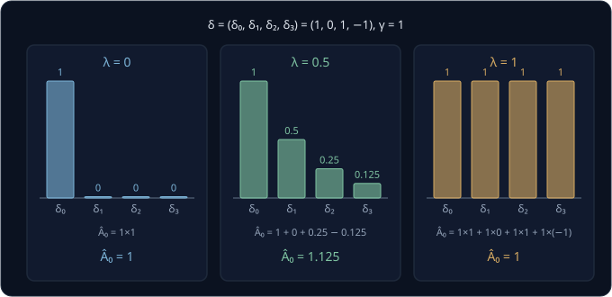

위 그림은 $\lambda$ 에 따라 몇 step 뒤의 TD error 까지 반영하는지를 보여 준다. $\lambda = 0$ 이면 $\delta_0$ 만 남아 앞 강의의 actor-critic
과 같다. $\lambda = 1$ 이면 모든 $\delta$ 를 그대로 더해 끝까지의 return 에서 $V(s_0)$ 을 뺀 $G_0 - V(s_0) = 4 - 3 = 1$ 이 된다.

**확인 문제.** $\gamma = 1$, $\lambda = 0.5$ 이고 $\delta = (0, 2, 0, 0)$ 이면 $\hat A_0$ 는?

답 보기

$0 + 0.5 \times 2 + 0.25 \times 0 + 0.125 \times 0 = 1$ 이다.

### 뒤에서부터의 손 계산

step 마다 위 합을 따로 계산하면 같은 덧셈을 여러 번 하게 된다. $\hat A_t$ 의 식에서 첫 항을 빼고 나머지를 $\gamma\lambda$ 로 묶으면
그 나머지가 바로 $\hat A_{t+1}$ 이다.

$$
\hat A_t = \delta_t + \gamma\lambda\, \hat A_{t+1}
$$

식은 "이번 step 의 advantage 는 이번 TD error 에 다음 step 의 advantage 를 $\gamma\lambda$ 배 해 더한 것" 으로 읽는다. 그래서 마지막
step 부터 거꾸로 한 번 훑으면 모든 step 의 advantage 가 나온다. 마지막 step 뒤에는 episode 가 끝났으므로 $\hat A_4 = 0$ 이다.

| 순서 | step $t$ | $\delta_t$ | $\gamma\lambda \times \hat A_{t+1}$ | $\hat A_t$ |
| --- | --- | --- | --- | --- |
| 1 | 3 | $-1$ | $0.5 \times 0 = 0$ | $-1$ |
| 2 | 2 | 1 | $0.5 \times (-1) = -0.5$ | 0.5 |
| 3 | 1 | 0 | $0.5 \times 0.5 = 0.25$ | 0.25 |
| 4 | 0 | 1 | $0.5 \times 0.25 = 0.125$ | 1.125 |

step 0 의 1.125 는 앞 절에서 몫으로 계산한 값과 같다.

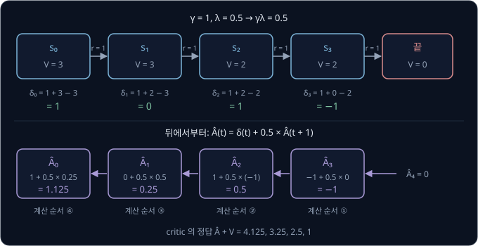

critic 도 이 결과로 고친다. critic 이 맞혀야 할 정답은 advantage 에 원래 예측을 더한 $\hat R_t = \hat A_t + V(s_t)$ 로, "예측보다 이만큼
더 받았다" 를 예측에 더한 값이다. 위 episode 에서는 $\hat R = (1.125 + 3,\ 0.25 + 3,\ 0.5 + 2,\ -1 + 2) = (4.125,\ 3.25,\ 2.5,\ 1)$ 이다.

**확인 문제.** $\gamma\lambda = 0.5$ 이고 $\delta = (2, 0, -2)$ 인 3 step episode 에서 뒤에서부터 $\hat A_2$, $\hat A_1$, $\hat A_0$ 를 구해
보자.

답 보기

$\hat A_2 = -2$, $\hat A_1 = 0 + 0.5 \times (-2) = -1$, $\hat A_0 = 2 + 0.5 \times (-1) = 1.5$ 다.

### rollout 이 중간에 끊긴 경우

PPO 는 policy 로 정해진 step 수만큼 environment(agent 가 행동하는 대상 세계)를 움직여 데이터를 모은다. 이렇게 모은 기록을
rollout 이라고 하는데, rollout 은 episode 가 끝나지 않았어도 정해진 step 수에서 멈춘다. 그러면 마지막 step 의 $\delta$ 에 넣을 다음 state 의 예측이 필요하다.

같은 4 step 이 막대가 아직 서 있는 채로 rollout 의 끝에 닿았다고 하자. 다음 state $s_4$ 에서 critic 의 예측이 $V(s_4) = 2$ 이면, 마지막
TD error 는 $\delta_3 = 1 + 2 - 2 = 1$ 이다. 앞 강의에서 본 bootstrap, 곧 아직 받지 않은 reward 를 critic 의 예측으로 채우는 방법이다.
숫자만 바꿔 뒤에서부터 다시 계산한다.

| step $t$ | $\delta_t$ | $\gamma\lambda \times \hat A_{t+1}$ | $\hat A_t$ |
| --- | --- | --- | --- |
| 3 | 1 | $0.5 \times 0 = 0$ | 1 |
| 2 | 1 | $0.5 \times 1 = 0.5$ | 1.5 |
| 1 | 0 | $0.5 \times 1.5 = 0.75$ | 0.75 |
| 0 | 1 | $0.5 \times 0.75 = 0.375$ | 1.375 |

막대가 쓰러지지 않은 만큼 step 3 의 advantage 가 $-1$ 에서 $+1$ 로 바뀌었고, 그 영향이 $\gamma\lambda$ 배씩 줄며 앞 step 으로 전해졌다.

반대로 rollout 한가운데에서 episode 가 끝나고 새 episode 가 시작되었다면, 끝난 step 에서 $V(s_{t+1}) = 0$ 으로 두고 $\hat A_{t+1}$ 도 더하지
않는다. 새 episode 의 결과는 앞 episode 의 action 과 상관없기 때문이다. rollout 에 "이 step 에서 episode 가 끝났다" 는 표시를 함께 적어
두는 이유다.

**확인 문제.** 위 표에서 $V(s_4) = 3$ 이었다면 $\delta_3$ 과 $\hat A_3$ 은?

답 보기

$\delta_3 = 1 + 3 - 2 = 2$ 이고, 마지막 step 이라 $\hat A_3 = \delta_3 = 2$ 다.

### λ 와 bias·variance

같은 episode 에서 $\lambda$ 만 바꿔 네 step 의 advantage 를 구하면 아래와 같다.

| $\lambda$ | $\hat A_0$ | $\hat A_1$ | $\hat A_2$ | $\hat A_3$ | 무엇과 같은가 |
| --- | --- | --- | --- | --- | --- |
| 0 | 1 | 0 | 1 | $-1$ | $\delta_t$ (actor-critic) |
| 0.5 | 1.125 | 0.25 | 0.5 | $-1$ | 둘을 섞은 값 |
| 1 | 1 | 0 | 0 | $-1$ | $G_t - V(s_t)$ |

critic 이 틀렸을 때 무슨 일이 생기는지 숫자로 본다. 진짜로는 3 이 맞는 $V(s_1)$ 을 critic 이 5 로 잘못 예측했다면 $\delta_0 = 1 + 5 - 3 = 3$,
$\delta_1 = 1 + 2 - 5 = -2$ 로 바뀌고 나머지는 그대로다.

| $\lambda$ | 틀린 critic 으로 구한 $\hat A_0$ | 맞는 critic 으로 구한 $\hat A_0$ | 차이 |
| --- | --- | --- | --- |
| 0 | 3 | 1 | 2 |
| 0.5 | $3 + 0.5 \times (-2) + 0.25 \times 1 + 0.125 \times (-1) = 2.125$ | 1.125 | 1 |
| 1 | $3 - 2 + 1 - 1 = 1$ | 1 | 0 |

$\lambda = 0$ 은 critic 의 예측 하나에 그대로 기대므로 critic 이 틀린 만큼 크게 어긋난다(bias 가 크다). $\lambda = 1$ 은 중간의 예측이 모두
지워져 critic 이 틀려도 영향이 없지만, 끝까지 받은 reward 를 모두 더하므로 그 사이 모든 step 의 운이 섞인다(variance 가 크다).
$\lambda = 0.5$ 는 둘 사이다.

실제로는 $\gamma = 0.99$, $\lambda = 0.95$ 를 많이 쓴다. $\gamma\lambda = 0.9405$ 라서 10 step 뒤의 TD error 는 $0.9405^{10} \approx 0.54$
배, 50 step 뒤는 약 0.047 배의 몫을 받는다. 수십 step 뒤까지의 결과를 반영하되, 아주 먼 뒤의 운은 줄여서 반영한다.

**확인 문제.** critic 이 아직 엉터리인 학습 초반에 $\lambda = 0$ 과 $\lambda = 1$ 가운데 어느 쪽 advantage 가 더 크게 어긋날까?

답 보기

$\lambda = 0$ 이다. $\delta_t$ 하나만 쓰므로 critic 의 틀린 예측 $V(s_{t+1})$ 이 advantage 에 그대로 들어간다. $\lambda = 1$ 은 실제로
받은 reward 를 끝까지 더해서 중간의 예측이 지워진다.

**요약**

- TD error $\delta_t = r_{t+1} + \gamma V(s_{t+1}) - V(s_t)$ 를 $n$ 개 더하면 reward 를 $n$ 개 쓴 advantage 가 된다
- GAE 는 이것들을 $\lambda$ 로 섞은 $\hat A_t = \sum_l (\gamma\lambda)^l \delta_{t+l}$ 이고, 뒤에서부터 $\hat A_t = \delta_t + \gamma\lambda \hat A_{t+1}$ 로 계산한다. $\delta = (1, 0, 1, -1)$, $\gamma\lambda = 0.5$ 면 $\hat A = (1.125, 0.25, 0.5, -1)$ 이다
- $\lambda = 0$ 은 actor-critic 의 $\delta_t$ 로 bias 가 크고, $\lambda = 1$ 은 $G_t - V(s_t)$ 로 variance 가 크며, 보통 $\lambda = 0.95$ 로 그 사이를 고른다

## PPO 의 한 iteration

### rollout 수집

PPO 는 데이터를 모으고, 고치고, 버리는 한 바퀴를 되풀이한다. 이 한 바퀴를 iteration 이라고 한다. 첫 단계는 rollout 수집이다.

같은 environment 를 여러 개 동시에 띄우고 지금 policy 로 각각 정해진 step 수만큼 움직인다. CartPole 에서
흔히 쓰는 설정은 environment 4 개, 각 128 step 이라서 한 iteration 에 $4 \times 128 = 512$ 개의 sample 이 모인다. sample 마다 아래 값을
적어 둔다.

| 적어 두는 값 | 쓰이는 곳 |
| --- | --- |
| state $s_t$ | policy 와 critic 에 다시 넣는다 |
| action $a_t$ | ratio 를 계산할 action |
| 옛 policy 의 확률 $\pi_{\theta_\text{old}}(a_t \mid s_t)$ | ratio 의 분모 |
| reward $r_{t+1}$ | TD error |
| episode 가 끝났는지 | GAE 를 episode 경계에서 끊기 |
| critic 의 예측 $V(s_t)$ | TD error, critic 의 정답 |

옛 policy 의 확률은 보통 $\ln$ 을 씌운 log-probability 로 적는다. ratio 는 두 log-probability 의 차를 $e$ 의 지수에 넣어 계산한다.
$\ln$ 이 나눗셈을 뺄셈으로 바꾸고, $e$ 의 지수에 $\ln$ 값을 넣으면 원래 수로 돌아오기 때문이다. $\theta = 0.5$ 의 B 라면 $\ln 0.6225 - \ln 0.5 = -0.4740 - (-0.6931) = 0.2191$ 이고,
$e^{0.2191} \approx 1.245$ 로 앞에서 구한 ratio 1.2449 와 같다.

rollout 이 끝나면 마지막 state 의 예측으로 GAE 를 계산해 sample 마다 $\hat A_t$ 와 critic 의 정답 $\hat R_t$ 를 붙인다.

**확인 문제.** environment 8 개를 각 256 step 씩 움직이면 한 iteration 에 sample 이 몇 개 모일까?

답 보기

$8 \times 256 = 2048$ 개다.

### epoch 와 mini-batch

모은 sample 512 개를 무작위로 섞은 뒤 128 개씩 4 묶음으로 나눈다. 이 작은 묶음을 mini-batch 라고 하고, mini-batch 하나로 gradient 를
계산해 $\theta$ 를 한 번 고친다. 이렇게 gradient 로 한 번 고치는 것을 gradient step 이라고 한다. 4 묶음을 모두 쓰면
epoch 하나가 끝나고, 다시 섞어 같은 일을 정해진 epoch 수만큼 되풀이한다. epoch 를 4 번 돌면 같은 데이터로 $4 \times 4 = 16$ 번 고친다.

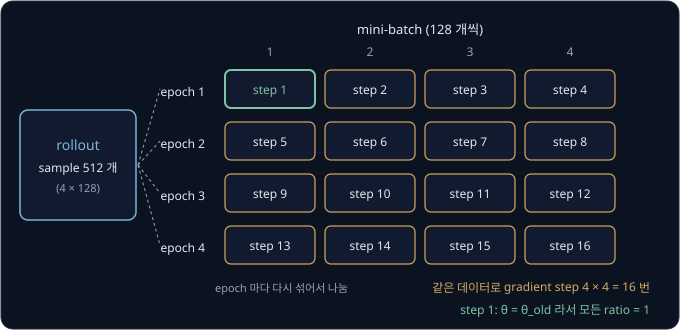

앞 강의의 방법이라면 이 512 개로 한 번만 고치고 버렸을 것이다. PPO 는 같은 데이터로 16 번 고치고, 그사이 ratio 가 경계를 넘은 sample 은
clip 이 하나씩 멈춰 세운다.

첫 epoch 의 첫 mini-batch 에서는 아직 한 번도 고치지 않았으므로 $\theta = \theta_\text{old}$ 이고 모든 sample 의 ratio 가 1 이다. 그래서
첫 gradient step 은 앞 강의의 actor-critic update 와 같다. 둘째 mini-batch 부터는 ratio 가 1 에서 조금씩 멀어진다.

**확인 문제.** sample 2048 개를 64 개씩 mini-batch 로 나누고 10 epoch 를 돌면 gradient step 은 몇 번일까?

답 보기

mini-batch 가 $2048 \div 64 = 32$ 개이고, 10 epoch 이므로 $32 \times 10 = 320$ 번이다.

### value loss

같은 mini-batch 로 critic 도 고친다. critic 이 예측하는 "그 state 에서 앞으로 받을 reward 의 합" 을 value 라고 하는데, critic 의 예측
$V_\phi(s_t)$ 가 GAE 로 만든 정답 $\hat R_t$ 에 가까워지도록 둘의 차이를 제곱한 값을 줄인다. 이렇게 모델이 얼마나 틀렸는지 나타내 줄여야
하는 숫자를 loss 라고 하고, 이 값은 value 의 loss 라서 value loss 라고 부른다. $\phi$ 는 그리스 문자 phi(파이 또는 피)로 critic 의 parameter 를 policy 의 $\theta$ 와 구분해 쓰는 글자다.

$$
L^{\text{VF}} = \frac{1}{n}\sum_{t=1}^{n} \big(V_\phi(s_t) - \hat R_t\big)^2
$$

VF 는 state 를 받아 value 를 내는 함수인 value function 의 머리글자다. 식은 "예측에서 정답을 빼 제곱하고 평균한다" 로 읽고,
MSE(오차를 제곱해 평균한 값)와 같은 모양이다. GAE 예시의 step 0 은 예측 3, 정답 4.125 라서 $(3 - 4.125)^2 = 1.2656$ 이다.

**확인 문제.** GAE 예시의 step 3 은 예측 2, 정답 1 이다. 이 sample 의 value loss 는?

답 보기

$(2 - 1)^2 = 1$ 이다.

### entropy bonus

policy 가 너무 빨리 한 action 으로 쏠리지 않게 하는 항도 더한다. 확률분포가 얼마나 고르게 퍼져 있는지 재는 값을 entropy 라고 한다.

$$
\mathcal H(\pi) = -\sum_a \pi(a)\, \ln \pi(a)
$$

$\mathcal H$ 는 entropy 의 첫 글자 H 를 필기체로 쓴 기호다. 식은 "action 마다 확률에 그 확률의 $\ln$ 을 곱해 더하고, 부호를 뒤집는다" 로
읽는다. 확률의 $\ln$ 은 0 이하라서 부호를 뒤집으면 0 이상이 된다.

| 확률분포 | 계산 | entropy |
| --- | --- | --- |
| A 0.5, B 0.5 | $-(0.5 \times (-0.6931) + 0.5 \times (-0.6931))$ | 0.6931 |
| A 0.9, B 0.1 | $-(0.9 \times (-0.1054) + 0.1 \times (-2.3026))$ | 0.3251 |
| A 0.99945, B 0.00055 | | 0.0047 |

둘을 반반 고르면 entropy 가 가장 크고, 한쪽으로 쏠릴수록 0 에 다가간다. 마지막 줄은 $\eta = 10$ 으로 망가졌던 policy 다. 목표에 entropy 를
조금 더해 주면 policy 는 entropy 가 큰 쪽, 곧 여러 action 을 계속 해 보는 쪽으로 약간 끌린다. 이 항을 entropy bonus 라고 하고, 새로운
action 을 해 보며 정보를 얻는 exploration 이 일찍 사라지지 않게 한다.

**확인 문제.** A 0.5, B 0.5 와 A 0.9, B 0.1 가운데 entropy bonus 가 더 큰 쪽은?

답 보기

entropy 가 0.6931 로 더 큰 A 0.5, B 0.5 쪽이다.

### 전체 loss

neural network 를 고치는 도구는 대부분 loss 를 줄이는 gradient descent(gradient 를 빼서 값을 줄이는 update)만 하므로, 키울
값에는 마이너스를 붙이고 줄일 값은 그대로 더해 loss 하나로 만든다.

$$
\mathcal L = -L^{\text{CLIP}} + c_v\, L^{\text{VF}} - c_e\, \mathcal H
$$

$c_v$ 와 $c_e$ 는 value loss 와 entropy 를 얼마나 반영할지 정하는 계수로, 흔히 0.5 와 0.01 을 쓴다. 식은 "clipped surrogate 는 키우고,
value loss 는 줄이고, entropy 는 조금 키운다" 로 읽는다. 어떤 mini-batch 에서 $L^{\text{CLIP}} = 0.2$, $L^{\text{VF}} = 1.5$,
$\mathcal H = 0.6$ 이면 $\mathcal L = -0.2 + 0.5 \times 1.5 - 0.01 \times 0.6 = -0.2 + 0.75 - 0.006 = 0.544$ 다.

**확인 문제.** $L^{\text{CLIP}} = 0.1$, $L^{\text{VF}} = 2$, $\mathcal H = 0.5$, $c_v = 0.5$, $c_e = 0.01$ 이면 $\mathcal L$ 은?

답 보기

$-0.1 + 0.5 \times 2 - 0.01 \times 0.5 = -0.1 + 1 - 0.005 = 0.895$ 다.

### clip fraction

한 iteration 동안 policy 가 얼마나 바뀌었는지 보려고, ratio 가 $[0.8, 1.2]$ 밖으로 나간 sample 의 비율을 함께 기록한다. 이 비율을
clip fraction 이라고 한다. mini-batch 안 8 개 sample 의 ratio 가 1.05, 0.93, 1.27, 0.98, 1.10, 0.76, 1.02, 1.15 라면 범위 밖은 1.27 과
0.76 두 개라서 clip fraction 은 $2 \div 8 = 0.25$ 다.

clip fraction 이 크면 그 iteration 에서 policy 가 옛 policy 에서 많이 멀어졌다는 뜻이다. KL divergence 를 sample 로 어림한 값도 함께 기록해,
어느 update 에서 policy 가 갑자기 크게 바뀌었는지 찾는 데 쓴다.

**확인 문제.** ratio 가 0.95, 1.25, 1.1, 0.7 인 4 개 sample 의 clip fraction 은?

답 보기

1.25 와 0.7 이 범위 밖이라 $2 \div 4 = 0.5$ 다.

### 한 iteration 의 흐름

지금까지의 단계를 한 그림으로 모으면 아래와 같다.

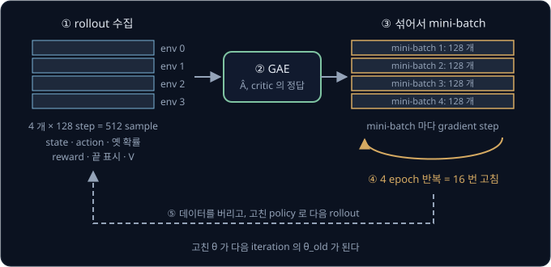

그림의 env 는 environment 의 줄임말이다.

1. 지금 policy $\pi_{\theta_\text{old}}$ 로 environment 여러 개를 정해진 step 수만큼 움직여 rollout 을 모은다
2. 마지막 state 의 예측까지 써서 GAE 로 sample 마다 $\hat A_t$ 와 $\hat R_t$ 를 계산한다
3. sample 을 섞어 mini-batch 로 나누고, mini-batch 마다 $\mathcal L$ 로 gradient step 을 한다. 이것을 정해진 epoch 수만큼 되풀이한다
4. 데이터를 버리고, 고친 $\theta$ 를 새 $\theta_\text{old}$ 로 삼아 1 로 돌아간다

PPO 는 같은 데이터를 여러 epoch 쓰는데도 on-policy 방법으로 분류한다. 데이터를 다시 쓰는 것은 그 데이터를 모은 iteration 안에서뿐이고,
그동안 clip 이 새 policy 를 옛 policy 가까이에 붙잡아 두기 때문이다. iteration 이 끝나면 데이터는 버린다. 아주 오래전 policy 로 모은
데이터까지 쌓아 두고 계속 다시 쓰는 off-policy 방법은 [DQN → SAC](../off-policy/README.md) 에서 다룬다. 데이터를 몇 epoch 까지 다시 쓸 수
있는지는 결국 새 policy 가 옛 policy 에서 얼마나 멀어지는지로 정해진다. epoch 를 너무 늘리면 clip fraction 이 커지고 대부분의 sample 이
멈춰서, 더 돌려도 배우는 것이 적다.

**확인 문제.** iteration 2 의 첫 mini-batch 에서 ratio 의 분모로 쓰는 확률은 어느 policy 의 것일까?

답 보기

iteration 1 이 끝날 때 고친 policy, 곧 iteration 2 의 rollout 을 모은 policy 의 확률이다. 그 policy 가 새 $\theta_\text{old}$ 다.

**요약**

- 한 iteration 은 rollout 수집 → GAE → 섞어서 mini-batch 로 여러 epoch 학습 → 데이터 버리기 순서이고, sample 512 개를 128 개씩 4 epoch 쓰면 16 번 고친다
- loss 는 $-L^{\text{CLIP}} + c_v L^{\text{VF}} - c_e \mathcal H$ 로, clipped surrogate 를 키우고 critic 의 오차를 줄이며 entropy 를 조금 키운다
- 데이터는 그 iteration 안에서만 다시 쓰고 clip 이 policy 를 가까이 붙잡아 두므로 PPO 는 on-policy 방법이다

## 연속 action 의 ratio

### Gaussian policy

로봇 관절에 줄 힘은 $-1$ 부터 $1$ 사이의 아무 숫자나 될 수 있어서, A 와 B 처럼 action 마다 확률을 하나씩 적을 수 없다. 그래서 연속된
action 에서는 종 모양의 곡선으로 action 을 뽑는다. 이 곡선을 normal distribution 또는 Gaussian 이라고 하는데, Gaussian 은 이 곡선을
연구한 수학자 Gauss 의 이름에서 왔다.

종 모양 곡선은 두 숫자로 정해진다. 가운데 위치는 평균 $\mu$ 이고, 퍼진 정도는 standard deviation(표준편차) $\sigma$ 다. $\mu$ 는 그리스
문자 mu(뮤), $\sigma$ 는 sigma(시그마)의 소문자다. 앞 강의에서는 B 의 확률 곡선 $e^\theta / (1 + e^\theta)$ 를 sigmoid 라 부르고
$\sigma(\theta)$ 로 썼지만, 여기의 $\sigma$ 는 다른 값이다. standard deviation 은 variance 의 제곱근, 곧 제곱해서 variance 가 되는
양수다. 앞 강의에서 본 $\{1, 3\}$ 은 variance 가 1 이라 standard deviation 이 1 이고, $\{-2, 6\}$ 은 variance 가 16 이라
$4 \times 4 = 16$ 에서 standard deviation 이 4 다.

곡선의 높이는 아래 식으로 계산한다.

$$
p(a) = \frac{1}{\sigma\sqrt{2\pi}}\, e^{-\frac{(a - \mu)^2}{2\sigma^2}}
$$

여기의 $\pi$ 는 policy 가 아니라 원주율 3.14159 다. 식은 "action $a$ 가 평균에서 떨어진 거리를 제곱해 $2\sigma^2$ 로 나누고, 마이너스를
붙여 $e$ 의 지수에 넣은 뒤, 앞의 정해진 수를 곱한다" 로 읽는다. 평균에서 멀수록 지수가 큰 음수가 되어 높이가 낮아진다. $\mu = 0$,
$\sigma = 1$ 이면 앞의 수는 $1 \div \sqrt{2\pi} = 0.3989$ 다.

| action $a$ | 0 | 0.5 | 0.8 | 1 | 2 |
| --- | --- | --- | --- | --- | --- |
| 높이 $p(a)$ | 0.3989 | 0.3521 | 0.2897 | 0.2420 | 0.0540 |

연속된 action 은 값이 끝없이 많아서 정확히 0.8 이 나올 확률은 0 이고, 대신 이 높이를 확률 밀도라고 부른다. 높이가 높은 근처의 값일수록
자주 뽑힌다. Gaussian policy 는 network 가 state 를 받아 관절마다 평균 $\mu$ 를 내고, 그 평균의 종 모양 곡선에서 action 을 뽑는다. 퍼진
정도 $\sigma$ 는 학습으로 고치는 parameter 를 따로 둔다.

**확인 문제.** $\mu = 0$, $\sigma = 1$ 인 Gaussian 에서 $a = 1$ 과 $a = 2$ 가운데 더 자주 뽑히는 근처는?

답 보기

높이가 0.2420 으로 0.0540 보다 높은 $a = 1$ 근처다.

### 확률 밀도로 만든 ratio

연속 action 에서는 확률 대신 확률 밀도로 ratio 를 만든다. 옛 policy 의 평균이 0, 새 policy 의 평균이 0.5 이고 둘 다 $\sigma = 1$ 인데,
rollout 에서 뽑은 action 이 0.8 이었다고 하자.

| | 평균 $\mu$ | $(0.8 - \mu)^2 \div 2$ | $e^{-(\cdot)}$ | 높이 $p(0.8)$ |
| --- | --- | --- | --- | --- |
| 옛 policy | 0 | 0.32 | 0.7261 | $0.3989 \times 0.7261 = 0.2897$ |
| 새 policy | 0.5 | 0.045 | 0.9560 | $0.3989 \times 0.9560 = 0.3814$ |

ratio 는 $0.3814 \div 0.2897 = 1.3165$ 다. 앞의 수 0.3989 는 분자와 분모에 똑같이 있어 나눌 때 지워진다. 평균이 action 쪽으로 다가가 그
근처를 더 자주 뽑게 되었으므로 ratio 가 1 보다 크고, $\epsilon = 0.2$ 라면 clip 으로 1.2 가 된다. 숫자만 바꿔 뽑은 action 이 $-0.2$ 였다면
높이가 0.3910 에서 0.3123 으로 낮아져 ratio 는 0.7985 이고, 0.8 아래라 clip 으로 0.8 이 된다.

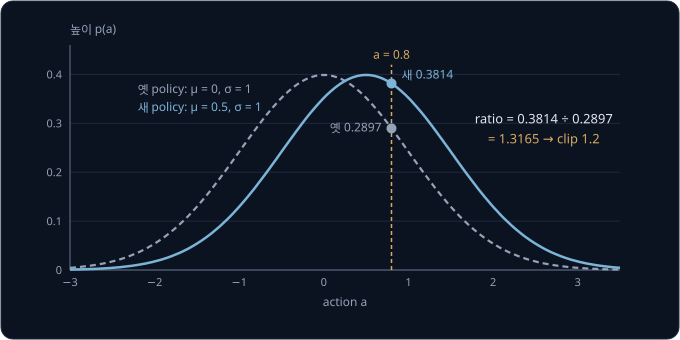

관절이 여럿이면 관절마다 action 을 따로 뽑으므로, 여러 관절의 action 이 함께 나올 확률 밀도는 관절마다의 높이를 곱한 것이다. 그래서
ratio 도 관절마다의 ratio 를 곱한 값이 된다. 두 관절의 ratio 가 1.1 과 1.2 이면 전체 ratio 는 $1.1 \times 1.2 = 1.32$ 다. 실제로는
$\ln$ 을 씌워 곱을 합으로 바꿔 계산한다. 다리 넷 달린 로봇처럼 관절이 12 개라면 열두 개의 log-probability 를 더한다.

**확인 문제.** 세 관절의 ratio 가 1.1, 1.0, 0.9 이면 전체 ratio 는?

답 보기

$1.1 \times 1.0 \times 0.9 = 0.99$ 다.

**요약**

- 연속 action 은 network 가 관절마다 평균 $\mu$ 를 내는 Gaussian 에서 뽑고, 확률 대신 곡선의 높이(확률 밀도)를 쓴다
- ratio 는 새 높이 ÷ 옛 높이이고, 평균이 0 에서 0.5 로 옮겨 가면 action 0.8 의 ratio 는 1.3165 다
- 관절이 여럿이면 관절마다의 ratio 를 곱해 전체 ratio 를 만든다

## 정리

- policy 를 한 번에 크게 고치면 망가지고, 망가진 policy 는 좋은 action 의 데이터를 모으지 못해 회복하기 어렵다. 운 나쁜 sample 하나로
  $\eta = 10$ 만큼 고치면 $\pi_\theta(B)$ 가 0.5 에서 0.000553 이 되고, 정확한 gradient 로도 되돌아오는 데 186 번이 걸린다
- probability ratio $r_t(\theta) = \pi_\theta(a_t \mid s_t) / \pi_{\theta_\text{old}}(a_t \mid s_t)$ 는 action 하나에서 policy 가 몇 배로
  바뀌었는지를 잰다. 옛 데이터의 sample 에 ratio 를 곱하면 새 policy 의 평균을 구할 수 있지만, ratio 가 1 에서 멀면 믿을 수 없다
- surrogate objective $\frac{1}{n}\sum_t r_t(\theta)\hat A_t$ 는 $\theta_\text{old}$ 에서 policy gradient 와 같은 방향이다. 제한 없이 여러
  epoch 키우면 policy 가 멀리 밀려나서, TRPO 는 KL divergence 에 조건을 걸었고 PPO 는 ratio 를 $[1 - \epsilon, 1 + \epsilon]$ 로 잘랐다
- clipped surrogate $\min(r\hat A,\ \operatorname{clip}(r, 0.8, 1.2)\hat A)$ 는 advantage 가 양수이면 ratio 1.2 위에서, 음수이면 0.8 아래에서
  gradient 를 0 으로 만들고, 반대쪽으로 잘못 간 update 를 되돌리는 gradient 는 살려 둔다
- GAE 는 TD error $\delta_t$ 를 $(\gamma\lambda)^l$ 몫으로 섞은 advantage 로, 뒤에서부터 $\hat A_t = \delta_t + \gamma\lambda \hat A_{t+1}$
  로 계산한다. $\lambda$ 가 0 이면 bias 가 크고 1 이면 variance 가 크다
- PPO 의 한 iteration 은 rollout 수집, GAE, 섞어서 mini-batch 로 여러 epoch 학습, 데이터 버리기다. loss 는 clipped surrogate 에 value
  loss 와 entropy bonus 를 더한 것이다

PPO 도 데이터를 한 iteration 만 쓰고 버리는 on-policy 방법이라, 실물 로봇을 직접 움직여 데이터를 모으기에는 여전히 많은 데이터가
든다. 지난 데이터를 쌓아 두고 계속 다시 쓰는 방법은 [DQN → SAC](../off-policy/README.md) 에서 다룬다.

그래도 PPO 가 로봇 학습에서 많이 쓰이는 이유는 안정성에 있다. 다리로 걷는 로봇의 보행 policy 는 대개 simulator(컴퓨터 안에서 물리
법칙을 계산해 로봇을 움직여 보는 프로그램) 안에서 PPO 로 학습한 뒤 실물 로봇으로 옮기는데, simulator 에서 실물로 옮기는 이 과정을
sim2real 이라고 한다. Rudin 등(2021)은 계산을 병렬로 빠르게 하는 장치인 GPU 한 장에서 수천 개의 simulator 를 동시에 돌려 PPO 로 4족
보행을 몇 분 만에 학습했고, 보행 학습 코드 모음인 legged_gym 과 MuJoCo Playground 도 PPO 를 기본 학습 알고리즘으로 쓴다. simulator 를
병렬로 돌리면 새 데이터를 싸게 많이 모을 수 있어서, 데이터를 한 iteration 만 쓰는 약점이 크게 문제 되지 않는다. 다만 학습에 쓴
simulator 의 질량·마찰 같은 값에서만 잘 걷는 policy 는 실물에서 쉽게 넘어진다. 이 값들을 episode 마다 바꿔 가며 학습해 실물에서도
버티게 만드는 방법은 [Sim-to-Real Locomotion](../sim2real-locomotion/README.md) 에서 다룬다.

PPO 가 쓰이는 또 하나의 자리는 VLA 를 reinforcement learning 으로 다시 다듬는 일이다. VLA(Vision-Language-Action model)는 카메라 영상과
"컵을 집어" 같은 말을 받아 로봇의 action 을 내는 큰 neural network 이고, 먼저 사람의 시연을 따라 하도록 학습한다. 이미 학습된 모델을
새 목표로 조금 더 학습하는 것을 fine-tuning 이라고 하는데, 시연만으로는 시연보다 잘하기 어려워서 컵 집기 같은 작업에 성공하면 reward 1 을 주는
reinforcement learning 으로 한 번 더 fine-tuning 한다. 수십억 개의 parameter 로 어렵게 배운 policy 가 update 한 번에 망가지면 안 되므로,
policy 를 옛 policy 가까이에 붙잡아 두는 PPO 가 자연스러운 선택이다. VLA-RL 과 RL4VLA 는 공개 VLA 인 OpenVLA 를, DPPO 는 잡음에서
시작해 조금씩 다듬어 action 을 만드는 diffusion policy 를 PPO 로 fine-tuning 했다. 이 내용은 [VLA + RL](../vla-rl/README.md) 에서
다룬다.

## 참고 자료

- John Schulman 외, [Proximal Policy Optimization Algorithms](https://arxiv.org/abs/1707.06347) (2017) — PPO 원 논문. 3절의 그림 1 이
  "advantage 가 양수일 때·음수일 때" 의 그래프와 같고, 5절에 한 iteration 의 의사코드가 있다
- John Schulman 외, [High-Dimensional Continuous Control Using Generalized Advantage Estimation](https://arxiv.org/abs/1506.02438)
  (2015) — GAE 논문. 3절이 이 강의의 "여러 step 을 더한 advantage" 와 "λ 로 섞는 GAE" 의 유도다
- John Schulman 외, [Trust Region Policy Optimization](https://arxiv.org/abs/1502.05477) (2015) — KL 조건을 거는 이유와 surrogate
  objective 의 유도. 수식이 많아서 PPO 논문을 먼저 읽고 필요할 때 연다
- OpenAI Spinning Up, [Proximal Policy Optimization](https://spinningup.openai.com/en/latest/algorithms/ppo.html) — clipped objective 를
  advantage 의 부호로 나눠 다시 쓴 설명과 의사코드. 이 강의의 조합 표를 식으로 확인할 때 읽는다
- Huang 외, [The 37 Implementation Details of Proximal Policy Optimization](https://iclr-blog-track.github.io/2022/03/25/ppo-implementation-details/)
  (2022) — 논문에 없는 구현 세부(advantage 정규화, learning rate 감소 등)가 성능을 얼마나 바꾸는지 하나씩 정리한 글
- Logan Engstrom 외, [Implementation Matters in Deep Policy Gradients](https://arxiv.org/abs/2005.12729) (2020) — PPO 가 TRPO 보다 나은 성능의
  상당 부분이 clip 이 아니라 구현 세부에서 왔다는 실험. PPO 를 직접 구현해 볼 때 읽는다
- Lilian Weng, [Policy Gradient Algorithms](https://lilianweng.github.io/posts/2018-04-08-policy-gradient/) — 앞 강의의 REINFORCE·actor-critic
  에서 TRPO·PPO 까지 한 기호 체계로 이어 본 글
- UC Berkeley CS 285, [Deep Reinforcement Learning](https://rail.eecs.berkeley.edu/deeprlcourse/) — advanced policy gradient 강의에서
  TRPO 와 PPO 의 유도를 영상과 slide 로 다룬다
- Nikita Rudin 외, [Learning to Walk in Minutes Using Massively Parallel Deep Reinforcement Learning](https://arxiv.org/abs/2109.11978)
  (2021) — 수천 개의 simulator 를 GPU 에서 동시에 돌려 PPO 로 4족 보행을 학습하고 실물 로봇으로 옮긴 논문
- [legged_gym](https://github.com/leggedrobotics/legged_gym)·[MuJoCo Playground](https://github.com/google-deepmind/mujoco_playground)
  — PPO 로 보행 policy 를 학습하는 대표 코드 모음. 실제 학습에 어떤 설정값을 쓰는지 볼 때 연다
