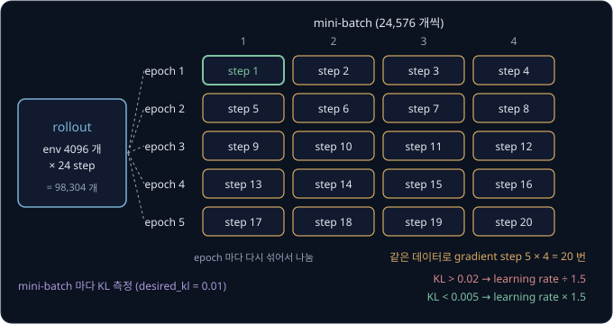

# PPO

policy gradient 로 policy 를 학습하다 보면 reward 가 잘 오르다가 어느 update 뒤에 갑자기 떨어지고 다시 올라오지 않는 일이 생긴다.
learning rate 를 줄이면 이런 붕괴는 줄지만 학습이 느려지고, 비싸게 모은 데이터는 여전히 한 번 쓰고 버려야 한다. 한 번 모은 데이터로
여러 번 고치면서도 policy 가 한 번에 망가지지 않게 막을 수는 없을까?

PPO(Proximal Policy Optimization)가 그 방법이다. 데이터를 모은 policy 와 지금 policy 가 같은 action 을 고를 확률의 비를 0.8 ~ 1.2 근처로
묶어 두고, 같은 데이터로 여러 epoch 학습한다. Rudin 등(2021)은 GPU 한 장에서 4족 로봇 ANYmal 수천 대를 동시에 simulation 하며 PPO 로 평지
보행 policy 를 4 분 안에 학습했다. 그 코드인 legged_gym 과 후속 Isaac Lab 의 보행 예제도 PPO 를 기본으로 쓴다.

## 학습 목표

- 한 번에 크게 바꾼 update 가 policy 를 망가뜨리고, 망가진 policy 가 회복하기 어려운 이유를 숫자로 설명할 수 있다
- probability ratio 와 clipped surrogate($\epsilon = 0.2$)가 같은 데이터로 여러 epoch 학습하면서도 policy 의 변화를 막는 방식을 advantage
  의 부호별로 설명할 수 있다
- GAE 의 $\lambda$ 가 advantage 의 bias 와 variance 를 바꾸는 방식과, rollout 이 중간에 끊긴 경우 critic 의 예측으로 메우는 이유를 설명할 수 있다
- legged_gym·Isaac Lab 의 PPO 기본 설정을 읽고, PPO 가 수천 개 env 의 병렬 simulation 에 잘 맞는 이유를 설명할 수 있다

## 한 번에 크게 바꾼 update

[Policy Gradient](../policy-gradient/README.md) 의 슬롯머신 두 대를 그대로 쓴다. 기계 A 는 당길 때마다 동전 1 개를 주고, 기계 B 는 0.5 의
확률로 4 개를 주며 나머지 경우에는 하나도 주지 않는다. 기댓값은 A 가 1 이고 B 가 $4 \times 0.5 = 2$ 다. policy 는 parameter $\theta$ 하나로 B 를 고를 확률을
$\pi_\theta(B) = e^\theta / (1 + e^\theta)$ 로 정하고, $\theta = 0$ 이면 A 와 B 를 반씩 고른다. update 는 advantage $\hat A$(고른 action 이
평균보다 나은 정도)에 log-probability 의 gradient 와 learning rate $\eta$ 를 곱해 $\theta$ 에 더한다.

$$
\theta \leftarrow \theta + \eta\, \hat A\, \nabla_\theta \ln \pi_\theta(a)
$$

같은 데이터로 여러 번 고치면 한 번에 크게 고친 것과 비슷한 효과가 나므로, 먼저 learning rate 를 키우면 무슨 일이 생기는지 본다.

$\theta = 0$ 에서 B 를 골랐는데 운이 나빠 0 개를 받았다고 하자. $\theta = 0$ 의 평균 reward 는
$0.5 \times 1 + 0.5 \times 2 = 1.5$ 이므로 $\hat A = 0 - 1.5 = -1.5$ 다. 이때 B 의 $\nabla_\theta \ln \pi_\theta(B) = 1 - 0.5 = 0.5$ 이므로
$\theta$ 의 변화는 $\eta \times (-1.5) \times 0.5 = -0.75\,\eta$ 다.

| $\eta$ | 새 $\theta$ | 새 $\pi_\theta(B)$ | 1000 번 당길 때 B 를 고르는 횟수 |
| --- | --- | --- | --- |
| 0.1 | $-0.075$ | 0.4813 | 약 481 번 |
| 1 | $-0.75$ | 0.3208 | 약 321 번 |
| 10 | $-7.5$ | 0.000553 | 약 0.55 번 |

$\eta = 10$ 이면 더 좋은 기계가 한 번 운이 나빴을 뿐인데 policy 가 B 를 거의 버려서, 다음 데이터에는
B 가 더 좋다는 정보가 거의 들어오지 않는다. 진짜 gradient
$\pi_\theta(A)\,\pi_\theta(B)\,(2 - 1)$ 을 정확히 알아도 $\theta = -7.5$ 에서는 $0.9994 \times 0.000553 \approx 0.00055$ 로 아주 작아서,
$\eta = 10$ 으로 계속 고쳐도 $\theta$ 가 0 으로 돌아오기까지 update 가 186 번 필요하다.

supervised learning 은 모델이 아무리 틀려도 학습 데이터가 그대로지만, reinforcement learning 은 이처럼 policy 가 자기 데이터를 직접 모으므로
policy 를 한 번에 너무 크게 바꾸지 않는 장치가 따로 필요하다.

<b>심화: θ 의 변화와 확률의 변화</b>

learning rate 가 정하는 것은 $\theta$ 가 움직이는 크기이지 policy 가 바뀌는 크기가 아니다. $\theta$ 를 똑같이 1 만큼 늘려도 어디서 출발하느냐에
따라 확률이 바뀌는 비율이 다르다.

| $\theta$ 의 변화 | $\pi_\theta(B)$ | $\pi_\theta(A)$ | A 의 확률이 몇 배가 되었나 |
| --- | --- | --- | --- |
| $0 \to 1$ | $0.5 \to 0.7311$ | $0.5 \to 0.2689$ | $0.2689 \div 0.5 = 0.5379$ |
| $4 \to 5$ | $0.9820 \to 0.9933$ | $0.0180 \to 0.0067$ | $0.0067 \div 0.0180 = 0.3721$ |

$\theta$ 를 4 에서 5 로 옮기면 B 의 확률은 0.0113 만 올라 거의 그대로처럼 보이지만, 1000 번에 18 번 고르던 A 는 6.7 번만 고르게 되어 확률이
0.3721 배로 줄었다. 그래서 policy 가 얼마나 바뀌었는지는 $\theta$ 의 변화가 아니라 action 마다 확률이 몇 배가 되었는지로 재야 하고, 어느
$\theta$ 에서나 안전한 learning rate 하나를 미리 정하기도 어렵다.

**확인 문제.** 같은 sample 로 $\eta = 2$ 이면 새 $\theta$ 와 $\pi_\theta(B)$ 는? ($e^{-1.5} \approx 0.2231$)

답 보기

1. $\theta$ 의 변화는 $-0.75 \times \eta = -0.75 \times 2 = -1.5$ 라서 새 $\theta = -1.5$ 다
2. $\pi_\theta(B) = 0.2231 \div (1 + 0.2231) = 0.2231 \div 1.2231 \approx 0.1824$ 다

1000 번 당기면 B 를 약 182 번 고른다.

## probability ratio

같은 데이터로 여러 번 고치려면 두 policy 를 구분해야 한다. 데이터를 모을 때 쓴 parameter 를 $\theta_\text{old}$ 라 하고, 지금 고치고 있는
parameter 를 $\theta$ 라 한다. sample 하나에서 고른 action 을 새 policy 가 고를 확률을 옛 policy 가 고를 확률로 나눈 값이 **probability ratio** 다.

$$
r_t(\theta) = \frac{\pi_\theta(a_t \mid s_t)}{\pi_{\theta_\text{old}}(a_t \mid s_t)}
$$

$a_t$ 는 $t$ 번째 sample 에서 고른 action 이고 $s_t$ 는 그때의 state(agent 가 보는 지금 상황)이며, 세로선 $\mid$ 는 "state $s_t$ 에서" 라고
읽는다. ratio 의 글자 $r$ 은 reward 와 같지만 다른 값이라서, 이 강의에서는 늘 괄호 안에 $\theta$ 를 붙여 $r_t(\theta)$ 로 쓴다.
$\theta_\text{old} = 0$ 으로 데이터를 모았고 몇 번 고쳐 $\theta = 0.5$ 가 되었다면 ratio 는 아래와 같다.

| action | 옛 확률 | 새 확률 | ratio |
| --- | --- | --- | --- |
| A | 0.5 | 0.3775 | $0.3775 \div 0.5 = 0.7551$ |
| B | 0.5 | 0.6225 | $0.6225 \div 0.5 = 1.2449$ |

고치기 시작하는 순간에는 $\theta = \theta_\text{old}$ 라서 모든 sample 의 ratio 가 정확히 1 이고, 고칠수록 1 에서 멀어진다.

ratio 를 곱하면 옛 데이터로도 새 policy 의 평균을 계산할 수 있다. $\theta_\text{old} = 0$ 으로 모은 데이터에는 A 와 B 가 반씩 들어 있지만,
$\theta = 2$ 의 새 policy 는 A 를 0.1192 의 확률로 고르고 B 를 0.8808 의 확률로 고른다. sample 마다 ratio 를 곱해서 세면 데이터 속
비율이 새 policy 의 비율과 같아지고, 그 비율로 평균한 gradient 도 $\theta = 2$ 의 진짜 gradient 0.105 와 같아진다(아래 그림, 계산은 심화).
다른 확률로 모은 sample 에 확률의 비를 곱해 원하는 분포에서의 평균을 구하는 이 방법을 **importance sampling** 이라고 한다.

ratio 가 1 에서 아주 멀면 이 방법을 믿기 어렵다. 옛 policy 가 0.01 의 확률로 고르던 action 을 새 policy 가 0.5 로 고르면 ratio 가 50 이라서,
100 번에 1 번꼴로만 들어 있던 그 sample 하나가 50 개 몫으로 세어진다. 그 한 sample 이 운 좋게 좋았는지 나빴는지에 따라 평균이 크게 흔들리므로,
ratio 로 고친 계산은 새 policy 가 옛 policy 에서 많이 멀어지지 않았을 때만 쓸 수 있다.

실제 구현은 확률 대신 log-probability 를 저장한다. legged_gym 이 쓰는 학습 library rsl_rl 은 rollout 때 저장한 log-probability 를 지금
policy 의 log-probability 에서 빼고 $e$ 의 지수에 넣어 ratio 를 만든다. $\theta = 0.5$ 의 B 라면
$\ln 0.6225 - \ln 0.5 = -0.4740 - (-0.6931) = 0.2191$ 이고, $e^{0.2191} \approx 1.245$ 로 위 표의 1.2449 와 같다.

<b>심화: ratio 로 옛 데이터를 다시 쓴 gradient</b>

[Policy Gradient](../policy-gradient/README.md) 의 두 기계 문제에서는 $\theta = 0$ 의 sample 을 $\theta = 2$ 에서 그대로 쓰면 진짜 gradient
$+0.105$ 대신 $-0.3212$ 가 나와 부호까지 틀렸다. ratio 를 곱해 다시 계산한다. $\theta = 2$ 에서 $\nabla_\theta \ln \pi_\theta(a)$ 는 A 가
$-\pi_\theta(B) = -0.8808$, B 가 $1 - \pi_\theta(B) = 0.1192$ 다.

| 경우 | 옛 데이터의 비율 | ratio | 비율 × ratio | $r$ | $\nabla_\theta \ln \pi_\theta(a)$ | 비율 × ratio × $r$ × $\nabla$ |
| --- | --- | --- | --- | --- | --- | --- |
| A 를 고름 | 0.5 | 0.2384 | 0.1192 | 1 | $-0.8808$ | $-0.1050$ |
| B 를 골라 4 개 | 0.25 | 1.7616 | 0.4404 | 4 | $+0.1192$ | $+0.2100$ |
| B 를 골라 0 개 | 0.25 | 1.7616 | 0.4404 | 0 | $+0.1192$ | $0$ |

마지막 열을 더하면 $-0.1050 + 0.2100 + 0 = 0.105$ 로 진짜 gradient 와 같다. 식으로 쓰면 아래와 같다.

$$
\mathbb E_{a \sim \pi_\theta}\big[f(a)\big] = \mathbb E_{a \sim \pi_{\theta_\text{old}}}\Big[\frac{\pi_\theta(a)}{\pi_{\theta_\text{old}}(a)}\, f(a)\Big]
$$

$\mathbb E$ 는 기댓값이고 아래첨자 $a \sim \pi_\theta$ 는 "action $a$ 를 $\pi_\theta$ 의 확률로 뽑을 때" 라는 뜻이다. $f(a)$ 는 action 마다
정해지는 값으로, 위 표에서는 $r \times \nabla_\theta \ln \pi_\theta(a)$ 였다.

**확인 문제.** 옛 policy 가 어떤 action 을 0.4 의 확률로, 새 policy 가 0.5 의 확률로 고른다. ratio 는? 새 policy 가 0.3 이면?

답 보기

ratio 는 새 확률 ÷ 옛 확률이라서 $0.5 \div 0.4 = 1.25$ 이고, 0.3 이면 $0.3 \div 0.4 = 0.75$ 다.

## surrogate objective

ratio 를 쓰면 옛 데이터로 계산하면서 키울 목표를 만들 수 있다. 그 목표는 batch(한 번에 쓰는 sample 묶음)에 sample 이 $n$ 개 있을 때
sample 마다 ratio 와 advantage 를 곱해 평균한 값이다.

$$
L(\theta) = \frac{1}{n}\sum_{t=1}^{n} r_t(\theta)\, \hat A_t
$$

$\hat A_t$ 는 데이터를 모을 때 계산해 둔 $t$ 번째 sample 의 advantage 다. 이 값을 **surrogate objective** 라고 한다. surrogate 는
"대리" 라는 뜻으로, 직접 키우기 어려운 기대 reward 대신 키우는 목표라서 붙은 이름이다. $\theta = \theta_\text{old}$ 에서 $L$ 의 gradient 는 policy
gradient 와 정확히 같아서, 첫 update 는 [Policy Gradient](../policy-gradient/README.md) 의 actor-critic update 와 같다.

같은 batch 를 처음부터 끝까지 한 번 학습에 쓰는 것을 epoch 라고 하는데, 제한 없는 surrogate 를 여러 epoch 키우면 policy 가 멀리 밀려난다.
운 나쁜 sample 하나($\hat A = -1.5$, B 를 고름)로 된 batch 에서 $L(\theta) = \frac{\pi_\theta(B)}{0.5} \times (-1.5) = -3\,\pi_\theta(B)$ 는
$\theta$ 를 줄일수록 끝없이 커진다. 그래서 $\eta = 0.5$ 로 gradient ascent(gradient 를 더해 목표를 키우는 update)를 10 epoch 하면 B 의 확률이
0.5 에서 0.0822 까지 떨어진다(epoch 별 값은 [같은 batch 의 여러 epoch](#같은-batch-의-여러-epoch) 의 표). 실제 batch 의 수천 개 sample 에서도
advantage 가 양수인 sample 의 gradient 는 그 action 의 ratio 를 끝없이 키우고, 음수인 sample 의 gradient 는 ratio 를 0 쪽으로 끝없이 줄인다. 그사이 ratio 가 1 에서 멀어져
importance sampling 을 믿을 수 없게 되고, 옛 policy 로 계산해 둔 advantage 도 맞지 않게 된다.

2015 년 Schulman 등의 TRPO(Trust Region Policy Optimization)는 surrogate 를 키우되, 옛 policy 와 새 policy 의 확률분포 차이인 KL divergence
가 정해 둔 값 $\delta$ 를 넘지 않게 하는 조건을 걸었다. 논문의 모든 실험에서 $\delta = 0.01$ 을 썼다. 이 조건 아래에서 가장 좋은 방향을 찾으려면
gradient 가 $\theta$ 에 따라 어떻게 바뀌는지까지 계산해야 해서, parameter 가 많은 neural network 에서는 계산이 무겁고 구현이 복잡했다.
2017 년 같은 연구진이 낸 PPO 는 KL 조건 대신 ratio 를 직접 잘라 보통의 gradient ascent 만으로 비슷한 효과를 낸다.

<b>심화: surrogate 의 gradient 와 KL divergence</b>

$\theta_\text{old} = 0$ 에서 B 를 골라 4 개를 받은 sample($\hat A = 2.5$)의 항 $r_t(\theta) \times 2.5 = \frac{\pi_\theta(B)}{0.5} \times 2.5$ 를
숫자로 미분해 본다. $\theta = 0$ 이면 2.5, $\theta = 0.01$ 이면 $\pi_\theta(B) = 0.5025$ 라서 $1.005 \times 2.5 = 2.5125$ 다. 변화 비율은
$0.0125 \div 0.01 = 1.25$ 로, policy gradient 의 $\hat A \times \nabla_\theta \ln \pi_\theta(B) = 2.5 \times 0.5 = 1.25$ 와 같다.

같아지는 이유는 ratio 의 분모가 고정된 수이기 때문이다. ratio 의 gradient 는 $\nabla_\theta \pi_\theta(a) \div \pi_{\theta_\text{old}}(a)$ 이고,
$\theta = \theta_\text{old}$ 에서는 분모가 $\pi_\theta(a)$ 와 같으므로 $\nabla_\theta \ln \pi_\theta(a) = \nabla_\theta \pi_\theta(a) \div \pi_\theta(a)$
가 된다.

KL divergence 는 옛 분포 $p$ 와 새 분포 $q$ 의 차이를 잰다.

$$
\mathrm{KL}(p \,\|\, q) = \sum_a p(a)\, \ln \frac{p(a)}{q(a)}
$$

A 0.5, B 0.5 에서 A 0.6, B 0.4 로 바뀌었다면 $0.5 \ln(0.5 / 0.6) + 0.5 \ln(0.5 / 0.4) = -0.0912 + 0.1116 = 0.0204$ 다. 두 분포가 같으면
$\ln 1 = 0$ 이라 KL 도 0 이다. 앞에서 본 update 의 KL 을 재면 $\theta$ 를 0 에서 1 로 고친 경우는 0.1202 이고 $\eta = 10$ 으로 $-7.5$ 까지
밀린 경우는 3.06 이라서, 둘 다 TRPO 의 $\delta = 0.01$ 을 크게 넘는다.

## clipped surrogate

$\operatorname{clip}(x, l, h)$ 는 $x$ 를 $l$ 과 $h$ 사이로 자르는 함수로, $x$ 가 $l$ 보다 작으면 $l$ 을 내고 $h$ 보다 크면 $h$ 를 내며 그
사이면 $x$ 를 그대로 낸다. PPO 는 ratio 를 $1 - \epsilon$ 과 $1 + \epsilon$ 사이로 자르는데, $\epsilon$(epsilon)은 보통 0.2 라서 범위는
$[0.8, 1.2]$ 다. 그리고 sample 마다 자르지 않은 항과 자른 항 가운데 작은 값을 골라 평균한다.

$$
L^{\text{CLIP}}(\theta) = \frac{1}{n}\sum_{t=1}^{n} \min\Big(r_t(\theta)\,\hat A_t,\ \operatorname{clip}\big(r_t(\theta), 1-\epsilon, 1+\epsilon\big)\,\hat A_t\Big)
$$

이 값을 **clipped surrogate objective** 라고 한다. ratio 가 1.3 이고 advantage 가 $+2$ 인 sample 이면 자르지 않은 항은 $1.3 \times 2 = 2.6$ 이고
자른 항은 $1.2 \times 2 = 2.4$ 라서 2.4 를 고른다. 자른 항은 $\theta$ 를 조금 바꿔도 2.4 그대로라서, 이 sample 은 gradient 에 아무것도 보태지
않는다. advantage 의 부호와 ratio 의 구간으로 나누면 아래 여섯 경우가 된다.

| advantage | ratio 구간 | 그 action 에 일어난 일 | 고르는 항 | gradient |
| --- | --- | --- | --- | --- |
| 양수 | 0.8 아래 | 좋은 action 의 확률이 오히려 크게 내려감 | 자르지 않은 항 | 흐름, 다시 올림 |
| 양수 | 0.8 ~ 1.2 | 좋은 action 의 확률이 조금 바뀜 | 두 항이 같음 | 흐름, 올림 |
| 양수 | 1.2 위 | 좋은 action 의 확률을 이미 충분히 올림 | 자른 항 | 0, 멈춤 |
| 음수 | 0.8 아래 | 나쁜 action 의 확률을 이미 충분히 내림 | 자른 항 | 0, 멈춤 |
| 음수 | 0.8 ~ 1.2 | 나쁜 action 의 확률이 조금 바뀜 | 두 항이 같음 | 흐름, 내림 |
| 음수 | 1.2 위 | 나쁜 action 의 확률이 오히려 크게 올라감 | 자르지 않은 항 | 흐름, 다시 내림 |

멈추는 경우는 둘뿐이고, 둘 다 advantage 가 가리키는 방향으로 이미 20% 넘게 간 경우다. 반대 방향으로 벗어난 경우는 잘못 간 것이라서
되돌리는 gradient 는 남겨 둔다. $\min$ 이 두 항 가운데 늘 더 나쁜 쪽을 고르므로, 좋아지는 쪽으로는 20% 까지만 믿고 나빠지는 쪽은 그대로
반영한다. 위 그림의 평평한 구간이 gradient 가 0 인 곳이다. PPO 의 proximal 은 "가까운" 이라는 뜻으로, 새 policy 를 옛 policy 가까이 둔다는 데서
붙은 이름이다.

PPO 논문의 저자들은 MuJoCo 연속 제어 과제 7 개를 seed 3 개씩 모두 21 번, 번마다 100 만 step 학습한 뒤 점수를 0(무작위 policy)과
1(가장 좋은 결과) 사이로 맞춰 평균했다. 제한 없는 surrogate 는 한 과제(half cheetah)에서 처음의 무작위 policy 보다도 나빠져 평균이
$-0.39$ 였다. clip 을 쓴 결과는 $\epsilon$ 이 0.1, 0.2, 0.3 일 때 각각 0.76, 0.82, 0.70 이었다. CleanRL, legged_gym, Isaac Lab 의 기본값도 0.2 다.

> **오해** clip 은 ratio 를 늘 0.8 과 1.2 사이에 가둔다.
>
> **사실** clip 은 ratio 를 경계 안으로 되돌리지 않는다. 한 번의 update 가 크면 ratio 가 경계를 넘을 수 있고 clip 은 그다음부터 그 방향으로 더 밀지 않을 뿐이라서, 다음 절의 표에서는 ratio 가 0.6473 까지
> 내려간다.

<b>심화: advantage 가 ±2 일 때의 두 항</b>

| ratio $r$ | 0.7 | 0.9 | 1.0 | 1.1 | 1.3 | 1.5 |
| --- | --- | --- | --- | --- | --- | --- |
| $\hat A = +2$: $r \hat A$ | 1.4 | 1.8 | 2.0 | 2.2 | 2.6 | 3.0 |
| $\hat A = +2$: $\operatorname{clip}(r)\hat A$ | 1.6 | 1.8 | 2.0 | 2.2 | 2.4 | 2.4 |
| $\hat A = +2$: 작은 값 | 1.4 | 1.8 | 2.0 | 2.2 | 2.4 | 2.4 |
| $\hat A = -2$: $r \hat A$ | $-1.4$ | $-1.8$ | $-2.0$ | $-2.2$ | $-2.6$ | $-3.0$ |
| $\hat A = -2$: $\operatorname{clip}(r)\hat A$ | $-1.6$ | $-1.8$ | $-2.0$ | $-2.2$ | $-2.4$ | $-2.4$ |
| $\hat A = -2$: 작은 값 | $-1.6$ | $-1.8$ | $-2.0$ | $-2.2$ | $-2.6$ | $-3.0$ |

음수끼리는 0 에서 먼 쪽이 더 작아서 $-2.6$ 이 $-2.4$ 보다 작다. $\hat A = +2$ 에서는 1.3, 1.5 에서 자른 항이 작아 gradient 가 0 이고, 0.7 에서는
자르지 않은 항 1.4 가 작아 gradient 가 흐른다. $\hat A = -2$ 에서는 반대로 0.7 에서 자른 항 $-1.6$ 이 작아 gradient 가 0 이고, 1.3, 1.5 에서는
자르지 않은 항이 작아 gradient 가 흐른다.

**확인 문제.** $\hat A = -1$, ratio 0.6 인 sample 의 두 항과 고르는 값은? 이 sample 은 $\theta$ 를 움직일까?

답 보기

1. 자르지 않은 항: $0.6 \times (-1) = -0.6$
2. 자른 항: 0.6 은 0.8 보다 작아 0.8 로 잘리므로 $0.8 \times (-1) = -0.8$
3. 작은 값은 $-0.8$ 이고 자른 항이다

자른 항은 $\theta$ 를 바꿔도 값이 그대로라서 gradient 가 0 이고, 이 sample 은 $\theta$ 를 움직이지 않는다. 나쁜 action 의 확률을 이미 0.8 배
아래로 내린 경우다.

## 같은 batch 의 여러 epoch

[surrogate objective](#surrogate-objective) 의 운 나쁜 sample($\hat A = -1.5$) 하나짜리 batch 를 같은 $\eta = 0.5$ 로 10 epoch 학습하며 clip
이 없을 때와 있을 때를 비교한다. clip 이 없을 때의 gradient 는 $-3\,\pi_\theta(A)\,\pi_\theta(B)$ 다.

| epoch | clip 없음: $\pi_\theta(B)$ | ratio | clip 있음: $\pi_\theta(B)$ | ratio | clip 있음: gradient |
| --- | --- | --- | --- | --- | --- |
| 1 | 0.5 | 1 | 0.5 | 1 | $-0.75$ |
| 2 | 0.4073 | 0.8147 | 0.4073 | 0.8147 | $-0.7242$ |
| 3 | 0.3236 | 0.6473 | 0.3236 | 0.6473 | 0 |
| 10 | 0.0922 | 0.1843 | 0.3236 | 0.6473 | 0 |
| 10 epoch 뒤 | 0.0822 | 0.1644 | 0.3236 | 0.6473 | |

epoch 1, 2 에서는 ratio 가 범위 안이라 두 경우가 같다. epoch 2 의 update 로 ratio 가 0.6473 까지 내려가 0.8 아래로 벗어나자, epoch 3
부터 clip 이 있는 쪽은 자른 항 $0.8 \times (-1.5) = -1.2$ 를 골라 gradient 가 0 이 되고 $\theta$ 가 더 움직이지 않는다.

B 를 0.3236 의 확률로 고르는 policy 로 다음 데이터를 모으면 B 가 세 번에 한 번꼴로 나와 동전 4 개를 받는 sample 도 들어오고, advantage
가 양수인 이 sample 이 B 의 확률을 다시 올린다. 결과가 좋은 batch 에서는 ratio 가 1.2 를 넘는 순간 gradient 가 멈추므로, 한 iteration(데이터를
모으고 고치는 한 바퀴) 동안 B 의 확률은 대략 1.2 배 안쪽으로만 오르고 iteration 을 거듭하며 꾸준히 오른다.

## GAE

clipped surrogate 에 넣는 advantage $\hat A_t$ 는 critic 의 예측으로 계산한다. critic 은 state 에서 앞으로 받을 reward 의 합 $V(s)$ 를
예측하는 network 다. actor-critic 에서는 한 step 의 결과로 만든 TD error 를 advantage 로 쓴다.

$$
\delta_t = r_{t+1} + \gamma\, V(s_{t+1}) - V(s_t)
$$

$r_{t+1}$ 은 step $t$ 의 action 직후에 받은 reward 이고, $\gamma$(gamma)는 늦게 받는 reward 를 깎는 discount factor 다. 식은 "받은 reward 에 다음
state 의 예측을 $\gamma$ 만큼 깎아 더하고 원래 state 의 예측을 뺀다" 로 읽는다. 막대를 세운 수레(CartPole)의 짧은 episode 로 계산한다.
막대가 서 있는 동안 step 마다 reward 1 을 받고 네 번째 reward 뒤에 막대가 쓰러졌다. critic 의 예측은 이 예를 위해 정한 값이고, 계산을
쉽게 하려고 $\gamma = 1$ 로 둔다. 끝난 뒤의 state 는 앞으로 받을 reward 가 없으므로 $V = 0$ 이다.

| step $t$ | 0 | 1 | 2 | 3 |
| --- | --- | --- | --- | --- |
| critic 의 예측 $V(s_t)$ | 3 | 3 | 2 | 2 |
| 다음 state 의 예측 $V(s_{t+1})$ | 3 | 2 | 2 | 0 (끝남) |
| $\delta_t = 1 + V(s_{t+1}) - V(s_t)$ | 1 | 0 | 1 | $-1$ |

$\delta_t$ 는 reward 하나와 critic 의 예측만 쓰므로 흔들림(variance)이 작지만 critic 이 틀린 만큼 치우친다(bias). 반대로 끝까지 받은
reward 를 모두 더한 return 에서 $V(s_t)$ 를 빼면 치우침은 없지만 그사이 모든 step 의 운이 섞여 흔들림이 크다. reward 를 $n$ 개 쓰고 나머지를
critic 의 예측으로 채운 advantage 는 $\delta$ 를 $n$ 개 더한 값과 같아서, 그 사이의 방법도 $\delta$ 로 만들 수 있다.

**GAE**(Generalized Advantage Estimation)는 몇 step 뒤의 $\delta$ 일수록 $\gamma\lambda$ 를 거듭 곱해 작게 섞는다. $\lambda$(lambda)는 0 과 1
사이의 수다.

$$
\hat A_t = \delta_t + \gamma\lambda\,\delta_{t+1} + (\gamma\lambda)^2\,\delta_{t+2} + \cdots
$$

$\gamma = 1$, $\lambda = 0.5$ 이면 몫이 1, 0.5, 0.25, 0.125 라서 $\hat A_0 = 1 + 0.5 \times 0 + 0.25 \times 1 + 0.125 \times (-1) = 1.125$ 다.

$\lambda = 0$ 이면 $\delta_t$ 하나만 남아 actor-critic 과 같다. $\lambda = 1$ 이면 모든 $\delta$ 를 그대로 더해 중간의 예측이 지워지므로,
return 에서 $V(s_0)$ 을 뺀 $4 - 3 = 1$ 이 된다. 실제로는 첫 항을 빼고 나머지를 $\gamma\lambda$ 로 묶은 $\hat A_t = \delta_t + \gamma\lambda\,\hat A_{t+1}$
을 써서 마지막 step 부터 거꾸로 한 번 훑는다. 마지막 step 뒤에는 episode 가 끝났으므로 $\hat A_4 = 0$ 이다.

| 순서 | step $t$ | $\delta_t$ | $\gamma\lambda \times \hat A_{t+1}$ | $\hat A_t$ |
| --- | --- | --- | --- | --- |
| 1 | 3 | $-1$ | $0.5 \times 0 = 0$ | $-1$ |
| 2 | 2 | 1 | $0.5 \times (-1) = -0.5$ | 0.5 |
| 3 | 1 | 0 | $0.5 \times 0.5 = 0.25$ | 0.25 |
| 4 | 0 | 1 | $0.5 \times 0.25 = 0.125$ | 1.125 |

critic 이 틀리면 $\lambda$ 가 작을수록 더 크게 어긋난다. 진짜로는 3 이 맞는 $V(s_1)$ 을 critic 이 5 로 잘못 예측하면, $\hat A_0$ 이
어긋나는 양은 $\lambda = 0$ 에서 2 이고 $\lambda = 0.5$ 에서 1 이며, 중간의 예측이 지워지는 $\lambda = 1$ 에서는 0 이다(계산은 아래 심화). $\lambda$ 가 작으면 critic 의 오차를 그대로 받는 bias 가 커지고, 크면 여러 step 의 운이 섞이는 variance 가 커진다.

PPO 논문의 MuJoCo·Atari 실험은 모두 $\gamma = 0.99$, $\lambda = 0.95$ 를 썼고, legged_gym 과 Isaac Lab 의 보행 설정도 같은 값이다.
$\gamma\lambda = 0.9405$ 라서 10 step 뒤의 TD error 는 $0.9405^{10} \approx 0.54$ 배의 몫을 받고, 50 step 뒤의 TD error 는 약 0.047 배를
받는다. GAE 논문의 저자들은 cart-pole 실험에서 $\gamma$ 가 0.96 ~ 0.99 이고 $\lambda$ 가 0.92 ~ 0.99 일 때 결과가 가장 좋았다고 보고했다.

<b>심화: δ 의 합과 GAE 몫의 유도</b>

step 0 의 advantage 를 reward 개수별로 계산하면 $\delta$ 의 합과 같다.

| 쓰는 reward 수 | 계산 | 값 | $\delta$ 로 쓰면 |
| --- | --- | --- | --- |
| 1 개 | $1 + V(s_1) - V(s_0) = 1 + 3 - 3$ | 1 | $\delta_0$ |
| 2 개 | $1 + 1 + V(s_2) - V(s_0) = 2 + 2 - 3$ | 1 | $\delta_0 + \delta_1 = 1 + 0$ |
| 3 개 | $3 + V(s_3) - V(s_0) = 3 + 2 - 3$ | 2 | $\delta_0 + \delta_1 + \delta_2 = 1 + 0 + 1$ |
| 4 개 (끝까지) | $4 - V(s_0) = 4 - 3$ | 1 | $1 + 0 + 1 - 1$ |

2 개짜리를 풀어 쓰면 $\delta_0 + \delta_1 = \big(r_1 + V(s_1) - V(s_0)\big) + \big(r_2 + V(s_2) - V(s_1)\big)$ 에서 $+V(s_1)$ 과 $-V(s_1)$ 이
지워져 $r_1 + r_2 + V(s_2) - V(s_0)$ 이 된다. $\gamma$ 가 1 이 아니면 뒤의 $\delta$ 에 $\gamma$ 를 곱해 더한다.

GAE 는 원래 이 advantage 들을 reward 1 개짜리에 $1 - \lambda$, 2 개짜리에 $(1 - \lambda)\lambda$, 3 개짜리에 $(1 - \lambda)\lambda^2$ 처럼 뒤로
갈수록 $\lambda$ 배씩 줄어드는 몫으로 가중 평균한 것이고, episode 가 끝나면 남은 몫은 끝까지 쓴 advantage 가 가져간다. $\lambda = 0.5$ 이면
몫이 0.5, 0.25, 0.125, 0.125 라서 $0.5 \times 1 + 0.25 \times 1 + 0.125 \times 2 + 0.125 \times 1 = 1.125$ 다. $\delta_0$ 은 네 advantage 에 모두
들어 있어 몫 $0.5 + 0.25 + 0.125 + 0.125 = 1$ 을 받고, $\delta_1$ 은 1 개짜리를 뺀 세 개에 들어 있어 $0.25 + 0.125 + 0.125 = 0.5$ 를 받는다.
그래서 $\delta$ 마다 $(\gamma\lambda)^l$ 몫을 주는 식과 같아진다.

$$
\hat A_t = \sum_{l=0}^{\infty} (\gamma\lambda)^l\, \delta_{t+l}
$$

진짜로는 3 이 맞는 $V(s_1)$ 을 critic 이 5 로 잘못 예측하면 $\delta_0 = 1 + 5 - 3 = 3$,
$\delta_1 = 1 + 2 - 5 = -2$ 가 되고 나머지는 그대로다.

| $\lambda$ | 틀린 critic 으로 구한 $\hat A_0$ | 맞는 critic 으로 구한 $\hat A_0$ | 차이 |
| --- | --- | --- | --- |
| 0 | 3 | 1 | 2 |
| 0.5 | $3 - 1 + 0.25 - 0.125 = 2.125$ | 1.125 | 1 |
| 1 | $3 - 2 + 1 - 1 = 1$ | 1 | 0 |

critic 이 맞혀야 할 정답은 advantage 에 원래 예측을 더한 $\hat R_t = \hat A_t + V(s_t)$ 다. 위 episode 에서는
$\hat R = (1.125 + 3,\ 0.25 + 3,\ 0.5 + 2,\ -1 + 2) = (4.125,\ 3.25,\ 2.5,\ 1)$ 이다.

**확인 문제.** $\gamma\lambda = 0.5$ 이고 $\delta = (2, 0, -2)$ 인 3 step episode 에서 뒤에서부터 $\hat A_2$, $\hat A_1$, $\hat A_0$ 를 구해
보자.

답 보기

$\hat A_t = \delta_t + 0.5 \times \hat A_{t+1}$ 을 마지막 step 부터 쓴다. episode 가 끝났으므로 $\hat A_3 = 0$ 이다.

| step $t$ | $\delta_t$ | $0.5 \times \hat A_{t+1}$ | $\hat A_t$ |
| --- | --- | --- | --- |
| 2 | $-2$ | $0.5 \times 0 = 0$ | $-2$ |
| 1 | 0 | $0.5 \times (-2) = -1$ | $-1$ |
| 0 | 2 | $0.5 \times (-1) = -0.5$ | 1.5 |

## rollout 이 중간에 끊긴 경우

PPO 는 policy 로 environment(agent 가 행동하는 대상 세계)를 정해진 step 수만큼 움직여 데이터를 모은다. 이 기록을 rollout 이라고 하는데,
rollout 은 episode 가 끝나지 않았어도 정해진 step 수에서 멈춘다. 그러면 마지막 step 의 $\delta$ 에 넣을 다음 state 의 예측이 필요하다.

앞 절의 4 step 이 막대가 아직 서 있는 채로 rollout 의 끝에 닿았고, 다음 state 의 예측이 $V(s_4) = 2$ 라고 하자. 마지막 TD error 는
$\delta_3 = 1 + 2 - 2 = 1$ 로 바뀌는데, 아직 받지 않은 reward 를 critic 의 예측으로 채우는 이 방법을 bootstrap 이라고 한다.

| step $t$ | $\delta_t$ | $0.5 \times \hat A_{t+1}$ | $\hat A_t$ | 쓰러져 끝난 경우의 $\hat A_t$ |
| --- | --- | --- | --- | --- |
| 3 | 1 | 0 | 1 | $-1$ |
| 2 | 1 | 0.5 | 1.5 | 0.5 |
| 1 | 0 | 0.75 | 0.75 | 0.25 |
| 0 | 1 | 0.375 | 1.375 | 1.125 |

막대가 쓰러지지 않은 만큼 step 3 의 advantage 가 $-1$ 에서 $+1$ 로 바뀌었고, 그 영향이 $\gamma\lambda$ 배씩 줄며 앞 step 으로 전해졌다.
반대로 rollout 한가운데에서 episode 가 끝나고 새 episode 가 시작되면 끝난 step 에서 $V(s_{t+1}) = 0$ 으로 두고 $\hat A_{t+1}$ 도 더하지 않는다.
새 episode 의 결과는 앞 episode 의 action 과 상관없기 때문이다.

Rudin 등의 보행 설정에서 episode 는 최대 20 초이고 policy 가 0.02 초마다 action 을 내므로, episode 하나는 1000 step 이다. rollout 은
env 마다 24 step 이라 episode 하나가 iteration 약 42 번에 걸친다. 로봇이 넘어져 끝난 episode 는 $V = 0$ 이 맞지만, 20 초가 다 되어 끊긴
episode(time-out)는 로봇이 계속 걸을 수 있었으므로 0 으로 두면 critic 이 틀린 것을 배운다. 저자들은 time-out 을 따로 감지해 critic 의
예측으로 bootstrap 했다. rsl_rl 은 time-out 이 난 step 의 reward 에 $\gamma\, V(s)$ 를 더하는 방식으로 이를 구현한다. 저자들은 또 env 마다 연속 step 이 25 개(0.5 초)보다 적으면 GAE 가 여러
step 의 reward 를 쓰지 못해 학습이 잘 되지 않았다고 보고했는데, 기본값 24 step(0.48 초)이 그 경계에 있다.

**확인 문제.** 위 표에서 $V(s_4) = 3$ 이었다면 $\delta_3$ 과 $\hat A_3$ 은?

답 보기

$\delta_3 = r_4 + V(s_4) - V(s_3) = 1 + 3 - 2 = 2$ 이고, rollout 의 마지막 step 이라 $\hat A_3 = \delta_3 = 2$ 다.

## value loss 와 entropy bonus

같은 batch 로 critic 도 고친다. critic 의 예측 $V_\phi(s_t)$ 가 GAE 로 만든 정답 $\hat R_t = \hat A_t + V(s_t)$ 에 가까워지도록 둘의
차이를 제곱해 평균한 **value loss** $L^{\text{VF}}$ 를 줄인다. $\phi$(phi)는 critic 의 parameter 를 policy 의 $\theta$ 와 구분해 쓰는 글자다.
앞의 episode 에서 step 0 은 예측이 3 이고 정답이 $1.125 + 3 = 4.125$ 라서 이 sample 의 value loss 는 $(3 - 4.125)^2 = 1.2656$ 이다.

policy 가 너무 빨리 한 action 으로 쏠리지 않게 하는 항도 더한다. 확률분포가 얼마나 고르게 퍼져 있는지 재는 값이 entropy
$\mathcal H(\pi) = -\sum_a \pi(a) \ln \pi(a)$ 다.

| 확률분포 | entropy |
| --- | --- |
| A 0.5, B 0.5 | $-(0.5 \times (-0.6931) \times 2) = 0.6931$ |
| A 0.9, B 0.1 | $-(0.9 \times (-0.1054) + 0.1 \times (-2.3026)) = 0.3251$ |
| A 0.99945, B 0.00055 ($\eta = 10$ 으로 망가진 policy) | 0.0047 |

둘을 반반 고르면 entropy 가 가장 크고 한쪽으로 쏠릴수록 0 에 다가간다. 목표에 entropy 를 조금 더하면 policy 는 여러 action 을 계속 해 보는
쪽으로 약간 끌리는데, 이 항을 **entropy bonus** 라고 한다. neural network 학습 도구는 대개 loss 를 줄이는 gradient descent 로 동작하므로, 키울 값에는
마이너스를 붙여 셋을 loss 하나로 묶는다.

$$
\mathcal L = -L^{\text{CLIP}} + c_v\, L^{\text{VF}} - c_e\, \mathcal H
$$

$c_v$ 와 $c_e$ 는 value loss 와 entropy 를 얼마나 반영할지 정하는 계수로, 구현마다 다르다.

| 출처 | $c_v$ | $c_e$ |
| --- | --- | --- |
| PPO 논문 Atari 실험 | 1 | 0.01 |
| CleanRL `ppo.py` 기본값 | 0.5 | 0.01 |
| legged_gym 기본값 | 1.0 | 0.01 |
| Isaac Lab ANYmal-D 보행 | 1.0 | 0.005 |

rsl_rl 은 value loss 에도 clip 을 걸어, critic 의 예측을 rollout 때의 예측 ±0.2 로 자른 오차와 자르지 않은 오차 가운데 큰 쪽을 쓰고, gradient
전체의 크기도 1.0 이하로 자른다. Engstrom 등(2020)은 value clipping, reward scaling, gradient 크기 제한 같은 구현 세부를 하나씩 빼 보는
실험으로, TRPO 보다 나은 PPO 의 성능이 clip 보다 이런 구현 세부에서 더 많이 온다는 것을 보였다.

**확인 문제.** $L^{\text{CLIP}} = 0.1$, $L^{\text{VF}} = 2$, $\mathcal H = 0.5$, $c_v = 0.5$, $c_e = 0.01$ 이면 $\mathcal L$ 은?

답 보기

$\mathcal L = -0.1 + 0.5 \times 2 - 0.01 \times 0.5 = -0.1 + 1 - 0.005 = 0.895$ 다.

## PPO 의 한 iteration

PPO 는 데이터를 모으고, 고치고, 버리는 한 바퀴를 되풀이한다.

1. 지금 policy $\pi_{\theta_\text{old}}$ 로 env 여러 개를 정해진 step 수만큼 움직여 rollout 을 모은다. sample 마다 state, action,
   옛 policy 의 log-probability, reward, episode 가 끝났는지, critic 의 예측을 적어 둔다
2. 마지막 state 의 예측까지 써서 GAE 로 sample 마다 $\hat A_t$ 와 $\hat R_t$ 를 계산한다
3. sample 을 섞어 mini-batch(batch 를 나눈 작은 묶음)로 나누고, mini-batch 마다 $\mathcal L$ 로 gradient 를 계산해 한 번 고친다. 이것을 정해진 epoch 수만큼 되풀이한다
4. 데이터를 버리고, 고친 $\theta$ 를 새 $\theta_\text{old}$ 로 삼아 1 로 돌아간다

PPO 를 읽기 쉽게 한 파일로 구현한 CleanRL 의 CartPole 기본 설정은 env 4 개를 각 128 step 씩 움직인다. 한 iteration 에 sample 이
$4 \times 128 = 512$ 개 모이고, 섞어서 128 개씩 mini-batch 4 개로 나눠 4 epoch 학습하면 같은 데이터로 $4 \times 4 = 16$ 번 고친다.

위 그림처럼 첫 step 에서는 모든 ratio 가 1 이지만 둘째 mini-batch 부터는 1 에서 조금씩 멀어진다. policy gradient 라면 이 512 개로 한 번만 고치고 버렸을 데이터를 PPO 는 16 번 쓰는데, 그사이 ratio 가 경계를 넘은 sample 은 하나씩
gradient 가 0 이 된다.

학습 중에는 ratio 가 $[0.8, 1.2]$ 밖으로 나간 sample 의 비율인 clip fraction 과 KL divergence 의 어림값을 함께 기록한다. sample 8 개 가운데
2 개의 ratio 가 범위 밖이면 clip fraction 은 $2 \div 8 = 0.25$ 다. epoch 를 너무 늘리면 clip fraction 이 커지고 대부분 sample 의 gradient 가
0 이 되어, 더 학습해도 배우는 것이 적다.

PPO 는 같은 데이터를 여러 epoch 쓰지만 on-policy 방법에 속한다. 데이터를 다시 쓰는 것은 그 데이터를 모은 iteration 안에서뿐이고, 그동안
clip 으로 새 policy 를 옛 policy 가까이 두며, iteration 이 끝나면 데이터를 버리기 때문이다. 아주 오래전 policy 로 모은 데이터까지 쌓아
두고 다시 쓰는 off-policy 방법은 [DQN → SAC](../off-policy/README.md) 에서 다룬다.

**확인 문제.** sample 2048 개를 64 개씩 mini-batch 로 나누고 10 epoch 학습하면 gradient step 은 몇 번일까?

답 보기

1. mini-batch 수: $2048 \div 64 = 32$ 개
2. gradient step: epoch 마다 32 번이고 10 epoch 이므로 $32 \times 10 = 320$ 번

## 연속 action 의 ratio

로봇 관절의 목표 각도는 연속된 숫자라서 A 와 B 처럼 action 마다 확률을 하나씩 적을 수 없다. 그래서 policy network 는 관절마다 평균 $\mu$ 를
내고, 그 평균을 가운데로 하는 Gaussian(종 모양 분포)에서 action 을 뽑는다. 퍼진 정도인 standard deviation $\sigma$ 는 따로 둔
parameter 로 학습하는데, legged_gym 은 학습을 시작할 때 $\sigma$ 를 1.0 으로 둔다. 연속된 값은 정확히 한 값이 나올 확률이 0 이라서 확률 대신
곡선의 높이인 확률 밀도로 ratio 를 만든다.

옛 policy 의 평균이 0, 새 policy 의 평균이 0.5 이고 둘 다 $\sigma = 1$ 인데 rollout 에서 뽑은 action 이 0.8 이었다고 하자.

| | 평균 $\mu$ | 높이 $p(0.8)$ |
| --- | --- | --- |
| 옛 policy | 0 | $0.3989 \times e^{-0.32} = 0.2897$ |
| 새 policy | 0.5 | $0.3989 \times e^{-0.045} = 0.3814$ |

ratio 는 $0.3814 \div 0.2897 = 1.3165$ 다. 평균이 action 쪽으로 다가가 그 근처를 더 자주 뽑게 되었으므로 ratio 가 1 보다 크고, $\epsilon = 0.2$
라면 clip 으로 1.2 가 된다.

관절마다 action 을 따로 뽑으므로 여러 관절의 action 이 함께 나올 확률 밀도는 관절별 높이를 곱한 값이고, ratio 도 관절별 ratio 를
곱한 값이 된다. 두 관절의 ratio 가 1.1 과 1.2 이면 전체 ratio 는 $1.1 \times 1.2 = 1.32$ 다. 실제로는 $\ln$ 을 씌워 곱을 합으로 바꾸므로,
관절이 12 개인 4족 로봇에서는 log-probability 열두 개를 더한다. 관절이 많을수록 관절별 작은 변화가 곱해져 ratio 가 1 에서 쉽게 멀어진다.

<b>심화: Gaussian 의 높이</b>

평균 $\mu$, standard deviation $\sigma$ 인 Gaussian 에서 action $a$ 의 높이는 아래와 같다.

$$
p(a) = \frac{1}{\sigma\sqrt{2\pi}}\, e^{-\frac{(a - \mu)^2}{2\sigma^2}}
$$

여기의 $\pi$ 는 policy 가 아니라 원주율이다. $\sigma = 1$ 이면 앞의 수는 $1 \div \sqrt{2\pi} = 0.3989$ 이고, $a = 0.8$ 에서 지수는 옛 policy 가
$(0.8 - 0)^2 \div 2 = 0.32$, 새 policy 가 $(0.8 - 0.5)^2 \div 2 = 0.045$ 다. 앞의 수 0.3989 는 분자와 분모에 똑같이 있어 ratio 를 계산할 때 지워진다.
rsl_rl 이 KL 을 계산할 때 쓰는 것도 두 Gaussian 의 평균과 $\sigma$ 로 바로 구하는 식이다.

**확인 문제.** 세 관절의 ratio 가 1.1, 1.0, 0.9 이면 전체 ratio 는? 이 sample 의 ratio 는 clip 범위 안일까?

답 보기

전체 ratio 는 관절별 ratio 를 곱한 $1.1 \times 1.0 \times 0.9 = 0.99$ 이고, 0.8 과 1.2 사이라서 범위 안이다.

## 대규모 병렬 simulation 의 PPO 설정

PPO 는 iteration 마다 새 데이터를 모아야 해서 데이터가 많이 든다. 실물 로봇 한 대로는 그 데이터를 모으기 어렵지만, GPU 에서 같은 로봇을 수천
대 동시에 simulation 하면 새 데이터가 싸진다. PPO 는 gradient 만 쓰는 단순한 계산이라 rollout 과 update 를 모두 GPU 안에서 처리하기 쉽고,
sample 이 많을수록 gradient 가 덜 흔들리므로 큰 batch 와도 잘 맞는다.

| 설정 | PPO 논문 MuJoCo | CleanRL CartPole | legged_gym 기본값 | Isaac Lab ANYmal-D |
| --- | --- | --- | --- | --- |
| env 수 | 밝히지 않음 | 4 | 4096 | 4096 |
| env 마다 step | 2048 | 128 | 24 | 24 |
| 한 iteration 의 sample | env 수 × 2048 | 512 | 98,304 | 98,304 |
| mini-batch | 64 개씩 | 4 개로 나눔 | 4 개로 나눔 | 4 개로 나눔 |
| epoch | 10 | 4 | 5 | 5 |
| clip $\epsilon$ | 0.2 | 0.2 | 0.2 | 0.2 |
| $\gamma$, $\lambda$ | 0.99, 0.95 | 0.99, 0.95 | 0.99, 0.95 | 0.99, 0.95 |
| learning rate | $3 \times 10^{-4}$ | $2.5 \times 10^{-4}$ 에서 0 으로 줄임 | $10^{-3}$ 에서 adaptive | $10^{-3}$ 에서 adaptive |

legged_gym 의 mini-batch 하나는 $4096 \times 24 \div 4 = 24{,}576$ 개로 CartPole 의 128 개보다 192 배 크다. Rudin 등은 env 수를 크게 늘린
만큼 env 마다 step 수를 줄여 batch 를 적당한 크기로 유지했고, mini-batch 를 수만 개로 키우면 학습 시간을 늘리지 않고도 학습이 안정된다고
보고했다.

adaptive schedule 은 learning rate 를 KL 에 맞춰 바꿔 policy 의 변화를 한 번 더 제한한다. rsl_rl 은 mini-batch 마다 옛 policy 와 새 policy 의 KL 을
재서, 목표값 `desired_kl = 0.01` 의 두 배인 0.02 를 넘으면 learning rate 를 1.5 로 나누고 절반인 0.005 보다 작으면 1.5 를 곱한다. learning
rate 는 $10^{-5}$ 와 $10^{-2}$ 사이에서만 움직인다. KL 이 0.03 이면 $10^{-3}$ 이 $10^{-3} \div 1.5 \approx 6.7 \times 10^{-4}$ 가 된다. policy 가 너무 많이 바뀌면 learning rate 를 줄이고 너무 적게 바뀌면 키워서, KL 을 TRPO 의 $\delta$ 와 같은 0.01 근처에
머물게 한다.

Rudin 등은 RTX A6000 GPU 한 장에서 env 4096 개, batch 98,304 로 1500 번 update 해 험지 보행 policy 를 20 분 안에 학습했고, 평지 policy 는
4 분이 채 걸리지 않았다. 1500 번 × 98,304 개는 약 1.47 억 step 이다. env 수를 바꿔 본 실험에서는 2048 ~ 4096 대에 batch 약 10 만 ~ 20 만 개가 성능과 학습
시간 사이에서 가장 좋은 절충이었다. batch 크기를 고정한 채 env 를 너무 늘려 env 마다 step 이 너무 짧아지면 성능이 급격히 떨어졌다.
Isaac Lab 의 ANYmal-D 설정에서 최대 iteration 은 험지가 2000 번이고 평지가 300 번이다. simulator 에서 배운 policy 를 실물에서도 쓸 수 있게 하는 마찰·질량 무작위화와 관측 noise 는
[Sim-to-Real Locomotion](../sim2real-locomotion/README.md) 에서 다룬다.

**확인 문제.** env 2048 개를 각 48 step 씩 움직이고 mini-batch 를 8 개로 나눠 5 epoch 학습한다. mini-batch 하나의 크기와 gradient step 수는?

답 보기

1. 한 iteration 의 sample: $2048 \times 48 = 98{,}304$ 개
2. mini-batch 하나: $98{,}304 \div 8 = 12{,}288$ 개
3. gradient step: epoch 마다 8 번이고 5 epoch 이므로 $8 \times 5 = 40$ 번

## 정리

- policy 를 한 번에 크게 고치면 좋은 action 을 거의 고르지 않는 policy 가 되고, 그 policy 는 좋은 action 의 데이터를 모으지 못해 회복이 어렵다.
  운 나쁜 sample 하나로 $\eta = 10$ 만큼 고치면 $\pi_\theta(B)$ 가 0.5 에서 0.000553 이 된다
- PPO 는 probability ratio $\pi_\theta / \pi_{\theta_\text{old}}$ 로 옛 데이터를 다시 쓰고, $\min(r\hat A, \operatorname{clip}(r, 0.8, 1.2)\hat A)$
  로 advantage 가 가리키는 방향으로 20% 넘게 간 sample 의 gradient 를 멈춘다. 같은 운 나쁜 sample 로 10 epoch 학습해도 B 의 확률은 0.3236 에서
  멈춘다
- advantage 는 TD error 를 $(\gamma\lambda)^l$ 몫으로 섞은 GAE 로 계산하고($\gamma = 0.99$, $\lambda = 0.95$), loss 는 clipped surrogate 에 value
  loss 와 entropy bonus 를 더한 것이다. legged_gym·Isaac Lab 은 env 4096 개 × 24 step, mini-batch 4 개, 5 epoch, adaptive learning rate 로
  병렬 simulation 의 큰 batch 를 쓴다

PPO 로 보행 policy 를 학습하려면 policy 가 무엇을 보고 무엇을 내는지, reward 를 어떻게 짜는지, simulator 의 물리값이 실물과 다를 때 어떻게
대처하는지가 남는다. [Sim-to-Real Locomotion](../sim2real-locomotion/README.md) 에서 그 과정을 다룬다. 시연으로 먼저 배운 VLA 를 성공 여부
reward 와 PPO 로 더 학습하는 방법은 [VLA + RL](../vla-rl/README.md) 에서 다룬다.

## 참고 자료

- John Schulman 외, [Proximal Policy Optimization Algorithms](https://arxiv.org/abs/1707.06347) (2017) — PPO 원 논문. 3절의 그림 1 이
  advantage 부호별 clip 그래프이고, 6.1절 표 1 이 $\epsilon$ 비교, 부록 표 3 ~ 5 가 MuJoCo·Atari 설정값이다
- John Schulman 외, [High-Dimensional Continuous Control Using Generalized Advantage Estimation](https://arxiv.org/abs/1506.02438)
  (2015) — GAE 논문. 3절이 $\delta$ 의 합과 $\lambda$ 가중 평균의 유도, 그림 2 가 cart-pole 에서 $\gamma$·$\lambda$ 를 바꾼 실험이다
- John Schulman 외, [Trust Region Policy Optimization](https://arxiv.org/abs/1502.05477) (2015) — KL 조건을 거는 이유와 surrogate objective 의
  유도. 수식이 많아서 PPO 논문을 먼저 읽고 필요할 때 연다
- OpenAI Spinning Up, [Proximal Policy Optimization](https://spinningup.openai.com/en/latest/algorithms/ppo.html) — clipped objective 를
  advantage 의 부호로 나눠 다시 쓴 설명과 의사코드. 이 강의의 여섯 경우 표를 식으로 확인할 때 읽는다
- Huang 외, [The 37 Implementation Details of Proximal Policy Optimization](https://iclr-blog-track.github.io/2022/03/25/ppo-implementation-details/)
  (2022) — value clipping, advantage 정규화, learning rate 감소처럼 논문에 없는 구현 세부를 CleanRL 코드와 함께 하나씩 정리한 글
- Logan Engstrom 외, [Implementation Matters in Deep Policy Gradients](https://arxiv.org/abs/2005.12729) (2020) — PPO 의 성능 차이 상당 부분이
  clip 이 아니라 구현 세부에서 온다는 실험. PPO 를 직접 구현할 때 읽는다
- Nikita Rudin 외, [Learning to Walk in Minutes Using Massively Parallel Deep Reinforcement Learning](https://arxiv.org/abs/2109.11978)
  (2021) — env 수와 batch 크기 실험(그림 4), time-out bootstrap, 학습 시간을 볼 때 읽는다
- [rsl_rl](https://github.com/leggedrobotics/rsl_rl) — legged_gym·Isaac Lab 이 쓰는 PPO 구현. `algorithms/ppo.py` 에서 ratio, clip, value
  clipping, adaptive learning rate 를 코드로 확인한다
- [legged_gym](https://github.com/leggedrobotics/legged_gym)·[Isaac Lab](https://isaac-sim.github.io/IsaacLab/main/index.html) — 보행 학습
  코드. legged_gym 의 `legged_robot_config.py` 의 `LeggedRobotCfgPPO` 와 Isaac Lab 의 `rsl_rl_ppo_cfg.py` 에 이 강의의 설정값이 있다
- [CleanRL](https://github.com/vwxyzjn/cleanrl) — PPO 를 파일 하나로 구현한 코드. `cleanrl/ppo.py` 가 CartPole 설정이다
