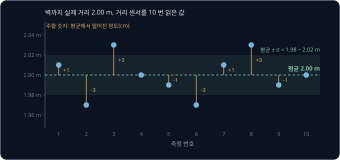
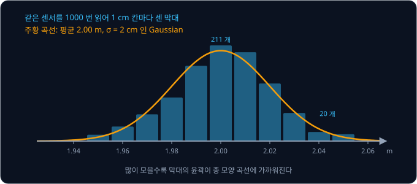
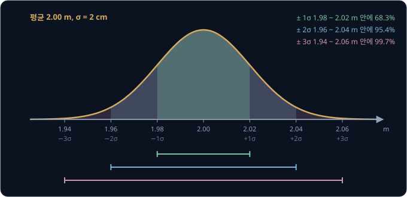
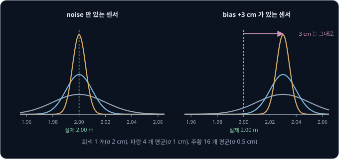
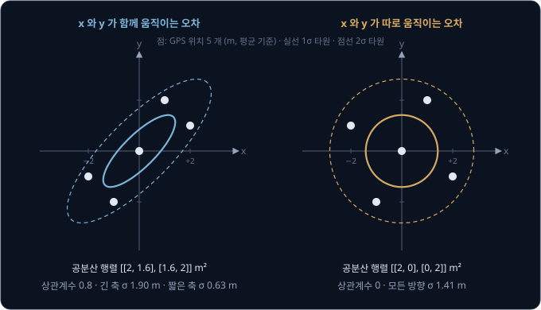
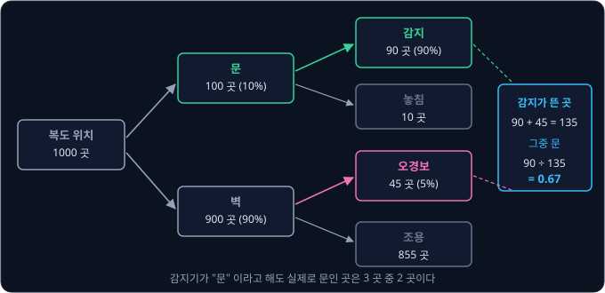
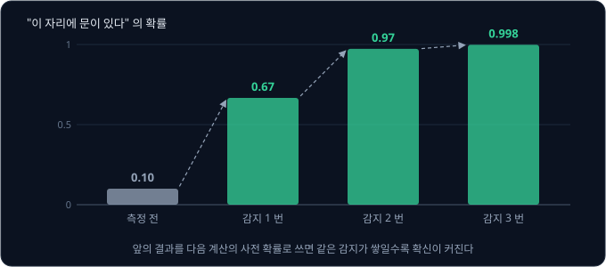

# Probability & Gaussians

로봇을 벽에서 2.00 m 떨어진 곳에 세워 두고 거리 센서를 열 번 읽으면 2.01, 1.97, 2.03, 2.00 m 처럼 읽을 때마다 다른 값이 나온다. 로봇도 벽도
그대로인데 값이 이렇게 흔들린다면, 이 센서를 보고 달리는 로봇은 장애물 앞 몇 cm 에서 멈춰야 부딪히지 않을까?

이 문제를 푸는 좋은 방법은 확률을 쓰는 것인데, 확률로는 흔들리는 값을 "가장 그럴듯한 값" 과 "흔들리는 폭" 두 숫자로 적고 계산할 수
있다. 폭을 표준편차 σ 로 적었을 때 값이 흩어진
모양이 Gaussian 이면, σ 의 몇 배 안에 값이 얼마나 들어오는지가 정해져 있어서 멈출 여유를 숫자로 정할 수 있다. Hokuyo 의 2D LiDAR UST-10LX 는 데이터시트에 같은
거리를 되풀이해 잰 값의 흩어짐을 "σ < 30 mm" 로 적고, ROS 의 GPS 메시지 `sensor_msgs/NavSatFix` 는 위치와 함께 그 오차를 3 × 3 공분산 행렬로 담아 보낸다.

## 학습 목표

- 센서 측정값의 평균·분산·표준편차를 계산하고, Gaussian 과 68-95-99.7 규칙으로 안전 여유를 정하는 방법을 설명할 수 있다
- 독립인 측정 $N$ 개를 평균하면 표준편차가 $\sqrt N$ 분의 1 로 줄지만 bias 는 줄지 않는 이유를 설명할 수 있다
- 두 값의 공분산·상관계수와, 공분산 행렬이 오차 타원을 그리는 방식을 설명할 수 있다
- Bayes rule 로 측정 뒤의 믿음을 계산하고, 기댓값으로 선택지를 비교할 수 있다

## 평균과 표준편차

벽까지의 실제 거리가 2.00 m 인 자리에서 거리 센서를 열 번 읽은 값이 아래 표의 둘째 칸이다. 가장 그럴듯한 값으로는 **평균**(mean)을 쓰는데,
값을 모두 더해 개수로 나눈 값이다. 열 개 값의 합이 20.00 m 라서 평균은 $20.00 \div 10 = 2.00$ m 이고, 평균은 그리스 문자 $\mu$("뮤")로 적는다.

| 번호 | 측정값 (m) | 편차 (cm) | 편차² (cm²) |
| --- | --- | --- | --- |
| 1 | 2.01 | +1 | 1 |
| 2 | 1.97 | −3 | 9 |
| 3 | 2.03 | +3 | 9 |
| 4 | 2.00 | 0 | 0 |
| 5 | 1.99 | −1 | 1 |
| 6 | 1.97 | −3 | 9 |
| 7 | 2.01 | +1 | 1 |
| 8 | 2.03 | +3 | 9 |
| 9 | 1.99 | −1 | 1 |
| 10 | 2.00 | 0 | 0 |
| 합 | 20.00 | 0 | 40 |

셋째 칸의 **편차**(deviation)는 측정값에서 평균을 뺀 값으로, 각 값이 평균에서 얼마나 떨어져 있는지를 cm 로 적었다. 흔들림의 크기를 숫자
하나로 나타내고 싶은데, 편차를 그대로 평균하면 +와 −가 서로 지워져 언제나 0 이 된다. 그래서 편차를 제곱해 부호를 없앤 뒤 평균하고, 이 값을
**분산**(variance)이라고 부른다. 이 센서의 분산은 $40 \div 10 = 4$ cm² 다.

분산은 단위가 cm² 라서 "몇 cm 흔들린다" 로 읽기 어렵다. 분산의 제곱근을 구하면 원래 단위로 돌아오는데, 이 값이 **표준편차**(standard
deviation)이고 그리스 문자 $\sigma$("시그마")로 적는다. 제곱근 $\sqrt{\ }$ 은 제곱해서 그 수가 되는 양수라서 $\sigma = \sqrt 4 = 2$ cm 이고,
거꾸로 분산은 $\sigma^2$ 으로 적는다. $\sigma = 2$ cm 는 이 센서로 한 번 읽은 값이 평균에서 2 cm 안팎 벗어난다는 뜻이다.

<b>심화: 분산의 식과 N − 1</b>

측정값을 $x_1, x_2, \dots, x_N$ 이라고 하면 평균과 분산은 아래와 같다. $\sum$ 은 $i = 1$ 부터 $N$ 까지 모두 더하라는 기호다.

$$
\mu = \frac{1}{N} \sum_{i=1}^{N} x_i, \qquad \sigma^2 = \frac{1}{N} \sum_{i=1}^{N} (x_i - \mu)^2
$$

$N$ 대신 $N - 1$ 로 나누는 식도 자주 쓴다. 평균을 바로 그 값들로 구했기 때문에 값들은 진짜 평균보다 자기들로 구한 평균에 조금 더 가깝게
모이고, 그래서 $N$ 으로 나누면 분산이 실제보다 조금 작게 나온다. 위 예를 $N - 1$ 로 나누면 $40 \div 9 \approx 4.44$ cm² 라 차이가 크지 않다.
그래도 NumPy 의 `np.std` 는 기본으로 $N$ 으로 나누고 pandas 의 `std` 는 $N - 1$ 로 나누므로, 데이터가 적을 때는 어느 쪽인지 확인한다.

## 분포와 Gaussian

**확률**(probability)은 어떤 일이 얼마나 자주 일어나는지를 0 과 1 사이의 숫자로 적은 것이다. 0 은 일어나지 않는다는 뜻이고 1 은 반드시
일어난다는 뜻이며, 일어날 수 있는 모든 경우의 확률을 더하면 1 이다. 같은 센서를 1000 번 읽어 1 cm 칸마다 몇 개가 들어갔는지 세면,
2.00 m 칸에 211 개, 2.04 m 칸에 20 개가 들어간다. 칸의 개수를 1000 으로 나누면 "한 번 읽었을 때 그 칸의 값이 나올 확률" 이
된다. 이렇게 칸마다 개수를 세어 막대로 그린 그림을 histogram 이라고 한다.

값을 많이 모을수록 막대의 윤곽은 매끄러운 곡선 하나에 가까워진다. 이 곡선처럼 값마다 얼마나 자주 나오는지를 빠짐없이 적은 것을
**확률분포**(probability distribution)라고 한다. 곡선 아래의 넓이가 확률이라서, 1.98 ~ 2.02 m 사이의 넓이가 그 범위의 값이 나올
확률이고 곡선 아래 전체의 넓이는 1 이다. 곡선의 높이는 확률 자체가 아니라 그 근처에 값이 얼마나 몰려 있는지를 나타낸다.

센서 오차의 분포는 위 그림처럼 가운데가 가장 높고 양쪽으로 똑같이 낮아지는 종 모양인 경우가 많다. 이 모양을 **Gaussian** 또는
정규분포(normal distribution)라고 하고, 평균 $\mu$ 와 표준편차 $\sigma$ 두 숫자만 알면 모양 전체가 정해져서 $\mathcal N(\mu, \sigma^2)$ 으로
적는다. 위 센서는 $\mathcal N(2.00\text{ m}, (2\text{ cm})^2)$ 이다. 센서 오차에는 전기 noise, 빛의 세기, 온도처럼 작고 서로 무관한 원인
여러 개가 더해져 있어서 종 모양이 된다. 서로 무관한 작은 값을 많이 더하면 각 값이 어떤 분포를 따르든 그 합은 종 모양에 가까워지는데,
이것을 central limit theorem 이라고 한다. 이름은 Gauss 가 1809 년 천체의 궤도를 관측값으로 계산하면서 관측 오차를 이 분포로 다룬 데서 왔다.

모든 오차가 Gaussian 인 것은 아니다. LiDAR 빛이 유리를 통과하거나 검은 면에 흡수되면 실제 거리와 전혀 다른 값이 가끔 섞이는데, 이런 값을
outlier 라고 한다. Gaussian 으로 계산하면 이런 값이 나올 확률이 거의 0 이라서, outlier 는 평균이나 Kalman filter 에 넣기 전에 따로 걸러야 한다.

<b>심화: Gaussian 의 식</b>

$\mathcal N(\mu, \sigma^2)$ 의 곡선을 나타내는 확률밀도함수(probability density function, pdf)는 아래와 같다.

$$
p(x) = \frac{1}{\sigma \sqrt{2\pi}} \exp\!\left( -\frac{(x - \mu)^2}{2\sigma^2} \right)
$$

$\exp(a)$ 는 $e^a$ 이고 $e \approx 2.718$ 이다. $x$ 가 평균에서 $\sigma$ 의 $k$ 배 떨어져 있으면 지수 부분이 $-k^2 / 2$ 가 되므로,
곡선의 높이는 평균에서 가장 높고 $\pm 1\sigma$ 에서 그 $e^{-1/2} \approx 0.61$ 배, $\pm 2\sigma$ 에서 $e^{-2} \approx 0.14$ 배,
$\pm 3\sigma$ 에서 $e^{-4.5} \approx 0.011$ 배로 빠르게 낮아진다. 앞의 $\frac{1}{\sigma\sqrt{2\pi}}$ 는 곡선 아래 넓이를 1 로 맞추는
숫자다. 위 센서는 가운데 높이가 $1 \div (2 \times 2.507) \approx 0.20$ 이라 1 cm 칸 하나에 약 20% 가 들어가고, 1000 번 중 2.00 m 칸에 211 개가
들어간 것과 비슷하다.

## 68-95-99.7 규칙과 안전 여유

Gaussian 은 평균에서 $\sigma$ 의 몇 배 안에 값이 얼마나 들어오는지가 $\mu$ 와 $\sigma$ 의 값과 상관없이 정해져 있다. 위 센서($\sigma$ = 2 cm)에
대입하면 아래와 같다.

| 범위 | 이 센서의 범위 | 안에 들어올 확률 | 밖으로 나갈 확률 |
| --- | --- | --- | --- |
| $\mu \pm 1\sigma$ | 1.98 ~ 2.02 m | 68.3% | 31.7% (3 번에 1 번꼴) |
| $\mu \pm 2\sigma$ | 1.96 ~ 2.04 m | 95.4% | 4.6% (22 번에 1 번꼴) |
| $\mu \pm 3\sigma$ | 1.94 ~ 2.06 m | 99.7% | 0.27% (370 번에 1 번꼴) |

세 확률의 앞자리를 따서 68-95-99.7 규칙이라고 부른다. 데이터시트나 논문이 오차를 "±3σ" 로 적으면 값의 99.7% 가 그 안에 들어온다는 뜻이고,
"σ" 만 적었다면 세 번에 한 번은 그 범위를 벗어난다는 뜻이다.

Hokuyo UST-10LX 의 사양은 accuracy ±40 mm, repeated accuracy $\sigma$ < 30 mm 이고, 둘 다 흰 종이를 놓은
공장 시험 조건에서 잰 값이다. repeated accuracy 는 같은 거리를 되풀이해 잴 때 값이 흩어지는 정도라서 $\sigma$ 를 30 mm 로 잡으면 $\pm 3\sigma$ 는
±90 mm 다. accuracy 는 실제 거리와 어긋날 수 있는 폭이므로, 장애물에 다가가는 로봇은 센서가 읽은 거리에서 $40 + 90 = 130$ mm 를 빼고
판단하면 noise 의 99.7% 까지 덮는다. 위험한 쪽은 센서가 실제보다 멀다고 읽는 한쪽뿐이라, 이 여유를 넘어 부딪힐 확률은 0.27% 의 절반인 0.135% 다.

0.135% 는 작아 보이지만 측정 횟수를 곱하면 달라진다. UST-10LX 는 270° 를 0.25° 마다 재서 scan 한 번에 점이 약 1,080 개
나온다. scan 이 25 ms 마다, 1 초에 40 번 나오므로 1 초에 내는 점은 $1080 \times 40 \approx 43{,}000$ 개다. 모든 점이 Gaussian 을 따른다고 해도
$3\sigma$ 보다 멀게 읽힌 점이 1 초에 $43{,}000 \times 0.00135 \approx 58$ 개 나온다. 그래서 점 하나가 크게 벗어났다고 바로 멈추거나 바로
무시하기보다, 이웃한 점과 다음 scan 을 함께 보고 판단해야 한다.

**확인 문제.** 표준편차가 1.5 cm 인 거리 센서가 있다. 값의 99.7% 를 덮으려면 측정값에서 몇 cm 를 여유로 빼야 할까? bias 는 없다고 한다.

답 보기

문제의 표준편차가 $\sigma = 1.5$ cm 다. 위 표에서 99.7% 는 $\mu \pm 3\sigma$ 이므로 여유는 $3 \times 1.5 = 4.5$ cm 다.

## 평균 내기와 bias

한 번 읽은 값은 2 cm 쯤 흔들리지만, 여러 번 읽어 평균하면 +쪽 오차와 −쪽 오차가 서로 상쇄되어 평균값은 덜 흔들린다. 다만 다 상쇄되지는
않아서, 서로 영향을 주지 않는(독립인) 측정 $N$ 개의 평균은 표준편차가 $N$ 분의 1 이 아니라 $\sqrt N$ 분의 1 로 줄어든다. 1 초에 40 번
읽는 센서로 계산하면 아래와 같다.

| 평균한 개수 $N$ | 평균값의 표준편차 $2 \div \sqrt N$ | 모으는 데 걸리는 시간 |
| --- | --- | --- |
| 1 | 2 cm | 0.025 초 |
| 4 | 1 cm | 0.1 초 |
| 16 | 0.5 cm | 0.4 초 |
| 100 | 0.2 cm | 2.5 초 |

표준편차를 반으로 줄이려면 측정이 네 배 필요한데, 0.5 m/s 로 달리는 로봇은 100 개를 모으는 2.5 초 동안 벌써 1.25 m 를 간다. 그래서 오래
평균하는 방법은 로봇이 서 있을 때나 천천히 변하는 값에만 쓸 수 있다. 움직이는 로봇에서 측정을 모아 쓰는 방법은 [Kalman Filter](../kalman-filter/README.md)
에서 다룬다.

$\sqrt N$ 규칙은 측정끼리 독립일 때만 맞아서, 같은 반사면 때문에 연속한 측정이 같은 쪽으로 틀리면 평균해도 그 오차는 남는다. 센서가 매번
실제보다 3 cm 길게 읽는 것처럼 평균 자체가 어긋난 오차를 **bias**(치우침)라고 하는데, bias 도 평균으로는 지워지지 않는다. 이 센서의 값을
100 개 평균하면 2.03 m 근처에 0.2 cm 폭으로 모일 뿐 3 cm 는 그대로 남는다.

| 성질 | noise (random error) | bias (systematic error) |
| --- | --- | --- |
| 읽을 때마다 | 크기와 부호가 바뀐다 | 같은 쪽으로 같은 만큼 틀린다 |
| $N$ 개를 평균하면 | $\sqrt N$ 분의 1 로 준다 | 그대로 남는다 |
| 줄이는 방법 | 평균, filter | calibration |

bias 는 실제 값을 알고 재야 드러난다. 벽을 정확히 2.00 m 에 두고 100 번 읽은 평균이 2.03 m 이면 이 센서는 3 cm 길게 읽는 것이므로,
이후 측정마다 3 cm 를 빼면 된다. 이렇게 알려진 기준으로 bias 를 재서 빼는 일을 **calibration** 이라고 한다. bias 는 온도나 표면의 색에
따라서도 바뀌는데, 데이터시트가 시험 조건(흰 종이)을 따로 적는 것도 이 때문이다. Gazebo 의 센서 설정 형식인 SDF 도 noise 를 정할 때 측정마다
새로 뽑는 noise 의 `stddev` 와 bias 의 `bias_mean`·`bias_stddev` 를 따로 적는다.

> **오해** 측정을 충분히 많이 평균하면 오차가 0 에 가까워진다.
>
> **사실** 평균으로 줄어드는 것은 측정마다 독립으로 바뀌는 noise 뿐이다. bias 는 몇 번을 평균해도 그대로라서 calibration 으로 재서 빼야 한다.

**확인 문제.** 표준편차가 4 cm 인 센서로 평균값의 표준편차를 1 cm 로 줄이려면 독립인 측정을 몇 개 평균해야 할까?

답 보기

평균값의 표준편차는 $4 \div \sqrt N$ 이다. 이 값이 1 이 되려면 $\sqrt N = 4$ 여야 하므로 $N = 4 \times 4 = 16$ 개다. 표준편차가 $N$ 이
아니라 $\sqrt N$ 에 반비례해서 4 개가 아니라 16 개가 필요하다.

<b>심화: 합의 분산과 쌓이는 odometry 오차</b>

두 값 $X$, $Y$ 를 더한 값의 분산은 아래와 같다. $\mathrm{Var}$ 는 분산, $\mathrm{Cov}$ 는 다음 절의 공분산이다.

$$
\mathrm{Var}(X + Y) = \mathrm{Var}(X) + \mathrm{Var}(Y) + 2\,\mathrm{Cov}(X, Y)
$$

둘이 독립이면 공분산이 0 이라 분산이 그대로 더해진다. 분산이 $\sigma^2$ 인 독립 측정 $N$ 개를 더하면 분산은 $N\sigma^2$ 이다. 평균은 그 합을
$N$ 으로 나눈 값이라 분산이 $N^2$ 으로 나뉘어 $N\sigma^2 \div N^2 = \sigma^2 / N$ 이 되고, 제곱근을 씌우면 표준편차 $\sigma / \sqrt N$ 이다.

같은 식으로 바퀴 odometry 의 오차가 쌓이는 방식도 설명할 수 있다. 바퀴로 1 m 갈 때마다 분산 1 cm² 의 독립 오차가 생긴다면 100 m 뒤의 분산은
$100 \times 1 = 100$ cm² 이고 표준편차는 $\sqrt{100} = 10$ cm 다. 오차는 거리가 아니라 거리의 제곱근에 비례해 커진다. Kalman filter
의 예측 단계에서 분산을 더하는 계산도 이 식을 쓴다. 한편 바퀴 지름을 1% 틀리게 잡은 bias 는 1 m 마다 같은 쪽으로 1 cm 씩 쌓여 100 m 뒤에
1 m 가 되므로, odometry 에서도 bias 를 먼저 calibration 해야 한다.

## 공분산과 상관계수

값이 두 개인 측정은 각자의 흔들림 말고도 둘이 함께 움직이는지를 따로 봐야 한다. 서 있는 로봇이 GPS 로 위치를 다섯 번 받아 동쪽 $x$ 와 북쪽
$y$ 가 평균에서 몇 m 떨어졌는지 적으면 아래와 같다.

| 번호 | $x$ 편차 (m) | $y$ 편차 (m) | $x$ 편차 × $y$ 편차 |
| --- | --- | --- | --- |
| 1 | +2 | +1 | +2 |
| 2 | −2 | −1 | +2 |
| 3 | +1 | +2 | +2 |
| 4 | −1 | −2 | +2 |
| 5 | 0 | 0 | 0 |
| 제곱의 평균 또는 곱의 평균 | $(4+4+1+1+0) \div 5 = 2$ | $(1+1+4+4+0) \div 5 = 2$ | $8 \div 5 = 1.6$ |

$x$ 와 $y$ 의 분산은 둘 다 2 m² 인데, 표를 보면 $x$ 가 +쪽으로 틀릴 때는 $y$ 도 +쪽으로 틀리고 $x$ 가 −쪽일 때는 $y$ 도 −쪽으로 틀린다.
두 편차를 곱하면 같은 쪽으로 틀린 경우 +, 반대쪽으로 틀린 경우 − 가 되므로, 곱의 평균을 보면 둘이 함께 움직이는지 알 수 있다. 이 값을
**공분산**(covariance)이라고 하고 위 예에서는 1.6 m² 다. 공분산이 0 이면 둘이 따로 움직이고, 음수면 반대로 움직인다.

공분산은 값의 크기에 따라 커져서 "얼마나 강하게 함께 움직이는지" 를 바로 읽기 어렵다. 공분산을 두 표준편차의 곱으로 나눈 값을
**상관계수**(correlation coefficient)라고 하는데, 언제나 −1 과 1 사이에 있다. 위 예는 $1.6 \div (\sqrt 2 \times \sqrt 2) = 0.8$ 로 꽤 강하게
함께 움직인다. 상관계수가 1 이면 점들이 오른쪽 위로 기운 직선 하나 위에 놓이고, −1 이면 오른쪽 아래로 기운 직선 위에 놓인다.

GPS 의 $x$ 와 $y$ 가 함께 틀리는 원인 하나는 위성의 배치다. 높은 건물 사이 도로에서는 하늘이 도로 방향으로만 열려 있어서 보이는 위성이
도로를 따라 늘어선다. 그러면 도로를 따라가는 방향으로는 위치를 잘 정하지만 도로를 가로지르는 방향으로는 잘 정하지 못해서, 오차가 그 방향으로
길게 퍼진다. 도로가 북서쪽으로 뻗어 있으면 오차는 북동쪽으로 길게 퍼지고, 위 표처럼 $x$ 와 $y$ 가 같은 쪽으로 틀린다. 바퀴 두 개로 움직이는
로봇이 젖은 바닥에 들어서면 왼쪽과 오른쪽 바퀴가 함께 미끄러지므로, 두 바퀴의 오차도 상관계수가 0 보다 크다.

## 공분산 행렬과 오차 타원

$x$ 의 분산, $y$ 의 분산, 둘의 공분산을 2 × 2 행렬 하나에 모은 것을 **공분산 행렬**(covariance matrix)이라고 하고 $\Sigma$ 로 적는다.
대각선에 각자의 분산이, 대각선 밖에 공분산이 들어간다.

$$
\Sigma = \begin{bmatrix} \mathrm{Var}(x) & \mathrm{Cov}(x, y) \\ \mathrm{Cov}(x, y) & \mathrm{Var}(y) \end{bmatrix} = \begin{bmatrix} 2 & 1.6 \\ 1.6 & 2 \end{bmatrix} \text{ m}^2
$$

세 숫자를 행렬로 묶으면 어느 방향으로 오차가 얼마나 퍼지는지를 행렬 곱 한 번으로 구할 수 있다. 길이가 1 인 방향 vector $\mathbf u$ 를
정하면 그 방향의 분산은 $\mathbf u^\top \Sigma \mathbf u$ 다. $\mathbf u^\top$ 은 세로 vector $\mathbf u$ 를 가로로 눕힌 transpose 이고, transpose 와 행렬·vector 의 곱은 [Vectors & Matrices](../vectors-matrices/README.md) 에서 다룬다. 방향 몇 개를 넣어 보면 아래와 같다.

| 방향 | $\mathbf u$ | 분산 $\mathbf u^\top \Sigma \mathbf u$ | 표준편차 |
| --- | --- | --- | --- |
| 동쪽 | $[1, 0]$ | 2 | 1.41 m |
| 북동쪽 | $[0.707, 0.707]$ | $(2 + 1.6 + 1.6 + 2) \div 2 = 3.6$ | 1.90 m |
| 북서쪽 | $[-0.707, 0.707]$ | $(2 - 1.6 - 1.6 + 2) \div 2 = 0.4$ | 0.63 m |

북동쪽으로는 1.90 m, 북서쪽으로는 0.63 m 로 방향마다 세 배 가까이 다르다. 실제 GPS 다섯 점을 북동쪽 직선에 비춰 거리를 재 보면 $\pm 2.12$ m 가 넷,
0 이 하나라 제곱의 평균이 $4.5 \times 4 \div 5 = 3.6$ 으로 표의 값과 같다. 분산이 가장 큰 북동쪽을 긴 축(반지름 1.90 m)으로, 가장 작은
북서쪽을 짧은 축(반지름 0.63 m)으로 하는 타원을 그리면 오차가 퍼진 모양과 같아지는데, 이 타원을 **오차 타원**(error ellipse)이라고 한다. 다른
방향의 표준편차는 타원을 그 방향의 직선에 비춘 그림자 길이의 절반과 같아서, 동쪽으로 비춘 그림자의 절반이 1.41 m 다. 공분산이 0 이면
어느 방향으로나 분산이 2 라서 반지름 1.41 m 인 원이 된다.

타원의 두 축 방향을 공분산 행렬의 eigenvector 라고 하고, 축 방향의 분산 3.6 과 0.4 를 eigenvalue 라고 한다. RViz 의 Odometry 나
PoseWithCovariance display 에서 Covariance 항목을 켜면 로봇 위치 둘레에 타원(3차원이면 타원체)이 그려지는데, 이것도 메시지에 담긴 공분산
행렬의 eigenvector 와 eigenvalue 로 그린 오차 타원이다.

값이 둘일 때는 68-95-99.7 규칙을 그대로 쓸 수 없다. 두 방향으로 동시에 범위 안에 들어와야 해서, 1σ 타원 안에는 값의 39% 만, 2σ 타원
안에는 86%, 3σ 타원 안에는 98.9% 가 들어간다. "1σ 타원" 을 보고 68% 라고 읽으면 위치를 실제보다 확실하게 아는 것으로 착각하게 된다.

ROS 의 GPS 메시지 `sensor_msgs/NavSatFix` 는 이 행렬을 `position_covariance` 라는 숫자 9 개(동쪽·북쪽·위쪽의 3 × 3, 단위 m²)로 보낸다. 같은
메시지의 `position_covariance_type` 은 행렬을 얼마나 아는지를 적는 칸으로, 모름(0), 위성 배치로 어림함(1), 대각선만 앎(2), 전부 앎(3) 중
하나다. Kalman filter 는 이 행렬로 GPS 를 어느 방향으로 얼마나 믿을지 정하므로, 대각선만 채워 보내면 filter 는 실제로 기울어진 타원을 x·y 축에
나란한 타원으로 계산한다.

**확인 문제.** 공분산 행렬이 $\begin{bmatrix} 4 & 1 \\ 1 & 1 \end{bmatrix}$ m² 이다. $x$ 와 $y$ 의 표준편차와 상관계수는?

답 보기

대각선이 분산이라 $x$ 의 분산은 4, $y$ 의 분산은 1 이고, 표준편차는 $\sqrt 4 = 2$ m, $\sqrt 1 = 1$ m 다. 대각선 밖의 1 이 공분산이므로
상관계수는 공분산 ÷ 두 표준편차의 곱 $= 1 \div (2 \times 1) = 0.5$ 다.

## 조건부 확률과 Bayes rule

복도를 달리는 로봇에 문 감지기가 달려 있다. 이 복도에서 문이 있는 곳은 전체 위치의 10% 이고, 감지기는 문 앞에서 90% 의 확률로 "문" 신호를
내며(놓칠 확률 10%), 벽 앞에서도 5% 의 확률로 잘못 "문" 신호를 낸다(오경보). 감지기가 "문" 신호를 냈을 때 그 자리에 정말 문이 있을 확률은 얼마일까?

위치 1000 곳으로 세면 문은 100 곳이고 그중 90 곳에서 감지가 뜨며, 벽 900 곳 중 $900 \times 0.05 = 45$ 곳에서 오경보가
뜬다. 감지가 뜬 곳은 모두 $90 + 45 = 135$ 곳이고 그중 문은 90 곳이므로 확률은 $90 \div 135 \approx 0.67$ 이다.

"B 가 일어난 경우만 놓고 볼 때 A 의 확률" 을 **조건부 확률**(conditional probability)이라고 하고 $P(A \mid B)$ 로 적는다. $P$ 는
probability 의 첫 글자다. 감지기의 90% 는 문이 있는 100 곳만 놓고 센 $P(\text{감지} \mid \text{문}) = 90 \div 100$ 이고, 로봇이 알고 싶은 것은
감지가 뜬 135 곳만 놓고 센 $P(\text{문} \mid \text{감지}) = 90 \div 135$ 다. 두 값은 같은 90 곳을 서로 다른 범위로 나눈 것이라 다르고,
이 셈을 확률 기호로 적은 식이 **Bayes rule** 이다.

$$
P(\text{문} \mid \text{감지}) = \frac{P(\text{감지} \mid \text{문}) \, P(\text{문})}{P(\text{감지})} = \frac{0.9 \times 0.1}{0.9 \times 0.1 + 0.05 \times 0.9} = \frac{0.09}{0.135} \approx 0.67
$$

측정 전의 믿음 $P(\text{문}) = 0.1$ 을 prior(사전 확률)라고 하고, 센서가 상황마다 어떤 값을 내는지 적은 $P(\text{감지} \mid \text{문})$ 을
likelihood 라고 한다. 측정 뒤의 믿음 0.67 은 posterior(사후 확률)다. 분모 $P(\text{감지})$ 는 감지가 뜰 전체 확률로, 문 앞에서 뜨는 감지와
벽 앞에서 뜨는 오경보를 더한 값이다. 이름은 영국의 목사 Thomas Bayes 에서 왔다. 이 계산을 다룬 그의 글은 그가 1761 년에 죽은 뒤 친구
Richard Price 가 정리해 1763 년 Royal Society 에 발표했다.

posterior 는 prior 에 크게 좌우된다. 같은 감지기를 문이 드문 복도와 흔한 복도에 두면 아래와 같다.

| 문이 있는 위치의 비율 (prior) | 감지 뒤 문일 확률 (posterior) |
| --- | --- |
| 1% | $0.009 \div (0.009 + 0.0495) \approx 0.15$ |
| 10% | $0.09 \div (0.09 + 0.045) \approx 0.67$ |
| 50% | $0.45 \div (0.45 + 0.025) \approx 0.95$ |

문이 1% 뿐인 복도에서는 감지의 85% 가 오경보인데, 찾는 대상이 드물수록 오경보율이 조금만 높아도 감지 대부분이 오경보가 된다.

> **오해** 적중률 90% 인 감지기가 문이라고 하면 90% 의 확률로 문이다.
>
> **사실** 90% 는 문이 있을 때 감지가 뜰 확률 $P(\text{감지} \mid \text{문})$ 이다. 감지가 떴을 때 문일 확률 $P(\text{문} \mid \text{감지})$ 는 prior 와 오경보율까지 넣어 Bayes rule
> 로 따로 구해야 한다.

**확인 문제.** 같은 복도(문 10%)에서 감지기를 바꿔 적중률은 90% 그대로, 오경보율을 1% 로 낮췄다. 감지가 떴을 때 문일 확률은?

답 보기

위치 1000 곳으로 세면 문 100 곳 중 $100 \times 0.9 = 90$ 곳, 벽 900 곳 중 $900 \times 0.01 = 9$ 곳에서 감지가 뜬다. 감지가 뜬 99 곳 중 문은
90 곳이므로 $90 \div 99 \approx 0.91$ 이다. 오경보율을 5% 에서 1% 로 낮추자 posterior 가 0.67 에서 0.91 로 올랐다.

<b>심화: Bayes rule 의 유도</b>

"A 와 B 가 함께 일어날 확률" $P(A, B)$ 는 두 순서로 쪼갤 수 있다. B 가 일어날 확률에 B 일 때 A 일 확률을 곱해도 되고, A 가 일어날 확률에
A 일 때 B 일 확률을 곱해도 된다.

$$
P(A, B) = P(A \mid B)\,P(B) = P(B \mid A)\,P(A)
$$

가운데와 오른쪽을 $P(B)$ 로 나누면 Bayes rule 이 나온다.

$$
P(A \mid B) = \frac{P(B \mid A)\,P(A)}{P(B)}, \qquad P(B) = P(B \mid A)\,P(A) + P(B \mid \text{not } A)\,P(\text{not } A)
$$

분모는 B 가 일어나는 경우를 "A 이면서 B" 와 "A 가 아니면서 B" 로 나눠 더한 것이다. 문 예에서 $P(\text{문}, \text{감지}) = 0.9 \times 0.1 = 0.09$
가 1000 곳 중 90 곳이고, 분모 0.135 가 135 곳이다.

## 반복 측정과 믿음

로봇이 같은 자리에서 한 번 더 감지기를 읽어 또 "문" 이 나왔다고 하자. 첫 측정의 posterior 0.67 을 새 prior 로 놓고 같은 계산을 하면
$0.67 \times 0.9 \div (0.67 \times 0.9 + 0.33 \times 0.05) \approx 0.97$ 이 되고, 세 번째도 "문" 이면 0.998 이 된다.

| 측정 | prior | 결과 | posterior |
| --- | --- | --- | --- |
| 1 번째 | 0.10 | 감지 | 0.67 |
| 2 번째 | 0.67 | 감지 | 0.97 |
| 3 번째 | 0.97 | 감지 | 0.998 |
| 1 번째 뒤 감지 대신 놓침 | 0.67 | 조용 | $\frac23 \times 0.1 \div (\frac23 \times 0.1 + \frac13 \times 0.95) \approx 0.17$ |

마지막 줄처럼 감지가 뜨지 않는 것도 정보다. 문 앞에서 감지가 뜨지 않을 확률은 10% 뿐이라서, 한 번 감지된 자리라도 다음 측정이 조용하면 문일 확률이
0.17 로 떨어진다. 다만 이 계산은 측정마다 오류가 독립이라고 가정한다. 오경보가 문처럼 생긴 포스터 때문이라면 같은 자리에서 몇 번을 읽어도 같은 오경보가
뜨므로, bias 처럼 반복 측정으로 지워지지 않는다.

로봇이 지도 위에서 자기 위치를 찾는 localization 도 같은 계산으로 한다. 복도 위치마다 "로봇이 지금 여기 있을 확률" 을 prior 로 두고, 감지기 결과가
들어올 때마다 위치마다 Bayes rule 을 적용하면 지도의 문 위치와 맞는 자리의 확률만 커진다. 로봇이 움직이면 그 확률을 이동한 만큼 옮기고
odometry 오차만큼 넓게 퍼뜨린 뒤 다시 측정으로 좁히는데, 이 두 단계를 되풀이하는 방법을 Bayes filter 라고 한다. 확률을 Gaussian 하나로
나타내면 [Kalman Filter](../kalman-filter/README.md) 가 되고, 점 수백 ~ 수천 개로 나타내면 particle filter 가 된다. ROS 2 의 Nav2 가 지도
위에서 위치를 찾는 데 쓰는 AMCL(Adaptive Monte Carlo Localization)이 particle filter 이고, 기본 설정은 점을 500 ~ 2000 개 쓴다.

<b>심화: 두 Gaussian 의 곱과 Kalman update</b>

prior 와 likelihood 가 둘 다 Gaussian 이면 Bayes rule 의 곱도 Gaussian 이 되어 평균과 분산만 계산하면 된다. prior 가
$\mathcal N(\mu_1, \sigma_1^2)$, 측정이 $\mathcal N(\mu_2, \sigma_2^2)$ 이면 posterior 는 아래와 같다.

$$
\mu = \frac{\sigma_2^2 \mu_1 + \sigma_1^2 \mu_2}{\sigma_1^2 + \sigma_2^2}, \qquad \sigma^2 = \frac{\sigma_1^2 \sigma_2^2}{\sigma_1^2 + \sigma_2^2}
$$

예측이 2 m(분산 2), GPS 가 3 m(분산 2)이면 $\mu = (2 \times 2 + 2 \times 3) \div 4 = 2.5$ m, $\sigma^2 = 4 \div 4 = 1$ 이다. 이 계산은
[Kalman Filter](../kalman-filter/README.md) 강의의 보정 단계 예시와 같다. 서로 독립인 정보 두 개를 합쳤기 때문에 분산이 어느 쪽보다도 작아진다.

## 기댓값

로봇이 물건을 집는 방법 두 가지 중 하나를 고른다고 하자. 어느 방법이든 성공하면 보상 10 을 받는다. 위에서 집는 방법 A 는 90% 성공하지만,
실패하면 물건을 떨어뜨려 깨뜨리므로 보상이 −50 이다. 옆에서 밀어 집는 방법 B 는 70% 만 성공하지만 실패해도 물건이 그 자리에 남아 보상이 0 이다.
성공률만 보면 A 가 낫다.

결과마다 "보상 × 그 결과의 확률" 을 구해 모두 더한 값을 **기댓값**(expected value)이라고 한다. A 의 기댓값은 $0.9 \times 10 + 0.1 \times (-50) = 4$ 이고
B 는 $0.7 \times 10 + 0.3 \times 0 = 7$ 이다. 100 번 시도한다고 세면 A 는 90 번 성공해 900 을 얻고 10 번 떨어뜨려 500 을 잃어 합이 400 이다.
B 는 70 번 성공해 700 이다. 한 번으로 나누면 4 와 7 이므로, 기댓값은 아주 여러 번 했을 때 한 번에 평균으로 얻는 값이다. 실패했을 때 잃는
크기까지 넣어 계산하면 성공률이 낮은 B 가 더 낫다.

앞에서 본 평균도 기댓값이다. 센서 값의 분포에서 값마다 "값 × 확률" 을 더하면 분포의 평균 $\mu$ 가 되고, 열 번 읽어 구한 평균 2.00 m 는 이
기댓값을 측정으로 어림한 값이다. 같은 방식으로 분산은 편차² 의 기댓값이다. 기댓값이 같아도 결과가 퍼진 정도는 다를 수 있다. 떨어뜨렸을 때
보상이 −20 이면 A 의 기댓값도 $9 - 2 = 7$ 로 B 와 같아지지만, A 만 가끔 큰 손해를 낸다.

reinforcement learning(강화 학습)은 로봇이 받을 보상의 기댓값이 가장 커지는 행동을 찾는 방법이다. 위 예에서는 성공 확률을 안다고 했지만
실제 로봇은 확률을 모르고, 직접 해 보며 어림해야 한다. 해 볼수록 정확해지지만 그동안 덜 좋은 선택도 해야 하는 이 문제를
[Bandits & MDPs](../bandit-mdp/README.md) 에서 다룬다.

**확인 문제.** 방법 C 는 60% 로 성공해 보상 10, 40% 로 실패해 보상 −5 다. 기댓값은 얼마이고, A·B 와 비교하면 어떤가?

답 보기

$0.6 \times 10 + 0.4 \times (-5) = 6 - 2 = 4$ 다. A 의 기댓값 4 와 같고 B 의 7 보다 작다.

## sampling

분포에서 값을 하나씩 뽑는 것을 **sampling** 이라고 한다. 컴퓨터는 0 과 1 사이에서 고르게 퍼진 무작위 수 $u$ 를 낼 수 있는데, 이 수로 어떤
분포의 값이든 뽑을 수 있다. 방법 A 의 성공·실패를 흉내 내려면 $u$ 가 0.9 보다 작으면 성공, 아니면 실패로 정한다. 결과마다 확률만큼의 길이로
0 ~ 1 구간을 잘라 두면, $u$ 가 떨어진 칸이 뽑힌 결과가 된다.

Gaussian 은 평균 0, 표준편차 1 인 표준 정규분포 $\mathcal N(0, 1)$ 에서 $\epsilon$("엡실론")을 뽑은 뒤 $x = \mu + \sigma \epsilon$ 으로
옮긴다. 거리 센서 $\mathcal N(2.00, 0.02^2)$ m 를 흉내 내려면 $\epsilon = 1.5$ 가 뽑혔을 때 $2.00 + 0.02 \times 1.5 = 2.03$ m,
$\epsilon = -0.5$ 일 때 $2.00 - 0.01 = 1.99$ m 를 내면 된다. Gazebo 같은 simulator 도 SDF 에 `gaussian` noise 를 설정하면 측정마다 $\epsilon$ 을
새로 뽑아 이 방식으로 센서 값에 noise 를 더한다. simulator 의 센서 값이 실제 센서처럼 흔들려야 그 값으로 만든 filter 와 policy 를 실제
로봇에 옮겼을 때 덜 어긋난다.

생성 모델도 같은 방법으로 값을 뽑는다. [VAE](../vae/README.md) 의 reparameterization trick 은 $\mu + \sigma \epsilon$ 으로 값을 뽑고,
[DDPM](../ddpm/README.md) 이 데이터에 조금씩 더하는 noise 도 $\mathcal N(0, 1)$ 에서 뽑은 $\epsilon$ 에 정해진 수를 곱해 만든다.

## 정리

- 측정값의 흔들림은 평균 $\mu$ 와 표준편차 $\sigma$ 로 적는다. 분산은 편차² 의 평균이고 표준편차는 그 제곱근이다. 벽에서 2.00 m 인 센서를 열
  번 읽은 값은 평균 2.00 m, 분산 4 cm², 표준편차 2 cm 였다
- Gaussian 은 $\mu \pm 1\sigma, 2\sigma, 3\sigma$ 안에 68.3%, 95.4%, 99.7% 가 들어가므로 안전 여유는 "accuracy + $3\sigma$" 처럼 정한다.
  독립인 측정 $N$ 개의 평균은 표준편차가 $\sigma / \sqrt N$ 로 줄지만, 늘 같은 쪽으로 틀리는 bias 는 calibration 으로 재서 빼야 한다
- 값이 둘 이상이면 공분산 행렬이 각 방향의 퍼짐을 담고($\mathbf u^\top \Sigma \mathbf u$), 그 모양이 오차 타원이다. 공분산 1.6, 분산 2 인
  GPS 는 북동쪽 σ 1.90 m, 북서쪽 σ 0.63 m 로 기운 타원이었다
- Bayes rule 은 prior 와 likelihood 로 posterior 를 구한다. 적중률 90%, 오경보 5% 인 문 감지기를 문이 10% 인 복도에 두면 문일 확률이 감지 한 번 뒤
  0.67, 두 번 뒤 0.97 이다. 기댓값은 "결과 × 확률" 의 합이고, sampling 은 분포에서 값을 뽑는 일이다

이 강의에서는 측정을 Bayes rule 로 한 번씩 합쳤다. 로봇이 움직이는 동안 움직임으로 위치를 예측하고 센서로 보정하기를 1초에 수십 번 되풀이하면서
Gaussian 의 평균과 분산을 함께 고쳐 가는 방법을 다음 강의 [Kalman Filter](../kalman-filter/README.md) 에서 다룬다.

## 참고 자료

- Brown University, [Seeing Theory](https://seeing-theory.brown.edu/) — 기댓값·분산, 조건부 확률, central limit theorem, Bayes 추론을 움직이는
  그림으로 직접 바꿔 보는 사이트. 1 ~ 3장과 5장이 이 강의의 범위다
- 3Blue1Brown, [Bayes' theorem](https://www.3blue1brown.com/lessons/bayes-theorem) — 사람 수를 세는 방식과 넓이 그림으로 Bayes rule 을
  설명한다. 이 강의의 [조건부 확률과 Bayes rule](#조건부-확률과-bayes-rule) 절에서 위치 1000 곳을 센 것과 같은 방식이다
- Thrun, Burgard, Fox, [Probabilistic Robotics](https://robots.stanford.edu/probabilistic-robotics/) (MIT Press) — 2장 Recursive State
  Estimation 이 문이 열렸는지 감지하는 로봇 예로 Bayes rule 과 Bayes filter 를 세운다. Kalman filter 와 particle filter 가 3장과 4장이다
- Groves, [Shadow Matching: A New GNSS Positioning Technique for Urban Canyons](https://doi.org/10.1017/S0373463311000087) (The Journal
  of Navigation 64(3), 2011) — 건물 사이 도로에서는 보이는 위성이 도로를 따라 늘어서서, 도로를 가로지르는 방향의 위치 정확도가 떨어진다는 설명
- Hokuyo, [UST-10/20LX 사양](https://www.hokuyo-aut.jp/search/single.php?serial=167) — accuracy ±40 mm 와 repeated accuracy σ < 30 mm 를
  따로 적은 LiDAR 데이터시트의 예
- ROS 2 common_interfaces, [`sensor_msgs/NavSatFix`](https://github.com/ros2/common_interfaces/blob/rolling/sensor_msgs/msg/NavSatFix.msg) —
  `position_covariance` 9 개 숫자와 `position_covariance_type` 의 정의
- SDFormat, [`noise` 요소](https://github.com/gazebosim/sdformat/blob/main/sdf/1.12/noise.sdf) — simulator 센서에 Gaussian noise 와 bias 를
  따로 넣는 설정 항목
- Nav2, [AMCL 설정](https://docs.nav2.org/jazzy/configuration_and_development/configuration_guide/others/configuring_amcl/) — particle
  filter 로 지도 위 위치를 찾는 AMCL 의 parameter. `min_particles`·`max_particles` 의 기본값이 500 과 2000 이다
