# PyTorch Training Loop

## 학습 목표

- 숫자를 여러 축으로 늘어놓은 묶음(tensor)과 그 모양(shape)을 읽고, 한 층의 곱하고 더하는 계산을 묶음 단위로 따라갈 수 있다
- 음수를 0 으로 바꾸는 함수(ReLU)가 층 사이에 없으면 층을 여러 개 쌓아도 한 층과 다를 바 없는 이유를 숫자로 보일 수 있다
- 점수 여러 개를 합이 1 인 확률로 바꾸고, 정답의 확률로 loss 를 계산하고, 그 loss 가 점수를 어느 쪽으로 고치게 하는지 손으로
  계산할 수 있다
- 데이터를 작은 묶음으로 나눠 고치는 방식과, parameter 를 고치는 세 가지 규칙(SGD, momentum, Adam)을 같은 숫자 예시로 비교할 수
  있다
- 학습에 쓰지 않은 데이터로 따로 점검해야 하는 이유와, 학습 데이터를 외워 버리는 현상을 숫자로 설명할 수 있다
- network 를 입력을 요약하는 앞부분과 원하는 출력을 내는 뒷부분으로 나눠 보고, 앞부분은 그대로 두고 뒷부분만 바꿔 다른 일을 시킬
  수 있다는 것을 설명할 수 있다

## 숫자 묶음으로 하는 계산

### 숫자 하나씩 계산하는 방식의 한계

[Backpropagation](../autograd/README.md) 강의에서는 숫자 하나하나를 computational graph 의 node 로 두고 계산했다.
computational graph 는 식을 덧셈·곱셈 같은 연산 하나씩으로 쪼개 그린 그림이고, node 는 그 그림의 상자 하나다. 앞에서 뒤로 값을
계산하는 forward 를 한 번 하고, 마지막 loss(예측이 정답에서 벗어난 정도를 숫자 하나로 나타낸 값)에서 출발해 거꾸로 gradient 를
채우는 backward 를 한 번 하면 모든 parameter(학습으로 정하는 숫자)의 gradient 가 나왔다. gradient 는 "이 숫자를 조금 늘리면 loss 가
얼마나 변하는가" 를 숫자마다 모은 것이었다. 두 입력이 다를 때만 1 을 내는 XOR 를 푼 network 는 parameter 가 아홉 개뿐이라 이
방식으로 충분했다.

손글씨 숫자 사진을 알아보는 network 는 사정이 다르다. neuron 은 입력마다 weight 를 곱해 더하고 bias 를 더해 출력 하나를 내는
계산 단위였는데, 사진 한 장은 숫자 784 개로 되어 있어서 첫 층의 neuron 하나가 곱셈을 784 번 한다. 첫 층의 neuron 이 256 개라면
첫 층에서만 곱셈이 $784 \times 256 = 200{,}704$ 번이다. 숫자 하나마다 node 를 만들면 사진 한 장의 첫 층만으로 node 가 20 만 개를
넘고, 사진 100 장을 한 번에 계산하면 2,000 만 개가 된다. node 하나를 만들고 기록하는 일은 곱셈 한 번보다 훨씬 오래 걸려서, 이
방식으로는 학습 시간 대부분을 node 를 만드는 데 쓰게 된다.

그래서 숫자 하나가 아니라 숫자 묶음 하나를 node 로 두어, 곱셈 20 만 번을 "행렬 곱 한 번" 이라는 node 하나로 기록한다.
행렬 곱은 행렬의 행마다 내적(같은 자리끼리 곱해 모두 더한 값)을 구해 쌓는 계산이고, 실제 곱셈은
미리 빠르게 만들어 둔 계산 프로그램이 한꺼번에 처리한다. backward 도 묶음 단위로 해서, 행렬 곱 node 하나를 거꾸로 지날 때
gradient 20 만 개가 한 번에 나온다. 계산 방식은 Backpropagation 강의의 reverse-mode automatic differentiation(출력에서 거꾸로 훑어
모든 gradient 를 한꺼번에 구하는 방법)과 똑같다. 덧셈·곱셈 하나하나 대신 묶음 연산 하나하나에 local derivative(연산 하나의 출력이
입력에 대해 변하는 비율) 규칙을 적용한다는 점만 다르다.

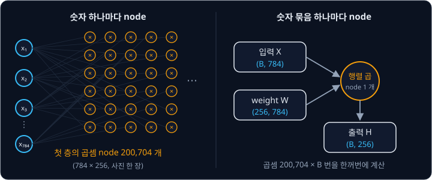

위 그림은 두 방식을 비교한 것이다. 왼쪽은 곱셈 하나하나가 node 이고, 오른쪽은 입력 묶음과 weight 묶음이 행렬 곱 node 하나로
들어가 출력 묶음 하나가 나온다.

이런 묶음 계산과 automatic differentiation 을 맡아 주는 프로그램 도구가 PyTorch 다. neural network 를 만들고 학습시키는 데 가장 널리 쓰이는 도구
중 하나이고, 그 안에서 gradient 를 자동으로 구하는 부분을 autograd 라고 부른다. auto(자동)와 grad(gradient)를 붙인 이름이다.
이 강의는 PyTorch 로 학습을 짤 때 거치는 단계(데이터 묶기, 층 계산, loss, gradient, parameter 고치기, 점검)가 각각 무슨 계산인지를
작은 숫자로 따라간다.

**확인 문제.** 입력이 784 개, 첫 층의 neuron 이 128 개면 사진 한 장의 첫 층에서 곱셈은 몇 번일까?

답 보기

neuron 하나가 입력 784 개에 weight 를 하나씩 곱하므로 $784 \times 128 = 100{,}352$ 번이다.

### 손글씨 숫자 이미지

이 강의에서 예로 드는 문제는 손으로 쓴 숫자 사진을 보고 0 부터 9 중 어느 숫자인지 맞히는 것이다. 이 문제에 가장 널리 쓰인
데이터가 MNIST 다. 사진은 가로 28 칸, 세로 28 칸의 흑백 이미지이고, 학습용 60,000 장과 시험용 10,000 장이 있다.

이미지의 칸 하나를 pixel 이라고 한다. 흑백 이미지에서 pixel 하나는 밝기 숫자 하나이고, 이 강의에서는 0(검정)부터 1(흰색) 사이의
값으로 쓴다. 사진마다 "이 사진은 숫자 7 이다" 같은 정답이 붙어 있는데, 이 정답을 label 이라고 한다. 고를 수 있는 답의 종류 하나하나를
class 라고 부르므로 MNIST 에는 class 가 10 개(숫자 0 ~ 9) 있다.

가로 4 칸, 세로 4 칸짜리 작은 이미지로 먼저 보자. 숫자 1 처럼 가운데 세로줄만 밝은 이미지다.

| | 1 열 | 2 열 | 3 열 | 4 열 |
| --- | --- | --- | --- | --- |
| 1 행 | 0 | 1 | 0 | 0 |
| 2 행 | 0 | 1 | 0 | 0 |
| 3 행 | 0 | 1 | 0 | 0 |
| 4 행 | 0 | 1 | 0.5 | 0 |

이 강의의 network 는 이미지를 표 모양 그대로 받지 않고, 첫 행부터 차례로 이어 붙여 숫자 한 줄로 편 뒤 받는다. 위 이미지를 펴면
$0, 1, 0, 0,\ 0, 1, 0, 0,\ 0, 1, 0, 0,\ 0, 1, 0.5, 0$ 의 숫자 16 개가 된다. 이렇게 여러 줄의 숫자를 한 줄로 펴는 것을 flatten 이라고
한다. MNIST 사진은 $28 \times 28 = 784$ 칸이라 펴면 숫자 784 개가 된다.

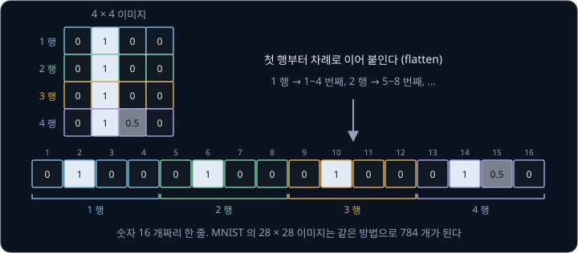

위 그림은 네 행을 색으로 구분해 한 줄로 이어 붙이는 모습이다. 1 행의 네 숫자가 1 ~ 4 번째 자리, 2 행이 5 ~ 8 번째 자리로 간다.

**확인 문제.** 가로 5 칸, 세로 5 칸 이미지를 펴면 숫자 몇 개가 되고, 2 행 1 열의 pixel 은 몇 번째 자리로 갈까?

답 보기

$5 \times 5 = 25$ 개다. 1 행의 5 개가 1 ~ 5 번째 자리를 차지하므로 2 행 1 열은 6 번째 자리다.

### tensor 와 shape

숫자를 순서대로 한 줄로 묶은 것을 vector, 가로줄(행)과 세로줄(열)로
늘어놓은 직사각형 묶음을 행렬이라고 한다. 숫자 묶음은 줄 방향이 더 많을 수도 있다. 4 × 4 이미지 두 장을 한데 묶으면 "몇 번째
이미지인가, 몇 행인가, 몇 열인가" 의 세 방향으로 늘어놓은 묶음이 된다.

이렇게 숫자를 몇 방향으로든 늘어놓은 묶음을 tensor 라고 하고, 늘어놓은 방향 하나하나를 축(axis)이라고 한다. 숫자 하나는 축이
0 개, vector 는 1 개, 행렬은 2 개인 tensor 다. 축마다 칸이 몇 개인지를 괄호 안에 차례로 적은 것을 shape 라고 한다.

| 묶음 | 예 | 축 개수 | shape |
| --- | --- | --- | --- |
| 숫자 하나 | $7$ | 0 | $()$ |
| vector | $(1, 0, 2)$ | 1 | $(3)$ |
| 행렬 | 2 행 3 열 | 2 | $(2, 3)$ |
| 이미지 두 장 | 4 × 4 이미지 2 장 | 3 | $(2, 4, 4)$ |

shape 의 숫자를 모두 곱하면 tensor 안의 숫자 개수가 나온다. $(2, 3)$ 은 $2 \times 3 = 6$ 개, $(2, 4, 4)$ 는 $2 \times 4 \times 4 = 32$
개다.

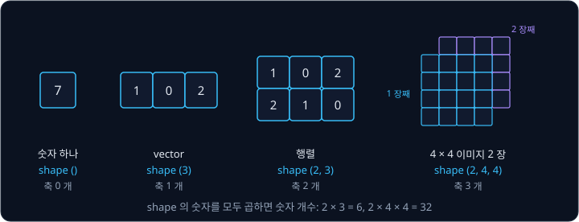

위 그림은 네 가지 tensor 를 축 개수 순서로 놓은 것이다. 학습에서는 사진을 여러 장씩 묶어 한 번에 계산하는데, 이 묶음을 batch
라고 하고 몇 장을 묶었는지를 batch 크기라고 한다. 사진 100 장을 펴서 묶으면 shape 가 $(100, 784)$ 인 tensor 가 되고, 첫 축이
"몇 번째 사진인가", 둘째 축이 "몇 번째 pixel 인가" 다. 이렇게 batch 를 첫 축에 두는 것이 관례다.

tensor 라는 말은 물리학에서는 좌표를 바꿀 때 정해진 규칙으로 바뀌는 양을 가리키지만, neural network 를 다룰 때는 그런 뜻 없이
"여러 축으로 늘어놓은 숫자 묶음" 만을 뜻한다.

**흔한 오해.** shape $(100, 784)$ 를 "숫자 두 개짜리 vector" 로 읽기 쉽다. shape 는 tensor 의 내용이 아니라 모양을 적은 것이라서,
이 tensor 에는 숫자가 $100 \times 784 = 78{,}400$ 개 들어 있다.

**확인 문제.** MNIST 사진 32 장을 펴지 않고 그대로 묶은 tensor 의 shape 와 숫자 개수는?

답 보기

사진 번호·행·열의 세 축이라 shape 는 $(32, 28, 28)$ 이고, 숫자는 $32 \times 28 \times 28 = 25{,}088$ 개다.

**요약**

- 숫자 하나마다 node 를 두면 너무 느려서, PyTorch 는 숫자 묶음 하나를 node 로 두고 같은 reverse-mode automatic differentiation 을 한다
- tensor 는 여러 축으로 늘어놓은 숫자 묶음이고, shape 는 축마다 칸 수를 적은 것이다
- MNIST 사진은 28 × 28 이고, 펴면 숫자 784 개가 된다. batch 로 묶으면 shape 는 (batch 크기, 784) 다

## layer 와 activation

### Linear layer

neuron 은 입력마다 weight 를 곱해 더하고 bias 를 더한 값 $z$ 를 계산한다. 같은 입력을
받는 neuron 여러 개를 나란히 둔 것이 layer 다. neuron 마다 따로 계산하지 않고, layer 하나를 행렬 곱 한 번으로 계산하는 방법을
숫자로 따라가 보자.

입력 3 개 $x = (1, 0, 2)$ 를 neuron 2 개가 받는다. neuron 마다 weight 3 개와 bias 1 개가 있다.

| neuron | weight | bias | 계산 | 결과 |
| --- | --- | --- | --- | --- |
| 1 | $(1, 2, -1)$ | 0 | $1 \times 1 + 2 \times 0 + (-1) \times 2 + 0$ | $-1$ |
| 2 | $(0, 1, 1)$ | 1 | $0 \times 1 + 1 \times 0 + 1 \times 2 + 1$ | $3$ |

결과 $h = (-1, 3)$ 이 이 layer 의 출력이다. 표의 weight 두 줄을 위아래로 쌓으면 2 행 3 열 행렬 $W$ 가 되고, bias 두 개는 vector $b$ 가
된다.

$$
W = \begin{bmatrix} 1 & 2 & -1 \\ 0 & 1 & 1 \end{bmatrix}, \qquad b = (0, 1), \qquad h = W x + b
$$

$Wx$ 는 행렬과 vector 의 곱으로, $W$ 의 각 행과 $x$ 의 같은 자리 칸끼리 곱해 더한 값(내적)을 차례로
세로로 쌓은 것이다. 식 $h = Wx + b$ 는 "입력에 weight 행렬을 곱하고 bias 를 더한다" 로 읽는다. $W$ 의 행 하나가 neuron 하나의 weight
이고, 행렬 곱 한 번이 neuron 두 개의 계산을 한꺼번에 한다. 이렇게 행렬 곱과 bias 덧셈만 하는 layer 를 Linear layer 라고 한다.
linear 는 "직선의" 라는 뜻으로, 곱하고 더하기만 해서 Linear Regression 의 $wx + b$ 와 같은 꼴이라는 의미다.

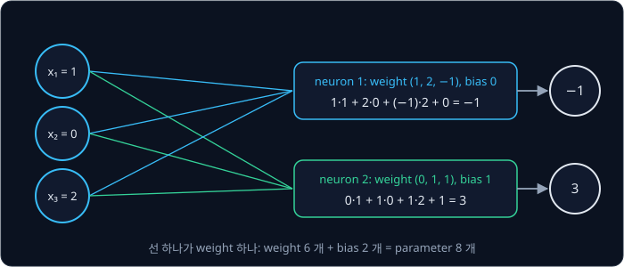

위 그림은 입력 세 칸에서 출력 두 칸으로 가는 선과 neuron 마다의 계산을 적은 것이다. 선 하나가 weight 하나이므로 weight 는
$2 \times 3 = 6$ 개이고, bias 2 개를 더하면 이 layer 의 parameter 는 8 개다. 일반적으로 입력이 $n_{\text{in}}$ 개, 출력이
$n_{\text{out}}$ 개인 Linear layer 의 parameter 는 $n_{\text{out}} \times (n_{\text{in}} + 1)$ 개다. $n_{\text{in}}$ 은 "엔 인" 이라고
읽고 입력 개수, $n_{\text{out}}$ 은 "엔 아웃" 이라고 읽고 출력 개수다.

**확인 문제.** 같은 layer 에 입력 $x = (2, 1, 0)$ 을 넣으면 출력은?

답 보기

neuron 1 은 $1 \times 2 + 2 \times 1 + (-1) \times 0 + 0 = 4$, neuron 2 는 $0 \times 2 + 1 \times 1 + 1 \times 0 + 1 = 2$ 라서 $(4, 2)$ 다.

### batch 를 한 번에 계산하는 Linear layer

입력 하나씩 계산하지 않고 batch 를 한 번에 계산해 보자. 입력 두 개 $(1, 0, 2)$ 와 $(2, 1, 0)$ 을 위아래로 쌓으면 shape $(2, 3)$ 인
행렬 $X$ 가 된다. 행 하나가 입력 하나다.

$$
X = \begin{bmatrix} 1 & 0 & 2 \\ 2 & 1 & 0 \end{bmatrix}, \qquad
H = X W^\top + b = \begin{bmatrix} -1 & 3 \\ 4 & 2 \end{bmatrix}
$$

$W^\top$ 는 "W transpose" 라고 읽고, $W$ 의 행과 열을 맞바꾼 3 행 2 열 행렬이다. $XW^\top$ 의 1 행
1 열 칸은 $X$ 의 1 행과 $W$ 의 1 행의 내적이고, 1 행 2 열 칸은 $X$ 의 1 행과 $W$ 의 2 행의 내적이다. 그래서 결과 $H$ 의 행 하나가
입력 하나의 출력이 되고, 1 행 $(-1, 3)$ 과 2 행 $(4, 2)$ 는 앞에서 하나씩 계산한 값과 같다. bias $b$ 는 모든 행에 똑같이 더한다.

| 칸 | 계산 | 값 |
| --- | --- | --- |
| 1 행 1 열 | $(1, 0, 2) \cdot (1, 2, -1) + 0$ | $-1$ |
| 1 행 2 열 | $(1, 0, 2) \cdot (0, 1, 1) + 1$ | $3$ |
| 2 행 1 열 | $(2, 1, 0) \cdot (1, 2, -1) + 0$ | $4$ |
| 2 행 2 열 | $(2, 1, 0) \cdot (0, 1, 1) + 1$ | $2$ |

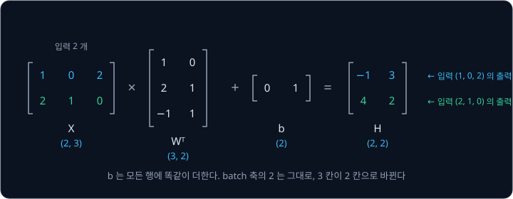

위 그림처럼 shape 는 $(2, 3)$ 에서 $(2, 2)$ 로 바뀐다. batch 축의 2 는 그대로이고, 입력 3 칸이 출력 2 칸으로 바뀐다. batch 크기가
100 이어도 식은 같고 $X$ 의 행만 100 개가 되어, 출력 shape 는 $(100, 2)$ 다.

**확인 문제.** shape $(64, 784)$ 인 batch 가 입력 784 개·출력 256 개인 Linear layer 를 지나면 출력 shape 는?

답 보기

batch 축은 그대로이고 784 칸이 256 칸이 되므로 $(64, 256)$ 이다.

### ReLU

neuron 의 $z$ 는 sigmoid(입력을 0 과 1 사이 값으로 바꾸는 S 자 곡선) 같은 함수에 넣어 출력으로 바꾼다. 이렇게 $z$ 를 출력으로 바꾸는 함수를 activation
function 이라고 한다. 요즘 neural network 에서 가장 많이 쓰는 activation function 은 ReLU 다. Rectified Linear Unit 을 줄인
이름이고, rectified 는 "음수 쪽을 잘라 바로잡은" 이라는 뜻이다.

$$
\mathrm{relu}(z) = \max(0, z)
$$

$\max(0, z)$ 는 "0 과 $z$ 중 큰 쪽" 이다. 그래서 식은 "$z$ 가 음수면 0 을 내고, 0 이상이면 $z$ 를 그대로 낸다" 로 읽는다.
앞의 Linear layer 출력 $h = (-1, 3)$ 에 ReLU 를 칸마다 적용하면 $(0, 3)$ 이 된다. $-1$ 은 음수라 0 이 되고 3 은 그대로다.

| $z$ | $-2$ | $-1$ | $0$ | $1$ | $2$ | $3$ |
| --- | --- | --- | --- | --- | --- | --- |
| $\mathrm{relu}(z)$ | 0 | 0 | 0 | 1 | 2 | 3 |
| 기울기 | 0 | 0 | | 1 | 1 | 1 |

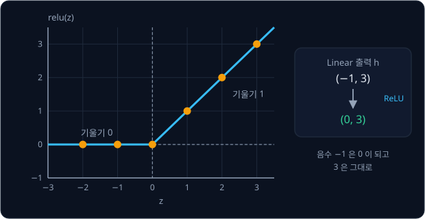

위 그림처럼 ReLU 의 그래프는 0 에서 꺾인 두 직선이다. 기울기는 음수 쪽에서 0, 양수 쪽에서 1 이다. $z = 0$ 에서는 꺾여서 기울기를
하나로 정할 수 없는데, 계산에서는 보통 0 으로 둔다.

sigmoid 의 기울기는 많아야 0.25 라서 층을 지날 때마다 gradient 가 4 분의 1 이하로 줄었다. ReLU 는 양수 쪽 기울기가 정확히 1 이라
$z$ 가 양수인 neuron 을 지나는 gradient 가 줄지 않는다. 계산도 비교 한 번이라 $e^{-z}$ 를 구해야 하는 sigmoid 보다 훨씬 빠르다. 대신 $z$ 가
음수인 neuron 은 기울기가 0 이라 그 입력에서는 gradient 가 전해지지 않는다.

**확인 문제.** $h = (2, -3, 0.5, -0.1)$ 에 ReLU 를 적용하면?

답 보기

음수인 $-3$ 과 $-0.1$ 만 0 이 되어 $(2, 0, 0.5, 0)$ 이다.

### ReLU 가 필요한 이유

Linear layer 두 개를 activation function 없이 바로 이으면 어떻게 될까? 입력 $x$ 하나를 받아 neuron 두 개가 $h_1 = x$,
$h_2 = -x$ 를 내고, 다음 layer 가 둘을 더해 $y = h_1 + h_2$ 를 낸다고 하자.

| $x$ | $h_1 = x$ | $h_2 = -x$ | ReLU 없이 $y = h_1 + h_2$ | ReLU 를 넣은 $y = \mathrm{relu}(h_1) + \mathrm{relu}(h_2)$ |
| --- | --- | --- | --- | --- |
| $-2$ | $-2$ | 2 | 0 | $0 + 2 = 2$ |
| $-1$ | $-1$ | 1 | 0 | $0 + 1 = 1$ |
| 0 | 0 | 0 | 0 | 0 |
| 1 | 1 | $-1$ | 0 | $1 + 0 = 1$ |
| 2 | 2 | $-2$ | 0 | $2 + 0 = 2$ |

ReLU 가 없으면 $y = x + (-x) = 0$ 이라 무엇을 넣어도 0 이 나온다. 숫자를 바꿔도 결론은 같은데, Linear layer 두 개를 이으면
"곱하고 더한 것에 다시 곱하고 더한" 꼴이라 정리하면 곱하고 더한 것 한 번이 되기 때문이다. 예를 들어 $h = 3x + 1$ 다음에 $y = 2h + 1$ 을
하면 $y = 2(3x + 1) + 1 = 6x + 3$ 으로, Linear layer 하나와 같다. 층을 몇 개 쌓아도 직선 하나밖에 표현하지 못한다.

ReLU 를 넣으면 $y$ 는 2, 1, 0, 1, 2 로 V 자 모양이 된다. 직선 하나로는 이 모양을 만들 수 없다. ReLU 가 음수를 0 으로 자르면서
그래프를 꺾어 주기 때문이다.

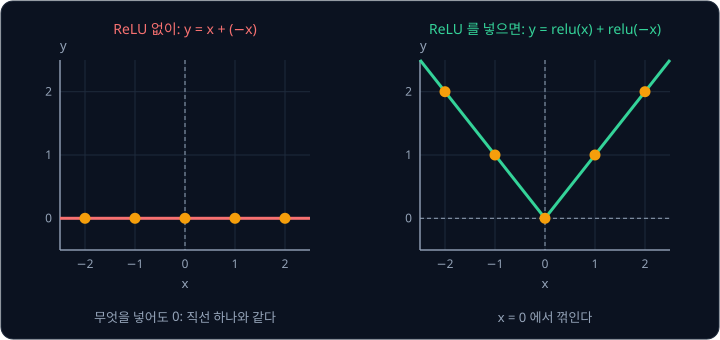

위 그림의 왼쪽은 ReLU 가 없을 때, 오른쪽은 있을 때의 출력이다. neuron 이 많아지면 꺾이는 곳도 많아져서, 꺾인 직선 여러 개를
이어 붙여 거의 어떤 곡선이든 흉내 낼 수 있다. [Perceptron](../perceptron/README.md) 에서 XOR 를 풀려면 직선 두 개가 필요했던 것처럼,
층을 쌓는 효과는 층 사이에 activation function 이 있어야 생긴다.

**흔한 오해.** "층을 많이 쌓을수록 복잡한 것을 배운다" 는 말은 층 사이에 activation function 이 있을 때만 맞다. activation function 없이
Linear layer 100 개를 쌓으면 parameter 만 많고 표현력은 Linear layer 한 개와 같다.

**확인 문제.** $h = 2x - 1$ 다음에 $y = 3h + 2$ 를 activation function 없이 이으면 $y$ 를 $x$ 의 식 하나로 쓸 수 있을까?

답 보기

$y = 3(2x - 1) + 2 = 6x - 3 + 2 = 6x - 1$ 로, 직선 하나가 된다.

### 784 → 256 → 10 MLP

여러 layer 를 이어 쌓은 network 를 MLP(multi-layer perceptron)라고 한다. MNIST 를 위한 가장 기본적인
MLP 는 아래 순서로 계산한다.

1. 사진을 펴서 숫자 784 개를 만든다
2. 입력 784 개·출력 256 개인 Linear layer 를 지난다
3. ReLU 를 지난다
4. 입력 256 개·출력 10 개인 Linear layer 를 지난다

마지막 출력 10 개는 class 10 개(숫자 0 ~ 9)에 대한 점수다. 점수가 가장 큰 class 가 network 의 답이다. 이렇게 마지막 layer 가 낸,
아직 확률로 바꾸지 않은 점수들을 logits 라고 부른다.

batch 크기를 $B$ 라고 하면 shape 는 아래처럼 바뀐다.

| 단계 | shape | parameter 수 |
| --- | --- | --- |
| 펴진 입력 | $(B, 784)$ | |
| Linear 784 → 256 | $(B, 256)$ | $256 \times (784 + 1) = 200{,}960$ |
| ReLU | $(B, 256)$ | 0 |
| Linear 256 → 10 | $(B, 10)$ | $10 \times (256 + 1) = 2{,}570$ |

parameter 는 모두 $200{,}960 + 2{,}570 = 203{,}530$ 개다. ReLU 는 칸마다 같은 규칙을 적용할 뿐 학습할 숫자가 없다.

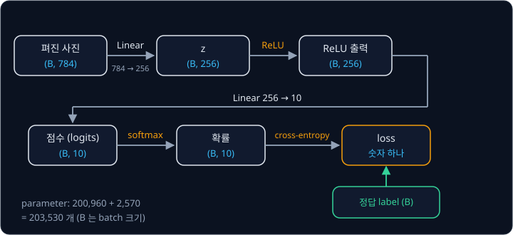

위 그림은 batch 가 MLP 를 지나며 바뀌는 shape 를 보여 준다. 오른쪽 끝의 softmax 와 cross-entropy 는 점수를 확률로 바꾸고 loss 를
계산하는 단계로, 다음 큰 섹션에서 다룬다. batch 에 사진이 몇 장이든 loss 는 batch 전체의 평균 하나라서 숫자 하나다.

**확인 문제.** 입력 784 개, hidden layer(입력과 출력 사이 layer)의 neuron 128 개, 출력 10 개인 MLP 의 parameter 는 모두 몇 개일까?

답 보기

첫 layer 는 $128 \times (784 + 1) = 100{,}480$, 둘째 layer 는 $10 \times (128 + 1) = 1{,}290$ 이라 모두 $101{,}770$ 개다.

### weight 의 처음 값 크기

hidden neuron 들을 같은 값으로 출발시키면 모두 같은 gradient 를 받아 끝까지 같은 neuron 으로 남기 때문에, weight 는
작은 random(무작위) 값으로 출발시킨다. 784 개나 되는 입력을 받는 layer 에서는 그 "작은" 이 얼마나 작아야 하는지가 중요하다.

입력 784 개가 모두 1 이고, weight 784 개의 부호를 동전 던지기로 정해 $+1$ 이나 $-1$ 로 둔다고 하자. $z$ 는 784 개를 모두 더한
값이다. 실제로 여섯 번 뽑아 보면 $z$ 는 38, $-2$, $-32$, 34, 14, $-36$ 이었다. $+1$ 과 $-1$ 이 서로 일부 지워져서 784 까지
커지지는 않지만, 크기가 대략 $\sqrt{784} = 28$ 안팎이다. $\sqrt{\ }$ 는 제곱근이라고 읽고, $\sqrt{784}$ 는 "제곱해서 784 가 되는
양수" 라서 $28 \times 28 = 784$ 이므로 28 이다. 무작위 부호의 숫자 $n$ 개를 더하면 합의 크기가 대략 $\sqrt{n}$ 배가 된다.

weight 크기를 $\pm 0.05$ 로 줄이면 같은 부호에서 $z$ 가 모두 0.05 배가 되어 1.9, $-0.1$, $-1.6$, 1.7, 0.7, $-1.8$ 이 된다.

| weight 크기 | 여섯 번 뽑은 $z$ | $z$ 의 크기 |
| --- | --- | --- |
| $\pm 1$ | 38, $-2$, $-32$, 34, 14, $-36$ | 약 28 |
| $\pm 0.05$ | 1.9, $-0.1$, $-1.6$, 1.7, 0.7, $-1.8$ | 약 1.4 |

$z$ 가 28 정도면 sigmoid 는 1 에 바짝 붙어 기울기가 거의 0 이 되고, ReLU 를 쓰더라도 층마다 크기가 수십 배씩 불어난다. 층마다
28 배씩 커진다면 세 층을 지난 뒤에는 $28 \times 28 \times 28 = 21{,}952$ 배다. 그러면 loss 와 gradient 가 지나치게 커져서 학습이 첫 step(parameter 를 한 번 고치는 일)부터
엉뚱한 곳으로 튄다.

2015년 Kaiming He 등은 ReLU 를 쓰는 network 에서 weight 크기를 대략 $\sqrt{2 / n_{\text{in}}}$ 으로 잡으면 층을 지나도 값의 크기가
유지된다는 것을 보였다. $n_{\text{in}}$ 은 그 layer 의 입력 개수다. 784 개 입력이면 $\sqrt{2 / 784} \approx 0.0505$ 로, 위 표의 0.05 와
거의 같다. 분자의 2 는 ReLU 가 대략 절반의 neuron 을 0 으로 만들어 크기가 줄어드는 만큼을 미리 키워 둔 것이다. 이 방식을 Kaiming
초기화 또는 He 초기화라고 부르고, 초기화(initialization)는 학습 전에 parameter 의 처음 값을 정하는 일을 말한다.

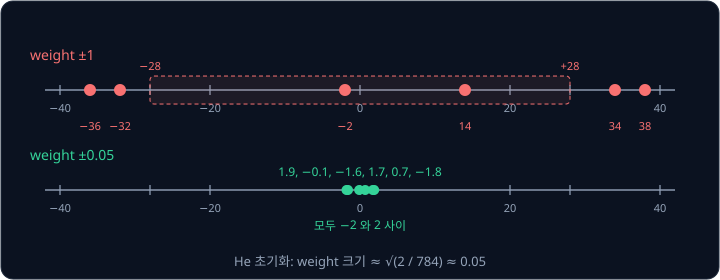

위 그림은 두 경우의 $z$ 여섯 개를 같은 수직선 위에 찍은 것이다. weight 를 20 분의 1 로 줄이면 $z$ 도 20 분의 1 로 줄어 0 근처에
모인다.

**확인 문제.** 입력이 200 개인 Linear layer 에 He 초기화를 쓰면 weight 크기는 대략 얼마일까?

답 보기

$\sqrt{2 / 200} = \sqrt{0.01} = 0.1$ 이다. $0.1 \times 0.1 = 0.01$ 이기 때문이다.

**요약**

- Linear layer 는 행렬 곱과 bias 덧셈으로 neuron 여러 개를 한 번에 계산하고, batch 를 넣으면 행 하나가 입력 하나의 출력이 된다
- ReLU 는 음수를 0 으로 바꾸는 activation function 이고, 층 사이에 없으면 여러 층이 한 층과 같아진다
- 784 → 256 → 10 MLP 의 parameter 는 203,530 개이고, weight 는 $\sqrt{2 / n_{\text{in}}}$ 정도 크기의 random 값으로 출발시킨다

## softmax 와 cross-entropy

### softmax

MLP 의 마지막 layer 는 class 마다 점수 하나, 곧 logits 를 낸다. 점수는 $-3.3$ 이나 8.1 처럼 아무 크기나 될 수 있어서 "이 사진이
7 일 가능성이 얼마인가" 로 바로 읽기 어렵다. 그래서 점수를 0 과 1 사이의 값으로, 그것도 모두 더하면 1 이 되도록 바꾼다. 이렇게
모두 더해 1 이 되고 각각 0 과 1 사이인 값들을 확률이라고 한다. 확률 0.659 는 "100 번 중 66 번쯤" 이라는 정도를 나타낸다.

class 가 3 개인 작은 예로 계산한다. 앞에서 계산한 Linear layer 와 ReLU 의 출력 $(0, 3)$ 을 class 3 개의 점수를 내는 Linear layer 에
넣었더니 logits 가 $z = (2.0, 1.0, 0.1)$ 이 나왔다고 하자. 점수를 확률로 바꾸는 계산은 세 단계다.

1. 점수마다 $e^{z}$ 를 계산한다. $e$ 는 약 2.718 인 정해진 수이고, $e^{2} = e \times e$ 이다
2. 세 값을 모두 더한다
3. 각 값을 그 합으로 나눈다

| class | 점수 $z$ | $e^{z}$ | $e^{z} \div$ 합 |
| --- | --- | --- | --- |
| 0 | 2.0 | 7.389 | $7.389 \div 11.212 = 0.659$ |
| 1 | 1.0 | 2.718 | $2.718 \div 11.212 = 0.242$ |
| 2 | 0.1 | 1.105 | $1.105 \div 11.212 = 0.099$ |
| 합 | | 11.212 | 1 |

이 계산을 softmax 라고 한다. 식으로는 아래처럼 쓴다.

$$
p_j = \frac{e^{z_j}}{\sum_{k} e^{z_k}}
$$

$p_j$ 는 $j$ 번째 class 의 확률이고, $z_j$ 는 $j$ 번째 점수다. 분모의 $\sum_k$ 는 합의 기호로, $k$ 를
모든 class 로 바꿔 가며 $e^{z_k}$ 를 더하라는 뜻이다. 그래서 식은 "$j$ 번째 점수의 $e^{z}$ 를 모든 점수의 $e^{z}$ 합으로 나눈다" 로
읽는다. 위 표에 맞추면 $p_0 = 0.659$, 분모는 11.212 다.

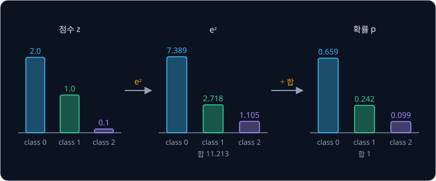

위 그림은 세 단계를 막대로 그린 것이다. $e^{z}$ 는 언제나 양수라서 확률도 언제나 양수이고, 합으로 나눴으니 더하면 1 이다. 점수가
가장 큰 class 의 확률이 가장 크다는 순서도 그대로 유지된다. 이름은 가장 큰 값만 1 로 남기는 max 를 부드럽게(soft) 만든 것이라는
뜻이다. 점수 2.0 인 class 를 1, 나머지를 0 으로 두는 대신 0.659, 0.242, 0.099 처럼 나머지에도 몫을 나눠 준다.

숫자만 바꿔 점수가 모두 같은 $z = (1, 1, 1)$ 이면 $e^{1} = 2.718$ 이 세 개라 합은 8.155 이고, 확률은 모두 $2.718 \div 8.155 = 1/3$ 이다.
점수가 같으면 확률도 똑같이 나뉜다.

**확인 문제.** 점수 $z = (3, 1, 0)$ 의 softmax 를 구해 보자. $e^{3} \approx 20.086$, $e^{1} \approx 2.718$, $e^{0} = 1$ 이다.

답 보기

합은 $20.086 + 2.718 + 1 = 23.804$ 이고, 확률은 $20.086 \div 23.804 \approx 0.844$, $2.718 \div 23.804 \approx 0.114$,
$1 \div 23.804 \approx 0.042$ 다. 더하면 1 이다.

### log

정답 class 의 확률로 loss 를 만들려면 log 라는 계산이 필요하다. $e^{-1} = 1 \div e \approx 0.368$ 이다. 이 관계를 거꾸로 읽어
"$e$ 를 몇 제곱해야 0.368 이 되는가" 를 물으면 답은 $-1$ 이고, 이 답을 $\log 0.368 = -1$ 로 쓴다. 이 강의의 $\log p$ 는 언제나
"$e$ 를 몇 제곱해야 $p$ 가 되는가" 의 답이다.

| $p$ | $e$ 의 몇 제곱인가 | $\log p$ |
| --- | --- | --- |
| 1 | $e^{0} = 1$ | 0 |
| 0.659 | $e^{-0.417} \approx 0.659$ | $-0.417$ |
| 0.5 | $e^{-0.693} \approx 0.5$ | $-0.693$ |
| 0.368 | $e^{-1} \approx 0.368$ | $-1$ |
| 0.1 | $e^{-2.303} \approx 0.1$ | $-2.303$ |
| 0.01 | $e^{-4.605} \approx 0.01$ | $-4.605$ |

$p$ 가 1 이면 $\log p = 0$ 이고, $p$ 가 1 보다 작으면 $\log p$ 는 음수다. $p$ 가 0 에 가까워질수록 $\log p$ 는 끝없이 작아진다.
0.1 에서 0.01 로 10 분의 1 이 될 때마다 $\log p$ 는 2.303 씩 작아진다. 0.659 처럼 딱 떨어지지 않는 값은 계산기로 구한다.

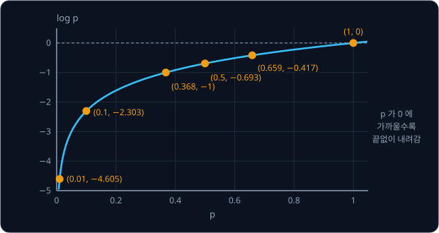

위 그림은 $p$ 를 가로축, $\log p$ 를 세로축에 놓은 그래프다. $p = 1$ 에서 0 이고, 왼쪽으로 갈수록 급하게 내려간다.

**확인 문제.** $e^{-2} \approx 0.135$ 다. $\log 0.135$ 는 얼마일까?

답 보기

$e$ 를 $-2$ 제곱하면 0.135 이므로 $\log 0.135 \approx -2$ 다.

### cross-entropy loss

정답 class 의 확률이 클수록 network 가 잘한 것이다. 그래서 loss 는 정답 class 의 확률 $p_y$ 에 log 를 씌우고 부호를 바꾼 값으로
정한다. $y$ 는 정답 class 의 번호, 곧 label 이다.

$$
L = -\log p_y
$$

식은 "정답 class 의 확률에 log 를 씌우고 앞에 마이너스를 붙인다" 로 읽는다. $\log p_y$ 가 음수라서 마이너스를 붙이면 loss 는
0 이상이 된다. 이 loss 를 cross-entropy 라고 부른다. 정보 이론이라는 분야에서 정답의 확률들과 예측한 확률들을 비교하려고 만든 양의 이름인데,
정답 class 의 확률을 1, 나머지를 0 으로 두고 계산하면 위 식만 남는다.

앞의 예에서 정답이 class 0 이면 $p_0 = 0.659$ 라서 $L = -\log 0.659 = 0.417$ 이다. 숫자만 바꿔 몇 경우를 더 보자.

| 점수 $z$ | 정답 | 정답 확률 $p_y$ | loss $-\log p_y$ |
| --- | --- | --- | --- |
| $(3, 1, 0)$ | 0 | 0.844 | 0.170 |
| $(2.0, 1.0, 0.1)$ | 0 | 0.659 | 0.417 |
| $(1, 1, 1)$ | 0 | 0.333 | 1.099 |
| $(0, 2, 0)$ | 0 | 0.107 | 2.240 |

정답 확률이 1 에 가까우면 loss 는 0 에 가깝고, 정답 확률이 0 에 가까워질수록 loss 가 빠르게 커진다. 마지막 줄처럼 틀린 class 에
확신을 갖고 높은 점수를 준 경우 loss 가 특히 크다.

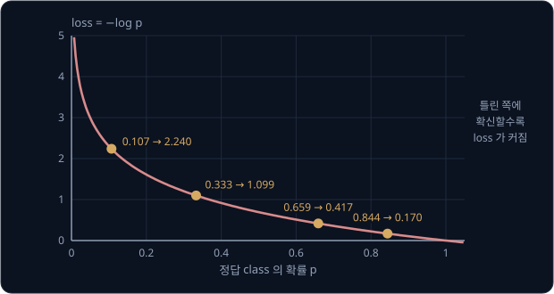

위 그림은 정답 확률에 따른 loss 다. 앞 절의 $\log p$ 그래프를 위아래로 뒤집은 모양이다.

batch 에서는 사진마다 loss 를 구해 평균한다. 위 표의 네 줄이 batch 하나라면 batch 의 loss 는
$(0.170 + 0.417 + 1.099 + 2.240) \div 4 \approx 0.981$ 이다.

**흔한 오해.** "loss 가 0.417 이면 41.7% 틀렸다" 로 읽기 쉽다. cross-entropy 는 비율이 아니라 $-\log$ 값이라 1 을 넘을 수 있고,
정답 확률이 0.107 이면 2.240 이 된다. 몇 % 를 맞혔는지는 뒤에서 보는 accuracy 로 따로 잰다.

**확인 문제.** 정답 class 의 확률이 0.5 면 loss 는? 0.1 이면?

답 보기

$-\log 0.5 = 0.693$, $-\log 0.1 = 2.303$ 이다.

### logits 의 gradient

loss 를 줄이려면 점수 $z$ 를 어느 쪽으로 고쳐야 할까? 점수 하나를 0.01 늘려 loss 가 변하는 비율을 재 보자. 정답은 class 0 이고
처음 loss 는 0.41703 이다.

| 늘린 점수 | 새 loss | 변화 | 비율 (변화 ÷ 0.01) |
| --- | --- | --- | --- |
| $z_0$: 2.0 → 2.01 | 0.41363 | $-0.00340$ | $-0.340$ |
| $z_1$: 1.0 → 1.01 | 0.41946 | $+0.00243$ | $+0.243$ |
| $z_2$: 0.1 → 0.11 | 0.41802 | $+0.00099$ | $+0.099$ |

비율의 크기를 softmax 확률과 비교하면 규칙이 보인다. $z_1$ 의 비율 0.243 은 $p_1 = 0.242$, $z_2$ 의 비율 0.099 는 $p_2 = 0.099$
와 거의 같고, 정답인 $z_0$ 의 비율 $-0.340$ 은 $p_0 - 1 = 0.659 - 1 = -0.341$ 과 거의 같다. 늘리는 양을 더 줄이면 정확히 같아진다.
미분 공식으로 정리하면 아래 결과가 나오는데, 정리하는 과정은 미분 계산이 길어서 생략하고 위에서 잰 값과 맞는지만 확인한다.

$$
\frac{\partial L}{\partial z_j} = p_j - \mathrm{onehot}(y)_j
$$

$\frac{\partial L}{\partial z_j}$ 는 "$z_j$ 를 조금 바꿨을 때 $L$ 이 변하는 비율", 곧 $z_j$ 의 gradient 다.
$\mathrm{onehot}(y)$ 는 정답 class 자리만 1 이고 나머지는 0 인 vector 다. 정답이 class 0 이면 $(1, 0, 0)$ 이다. 이름은 "한 칸만
켜져 있다(one hot)" 는 뜻이다. 식은 "점수 $z_j$ 의 gradient 는 그 class 의 확률에서, 정답이면 1 을, 아니면 0 을 뺀 값" 으로 읽는다.

| class | 확률 $p_j$ | $\mathrm{onehot}(y)_j$ | gradient $p_j - \mathrm{onehot}(y)_j$ |
| --- | --- | --- | --- |
| 0 (정답) | 0.659 | 1 | $-0.341$ |
| 1 | 0.242 | 0 | $0.242$ |
| 2 | 0.099 | 0 | $0.099$ |

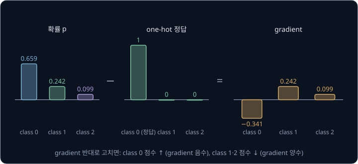

위 그림처럼 정답 class 의 gradient 는 음수라서 gradient descent 는 그 점수를 올리고, 나머지 class 는 양수라서 점수를 내린다.
틀린 class 중에서도 확률을 많이 가져간 class 1 이 가장 크게 내려간다. gradient 는 "확률이 얼마나 정답에서 벗어났는가" 그대로라서
계산이 아주 간단하다. 이 gradient 가 Backpropagation 강의의 backward 출발점 역할을 하고, 여기서부터 chain rule(칸마다의 비율을 곱하는 규칙)로 두 Linear layer 의
parameter 까지 전해진다.

**확인 문제.** 확률이 $(0.2, 0.7, 0.1)$ 이고 정답이 class 2 면 세 점수의 gradient 는?

답 보기

onehot 이 $(0, 0, 1)$ 이라 gradient 는 $(0.2, 0.7, 0.1 - 1) = (0.2, 0.7, -0.9)$ 다. 정답 class 2 의 점수만 올라가고, 확률을 가장
많이 가져간 class 1 의 점수가 가장 크게 내려간다.

### 큰 logits 와 overflow

컴퓨터는 숫자 하나를 정해진 크기의 칸에 저장한다. neural network 에서 흔히 쓰는 float32 는 숫자 하나를 0 과 1 로 된 자리(bit) 32 개에
저장하는 방식이고, 담을 수 있는 가장 큰 수가 약 $3.4 \times 10^{38}$ 이다. $10^{38}$ 은 1 뒤에 0 이 38 개 붙은 수다. 이보다 큰
수는 담지 못해 inf(무한대 표시)가 되는데, 이렇게 담을 수 있는 범위를 넘치는 것을 overflow 라고 한다.

$e^{z}$ 는 $z$ 가 조금만 커져도 급격히 커진다. $e^{89}$ 가 이미 약 $4.5 \times 10^{38}$ 이라, 점수가 89 를 넘으면 softmax 의 첫 단계에서
inf 가 나온다. inf 를 inf 로 나누면 nan(숫자가 아님 표시)이 되고, nan 이 한 번 생기면 그 뒤의 loss 와 gradient 가 모두 nan 이 된다.

다행히 softmax 는 모든 점수에서 같은 수를 빼도 결과가 바뀌지 않는다. 앞의 $z = (2.0, 1.0, 0.1)$ 에서 가장 큰 점수 2.0 을 모두 빼
$(0, -1, -1.9)$ 로 계산해 보자.

| class | 뺀 점수 | $e^{z}$ | $e^{z} \div$ 합 |
| --- | --- | --- | --- |
| 0 | 0 | 1 | $1 \div 1.517 = 0.659$ |
| 1 | $-1$ | 0.368 | $0.368 \div 1.517 = 0.242$ |
| 2 | $-1.9$ | 0.150 | $0.150 \div 1.517 = 0.099$ |
| 합 | | 1.517 | 1 |

확률이 처음과 똑같다. 점수에서 2 를 빼면 $e^{z}$ 가 모두 $e^{2}$ 로 나눠지는데, 분자와 분모가 똑같이 $e^{2}$ 로 나눠지니 비율은
그대로이기 때문이다. 가장 큰 점수를 빼면 지수에 들어가는 값이 모두 0 이하가 되어 $e^{z}$ 가 1 을 넘지 않으므로 overflow 가 생기지
않는다. 점수가 $(1002, 1001, 1000.1)$ 이어도 1002 를 빼면 $(0, -1, -1.9)$ 가 되어 같은 확률이 나온다.

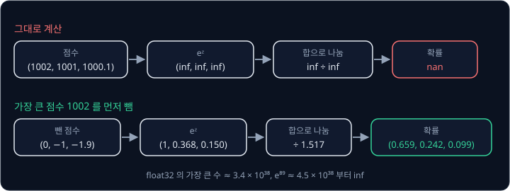

위 그림의 위쪽 길은 점수를 그대로 넣은 경우, 아래쪽 길은 가장 큰 점수를 먼저 뺀 경우다. 같은 이유로 확률을 먼저 구한 뒤 log 를
씌우는 것보다 처음부터 $-\log p_y$ 를 점수로 바로 계산하는 편이 안전하다. 정답 확률이 $10^{-50}$ 처럼 아주 작으면 float32 에서
0 이 되어 버리고, $\log 0$ 은 끝없이 작아서 inf 가 되기 때문이다. PyTorch 의 cross-entropy 계산은 점수를 받아 이 두 가지를 처리해 준다.

**확인 문제.** 점수 $(5, 5, 3)$ 에서 가장 큰 점수를 빼면 어떤 점수가 되고, 첫 class 의 확률은? $e^{-2} \approx 0.135$ 다.

답 보기

5 를 빼면 $(0, 0, -2)$ 이고 $e^{z}$ 는 $1, 1, 0.135$, 합은 2.135 다. 첫 class 의 확률은 $1 \div 2.135 \approx 0.468$ 이다.

**요약**

- softmax 는 점수마다 $e^{z}$ 를 구해 합으로 나눠, 모두 양수이고 더하면 1 인 확률로 바꾼다
- cross-entropy loss 는 정답 확률의 $-\log$ 다. $(2.0, 1.0, 0.1)$ 에서 정답이 class 0 이면 0.417 이다
- 점수의 gradient 는 확률에서 one-hot 정답을 뺀 값이고, 계산할 때는 가장 큰 점수를 먼저 빼서 overflow 를 막는다

## mini-batch 와 epoch

### mini-batch

gradient descent(gradient 의 반대 방향으로 parameter 를 조금씩 고치는 방법)를 그대로 하면 step 마다
데이터 전체로 gradient 를 구한다. step 은 parameter 를 한 번 고치는 단위다.
MNIST 처럼 사진이 60,000 장이면 parameter 를 한 번 고치기 위해 60,000 장을 모두 계산해야 해서 학습이 너무 느리다.

그래서 데이터를 작은 묶음으로 나눠 묶음 하나의 평균 gradient 로 parameter 를 고친다. 이 묶음을 mini-batch 라고 한다. 앞에서 말한
batch 와 같은 것인데, 데이터 전체(batch)가 아니라 그 일부라는 뜻에서 mini 를 붙였다. 데이터 전체를 한 번씩 다 쓴 것을 epoch 하나라고
부른다.

사진 12 장을 mini-batch 4 장씩 나누면 epoch 하나에 step 이 $12 \div 4 = 3$ 번 있다. epoch 를 시작할 때마다 사진의 순서를 무작위로
섞는데, 이것을 shuffle 이라고 한다. 섞지 않으면 매 epoch 같은 사진끼리 같은 mini-batch 에 묶여서, 예를 들어 0 만 모인 mini-batch
다음에 1 만 모인 mini-batch 가 오는 식으로 순서에 따라 parameter 가 한쪽으로 쏠렸다 돌아오기를 되풀이할 수 있다.

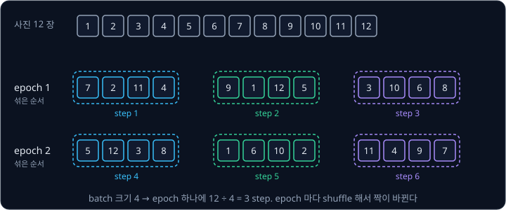

위 그림처럼 epoch 1 과 epoch 2 는 같은 사진 12 장을 쓰지만 묶이는 짝이 다르다. MNIST 60,000 장을 mini-batch 100 장씩 나누면 epoch
하나에 $60{,}000 \div 100 = 600$ step 이고, 5 epoch 를 돌면 $600 \times 5 = 3{,}000$ step 이다. 한 mini-batch 에 몇 장을 넣을지를
batch 크기라고 하고, learning rate(gradient 에 곱해 한 번에 움직일 크기를 정하는 수)처럼 사람이 학습 전에 정하는
hyperparameter 다.

**확인 문제.** 사진 50,000 장을 batch 크기 100 으로 학습하면 epoch 하나에 step 이 몇 번일까? 10 epoch 를 돌면?

답 보기

$50{,}000 \div 100 = 500$ 번이고, 10 epoch 면 $500 \times 10 = 5{,}000$ 번이다.

### mini-batch gradient 와 SGD

mini-batch 의 gradient 는 데이터 전체의 gradient 와 조금 다르다. 데이터가 4 개이고, 어떤 parameter 하나에 대해 sample 마다의
gradient 가 $-4, -2, 1, 1$ 이라고 하자. sample 은 입력과 정답 한 쌍이다. 전체 평균은 $(-4 - 2 + 1 + 1) \div 4 = -1$ 이다.

| 섞은 순서 | 첫 mini-batch | 평균 | 둘째 mini-batch | 평균 | 두 평균의 평균 |
| --- | --- | --- | --- | --- | --- |
| A | $-4, 1$ | $-1.5$ | $-2, 1$ | $-0.5$ | $-1$ |
| B | $-4, -2$ | $-3$ | $1, 1$ | $1$ | $-1$ |

mini-batch 하나의 gradient 는 $-1.5$, $-0.5$, $-3$, 1 처럼 전체 평균 $-1$ 주위에서 흔들린다. 순서 B 의 둘째 mini-batch 는 부호까지
반대다. 하지만 epoch 하나에 걸쳐 평균하면 언제나 전체 평균 $-1$ 이 된다. 그래서 mini-batch 로 고치는 parameter 는 한 step 씩 보면
조금씩 엇나가지만, 여러 step 을 모아 보면 전체 gradient 를 따라 내려간다.

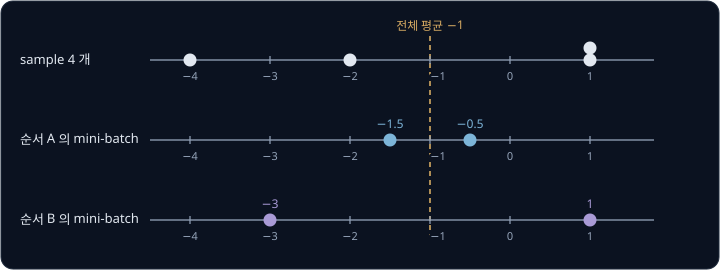

위 그림은 mini-batch gradient 가 전체 평균 주위에 흩어진 모습이다. 이렇게 무작위로 고른 일부 데이터의 gradient 로 하는 gradient
descent 를 SGD(stochastic gradient descent)라고 한다. stochastic 은 "무작위가 섞인" 이라는 뜻이다. update 식은 Linear Regression
의 gradient descent 와 같다.

$$
\theta \leftarrow \theta - \eta\, g
$$

$\theta$ 는 그리스 문자 theta(세타)로 parameter 하나를 가리키고, $g$ 는 이번 mini-batch 로 구한 그 parameter 의 gradient, $\eta$ 는
eta(에타)로 읽는 learning rate 다. 식은 "parameter 에서 learning rate 곱하기 gradient 를 뺀다" 로 읽는다. $\theta = 1$, $g = 5$,
$\eta = 0.1$ 이면 $1 - 0.1 \times 5 = 0.5$ 가 된다. 1951년 Robbins 와 Monro 는 무작위로 흔들리는 값으로도 이런 식의 update 를
되풀이하면 원하는 답에 다가갈 수 있다는 조건을 처음 보였고, 이 연구가 SGD 의 출발점이다.

mini-batch 를 쓰면 같은 시간에 parameter 를 훨씬 자주 고칠 수 있다. 60,000 장 전체로 한 번 고칠 시간에 mini-batch 100 장씩으로는
600 번 고친다. 한 번 한 번은 조금 부정확해도 대부분 내려가는 쪽을 가리키므로 훨씬 빨리 내려간다.

**확인 문제.** sample gradient 가 $2, 4, -2, 0$ 이다. 전체 평균은 얼마이고, mini-batch $\{2, -2\}$, $\{4, 0\}$ 의 평균은 각각 얼마일까?

답 보기

전체 평균은 $4 \div 4 = 1$ 이다. mini-batch 평균은 $0 \div 2 = 0$ 과 $4 \div 2 = 2$ 이고, 이 둘을 평균하면 다시 1 이다.

**요약**

- mini-batch 는 데이터의 작은 묶음이고, epoch 는 데이터 전체를 한 번 다 쓴 것이다. 60,000 장을 100 장씩 나누면 epoch 하나에 600 step 이다
- epoch 마다 shuffle 해서 mini-batch 를 다시 묶는다
- mini-batch gradient 는 전체 gradient 주위에서 흔들리고, 이것으로 하는 update 가 SGD $\theta \leftarrow \theta - \eta g$ 다

## optimizer

gradient 를 받아 parameter 를 실제로 고치는 규칙을 optimizer 라고 한다. SGD 도 optimizer 이고, 이 섹션에서는 SGD 를 고친 momentum
과 Adam 을 본 뒤 셋을 같은 문제로 비교한다.

### momentum

SGD 는 그 step 의 gradient 만 보고 움직인다. 그래서 gradient 가 매 step 같은 방향을 가리켜도 속도가 붙지 않고, mini-batch 마다
gradient 가 흔들리면 그대로 따라 흔들린다. momentum 은 지난 gradient 들을 buffer(임시로 쌓아 두는 값) $b$ 에 모아 두고 그 방향으로
움직인다.

$$
b \leftarrow \mu\, b + g, \qquad \theta \leftarrow \theta - \eta\, b
$$

$\mu$ 는 그리스 문자 mu(뮤)로, 지난 buffer 를 얼마나 남길지 정하는 숫자이고 보통 0.9 다. 첫 식은 "지난 buffer 에 0.9 를
곱하고 이번 gradient 를 더해 새 buffer 로 삼는다", 둘째 식은 "parameter 를 learning rate 곱하기 buffer 만큼 옮긴다" 로 읽는다.
buffer 는 0 에서 시작한다.

gradient 가 매 step 1 이고 $\mu = 0.9$, $\eta = 0.1$ 이면 아래와 같다.

| step | $g$ | $b = 0.9 \times$ 지난 $b + g$ | 움직인 거리 $\eta b$ | SGD 가 움직인 거리 $\eta g$ |
| --- | --- | --- | --- | --- |
| 1 | 1 | $0.9 \times 0 + 1 = 1$ | 0.1 | 0.1 |
| 2 | 1 | $0.9 \times 1 + 1 = 1.9$ | 0.19 | 0.1 |
| 3 | 1 | $0.9 \times 1.9 + 1 = 2.71$ | 0.271 | 0.1 |
| 4 | 1 | $0.9 \times 2.71 + 1 = 3.439$ | 0.3439 | 0.1 |

같은 방향의 gradient 가 이어지면 buffer 가 커지면서 한 step 에 움직이는 거리가 늘어난다. 계속 이어지면 buffer 는 10 에 다가가서
SGD 의 10 배 속도가 된다. 10 은 $1 \div (1 - 0.9)$ 로, buffer 가 더 커지지 않는 지점이다.

숫자만 바꿔 gradient 가 $+1, -1, +1, -1$ 처럼 번갈아 바뀌면 buffer 는 $1, -0.1, 0.91, -0.181, 0.837, -0.247$ 이 된다. 반대 방향의
gradient 가 지난 buffer 를 줄여서 buffer 의 크기가 1 을 넘지 않는다. 방향이 꾸준한 parameter 는 빨라지고 오락가락하는
parameter 는 빨라지지 않는다. momentum 은 운동량이라는 뜻이고, 굴러 내려가는 공이 속도를 얻어 작은 요철은 넘어가는 모습에서 온
이름이다.

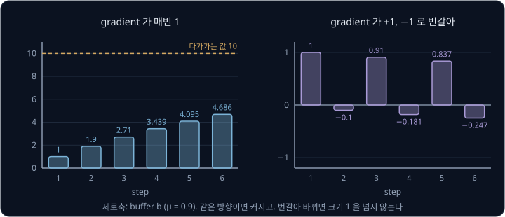

위 그림의 왼쪽은 같은 방향 gradient, 오른쪽은 번갈아 바뀌는 gradient 에서의 buffer 다.

**확인 문제.** $\mu = 0.9$ 이고 gradient 가 2, 2, 2 로 들어오면 셋째 step 의 buffer 는?

답 보기

$b = 2$, $0.9 \times 2 + 2 = 3.8$, $0.9 \times 3.8 + 2 = 5.42$ 다. gradient 가 1 일 때의 2.71 의 정확히 두 배다.

### moving average

Adam 을 보기 전에 계산 하나를 익힌다. 값이 하나씩 들어올 때마다 "지금까지의 평균" 을 새로 구하는 방법으로, 지난 평균에 0.9 를
곱하고 새 값에 0.1 을 곱해 더한다.

$$
m \leftarrow 0.9\, m + 0.1\, g
$$

식은 "지난 평균을 90%, 새 값을 10% 섞어 새 평균으로 삼는다" 로 읽는다. 오래된 값일수록 0.9 가 여러 번 곱해져 비중이 작아지므로,
최근 값 쪽으로 움직이는 평균이 된다. 이런 평균을 moving average(이동 평균)라고 한다.

$g$ 가 매번 2 이고 $m$ 이 0 에서 시작하면 $m$ 은 0.2, 0.38, 0.542 로 2 를 향해 천천히 올라간다. 들어온 값이 모두 2 인데 평균이
0.2 라고 나오는 것은 0 에서 출발한 탓이다. 그래서 $m$ 을 $1 - 0.9^{t}$ 로 나눠 바로잡는다. $t$ 는 지금까지 들어온 값의 개수이고,
$0.9^{t}$ 는 0.9 를 $t$ 번 곱한 수다.

| $t$ | $m$ | $1 - 0.9^{t}$ | $m \div (1 - 0.9^{t})$ |
| --- | --- | --- | --- |
| 1 | 0.2 | $1 - 0.9 = 0.1$ | 2 |
| 2 | 0.38 | $1 - 0.81 = 0.19$ | 2 |
| 3 | 0.542 | $1 - 0.729 = 0.271$ | 2 |

나눈 값은 처음부터 정확히 2 다. 0 에서 출발해 생긴 치우침(bias)을 바로잡는다고 해서 이 나눗셈을 bias correction 이라고 부른다.
여기서 bias 는 neuron 의 bias 와 다른 뜻으로, 값이 한쪽으로 치우친 정도를 말한다. $t$ 가 커지면 $0.9^{t}$ 가 0 에 가까워져서
나누는 수가 1 에 가까워지고, bias correction 은 저절로 사라진다.

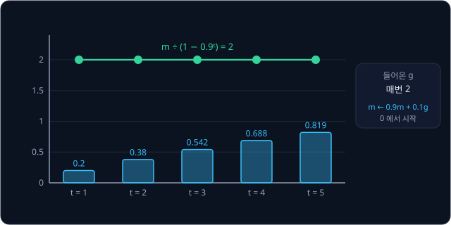

위 그림의 아래쪽 막대가 moving average $m$, 위쪽 선이 bias correction 한 값이다.

**확인 문제.** $g$ 가 매번 5 이고 $m$ 이 0 에서 시작하면 첫 step 의 $m$ 과 bias correction 한 값은?

답 보기

$m = 0.9 \times 0 + 0.1 \times 5 = 0.5$ 이고, $0.5 \div 0.1 = 5$ 다.

### Adam

2014년 Kingma 와 Ba 가 제안한 Adam 은 parameter 마다 moving average 두 개를 따로 둔다. 하나는 gradient 의 moving average $m$ 이고,
다른 하나는 gradient 를 제곱한 값의 moving average $v$ 다. 이름은 adaptive moment estimation 을 줄인 것으로, gradient 의 평균과
제곱 평균(통계에서 moment 라고 부르는 양)을 추정해 step 크기를 parameter 마다 맞춘다(adaptive)는 뜻이다.

$$
m \leftarrow \beta_1 m + (1 - \beta_1)\, g, \qquad v \leftarrow \beta_2 v + (1 - \beta_2)\, g^2
$$

$$
\hat m = \frac{m}{1 - \beta_1^{t}}, \qquad \hat v = \frac{v}{1 - \beta_2^{t}}, \qquad
\theta \leftarrow \theta - \eta\, \frac{\hat m}{\sqrt{\hat v} + \epsilon}
$$

| 기호 | 읽는 법 | 뜻 | 보통 쓰는 값 |
| --- | --- | --- | --- |
| $\beta_1$, $\beta_2$ | 베타 원, 베타 투 | moving average 가 지난 값을 남기는 비율 | 0.9, 0.999 |
| $m$, $v$ | 엠, 브이 | gradient 와 gradient 제곱의 moving average. 0 에서 시작 | |
| $\hat m$, $\hat v$ | 엠 햇, 브이 햇 | bias correction 한 $m$, $v$ | |
| $t$ | 티 | 지금까지 한 step 수. 1 부터 센다 | |
| $\epsilon$ | 엡실론 | 0 으로 나누지 않게 더하는 아주 작은 수 | $10^{-8}$ |

첫 줄은 앞 절의 moving average 두 개이고, 둘째 줄은 둘을 bias correction 한 뒤 "$\hat m$ 을 $\sqrt{\hat v}$ 로 나눈 값에 learning
rate 를 곱해 parameter 에서 뺀다" 로 읽는다. $10^{-8}$ 은 0.00000001 이다.

첫 step 을 숫자로 따라가 보자. gradient 가 $g = 2$ 이다.

| 값 | 계산 | 결과 |
| --- | --- | --- |
| $m$ | $0.9 \times 0 + 0.1 \times 2$ | 0.2 |
| $v$ | $0.999 \times 0 + 0.001 \times 2^2$ | 0.004 |
| $\hat m$ | $0.2 \div (1 - 0.9)$ | 2 |
| $\hat v$ | $0.004 \div (1 - 0.999)$ | 4 |
| 움직이는 거리 | $\eta \times 2 \div \sqrt{4} = \eta \times 2 \div 2$ | $\eta$ |

숫자만 바꿔 gradient 가 200 이면 $\hat m = 200$, $\hat v = 40{,}000$, $\sqrt{\hat v} = 200$ 이라 움직이는 거리가 다시 $\eta$ 이고,
0.02 여도 $0.02 \div 0.02$ 라서 $\eta$ 다. gradient 를 그 크기로 나누기 때문에 Adam 은 gradient 가 크든 작든 한 step 에 대략
$\eta$ 만큼 움직인다. 첫 step 에는 정확히 $\eta$ 이고, 그 뒤로도 gradient 가 꾸준하면 $\eta$ 근처다.

bias correction 을 빼면 첫 step 에 $m = 0.2$, $\sqrt{v} = \sqrt{0.004} \approx 0.063$ 이라 거리가 $\eta \times 0.2 \div 0.063 \approx 3.16\eta$
가 된다. 두 moving average 가 0 에서 출발해 서로 다른 속도로 차오르기 때문에 생기는 차이로, 학습 첫 몇 step 에 의도보다 3 배 넘게
크게 움직인다.

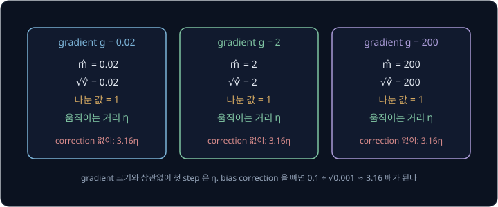

위 그림은 세 gradient 크기에서 첫 step 의 거리를 비교한 것이다. neural network 에서는 parameter 마다 gradient 크기가 수백 배씩
다를 수 있다. SGD 로는 learning rate 하나가 어떤 parameter 에는 너무 크고 다른 parameter 에는 너무 작기 쉽지만, Adam 은 parameter
마다 자기 gradient 크기로 나누므로 learning rate 하나로 모든 parameter 를 비슷한 거리씩 움직인다.

**확인 문제.** Adam 의 첫 step 에서 gradient 가 $-4$ 이고 $\eta = 0.01$ 이면 parameter 는 어느 쪽으로 얼마나 움직일까?

답 보기

$m = -0.4$, $v = 0.016$ 이고 $\hat m = -4$, $\hat v = 16$, $\sqrt{\hat v} = 4$ 다. $\theta$ 에서 $0.01 \times (-4) \div 4 = -0.01$ 을
빼므로 0.01 만큼 커진다. gradient 가 음수이니 키우는 쪽이다.

### 세 optimizer 의 비교

같은 문제를 세 optimizer 로 풀어 보자. loss 가 $L = w^2$ 이고 $w = 5$ 에서 출발한다. $w^2$ 의
derivative 는 $2w$ 라서 gradient 는 $2w$ 이고, $w = 0$ 이 답이다. 세 optimizer 모두 $\eta = 0.1$ 로 두고, momentum 은 $\mu = 0.9$,
Adam 은 앞의 기본값을 쓴다.

| step | SGD | momentum | Adam |
| --- | --- | --- | --- |
| 0 | 5 | 5 | 5 |
| 1 | 4 | 4 | 4.9 |
| 2 | 3.2 | 2.3 | 4.8 |
| 3 | 2.56 | 0.31 | 4.7 |
| 4 | 2.048 | $-1.543$ | 4.6 |
| 5 | 1.638 | $-2.902$ | 4.5 |
| 20 | 0.058 | $-1.746$ | 3.06 |
| 60 | 0.000 | $-0.182$ | 0.48 |

SGD 는 매 step $w \leftarrow w - 0.1 \times 2w = 0.8w$ 라서 5, 4, 3.2 로 0.8 배씩 줄어든다. momentum 은 step 2 에서
$b = 0.9 \times 10 + 8 = 17$ 이라 $w = 4 - 1.7 = 2.3$ 으로 SGD 보다 빨리 내려가지만, 쌓인 buffer 때문에 0 을 지나쳐 $-2.9$ 까지
갔다가 되돌아오며 흔들린다. Adam 은 앞에서 본 대로 한 step 에 0.1 씩 움직여서, 이 문제에서는 가장 느리다.

이번에는 loss 를 $L = 0.01 w^2$ 로 바꾼다. 답은 똑같이 $w = 0$ 인데 gradient 가 $0.02 w$ 로 100 분의 1 이 된다.

| step | SGD | momentum | Adam |
| --- | --- | --- | --- |
| 0 | 5 | 5 | 5 |
| 1 | 4.99 | 4.99 | 4.9 |
| 5 | 4.950 | 4.869 | 4.5 |
| 20 | 4.804 | 3.863 | 3.06 |
| 60 | 4.434 | 1.475 | 0.48 |

SGD 는 60 step 이 지나도 4.43 으로 거의 움직이지 않는다. momentum 은 buffer 가 쌓여 SGD 보다 훨씬 빠르다. Adam 은 앞의 표와 숫자가
똑같다. gradient 를 그 크기로 나누기 때문에 loss 에 0.01 을 곱해도 움직임이 변하지 않는다.

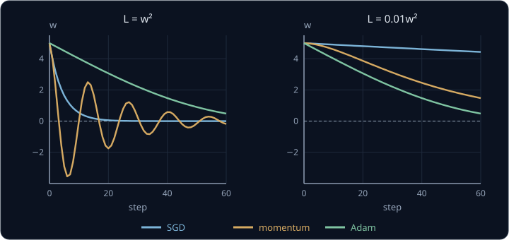

위 그림은 두 표를 그래프로 그린 것이다. 어느 optimizer 가 언제나 가장 좋지는 않다. gradient 크기에 딱 맞는 learning rate 를 고른
SGD 는 빠르고, momentum 은 꾸준한 방향에서 빨라지는 대신 지나쳐 흔들릴 수 있다. Adam 은 gradient 크기가 parameter 마다, 학습
시기마다 달라져도 learning rate 하나로 비슷하게 움직여서, 처음 학습시켜 보는 network 의 기본값으로 가장 많이 쓴다.

**흔한 오해.** "Adam 이 SGD 보다 언제나 빠르다" 고 생각하기 쉽다. 위 $L = w^2$ 에서는 SGD 가 20 step 에 0.058 까지 내려갔지만 Adam 은
3.06 에 머물렀다. Adam 의 장점은 빠르기보다, gradient 크기가 달라져도 같은 learning rate 로 버틴다는 데 있다.

**확인 문제.** $L = w^2$, $w = 2$, $\eta = 0.1$ 일 때 SGD 의 한 step 뒤 $w$ 와, Adam 의 첫 step 뒤 $w$ 는?

답 보기

gradient 는 $2 \times 2 = 4$ 다. SGD 는 $2 - 0.1 \times 4 = 1.6$ 이고, Adam 은 첫 step 에 정확히 $\eta = 0.1$ 만큼 움직여 1.9 다.

**요약**

- momentum 은 gradient 를 buffer 에 쌓아 같은 방향이 이어지면 최대 10 배($\mu = 0.9$)까지 빨라지고, 대신 지나쳐 흔들릴 수 있다
- Adam 은 gradient 와 그 제곱의 moving average 를 bias correction 한 뒤 나눠서, gradient 크기와 상관없이 한 step 에 대략 $\eta$ 씩 움직인다
- 어느 optimizer 도 언제나 가장 빠르지는 않다

## training loop

### 한 step 의 여섯 단계

지금까지 본 계산을 학습 순서대로 이으면 PyTorch 로 학습을 짤 때의 한 step 이 된다. 기본 학습 loop 는 예측 → loss →
gradient → update 의 네 단계인데, 여기서는 mini-batch 를 꺼내는 일과 gradient 를 0 으로 되돌리는 일이 더해져 여섯 단계다.

1. **mini-batch 꺼내기** — shuffle 한 데이터에서 다음 사진 100 장과 label 100 개를 꺼낸다
2. **forward** — 사진을 MLP 에 넣어 logits 를 계산한다. 이때 autograd 는 어떤 tensor 가 어떤 연산으로 만들어졌는지 graph 로 기록한다
3. **loss 계산** — logits 와 label 로 cross-entropy 를 계산해 평균한다. 숫자 하나다
4. **gradient 를 0 으로 되돌리기** — 지난 step 에 각 parameter 에 저장해 둔 gradient 를 지운다
5. **backward** — loss 에서 출발해 graph 를 거꾸로 훑으며 parameter 203,530 개의 gradient 를 한 번에 채운다
6. **parameter 고치기** — optimizer 가 저장된 gradient 를 읽어 SGD·momentum·Adam 의 규칙대로 parameter 를 고친다

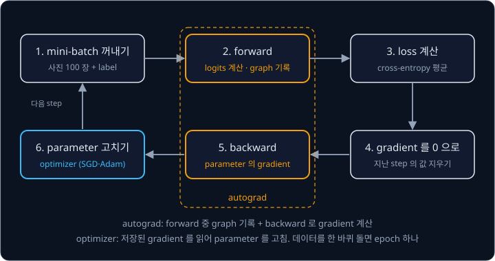

위 그림에서 주황색 테두리가 autograd 가 맡는 부분이다. autograd 는 forward 동안 graph 를 기록해 두었다가 backward 에서 Backpropagation
강의의 reverse-mode 계산을 tensor 단위로 해서 gradient 를 채운다. parameter 를 실제로 바꾸는 것은 autograd 가 아니라 optimizer 다.
autograd 는 "어느 쪽으로 얼마나 고치면 좋은가" 를 알려 주고, optimizer 가 그 정보를 받아 "실제로 얼마나 움직일지" 를 정한다.
그래서 같은 gradient 로도 optimizer 를 바꾸면 parameter 가 다르게 움직인다.

이 여섯 단계를 mini-batch 마다 되풀이하고, 데이터를 한 바퀴 돌면 epoch 하나다. network 가 MLP 에서 사진을 보는 큰 network 나
로봇의 행동을 내는 network 로 바뀌어도, loss 가 cross-entropy 에서 다른 것으로 바뀌어도 이 여섯 단계는 그대로다.

**확인 문제.** 아래 일 중 autograd 가 하는 일을 모두 고르자. (가) 사진을 섞는다 (나) forward 중에 graph 를 기록한다
(다) parameter 마다 gradient 를 계산한다 (라) parameter 에서 $\eta \times$ gradient 를 뺀다

답 보기

(나)와 (다)다. (가)는 데이터를 꺼내는 단계, (라)는 optimizer 의 일이다.

### gradient 를 0 으로 되돌리는 이유

Backpropagation 강의에서 한 값이 여러 곳에 쓰이면 길마다의 gradient 를 더해 쌓아야 한다고 했다. autograd 는 이 규칙을 지키려고
backward 에서 구한 gradient 를 parameter 에 저장된 값에 덮어쓰지 않고 언제나 더한다. 그래서 step 이 바뀔 때 직접 0 으로
지우지 않으면 지난 step 의 gradient 가 그대로 남아 이번 gradient 에 더해진다.

parameter $w = 1$, $\eta = 0.1$ 로 SGD 를 두 step 한다고 하자. 첫 step 의 gradient 는 0.5, 둘째 step 의 gradient 는 0.3 이다.

| step | 이번 gradient | 0 으로 되돌릴 때 쓰는 값 | 새 $w$ | 되돌리지 않을 때 쓰는 값 | 새 $w$ |
| --- | --- | --- | --- | --- | --- |
| 1 | 0.5 | 0.5 | $1 - 0.1 \times 0.5 = 0.95$ | 0.5 | 0.95 |
| 2 | 0.3 | 0.3 | $0.95 - 0.1 \times 0.3 = 0.92$ | $0.5 + 0.3 = 0.8$ | $0.95 - 0.1 \times 0.8 = 0.87$ |

되돌리지 않으면 step 1 에서 이미 쓴 gradient 0.5 를 step 2 에서 한 번 더 써서 $w$ 가 0.92 대신 0.87 이 된다. step 이 이어질수록
쌓인 gradient 가 점점 커져 parameter 가 엉뚱하게 움직인다.

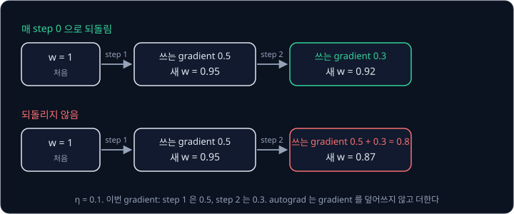

위 그림의 위쪽 줄은 매 step gradient 를 지운 경우, 아래쪽 줄은 지우지 않은 경우다. 이 더해 쌓는 성질을 일부러 쓰기도 한다.
GPU(같은 계산을 수많은 숫자에 동시에 하는 계산 장치)의 저장 공간이 모자라 mini-batch 100 장을 한 번에 넣지 못하면 50 장씩 두 번 backward 해서 gradient 를 쌓은 뒤 한 번만 parameter 를
고친다. 이때 두 loss 를 각각 2 로 나눠 두면 쌓인 gradient 가 100 장의 평균 gradient 와 같아진다.

**확인 문제.** gradient 를 지우지 않고 세 step 동안 gradient 가 0.2, 0.2, 0.2 로 나왔다. 셋째 step 의 update 에 쓰이는 값은?

답 보기

$0.2 + 0.2 + 0.2 = 0.6$ 이다. 지웠다면 0.2 를 썼을 것이다.

**요약**

- 한 step 은 mini-batch 꺼내기 → forward → loss → gradient 0 으로 되돌리기 → backward → parameter 고치기다
- autograd 는 forward 중 graph 를 기록하고 backward 로 gradient 를 채우며, parameter 를 고치는 것은 optimizer 다
- autograd 는 gradient 를 더해 쌓으므로 step 마다 0 으로 되돌려야 한다

## validation 과 overfitting

### accuracy

loss 는 학습에 쓰기 좋지만 사람이 "얼마나 잘 맞히나" 를 읽기에는 불편하다. 그래서 점검할 때는 맞힌 비율을 따로 잰다. 사진마다
점수가 가장 큰 class 를 network 의 답으로 보고, 그 답이 label 과 같은 사진의 비율을 accuracy(정확도)라고 한다.

점수와 label 이 아래와 같은 네 sample 로 계산한다. 3 번 sample 을 뺀 셋은 앞의 cross-entropy 표에 나온 점수다.

| sample | 점수 $z$ | 가장 큰 점수의 class | label | 맞았나 |
| --- | --- | --- | --- | --- |
| 1 | $(2.0, 1.0, 0.1)$ | 0 | 0 | 맞음 |
| 2 | $(0, 2, 0)$ | 1 | 0 | 틀림 |
| 3 | $(1, 2, 3)$ | 2 | 2 | 맞음 |
| 4 | $(3, 1, 0)$ | 0 | 0 | 맞음 |

네 장 중 세 장을 맞혀 accuracy 는 $3 \div 4 = 0.75$, 곧 75% 다. 3 번 sample 은 정답 class 2 의 확률이 0.665 라서 loss 가
$-\log 0.665 \approx 0.408$ 이고, 네 sample 의 loss 를 평균하면 $(0.417 + 2.240 + 0.408 + 0.170) \div 4 \approx 0.809$ 다. accuracy 는 맞았나 틀렸나만 세지만, loss 는 얼마나 확신을 갖고 맞혔거나 틀렸는지까지 반영한다.

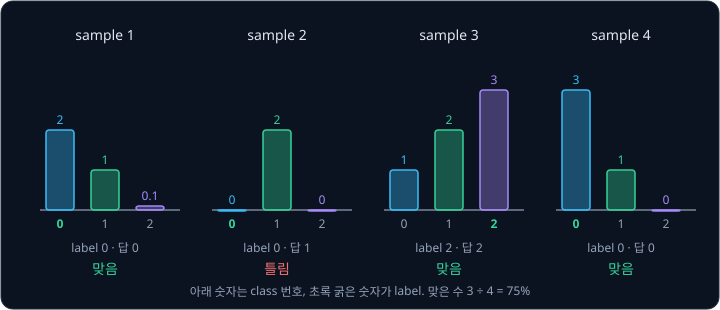

위 그림은 sample 마다 세 점수를 막대로 그리고 label 을 표시한 것이다. 2 번 sample 은 정답 class 0 이 아닌 class 1 에 가장 높은
점수를 주었다.

**확인 문제.** 점수 $(0.5, 0.2, 0.9)$, label 0 인 sample 은 맞은 것일까?

답 보기

가장 큰 점수는 class 2 의 0.9 라서 답은 2 이고, label 0 과 달라 틀렸다.

### train set, validation set, test set

network 가 학습에 쓴 사진만 잘 맞히는 것은 쓸모가 없다. 로봇이나 프로그램이 실제로 만나는 것은 처음 보는 사진이기 때문이다.
처음 보는 데이터에서도 잘하는 능력을 generalization(일반화)이라고 하고, 이 능력은 학습에 쓰지 않은 데이터로만 잴 수 있다. 그래서
데이터를 쓰임새에 따라 세 묶음으로 나눈다.

| 묶음 | MNIST 에서의 크기 | 쓰임 |
| --- | --- | --- |
| train set | 50,000 장 | gradient 를 계산해 parameter 를 고치는 데 쓴다 |
| validation set | 10,000 장 | 학습 중간중간 성능을 재고, learning rate·batch 크기·학습을 멈출 epoch 를 고르는 데 쓴다 |
| test set | 10,000 장 | 모든 선택이 끝난 뒤 마지막에 한 번만 잰다 |

MNIST 는 학습용 60,000 장과 시험용 10,000 장으로 나뉘어 있으므로, 학습용에서 10,000 장을 떼어 validation set 으로 쓰면 위 표가
된다. validation 은 "검증", test 는 "시험" 이라는 뜻이다.

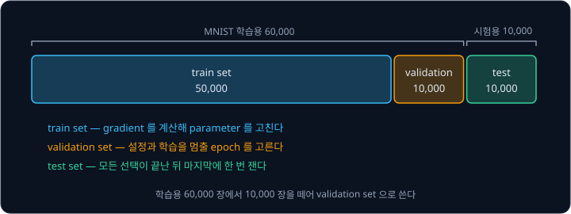

위 그림은 세 묶음의 크기와 쓰임이다. test set 을 따로 두는 이유는 validation set 도 여러 번 보면서 설정을 고르다 보면 그 10,000 장에
맞춘 설정이 뽑히기 때문이다. learning rate 열 가지를 validation set 으로 비교해 가장 좋은 것을 골랐다면, 그 성능은 열 번 중 운 좋게
가장 높게 나온 값이라 실제보다 조금 좋게 보인다. 아무 선택에도 쓰지 않은 test set 이 있어야 처음 보는 데이터에서의 성능을 정직하게
알 수 있다.

**확인 문제.** 데이터 1,000 개를 train 800 개, validation 100 개, test 100 개로 나눴다. learning rate 를 고를 때 비교하는 성능은 어느 묶음에서 잰 것이어야 할까?

답 보기

validation set 100 개다. train set 은 이미 학습에 쓴 데이터라 처음 보는 데이터에서의 성능을 알려 주지 않고, test set 은 선택이 모두
끝난 뒤 마지막 점검에만 쓴다.

### overfitting

[Linear Regression](../linear-regression/README.md) 의 noise 가 섞인 데이터 $(1, 5.5)$, $(2, 7.5)$, $(3, 10.5)$, $(4, 14.5)$ 를 다시
보자. 이 점들은 직선 $y = 3x + 2$ 에 noise(측정마다 무작위로 끼어드는 작은 차이)를 섞어 만든 것이었다. 여기에 두 모델을 맞춘다.

- **직선** $\hat y = 3x + 2$ — Linear Regression 에서 구한, loss 가 가장 작은 직선이다
- **곡선** $\hat y = 0.5x^2 + 0.5x + 4.5$ — 네 점을 모두 정확히 지나는 곡선이다. $x = 2$ 이면 $0.5 \times 4 + 0.5 \times 2 + 4.5 = 7.5$ 다

train set 인 네 점에서 직선의 loss 는 0.25 였고, 곡선은 네 점을 모두 지나니 loss 가 0 이다. train loss 만 보면 곡선이 더 좋다.

같은 직선에서 새로 잰 validation 점 세 개 $(1.5, 6.0)$, $(2.5, 10.0)$, $(3.5, 12.0)$ 으로 두 모델을 점검한다. 이 점들에도 noise 가
섞여 있다.

| $x$ | 측정값 | 직선의 예측 | 직선의 오차 | 곡선의 예측 | 곡선의 오차 |
| --- | --- | --- | --- | --- | --- |
| 1.5 | 6.0 | 6.5 | 0.5 | 6.375 | 0.375 |
| 2.5 | 10.0 | 9.5 | $-0.5$ | 8.875 | $-1.125$ |
| 3.5 | 12.0 | 12.5 | 0.5 | 12.375 | 0.375 |
| validation loss | | | 0.25 | | 0.516 |

직선의 validation loss 는 $(0.25 + 0.25 + 0.25) \div 3 = 0.25$ 로 train loss 와 같다. 곡선은
$(0.1406 + 1.2656 + 0.1406) \div 3 \approx 0.516$ 으로 train loss 0 보다 훨씬 나빠졌다. 곡선은 데이터에 섞인 noise 까지 정확히
따라가도록 휘어졌는데, noise 는 새 데이터에서 다시 나오지 않으므로 그 휨이 오히려 오차가 된다.

이렇게 train set 에는 아주 잘 맞지만 처음 보는 데이터에서는 성능이 떨어지는 현상을 overfitting(과적합)이라고 한다. network 가 규칙을
배우지 않고 학습 데이터 자체를 외워 버렸다고 볼 수 있다.

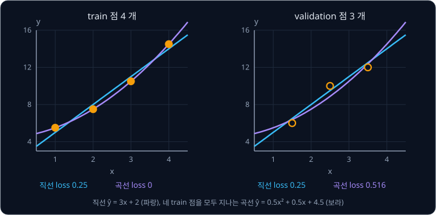

위 그림의 왼쪽은 train 점에서, 오른쪽은 validation 점에서 두 모델을 비교한 것이다. 곡선은 $x = 2.5$ 근처에서 직선보다 아래로 처져서
그 자리의 validation 점과 크게 어긋난다.

**흔한 오해.** "train loss 가 0 이면 완벽한 모델" 이라고 생각하기 쉽다. 더 많이 휘어질 수 있는 모델은 noise 까지 따라가서 train
loss 를 0 에 가깝게 만들 수 있다. train loss 가 0 인 곡선의 validation loss 는 직선의 두 배가 넘었다.

**확인 문제.** 곡선 $\hat y = 0.5x^2 + 0.5x + 4.5$ 의 $x = 5$ 에서의 예측은? 직선 $3x + 2$ 의 예측과 얼마나 다를까?

답 보기

곡선은 $0.5 \times 25 + 0.5 \times 5 + 4.5 = 12.5 + 2.5 + 4.5 = 19.5$, 직선은 $3 \times 5 + 2 = 17$ 이라 2.5 차이가 난다. 학습 데이터
범위를 벗어날수록 곡선의 휨이 더 크게 드러난다.

### epoch 에 따른 overfitting

neural network 에서는 overfitting 이 epoch 를 거듭하며 나타난다. 물결처럼 오르내리는 곡선 위의 12 점에 noise 를 섞어 train set
으로 쓰고, 같은 곡선에서 따로 뽑은 60 점을 validation set 으로 썼다. network 는 입력 1 개 → 32 → 32 → 출력 1 개인 ReLU MLP 이고,
Adam($\eta = 0.005$)으로 MSE loss 를 줄였다. MSE 는 오차 제곱의 평균이다. train set 이 12 점뿐이라 mini-batch
하나에 다 넣어서 epoch 하나가 step 하나다.

| epoch | train loss | validation loss |
| --- | --- | --- |
| 0 | 1.062 | 0.814 |
| 20 | 0.280 | 0.270 |
| 50 | 0.168 | 0.220 |
| 100 | 0.094 | 0.255 |
| 300 | 0.051 | 0.261 |
| 500 | 0.003 | 0.282 |
| 1000 | 0.000 | 0.300 |

train loss 는 끝까지 줄어 epoch 1000 에는 거의 0 이다. validation loss 는 epoch 50 의 0.220 까지 줄다가 그 뒤로 다시 올라간다.
epoch 50 까지는 곡선의 큰 모양을 배우고, 그 뒤로는 12 점에 섞인 noise 를 따라 휘어지기 시작했다.

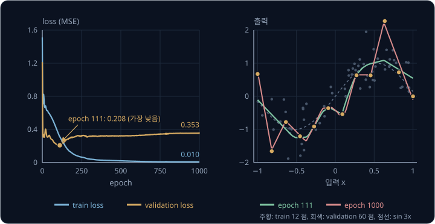

위 그림의 오른쪽은 두 시점의 network 가 그린 곡선이다. epoch 50 의 곡선은 점들 사이를 부드럽게 지나고, epoch 1000 의 곡선은 train
점 12 개를 하나하나 찍고 지나가느라 점 사이에서 크게 휜다.

그래서 학습 중에는 epoch 마다 validation loss 를 재고, 가장 낮았던 epoch 의 parameter 를 따로 저장해 둔다. validation loss 가 한동안
더 내려가지 않으면 학습을 멈추는데, 이 방법을 early stopping(조기 종료)이라고 한다. 위 실험이라면 epoch 50 의 parameter 를 쓴다.
데이터를 더 모으거나, parameter 가 더 적은 network 를 쓰는 것도 overfitting 을 줄이는 방법이다.

**확인 문제.** 어떤 학습에서 epoch 별 validation loss 가 0.9, 0.6, 0.5, 0.55, 0.6, 0.7 이었다. 어느 epoch 의 parameter 를 쓰는 것이 좋을까? epoch 는 1 부터 센다.

답 보기

validation loss 가 가장 낮은 0.5 인 epoch 3 이다. 그 뒤로 validation loss 가 오르는 것은 overfitting 이 시작됐다는 신호다.

**요약**

- accuracy 는 가장 큰 점수의 class 가 label 과 같은 비율이다
- train set 으로 학습하고, validation set 으로 설정과 멈출 시점을 고르고, test set 으로 마지막에 한 번 잰다
- train loss 는 계속 줄어도 validation loss 가 다시 오르면 overfitting 이고, validation loss 가 가장 낮은 epoch 의 parameter 를 쓴다

## backbone 과 head

### backbone 과 head 의 구분

이 강의의 작은 network 를 다시 보자. 입력 $(1, 0, 2)$ 가 Linear layer 와 ReLU 를 지나 $(0, 3)$ 이 되고, 다음 Linear layer 가 이것을
class 3 개의 점수 $(2.0, 1.0, 0.1)$ 로 바꿨다. 이 계산을 두 부분으로 나눠 볼 수 있다.

- **앞부분** — 입력 숫자 3 개를 받아 숫자 2 개 $(0, 3)$ 로 요약한다. 입력의 어떤 성질이 중요한지 골라 담은 숫자다
- **뒷부분** — 요약한 숫자 2 개를 받아 이 문제가 원하는 모양의 출력, 곧 class 3 개의 점수로 바꾼다

앞부분을 backbone, 뒷부분을 head 라고 부른다. backbone 이 내는 요약 숫자를 feature 라고 한다. 784 → 256 → 10 MLP 라면 첫 Linear
layer 와 ReLU 가 backbone 으로 사진 한 장을 feature 256 개로 요약하고, 마지막 Linear layer 가 head 로 feature 256 개를 class 10 개의
점수로 바꾼다.

| 부분 | 작은 network | 784 → 256 → 10 MLP |
| --- | --- | --- |
| backbone | Linear 3 → 2, ReLU. parameter 8 개 | Linear 784 → 256, ReLU. parameter 200,960 개 |
| feature | $(0, 3)$, 숫자 2 개 | 숫자 256 개 |
| head | Linear 2 → 3. parameter 9 개 | Linear 256 → 10. parameter 2,570 개 |
| 출력 | 점수 $(2.0, 1.0, 0.1)$ | 점수 10 개 |

backbone 은 원래 등뼈, head 는 머리라는 뜻이다. 입력을 받아 대부분의 계산을 하는 긴 앞부분과 그 끝에 붙어 최종 출력을 내는 작은
뒷부분이라는 생김새에서 온 이름이고, parameter 도 대부분 backbone 에 있다. 큰 network 에서는 backbone 이 수십 개 layer 이고 head 는
layer 한두 개인 경우가 많다.

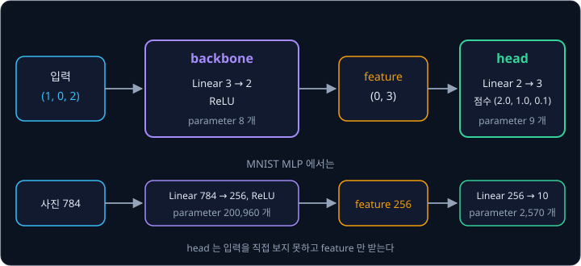

위 그림의 왼쪽 상자가 backbone, 오른쪽 상자가 head 다. head 는 입력을 직접 보지 못하고 backbone 이 낸 feature 만 받는다.

head 라는 단어는 [Transformer](../transformer/README.md) 강의에서 attention head 라는 말로 다시 나오는데, 그때는 network 의 출력 부분이
아니라 한 layer 안에서 나란히 계산하는 작은 계산 묶음을 가리킨다. 이 강의의 head 는 network 끝에서 최종 출력을 내는 부분이다.

**확인 문제.** 입력 784 개 → 512 → ReLU → 256 → ReLU → 10 인 MLP 에서 마지막 Linear layer 만 head 로 보면, backbone 이 내는 feature 는 숫자 몇 개이고 head 의 parameter 는 몇 개일까?

답 보기

feature 는 마지막 Linear layer 에 들어가는 숫자 256 개다. head 는 Linear 256 → 10 이라 parameter 가 $10 \times (256 + 1) = 2{,}570$ 개다.

### head 교체

backbone 과 head 로 나눠 보면 같은 backbone 에 head 만 바꿔 다른 일을 시킬 수 있다. 작은 network 의 backbone 은 그대로 두고, 로봇
팔의 관절 두 개를 몇 도 돌릴지 내는 head 를 새로 붙여 보자.

| head | 출력 모양 | weight | 계산 | 출력 | loss |
| --- | --- | --- | --- | --- | --- |
| 분류 head | 점수 3 개 | 3 행 2 열 | Linear 2 → 3 | $(2.0, 1.0, 0.1)$ | cross-entropy |
| 관절 head | 각도 2 개 | 두 행 $(1, 10)$, $(2, -5)$ | Linear 2 → 2, bias 0 | $(30, -15)$ | MSE |

관절 head 는 feature $(0, 3)$ 에 weight 를 곱해 $1 \times 0 + 10 \times 3 = 30$, $2 \times 0 + (-5) \times 3 = -15$ 를 낸다. 첫 관절을
30 도, 둘째 관절을 $-15$ 도 돌리라는 뜻이다. 관절 각도는 class 를 고르는 문제가 아니라 연속된 숫자를 맞히는 문제라서 softmax 와
cross-entropy 대신 MSE 를 loss 로 쓴다. 사람이 직접 로봇을 움직여 보여 준 시연에서 관절을 돌린 각도가 $(28, -12)$ 였다면 오차는 2 와 $-3$, MSE 는
$(4 + 9) \div 2 = 6.5$ 다.

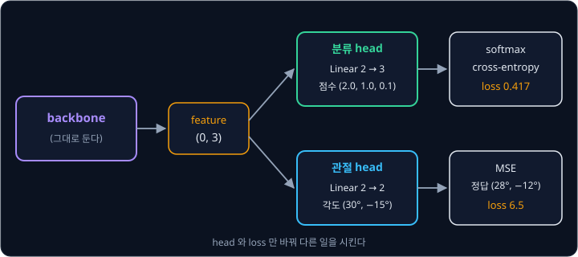

위 그림처럼 head 와 loss 만 바꾸고 backbone 은 그대로 쓴다. 이미 많은 사진으로 학습한 backbone 은 사진에서 쓸모 있는 feature 를
뽑는 법을 배워 두었기 때문에, 새 일을 시킬 때 backbone 은 그대로 두거나 조금만 고치고 head 를 주로 학습시키면 적은 데이터로도 빨리
배운다. 뒤의 [ResNet](../resnet/README.md) 은 이렇게 다른 network 의 backbone 으로 널리 쓰이는 network 이고,
[RT-1](../rt1/README.md) 강의에서는 같은 backbone 위에 분류 head 와 MSE head 를 각각 붙여 로봇 행동을 내는 두 방식을 비교한다.

**확인 문제.** feature 가 $(2, 1)$ 일 때 위 관절 head 의 출력은?

답 보기

$1 \times 2 + 10 \times 1 = 12$, $2 \times 2 + (-5) \times 1 = -1$ 이라 $(12, -1)$ 이다.

### transformer 와 LLM 의 구분

backbone 을 무엇으로 만드느냐에 따라 network 구조에 이름이 붙는다. 이 강의의 MLP 는 Linear layer 와 ReLU 를 쌓은 구조이고, 뒤에서
배우는 [CNN](../cnn/README.md) 은 이미지의 가까운 pixel 끼리 묶어 계산하는 구조, [Transformer](../transformer/README.md) 는 입력
조각들이 서로를 참고해 값을 고치는 attention 계산을 쌓은 구조다. transformer 는 2017년 Vaswani 등이 제안한 구조의 이름이다.

한편 LLM 은 large language model(거대 언어 모델)의 줄임말로, 구조가 아니라 학습시킨 결과물의 이름이다. 엄청난 양의 텍스트로 "다음에
올 token 을 맞히는" 학습을 시킨 모델을 말하고, 오늘날 LLM 은 대부분 transformer 를 backbone 으로 쓴다. 여기서 token 은 텍스트를
잘게 자른 조각 하나다. [GPT-2](../gpt/README.md) 가 이렇게 학습한 LLM 이다.

그래서 transformer 와 LLM 은 같은 말이 아니다. 같은 transformer 구조를 이미지 조각으로 학습시키면 사진을 분류하는
[ViT](../vit/README.md) 가 되고, 로봇 시연 데이터로 학습시키면 로봇 행동을 내는 [RT-1](../rt1/README.md) 이 된다. 둘 다 transformer
이지만 텍스트로 학습시키지 않았으니 LLM 이 아니다. ViT 에서는 token 이라는 말이 텍스트 조각이 아니라 이미지를 자른 조각 하나를
가리킨다.

| 이름 | 무엇의 이름인가 | 예 |
| --- | --- | --- |
| MLP, CNN, transformer | network 구조 | 이 강의의 784 → 256 → 10 MLP |
| LLM | 텍스트로 학습시킨 거대 언어 모델 | GPT-2 (transformer 구조) |

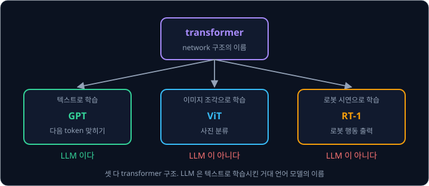

위 그림은 transformer 구조 하나에서 데이터에 따라 세 모델이 나오는 모습이다. 구조의 이름과 학습시킨 결과의 이름을 구분하면 "이
로봇 모델은 transformer 를 쓴다" 와 "이 로봇 모델은 LLM 을 쓴다" 가 서로 다른 말이라는 것이 보인다.

**확인 문제.** "ViT 는 transformer 이다" 와 "ViT 는 LLM 이다" 중 맞는 말은?

답 보기

"ViT 는 transformer 이다" 만 맞다. ViT 는 transformer 구조를 쓰지만 텍스트가 아니라 이미지로 학습시켰으므로 LLM 이 아니다.

**요약**

- backbone 은 입력을 feature(요약 숫자)로 바꾸는 앞부분, head 는 feature 를 원하는 출력으로 바꾸는 뒷부분이다
- 같은 backbone 에 head 와 loss 만 바꿔 분류(cross-entropy)나 관절 각도(MSE) 같은 다른 일을 시킬 수 있다
- transformer 는 구조의 이름이고, LLM 은 그 구조를 텍스트로 학습시킨 모델의 이름이다

## 정리

- PyTorch 는 숫자 묶음(tensor) 하나를 graph 의 node 로 두고 Backpropagation 의 reverse-mode 계산을 그대로 한다. shape 는 축마다의
  칸 수이고, batch 는 첫 축에 둔다
- Linear layer 는 $H = XW^\top + b$ 로 neuron 여러 개와 batch 를 한 번에 계산한다. 층 사이의 ReLU 가 없으면 여러 층이 한 층과 같아진다.
  weight 는 $\sqrt{2 / n_{\text{in}}}$ 정도 크기의 random 값으로 출발시킨다
- softmax 는 점수를 확률로 바꾸고, cross-entropy 는 정답 확률의 $-\log$ 다. 점수 $(2.0, 1.0, 0.1)$, 정답 class 0 이면 확률 0.659,
  loss 0.417, 점수의 gradient 는 확률 − one-hot $= (-0.341, 0.242, 0.099)$ 다
- mini-batch 로 나눠 고치면 gradient 가 흔들리지만 훨씬 자주 고칠 수 있다(SGD). momentum 은 같은 방향에서 빨라지고, Adam 은 gradient
  크기와 상관없이 한 step 에 대략 $\eta$ 씩 움직인다
- 한 step 은 mini-batch → forward → loss → gradient 0 으로 되돌리기 → backward → parameter 고치기이고, autograd 는 graph 기록과
  backward 를, optimizer 는 parameter 고치기를 맡는다
- train set 으로 학습하고 validation set 으로 overfitting 을 살피며, validation loss 가 가장 낮은 epoch 의 parameter 를 쓴다
- network 는 feature 를 만드는 backbone 과 출력을 내는 head 로 나눠 볼 수 있고, head 만 바꿔 다른 일을 시킬 수 있다. transformer 는
  구조, LLM 은 그 구조를 텍스트로 학습시킨 모델이다

이 강의의 MLP 는 사진을 784 개 숫자로 펴서 받기 때문에 어느 pixel 이 어느 pixel 옆에 있었는지를 쓰지 못하고, 입력 길이가 정해져
있어서 길이가 제각각인 문장이나 시간에 따라 이어지는 센서 값을 다루지 못한다. 가까운 pixel 끼리 묶어 계산하는 구조는
[CNN](../cnn/README.md), 길이가 정해지지 않은 입력 조각들을 서로 참고하게 하는 구조는 [Transformer](../transformer/README.md),
데이터를 숫자 몇 개로 압축했다가 되살리는 모델은 [VAE](../vae/README.md) 에서 다룬다. 사람의 시연을 따라 하도록 로봇의 행동을
학습시키는 일은 [Behavior Cloning](../behavior-cloning/README.md), 점수(reward)를 보고 행동을 고치는 학습은
[Policy Gradient](../policy-gradient/README.md) 와 [DQN → SAC](../off-policy/README.md) 에서 다루며, 모두 이 강의의 training loop 를
그대로 쓴다.

## 참고 자료

- Herbert Robbins, Sutton Monro, [A Stochastic Approximation Method](https://doi.org/10.1214/aoms/1177729586) (1951) — 무작위로
  흔들리는 값으로도 되풀이한 update 가 답에 다가가는 조건을 처음 보인 논문. SGD 의 출발점이다
- Diederik P. Kingma, Jimmy Ba, [Adam: A Method for Stochastic Optimization](https://arxiv.org/abs/1412.6980) (2014) — 2쪽의
  Algorithm 1 이 이 강의의 Adam 식이고, 3절이 bias correction 을 다룬다
- Kaiming He et al., [Delving Deep into Rectifiers](https://arxiv.org/abs/1502.01852) (2015) — 2.2절에서 ReLU network 의 weight 크기
  $\sqrt{2/n}$ 을 유도한다
- PyTorch 문서, [torch.optim.SGD](https://docs.pytorch.org/docs/stable/generated/torch.optim.SGD.html)·[torch.optim.Adam](https://docs.pytorch.org/docs/stable/generated/torch.optim.Adam.html)
  — 문서의 algorithm 상자에 이 강의의 momentum buffer 와 Adam 식이 그대로 적혀 있다
- PyTorch 문서, [torch.nn.functional.cross_entropy](https://docs.pytorch.org/docs/stable/generated/torch.nn.functional.cross_entropy.html)
  — 확률이 아니라 점수(logits)와 정답 class 번호를 받아 softmax 와 $-\log$ 를 한 번에 계산한다는 설명
- PyTorch tutorial, [What is torch.nn really?](https://docs.pytorch.org/tutorials/beginner/nn_tutorial.html) — MNIST 를 tensor 연산만으로
  학습시킨 뒤 도구를 하나씩 바꿔 가는 글. 이 강의의 여섯 단계가 실제로 어떻게 짜이는지 볼 수 있다
- Stanford CS231n, [Linear classification](https://cs231n.github.io/linear-classify/) — softmax 와 cross-entropy, 가장 큰 점수를 빼는
  수치 안정성 절
- Stanford CS231n, [Neural Networks Part 3: Learning and Evaluation](https://cs231n.github.io/neural-networks-3/) — SGD·momentum·Adam 을
  같은 표기로 비교하고, train·validation loss 곡선을 읽는 법을 다룬다
- Sebastian Ruder, [An overview of gradient descent optimization algorithms](https://www.ruder.io/optimizing-gradient-descent/) —
  momentum 부터 Adam 까지 update 식을 한곳에 정리한 글
- Andrej Karpathy, [Building makemore Part 3: Activations & Gradients, BatchNorm](https://www.youtube.com/watch?v=P6sfmUTpUmc) — 초기화에
  따라 layer 출력의 크기가 어떻게 바뀌는지 직접 그려 보는 영상
- Andrej Karpathy, [A Recipe for Training Neural Networks](https://karpathy.github.io/2019/04/25/recipe/) — 학습이 잘 안 될 때 loss 곡선과
  overfitting 을 점검하는 순서
