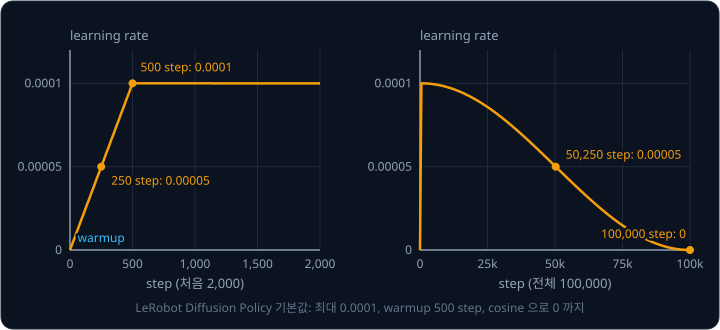
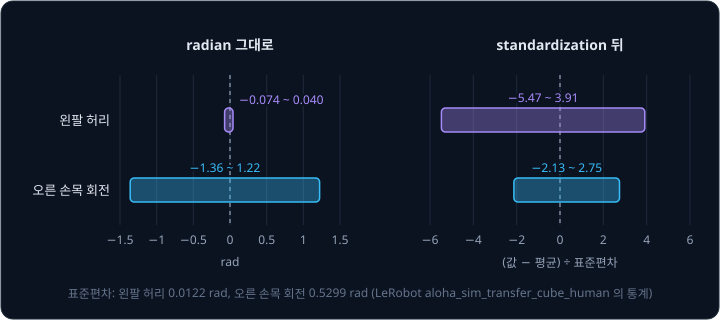
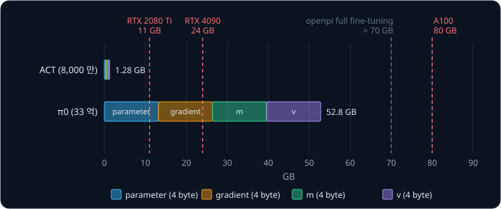

# PyTorch Training Loop

LeRobot 으로 로봇 팔 시연을 따라 하는 ACT policy 를 학습시키면, 몇 시간 동안 terminal 에 200 step 마다 step 번호와 loss 가 찍히고 20,000
step 마다 checkpoint 파일이 하나씩 쌓인다. 기본 설정에서는 같은 계산을 100,000 번 되풀이하는데, 그 한 번에 GPU 는 무엇을 계산하는 걸까?

한 번의 계산은 시연 frame 8 개를 꺼내 policy 에 넣고(forward) 예측과 시연의 차이를 숫자 하나(loss)로 만드는 데서 시작한다. 그 숫자에서
거꾸로 parameter 마다 gradient 를 구하고(backward), optimizer 가 그 gradient 로 parameter 를 조금 고치면 한 번이 끝난다. 이 순서를
되풀이하는 학습 과정을 training loop 라고 한다. ACT 논문은 parameter 가 약 8,000 만 개인 policy 를 이 loop 로 RTX 2080 Ti 한 장에서 5 시간쯤
학습시켰다.

## 학습 목표

- mini-batch 하나로 forward → loss → backward → update 를 하는 step 과 epoch 의 관계를 설명할 수 있다
- softmax cross-entropy 와 그 gradient, SGD·momentum·Adam 이 parameter 를 고치는 방식을 숫자로 설명할 수 있다
- 입력 normalization 과 early stopping 이 필요한 이유와, 로봇 policy 에서 validation loss 를 어디까지 믿을 수 있는지 설명할 수 있다
- 학습 중 GPU memory 를 차지하는 것과, memory 가 모자랄 때 batch 크기와 gradient accumulation 으로 대응하는 방법을 설명할 수 있다

## tensor 와 batch

이 강의의 예제는 손글씨 숫자 사진을 보고 0 ~ 9 중 어느 숫자인지 맞히는 network 다. 데이터는 가로·세로 28 pixel 인 흑백 사진을 모은 MNIST 로,
학습용 60,000 장과 시험용 10,000 장에 "이 사진은 7" 같은 정답(label)이 붙어 있다. 고를 수 있는 답 하나하나를 class 라고 하므로 class 는
10 개다. network 는 사진의 행을 차례로 이어 붙여 0 ~ 1 사이 밝기 숫자 $28 \times 28 = 784$ 개짜리 한 줄로 편(flatten) 뒤 받는다.

첫 층의 neuron 이 256 개면 사진 한 장을 첫 층에 넣는 데만 곱셈이 $784 \times 256 = 200{,}704$ 번 필요해서, 곱셈 하나마다 computational graph
에 node 를 만들면 node 를 기록하는 데 시간을 대부분 쓴다. PyTorch 는 이 곱셈 전체를 "행렬 곱 한 번" 이라는 node 하나로 기록하고, backward
에서도 gradient 를 묶음째 구한다. PyTorch 에서 gradient 를 자동으로 구하는 부분을 autograd 라고 한다.

이렇게 숫자를 몇 방향으로든 늘어놓은 묶음을 **tensor** 라고 하고, 방향마다 숫자가 몇 개인지 적은 것을 shape 라고 한다. 사진 여러 장을 한
번에 계산하려고 묶은 것은 batch 라고 한다. 100 장을 펴서 묶으면 shape 가 $(100, 784)$ 이고, 첫 축은 몇 번째 사진인지를 가리킨다.

## MLP 의 forward

같은 입력을 받는 neuron 여러 개를 나란히 둔 layer 는 행렬 곱 한 번으로 계산한다. 입력 $(1, 0, 2)$ 와 $(2, 1, 0)$ 을 행으로 쌓은 $X$ 와,
neuron 두 개의 weight $(1, 2, -1)$ 과 $(0, 1, 1)$ 을 행으로 쌓은 $W$, bias $b = (0, 1)$ 로 계산하면 아래와 같다.

$$
H = X W^\top + b = \begin{bmatrix} 1 & 0 & 2 \\ 2 & 1 & 0 \end{bmatrix} \begin{bmatrix} 1 & 0 \\ 2 & 1 \\ -1 & 1 \end{bmatrix} + (0, 1)
= \begin{bmatrix} -1 & 3 \\ 4 & 2 \end{bmatrix}
$$

$W^\top$ 는 $W$ 의 행과 열을 맞바꾼 transpose 다. $H$ 의 1 행 1 열은 $1 \times 1 + 0 \times 2 + 2 \times (-1) + 0 = -1$ 이다. $H$ 의 행
하나가 입력 하나에 대한 출력이다. 곱하고 더하기만 하는 이 layer 를 Linear layer 라고 하는데, 입력이 $n_{\text{in}}$ 개이고 출력이
$n_{\text{out}}$ 개면 parameter 는 bias 까지 $n_{\text{out}} \times (n_{\text{in}} + 1)$ 개다.

layer 사이의 activation function 으로는 음수를 0 으로 바꾸고 0 이상은 그대로 두는 ReLU($\mathrm{relu}(z) = \max(0, z)$)를 많이 쓴다. $H$ 의
첫 행 $(-1, 3)$ 은 ReLU 를 지나 $(0, 3)$ 이 된다. ReLU 의 기울기는 음수 쪽에서 0 이고 양수 쪽에서 1 이라서, 기울기가 최대 0.25 인 sigmoid 와
달리 출력이 양수인 neuron 을 지나는 gradient 를 줄이지 않는다.

<b>심화: ReLU 가 없는 두 층</b>

입력 $x$ 를 받아 neuron 두 개가 $h_1 = x$, $h_2 = -x$ 를 내고 다음 layer 가 둘을 더한다고 하자.

| $x$ | $-2$ | $-1$ | 0 | 1 | 2 |
| --- | --- | --- | --- | --- | --- |
| ReLU 없이 $h_1 + h_2$ | 0 | 0 | 0 | 0 | 0 |
| $\mathrm{relu}(h_1) + \mathrm{relu}(h_2)$ | 2 | 1 | 0 | 1 | 2 |

이 예에서 ReLU 가 없으면 무엇을 넣어도 0 이다. Linear layer 두 개를 이은 계산은 정리하면 Linear layer 하나와 같기 때문인데, 예를 들어
$h = 3x + 1$ 다음에 $y = 2h + 1$ 을 하면 $y = 6x + 3$ 하나로 정리된다. ReLU 를 넣으면 출력이 V 자로 꺾이고, neuron 이 많을수록 꺾이는 곳이
늘어 꺾인 직선을 이어 붙인 곡선을 만들 수 있다.

이 강의에서 MNIST 에 쓰는 MLP(multi-layer perceptron)는 Linear 784 → 256, ReLU, Linear 256 → 10 순서로 계산한다. 마지막 숫자 10 개는 class
마다 하나씩 붙는 점수다. 확률로 바꾸기 전의 이 점수를 logits 라고 한다.

| 단계 ($B$ 는 batch 크기) | shape | parameter 수 |
| --- | --- | --- |
| 펴진 입력 | $(B, 784)$ | |
| Linear 784 → 256, ReLU | $(B, 256)$ | $256 \times (784 + 1) = 200{,}960$ |
| Linear 256 → 10 | $(B, 10)$ | $10 \times (256 + 1) = 2{,}570$ |

parameter 는 모두 203,530 개다. 이 값들은 학습 전에 작은 random 값으로 정해 두는데, hidden neuron 들을 같은 값에서 출발시키면 같은 gradient
를 받아 끝까지 같은 neuron 으로 남기 때문이다.

<b>심화: weight 의 처음 크기</b>

입력 784 개가 모두 1 이고, weight 784 개는 부호를 동전 던지기로 정해 $\pm 1$ 로 둔 neuron 이 있다고 하자. 이 neuron 의 $z$ 를 직접 여섯 번
뽑아 보니 38, $-2$, $-32$, 34, 14, $-36$ 이었다. 부호가 무작위인 숫자 $n$ 개를 더하면 일부가 서로 지워져 합의 크기가 대략 $\sqrt{n}$ 이
되므로, 여기서는 $\sqrt{784} = 28$ 안팎이다. 층마다 28 배씩 커지면 세 층 뒤에는 $28^3 = 21{,}952$ 배라서 loss 와 gradient 가 첫 step 부터
지나치게 커진다.

| weight 크기 | 여섯 번 뽑은 $z$ | $z$ 의 크기 |
| --- | --- | --- |
| $\pm 1$ | 38, $-2$, $-32$, 34, 14, $-36$ | 약 28 |
| $\pm 0.05$ | 1.9, $-0.1$, $-1.6$, 1.7, 0.7, $-1.8$ | 약 1.4 |

He 등(2015)은 ReLU network 에서 weight 를 표준편차 $\sqrt{2 / n_{\text{in}}}$ 인 Gaussian 에서 뽑으면 층을 지나도 값의 크기가 유지된다는
것을 보였다. $n_{\text{in}} = 784$ 면 $\sqrt{2 / 784} \approx 0.0505$ 다. 분자의 2 는 ReLU 가 neuron 의 절반쯤을 0 으로 만들어 줄어드는
크기를 미리 채워 준다. 이 He 초기화(initialization)는 입력이 1 안팎이라고 가정한다.

**확인 문제.** 입력 784 개, hidden neuron 128 개, 출력 10 개인 MLP 의 parameter 는 모두 몇 개일까?

답 보기

1. 첫 layer: $128 \times (784 + 1) = 100{,}480$
2. 둘째 layer: $10 \times (128 + 1) = 1{,}290$
3. 합: $100{,}480 + 1{,}290 = 101{,}770$ 개

## softmax 와 cross-entropy

logits 는 아무 크기나 될 수 있어서 확률로 읽기 어렵다. 그래서 점수마다 $e^{z}$ 를 구하고($e \approx 2.718$) 그 합으로 나눠, 모두 양수이고
더하면 1 인 확률로 바꾼다. 이 계산이 **softmax** 다.

| class | 점수 $z$ | $e^{z}$ | 확률 $e^{z} \div$ 합 |
| --- | --- | --- | --- |
| 0 | 2.0 | 7.389 | $7.389 \div 11.213 = 0.659$ |
| 1 | 1.0 | 2.718 | $2.718 \div 11.213 = 0.242$ |
| 2 | 0.1 | 1.105 | $1.105 \div 11.213 = 0.099$ |

$$
p_j = \frac{e^{z_j}}{\sum_{k} e^{z_k}}
$$

$p_j$ 는 $j$ 번째 class 의 확률이고, 분모의 $\sum_k$ 는 모든 class 의 $e^{z_k}$ 를 더하라는 뜻이다. softmax 라는 이름은 가장 큰 값만 남기는
max 를 부드럽게(soft) 만들었다는 뜻이다.

loss 는 정답 class 의 확률 $p_y$ 에 log 를 씌우고 부호를 바꾼 **cross-entropy** $L = -\log p_y$ 다. $\log p$ 는 $e$ 를 몇 제곱해야 $p$ 가
되는지를 나타내는 수다. $e^{-0.417} \approx 0.659$ 라서 $\log 0.659 = -0.417$ 이고, 정답이 class 0 이면 $L = 0.417$ 이다. 확률은 1 을 넘지
않아 $\log p$ 가 0 이하이므로 loss 는 0 이상이다. cross-entropy 는 원래 정보 이론에서 두 확률 분포를 비교하는 양인데, 정답 class 만 1 이고
나머지는 0 인 분포와 비교하면 이 식만 남는다.

틀린 class 를 확신할수록 loss 가 크다. 점수가 $(0, 2, 0)$ 인데 정답이 class 0 이면 정답 확률이 0.107 이라 loss 는 2.240 이다. batch 에서는
사진마다 loss 를 구해 평균한다.

**흔한 오해.** "loss 가 0.417 이면 41.7% 틀렸다." cross-entropy 는 비율이 아니라 $-\log$ 값이라 1 을 넘을 수 있다. 맞힌 비율은 accuracy 로
따로 재는데, 점수가 가장 큰 class 가 label 과 같은 사진의 비율이다.

정답 class 의 값만 1 이고 나머지는 0 인 vector 를 $\mathrm{onehot}(y)$ 로 쓰면, 점수 $z_j$ 의 gradient 는 그 class 의 확률 $p_j$ 에서
$\mathrm{onehot}(y)$ 의 $j$ 번째 값을 뺀 값이다.

$$
\frac{\partial L}{\partial z_j} = p_j - \mathrm{onehot}(y)_j
$$

| class | 확률 $p_j$ | $\mathrm{onehot}(y)_j$ | gradient |
| --- | --- | --- | --- |
| 0 (정답) | 0.659 | 1 | $-0.341$ |
| 1 | 0.242 | 0 | $0.242$ |
| 2 | 0.099 | 0 | $0.099$ |

gradient 의 반대 방향으로 고치면 gradient 가 음수인 정답 점수는 올라가고, 오답 가운데 확률을 많이 가져간 class 1 의 점수가 가장 크게
내려간다. backward 는 이 gradient 에서 출발해 chain rule 로 두 Linear layer 의 parameter 까지 gradient 를 전한다.

<b>심화: gradient 의 숫자 검산과 overflow</b>

점수 하나를 0.01 늘려 loss 가 변하는 비율을 재면 공식과 맞는다. 처음 loss 는 0.41703 이다.

| 늘린 점수 | 새 loss | 비율 (변화 ÷ 0.01) | $p_j - \mathrm{onehot}(y)_j$ |
| --- | --- | --- | --- |
| $z_0$: 2.0 → 2.01 | 0.41363 | $-0.340$ | $-0.341$ |
| $z_1$: 1.0 → 1.01 | 0.41946 | $+0.243$ | $0.242$ |
| $z_2$: 0.1 → 0.11 | 0.41802 | $+0.099$ | $0.099$ |

float32 는 숫자 하나를 bit 32 개에 저장하는 형식으로, 나타낼 수 있는 가장 큰 수가 약 $3.4 \times 10^{38}$ 이다.
$e^{89} \approx 4.5 \times 10^{38}$ 이라서 점수가 89 를 넘으면 softmax 에서 inf 가 나오고, inf 를 inf 로 나눈 nan(숫자가 아님)이 loss 와
gradient 전체로 퍼진다. softmax 는 모든 점수에서 같은 수를 빼도 분자와 분모가 같은 비율로 줄어 결과가 그대로라서, 가장 큰 점수를 먼저 빼면
overflow 가 생기지 않는다. $(1002, 1001, 1000.1)$ 에서 1002 를 빼면 $(0, -1, -1.9)$ 이고 $e^{z}$ 의 합이 $1 + 0.368 + 0.150 = 1.517$ 이라
확률이 다시 0.659, 0.242, 0.099 다.

정답 확률이 $10^{-50}$ 처럼 작으면 float32 에서 0 이 되어 $\log 0$ 이 inf 가 되므로, 점수에서 $-\log p_y$ 를 바로 계산하는 편이 안전하다.
PyTorch 의 `cross_entropy` 가 확률이 아니라 logits 를 받는 것도 이 때문이다.

**확인 문제.** 확률이 $(0.2, 0.7, 0.1)$ 이고 정답이 class 2 면 세 점수의 gradient 는?

답 보기

1. 정답이 class 2 라서 onehot 은 $(0, 0, 1)$ 이다
2. gradient 는 $(0.2 - 0, 0.7 - 0, 0.1 - 1) = (0.2, 0.7, -0.9)$ 다

정답 점수만 올라가고, 확률을 가장 많이 가져간 class 1 의 점수가 가장 크게 내려간다.

## mini-batch 와 epoch

gradient descent 를 그대로 하면 parameter 를 한 번 고칠 때마다 사진 60,000 장을 모두 계산해야 한다. 그래서 데이터를 작은 묶음으로 나눠 묶음
하나의 평균 gradient 로 고치는데, 이 묶음이 **mini-batch** 다. parameter 를 한 번 고치는 단위를 step 이라 하고, 데이터 전체를 한 번씩 다
쓰는 단위를 epoch 라고 한다. 60,000 장을 100 장씩 나누면 epoch 하나가 600 step 이다. epoch 마다 순서를 무작위로 섞어(shuffle) 같은 숫자의
사진만 모인 mini-batch 가 이어지지 않게 한다.

로봇 시연 데이터에서는 frame 하나가 sample 하나다. LeRobot 의 ALOHA 시뮬레이션 데이터 `aloha_sim_transfer_cube_human` 은 50 Hz 로 녹화한
시연 50 개이고 frame 은 모두 20,000 개라서, 시연 하나가 400 frame(8 초)이다. 기본 batch 크기 8 로는 epoch 하나가 $20{,}000 \div 8 = 2{,}500$
step 이고, 기본 학습 길이 100,000 step 은 $100{,}000 \div 2{,}500 = 40$ epoch 다.

mini-batch 의 gradient 는 전체 gradient 와 다르다. 예를 들어 sample 네 개의 gradient 가 $-4, -2, 1, 1$ 이면 전체 평균은 $-1$ 인데, 두 장씩
묶은 mini-batch 의 평균은 섞은 순서에 따라 $-1.5$ 와 $-0.5$ 가 되기도 하고 $-3$ 과 1 이 되기도 한다. step 하나의 gradient 는 부호까지 바뀔
만큼 흔들리지만, epoch 하나에 걸쳐 평균하면 언제나 $-1$ 이다.

무작위로 고른 일부 데이터의 gradient 로 하는 gradient descent 를 **SGD**(stochastic gradient descent)라고 한다. SGD 의 update 는 parameter
$\theta$ 에서 learning rate $\eta$ 와 mini-batch gradient $g$ 의 곱을 빼는 $\theta \leftarrow \theta - \eta\, g$ 다. Robbins 와
Monro(1951)는 이렇게 흔들리는 값으로 update 를 되풀이해도 답에 다가가는 조건을 처음 보였다.

**확인 문제.** 시연 frame 12,000 개를 batch 크기 8 로 학습하면 epoch 하나는 몇 step 이고, 30,000 step 은 몇 epoch 일까?

답 보기

1. epoch 하나: $12{,}000 \div 8 = 1{,}500$ step
2. 30,000 step: $30{,}000 \div 1{,}500 = 20$ epoch

## optimizer

gradient 를 받아 parameter 를 고치는 규칙을 optimizer 라고 한다. SGD 는 같은 방향의 gradient 가 이어져도 한 step 에 움직이는 거리가 늘지
않는데, **momentum** 은 지난 gradient 를 buffer $b$ 에 모아 그 방향으로 움직인다.

$$
b \leftarrow \mu\, b + g, \qquad \theta \leftarrow \theta - \eta\, b
$$

$\mu$ 는 지난 buffer 를 남기는 비율로 흔히 0.9 로 두고, buffer 는 0 에서 시작한다. gradient 가 매 step 1 이고 $\eta = 0.1$ 이면 아래와 같다.

| step | $b = 0.9 \times$ 지난 $b + 1$ | momentum 이 움직인 거리 | SGD 가 움직인 거리 |
| --- | --- | --- | --- |
| 1 | $0 + 1 = 1$ | 0.1 | 0.1 |
| 2 | $0.9 + 1 = 1.9$ | 0.19 | 0.1 |
| 3 | $1.71 + 1 = 2.71$ | 0.271 | 0.1 |
| 4 | $2.439 + 1 = 3.439$ | 0.3439 | 0.1 |

같은 방향이 이어지면 buffer 는 $1 \div (1 - 0.9) = 10$ 에 다가가 SGD 의 10 배 거리를 움직이게 되고, gradient 가 $+1, -1$ 로 번갈아 바뀌면
buffer 의 크기가 1 을 넘지 않는다. PyTorch 의 `torch.optim.SGD` 에서 momentum 기본값은 0 이다.

**Adam**(Kingma 와 Ba, 2014)은 parameter 마다 gradient 의 평균 $m$ 과 gradient 제곱의 평균 $v$ 를 두고, $m$ 을 $\sqrt{v}$ 로 나눈 값에
learning rate 를 곱해 뺀다. 두 평균은 지난 평균과 새 값을 일정 비율로 섞는 moving average 다. gradient 를 자기 크기로 나누므로 첫 step
에서는 gradient 가 0.02 이든 200 이든 정확히 $\eta$ 만큼 움직이고, 그 뒤로도 gradient 가 꾸준하면 $\eta$ 근처로 움직인다. Adam 이라는 이름은
adaptive moment estimation 의 줄임말이다.

사람이 학습 전에 정하는 값을 hyperparameter 라고 하는데, Adam 의 hyperparameter 는 아래와 같다.

| hyperparameter | 뜻 | Adam 논문의 권장값(PyTorch 기본값과 같음) |
| --- | --- | --- |
| learning rate $\eta$ | 한 step 에 움직이는 거리의 기준 | 0.001 |
| $\beta_1$ | $m$ 이 지난 평균을 남기는 비율 | 0.9 |
| $\beta_2$ | $v$ 가 지난 평균을 남기는 비율 | 0.999 |
| $\epsilon$ | 0 으로 나누지 않게 분모에 더하는 수 | $10^{-8}$ |

LeRobot 의 ACT 와 Diffusion Policy 도 Adam 계열 optimizer 를 쓰는데, 기본값은 아래와 같다.

| policy | optimizer | learning rate | 그 밖의 설정 |
| --- | --- | --- | --- |
| ACT | AdamW | $10^{-5}$ | weight decay $10^{-4}$, learning rate 고정 |
| Diffusion Policy | Adam | $10^{-4}$ | $\beta_1 = 0.95$, weight decay $10^{-6}$, warmup 500 step 뒤 cosine 감소 |

ACT 의 learning rate $10^{-5}$ 는 Adam 기본값의 100 분의 1 로, ACT 논문의 hyperparameter 표와 같은 값이다. weight decay 는 step 마다
weight 를 0 쪽으로 조금씩 줄이는 설정이다. AdamW 는 이 줄이는 계산을 $m$, $v$ 와 섞지 않고 따로 하는 Adam 이다.

learning rate 를 step 에 따라 바꾸는 규칙을 learning rate schedule 이라고 한다. Diffusion Policy 는 처음 500 step 동안 learning rate 를 0
에서 $10^{-4}$ 까지 직선으로 올리는데, 이 단계를 warmup 이라고 한다. 그 뒤에는 cosine 곡선의 절반 모양으로 줄여 마지막 step 에 0 이 되게
하므로, 100,000 step 을 학습하면 250 step 과 50,250 step 에서 $5 \times 10^{-5}$ 다. learning rate 가 작아질수록 흔들리는 gradient 를 따라
parameter 가 움직이는 폭도 줄어든다.

<b>심화: moving average 의 bias correction 과 Adam 의 식</b>

$m \leftarrow 0.9\, m + 0.1\, g$ 에서 $g$ 가 매번 2 이고 $m$ 이 0 에서 시작하면 $m$ 은 0.2, 0.38, 0.542 로 천천히 올라간다. $m$ 이 0 에서
출발했기 때문이다. 그래서 $m$ 을 $1 - 0.9^{t}$ 로 나눠 바로잡는데($t$ 는 지금까지 들어온 값의 개수), 이 나눗셈을 bias correction 이라고
한다.

| $t$ | $m$ | $1 - 0.9^{t}$ | $m \div (1 - 0.9^{t})$ |
| --- | --- | --- | --- |
| 1 | 0.2 | 0.1 | 2 |
| 2 | 0.38 | 0.19 | 2 |
| 3 | 0.542 | 0.271 | 2 |

Adam 의 식은 아래와 같고, $\hat m$, $\hat v$ 가 bias correction 한 값이다.

$$
m \leftarrow \beta_1 m + (1 - \beta_1)\, g, \qquad v \leftarrow \beta_2 v + (1 - \beta_2)\, g^2
$$

$$
\hat m = \frac{m}{1 - \beta_1^{t}}, \qquad \hat v = \frac{v}{1 - \beta_2^{t}}, \qquad
\theta \leftarrow \theta - \eta\, \frac{\hat m}{\sqrt{\hat v} + \epsilon}
$$

$g = 2$ 로 첫 step 을 계산하면 $m = 0.2$, $v = 0.001 \times 4 = 0.004$, $\hat m = 0.2 \div 0.1 = 2$, $\hat v = 0.004 \div 0.001 = 4$ 라서
움직이는 거리는 $\eta \times 2 \div \sqrt{4} = \eta$ 다. bias correction 을 빼면 $\eta \times 0.2 \div \sqrt{0.004} \approx 3.16\eta$ 로,
첫 몇 step 을 의도보다 3 배 넘게 움직인다.

<b>심화: 세 optimizer 의 비교</b>

loss $L = w^2$(gradient $2w$, 답 $w = 0$)을 $w = 5$ 에서 출발해 줄인다. 세 optimizer 모두 $\eta = 0.1$ 을 쓰고, momentum 은 $\mu = 0.9$ 로
두며 Adam 의 나머지 값은 기본값으로 둔다. 오른쪽 세 열은 loss 를 $L = 0.01 w^2$ 로 바꿔 gradient 를 100 분의 1 로 줄인 경우다.

| step | SGD ($w^2$) | momentum | Adam | SGD ($0.01 w^2$) | momentum | Adam |
| --- | --- | --- | --- | --- | --- | --- |
| 1 | 4 | 4 | 4.9 | 4.99 | 4.99 | 4.9 |
| 2 | 3.2 | 2.3 | 4.8 | 4.98 | 4.971 | 4.8 |
| 5 | 1.638 | $-2.902$ | 4.5 | 4.950 | 4.869 | 4.5 |
| 20 | 0.058 | $-1.746$ | 3.06 | 4.804 | 3.863 | 3.06 |
| 60 | 0.000 | $-0.182$ | 0.48 | 4.434 | 1.475 | 0.48 |

$L = w^2$ 에서 SGD 는 매 step $w \leftarrow 0.8w$ 다. momentum 은 step 2 에서 buffer 가 $0.9 \times 10 + 8 = 17$ 이라 $w = 4 - 1.7 = 2.3$
으로 더 빨리 내려가지만, 0 을 지나쳐 흔들린다. Adam 은 한 step 에 0.1 씩 움직여 가장 느리다. loss 에 0.01 을 곱하면 SGD 는 60 step 뒤에도
4.43 에 머물지만 Adam 의 움직임은 그대로다.

**흔한 오해.** "Adam 이 SGD 보다 언제나 빠르다." $L = w^2$ 에서는 20 step 에 SGD 가 0.058, Adam 이 3.06 이었다. Adam 을 쓰면 gradient 크기가
parameter 마다 다르고 학습 시기마다 달라져도 learning rate 하나로 학습할 수 있다.

**확인 문제.** Adam 의 첫 step 에서 gradient 가 $-4$ 이고 $\eta = 0.01$ 이면 parameter 는 어느 쪽으로 얼마나 움직일까?

답 보기

1. $m = 0.1 \times (-4) = -0.4$, $v = 0.001 \times 16 = 0.016$
2. $\hat m = -0.4 \div 0.1 = -4$, $\hat v = 0.016 \div 0.001 = 16$, $\sqrt{\hat v} = 4$
3. update: $\theta - 0.01 \times (-4) \div 4 = \theta + 0.01$

gradient 가 음수라서 parameter 를 0.01 키운다.

## training loop

지금까지의 계산을 학습 순서대로 이으면 한 step 이 된다.

1. shuffle 한 데이터에서 다음 mini-batch(사진 100 장과 label 100 개)를 꺼낸다
2. forward 로 logits 를 계산한다. autograd 는 어떤 tensor 가 어떤 연산으로 만들어졌는지 graph 로 기록한다
3. logits 와 label 로 cross-entropy 를 계산해 평균한다
4. 지난 step 에 parameter 마다 저장해 둔 gradient 를 0 으로 지운다
5. backward 로 graph 를 거꾸로 훑어 parameter 203,530 개의 gradient 를 채운다
6. optimizer 가 저장된 gradient 를 읽어 parameter 를 고친다

autograd 는 어느 쪽으로 고치면 loss 가 줄어드는지 계산하고, 실제로 얼마나 움직일지는 optimizer 가 정한다.

4 단계에서 gradient 를 지우는 것은 autograd 가 새로 구한 gradient 를 parameter 에 저장된 값에 더하기 때문이다. 한 값이 여러 곳에 쓰이면
길마다 구한 gradient 를 더해야 해서 PyTorch 를 이렇게 만들었다. 예를 들어 $w = 1$, $\eta = 0.1$ 로 SGD 를 두 step 하는 동안 gradient 가 0.5,
0.3 이 나오면 아래와 같다.

| step | 이번 gradient | 지울 때 새 $w$ | 지우지 않을 때 쓰는 값 | 지우지 않을 때 새 $w$ |
| --- | --- | --- | --- | --- |
| 1 | 0.5 | $1 - 0.1 \times 0.5 = 0.95$ | 0.5 | 0.95 |
| 2 | 0.3 | $0.95 - 0.1 \times 0.3 = 0.92$ | $0.5 + 0.3 = 0.8$ | $0.95 - 0.1 \times 0.8 = 0.87$ |

LeRobot 의 학습 함수는 backward 다음에 gradient clipping → parameter 고치기 → gradient 지우기 → learning rate 갱신 순서로 진행한다. gradient
clipping 은 모든 gradient 를 한 줄로 이은 vector 의 길이(값마다 제곱해 더한 값의 제곱근)가 LeRobot 기본값 10 을 넘지 않게 줄이는 일이다.
gradient 가 $(30, 40)$ 이면 길이가 $\sqrt{900 + 1600} = 50$ 이라서 $10 \div 50 = 0.2$ 를 곱해 $(6, 8)$ 로 줄인다. 방향은 두고 크기만
줄이므로, 유별난 sample 때문에 gradient 가 커진 step 에서도 parameter 가 크게 바뀌지 않는다.

**확인 문제.** 아래 중 autograd 가 하는 일을 모두 고르자. (가) 데이터를 섞는다 (나) forward 중에 graph 를 기록한다 (다) parameter 마다
gradient 를 계산한다 (라) parameter 에서 $\eta \times$ gradient 를 뺀다

답 보기

(나)와 (다)다. (가)는 mini-batch 를 꺼내는 단계에서 하는 일이고, (라)는 optimizer 가 하는 일이다.

## 입력 normalization

로봇 policy 의 입력에는 단위가 다른 값이 섞인다. 관절 각도는 radian 으로 $-3$ 에서 $3$ 사이인데 집게 벌림을 mm 로 재면 0 에서 80 사이다.
weight 의 처음 크기는 입력이 1 안팎이라고 보고 정하므로 40 mm 같은 입력은 첫 층의 $z$ 를 수십 배로 키운다. 또 $z = w_1 x_1 + w_2 x_2$ 에서
weight 의 gradient 는 $z$ 의 gradient 에 입력을 곱한 값이라, 큰 입력에 붙은 weight 의 gradient 가 크다. 아래 예에서 집게 벌림은 40 mm 이고
관절 각도는 0.5 rad 이며, $z$ 의 gradient 는 0.1 이다.

| 입력 | 그대로 | weight 의 gradient | standardization | weight 의 gradient |
| --- | --- | --- | --- | --- |
| 집게 (평균 20 mm, 표준편차 25 mm) | 40 | $0.1 \times 40 = 4$ | $(40 - 20) \div 25 = 0.8$ | 0.08 |
| 관절 (평균 0.2 rad, 표준편차 0.5 rad) | 0.5 | $0.1 \times 0.5 = 0.05$ | $(0.5 - 0.2) \div 0.5 = 0.6$ | 0.06 |

그대로 넣으면 두 gradient 가 80 배 차이 나서 SGD 의 learning rate 하나를 두 weight 에 함께 맞추기 어렵다. 입력마다 평균을 빼고 표준편차(값이
평균에서 흩어진 정도)로 나누는 standardization 을 하면 두 값이 모두 1 안팎이 된다. Adam 을 쓰면 gradient 크기 차이는 덜 문제가 되지만, $z$
가 커지는 문제는 그대로 남는다.

LeRobot 은 dataset 의 통계 파일에 값마다 평균·표준편차·최솟값·최댓값을 적어 두고 이 값으로 입력을 바꾼다. ACT 는 사진·관절 상태·action 을
모두 standardization 으로 바꾸고, Diffusion Policy 는 관절 상태와 action 을 최솟값이 $-1$ 이고 최댓값이 $1$ 이 되게 옮기는 min-max 방식을
쓴다. policy 가 낸 action 도 normalization 된 값이라 로봇에 보내기 전에 같은 통계로 되돌려야 한다. 그래서 LeRobot 은 통계를 checkpoint 와
함께 저장한다.

ALOHA 시뮬레이션 데이터의 실제 통계를 보면, 상자를 옮기는 동안 왼팔 허리 관절은 거의 돌지 않고 오른 손목 회전 관절은 크게 돈다.

| 관절 | 평균 (rad) | 표준편차 (rad) | 최솟값 → standardization | 최댓값 → standardization |
| --- | --- | --- | --- | --- |
| 왼팔 허리 | $-0.0074$ | 0.0122 | $-0.0741 \to -5.47$ | $0.0403 \to 3.91$ |
| 오른 손목 회전 | $-0.2348$ | 0.5299 | $-1.3615 \to -2.13$ | $1.2217 \to 2.75$ |

standardization 뒤에는 움직이는 폭이 23 배 차이 나던 두 관절이 비슷한 범위로 모이지만, 거의 움직이지 않는 왼팔 허리의 값은 오히려 $-5.47$
까지 커진다. 표준편차 0.0122 로 나누면 0.0122 rad(0.7°)만 움직여도 1 이 되기 때문이다. openpi README 의 문제 해결 표에 따르면, 학습 loss 가
발산할 때는 통계 파일에 표준편차나 범위가 너무 작게 잡힌 값이 없는지 확인해야 한다.

**확인 문제.** 평균 0.2 rad, 표준편차 0.5 rad 인 관절이 $-0.3$ rad 이면 standardization 한 값은?

답 보기

$(-0.3 - 0.2) \div 0.5 = -0.5 \div 0.5 = -1$ 이다. 평균보다 표준편차 하나만큼 작다는 뜻이다.

## loss curve 와 early stopping

처음 보는 데이터에서의 성능은 학습에 쓰지 않은 데이터로만 잴 수 있다. [Linear Regression](../linear-regression/README.md) 에서 네 점을 모두
지난 곡선도 train loss 는 0 이었지만 새 측정에서는 크게 틀렸다. neural network 학습에서는 데이터를 셋으로 나눈다. train set 으로는 parameter
를 고치고, validation set 으로는 학습 중간중간 성능을 재서 설정과 멈출 시점을 고른다. test set 은 모든 선택이 끝난 뒤 한 번만 잰다.
validation set 으로 여러 설정을 비교해 고르면 운 좋게 높게 나온 값이 뽑혀 그 성능이 실제보다 좋게 보이므로, test set 을 따로 둔다.

epoch 마다 train loss 와 validation loss 를 찍은 그래프를 loss curve 라고 한다. 직접 해 본 실험에서는 곡선 $y = \sin 3x$ 위의 12 점에
표준편차 0.4 인 noise 를 섞어 train set 으로 쓰고, 같은 곡선에서 따로 뽑은 60 점을 validation set 으로 썼다. network 는 입력 1 개 → 32 → 32
→ 출력 1 개인 ReLU MLP 이고, Adam($\eta = 0.005$)으로 오차 제곱의 평균인 MSE 를 줄였다. 12 점을 mini-batch 하나에 모두 넣었으므로 epoch
하나가 step 하나다.

| epoch | 0 | 20 | 50 | 111 | 200 | 500 | 1000 |
| --- | --- | --- | --- | --- | --- | --- | --- |
| train loss | 1.512 | 0.685 | 0.574 | 0.313 | 0.101 | 0.022 | 0.010 |
| validation loss | 1.213 | 0.401 | 0.306 | 0.208 | 0.306 | 0.321 | 0.353 |

처음에 validation loss 가 더 낮은 것은 이 12 점의 noise 가 우연히 컸기 때문이다. train loss 는 끝까지 줄지만 validation loss 는 epoch 111 의
0.208 이 가장 낮고, 그 뒤로는 network 가 그리는 곡선이 12 점의 noise 까지 따라 휘면서 다시 오른다. 학습을 오래 할수록 생기는 overfitting 이
loss curve 에는 이렇게 나타난다.

그래서 validation loss 가 가장 낮았던 시점의 parameter 를 저장해 두고, validation loss 가 한동안 더 내려가지 않으면 학습을 멈추는데, 이
방법이 **early stopping** 이다. ACT 논문에서도 validation loss 가 가장 낮은 policy 를 골라 로봇에서 실행했다. LeRobot 에서는 validation 으로
떼어 둘 시연 비율의 기본값이 0 이라서, 따로 설정하지 않으면 validation loss 없이 20,000 step 마다 checkpoint 만 남긴다.

다만 로봇 policy 에서는 validation loss 가 가장 낮은 checkpoint 가 가장 잘 움직인다는 보장이 없다. robomimic 논문(Mandlekar 등, 2021)은
시뮬레이션에서 checkpoint 마다 50 번씩 실행해 성공률을 쟀다. 데이터의 30% 를 validation 으로 뗀 Square 작업에서 가장 좋은 checkpoint 의
성공률은 80.7% 였지만, validation loss 가 가장 낮은 checkpoint 는 2.7% 에 그쳤다. validation loss 는 epoch 100 ~ 300 에 가장 낮았고,
성공률이 가장 높은 시점은 그보다 훨씬 뒤였다. 그래서 로봇 학습에서는 checkpoint 를 실제로 실행해 성공률로 고르는 일이 많다. LeRobot 도
시뮬레이션 환경이 있으면 20,000 step 마다 policy 를 실행해 성공률을 잰다.

**확인 문제.** epoch 별 validation loss 가 0.9, 0.6, 0.5, 0.55, 0.6, 0.7 이었다(epoch 는 1 부터 센다). 어느 epoch 의 parameter 를 쓰는 것이
좋을까?

답 보기

validation loss 가 가장 낮은 0.5 인 epoch 3 이다. 그 뒤로 오르는 것은 overfitting 이 시작됐다는 신호다.

## GPU memory

학습하는 동안 GPU memory 에는 parameter 와 그 gradient, optimizer 가 parameter 마다 저장하는 값, 그리고 forward 의 중간값 가운데 backward 에
다시 쓰려고 저장한 activation 이 올라간다. float32 숫자 하나는 4 byte 이고 Adam 으로 학습하면 parameter 마다 parameter·gradient·$m$·$v$ 네
숫자를 저장하므로, 계산하면 parameter 하나에 $4 \times 4 = 16$ byte 가 든다.

| 모델 | parameter | parameter·gradient·$m$·$v$ (float32) |
| --- | --- | --- |
| 이 강의의 MNIST MLP | 203,530 | $203{,}530 \times 16 \approx 3.3$ MB |
| ACT | 약 8,000 만 | $8 \times 10^{7} \times 16 = 1.28$ GB |
| π0 | 약 33 억 | $3.3 \times 10^{9} \times 16 = 52.8$ GB |

ACT 는 11 GB 짜리 RTX 2080 Ti 에서 batch 크기 8 로 학습했으므로 나머지 memory 는 카메라 사진 같은 입력과 activation 이 차지한다. π0 는 이 네
숫자만으로 24 GB 짜리 RTX 4090 을 넘는다. openpi README 에 따르면 parameter 전체를 학습하는 full fine-tuning 에는 70 GB 넘게 필요하다. 원래
weight 는 고정하고 덧붙인 작은 행렬만 학습하는 LoRA 는 gradient 와 $m$, $v$ 도 그 행렬 몫만 저장하므로, 필요한 memory 가 22.5 GB 남짓으로
줄어든다.

activation 은 sample 마다 저장되므로 batch 크기에 비례해 늘어난다. batch 크기를 지키면서 memory 를 줄이려면 gradient accumulation 을 쓰는데,
autograd 가 gradient 를 더해 쌓는 성질을 이용해 작은 mini-batch 여러 개를 backward 한 뒤 parameter 를 한 번만 고치는 방법이다. 앞에서 예로
든 sample 별 gradient $-4, -2, 1, 1$ 의 batch 4 를 두 장씩 나누면 아래와 같다.

| 방법 | 한 번에 올리는 sample | 쌓인 gradient |
| --- | --- | --- |
| batch 4 한 번 | 4 장 | $(-4 - 2 + 1 + 1) \div 4 = -1$ |
| batch 2 두 번, loss 를 2 로 나눔 | 2 장 | $\{-4, -2\}$ 평균 $-3$, $\{1, 1\}$ 평균 1 → $-3 \div 2 + 1 \div 2 = -1$ |

memory 에는 두 장 분량의 activation 만 올라가지만, step 하나에 forward 와 backward 를 두 번 해야 해서 시간이 더 든다. LeRobot 의 학습
설정에도 gradient accumulation 항목이 있다.

**확인 문제.** parameter 가 10 억 개인 모델을 float32 Adam 으로 학습하면 parameter·gradient·$m$·$v$ 에만 memory 가 얼마나 들까?

답 보기

1. parameter 하나에 4 byte 숫자 네 개라서 16 byte
2. $10^{9} \times 16 = 1.6 \times 10^{10}$ byte, 16 GB

activation 은 따로 더 든다.

## 정리

- 한 step 은 mini-batch 로 forward → loss → backward → update 를 하는 일이고, frame 20,000 개를 batch 8 로 100,000 step 학습하면
  40 epoch 다. cross-entropy 에서 점수의 gradient 는 확률에서 one-hot 정답을 뺀 값이다
- Adam 은 gradient 를 자기 크기로 나눠 한 step 에 대략 learning rate 만큼 움직인다. 기본값은 learning rate 0.001, $\beta_1$ 0.9, $\beta_2$
  0.999, $\epsilon$ $10^{-8}$ 이고, LeRobot 의 ACT 는 AdamW 에 learning rate $10^{-5}$ 를 쓴다
- 입력은 통계로 크기를 맞추고 그 통계를 checkpoint 와 함께 둔다. validation loss 가 다시 오르면 overfitting 이지만, 로봇 policy 는
  성공률로도 확인해야 한다
- Adam 으로 학습하면 GPU 에는 parameter 하나에 16 byte 와 batch 크기에 비례하는 activation 이 올라간다

이 강의의 MLP 는 사진을 784 개 숫자로 펴서 받기 때문에 어느 pixel 이 어느 pixel 옆에 있었는지를 쓰지 못한다. 입력 길이도 정해져 있어서
길이가 제각각인 문장이나 시간에 따라 이어지는 센서 값을 다루지 못한다. 다음으로 볼 모델은 가까운 pixel 끼리 묶어 계산하는
[CNN](../cnn/README.md), 입력 조각들이 서로를 참고하게 하는 [Transformer](../transformer/README.md), 데이터를 숫자 몇 개로 압축했다가
되살리는 [VAE](../vae/README.md) 다. 시연을 따라 하도록 policy 를 학습시키는 [Behavior Cloning](../behavior-cloning/README.md) 과 reward 를
보고 행동을 고치는 [Policy Gradient](../policy-gradient/README.md), [DQN → SAC](../off-policy/README.md) 도 모두 이 강의의 training loop 를
그대로 쓴다.

## 참고 자료

- Robbins, Monro, [A Stochastic Approximation Method](https://doi.org/10.1214/aoms/1177729586) (1951) — 흔들리는 값으로 update 를 되풀이해도 답에
  다가가는 조건을 처음 보인, SGD 의 바탕이 된 논문
- Kingma, Ba, [Adam: A Method for Stochastic Optimization](https://arxiv.org/abs/1412.6980) (2014) — Algorithm 1 의 식과 기본값, 3절의
  bias correction
- He et al., [Delving Deep into Rectifiers](https://arxiv.org/abs/1502.01852) (2015) — 2.2절의 ReLU network weight 표준편차 $\sqrt{2/n}$ 유도
- Mandlekar et al., [What Matters in Learning from Offline Human Demonstrations for Robot Manipulation](https://arxiv.org/abs/2108.03298)
  (2021) — 4.5절과 부록 G 의 validation loss 와 성공률 비교
- Zhao et al., [ACT 논문](https://arxiv.org/abs/2304.13705) (2023) — 4절의 parameter 수와 학습 시간, 부록 D Table III 의 learning rate 와
  batch 크기
- PyTorch 문서, [SGD](https://docs.pytorch.org/docs/stable/generated/torch.optim.SGD.html)·[Adam](https://docs.pytorch.org/docs/stable/generated/torch.optim.Adam.html)·[AdamW](https://docs.pytorch.org/docs/stable/generated/torch.optim.AdamW.html)·[cross_entropy](https://docs.pytorch.org/docs/stable/generated/torch.nn.functional.cross_entropy.html)·[clip_grad_norm_](https://docs.pytorch.org/docs/stable/generated/torch.nn.utils.clip_grad_norm_.html)
  — optimizer 기본값과 algorithm 상자, logits 를 받는 cross-entropy, gradient 전체의 길이를 자르는 방식
- LeRobot 소스, [train.py](https://github.com/huggingface/lerobot/blob/main/src/lerobot/configs/train.py)·[optimizers.py](https://github.com/huggingface/lerobot/blob/main/src/lerobot/optim/optimizers.py)·[ACT 설정](https://github.com/huggingface/lerobot/blob/main/src/lerobot/policies/act/configuration_act.py)·[Diffusion Policy 설정](https://github.com/huggingface/lerobot/blob/main/src/lerobot/policies/diffusion/configuration_diffusion.py)·[normalize_processor.py](https://github.com/huggingface/lerobot/blob/main/src/lerobot/processor/normalize_processor.py)
  — batch 크기·step 수·checkpoint 주기, optimizer 와 gradient clipping 기본값, policy 별 normalization 방식
- Physical Intelligence, [openpi](https://github.com/Physical-Intelligence/openpi) — README 의 GPU memory 표와, loss 가 발산할 때 통계 파일을
  확인하라는 문제 해결 표
- PyTorch tutorial, [What is torch.nn really?](https://docs.pytorch.org/tutorials/beginner/nn_tutorial.html) — 이 강의의 여섯 단계를 MNIST
  학습 코드로 짜 가는 글
