# Real Robot

## 학습 목표

- 사람이 조종한 기록으로 학습한 행동 규칙이 실제 로봇 팔을 움직이기까지, 카메라 사진 한 장이 관절 목표값이 되고 모터가 그
  목표를 따라가는 과정을 1000 분의 1 초 단위의 시간표로 적을 수 있다
- 모델이 가진 숫자의 개수로 필요한 메모리와 계산 한 번의 최소 시간을 어림해, 노트북에서 어떤 크기의 모델을 돌릴 수 있는지
  설명할 수 있다
- 같은 과제를 여러 번 시도한 결과로 성공률을 재고, 시도 횟수가 적을 때 그 성공률이 얼마나 흔들리는지 범위로 계산할 수 있다
- 실패를 종류별로 나누고, 연습 때 없던 물체 위치·조명·카메라 위치에서 로봇이 실패하는 이유를 숫자로 설명할 수 있다
- 카메라 사진에서 관절값까지 한 번에 배우는 구성과, 물체 이름을 받아 위치를 찾아 주는 프로그램 뒤에 작은 행동 규칙을 붙인
  구성을 비교하고, 뒤의 구성을 글·사진·행동을 한 모델로 배운 로봇 모델과 구별할 수 있다
- 실제 팔을 움직일 때 필요한 비상 정지와 속도·힘 제한, 실물 대신 simulation 으로 같은 절차를 해 보는 방법을 설명할 수 있다

## 실물 팔에 policy 를 올리는 일

### simulation 과 실물의 차이

앞의 강의들에서 로봇은 대부분 컴퓨터 안의 가상 세계에서 움직였다. 물리 법칙을 계산해 로봇과 물체가 어떻게 움직일지 흉내 내는
프로그램을 simulation 이라고 하고, [MuJoCo Simulation](../mujoco-sim/README.md) 에서 다뤘다. simulation 은 관절 각도를 정확한 값으로
알려 주고, 같은 장면이면 카메라 사진도 매번 똑같이 그려 주고, 과제에 성공했는지도 코드가 계산해 준다. 실물 팔에서는 이 가운데
어느 것도 저절로 얻을 수 없다.

| 항목 | simulation | 실물 |
| --- | --- | --- |
| 관절 값 | 정확한 값 | 센서가 잴 때마다 조금씩 흔들린다 |
| 카메라 사진 | 같은 장면이면 같은 사진 | 조명에 따라 밝기와 색이 바뀐다 |
| 명령의 반영 | 다음 계산 단계에 그대로 | 모터가 조금 늦게, 조금 넘치게 따라간다 |
| 성공 판정 | 코드가 계산 | 사람이 보고 기록한다 |
| 처음 상태 | 명령 한 줄로 되돌린다 | 사람이 물체를 손으로 다시 놓는다 |

관절 각도를 재는 센서를 encoder 라고 한다. 실물 encoder 는 같은 자세에서도 잴 때마다 값이 조금씩 다르고, 모터와 관절 사이의
톱니바퀴에는 작은 틈이 있어서 모터가 방향을 바꿀 때 관절이 잠깐 따라오지 않는다. 이 틈을 backlash 라고 한다. 그래서 학습할 때
simulation 에서 잘 되던 행동 규칙도 실물에서는 떨리거나 조금씩 빗나갈 수 있다.

**확인 문제.** 실물 팔로 같은 과제를 두 번 시도할 때, simulation 과 달리 사람이 꼭 해야 하는 일 두 가지는?

답 보기

시도가 끝날 때마다 물체를 처음 자리에 손으로 다시 놓아야 하고, 성공했는지를 눈으로 보고 기록해야 한다.

### SO-101 팔과 시연 수집

이 강의의 예시 로봇은 SO-101 이다. SO-101 은 관절 다섯 개와 집게 하나, 모두 여섯 곳을 servo motor 여섯 개로 움직이는 값싼 팔이다.
servo motor 는 모터, 각도 센서, 작은 컴퓨터를 한 상자에 넣어 "목표 각도" 를 받으면 스스로 그 각도로 가는 모터다. 그래서 팔에 보내는
명령은 관절마다의 목표 각도 6 개다.

[Teleop Dataset](../teleop-dataset/README.md) 에서 본 것처럼, 사람이 같은 모양의 팔(leader)을 손으로 움직이면 로봇 팔(follower)이
그 관절 각도를 따라 하고, 그동안 카메라 사진과 관절 각도와 보낸 명령이 짧은 간격마다 기록된다. 사람이 로봇을 원격으로 조종하는
이 방식을 teleoperation 이라고 하고, 사람이 해 보인 한 번의 작업 기록을 시연(demonstration) 또는 episode 라고 한다. 기록 한 칸은
frame 이고, 1초에 frame 을 몇 개 기록하는지를 fps(frames per second)라고 적는다.

예시 과제는 "책상 위의 큐브를 집어 상자에 넣기" 다. 큐브를 책상 위 다섯 자리에 10 번씩 놓아 시연 50 개를 모으고, 시연 하나는 8 초,
기록은 30 fps 로 한다.

| 항목 | 계산 | 값 |
| --- | --- | --- |
| 시연 하나의 frame 수 | $8 \times 30$ | 240 |
| 시연 50 개의 frame 수 | $50 \times 240$ | 12,000 |
| frame 하나의 간격 | $1000 \div 30$ ms | 약 33.3 ms |

ms(밀리초)는 1000 분의 1 초다. frame 하나에는 그 순간의 카메라 사진, 관절 각도 6 개, 그 순간 보낸 목표 각도 6 개가 들어 있다.
관측을 받아 행동을 내는 규칙을 policy 라고 하는데, 이 강의의 policy 는 [ACT](../act/README.md) 처럼 사진과 관절 각도를 받아 다음 목표
각도들을 내는 neural network(곱하고 더하는 계산을 여러 겹 쌓은 큰 모델)다.

**확인 문제.** 시연 하나가 10 초이고 30 fps 로 시연 40 개를 모으면 frame 은 몇 개일까?

답 보기

시연 하나가 $10 \times 30 = 300$ frame 이고, 40 개면 $40 \times 300 = 12{,}000$ 개다.

### 수집에서 평가까지의 네 단계

실물 팔에 policy 를 올리는 일은 네 단계로 이어진다.

1. **시연 수집** — teleoperation 으로 시연 50 개, frame 12,000 개를 기록한다
2. **학습** — 기록의 (사진과 관절 각도, 목표 각도) 쌍으로 policy 를 학습한다. [Behavior Cloning](../behavior-cloning/README.md) 에서
   본 것처럼 시연의 행동을 정답으로 삼는 학습이다
3. **추론 loop** — 학습한 policy 에 지금의 사진과 관절 각도를 넣어 목표 각도를 얻고, 그 목표를 팔에 보내는 일을 33.3 ms 마다
   되풀이한다. 학습이 끝난 모델에 입력을 넣어 출력을 계산하는 일을 추론(inference)이라고 한다
4. **평가** — 큐브를 여러 자리에 놓고 여러 번 시도해 성공률을 재고, 실패를 종류별로 나눈다

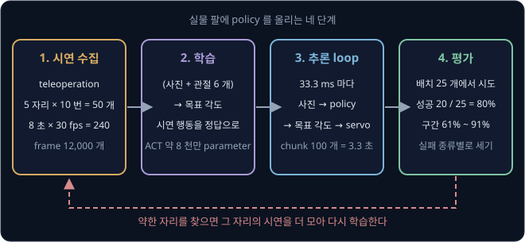

위 그림은 네 단계와 각 단계의 숫자를 보여 준다. 마지막 화살표가 처음으로 되돌아가는 것은 평가에서 약한 자리를 찾으면 그 자리의
시연을 더 모아 다시 학습하기 때문이다. 이 강의는 셋째 단계(추론 loop)와 넷째 단계(평가)를 자세히 다룬다.

**요약**

- 실물에서는 관절 값이 흔들리고, 사진이 조명에 따라 바뀌고, 모터가 늦게 따라가고, 성공 판정과 물체 재배치를 사람이 한다
- SO-101 은 servo 여섯 개로 움직이고, 명령은 관절마다의 목표 각도 6 개다. 예시는 30 fps, 8 초짜리 시연 50 개(frame 12,000 개)다
- 시연 수집 → 학습 → 추론 loop → 평가를 거치고, 평가에서 찾은 약점은 시연을 더 모아 보완한다

## 추론 loop 의 시간표

### tick 과 고정 주기 loop

시연을 30 fps 로 기록했다면 policy 도 33.3 ms 마다 목표 각도를 하나씩 보내야 사람이 시연할 때와 같은 빠르기로 움직인다. 시연에서
"한 frame 뒤에는 이 각도" 를 배웠는데 목표를 50 ms 마다 보내면 같은 동작이 1.5 배 느리게 재생되고, 20 ms 마다 보내면 빨리 감기처럼
재생된다.

그래서 추론 loop 는 정해진 간격마다 같은 일을 되풀이한다. 이 정해진 간격 하나를 tick 이라고 하고, tick 마다 하는 일은 아래와 같다.

1. 카메라 사진 한 장과 관절 각도 6 개를 읽는다
2. 필요하면 policy 로 추론해 목표 각도를 얻는다
3. 목표 각도 6 개를 servo 에 보낸다
4. 33.3 ms 가 다 찰 때까지 기다린다

넷째 단계 때문에 일이 일찍 끝나도 다음 tick 은 정확히 33.3 ms 뒤에 시작한다. 이렇게 간격을 고정해 되풀이하는 loop 를 고정 주기
loop 라고 한다.

| tick | 시작 시각 | 하는 일 |
| --- | --- | --- |
| 0 | 0 ms | 읽기 → 추론 → 목표 보내기 → 기다리기 |
| 1 | 33.3 ms | 읽기 → 목표 보내기 → 기다리기 |
| 2 | 66.7 ms | 읽기 → 목표 보내기 → 기다리기 |
| 30 | 1000 ms | 읽기 → 목표 보내기 → 기다리기 |

tick 번호에 33.3 ms 를 곱하면 시작 시각이 나온다. tick 30 은 $30 \times 33.3 \approx 1000$ ms, 곧 1 초다. 표에서 tick 1, 2, 30 에는
추론이 없는데, 그 이유는 다음 절의 action chunk 에 있다.

**확인 문제.** 시연을 20 fps 로 기록했다. tick 하나는 몇 ms 이고, tick 40 은 몇 초에 시작할까?

답 보기

$1000 \div 20 = 50$ ms 이고, tick 40 은 $40 \times 50 = 2000$ ms, 곧 2 초에 시작한다.

### action chunk 와 queue

[ACT](../act/README.md) 는 추론 한 번에 앞으로 $k$ tick 동안의 목표 각도 $k$ 개를 한꺼번에 낸다. 이 묶음을 action chunk 라고 한다.
로봇 학습 도구 모음인 LeRobot 의 ACT 는 기본값이 $k = 100$ 이라서, 30 fps 에서 chunk 하나는 $100 \times 33.3 \approx 3333$ ms, 곧 약
3.3 초 분량의 움직임이다.

추론으로 받은 100 개는 queue 에 넣어 둔다. queue 는 먼저 넣은 것을 먼저 꺼내는 대기 줄이고, tick 마다 맨 앞의 하나를 꺼내 servo 에
보낸다. 추론은 queue 가 비었을 때만 한다.

| tick | 시각 | queue 에 남은 수 (보내기 전) | 추론 | 보내는 목표 |
| --- | --- | --- | --- | --- |
| 0 | 0 ms | 0 | 한다 (100 개를 받는다) | 1 번째 |
| 1 | 33.3 ms | 99 | 안 한다 | 2 번째 |
| 2 | 66.7 ms | 98 | 안 한다 | 3 번째 |
| 99 | 3300 ms | 1 | 안 한다 | 100 번째 |
| 100 | 3333 ms | 0 | 한다 (새 100 개) | 새 chunk 의 1 번째 |

tick 0 에 queue 가 비어 있으니 추론하고, 받은 100 개 가운데 첫째를 바로 보낸다. 그 뒤 99 tick 동안은 꺼내 보내기만 하고, tick 100 에
queue 가 다시 비면 그때 새 사진을 보고 추론한다. 추론은 3.3 초에 한 번이지만 servo 는 33.3 ms 마다 새 목표를 받는다.

ACT 논문은 추론 한 번에 약 0.01 초(10 ms)가 걸렸다고 적었다. 노트북에서 ACT 추론이 20 ms 걸린다고 해 보자. tick 0 에 추론 20 ms 를
해도 tick 하나의 33.3 ms 안에 끝나므로 로봇은 기다리지 않는다.

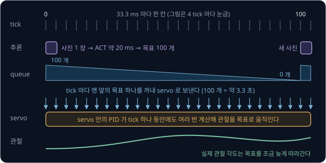

위 그림은 사진 한 장이 관절의 움직임이 되기까지의 길을 시간 순서로 보여 준다. 맨 윗줄이 tick 이고, tick 0 과 tick 100 에만 추론
상자가 있다. 가운데 queue 에서 tick 마다 목표 하나가 빠져 servo 로 가고, 맨 아랫줄의 servo 는 그 목표를 따라 관절을 돌린다.

**흔한 오해.** chunk 를 쓰면 로봇이 3.3 초 동안 한 번만 움직인다고 생각하기 쉽다. 로봇은 33.3 ms 마다 새 목표를 받아 움직이고,
3.3 초에 한 번으로 줄어드는 것은 사진을 보고 결정하는 횟수다. 그 3.3 초 동안은 새 사진을 보지 않으므로 큐브가 밀려도 바로 알아채지
못한다는 대가가 있다. [ACT](../act/README.md) 의 temporal ensembling 은 tick 마다 추론해 겹치는 chunk 를 평균하는 방법으로, 반응은
빨라지지만 추론을 tick 마다 33.3 ms 안에 끝내야 한다.

**확인 문제.** 30 fps 로봇에서 chunk 가 $k = 30$ 이면 chunk 하나는 몇 초 분량이고, 10 초짜리 시도에서 추론은 몇 번 할까?

답 보기

$30 \times 33.3 \approx 1000$ ms 라서 1 초 분량이다. 10 초 동안 1 초에 한 번씩이므로 추론은 10 번이다.

### servo 안의 PID 가 목표를 따라가는 모습

policy 가 보낸 목표 각도가 곧바로 관절 각도가 되지는 않는다. [PID Control](../pid-control/README.md) 에서 본 것처럼 SO-101 의
servo 는 안에서 PID controller 를 돌린다. PID controller 는 목표와 지금 각도의 차이(오차)를 보고 모터에 줄 힘을 계산하는 식이고,
tick 하나보다 훨씬 짧은 간격으로 계산한다. 예를 들어 servo 안의 계산이 1초에 1000 번이라면 tick 하나(33.3 ms) 동안 약 33 번 계산한다.

그래도 모터는 무게가 있는 팔을 움직여야 해서 목표보다 조금 늦게 따라간다. 어깨 관절이 30° 에서 쉬고 있고, chunk 의 목표가 tick
마다 1° 씩 올라 35° 에서 멈춘다고 하자. 관절이 목표에 닿는 데 tick 두 개가 걸린다면 아래처럼 된다.

| tick | 목표 각도 (°) | 실제 각도 (°) | 목표 − 실제 (°) |
| --- | --- | --- | --- |
| 0 | 31 | 30 | 1 |
| 1 | 32 | 30 | 2 |
| 2 | 33 | 31 | 2 |
| 3 | 34 | 32 | 2 |
| 4 | 35 | 33 | 2 |
| 5 | 35 | 34 | 1 |
| 6 | 35 | 35 | 0 |

tick 2 의 실제 각도 31° 는 tick 0 에 보낸 목표이고, tick 3 의 32° 는 tick 1 의 목표다. 팔이 움직이는 동안은 2° 뒤처지고, 목표가
35° 에서 멈추면 tick 두 개 뒤에 따라잡는다. 시연을 기록할 때도 follower 팔은 똑같이 늦게 따라갔으므로, policy 는 이 늦음까지
포함된 기록에서 배웠다. 그래서 추론 때의 servo 설정이 기록 때와 같아야 한다.

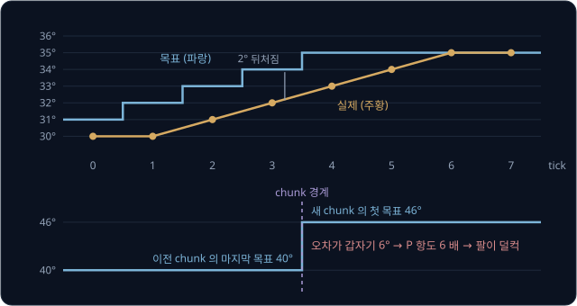

위 그림의 아래쪽은 chunk 가 바뀌는 자리에서 목표가 튀는 경우다. 이전 chunk 의 마지막 목표가 40° 였는데 새 chunk 의 첫 목표가 46° 면
오차가 갑자기 6° 가 되고, PID 의 P 항(오차에 비례하는 힘)도 갑자기 6 배로 커져서 팔이 덜컥 움직인다. 실물 팔이 chunk 가 바뀔 때마다
떨리면 이 튐을 먼저 의심한다.

**확인 문제.** 위 표에서 목표가 tick 4 이후 35° 가 아니라 계속 1° 씩 올라 tick 6 에 37° 가 되면, tick 6 의 실제 각도는?

답 보기

실제 각도는 tick 두 개 전의 목표이므로 tick 4 의 목표 35° 다. 목표와의 차이는 $37 - 35 = 2$° 다.

### tick 보다 긴 추론

모델이 크면 추론이 tick 하나보다 오래 걸린다. 사진과 글을 함께 읽는 SmolVLA(2025) 를 예로 들면, LeRobot 의 SmolVLA 는 chunk
기본값이 50 개라서 30 fps 에서 chunk 하나가 $50 \times 33.3 \approx 1667$ ms 분량이다. 노트북에서 이 모델의 추론이 300 ms 걸린다고 하자.

queue 가 빈 뒤에야 추론을 시작하면 그 300 ms 동안 servo 는 새 목표를 받지 못하고 마지막 자세에 멈춰 있다. 300 ms 는
$300 \div 33.3 = 9$ tick 이므로, chunk 하나(50 tick)를 실행할 때마다 9 tick 씩 멈춘다. 이렇게 추론이 끝날 때까지 실행을 멈추는 방식을
동기(synchronous) 추론이라고 한다.

| 방식 | 추론 시작 | chunk 하나에 걸리는 시간 | 멈추는 시간 |
| --- | --- | --- | --- |
| 동기 | queue 가 빈 뒤 | $1667 + 300 = 1967$ ms | 300 ms (9 tick) |
| 비동기 | queue 에 10 개 남았을 때 | 1667 ms | 0 ms |

비동기(asynchronous) 추론은 queue 가 다 비기 전에 다음 추론을 미리 시작한다. 10 개가 남았을 때 시작하면 그 10 개를 실행하는
$10 \times 33.3 = 333$ ms 안에 300 ms 짜리 추론이 끝나서, queue 가 비기 전에 새 chunk 가 도착한다. 남은 개수는 "남은 개수 × 33.3 ms ≥
추론 시간" 이 되게 고르면 되고, 300 ms 면 $300 \div 33.3 = 9$ 개 이상이다. 새 chunk 는 300 ms 전의 사진으로 계산했으므로 앞쪽 몇
개는 이미 지나간 tick 의 몫이라, 그 부분은 남은 목표와 합치거나 버리고 이어 붙인다.

SmolVLA 논문은 이 비동기 방식을 실물 SO-100 팔에서 시험했고, 과제 하나를 끝내는 평균 시간이 동기 방식의 13.75 초에서 9.70 초로 줄었다고
보고했다.

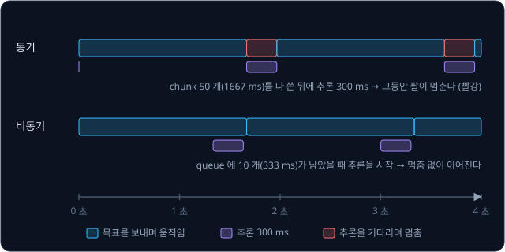

**확인 문제.** 추론에 500 ms 가 걸리는 모델을 30 fps 로봇에서 비동기로 쓴다. queue 에 몇 개 이상 남았을 때 다음 추론을 시작해야 할까?

답 보기

남은 개수 × 33.3 ms 가 500 ms 이상이어야 하므로 $500 \div 33.3 \approx 15$ 개 이상이다. 15 개면 $15 \times 33.3 \approx 500$ ms 다.

**요약**

- 추론 loop 는 tick(30 fps 면 33.3 ms)마다 사진과 관절 각도를 읽고 목표 각도를 보내는 고정 주기 loop 다
- ACT 는 추론 한 번에 목표 100 개(3.3 초 분량)를 queue 에 넣고 tick 마다 하나씩 꺼내므로 추론은 queue 가 빌 때만 한다
- servo 안의 PID 가 목표를 따라가며 tick 두 개쯤 늦게 따라가고, chunk 경계에서 목표가 튀면 팔이 덜컥 움직인다
- 추론이 tick 보다 길면 비동기 추론으로 queue 가 비기 전에 다음 추론을 시작한다

## 노트북에서 돌릴 수 있는 policy 크기

### parameter 수와 메모리

모델 안에서 학습으로 정해지는 숫자를 parameter 라고 한다. [Linear Regression](../linear-regression/README.md) 의 직선은 parameter 가
$w$, $b$ 두 개였지만 로봇 policy 는 수천만에서 수십억 개다. 추론하려면 이 숫자들을 모두 메모리에 올려 두어야 한다.

컴퓨터는 숫자 하나를 byte 몇 개에 저장한다. byte 는 0 과 1 여덟 자리로 된 저장 단위다. 소수를 4 byte 로 저장하는 방식을 float32,
2 byte 로 저장하는 방식을 bfloat16(줄여서 bf16)이라고 부른다. bf16 은 자릿수를 덜 기억하는 대신 메모리를 절반만 쓴다. 1 GB 는
10 억 byte 다.

| 모델 | parameter 수 | 숫자 하나 | 메모리 |
| --- | --- | --- | --- |
| ACT | 약 8 천만 | 4 byte (float32) | $0.08 \times 4 = 0.32$ GB |
| SmolVLA | 약 4 억 5 천만 | 2 byte (bf16) | $0.45 \times 2 = 0.9$ GB |
| π0 | 약 33 억 | 2 byte (bf16) | $3.3 \times 2 = 6.6$ GB |
| OpenVLA | 약 70 억 | 2 byte (bf16) | $7 \times 2 = 14$ GB |

표의 계산은 parameter 수를 10 억 단위로 적은 뒤 byte 수를 곱한 것이다. 8 천만은 0.08 × 10 억이라 $0.08 \times 4 = 0.32$ GB 다.
OpenVLA 논문은 bf16 으로 올렸을 때 실제로 15 GB 를 썼다고 적었는데, parameter 말고도 계산 중간값을 담을 자리가 더 필요해서 표의
14 GB 보다 조금 많다.

SmolVLA 논문은 비교 대상의 크기를 ACT 약 8 천만 개, SmolVLA 4 억 5 천만 개(그 가운데 행동을 내는 부분이 약 1 억 개), π0 33 억
개로 적었고, OpenVLA 논문은 70 억 개짜리 모델을 내놓았다.

**확인 문제.** parameter 가 20 억 개인 모델을 bf16 으로 올리면 메모리는 몇 GB 일까? float32 로 올리면?

답 보기

20 억은 $2 \times 10$ 억이므로 bf16 이면 $2 \times 2 = 4$ GB, float32 면 $2 \times 4 = 8$ GB 다.

### 추론 한 번의 최소 시간

메모리에 들어간다고 빨리 돌아가는 것은 아니다. 추론 한 번에 모델은 parameter 를 적어도 한 번씩은 메모리에서 읽어 와 곱하고
더해야 한다. 그래서 "메모리에서 1초에 몇 GB 를 읽을 수 있나" 가 추론 시간의 아래 한계를 정한다. 이 빠르기를 memory bandwidth 라고
한다.

Apple 은 노트북용 M4 Max 칩의 memory bandwidth 를 "1초에 0.5 TB 이상" 이라고 소개했고, 정확한 값은 구성마다 다르다. 1 TB 는 1000 GB
다. 어림하기 쉽게 1초에 400 GB 를 읽는다고 두고, 모델 전체를 한 번 읽는 시간을 계산해 보자.

| 모델 | 메모리 | 한 번 읽는 시간 | tick 33.3 ms 와 비교 |
| --- | --- | --- | --- |
| ACT | 0.32 GB | $0.32 \div 400 = 0.0008$ 초 = 0.8 ms | 아주 여유 있다 |
| SmolVLA | 0.9 GB | $0.9 \div 400 = 0.00225$ 초 ≈ 2.3 ms | 여유 있다 |
| π0 | 6.6 GB | $6.6 \div 400 = 0.0165$ 초 = 16.5 ms | chunk 가 있어야 맞춘다 |
| OpenVLA | 14 GB | $14 \div 400 = 0.035$ 초 = 35 ms | 한 번 읽기도 tick 보다 길다 |

이 값은 가장 빠르게 잡은 아래 한계이고, 실제 추론은 곱셈과 덧셈에 드는 시간과 프로그램의 여러 준비 과정 때문에 몇 배 더 걸린다.
게다가 OpenVLA 는 action 의 숫자 7 개를 token(모델이 한 번에 하나씩 내는 출력 단위) 하나씩 차례로 만들어서 추론 한 번에 모델 전체를
7 번 읽고, chunk 없이 목표 하나만 낸다. $35 \times 7 = 245$ ms 가 아래 한계라서 이 계산으로는 1초에 4 번 남짓밖에 목표를 낼 수 없다.
OpenVLA 논문도 NVIDIA 의 게임용 GPU 인 RTX 4090 한 장에서 1초에 약 6 번 추론했다고 적었다. GPU 는 곱셈·덧셈 수천 개를 동시에 하도록
만든 계산 칩이다.

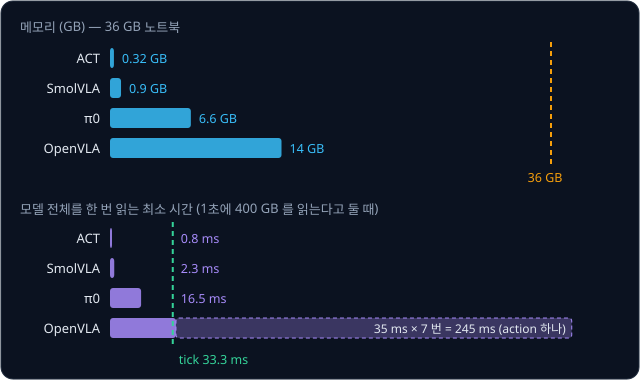

**확인 문제.** 메모리 4 GB 짜리 모델을 1초에 200 GB 를 읽는 컴퓨터에서 돌린다. 모델 전체를 한 번 읽는 최소 시간은 몇 ms 일까?

답 보기

$4 \div 200 = 0.02$ 초, 곧 20 ms 다. 30 fps 의 tick 33.3 ms 보다는 짧지만 실제 추론은 이보다 몇 배 더 걸린다.

### 36GB 노트북의 경우

예를 들어 Apple M4 Max 칩에 메모리 36 GB 를 단 노트북을 생각하자. Apple 의 칩은 CPU 와 GPU 가 메모리 하나를 함께 쓰는 unified memory
구조라서, 36 GB 의 대부분을 모델에 쓸 수 있다. CPU 는 컴퓨터의 일반 계산을 맡는 칩이다. 메모리만 보면 앞 표의 네 모델이 모두
들어간다. 그런데 실제로 돌릴 수 있는지는 메모리 말고도 두 가지에 달려 있다.

첫째는 앞 절의 속도다. ACT 와 SmolVLA 는 아래 한계가 tick 보다 한참 짧아서 노트북에서도 실시간으로 돌리기에 무리가 없다. SmolVLA
논문은 이 모델이 GPU 한 장으로 학습하고 소비자용 GPU 나 CPU 로도 돌릴 수 있게 설계했다고 적었다. 수십억 parameter 모델은 chunk 로
시간을 벌어도 노트북에서는 추론이 느린 경우가 많다.

둘째는 프로그램이 그 칩을 지원하느냐다. 큰 로봇 모델의 공개 코드는 대개 NVIDIA GPU 를 기준으로 만들어진다. π0 의 공개 저장소인
openpi 는 추론에 8 GB 이상의 NVIDIA GPU 가 필요하다고 적었고, Ubuntu 22.04 에서만 시험했다고 밝혔다. 반면 LeRobot 은 Apple 칩의 GPU 를
쓰는 설정(mps)을 안내한다. 다만 LeRobot 의 하드웨어 안내서는 시연 50 개쯤으로 된 dataset(학습에 쓰는 기록 묶음)을 다섯 번 훑으며 ACT 를 학습하는 데 RTX 4090
에서 30 ~ 60 분, Apple M1 ~ M3 Max 에서 6 ~ 14 시간쯤 걸린다는 어림값을 실었다. 그래서 학습은 큰 GPU 에서, 추론은 노트북에서 하는 식으로
나누기도 한다.

일반적인 경향을 표로 적으면 아래와 같다. 모델·프로그램 판본·설정에 따라 달라지므로 실제로는 직접 재어 봐야 한다.

| 모델 크기 | 예 | 36GB 노트북에서의 추론 |
| --- | --- | --- |
| 1 억 개 안팎 | ACT | 실시간으로 무리 없다 |
| 수억 개 | SmolVLA | chunk 와 비동기 추론을 쓰면 실시간으로 돌릴 수 있다 |
| 수십억 개 | π0, OpenVLA | 메모리에는 들어가도 느리거나, 공개 코드가 NVIDIA GPU 를 요구하는 경우가 많다 |

노트북이 느리면 추론만 GPU 가 있는 다른 컴퓨터에 맡기는 방법도 있다. SmolVLA 의 비동기 추론은 로봇 쪽 프로그램이 사진을 보내고
다른 컴퓨터의 policy 가 chunk 를 돌려주는 구조로 만들어져 있어서, 네트워크로 오가는 시간까지 비동기로 감출 수 있다.

**흔한 오해.** "메모리에 들어가면 돌릴 수 있다" 고 생각하기 쉽다. 70 억 개짜리 모델은 36 GB 노트북 메모리에 들어가지만, 추론 한
번에 parameter 를 여러 번 읽느라 아래 한계부터 245 ms 이고, 공개 코드가 그 칩을 지원하지 않을 수도 있다.

**확인 문제.** 메모리 16 GB 노트북에 OpenVLA(bf16, 실제 15 GB)와 SmolVLA(0.9 GB)를 함께 올릴 수 있을까?

답 보기

$15 + 0.9 = 15.9$ GB 로 16 GB 에 거의 꽉 찬다. 운영체제와 다른 프로그램도 메모리를 쓰므로 실제로는 둘을 함께 올리기 어렵다.

**요약**

- 메모리는 parameter 수 × 숫자 하나의 byte 수다. ACT 0.32 GB, SmolVLA 0.9 GB, π0 6.6 GB, OpenVLA 14 GB 다
- 추론 한 번은 parameter 를 적어도 한 번 읽어야 하므로 메모리 ÷ memory bandwidth 가 아래 한계다. 400 GB/초 면 ACT 0.8 ms, OpenVLA
  35 ms 이고, OpenVLA 는 action 하나에 7 번 읽는다
- 노트북에서는 ACT·SmolVLA 같은 작은 모델이 실시간으로 돌고, 수십억 parameter 모델은 느리거나 NVIDIA GPU 를 요구하는 경우가 많다

## 성공률과 그 흔들림

### 여러 번의 시도로 재는 성공률

policy 가 잘 되는지는 한 번 해 보고 알 수 없다. 큐브를 놓고 policy 를 처음부터 끝까지 실행해 보는 한 번을 trial(시도)이라고 하고,
trial 을 여러 번 해서 성공한 비율을 성공률이라고 한다. "큐브가 상자 바닥에 닿아 있고 팔이 처음 자세로 돌아왔다" 처럼 성공의 기준을
시도 전에 문장으로 정해 둔다. 기준이 없으면 애매한 결과를 그때그때 다르게 판정하게 된다.

ACT 로 25 번 시도해 20 번 성공했다면 성공률은 아래와 같다.

$$
\hat p = \frac{k}{n} = \frac{20}{25} = 0.8
$$

$n$ 은 시도 횟수, $k$ 는 성공 횟수다. $\hat p$ 는 "p 햇" 이라고 읽고, 시도 결과로 어림한 성공률이라는 뜻이다. p 는 비율
(proportion)의 첫 글자이고, 모자(hat)는 참값이 아니라 어림한 값이라는 표시다. 참 성공률은 이 policy 를 끝없이 많이 시도했을 때의
성공 비율인데, 그만큼 시도할 수는 없으므로 $\hat p$ 로 어림한다.

**확인 문제.** 40 번 시도해 30 번 성공했다. $\hat p$ 는?

답 보기

$30 \div 40 = 0.75$, 곧 75% 다.

### 같은 policy 의 다른 결과

같은 policy 를 같은 조건으로 시도해도 결과는 매번 조금씩 다르다. 큐브가 몇 mm 다르게 놓이고, 사진의 밝기가 조금 다르고, servo 의
반응도 조금씩 다르기 때문이다. 참 성공률이 70% 인 policy 를 10 번씩 다섯 묶음 시도했더니 아래처럼 나왔다고 하자.

| 묶음 | 1 | 2 | 3 | 4 | 5 |
| --- | --- | --- | --- | --- | --- |
| 성공 / 10 번 | 7 | 9 | 6 | 8 | 5 |
| $\hat p$ | 70% | 90% | 60% | 80% | 50% |

같은 policy 인데 어떤 묶음은 90%, 어떤 묶음은 50% 가 나왔다. 그래서 10 번 시도한 결과 하나만 보고 "90% 짜리 policy" 라고 하면 크게
틀릴 수 있다. 어림한 성공률에는 "참값이 대략 어디에서 어디 사이에 있다" 는 범위를 함께 적어야 한다. 이 범위를 신뢰 구간(confidence
interval)이라고 한다.

동전을 10 번 던지면 앞면이 꼭 5 번 나오지 않고 3 번이나 7 번도 자주 나오는 것과 같다.

**확인 문제.** 위 표의 다섯 묶음을 모두 합하면 50 번 중 몇 번 성공이고, 합친 $\hat p$ 는?

답 보기

$7 + 9 + 6 + 8 + 5 = 35$ 번이고 $35 \div 50 = 0.7$, 곧 70% 다. 묶음 하나보다 참값 70% 에 가깝다.

### 신뢰 구간의 어림 계산

신뢰 구간의 폭은 시도 횟수 $n$ 과 성공률 $\hat p$ 로 어림한다. 먼저 제곱근을 짚자. 어떤 수 $a$ 의 제곱근 $\sqrt{a}$ 는 "두 번 곱해서
$a$ 가 되는 양수" 다. $0.08 \times 0.08 = 0.0064$ 이므로 $\sqrt{0.0064} = 0.08$ 이고, $0.04 \times 0.04 = 0.0016$ 이므로
$\sqrt{0.0016} = 0.04$ 다.

25 번 중 20 번 성공($\hat p = 0.8$)일 때 한 줄에 한 단계씩 계산한다.

| 단계 | 계산 | 값 |
| --- | --- | --- |
| ① 성공률 × 실패율 | $0.8 \times (1 - 0.8) = 0.8 \times 0.2$ | 0.16 |
| ② 시도 횟수로 나누기 | $0.16 \div 25$ | 0.0064 |
| ③ 제곱근 | $\sqrt{0.0064}$ | 0.08 |
| ④ 2 배 | $2 \times 0.08$ | 0.16 |
| ⑤ 범위 | $0.8 - 0.16$ 부터 $0.8 + 0.16$ 까지 | 0.64 ~ 0.96 |

20 / 25 의 성공률은 "약 64% 에서 96% 사이" 라고 적는다. 같은 성공률 80% 를 100 번 시도로 얻었다면 ② 가 $0.16 \div 100 = 0.0016$,
③ 이 $\sqrt{0.0016} = 0.04$, ④ 가 $0.08$ 이라서 범위는 72% ~ 88% 로 좁아진다. 계산을 식으로 쓰면 아래와 같다.

$$
\hat p \pm 2\sqrt{\frac{\hat p\,(1 - \hat p)}{n}}
$$

$\pm$ 는 "플러스 마이너스" 라고 읽고, 앞의 값에서 뒤의 값을 뺀 곳부터 더한 곳까지라는 뜻이다. 첫 계산에 맞추면 $\hat p$ 는 0.8,
$1 - \hat p$ 는 실패율 0.2, $n$ 은 25, 제곱근은 ③ 의 0.08, 앞의 2 를 곱한 0.16 이 ④ 의 폭이다. 2 를 곱하는 이유는 이렇게 만든
범위가 참 성공률을 100 번 중 약 95 번 덮기 때문이고, 이것을 95% 신뢰 구간이라고 부른다. 정확한 값은 2 대신 1.96 이다.

$\hat p\,(1 - \hat p)$ 는 결과가 얼마나 들쭉날쭉한지를 나타낸다. 성공률이 0 이나 1 에 가까우면 거의 매번 같은 결과가 나오므로 이 곱이
작고($0.9 \times 0.1 = 0.09$), 성공률이 0.5 면 성공과 실패가 반반이라 가장 크다($0.5 \times 0.5 = 0.25$).

**확인 문제.** 100 번 중 50 번 성공했다. 위 계산으로 범위는?

답 보기

① $0.5 \times 0.5 = 0.25$, ② $0.25 \div 100 = 0.0025$, ③ $\sqrt{0.0025} = 0.05$($0.05 \times 0.05 = 0.0025$), ④ $2 \times 0.05 = 0.1$
이라서 40% ~ 60% 다.

### 시도 횟수와 구간의 폭

위 식에서 $n$ 은 제곱근 안의 분모에 있다. 그래서 시도를 4 배로 늘리면 제곱근 안이 4 분의 1 이 되고, 제곱근은 $\sqrt{4} = 2$ 분의 1 이
되어 폭이 절반으로 준다. 25 번에서 폭이 ±16% 였던 것이 100 번에서 ±8% 가 된 것이 그렇다. 폭을 절반으로 줄이려면 시도가 4 배 필요해서,
실물 평가에서 시도 횟수를 늘리는 일은 금방 비싸진다.

위의 어림 계산은 두 경우에 이상한 답을 낸다. 25 번 모두 성공하면 $\hat p (1 - \hat p) = 1 \times 0 = 0$ 이라 폭이 0 이 되어 "참
성공률은 정확히 100%" 라는 결론이 나오고, 10 번 중 9 번 성공이면 위쪽 끝이 $0.9 + 0.19 = 1.09$, 곧 109% 로 1 을 넘는다. 이런 때를 위해
Wilson score interval 이라는 계산을 쓴다. Wilson 구간은 가운데를 $(k + 2) \div (n + 4)$ 근처, 곧 가상의 성공 2 번과 실패 2 번을 더한
성공률 쪽으로 조금 옮기고, 늘 0 과 1 사이에 머물도록 폭을 정한다. 식이 길어서 이 강의에서는 계산한 값만 쓴다.

| 결과 | $\hat p$ | 어림 계산 (±2√…) | Wilson 95% 구간 |
| --- | --- | --- | --- |
| 9 / 10 | 90% | 71% ~ 109% | 60% ~ 98% |
| 20 / 25 | 80% | 64% ~ 96% | 61% ~ 91% |
| 25 / 25 | 100% | 100% ~ 100% | 87% ~ 100% |
| 80 / 100 | 80% | 72% ~ 88% | 71% ~ 87% |

25 번 모두 성공해도 Wilson 구간은 "참 성공률이 87% 일 수도 있다" 고 알려 준다. 시도가 100 번쯤 되면 두 계산이 거의 같아진다.

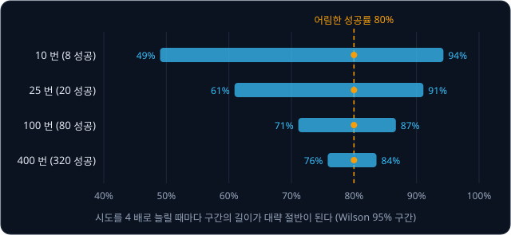

**확인 문제.** 성공률 80% 를 400 번 시도로 얻었다. 어림 계산의 폭(± 뒤의 값)은 몇 % 일까?

답 보기

$0.16 \div 400 = 0.0004$, $\sqrt{0.0004} = 0.02$, $2 \times 0.02 = 0.04$ 라서 ±4% 다. 100 번의 ±8% 에서 시도를 4 배 늘려 절반이 됐다.

### 두 policy 의 비교

ACT 가 25 번 중 20 번(80%), 다른 policy B 가 25 번 중 15 번(60%) 성공했다. ACT 가 더 낫다고 할 수 있을까? Wilson 구간은 ACT 가
61% ~ 91%, B 가 41% ~ 77% 라서 61% ~ 77% 가 겹친다. 두 policy 의 참 성공률이 둘 다 70% 일 가능성도 남아 있으므로, 25 번씩으로는
"ACT 가 낫다" 고 단정하기 어렵다. 같은 80% 와 60% 를 100 번씩으로 얻었다면 구간이 71% ~ 87% 와 50% ~ 69% 로 겹치지 않아 차이가 있다고
말할 수 있다.

비교할 때는 시도 조건도 맞춰야 한다. 큐브를 어디에 놓느냐에 따라 쉬운 자리와 어려운 자리가 있어서, 두 policy 를 서로 다른 자리에서
시도하면 자리 운이 결과에 섞인다. 그래서 처음 배치 25 개를 미리 정해 사진으로 남기고, 배치마다 두 policy 를 연달아 시도한다. 먼저
하는 쪽을 배치마다 번갈아 바꾸면, 시간이 지나며 바뀌는 조명이나 servo 의 열 같은 영향도 두 policy 에 고르게 나뉜다.

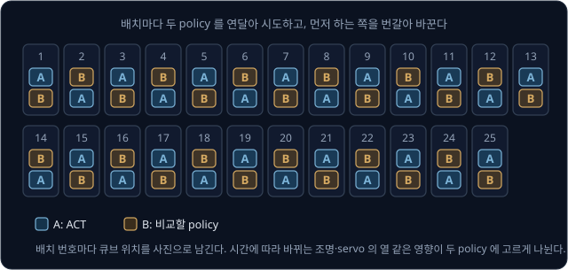

**흔한 오해.** 80% 와 60% 는 20% 나 차이 나니 당연히 앞의 것이 낫다고 생각하기 쉽다. 25 번씩 시도한 결과라면 각 성공률이 ±16 ~ 20% 쯤
흔들리므로 차이가 우연일 수 있다. 비교 결과에는 성공률과 함께 구간과 시도 횟수를 적는다.

**확인 문제.** 두 policy 의 Wilson 구간이 50% ~ 70%, 72% ~ 90% 다. 차이가 있다고 말할 수 있을까?

답 보기

두 구간이 겹치지 않으므로(70% 와 72% 사이에 틈이 있다) 뒤의 policy 가 낫다고 말할 수 있다.

**요약**

- 성공 기준을 미리 정하고 trial 을 여러 번 해서 $\hat p = k / n$ 을 잰다. 같은 policy 도 묶음마다 결과가 다르다
- 어림 구간은 $\hat p \pm 2\sqrt{\hat p(1 - \hat p)/n}$ 이고, 20 / 25 면 64% ~ 96% 다. 시도를 4 배 늘려야 폭이 절반이 된다
- 0% 나 100% 근처, 시도가 적을 때는 Wilson 구간을 쓴다. 두 policy 는 같은 배치에서 번갈아 시도해 비교하고, 구간이 겹치면 차이를
  단정하지 않는다

## 실패 분석

### 실패 유형의 분류

성공률만 보면 어디를 고칠지 모른다. 실패한 trial 마다 "어느 단계에서 어떻게 실패했나" 를 적어 종류별로 센다. ACT 의 25 번 가운데
실패 5 번을 영상으로 다시 보며 나눴더니 아래와 같았다고 하자.

| 실패 유형 | 보이는 모습 | 횟수 |
| --- | --- | --- |
| 접근 빗나감 | 집게가 큐브 옆 몇 cm 자리로 내려간다 | 2 |
| 쥐기 실패 | 큐브를 쥐었다가 들어 올리는 중에 미끄러진다 | 1 |
| 놓기 빗나감 | 큐브를 들고 갔지만 상자 가장자리에 걸친다 | 1 |
| 멈춤·떨림 | 팔이 중간에 멈추거나 같은 자리에서 떨기만 한다 | 1 |
| 합 | | 5 |

이 표를 보면 접근 빗나감이 가장 많다. 그 2 번이 모두 큐브가 책상 오른쪽 끝에 놓인 배치였다면, 원인은 손 동작이 아니라 그 자리의
시연이 모자란 것일 가능성이 크다. [Classical Pick & Place](../classical-pick/README.md) 의 모듈 파이프라인은 단계마다 중간 값이 있어서
실패를 단계별로 세기 쉬웠지만, end-to-end policy 는 중간 값이 없으므로 이렇게 영상에 보이는 모습으로 나눈다.

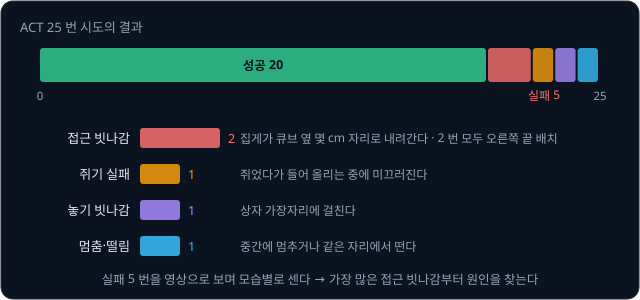

**확인 문제.** 실패 5 번 가운데 접근 빗나감 2 번을 모두 고치면 성공률은 몇 % 가 될까?

답 보기

성공이 $20 + 2 = 22$ 번이 되어 $22 \div 25 = 88\%$ 다.

### 영상과 기록을 이용한 원인 구분

같은 "떨림" 이라도 원인이 여럿이라서, 모습만으로 나눈 뒤에는 원인을 가리는 확인을 한다.

| 떨림의 모습 | 의심할 원인 | 확인하는 방법 |
| --- | --- | --- |
| chunk 가 바뀌는 순간(예: 3.3 초마다)에만 덜컥 움직인다 | chunk 경계의 목표 튐, 추론 지연 | 보낸 목표 각도를 tick 마다 기록해 경계에서 값이 튀는지 본다 |
| 일정한 빠르기로 계속 떤다 | servo 의 PID 설정 | policy 없이 고정 목표 하나를 보내도 떠는지 본다 |
| 특정 조명에서만 생긴다 | 카메라 사진이 시연과 다르다 | 그 조명에서 찍은 사진을 넣어 policy 출력이 tick 마다 크게 바뀌는지 본다 |

둘째 줄처럼 policy 를 빼고 고정 목표만 보내 보는 확인은 "policy 의 문제인가, 팔의 문제인가" 를 가르는 가장 쉬운 방법이다. 셋째 줄처럼
같은 사진을 policy 에 계속 넣어 출력만 기록하는 것도 같은 생각이다. [Teleop Dataset](../teleop-dataset/README.md) 에서 본 replay(기록된
목표를 그대로 다시 보내기)도 팔과 기록이 정상인지 확인하는 데 쓴다.

**확인 문제.** policy 를 끄고 고정 목표 하나만 보냈는데도 팔이 일정하게 떤다. 원인은 policy 쪽일까 팔 쪽일까?

답 보기

policy 가 관여하지 않는데도 떨므로 팔 쪽, 곧 servo 의 PID 설정이나 기계 문제다.

### 시연 범위 밖의 위치

[Behavior Cloning](../behavior-cloning/README.md) 에서 본 것처럼 neural network 는 시연 사이를 메우는 것은 잘하지만 시연 바깥으로
늘려 가는 것은 보장하지 못한다. 시연에서 큐브를 놓은 다섯 자리가 책상 위에 영역 하나를 만들고, 그 영역 안은 시연 사이를 메우는
계산이라 잘 맞지만 바깥은 policy 가 무엇을 낼지 알 수 없다.

평가 배치를 세 종류로 나눠 10 번씩 시도했다고 하자.

| 큐브 자리 | 시도 | 성공 | $\hat p$ | Wilson 95% 구간 |
| --- | --- | --- | --- | --- |
| 시연한 다섯 자리 | 10 | 9 | 90% | 60% ~ 98% |
| 다섯 자리 사이 (영역 안) | 10 | 7 | 70% | 40% ~ 89% |
| 영역 밖 (오른쪽 끝) | 10 | 1 | 10% | 2% ~ 40% |

영역 밖 구간의 위쪽 끝 40% 가 시연한 자리 구간의 아래쪽 끝 60% 보다 낮아서, 10 번씩만 시도해도 영역 밖이 확실히 약하다고 말할 수
있다. 처방은 [Teleop Dataset](../teleop-dataset/README.md) 의 성공률 표에서 본 것과 같이 약한 자리의 시연을 더 모아 다시 학습하는
것이다.

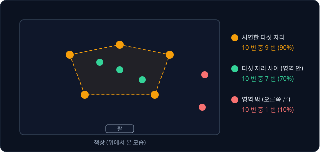

**흔한 오해.** policy 가 "큐브를 집는 법" 을 배웠으니 책상 어디에 놓든 집을 것이라고 생각하기 쉽다. policy 가 배운 것은 시연 장면의
사진과 관절 각도 사이의 짝이라서, 시연이 덮지 않은 자리에서는 위 표처럼 성공률이 크게 떨어진다.

**확인 문제.** 영역 밖 자리에 시연 10 개를 더 모아 다시 학습했더니 그 자리에서 10 번 중 8 번 성공했다. 성공률은 몇 %p 올랐을까?

답 보기

10% 에서 80% 로 70 %p 올랐다. %p(퍼센트포인트)는 두 백분율의 차이를 나타내는 단위다.

### 카메라 위치의 변화

카메라가 시연 때와 조금만 달라져도 policy 의 입력이 통째로 바뀐다. [Camera Geometry](../camera-geometry/README.md) 의 카메라
($f = 500$ pixel)가 책상 위 0.5 m 높이에서 아래를 보고 있다고 하자. focal length $f$ 는 카메라가 얼마나 확대해 찍는지를 pixel 로 적은
값이고, pixel 은 사진의 칸 하나다. 누가 카메라를 옆으로 1 cm(0.01 m) 밀면 책상 위의 모든 점이 사진에서 몇 pixel 옮겨 찍힐까?

$$
\text{옮겨 찍히는 칸 수} = f \times \frac{\text{카메라가 움직인 거리}}{\text{물체까지의 거리}} = 500 \times \frac{0.01}{0.5} = 10 \text{ pixel}
$$

식은 "옮겨 찍히는 pixel 수는 focal length 에 (카메라가 움직인 거리 ÷ 물체까지의 거리) 를 곱한 값" 이라고 읽는다. 카메라가 오른쪽으로
가면 사진 속 물체는 왼쪽으로 옮겨 찍히고, 그 칸 수가 10 이다.

[Behavior Cloning](../behavior-cloning/README.md) 의 예처럼 사진 속 큐브의 가로 위치 $u$ 가 100 pixel 늘 때마다 팔을 좌우로 돌리는
관절이 20° 씩 더 돈다고 배운 policy 라면, 큐브가 실제로는 그대로인데 10 pixel 옮겨 보이므로 관절을 2° 틀리게 돌린다. 30 cm 떨어진 집게
끝에서 2° 는 $2 \times 3.14 \times 30 \times \frac{2}{360} \approx 1.0$ cm 다. 카메라가 5 cm 밀리면 50 pixel, 10°, 약 5.2 cm 로 커져서
큐브를 놓친다.

| 카메라가 밀린 거리 | 옮겨 찍히는 칸 | 관절 오차 | 집게 끝 오차 (30 cm) |
| --- | --- | --- | --- |
| 1 cm | $500 \times 0.01 \div 0.5 = 10$ | $10 \div 100 \times 20 = 2$° | 약 1.0 cm |
| 5 cm | $500 \times 0.05 \div 0.5 = 50$ | $50 \div 100 \times 20 = 10$° | 약 5.2 cm |

그래서 카메라는 단단한 받침대에 고정하고, 시연 때의 카메라 위치를 사진이나 표시로 남겨 둔다.

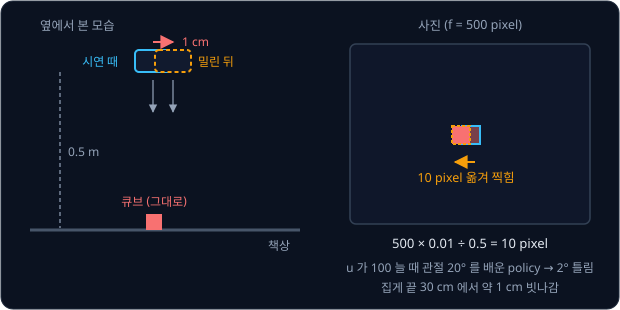

**확인 문제.** 같은 카메라($f = 500$, 물체까지 0.5 m)가 2 cm 밀렸다. 큐브는 사진에서 몇 pixel 옮겨 찍힐까?

답 보기

$500 \times 0.02 \div 0.5 = 20$ pixel 이다.

### 조명의 변화

사진의 pixel 하나에는 빨강·초록·파랑 빛의 세기가 0 부터 255 까지의 숫자 세 개로 적혀 있다. 해가 지거나 전등 하나를 끄면 이 숫자들이
함께 줄어든다. [Classical Pick & Place](../classical-pick/README.md) 의 큐브 윗면 $(200, 40, 30)$ 은 밝기가 반이 되면 $(100, 20, 15)$
가 된다.

policy 는 사진의 숫자를 학습 dataset 의 평균과 흩어진 정도에 맞춰 바꾼 뒤 넣는다. 이 과정을 정규화(normalization)라고 한다. 빨강의 평균이 120, 흩어진 정도가 40 이면
평균을 빼고 40 으로 나눈 $(200 - 120) \div 40 = 2$ 가 입력이 된다. 같은 큐브가 어두워져 빨강이 100 이 되면 입력은 $(100 - 120) \div 40 = -0.5$ 다. 사람 눈에는
같은 빨간 큐브지만 policy 가 받는 숫자는 2 에서 $-0.5$ 로 바뀌었고, 시연이 늘 밝은 조명이었다면 이런 입력은 한 번도 보지 못한
것이다. 조명도 물체 위치처럼 시연 범위의 일부다.

처방은 두 가지다. 시연을 모을 때와 실행할 때의 조명을 같게 하거나, 시연을 모을 때 조명을 일부러 여러 가지로 바꿔 범위를 넓힌다.
학습할 때 사진의 밝기를 무작위로 조금씩 바꿔 넣는 방법(augmentation)도 같은 효과를 노린다.

**확인 문제.** 평균 120, 흩어진 정도 40 으로 맞춰 넣는 policy 에 빨강 값 160 인 pixel 이 들어오면 입력은?

답 보기

$(160 - 120) \div 40 = 1$ 이다.

**요약**

- 실패를 접근 빗나감, 쥐기 실패, 놓기 빗나감, 멈춤·떨림처럼 보이는 모습으로 나눠 세고, 고정 목표·고정 입력으로 policy 쪽인지 팔
  쪽인지 가린다
- 시연 영역 밖 자리는 성공률이 크게 떨어진다(10 번 중 1 번). 약한 자리에 시연을 더 모은다
- 카메라가 1 cm 밀리면 10 pixel, 관절 2°, 집게 끝 약 1 cm 가 틀리고, 조명이 바뀌면 policy 의 입력 숫자가 통째로 바뀐다

## end-to-end 구성과 이름으로 대상을 고르는 구성

### 대상이 여럿인 장면

책상에 빨간 큐브와 파란 큐브가 함께 있고, 사람이 "파란 큐브를 상자에 넣어" 라고 말한다고 하자. 지금까지의 ACT 는 글을 입력으로
받지 않으므로 어느 큐브를 집을지 들을 방법이 없다. 시연에서 늘 빨간 큐브를 집었다면 실행 때도 빨간 큐브를 집는다.

대상을 말로 고르게 하는 구성은 크게 두 가지다.

- **(a) end-to-end policy** — 카메라 사진에서 관절 목표값까지 network 하나가 배운다. 대상을 말로 고르려면 글도 그 network 의 입력으로
  넣고, "빨강" 시연과 "파랑" 시연을 모두 모아야 한다
- **(b) 이름으로 찾는 인식기 + 작은 policy** — 물체 이름을 받아 사진에서 그 물체를 찾아 주는 프로그램(인식기)이 대상을 표시하고, 작은
  policy 는 그 표시를 보고 움직인다

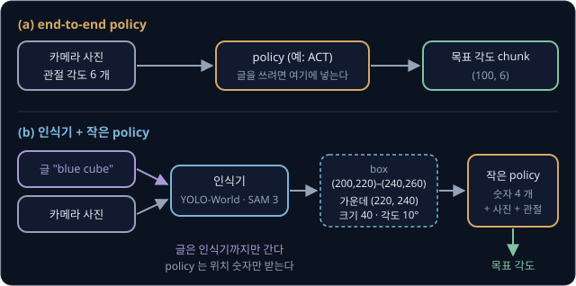

위 그림의 두 줄에서 글이 들어가는 곳을 보자. (a) 에서 글을 쓰려면 policy 자체가 글을 받아야 하고, (b) 에서는 글이 인식기까지만 가고
policy 에는 숫자만 들어간다.

### end-to-end policy

(a) 의 policy 는 [Behavior Cloning](../behavior-cloning/README.md) 과 [ACT](../act/README.md) 에서 본 그대로다. 입력 끝(사진)에서 출력
끝(관절 목표값)까지 중간 단계 없이 한 번에 배운다고 해서 end-to-end 라고 부른다. 큐브가 어디 있는지, 집게를 몇 도 비틀지 같은
중간 숫자를 사람이 정하지 않고 시연에서 통째로 배우므로, 쥐는 순간의 미세한 손목 움직임처럼 규칙으로 적기 어려운 동작도 시연에
있으면 배운다.

대신 배운 것은 시연에 있던 장면과 행동의 짝뿐이다. "파란 큐브" 라는 말을 따르게 하려면 글을 입력으로 받는 policy 를 쓰고, 빨강을
집는 시연과 파랑을 집는 시연을 모두 모아야 한다. 노란 오리 인형을 집게 하려면 노란 오리 인형의 시연이 또 필요하다.

**확인 문제.** (a) 구성의 policy 로 큐브 색 세 가지(빨강·파랑·초록) 가운데 말한 것을 집게 하려 한다. 색마다 다섯 자리 × 10 번씩
시연하면 모두 몇 개가 필요할까?

답 보기

색 하나에 $5 \times 10 = 50$ 개, 세 색이면 $3 \times 50 = 150$ 개다.

### 인식기가 대상을 표시하는 구성

(b) 의 첫 단계는 [Classical Pick & Place](../classical-pick/README.md) 에서 본 open-vocabulary 인식기다. 정해진 단어 목록에 묶이지
않고 아무 이름이나 받아 사진에서 그 물체를 찾는 인식기라서 이렇게 부른다. 인식기마다 내놓는 것이 다르다.

- **YOLO-World(2024)** — 이름을 받아 물체를 둘러싸는 직사각형, 곧 bounding box 를 낸다
- **SAM 3(2025)** — "yellow school bus" 같은 짧은 명사구를 받아 그 이름에 맞는 물체마다 mask 를 낸다. mask 는 사진의 칸마다 그 물체에
  속하면 1, 아니면 0 을 적은 표다

인식기가 "blue cube" 를 받아 파란 큐브의 box $(200, 220)$–$(240, 260)$ 을 냈다고 하자. 이것을 작은 policy 가 받을 숫자로 바꾸는 방법은
두 가지다.

**숫자로 넘기기.** box 의 가운데는 두 꼭짓점의 평균이다.

$$
u = (200 + 240) \div 2 = 220, \qquad v = (220 + 260) \div 2 = 240
$$

크기는 가로 $240 - 200 = 40$, 세로 $260 - 220 = 40$ pixel 이다. mask 를 쓰면 1 인 칸들의 평균(centroid)으로 같은 가운데 $(220, 240)$ 을
얻고, mask 의 모양을 감싸는 가장 작은 직사각형의 기울기로 큐브가 돌아간 각도(예: 10°)도 얻는다. box 는 늘 사진의 가로세로에 맞춘
직사각형이라 각도를 알려 주지 않는다. 이렇게 얻은 숫자 4 개 $(220, 240, 40, 10°)$ 를 관절 각도 6 개와 사진에 더해 policy 에 넣는다.

**사진에 표시해 넘기기.** 사진의 빨강·초록·파랑 세 장 옆에 한 장을 더 붙여, mask 의 칸은 1, 나머지는 0 으로 채운다. 480 × 640 사진이면
policy 의 사진 입력이 $480 \times 640 \times 3$ 에서 $480 \times 640 \times 4$ 로 바뀐다. 대상 말고 나머지를 어둡게 칠한 사진을 넣는
방법도 있다.

학습할 때는 시연을 모을 때 큐브 두 개를 함께 놓고, 시연마다 사람이 집은 큐브의 이름을 기록해 둔다. 그 이름으로 기록된 frame 마다
인식기를 돌려 표시를 만들면 (사진, 표시, 관절 각도) → 목표 각도 쌍이 생긴다. policy 는 이 쌍에서 "표시된 물체를 집는다" 를 배운다.

이 구성의 장점은 이름을 알아듣는 일을 인식기가 맡는다는 것이다. 인식기는 사진과 설명 글이 짝지어진 인터넷 규모의 데이터로 미리
학습해 두었으므로, 시연에 없던 "green cube" 나 "yellow duck" 도 사진에서 찾을 수 있다. policy 는 표시된 자리로 가서 쥐는 법만 알면
되므로, 새 물체의 모양이 시연한 물체와 비슷하게 쥘 수 있는 것이라면 새 시연 없이도 집을 수 있다.

**확인 문제.** 인식기가 "red cube" 에 대해 box $(100, 50)$–$(160, 130)$ 을 냈다. policy 에 넘길 가운데와 가로·세로 크기는?

답 보기

가운데는 $u = (100 + 160) \div 2 = 130$, $v = (50 + 130) \div 2 = 90$ 이고, 크기는 가로 $160 - 100 = 60$, 세로 $130 - 50 = 80$
pixel 이다.

### 같은 발상의 연구 MOO

Google 연구진의 MOO(Manipulation of Open-World Objects, Stone 외, 2023)가 (b) 와 같은 발상을 실물 로봇에서 시험했고, 로봇 학습 학회인
CoRL 2023 에 실렸다. 논문에서
확인한 내용은 아래와 같다.

- 명령에서 물체 이름 부분을 떼어 OWL-ViT 라는 open-vocabulary 인식기에 넣고 bounding box 를 얻는다. 인식기는 학습하지 않고 그대로
  고정해 쓴다
- box 의 가운데 pixel 하나만 1.0 으로 표시한 한 장짜리 mask 를 만들어 사진 옆에 붙여 넣는다. 물체가 둘이면 둘째 물체 자리는 0.5 로 적는다
- 인식기는 시도의 첫 frame 에서 한 번만 돌리고, 그 뒤로는 policy 가 사진에서 물체를 따라간다
- policy 는 Google 의 앞선 로봇 policy 인 [RT-1](../rt1/README.md) 과 같은 구조이고, 명령 가운데 물체 이름을 뺀 동사 부분("pick", "move near" 같은)만 글로 받는다
- 시연에는 물체 106 종류가 들어 있었고, 평가에서는 시연에 한 번도 없던 물체 47 개로 시험해 새 물체도 집을 수 있음을 보였다

MOO 의 policy 는 동사를 글로 받지만 물체 이름은 받지 않는다. 물체 이름을 아는 일은 인식기가, 물체를 다루는 일은 policy 가 나눠 맡는
구조다.

**확인 문제.** MOO 가 인식기를 매 frame 이 아니라 첫 frame 에서만 돌리는 이유는 무엇일까?

답 보기

인식기는 계산이 무거워서 매 frame 돌리면 실시간 제어가 어렵다. 첫 frame 에서 한 번만 돌리면 무거운 계산이 시작할 때 한 번으로
끝나고, 그 뒤 물체가 움직이면 policy 가 사진에서 따라간다.

### 두 구성의 비교

| 기준 | (a) end-to-end policy | (b) 인식기 + 작은 policy |
| --- | --- | --- |
| 속도 | policy 추론만 한다 | 인식기 시간이 더해진다. 인식기를 처음에 한 번만 돌리면 거의 늘지 않는다 |
| 필요한 시연 | 대상마다, 말마다 시연이 필요하다 | "표시된 것을 집기" 시연이면 새 이름도 시연 없이 다룬다 |
| 글로 할 수 있는 말 | 글을 받는 policy 라면 시연에 나온 말 | 인식기가 찾는 물체 이름·짧은 명사구뿐이다. "살살", "뒤집어" 같은 동작 지시는 policy 에 닿지 않는다 |
| 섬세한 동작 | 시연에 담긴 미세한 움직임을 사진에서 바로 배운다 | policy 가 사진도 함께 받으면 (a) 와 비슷하다. 숫자 4 개만 받으면 손끝 정렬이 거칠어진다 |
| 고장 진단 | 중간 값이 없다 | 인식기 출력을 사진에 그려 따로 확인할 수 있다 |
| 실패하기 쉬운 때 | 시연 범위 밖의 위치·물체·조명 | 인식기가 엉뚱한 물체를 표시할 때, 그리고 (a) 와 같은 시연 범위 밖 |

속도를 숫자로 보자. 인식기가 한 번에 100 ms 걸린다고 하면, 10 초짜리 시도에서 처음에 한 번만 돌릴 때는 100 ms 가 더해질 뿐이다.
chunk 가 1 초 분량이라 1 초마다 돌리면 10 번이라 1000 ms 가 더해지고, 비동기로 감추지 않으면 그만큼 팔이 멈춘다.

(b) 는 [Classical Pick & Place](../classical-pick/README.md) 의 끝에서 본 "인식기로 위치를 구하고 손 동작은 학습한 policy 에 맡기는"
섞은 구성의 한 형태다. 사람이 짠 규칙은 인식기의 출력을 숫자로 바꾸는 부분에만 남고, 나머지 행동은 시연에서 배운다.

**확인 문제.** 인식기가 한 번에 150 ms 걸린다. 8 초짜리 시도에서 2 초마다 인식기를 동기로 돌리면 팔이 멈추는 시간은 모두 몇 ms 일까?
(시작할 때 한 번을 포함해 0, 2, 4, 6 초에 돌린다)

답 보기

네 번 돌리므로 $4 \times 150 = 600$ ms 다. 처음에 한 번만 돌리면 150 ms 다.

**요약**

- (a) end-to-end policy 는 사진에서 관절 목표값까지 한 번에 배워 섬세한 동작에 강하지만, 대상을 말로 고르려면 글 입력과 대상마다의
  시연이 필요하다
- (b) 는 인식기(YOLO-World 의 box, SAM 3 의 mask)가 이름으로 찾은 대상을 숫자나 표시한 사진으로 바꿔 작은 policy 에 넘긴다. 새 이름도
  시연 없이 다루지만 글은 물체 이름까지만 쓸 수 있다
- MOO(2023)는 box 가운데 한 pixel 을 mask 로 붙여 RT-1 policy 에 넣어, 시연에 없던 물체 47 개로 같은 발상을 시험했다

## (b) 를 VLA 라고 부르지 않는 이유

### VLA 의 보통 뜻

VLA(Vision-Language-Action model)는 카메라 사진(vision)과 글 지시(language)를 함께
받아 로봇의 행동(action)을 내는 모델이다. 지금 이 이름으로 부르는 모델은 대개 아래 모양이다.

1. 사진과 글을 함께 이해하도록 인터넷 규모의 사진·글 데이터로 미리 학습한 모델을 가져온다. 이런 모델을 VLM(vision-language
   model)이라고 한다
2. 그 VLM 을 몸통으로 삼아 행동을 내는 부분을 붙이고, 로봇 시연 데이터로 한 덩어리 모델을 학습한다

SmolVLA 를 예로 들면, SmolVLM-2 라는 작은 VLM 이 사진·글·관절 각도를 token 으로 바꿔 한 줄로 이어 읽고, 그 계산 결과를 action
expert 라는 부분이 받아 action chunk 를 낸다. OpenVLA 는 VLM 전체를 로봇 데이터로 다시 학습하고, SmolVLA 는 VLM 을 고정하고 action
expert 만 학습한다는 차이가 있지만, 두 모델 모두 글이 행동을 계산하는 network 안으로 직접 들어간다. 그래서 "빨간 큐브" 라는 말이
"어디로 갈지" 뿐 아니라 "어떻게 움직일지" 를 정하는 계산에도 영향을 줄 수 있다.

**확인 문제.** VLA 를 만드는 두 단계에서 인터넷 데이터와 로봇 시연 데이터는 각각 어느 단계에 쓰일까?

답 보기

인터넷 규모의 사진·글 데이터는 VLM 을 미리 학습하는 첫 단계에, 로봇 시연 데이터는 VLM 에 행동을 내는 부분을 붙여 학습하는 둘째
단계에 쓰인다.

### (b) 에서 글이 닿는 곳

(b) 에서 글은 인식기에서 멈춘다. 인식기도 인터넷 규모의 사진·글 데이터로 미리 학습했으니 글과 사진을 함께 다루는 모델이고,
MOO 논문도 OWL-ViT 를 vision-language model 이라고 불렀다. 그러나 인식기가 내놓는 것은 "이 이름의 물체는 사진의 여기에 있다" 는 위치
뿐이다. policy 는 그 위치 숫자(또는 표시한 사진)와 관절 각도만 받고 글은 보지 않는다.

그래서 인식기가 인터넷에서 배운 지식 가운데 행동까지 전달되는 것은 "이름 → 위치" 하나뿐이다. "유리컵이니 살살 쥐어", "머그컵은
손잡이를 잡아" 처럼 물체에 대한 상식이 동작 방식을 바꿔야 하는 지시는 policy 에 닿을 길이 없다. 인식기와 policy 를 따로 학습해 이어
붙였을 뿐, 사전학습한 VLM 몸통이 행동까지 함께 학습한 한 덩어리 모델이 아니다. 그래서 (b) 는 보통 VLA 라고 부르지 않는다.

| 질문 | (b) 인식기 + 작은 policy | VLA (예: SmolVLA, OpenVLA) |
| --- | --- | --- |
| 글이 들어가는 곳 | 인식기 | 행동을 내는 모델 자체 |
| policy 가 받는 것 | 위치 숫자 또는 표시한 사진, 관절 각도 | 사진, 글, 관절 각도 |
| 인터넷 지식이 행동에 전해지는 길 | "이름 → 위치" 뿐 | 사진·글을 함께 읽은 VLM 의 계산 결과 전체 |
| 학습 | 인식기와 policy 를 따로 | 한 모델로 (VLM 일부를 고정하기도 한다) |

**확인 문제.** (b) 구성에 "파란 큐브를 뒤집어 놓아" 라고 말했다. 인식기와 policy 는 각각 무엇을 받을까?

답 보기

인식기는 물체 이름 "blue cube" 를 받아 파란 큐브의 위치를 낸다. policy 는 그 위치와 사진, 관절 각도만 받으므로 "뒤집어" 라는 지시는
받지 못하고, 시연에서 배운 대로 집어 넣는 동작을 한다.

### 흐릿한 용어 경계

VLA 라는 이름의 경계는 정해져 있지 않다. SmolVLA 논문은 VLA 연구의 초기 시도로 RT-1 과 Octo 를 꼽는데, 둘은 사전학습한 VLM 없이
로봇 데이터로 처음부터 학습한 모델이다. 글 명령을 받아 행동을 내기만 하면 넓게 VLA 라고 부르는 사람도 있고, 사전학습 VLM 을 몸통으로
쓴 모델만 VLA 라고 부르는 사람도 있다. 반대로 MOO 는 VLM 을 쓰지만 논문에서 스스로를 VLA 라고 부르지 않는다.

그래서 어떤 모델을 VLA 라고 부를지 다툴 때는 이름보다 아래 두 가지를 확인하는 편이 정확하다.

- 글이 행동을 계산하는 network 안까지 들어가는가, 아니면 앞 단계에서 멈추는가
- 인터넷 규모로 미리 학습한 부분이 행동을 내는 부분과 한 모델로 이어져 있는가

같은 단어가 문맥마다 뜻이 다른 예는 [Behavior Cloning](../behavior-cloning/README.md) 의 multimodal 에서도 봤다. VLA 의 설명에 나오는
multimodal 은 사진·글·관절 각도처럼 받는 입력의 종류가 여럿이라는 뜻이고, ACT 의 설명에 나오는 multimodal 은 같은 장면에 옳은
행동이 여럿이라는 뜻이다.

**요약**

- VLA 는 보통 인터넷 데이터로 미리 학습한 VLM 을 몸통으로, 로봇 시연으로 행동을 내는 부분까지 이어 학습한 한 덩어리 모델이다
- (b) 에서 글은 인식기에서 멈추고, policy 는 위치만 받는다. 인식기의 인터넷 지식은 "이름 → 위치" 로만 전해진다
- 용어의 경계가 흐릿하므로 글이 어디까지 들어가는지, 사전학습 부분이 행동 부분과 한 모델인지로 구분한다

## 안전과 sim fallback

### 비상 정지

학습한 policy 는 시연 범위 밖에서 무엇을 낼지 알 수 없다. 실물 팔이 갑자기 책상을 치거나 사람 쪽으로 움직일 수 있으므로, 실행하는
동안 언제든 팔을 멈출 방법이 손 닿는 곳에 있어야 한다. 이것을 비상 정지(emergency stop)라고 한다.

가장 확실한 비상 정지는 servo 의 전원을 끊는 것이다. servo 전원선에 스위치를 달아 두고 시도하는 동안 손을 그 근처에 둔다. 프로그램을
끝내는 방법도 있는데, LeRobot 의 SO-101 설정은 프로그램이 팔과의 연결을 끊을 때 servo 의 힘을 끄도록 기본값이 정해져 있다. 다만
프로그램이 멈춰 버리면 이 동작도 하지 못할 수 있으므로 전원 스위치가 마지막 수단이다.

전원을 끊으면 servo 가 힘을 잃어 팔이 중력에 처진다. 중력이 관절을 돌리는 힘인 gravity torque 를
servo 가 더는 버텨 주지 않기 때문이다. 그래서 팔이 처져도 부딪힐 것이 없도록 팔 아래를 비워 두고, 처음 시험할 때는 팔이 낮은 자세에서 시작하게 한다.

**확인 문제.** policy 실행 중 팔이 상자 쪽이 아니라 노트북 쪽으로 빠르게 움직인다. 먼저 할 일은?

답 보기

손 근처에 둔 전원 스위치로 servo 전원을 끊는다. 원인 분석은 팔이 멈춘 뒤 영상과 기록으로 한다.

### 한 tick 에 움직이는 양의 제한

policy 가 엉뚱한 목표를 내도 팔이 한 번에 크게 움직이지 않게, tick 마다 보내는 목표를 지금 각도에서 일정 범위 안으로 자를 수 있다.
LeRobot 의 SO-101 설정에는 이 한도(max_relative_target)가 있고, 기본값은 "제한 없음" 이다.

한도가 5° 이고 지금 어깨가 30° 인데 policy 가 55° 를 냈다고 하자. 차이 25° 가 5° 보다 크므로 목표는 $30 + 5 = 35$° 로 잘린다. 다음
tick 에 어깨가 35° 에 닿았다면 다시 40° 로 잘린다.

| tick | 지금 각도 (°) | policy 의 목표 (°) | 차이 (°) | 보내는 목표 (°) |
| --- | --- | --- | --- | --- |
| 0 | 30 | 55 | 25 | 35 |
| 1 | 35 | 55 | 20 | 40 |
| 2 | 40 | 55 | 15 | 45 |
| 3 | 45 | 55 | 10 | 50 |
| 4 | 50 | 55 | 5 | 55 |

55° 에 닿기까지 tick 5 개, $5 \times 33.3 \approx 167$ ms 가 걸린다. 한도 5° 는 30 fps 에서 1초에 최대 $5 \times 30 = 150$° 를 움직인다는
속도 제한과 같다. 한도가 작을수록 안전하지만, 시연보다 느리게 움직이게 되면 policy 가 배운 움직임과 어긋나므로 시연에서 한 tick 에
움직인 최대 각도보다 조금 크게 잡는다.

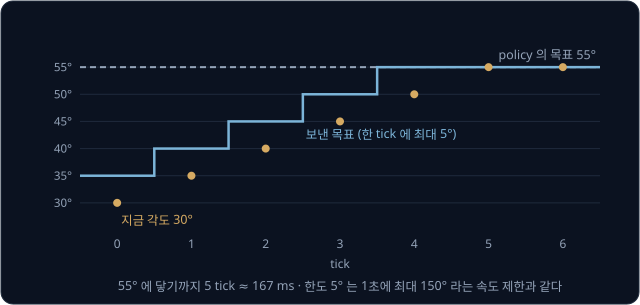

**확인 문제.** 한도가 10° 이고 지금 각도가 20°, policy 의 목표가 −5° 다. 보내는 목표는?

답 보기

차이가 $-5 - 20 = -25$° 로 한도 10° 보다 크므로 아래쪽으로 10° 만 간 $20 - 10 = 10$° 를 보낸다.

### 힘의 제한

집게가 큐브를 쥐면 큐브에 막혀 목표 각도까지 닫히지 못한다. 목표가 0°(완전히 닫힘)이고 큐브에 막혀 20° 에서 멈췄다면, 오차 20° 가
계속 남아 servo 는 그 오차를 줄이려고 힘을 계속 낸다. [PID Control](../pid-control/README.md) 의 P 항은 오차에 비례하는 힘이라서 오차가
남는 한 힘도 남고, 이 상태가 오래가면 모터에 전류가 계속 흘러 뜨거워진다.

그래서 LeRobot 은 SO-101 에 연결할 때 집게 servo 에 낼 수 있는 힘의 한도를 최대치의 50% 로, 보호 전류를 50% 로 써 넣고, 힘이 넘쳐
과부하가 되면 25% 의 힘만 내게 한다. 모든 관절의 P 계수는 16, D 계수는 32 로 써 넣는다. P 계수가 작으면 같은 오차에 내는 힘이 작아서
팔이 덜 떨고 부드럽지만 목표를 조금 더 늦게 따라간다.

| 설정 | 값 | 이유 |
| --- | --- | --- |
| 집게 힘의 한도 | 최대치의 50% | 큐브를 쥔 채 힘을 계속 낼 때 모터가 타지 않게 |
| 집게 보호 전류 | 최대치의 50% | 같은 이유 |
| 집게 과부하 때의 힘 | 25% | 과부하가 되면 힘을 더 줄인다 |
| P, D 계수 (모든 관절) | 16, 32 | 떨림을 줄인다 |

오차가 20° 일 때 P 항의 크기는 $K_p \times 20$ 이다. P 계수를 32 에서 16 으로 절반 줄이면 같은 20° 오차에서 P 항도 절반이 된다.

**확인 문제.** P 항만 생각할 때, P 계수 16 에서 오차 10° 와 P 계수 8 에서 오차 20° 의 힘은 어느 쪽이 클까?

답 보기

$16 \times 10 = 160$ 과 $8 \times 20 = 160$ 으로 같다.

### sim fallback

실물 팔이 없거나, 새 policy 를 실물에 올리기 전에 먼저 시험하고 싶을 때는 같은 절차를 simulation 에서 한다. 실물 대신 쓰는 이 예비
경로를 sim fallback 이라고 부른다. fallback 은 "주된 방법이 안 될 때 기대는 다음 방법" 이라는 뜻이다. Google DeepMind 의
mujoco_menagerie 에는 SO-101 의 MuJoCo 모델이 있어서, [Teleop Dataset](../teleop-dataset/README.md) 의 simulation teleoperation 으로
시연 50 개를 모으고 같은 25 번 시도 절차로 평가할 수 있다.

simulation 은 실물보다 깨끗하므로, 실물에서 생길 문제를 일부러 넣어 흉내 낸다. 아래 표의 noise 는 측정마다 무작위로 끼어드는 작은
차이다.

| 실물의 문제 | simulation 에서 흉내 내는 방법 |
| --- | --- |
| 카메라 사진의 noise·조명 변화 | 사진의 밝기를 무작위로 바꾸고 작은 무작위 값을 더한다 |
| 카메라 위치 오차 | 카메라를 시도마다 1 cm 안쪽으로 무작위로 옮긴다 |
| 추론·통신 지연 | 목표를 tick 한두 개 늦게 반영한다 |
| servo 가 늦게 따라감 | servo 의 P 계수를 낮춘다 |

이렇게 흉내를 내도 simulation 은 backlash, 접촉의 미세한 마찰, 실제 조명의 그림자를 다 재현하지
못하므로, simulation 성공률은 실물 성공률의 위쪽 끝으로 본다. 안전 설정(한도, 비상 정지 절차)은 simulation 에서 먼저 시험해 보고 실물에
옮긴다.

**확인 문제.** simulation 에서 25 번 중 24 번 성공한 policy 를 실물에 올리면 성공률도 96% 쯤일 것이라고 기대해도 될까?

답 보기

기대하기 어렵다. simulation 은 backlash·마찰·실제 조명을 다 재현하지 못해서 실물 성공률은 보통 이보다 낮고, simulation 결과는 위쪽
끝으로 본다. 실물에서 따로 시도해 재야 한다.

**요약**

- 실행 중에는 servo 전원 스위치를 손 닿는 곳에 두고, 전원이 끊기면 팔이 중력에 처지므로 팔 아래를 비워 둔다
- tick 마다 보내는 목표를 지금 각도에서 한도 안으로 자르면(5° → 1초에 150°) 엉뚱한 목표에도 팔이 천천히 움직인다
- 집게처럼 막힌 채 힘을 내는 servo 는 힘·전류 한도로 보호하고, 실물이 없거나 실물 전에는 같은 절차를 simulation 에서 문제를 흉내 내며
  해 본다

## 정리

- 실물 배포는 시연 수집(30 fps, 8 초짜리 50 개, frame 12,000 개) → 학습 → 추론 loop → 평가로 이어진다. 실물에서는 관절 값·사진이
  흔들리고 모터가 늦게 따라가며, 성공 판정과 재배치를 사람이 한다
- 추론 loop 는 tick 33.3 ms 마다 읽기 → 목표 보내기를 되풀이한다. ACT 는 추론 한 번(약 20 ms)으로 목표 100 개(3.3 초 분량)를 queue 에
  넣고, servo 안의 PID 가 목표를 tick 두 개쯤 늦게 따라간다. 추론이 300 ms 인 모델은 비동기로 queue 에 9 개 이상 남았을 때 다음 추론을
  시작해야 멈추지 않는다
- 메모리는 parameter 수 × byte 수(ACT 0.32 GB, SmolVLA 0.9 GB, π0 6.6 GB, OpenVLA 14 GB)이고, 메모리 ÷ memory bandwidth 가 추론 한 번의
  아래 한계다. 36GB 노트북에서는 작은 모델이 실시간으로 돌고, 수십억 parameter 모델은 느리거나 NVIDIA GPU 를 요구하는 경우가 많다
- 성공률은 여러 trial 로 재고 구간을 함께 적는다. 20 / 25 는 어림 64% ~ 96%, Wilson 61% ~ 91% 이고, 폭을 절반으로 줄이려면 시도가 4 배
  필요하다. 두 policy 는 같은 배치에서 번갈아 시도하고 구간이 겹치면 차이를 단정하지 않는다
- 실패는 모습으로 나눠 세고 고정 목표·고정 입력으로 원인을 가린다. 시연 영역 밖 자리, 카메라 1 cm 이동(10 pixel, 관절 2°), 조명 변화는
  모두 시연 범위 밖이라 실패한다
- 대상을 말로 고르려면 (a) 글을 받는 end-to-end policy 에 대상마다의 시연을 주거나, (b) 인식기가 이름으로 찾은 위치를 작은 policy 에
  넘긴다. MOO 가 (b) 의 예이고, (b) 에서 글은 인식기에서 멈춰 policy 에 닿지 않으므로 보통 VLA 라고 부르지 않는다
- 비상 정지(전원 스위치), 한 tick 의 이동량 제한, 집게의 힘 제한을 두고, 실물 전에 같은 절차를 simulation 에서 문제를 흉내 내며
  시험한다

이 강의의 policy 는 한 과제의 시연 수십 개로 배우므로 시연 범위 밖에서 약하고, 실패한 시도에서 스스로 나아지지도 않는다. policy 가
실제로 간 상태에서 사람에게 정답을 다시 물어 시연 범위를 넓히는 방법은 [DAgger](../dagger/README.md), 사진과 글을 함께 읽는 VLM 위에
행동을 내는 부분을 붙인 VLA 는 [RT-2 → OpenVLA](../vla-tokens/README.md) 와 [π0](../pi0/README.md), 실제 시도에서 얻은 성공·실패로
VLA 를 더 다듬는 방법은 [VLA + RL](../vla-rl/README.md) 에서 다룬다.

## 참고 자료

- LeRobot [SO-101 문서](https://huggingface.co/docs/lerobot/so101) — 팔의 조립, servo 번호 설정, calibration(관절의 0° 와 움직이는 범위를 맞추는 과정) 순서
- LeRobot [Imitation Learning on Real-World Robots](https://huggingface.co/docs/lerobot/il_robots) — 시연 기록, 학습, 실물 실행 명령과
  시연 수집 요령. Apple 칩에서 학습하는 설정(mps)도 여기에 있다
- LeRobot [Compute HW Guide](https://huggingface.co/docs/lerobot/hardware_guide) — policy 종류별 학습 메모리와, GPU·Apple 칩에서의
  학습 시간 어림값
- LeRobot [ACT](https://huggingface.co/docs/lerobot/act) — LeRobot ACT 의 학습·평가 방법과 주요 설정값
- LeRobot [LeRobotDataset v3.0](https://huggingface.co/docs/lerobot/lerobot-dataset-v3) — dataset 의 파일 구조와 정규화 통계의 위치
- T. Zhao 외, [Learning Fine-Grained Bimanual Manipulation with Low-Cost Hardware](https://arxiv.org/abs/2304.13705) (2023) — ACT 논문.
  저가 하드웨어로 과제당 10 분 분량의 시연을 배운 실물 실험과 추론 시간. [프로젝트 페이지](https://tonyzhaozh.github.io/aloha/) 에
  실물 영상이 있다
- M. Shukor 외, [SmolVLA](https://arxiv.org/abs/2506.01844) (2025) — 4 억 5 천만 parameter VLA. Section 3.3 의 비동기 추론, 실험 절의
  ACT·π0 와의 parameter 수·실물 성공률 비교를 읽는다
- M. J. Kim 외, [OpenVLA](https://arxiv.org/abs/2406.09246) (2024) — 70 억 parameter VLA. 추론 메모리 15 GB 와 RTX 4090 에서의 추론
  빠르기를 적은 절이 있다
- Physical Intelligence, [openpi](https://github.com/Physical-Intelligence/openpi) — π0 의 공개 저장소. README 첫머리에 필요한 NVIDIA
  GPU 메모리와 시험한 운영체제가 있다
- A. Stone 외, [Open-World Object Manipulation using Pre-trained Vision-Language Models](https://arxiv.org/abs/2303.00905) (2023) — MOO.
  Section 3 에 인식기 출력을 한 pixel mask 로 바꿔 policy 에 넣는 방법이 있다. [프로젝트 페이지](https://robot-moo.github.io/)
- T. Cheng 외, [YOLO-World](https://arxiv.org/abs/2401.17270) (2024) — 이름을 주면 bounding box 를 찾아 주는 open-vocabulary 인식기
- N. Carion 외, [SAM 3: Segment Anything with Concepts](https://arxiv.org/abs/2511.16719) (2025) — 짧은 명사구로 그 이름에 맞는 모든
  물체의 mask 를 내는 모델. 초록만 읽어도 입력과 출력을 알 수 있다
- F. Capuano 외, [Robot Learning: A Tutorial](https://arxiv.org/abs/2510.12403) (2025) — LeRobot 으로 데이터 수집부터 실물 배포까지를
  이어서 설명하는 튜토리얼
- [mujoco_menagerie 의 SO-101 모델](https://github.com/google-deepmind/mujoco_menagerie/tree/main/robotstudio_so101) — sim fallback 에
  쓰는 SO-101 의 MuJoCo 모델
- [Binomial proportion confidence interval](https://en.wikipedia.org/wiki/Binomial_proportion_confidence_interval) — 어림 구간과 Wilson
  score interval 의 식, Wilson 구간이 시도가 적을 때 나은 이유
