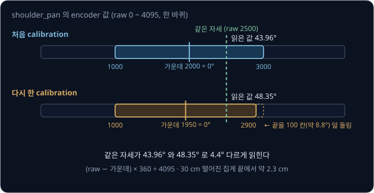

# Real Robot

simulation 에서 25 번 중 24 번 성공한 policy 라도 실물 SO-101 팔에 올리면 팔이 몇 초마다 잠깐씩 멈추거나, chunk 가 바뀌는 순간 갑자기
크게 움직이거나, 누가 카메라를 살짝 건드린 뒤로 큐브 옆을 집곤 한다. weight 는 숫자 하나 바뀌지 않았는데, 실물 팔에서는 무엇이 달라서
이렇게 실패할까?

policy 는 학습 때와 같은 시간 간격, 같은 기준으로 읽은 관절 각도, 같은 카메라 시점에서만 시연처럼 움직이는데, 실물에서는 추론 시간과
calibration, 카메라 위치, servo 의 반응이 그 조건과 조금씩 달라진다. 이 강의는 그 차이를 ms·도·pixel 단위로 재고, 여러 번의 trial 로
성공률을 믿을 만한 범위와 함께 적는 방법을 다룬다. SmolVLA 의 저자들은 실물 SO-100 팔에서 추론 방식만 비동기로 바꿔, 과제 하나를 끝내는 평균 시간을 13.75 초에서
9.70 초로 줄였다.

## 학습 목표

- 제어 주기와 추론 시간의 관계를 tick 시간표로 적고, action chunk queue 와 비동기 추론이 팔의 멈춤을 없애는 조건을 계산할 수 있다
- parameter 수와 memory bandwidth 로 어떤 policy 를 노트북에서 실시간으로 추론할 수 있는지 어림할 수 있다
- calibration·카메라 위치·조명이 시연 때와 달라지면 집게 끝이 몇 cm 빗나가는지 계산하고, 속도·힘 제한과 비상 정지가 하는 일을 설명할 수 있다
- 성공 기준과 시도 배치를 미리 정해 성공률을 신뢰 구간과 함께 재고, 실패를 원인별로 나눠 다음에 모을 시연을 정할 수 있다

## 수집에서 평가까지의 과정

이 강의의 예시 로봇인 SO-101 은 관절 5 개와 집게 1 개를 Feetech STS3215 servo 6 개로 움직이는 저가 팔이다. servo 는 목표 각도를 받으면
안에 든 작은 컴퓨터가 motor 를 그 각도까지 돌리므로, policy 가 팔에 보내는 action 은 servo 마다 하나씩, 목표 각도 6 개다.

예시 과제는 책상 위의 큐브를 집어 상자에 넣는 일이다. [Teleop Dataset](../teleop-dataset/README.md) 에서 본 leader-follower 조종으로 큐브를
다섯 자리에 10 번씩 놓아 시연 50 개를 모으는데, 시연 하나는 8 초 길이이고 1초에 30 frame(30 fps)씩 기록한다. 시연 하나가
$8 \times 30 = 240$ frame 이라 50 개를 모으면 12,000 frame 이 되고, frame 사이의 간격은 $1000 \div 30 \approx 33.3$ ms 다. LeRobot 의
안내서도 시연을 50 개 이상, 자리마다 10 개씩 모으고 카메라는 고정하라고 권한다.

학습 단계는 [Behavior Cloning](../behavior-cloning/README.md) 과 [ACT](../act/README.md) 에서 다뤘으므로, 이 강의는 위 그림의 셋째 단계인
추론과 넷째 단계인 평가를 다룬다. 추론(inference)은 학습이 끝난 모델에 입력을 넣어 출력을 계산하는 일이고, LeRobot 에서
학습한 policy 를 실행하는 명령은 `lerobot-rollout` 이다.

## 제어 주기와 추론 loop

시연을 30 fps 로 기록했다면 policy 도 33.3 ms 마다 목표 각도를 하나씩 보내야 시연과 같은 빠르기로 움직인다. policy 는 한 frame(33.3 ms)
뒤에 갈 각도를 배웠으므로, 목표를 50 ms 마다 보내면 같은 동작이 $50 \div 33.3 = 1.5$ 배 느리게 재생된다. 그래서 추론 loop 는 정해진 간격마다 같은
일을 되풀이하는데, 이 간격 하나를 **tick** 이라고 한다. `lerobot-rollout` 은 tick 마다 사진과 관절 각도를 읽고, policy 에서 목표 각도를 받아
servo 에 보내고, 33.3 ms 가 찰 때까지 기다린다.

[ACT](../act/README.md) 는 추론 한 번에 앞으로 $k$ tick 동안의 목표 $k$ 개를 묶은 action chunk 를 낸다. LeRobot ACT 의 기본값 $k = 100$ 이면
30 fps 에서 chunk 하나가 $100 \times 33.3 \approx 3333$ ms 분량이다. 먼저 넣은 것을 먼저 꺼내는 대기 줄을 **queue** 라고 하는데, 받은 100 개를
queue 에 넣어 두고 tick 마다 맨 앞의 것을 하나씩 꺼내 보낸다. 모델은 queue 가 다 비었을 때만 다시 계산한다.

| tick | 시각 | 보내기 전 queue 에 남은 수 | 추론 | 보내는 목표 |
| --- | --- | --- | --- | --- |
| 0 | 0 ms | 0 | 한다 (100 개를 받는다) | 1 번째 |
| 1 | 33.3 ms | 99 | 안 한다 | 2 번째 |
| 99 | 3300 ms | 1 | 안 한다 | 100 번째 |
| 100 | 3333 ms | 0 | 한다 (새 100 개) | 새 chunk 의 1 번째 |

ACT 논문에 따르면 추론 한 번은 RTX 2080 Ti 에서 약 0.01 초가 걸렸는데, 노트북에서 그 두 배인 20 ms 가 걸린다고 해도 tick 하나 안에 끝나므로
팔은 기다리지 않는다. 실제 시간은 `lerobot-rollout` 이 끝날 때 보여 주는 cadence 보고로 확인한다. LeRobot 문서의 보고 예시에서는 추론이 평균
5.18 ms 였지만 가장 오래 걸린 한 번은 40 ms 였고, tick 하나의 작업 전체가 33.3 ms 를 넘긴 것은 action 1197 개 가운데 12 번이었다. 주기 문제는
시연을 기록할 때도 생긴다. LeRobot dataset 은 frame 의 시각을 frame 번호로 계산하므로, 카메라가 느려 실제로는 1초에 25 frame 만 모여도 30 fps
로 적히고 policy 는 실제보다 빠른 움직임을 배운다.

> **오해** chunk 를 쓰면 로봇이 3.3 초 동안 한 번만 움직인다.
>
> **사실** 로봇은 33.3 ms 마다 새 목표를 받아 움직이고, 3.3 초에 한 번으로 줄어드는 것은 사진을 보고 결정하는 횟수다. 대신 그동안은 새 사진을 보지 않아서 큐브가 밀려도 바로 반응하지 못한다.

tick 보다 훨씬 짧은 주기로 목표를 따라가는 servo 안의 position PID 는 [PID Control](../pid-control/README.md) 에서
다루고, 저수준 loop 의 주기를 일정하게 지키는 real-time 설정은 [ros2_control](../ros2-control/README.md) 에서 다룬다.

**확인 문제.** 30 fps 로봇에서 LeRobot SmolVLA 의 기본값처럼 chunk 가 50 개이고 queue 가 빌 때만 추론한다. chunk 하나는 몇 초 분량이고,
10 초짜리 시도에서 추론은 몇 번 할까?

답 보기

1. chunk 하나의 길이: $50 \times 33.3 \approx 1667$ ms, 약 1.67 초
2. 10 초 동안의 추론 횟수: $10 \div 1.667 = 6$

답: 약 1.67 초 분량이고, 추론은 6 번이다.

## servo 의 추종 지연과 chunk 경계

servo 는 목표와 지금 각도의 차이를 보고 motor 에 힘을 주지만, 무게가 있는 팔을 움직여야 해서 목표보다 조금 늦게 따라간다. 예를 들어
30° 에 멈춰 있던 어깨 관절에 tick 마다 1° 씩 올라 35° 에서 멈추는 목표를 보내고, 관절이 목표에 닿기까지 tick 두 개가 걸린다고 하자.

| tick | 0 | 1 | 2 | 3 | 4 | 5 | 6 |
| --- | --- | --- | --- | --- | --- | --- | --- |
| 목표 각도 (°) | 31 | 32 | 33 | 34 | 35 | 35 | 35 |
| 실제 각도 (°) | 30 | 30 | 31 | 32 | 33 | 34 | 35 |

시연을 기록할 때도 follower 팔은 표처럼 늦게 따라갔으므로 policy 는 이 지연까지 담긴 기록으로 배웠다. LeRobot 은 SO-101 에 연결할 때마다 모든 servo 에 P 계수 16, I 계수 0, D 계수 32 를 써 넣는데,
기록 때와 실행 때 이 값이 다르면 같은 목표에 팔이 다르게 반응한다.

위 그림의 아래쪽은 이전 chunk 의 마지막 목표가 40° 이고 새 chunk 의 첫 목표가 46° 인 경우다. 목표가 한 번에 6° 바뀌어 오차에 비례하는
P 항의 힘도 목표가 1° 씩 오를 때보다 6 배 크게 늘어나므로, 팔이 갑자기 크게 움직인다. [ACT](../act/README.md) 에서 본 temporal ensembling 은
겹치는 chunk 의 예측을 가중 평균해 이 튐을 없애지만, tick 마다 추론해야 해서 LeRobot 은 기본값에서 끈다.

**확인 문제.** 위 표에서 목표가 tick 4 이후에도 1° 씩 계속 올라 tick 6 에 37° 가 되면, tick 6 의 실제 각도와 목표와의 차이는?

답 보기

1. 실제 각도는 tick 두 개 전의 목표이므로 tick 4 의 목표 35° 다
2. 목표와의 차이: $37 - 35 = 2$°

답: 35° 이고 2° 뒤처진다.

## 비동기 추론

모델이 크면 추론이 tick 하나보다 오래 걸린다. LeRobot SmolVLA 의 기본 chunk 50 개는 30 fps 에서 1667 ms 분량인데, 예를 들어 노트북에서
추론이 300 ms 걸린다고 하자. queue 가 빈 뒤에야 추론을 시작하면 그 300 ms 동안 servo 가 새 목표를 받지 못해서, 팔은 chunk 하나를 실행할 때마다
$300 \div 33.3 = 9$ tick 씩 멈춘다. 이렇게 추론이 끝날 때까지 실행을 멈추는 방식을 **동기**(synchronous) 추론이라고 한다.

**비동기**(asynchronous) 추론은 queue 가 다 비기 전에 다음 추론을 시작한다. 남은 목표를 실행하는 시간이 추론 시간 이상이면 queue 가 비기 전에
새 chunk 가 도착한다. 300 ms 예에서는 남은 개수 × 33.3 ms 가 300 ms 이상이 되는 9 개 이상이 남았을 때 시작하면 된다.

| 방식 | 추론 시작 | chunk 하나에 걸리는 시간 | 멈추는 시간 |
| --- | --- | --- | --- |
| 동기 | queue 가 빈 뒤 | $1667 + 300 = 1967$ ms | 300 ms (9 tick) |
| 비동기 | queue 에 10 개 남았을 때 | 1667 ms | 0 ms |

SmolVLA 저자들은 queue 에 남은 비율이 정해 둔 값 $g$ 아래로 내려가면 새 사진을 policy server 로 보내게 했고, 실험에서는 $g = 0.7$ 로
두었다. chunk 50 개라면 35 개 아래로 남았을 때 추론을 시작한다는 뜻이다. 실물 SO-100 팔에서 두 방식을 비교한 결과는 아래와 같다.

| 측정 | 동기 | 비동기 |
| --- | --- | --- |
| 세 과제의 평균 성공률 | 78.3% | 73.3% |
| Pick-Place 한 번을 끝내는 평균 시간 | 13.75 초 | 9.70 초 |
| 정해 둔 시간 안에 상자에 넣은 큐브 수의 평균 | 1.8 개 | 3.8 개 |

평균 성공률은 비슷했지만, 색깔별로 큐브를 나누는 분류(Sorting) 과제만 보면 성공률이 70% 에서 50% 로 내려갔다.

<b>심화: LeRobot 의 세 추론 방식</b>

`lerobot-rollout` 은 `--inference.type` 으로 추론 방식을 고른다.

| 방식 | 하는 일 |
| --- | --- |
| `sync` (기본값) | tick 마다 같은 loop 안에서 policy 를 부르고, 계산이 끝날 때까지 loop 가 기다린다 |
| `rtc` | 같은 컴퓨터의 다른 thread 에서 다음 chunk 를 계산하고, loop 는 준비된 action 을 꺼내 쓴다 |
| `remote` | GPU 가 있는 다른 컴퓨터의 policy server 에 사진을 보내고 chunk 를 받는다. 로봇 쪽 컴퓨터는 weight 를 올리지 않는다 |

`remote` 는 남은 queue 가 `refill_seconds`(기본 0.5 초, 30 fps 에서 15 개) 아래로 내려가면 새 chunk 를 요청한다. 다만 최근 가장 긴 왕복
시간에 action 하나의 간격을 더한 값이 더 길면 그 값을 기준으로 쓴다. 왕복이 300 ms 면 $300 + 33.3 \approx 333$ ms 가 0.5 초보다 짧아 기본값
15 개가 그대로 쓰이고, 왕복이 600 ms 로 늘면 $600 + 33.3 \approx 633$ ms 분량인 약 19 개가 남았을 때 요청한다. LeRobot 문서에 따르면 ACT·SmolVLA
등이 이 방식으로 실물 로봇에서 실행된 적이 있고, ACT 는 temporal ensembling 을 끄고 써야 한다.

**확인 문제.** 추론에 500 ms 가 걸리는 모델을 30 fps 로봇에서 비동기로 쓴다. queue 에 몇 개 이상 남았을 때 다음 추론을 시작해야 할까?

답 보기

1. 조건: 남은 개수 × 33.3 ms ≥ 500 ms
2. 계산: $500 \div 33.3 \approx 15$, 확인하면 $15 \times 33.3 \approx 500$ ms

답: 15 개 이상 남았을 때 시작한다.

## 늦게 도착한 chunk 의 이어 붙이기

비동기 추론에서 새 chunk 는 300 ms 전의 사진으로 계산한 것이라, 도착했을 때 앞쪽 몇 개는 이미 지나간 tick 의 몫이다. tick 20 의 사진으로
시작한 추론이 9 tick 뒤인 tick 29 에 끝나면 새 chunk 의 첫 9 개는 tick 20 ~ 28 에 보냈어야 할 목표다. LeRobot `remote` 의 기본값(`chunk_merge = auto`)이
고르는 aligned 합치기는 이 9 개를 버리고 tick 29 의 몫부터 남은 queue 를 새 값으로 바꾼다.

두 chunk 의 같은 tick 몫을 섞어 경계를 부드럽게 하는 blending 도 있다. 같은 tick 에 해당하는 남은 queue 의 목표를 $q$ 라 하고 새 chunk 의
목표를 $i$ 라 할 때, 새 값을 반영하는 비율을 `blend_weight` $b$ 로 정하면 섞은 목표는 $q + b\,(i - q)$ 다. LeRobot 은 기본값에서 blending 을 끄고(`blend_steps` = 0), 켤 때의 기본 $b$ 는
0.5 다. $q = 40$°, $i = 44$° 면 섞은 목표가 $40 + 0.5 \times 4 = 42$° 라서 한 번에 바뀌는 양이 4° 에서 2° 로 준다.

> **오해** blending 은 늘 움직임을 부드럽고 안전하게 만든다.
>
> **사실** 두 chunk 가 같은 방식의 조금 다른 값이면 계단을 줄여 주지만, 서로 다른 방식을 골랐다면 섞은 값은 어느 쪽도 아닌 목표가 된다. 팔과 큐브 사이에 상자가 있어서 시연의 절반은 왼쪽(어깨 관절 −20°)으로, 나머지 절반은
> 오른쪽(+20°)으로 돌아갔고 −10° ~ +10° 사이로 가면 상자에 부딪힌다고 하자. 남은 queue 는 왼쪽 길을 따라가는데 새 사진으로 계산한 chunk 가 오른쪽 길을 고르면, $b = 0.5$ 로 섞은 목표는 $-20 + 0.5 \times (20 - (-20)) = 0$°
> 가 되어 상자로 곧장 간다. [Behavior Cloning](../behavior-cloning/README.md) 에서 MSE 로 학습한 policy 가 두 정답의 평균을 내던 문제가 chunk 를 섞는 단계에서 다시 생긴다.

LeRobot 문서에 따르면 합치기와 blending 은 부드러운 움직임이나 성공한 grasp 를 보장하지 않으므로, 집게처럼 값이 갑자기 바뀌는 성분은
blending 에서 뺀다. `rtc`(Real-Time Chunking)는 앞 chunk 의 남은 부분을 조건으로 넣어 처음부터 그 뒤에 이어지는 chunk 를 계산하는데,
π0·π0.5·SmolVLA 처럼 이를 지원하는 모델에서만 쓸 수 있다.

**확인 문제.** 30 fps 로봇에서 추론이 200 ms 걸린다. tick 40 의 사진으로 시작한 추론의 chunk 가 도착하면 aligned 합치기는 앞에서 몇 개를
버리고, 어느 tick 의 몫부터 쓸까?

답 보기

1. 추론에 걸린 tick 수: $200 \div 33.3 = 6$
2. 도착한 tick: $40 + 6 = 46$
3. 버리는 수: tick 40 ~ 45 의 몫 6 개

답: 앞 6 개를 버리고 tick 46 의 몫부터 쓴다.

## 노트북에서의 모델 크기

모델 안에서 학습으로 정해지는 숫자인 parameter 는 추론할 때 모두 메모리에 올라가 있어야 한다. 숫자 하나를 4 byte 로 저장하는 float32 로
올리면 parameter 수 × 4 byte 가 필요하고, 2 byte 로 저장하는 bfloat16(bf16)으로 올리면 parameter 수 × 2 byte 가 필요하다. 1 GB 는 10 억
byte 다.

| 모델 | parameter 수 | 숫자 하나 | 메모리 |
| --- | --- | --- | --- |
| ACT | 약 8 천만 | 4 byte (float32) | $0.08 \times 4 = 0.32$ GB |
| SmolVLA | 약 4 억 5 천만 | 2 byte (bf16) | $0.45 \times 2 = 0.9$ GB |
| π0 | 약 33 억 | 2 byte (bf16) | $3.3 \times 2 = 6.6$ GB |
| OpenVLA | 약 70 억 | 2 byte (bf16) | $7 \times 2 = 14$ GB |

OpenVLA 저자들에 따르면 bf16 으로 올렸을 때 계산 중간값까지 합쳐 실제로 15 GB 를 썼다. 추론 한 번에 parameter 를 적어도 한 번씩 메모리에서
읽어야 하므로, 1초에 몇 GB 를 읽을 수 있는지를 나타내는 **memory bandwidth** 가 추론 시간의 아래 한계를 정한다. Apple 의 사양표에 따르면 메모리 36 GB 인 M5 Max(GPU 32 core) 노트북의 memory bandwidth 는 460 GB/s 인데, 계산하기 쉽게 400 GB/s 로 두면
π0 를 한 번 읽는 데 $6.6 \div 400 = 0.0165$ 초, 16.5 ms 가 걸린다.

OpenVLA 는 한 번 읽는 데만 $14 \div 400 = 0.035$ 초, 35 ms 가 걸려 tick 보다 길다. 게다가 action 의 숫자 7 개를 token 으로 하나씩 차례로
만들기 때문에 action 하나를 내려면 모델을 7 번 읽어야 해서, 아래 한계가 $35 \times 7 = 245$ ms 이고 1초에 4 번 남짓만 action 을 낼 수 있다.
OpenVLA 저자들도 RTX 4090 한 장에서 1초에 약 6 번 추론했다고 밝혔다. 실제 추론은 곱셈·덧셈과 준비 과정이 더해져 이 아래 한계보다 오래 걸린다.

<b>심화: 네 모델의 읽기 시간과 계산 장치</b>

메모리 표는 parameter 수를 10 억 단위로 적은 뒤 byte 수를 곱해 계산했다. 8 천만은 $0.08 \times 10$ 억이라 $0.08 \times 4 = 0.32$ GB 다.
1초에 400 GB 를 읽는다고 두면 한 번 읽는 시간은 아래와 같다.

| 모델 | 메모리 | 한 번 읽는 시간 | tick 33.3 ms 와 비교 |
| --- | --- | --- | --- |
| ACT | 0.32 GB | $0.32 \div 400 = 0.0008$ 초 = 0.8 ms | 크게 남는다 |
| SmolVLA | 0.9 GB | $0.9 \div 400 = 0.00225$ 초 ≈ 2.3 ms | 남는다 |
| π0 | 6.6 GB | $6.6 \div 400 = 0.0165$ 초 = 16.5 ms | chunk 가 있어야 맞춘다 |
| OpenVLA | 14 GB | $14 \div 400 = 0.035$ 초 = 35 ms | 한 번 읽기도 tick 보다 길다 |

parameter 수는 SmolVLA 논문에 적힌 값으로, ACT 가 약 8 천만 개이고 SmolVLA 는 4 억 5 천만 개, π0 는 33 억 개다. π0 는 chunk 를 만드는 동안 사진·글을
읽는 큰 부분은 한 번만 계산하고 작은 action 부분을 여러 번 계산하는데, 그 구조는 [π0](../pi0/README.md) 에서 다룬다.

코드가 그 계산 장치를 지원하는지도 따져야 한다. π0 의 공개 저장소 openpi 의 README 에 따르면 추론에는 메모리가 8 GB 를 넘는 NVIDIA GPU 가
필요하고, 시험한 운영체제는 Ubuntu 22.04 뿐이다. LeRobot 의 하드웨어 안내서에 따르면 시연 약 50 개로 ACT 를 5 epoch 학습하는 데 RTX 4090
에서는 30 ~ 60 분이 걸리고, Apple M1 ~ M3 Max 에서는 6 ~ 14 시간쯤 걸린다. 그래서 학습은 GPU 서버에서 하고, 노트북은 작은 모델을 직접 추론하거나 큰 모델을 `remote` 로 GPU 서버에 맡긴다.

> **오해** 메모리에 들어가면 노트북에서 실행할 수 있다.
>
> **사실** OpenVLA 같은 70 억 parameter 모델은 36 GB 노트북 메모리에 들어가지만 action 하나를 내는 시간의 아래 한계만 245 ms 이고, π0 의 openpi 처럼 NVIDIA GPU 와 Ubuntu 22.04 에서만
> 시험한 코드도 있다.

**확인 문제.** parameter 20 억 개짜리 모델을 bf16 으로 올려 1초에 200 GB 를 읽는 컴퓨터에서 돌린다. 메모리는 몇 GB 이고, 모델 전체를 한 번
읽는 최소 시간은?

답 보기

1. 메모리: 20 억은 $2 \times 10$ 억이므로 $2 \times 2 = 4$ GB
2. 한 번 읽는 시간: $4 \div 200 = 0.02$ 초 = 20 ms

답: 4 GB 이고 최소 20 ms 다. 30 fps 의 tick 33.3 ms 보다 짧지만 실제 추론은 이보다 오래 걸린다.

## calibration

servo 의 각도 센서는 한 바퀴를 0 ~ 4095 의 정수(raw 값)로 재는데, 이 raw 값을 policy 가 배우고 내는 각도로 바꾸는 기준을 정하는 일을
**calibration** 이라고 한다. LeRobot 의 SO-101 calibration 은 두 단계다.

1. 관절을 움직일 수 있는 범위의 가운데쯤에 두고 Enter 를 누르면, 그 자세가 raw 2047(0 ~ 4095 의 가운데)이 되도록 servo 에 offset 을 써 넣는다
2. 관절을 하나씩 움직일 수 있는 끝에서 끝까지 돌리면, 그동안 나온 raw 값의 최솟값과 최댓값을 기록한다

LeRobot 의 기본 설정(`use_degrees = True`)에서 집게를 뺀 관절의 각도는 (raw − 기록한 범위의 가운데) × 360 ÷ 4095 이다. 그래서 0° 는 손으로
잡아 둔 가운데 자세가 아니라 기록한 범위의 가운데이고, 범위를 끝까지 돌리지 않으면 0° 가 옮겨 간다. 집게는 기록한 범위를 0 ~ 100 으로 환산한
값을 쓴다.

예를 들어 처음 calibration 에서 shoulder_pan 의 범위가 raw 1000 ~ 3000 으로 기록되면 가운데는 2000 이고, raw 2500 인 자세는
$(2500 - 2000) \times 360 \div 4095 \approx 43.96$° 다. 다시 calibration 하면서 한쪽 끝을 100 칸(약 8.8°) 덜 돌려 1000 ~ 2900 이 기록되면
가운데가 1950 으로 옮겨 가고, 같은 자세가 $(2500 - 1950) \times 360 \div 4095 \approx 48.35$° 로 읽힌다. 처음 calibration 으로
기록한 시연에서 배운 policy 가 "43.96°" 를 보내면 팔은 4.4° 옆으로 가고, 축에서 30 cm 떨어진 집게 끝은
$2 \times 3.14 \times 30 \times \frac{4.4}{360} \approx 2.3$ cm 빗나간다.

LeRobot 은 calibration 결과를 로봇의 `id` 이름으로 된 파일에 저장하고, 조종·기록·평가에서 같은 `id` 를 쓰라고 안내한다. 기록과 평가 사이에
calibration 을 다시 했다면, 시연 하나를 replay(기록된 목표를 그대로 다시 보내는 일)해서 팔이 시연 때의 자리로 가는지 먼저 확인한다.

**확인 문제.** 처음 범위가 raw 1000 ~ 3000 이었는데 다시 할 때 다른 쪽 끝을 100 칸 덜 돌려 1100 ~ 3000 이 기록됐다. raw 2500 인 자세는 몇 도로
읽히고, 처음과 몇 도 다를까?

답 보기

1. 새 가운데: $(1100 + 3000) \div 2 = 2050$
2. 새 각도: $(2500 - 2050) \times 360 \div 4095 \approx 39.56$°
3. 처음과의 차이: $39.56 - 43.96 = -4.4$°

답: 약 39.56° 로 읽혀 처음보다 4.4° 작다. 덜 돌린 쪽이 반대라서 차이의 부호도 반대다.

## 카메라 위치와 조명

카메라가 시연 때와 조금만 달라져도 사진 속 모든 물체의 위치가 바뀐다. focal length 는 카메라가 얼마나 확대해 찍는지를 pixel 로 적은 값인데,
예를 들어 focal length 가 500 pixel 인 카메라가 책상 0.5 m 위에서 아래를 보다가 옆으로 1 cm 밀렸다고 하자.
[Camera Geometry](../camera-geometry/README.md) 에서 본 pinhole 식으로 계산하면 책상 위의 점은 사진에서 $500 \times 0.01 \div 0.5 = 10$ pixel
옮겨 찍힌다.

policy 가 [Behavior Cloning](../behavior-cloning/README.md) 에서 본 end-to-end policy 처럼 사진 속 물체의 가로 위치 $u$ 가 100 pixel 늘 때마다
팔 전체를 좌우로 돌리는 관절을 20° 더 돌리도록 배웠다면, 큐브는 그대로인데 사진에서 10 pixel 옮겨 보이므로 관절을 2° 틀리게 돌린다.

| 카메라가 밀린 거리 | 옮겨 찍히는 pixel | 관절 오차 | 30 cm 떨어진 집게 끝의 오차 |
| --- | --- | --- | --- |
| 1 cm | $500 \times 0.01 \div 0.5 = 10$ | $10 \div 100 \times 20 = 2$° | 약 1.0 cm |
| 5 cm | $500 \times 0.05 \div 0.5 = 50$ | $50 \div 100 \times 20 = 10$° | 약 5.2 cm |

그래서 카메라는 단단한 받침대에 고정하고 시연 때의 위치를 표시해 둔다. 조명이 바뀌어도 policy 가 받는 숫자가 통째로 바뀌므로, 조명은
시연과 실행에서 같게 두거나, 시연을 모을 때 일부러 조명을 여러 가지로 바꿔 policy 가 본 조명의 범위를 넓힌다. 학습할 때 사진의 밝기를 무작위로 바꿔 넣는
augmentation 도 같은 효과를 노린다.

<b>심화: 조명과 normalization</b>

policy 는 사진의 숫자에서 학습 dataset 의 평균을 빼고 standard deviation(값이 평균에서 보통 떨어진 정도)으로 나눈
값을 받는데, 이 처리를 normalization 이라고 한다. 빨강의 평균이 120 이고 standard deviation 이 40 이면 빨강 200 인 큐브는
$(200 - 120) \div 40 = 2$ 로 들어가는데, 전등 하나를 꺼서 밝기가 절반인 100 이 되면 $(100 - 120) \div 40 = -0.5$ 로 들어간다. 사람 눈에는 같은
빨간 큐브지만, 시연이 늘 밝은 조명이었다면 policy 는 이런 입력을 한 번도 보지 못했다.

**확인 문제.** 같은 카메라(focal length 500 pixel, 물체까지 0.5 m)가 2 cm 밀렸다. 큐브는 몇 pixel 옮겨 찍히고, 위 policy 의 관절은 몇 도
틀릴까?

답 보기

1. 옮겨 찍히는 pixel: $500 \times 0.02 \div 0.5 = 20$
2. 관절 오차: $20 \div 100 \times 20 = 4$°

답: 20 pixel 옮겨 찍히고 관절이 4° 틀린다. 30 cm 떨어진 집게 끝에서는 $2 \times 3.14 \times 30 \times \frac{4}{360} \approx 2.1$ cm 다.

## 안전 장치

학습한 policy 는 시연 범위 밖에서 무엇을 낼지 알 수 없어서, 실행하는 동안 언제든 팔을 멈출 수단이 손 닿는 곳에 있어야 한다. 이런 수단을
**비상 정지**(emergency stop)라고 한다. LeRobot 의 SO-101 설정은 프로그램이 팔과의 연결을 끊을 때 servo 의 힘을 끄지만
(`disable_torque_on_disconnect = True`), 프로그램이 멈추면 이 동작도 실행되지 않으므로 servo 전원선에 단 스위치가 마지막 수단이다. 전원이
끊기면 servo 가 중력이 관절을 돌리는 힘인 gravity torque 를 더 버티지 못해 팔이 처지므로, 팔 아래를 비워 두고 처음 시험할 때는 낮은 자세에서
시작한다.

LeRobot SO-101 설정의 `max_relative_target` 은 policy 가 엉뚱한 목표를 내도 팔이 한 번에 크게 움직이지 않도록 tick 마다 보내는 목표를 지금
각도에서 정한 한도 안으로 자르는데, 기본값은 제한 없음(None)이다. 예를 들어 한도가 5° 일 때 지금 30° 인 어깨에 policy 가
55° 를 내면, 보내는 목표는 $30 + 5 = 35$° 로 잘린다.

| tick | 지금 각도 (°) | policy 의 목표 (°) | 차이 (°) | 보내는 목표 (°) |
| --- | --- | --- | --- | --- |
| 0 | 30 | 55 | 25 | 35 |
| 1 | 35 | 55 | 20 | 40 |
| 2 | 40 | 55 | 15 | 45 |
| 3 | 45 | 55 | 10 | 50 |
| 4 | 50 | 55 | 5 | 55 |

한도 5° 는 30 fps 에서 1초에 최대 $5 \times 30 = 150$° 를 움직인다는 속도
제한과 같다. 한도가 작을수록 안전하지만 팔이 시연보다 느리게 움직이면 policy 가 배운 움직임과 어긋나므로, 시연에서 한 tick 에 움직인 가장 큰
각도보다 조금 크게 잡는다.

<b>심화: LeRobot 이 SO-101 에 써 넣는 보호 설정</b>

집게가 큐브를 쥐면 큐브에 막혀 목표까지 닫히지 못하고, 오차가 남는 동안 servo 는 힘을 계속 내서 motor 가 뜨거워진다. 그래서 LeRobot 은
연결할 때 집게 servo 에 아래 값을 써 넣는다.

| 설정 | 값 | 이유 |
| --- | --- | --- |
| 집게 힘의 한도 | 최대치의 50% | 큐브를 쥔 채 힘을 계속 낼 때 motor 가 타지 않게 |
| 집게 보호 전류 | 최대치의 50% | 같은 이유 |
| 집게 과부하 때의 힘 | 25% | 과부하가 되면 힘을 더 줄인다 |

LeRobot 코드의 주석에 따르면 `max_relative_target` 을 쓸 때는 보내기 전에 지금 각도를 한 번 더 읽어야 해서 loop 가 조금 느려진다.
`lerobot-rollout` 은 끝날 때 팔을 시작 자세로 천천히 되돌린다(`return_to_initial_position` 기본 true). 비동기 추론에서 queue 가 비면 마지막
목표를 1 초(`action_starvation_grace_s`) 동안 유지하며 기다리고, 그 안에 새 목표가 오지 않으면 오류를 내고 멈춘다.

**확인 문제.** 한도가 10° 이고 지금 각도가 20°, policy 의 목표가 −5° 다. 보내는 목표는?

답 보기

1. 차이: $-5 - 20 = -25$°, 한도 10° 보다 크다
2. 아래쪽으로 10° 만 간다: $20 - 10 = 10$°

답: 10° 를 보낸다.

## 성공률과 신뢰 구간

물체를 처음 자리에 놓고 policy 를 끝까지 실행해 보는 한 번을 **trial** 이라고 하고, 성공한 trial 의 비율을 성공률이라고 한다. "큐브가 상자 바닥에 닿아 있고 팔이 처음 자세로 돌아왔다" 처럼 성공 기준을 시도 전에 문장으로 정해 두어야 애매한
결과를 그때그때 다르게 판정하지 않는다. ACT 저자들은 실물 과제마다 물체를 15 cm 기준선 위의 무작위 위치에 놓고 25 번 시도했고, SmolVLA
저자들은 실물 과제를 하위 단계로 나눠 큐브를 쥐면 0.25 처럼 단계마다 점수를 줬다.

25 번 시도해 20 번 성공했다면 어림한 성공률은 $\hat p = 20 \div 25 = 0.8$ 이다. $\hat p$ 는 "p 햇" 이라고 읽으며, 끝없이 시도했을 때의 참 성공률을
몇 번의 시도로 어림한 값이다. 같은 policy 라도 시도마다 큐브가 몇 mm 다르게 놓이고 사진 밝기도 조금씩 달라서 결과가 흔들린다. 예를 들어 참
성공률이 70% 인 policy 를 10 번씩 다섯 묶음 시도하면 아래처럼 나올 수 있다.

| 묶음 | 1 | 2 | 3 | 4 | 5 |
| --- | --- | --- | --- | --- | --- |
| 성공 / 10 번 | 7 | 9 | 6 | 8 | 5 |

그래서 어림한 성공률에는 참값이 대략 어디에서 어디 사이에 있는지를 함께 적는데, 이
범위를 **신뢰 구간**(confidence interval)이라고 한다. 이렇게 만든 범위가 참 성공률을 100 번 중 약 95 번 덮도록 정한 것이 95% 신뢰 구간이다.
시도가 적거나 성공률이 0% 나 100% 에 가까울 때도 0 과 1 사이에 머무는 Wilson score interval 로 계산하면 아래와 같다.

| 결과 | $\hat p$ | Wilson 95% 구간 |
| --- | --- | --- |
| 9 / 10 | 90% | 60% ~ 98% |
| 20 / 25 | 80% | 61% ~ 91% |
| 25 / 25 | 100% | 87% ~ 100% |
| 80 / 100 | 80% | 71% ~ 87% |

표의 25 / 25 처럼 25 번 모두 성공해도 참 성공률은 87% 까지 낮을 수 있다. 위 그림처럼 구간의 폭은 시도 횟수의 제곱근에 반비례해서, 폭을
절반으로 줄이려면 사람이 물체를 매번 다시 놓으며 시도를 4 배로 늘려야 한다.

<b>심화: 어림 구간의 손계산과 Wilson 구간</b>

간단한 어림 구간은 $\hat p \pm 2\sqrt{\hat p\,(1 - \hat p) / n}$ 이다. $n$ 은 시도 횟수이고, $\pm$ 는 앞의 값에서 뒤의 값을 뺀 곳부터 더한
곳까지라는 뜻이다. 20 / 25 를 한 줄에 한 단계씩 계산하면 아래와 같다.

| 단계 | 계산 | 값 |
| --- | --- | --- |
| ① 성공률 × 실패율 | $0.8 \times 0.2$ | 0.16 |
| ② 시도 횟수로 나누기 | $0.16 \div 25$ | 0.0064 |
| ③ 제곱근 | $\sqrt{0.0064}$ ($0.08 \times 0.08 = 0.0064$) | 0.08 |
| ④ 2 배 | $2 \times 0.08$ | 0.16 |
| ⑤ 범위 | $0.8 - 0.16$ 부터 $0.8 + 0.16$ 까지 | 0.64 ~ 0.96 |

같은 80% 를 100 번으로 얻으면 ② 가 0.0016, ③ 이 0.04, ④ 가 0.08 이라 72% ~ 88% 로 좁아진다. $n$ 이 제곱근 안의 분모에 있어서 시도를 4 배로
늘리면 폭이 $\sqrt 4 = 2$ 분의 1 이 된다. 2 를 곱하는 것은 정규분포에서 평균 ± 2 standard deviation 안에 약 95% 가 들어가기 때문이고, 정확한
값은 1.96 이다. $\hat p(1 - \hat p)$ 는 결과가 얼마나 들쭉날쭉한지를 나타내서, 성공률 0.5 에서 0.25 로 가장 크고 0.9 에서는 0.09 로 작다.

이 어림 구간은 두 경우에 이상한 답을 낸다. 25 / 25 는 $1 \times 0 = 0$ 이라 폭이 0 이 되어 "참 성공률이 정확히 100%" 라고 말하고, 9 / 10 은
위쪽 끝이 $0.9 + 2\sqrt{0.09 / 10} = 0.9 + 0.19 = 1.09$ 로 1 을 넘는다. Wilson 구간은 $z = 1.96$ 일 때

$$
\frac{\hat p + \frac{z^2}{2n}}{1 + \frac{z^2}{n}} \pm \frac{z}{1 + \frac{z^2}{n}}\sqrt{\frac{\hat p(1 - \hat p)}{n} + \frac{z^2}{4n^2}}
$$

이다. 이 식은 성공 약 2 번과 실패 약 2 번을 더한 것처럼 가운데를 0.5 쪽으로 조금 옮기고 폭이 0 이 되지 않게 해서, 시도가 적을 때도 0 과 1
사이에 머문다. 본문
표의 Wilson 구간은 이 식으로 계산했고, 시도가 100 번쯤 되면 어림 구간과 거의 같아진다.

**확인 문제.** 성공률 80% 를 25 번 시도로 얻어 Wilson 구간이 61% ~ 91% 였다. 구간의 폭을 대략 절반으로 줄이려면 몇 번 시도해야 할까?

답 보기

1. 폭은 시도 횟수의 제곱근에 반비례하므로, 폭을 절반으로 줄이려면 시도가 $2 \times 2 = 4$ 배 필요하다
2. 시도 횟수: $25 \times 4 = 100$

답: 100 번이다. 본문 표에서 80 / 100 의 구간은 71% ~ 87% 라서, 폭이 $91 - 61 = 30$ 에서 $87 - 71 = 16$ 으로 줄었다.

## 두 policy 의 비교

ACT 는 25 번 중 20 번(80%) 성공했고 다른 policy B 는 25 번 중 15 번(60%) 성공했다면 ACT 가 낫다고 할 수 있을까? ACT 의 Wilson 구간은
61% ~ 91% 이고 B 의 구간은 41% ~ 77% 라서 61% ~ 77% 가 겹친다. 두 policy 의 참 성공률이 모두 70% 일 가능성도 남아 있어서, 25 번씩으로는 ACT 가
낫다고 단정하기 어렵다. 같은 80% 와 60% 를 100 번씩으로 얻었다면 구간이 71% ~ 87% 와 50% ~ 69% 로 겹치지 않는다.

큐브를 놓는 자리마다 난이도가 달라서, 두 policy 를 서로 다른 자리에서 시도하면 자리 운이 결과에 섞인다. 그래서 처음 배치 25 개를 미리 정해
사진으로 남기고, 배치마다 두 policy 를 연달아 시도한다. 먼저 하는 쪽을 배치마다 번갈아 바꾸면 시간이 지나며 바뀌는 조명이나 servo 의 열 같은
영향도 두 policy 에 고르게 나뉜다. LeRobot 에서는 `lerobot-rollout` 의 `episodic` 방식이 episode 마다 정한 시간(`episode_time_s`) 동안 policy
를 실행하고, episode 사이에는 `reset_time_s` 동안 사람이 물체를 다시 놓을 수 있게 기다린다.

> **오해** 80% 와 60% 처럼 20%p 나 차이 나면 당연히 앞의 것이 낫다.
>
> **사실** %p(퍼센트포인트)는 두 백분율의 차이를 나타내는 단위다. 차이가 커 보여도 시도가 적으면 우연일 수 있어서, 비교 결과에는 성공률과 함께 구간과 시도 횟수를 적는다.

**확인 문제.** 두 policy 의 Wilson 구간이 50% ~ 70%, 72% ~ 90% 다. 차이가 있다고 말할 수 있을까?

답 보기

두 구간이 겹치지 않는다(70% 와 72% 사이에 틈이 있다). 답: 뒤의 policy 가 낫다고 말할 수 있다.

## 실패 분석

성공률만으로는 어디를 고칠지 알 수 없어서, 실패한 trial 마다 어느 단계에서 어떻게 실패했는지를 영상으로 다시 보고 종류별로 센다. 예를 들어 ACT 의
25 번 가운데 실패 5 번을 나누면 아래와 같았다고 하자.

| 실패 유형 | 보이는 모습 | 횟수 |
| --- | --- | --- |
| 접근 빗나감 | 집게가 큐브 옆 몇 cm 자리로 내려간다 | 2 |
| 쥐기 실패 | 큐브를 쥐었다가 들어 올리는 중에 미끄러진다 | 1 |
| 놓기 빗나감 | 큐브를 들고 갔지만 상자 가장자리에 걸친다 | 1 |
| 멈춤·떨림 | 팔이 중간에 멈추거나 같은 자리에서 떨기만 한다 | 1 |

접근 빗나감 2 번이 모두 큐브가 책상 오른쪽 끝에 놓인 배치였다면, 원인은 동작을 잘못 배운 것보다 그 자리의 시연이 모자란 데 있을 가능성이
크다. 단계별 성공률을 적으면 실패가 어느 단계에서 쌓이는지도 보인다. 케이블 타이 끝을 고리에 끼우는 ACT 논문의 Thread Velcro 과제는
첫 단계 성공률이 92% 였다가 단계마다 대략 절반씩 줄어 40% 를 거쳐 최종 20% 가 되었다. 저자들은 집게를 너무 일찍 닫아 케이블 타이 꼬리를 놓치는 실패와 끼우는
위치가 빗나가는 실패를 들고, 검은 케이블 타이가 배경과 대비가 낮고 사진에서 작아서 위치를 알기 어려웠다고 설명했다.

떨림 하나에도 원인이 여럿일 수 있어서, 모습으로 나눈 뒤에는 원인을 가려내는 확인을 한다.

| 떨림의 모습 | 의심할 원인 | 확인하는 방법 |
| --- | --- | --- |
| chunk 가 바뀌는 순간에만 갑자기 크게 움직인다 | chunk 경계의 목표 튐, 추론 지연 | 보낸 목표 각도를 tick 마다 기록해 경계에서 값이 튀는지 보고, cadence 보고의 추론 시간을 본다 |
| 일정한 주기로 계속 떤다 | servo 의 PID 설정, 기계 문제 | policy 없이 고정 목표 하나를 보내도 떠는지 본다 |

**확인 문제.** policy 를 끄고 고정 목표 하나만 보냈는데도 팔이 일정하게 떤다. 원인은 policy 쪽일까 팔 쪽일까?

답 보기

policy 가 관여하지 않는데도 떨므로 팔 쪽이다. 답: servo 의 PID 설정이나 기계 문제를 먼저 살핀다.

## 시연 범위 밖의 위치

[Behavior Cloning](../behavior-cloning/README.md) 에서 본 것처럼 neural network 는 시연과 시연 사이는 잘 메우지만, 시연 바깥에서도 잘
맞으리라는 보장은 없다. 시연에서 큐브를 놓은 다섯 자리를 이으면 책상 위에 영역 하나가 생기는데, 평가 배치를 이 영역을 기준으로 세 종류로
나눠 10 번씩 시도한 결과가 아래와 같았다고 하자.

| 큐브 자리 | 성공 / 시도 | $\hat p$ | Wilson 95% 구간 |
| --- | --- | --- | --- |
| 시연한 다섯 자리 | 9 / 10 | 90% | 60% ~ 98% |
| 다섯 자리 사이 (영역 안) | 7 / 10 | 70% | 40% ~ 89% |
| 영역 밖 (오른쪽 끝) | 1 / 10 | 10% | 2% ~ 40% |

영역 밖 구간의 위쪽 끝 40% 가 시연한 자리 구간의 아래쪽 끝 60% 보다 낮아서, 10 번씩만 시도해도 영역 밖이 약하다고 말할 수 있다. 약한
자리의 시연을 더 모아 다시 학습하면 이 약점을 메울 수 있다. [DAgger](../dagger/README.md) 에서 다룬 개입 수집처럼, policy 를 실행하다가
실패하려는 순간 사람이 조종을 넘겨받아 회복 동작을 기록하는 방법도 있다. LeRobot 에서는 `lerobot-rollout` 의 `dagger` 방식을 쓴다. Space 키로
policy 를 멈추고 Tab 키로 사람의 수정을 기록하는데, 사람이 조종한 frame 에는 `intervention = True` 표시가 붙는다.

**확인 문제.** 영역 밖 자리에 시연 10 개를 더 모아 다시 학습했더니 그 자리에서 10 번 중 8 번 성공했다. 성공률은 몇 %p 올랐을까?

답 보기

1. 전: $1 \div 10 = 10$%, 후: $8 \div 10 = 80$%
2. 차이: $80 - 10 = 70$

답: 70 %p 올랐다.

## 이름으로 대상을 고르는 모듈식 구성

책상에 빨간 큐브와 파란 큐브가 함께 있고 사람이 "파란 큐브를 상자에 넣어" 라고 말해도, 글을 받지 않는 ACT 는 시연에서 늘 집던 빨간 큐브를
집는다. 대상을 말로 고르는 구성은 두 가지다.

- (a) 글도 end-to-end policy 의 입력으로 넣고, 빨간 큐브와 파란 큐브를 집는 시연을 모두 모은다
- (b) 물체 이름을 받아 사진에서 그 물체를 찾아 주는 open-vocabulary 인식기(YOLO-World, SAM 3 등)로 대상을 표시하고, 작은 policy 는 그 표시를
  보고 움직인다

인식기가 "blue cube" 를 받아 사진 속 직사각형 box $(200, 220)$–$(240, 260)$ 을 내면, 가운데는 두 꼭짓점의 평균인
$\big((200 + 240) \div 2,\ (220 + 260) \div 2\big) = (220, 240)$ 이다. 인식기는 인터넷 규모의 사진·글로 pretrained 되어 있어 시연에 없던
이름의 물체도 찾으므로, policy 는 표시된 물체로 가서 쥐는 법만 배우면 된다. Google 연구진의 MOO(Stone 외, 2023)에서는 weight 를 고정한
OWL-ViT 인식기가 낸 box 의 가운데 pixel 하나만 표시한 mask 를 사진에 붙여 policy 에 넣었다. 저자들은 물체 106 종류의 시연으로 학습하고, 시연에
없던 물체 47 개로 평가했다.

(b) 에서는 글이 인식기까지만 가고 policy 에는 위치 숫자만 들어가므로, "뒤집어 놓아", "살살 쥐어" 같은 동작 지시는 policy 에 전달되지 않는다.
사진과 글을 함께 읽는 pretrained 모델에 action 출력까지 붙여 한 모델로 학습한 것이 VLA 이고, 이 구성과의 차이는
[RT-2 → OpenVLA](../vla-tokens/README.md) 에서 다룬다. 글 명령을 받아 행동을 내기만 하면 넓게 VLA 라고 부르는 사람도 있어서 이름의 경계는
뚜렷하지 않다.

## simulation 과 실물

새 policy 를 실물에 올리기 전에는 같은 절차를 simulation 에서 먼저 해 본다. Google DeepMind 의
mujoco_menagerie 에는 SO-101 의 MuJoCo 모델이 있어서, simulation 안에서 시연 50 개를 모으고 같은 25 번 시도 절차로 평가할 수 있다. 다만
아래 항목은 실물과 다르다.

| 항목 | simulation | 실물 |
| --- | --- | --- |
| 관절 값 | 정확한 값 | 잴 때마다 조금씩 흔들리고, 기어 틈(backlash) 때문에 방향을 바꿀 때 늦는다 |
| 추론 시간 | simulation 시계를 멈추고 기다릴 수 있다 | 기다리는 동안 팔이 멈추거나 이전 목표대로 움직인다 |
| 성공 판정과 처음 상태 | 코드가 계산하고 명령 한 줄로 되돌린다 | 사람이 보고 기록하고, 물체를 손으로 다시 놓는다 |

그래서 simulation 에서는 사진의 밝기를 무작위로 바꾸고, 카메라를 시도마다 1 cm 안에서 옮기고, 목표를 tick 한두 개 늦게 반영하는 식으로
실물의 문제를 일부러 넣는다. 모델의 숫자가 실물과 다른 경우와 모델에 아예 없는 현상을 다루는 방법은 [MuJoCo Simulation](../mujoco-sim/README.md)
에서 sim-to-real gap 으로 다뤘다. 그래도 접촉의 미세한 마찰과 실제 그림자를 다 재현하지 못하므로, simulation 성공률은 실물 성공률의 위쪽 끝으로
보고 실물에서 따로 잰다. 안전 설정도 simulation 에서 먼저 시험한 뒤 실물에 옮긴다.

**확인 문제.** simulation 에서 25 번 중 24 번 성공한 policy 를 실물에 올리면 성공률도 96% 쯤일 것이라고 기대해도 될까?

답 보기

기대하기 어렵다. simulation 에는 backlash·마찰·실제 조명·추론 지연이 다 들어 있지 않아서 실물 성공률은 보통 이보다 낮다. 답: simulation 결과는
위쪽 끝으로 보고, 실물에서 따로 시도해 잰다.

## 정리

- policy 는 학습 때와 같은 조건에서만 시연처럼 움직인다. 30 fps 시연이면 tick 33.3 ms 마다 목표를 보내야 하고, 같은 servo 설정·calibration·카메라
  위치·조명을 지켜야 한다. calibration 범위를 100 칸 덜 기록하면 관절이 4.4° 틀리고 카메라가 1 cm 밀리면 2° 틀려서, 집게 끝이 cm 단위로 빗나간다
- action chunk 는 사진을 보고 결정하는 횟수를 줄이고, 추론이 tick 보다 길면 비동기 추론으로 queue 가 비기 전에 다음 추론을 시작한다(300 ms 면 9 개 이상 남았을
  때). 늦게 온 chunk 는 지난 몫을 버리고 이어 붙이는데, 서로 다른 방식을 고른 두 chunk 를 섞으면 −20° 와 +20° 가 0° 가 된다
- 성공률은 성공 기준과 배치를 미리 정한 여러 trial 로 재고 Wilson 구간과 함께 적는다. 20 / 25 의 구간은 61% ~ 91% 다. 실패는 모습과 단계로
  나누고, 고정 목표·replay 로 원인을 가린 뒤 약한 자리의 시연이나 개입 기록을 더한다

이 강의의 policy 는 한 과제의 시연 수십 개로 배우므로 시연 범위 밖에서 약하고, 실패한 시도에서 스스로 나아지지 않는다. pretrained 모델에
action 출력을 붙인 VLA 는 [RT-2 → OpenVLA](../vla-tokens/README.md) 와 [π0](../pi0/README.md) 에서 다루고, 실제
시도에서 얻은 성공·실패로 VLA 를 더 학습하는 방법은 [VLA + RL](../vla-rl/README.md) 에서 다룬다.

## 참고 자료

- LeRobot [SO-101 문서](https://huggingface.co/docs/lerobot/so101) — 팔의 조립, servo 번호 설정, calibration 순서와 영상
- LeRobot [Imitation Learning on Real-World Robots](https://huggingface.co/docs/lerobot/il_robots) — 시연 기록, 학습, `lerobot-rollout` 평가 명령,
  시연 수집 요령과 cadence 보고를 읽는 법
- LeRobot [Policy Deployment](https://github.com/huggingface/lerobot/blob/main/docs/source/inference.mdx) 와
  [Remote Inference](https://github.com/huggingface/lerobot/blob/main/docs/source/remote_inference.mdx) 문서 — `lerobot-rollout` 의 실행 방식과
  추론 방식, `refill_seconds`, aligned 합치기와 blending 식
- LeRobot [`config_so_follower.py`](https://github.com/huggingface/lerobot/blob/main/src/lerobot/robots/so_follower/config_so_follower.py),
  [`so_follower.py`](https://github.com/huggingface/lerobot/blob/main/src/lerobot/robots/so_follower/so_follower.py),
  [`motors_bus.py`](https://github.com/huggingface/lerobot/blob/main/src/lerobot/motors/motors_bus.py) — 안전 설정과 P·I·D 계수, calibration 과
  raw 값을 각도로 바꾸는 계산
- LeRobot [Compute Hardware Guide](https://github.com/huggingface/lerobot/blob/main/docs/source/hardware_guide.mdx) — policy 별 학습 메모리와 학습
  시간 어림값
- T. Zhao 외, [Learning Fine-Grained Bimanual Manipulation with Low-Cost Hardware](https://arxiv.org/abs/2304.13705) (2023) — ACT 논문. 추론 시간,
  실물 과제마다 25 번 시도한 평가와 단계별 성공률(Table I, II)
- M. Shukor 외, [SmolVLA](https://arxiv.org/abs/2506.01844) (2025) — Section 3.3 의 비동기 추론(Algorithm 1)과 Section 4.6 의 동기·비동기 비교
- M. J. Kim 외, [OpenVLA](https://arxiv.org/abs/2406.09246) (2024) — Section 3.5 에 bf16 추론 메모리 15 GB 와 RTX 4090 에서의 추론 빈도
- Physical Intelligence, [openpi](https://github.com/Physical-Intelligence/openpi) — README 첫머리에 π0 에 필요한 NVIDIA GPU 메모리와 시험한
  운영체제가 있다
- A. Stone 외, [Open-World Object Manipulation using Pre-trained Vision-Language Models](https://arxiv.org/abs/2303.00905) (2023) — MOO. Section 3 에
  인식기 출력을 한 pixel mask 로 바꿔 policy 에 넣는 방법이 있다
- F. Capuano 외, [Robot Learning: A Tutorial](https://arxiv.org/abs/2510.12403) (2025) — LeRobot 으로 데이터 수집부터 비동기 추론까지 이어 설명하는
  튜토리얼(Section 4.4)
- [mujoco_menagerie 의 SO-101 모델](https://github.com/google-deepmind/mujoco_menagerie/tree/main/robotstudio_so101) — simulation 에서 같은 절차를
  시험할 때 쓰는 MuJoCo 모델
- [Binomial proportion confidence interval](https://en.wikipedia.org/wiki/Binomial_proportion_confidence_interval) — 어림 구간과 Wilson score interval
  의 식
