# ResNet

로봇 카메라 사진에서 컵과 손잡이와 사람 손을 가려내려면 CNN 을 수십 층으로 깊게 쌓아야 한다. 그런데 2015년 Microsoft Research 의
실험에서 34 층 CNN 은 18 층 CNN 보다 처음 보는 사진은 물론 학습에 쓴 사진에서도 더 많이 틀렸다. 층을 늘렸는데 왜 학습 사진조차
덜 맞히게 될까?

이 실험을 한 Kaiming He 등은 층 두세 개마다 입력을 출력에 그대로 더하는 연결을 넣어 이 문제를 풀었고, 이렇게 만든 network 가
ResNet 이다. LeRobot 의 ACT 와 Diffusion Policy 도 기본 설정에서 ResNet-18 로 카메라 사진을 읽는다.

## 학습 목표

- 깊은 plain network 의 degradation 이 overfitting 과 다른 이유와, residual connection 이 identity 와 gradient 의 길을 만드는 방식을
  설명할 수 있다
- batch normalization 이 학습 때와 평가 때 다른 통계를 쓰는 이유와, 작은 batch 로 학습하는 로봇 policy 가 FrozenBatchNorm 이나
  GroupNorm 을 쓰는 이유를 설명할 수 있다
- ResNet-18 과 ResNet-50 을 block 과 stage 로 따라가며 층마다 출력 모양과 parameter 수를 셀 수 있다
- pretrained backbone 에 새 head 를 붙여 freeze 하거나 fine-tuning 하는 방법과, ACT·Diffusion Policy 가 ResNet-18 을 image encoder 로
  쓰는 방식을 설명할 수 있다

## degradation

3×3 filter 로 계산하는 convolution 층(줄여서 conv)을 $L$ 층 쌓으면 출력 한 칸이 보는 입력 영역(receptive field)의 폭이 $1 + 2L$
칸이라, 사진 속 물체를 통째로 보려면 층이 많아야 한다. ResNet 논문에 따르면 당시 좋은 성적을 낸 모델은 모두 16 ~ 30 층이었다.

ImageNet 은 사진을 강아지 품종, 컵, 자동차 같은 1000 개 종류(class)로 나눠 모은 데이터로, 학습용 사진이 약 128만 장이고 검증용
사진이 5만 장이다. 모델이 가장 높은 점수를 준 class 가 정답과 다른 사진의 비율을 top-1 error 라고 한다. He 등은 conv 층을 차례로
쌓기만 한 **plain network** 를 18 층과 34 층으로 만들어 비교했다.

| 망 | 층 수 | 검증 사진의 top-1 error |
| --- | --- | --- |
| plain | 18 | 27.94% |
| plain | 34 | 28.54% |

34 층이 더 많이 틀렸고, 학습 사진에서 틀린 비율(training error)도 학습하는 내내 18 층보다 높았다. 32×32 사진 10 class 데이터인
CIFAR-10 에서도 56 층 plain 망의 training error 가 20 층보다 높았다. He 등은 이렇게 층을 더 쌓았는데 학습 데이터에서조차 더 많이
틀리는 현상을 **degradation** 이라고 불렀다.

**흔한 오해.** "층이 많아 parameter(weight 처럼 학습으로 정하는 숫자)가 많아지니 학습 데이터를 외우는 overfitting 이 생긴 것" 이라고
생각하기 쉽다. overfitting 이라면 학습 데이터는 잘 맞히고 처음 보는 데이터(test)만 못 맞혀 training error 가 낮아야 하는데,
degradation 은 training error 자체가 높으니 외운 것이 아니라 덜 배운 것이다.

원리로 따지면 깊은 망이 얕은 망보다 나빠질 이유는 없다. 입력을 바꾸지 않고 그대로 내보내는 계산을 **identity** 라고 하는데, 잘 학습한
20 층 망 뒤에 identity 층 36 개를 붙인 56 층 망은 20 층 망과 똑같은 답을 내고 똑같이 틀린다.

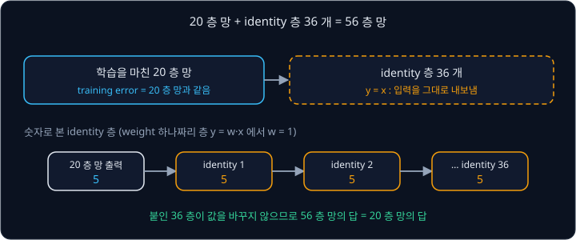

그런데도 56 층 plain 망의 training error 가 더 높게 나왔으니, loss(모델이 틀린 정도를 나타낸 숫자)를 줄이는 쪽으로 parameter 를
조금씩 고치는 gradient descent 가 20 층 망과 같은 상태조차 찾지 못했다.

**확인 문제.** A 망은 training error 2%, test error 30% 이고 B 망은 training error 25%, test error 27% 다. degradation 처럼 덜 배운
쪽은?

답 보기

| 망 | training error | test error | 판단 |
| --- | --- | --- | --- |
| A | 2% | 30% | 학습 사진은 98% 맞히는데 처음 보는 사진에서 크게 틀린다. 외운 쪽(overfitting)에 가깝다 |
| B | 25% | 27% | 학습 사진에서도 25% 를 틀린다. 덜 배운 쪽이다 |

답: B 다.

## 층마다 곱해지는 gradient

학습은 출력의 loss 에서 출발해 층을 거꾸로 지나며 gradient(parameter 를 조금 바꿨을 때 loss 가 변하는 비율)를 구하는데, chain rule
때문에 입력 쪽 층의 gradient 는 층마다 구한 비율을 모두 곱한 값이다. 층마다 같은 수가 곱해진다고 하면, 그 수가 1 에서 조금만 벗어나도
층이 많을 때 차이가 크게 벌어진다.

| 층마다 곱하는 수 | 5 층 | 10 층 | 20 층 |
| --- | --- | --- | --- |
| 0.5 | 0.031 | 0.00098 | 0.00000095 |
| 0.9 | 0.59 | 0.35 | 0.12 |
| 1 | 1 | 1 | 1 |
| 1.1 | 1.61 | 2.59 | 6.73 |
| 2 | 32 | 1,024 | 1,048,576 |

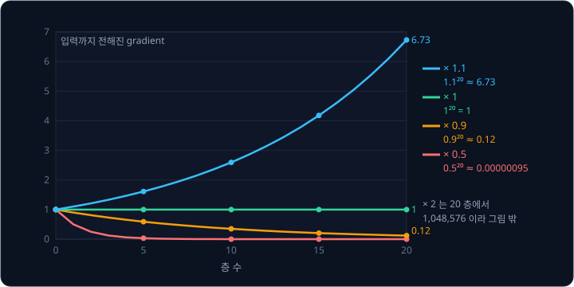

1 보다 작은 수를 거듭 곱해 입력 쪽 gradient 가 0 에 가까워지는 현상을 **vanishing gradient** 라고 하고, 1 보다 큰 수를 곱해 gradient 가
불어나는 현상을 **exploding gradient** 라고 한다. 0.5 를 20 번 곱하면 약 100만 분의 1 이라 입력 쪽 층은 거의 고쳐지지 않는다.

weight 의 처음 값 크기를 입력 개수 $n_{\text{in}}$ 에 맞춰 $\sqrt{2 / n_{\text{in}}}$ 정도로 잡는 He 초기화와 뒤에서 볼 batch
normalization 을 함께 쓰면 층마다 곱해지는 수가 1 근처에 머문다. ResNet 논문의 plain 망도 둘을 모두 썼고, 논문에 따르면 이 망의
backward gradient 크기는 정상이었는데 학습을 3 배 더 오래 해도 degradation 이 남았다. gradient 크기를 지켜도 풀리지 않았으니
degradation 은 vanishing gradient 와 다른 문제다.

<b>심화: 0.5 를 곱하는 층 세 개와 update 크기</b>

층마다 숫자 하나를 받아 0.5 를 곱하는 층 세 개 $h_1 = 0.5x$, $h_2 = 0.5h_1$, $h_3 = 0.5h_2$ 에 $x = 8$ 을 넣고 $x$ 를 0.01 늘리면,
변화가 아래처럼 전해진다.

| 값 | 바뀌기 전 | 바뀐 뒤 | 변화 | 앞 값의 변화에 대한 비율 |
| --- | --- | --- | --- | --- |
| $x$ | 8 | 8.01 | $+0.01$ | |
| $h_1 = 0.5x$ | 4 | 4.005 | $+0.005$ | $0.005 \div 0.01 = 0.5$ |
| $h_2 = 0.5h_1$ | 2 | 2.0025 | $+0.0025$ | $0.0025 \div 0.005 = 0.5$ |
| $h_3 = 0.5h_2$ | 1 | 1.00125 | $+0.00125$ | $0.00125 \div 0.0025 = 0.5$ |

전체 비율은 $0.00125 \div 0.01 = 0.125$ 로, 층마다 구한 비율을 곱한 $0.5 \times 0.5 \times 0.5$ 와 같다.

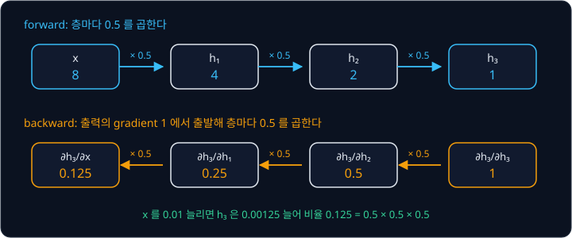

update 는 $w \leftarrow w - \eta g$ 로, weight $w$ 에서 learning rate $\eta$ 곱하기 gradient $g$ 를 빼서 새 weight 로 삼는다. 20 층 망의 맨
위 층 gradient 가 2 이고 층마다 0.5 가 곱해지면 맨 아래 층 gradient 는 $2 \times 0.5^{19} \approx 0.0000038$ 이다(두 층의 입력 크기가
같다고 둔다).

| 층 | gradient $g$ | $\eta = 0.1$ 일 때 한 번 고치는 양 $\eta g$ |
| --- | --- | --- |
| 맨 위 층 | 2 | 0.2 |
| 맨 아래 층 | 0.0000038 | 0.00000038 |

맨 아래 층이 0.2 만큼 움직이려면 같은 update 를 $2^{19} = 524{,}288$ 번 되풀이해야 한다. learning rate 를 52만 배로 키우면 learning
rate 가 똑같이 곱해지는 맨 위 층이 한 번에 $0.2 \times 524{,}288 \approx 10$만 만큼 움직여 발산한다.

sigmoid 의 기울기는 가장 클 때도 $0.5 \times 0.5 = 0.25$ 라서, 20 층 모두에서 가장 큰 기울기를 얻어도 $0.25^{20} \approx 9 \times 10^{-13}$
이다.

## residual connection

### residual block

He 등은 층 몇 개를 묶은 block 의 출력에 그 block 의 입력을 그대로 더했다.

$$
y = \mathcal F(x) + x
$$

$x$ 는 block 의 입력이고 $y$ 는 출력이며, $\mathcal F$(필기체 F)는 block 안의 층들이 계산하는 함수다. $x = 2$ 이고 층들이
$\mathcal F(x) = 0.3$ 을 냈다면 출력은 $0.3 + 2 = 2.3$ 이고, 같은 층을 plain 망처럼 쓰면 출력은 0.3 뿐이다. 입력이 층들을 건너뛰어
덧셈까지 곧장 가는 길을 **shortcut connection**(skip connection)이라고 하고, 이렇게 입력을 출력에 더하는 연결을 **residual connection**
이라고 한다. 이 연결을 둔 block 이 residual block 이고, residual block 을 쌓은 망이 ResNet(Residual Network)이다.

residual 은 "차이" 라는 뜻으로, block 이 내야 할 출력을 $H$ 라고 하면 $\mathcal F(x) = H - x$ 라서 층들은 출력 전체가 아니라 입력과
출력의 차이만 배운다.

### identity 와 0 근처의 weight

block 의 층을 weight 하나짜리 $\mathcal F(x) = wx$ 로 단순하게 두고, 학습 전 weight 는 0 근처의 작은 값인 0.05 라고 하자.

| block | 출력 | identity 가 되는 $w$ | 처음 $w = 0.05$ 에서의 거리 |
| --- | --- | --- | --- |
| plain | $y = wx$ | $w = 1$ | $1 - 0.05 = 0.95$ |
| residual | $y = wx + x$ | $w = 0$ | $0.05 - 0 = 0.05$ |

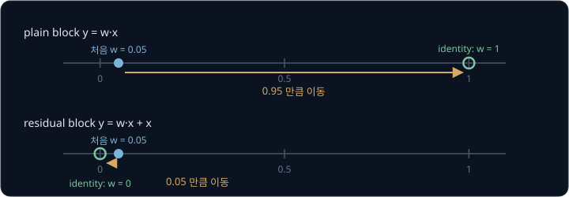

실제 block 은 conv 두 개와 ReLU(음수를 0 으로 바꾸는 계산)로 되어 있어 plain block 이 identity 를 흉내 내기가 이 예보다 훨씬 어렵다.
residual block 은 weight 를 0 쪽으로 보내기만 하면 identity 가 되므로, ResNet 은 입력을 거의 그대로 전하는 망에서 출발해 필요한
차이만 배운다. He 등이 학습을 마친 ResNet 을 재 보니 $\mathcal F$ 의 출력이 plain 망의 층 출력보다 대체로 작아 이 설명과 맞았다.

### shortcut 을 지나는 gradient

두 block 모두 $w = 0.1$, 입력 $x = 2$ 로 두고 $x$ 를 0.01 늘려서, $x$ 를 조금 바꿨을 때 $y$ 가 변하는 비율 $\frac{\partial y}{\partial x}$ 를
구해 본다.

| block | $x = 2$ 일 때 $y$ | $x = 2.01$ 일 때 $y$ | 변화 | 비율 $\frac{\partial y}{\partial x}$ |
| --- | --- | --- | --- | --- |
| plain $y = 0.1x$ | 0.2 | 0.201 | 0.001 | $0.001 \div 0.01 = 0.1$ |
| residual $y = 0.1x + x$ | 2.2 | 2.211 | 0.011 | $0.011 \div 0.01 = 1.1$ |

residual block 에서 $x$ 는 $\mathcal F$ 로 들어가는 길과 덧셈으로 곧장 가는 shortcut 두 곳에 쓰이고, 한 값이 여러 곳에 쓰이면 각 길의
비율을 더한다. shortcut 길은 덧셈뿐이라 비율이 1 이고 $\mathcal F$ 길은 0.1 이라서 합이 1.1 이다.

$$
\frac{\partial y}{\partial x} = 1 + \frac{\partial \mathcal F}{\partial x}
$$

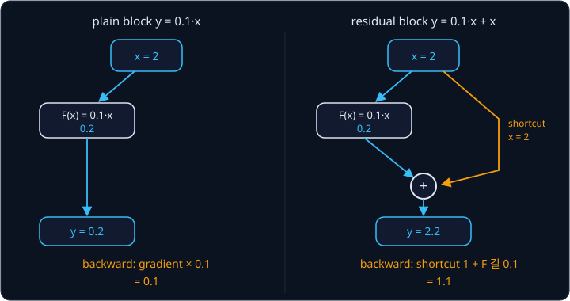

block 20 개의 weight 가 모두 $w$ 라면 plain 망의 비율은 $w^{20}$ 이고 residual 망은 $(1 + w)^{20}$ 이다.

| block 의 weight $w$ | plain 망 $w^{20}$ | residual 망 $(1 + w)^{20}$ |
| --- | --- | --- |
| 0.1 | $10^{-20}$ | $1.1^{20} \approx 6.73$ |
| $-0.1$ | $10^{-20}$ | $0.9^{20} \approx 0.12$ |
| 0 | 0 | 1 |
| 0.1 과 $-0.1$ 을 번갈아 | $10^{-20}$ | $(1.1 \times 0.9)^{10} \approx 0.90$ |

residual 망은 block 이 아무것도 배우지 않은 $w = 0$ 에서도 1 을 전하고 $\pm 0.1$ 범위에서는 0.12 와 6.73 사이에 머물러서, block 20 개
아래에 있는 층도 위쪽과 비슷한 크기의 gradient 를 받는다.

**흔한 오해.** "residual connection 이 있으면 gradient 가 언제나 정확히 1 로 전해진다." block 하나의 비율은
$1 + \frac{\partial \mathcal F}{\partial x}$ 라서 1 에서 조금씩 벗어나고, 위 표처럼 20 번 곱하면 0.12 나 6.73 이 되기도 한다. residual
connection 은 weight 를 거치지 않는 길 하나를 언제나 남길 뿐이다.

He 등이 plain 망과 층 수·parameter 수가 같은 ResNet 을 만들어 비교하자, 18 층에서 34 층으로 갈 때 plain 망은 error 가 0.60%p(퍼센트
포인트) 오르고 ResNet 은 2.85%p 내려갔다.

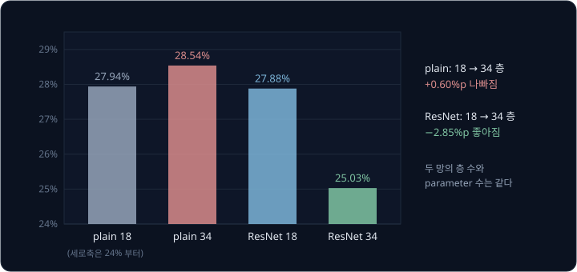

CIFAR-10 에서는 1202 층 ResNet 도 training error 가 0.1% 아래로 내려갔다. ResNet 여러 개를 합친 모델은 2015년 ImageNet 대회(ILSVRC) 분류 부문에서 1 위를 했다.

로봇 policy 에도 residual connection 이 들어 있다. LeRobot 의 ACT 구현은 Transformer 층마다 층의 출력에 입력을 더하고, Diffusion
Policy 의 noise 예측 network 는 `DiffusionConditionalResidualBlock1d` 라는 residual block 을 쌓아 만든다.

<b>심화: 두 block 의 길 네 개와 block 안 weight 의 gradient</b>

residual block 두 개 $x_1 = a x_0 + x_0$, $x_2 = b x_1 + x_1$ 에서 chain rule 로 block 마다 구한 비율을 곱하면 아래와 같다.

$$
\begin{aligned}
\frac{\partial x_2}{\partial x_0} = (1 + b)(1 + a) &= 1 \times (1 + a) + b \times (1 + a) \\
&= 1 + a + b + ab
\end{aligned}
$$

| 항 | 지나는 길 | $a = b = 0.1$ 일 때 |
| --- | --- | --- |
| $1$ | 두 block 모두 shortcut | 1 |
| $a$ | 첫 block 은 $\mathcal F$, 둘째는 shortcut | 0.1 |
| $b$ | 첫 block 은 shortcut, 둘째는 $\mathcal F$ | 0.1 |
| $ab$ | 두 block 모두 $\mathcal F$ | 0.01 |

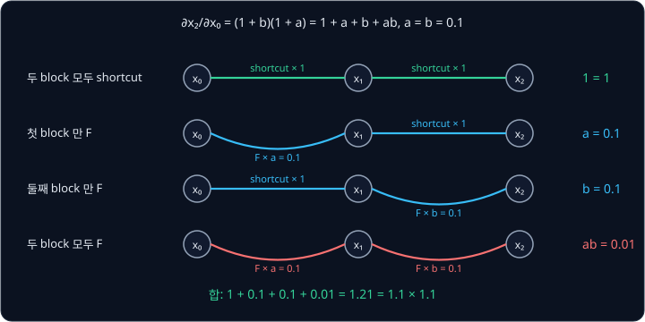

합은 1.21 이고, 두 block 모두 shortcut 을 타는 길은 weight 를 하나도 거치지 않는다. 숫자로 검산하면 $x_0 = 2$ 일 때 $x_1 = 2.2$,
$x_2 = 2.42$ 이고 $x_0 = 2.01$ 일 때 $x_1 = 2.211$, $x_2 = 2.4321$ 이라 비율은 $0.0121 \div 0.01 = 1.21$ 이다. plain 망이라면 gradient
가 지나는 길은 $ab = 0.01$ 하나뿐이다. block 이 $n$ 개면 길은 $2^n$ 개다.

$x_0 = 2$, $a = b = 0.1$ 에서 첫 block 의 weight $a$ 를 0.01 늘려 보면 두 망의 차이가 더 크다.

| 망 | 식 | $a$ 를 0.01 늘렸을 때 | 비율 $\frac{\partial x_2}{\partial a}$ |
| --- | --- | --- | --- |
| plain | $x_2 = b \times (a x_0)$ | 0.02 → 0.022 | $0.002 \div 0.01 = 0.2$ |
| residual | $x_2 = (1 + b)(a x_0 + x_0)$ | 2.42 → 2.442 | $0.022 \div 0.01 = 2.2$ |

chain rule 로 계산하면 plain 은 $x_0 \times b = 2 \times 0.1 = 0.2$ 이고 residual 은 $x_0 \times (1 + b) = 2 \times 1.1 = 2.2$ 다. 위에 block 이
하나만 더 있어도 11 배 차이가 나고, 위에 쌓인 block 이 많을수록 더 벌어진다.

He 등은 후속 논문 Identity Mappings in Deep Residual Networks(2016)에서 block 이 여러 개일 때를 식으로 정리했다. 덧셈 뒤의 ReLU 까지
없애 shortcut 이 순수한 identity 가 되면 $l$ 번째 block 의 입력 $x_l$ 과 $L$ 번째 block 의 입력 $x_L$ 사이에
$x_L = x_l + \sum_{i=l}^{L-1} \mathcal F(x_i)$ 가 성립해서, $\frac{\partial x_L}{\partial x_l}$ 에 언제나 1 이 들어 있다. He 등은 이
구조로 1001 층 ResNet 을 학습해 CIFAR-10 error 4.62% 를 얻었다.

**확인 문제.** block 3 개의 weight 가 모두 0.5 다. plain 망과 residual 망에서 입력까지 전해지는 비율은 각각?

답 보기

| 망 | block 하나의 비율 | 세 block 의 곱 |
| --- | --- | --- |
| plain | $w = 0.5$ | $0.5 \times 0.5 \times 0.5 = 0.125$ |
| residual | $1 + w = 1.5$ | $1.5 \times 1.5 \times 1.5 = 3.375$ |

## batch normalization

ResNet 의 conv 층 뒤에는 2015년 Sergey Ioffe 와 Christian Szegedy 가 발표한 batch normalization(BatchNorm, BN)이 붙는다. batch 는
학습 때 한 번에 함께 계산하는 사진 묶음이고, 이 묶음 안의 값으로 평균과 분산을 구해서 이런 이름이 붙었다.

### 정규화 계산

예를 들어 어떤 channel 이 사진 4 장에서 낸 값이 1, 2, 3, 6 이었는데 학습 도중 앞 층의 weight 가 10 배로 커지면, 같은 사진에서 10, 20,
30, 60 이 나온다. 다음 층은 그때까지 받던 입력 크기에 맞춰 weight 를 고쳐 왔는데, 갑자기 10 배인 입력을 받게 된다. Ioffe 와 Szegedy 는
이렇게 층이 받는 값의 분포가 학습 도중 계속 바뀌는 현상을 internal covariate shift 라고 불렀다. BatchNorm 은 모든 값에서 평균 $\mu$ 를
빼고 표준편차(분산 $\sigma^2$ 의 제곱근)로 나눠 평균 0, 분산 1 로 맞춘다.

$$
\hat x = \frac{x - \mu}{\sqrt{\sigma^2 + \epsilon}}
$$

분산은 각 값이 평균에서 떨어진 거리를 제곱해 평균한 값이고, $\epsilon$ 은 분산이 0 일 때 0 으로 나누지 않으려고 더하는 작은 수다(PyTorch
기본값 0.00001, 손계산에서는 0). $\hat x$ 는 "엑스 햇" 으로 읽는다.

| 원래 값 | 평균 | 표준편차 | $\hat x$ |
| --- | --- | --- | --- |
| 1, 2, 3, 6 | 3 | $\sqrt{3.5} \approx 1.871$ | $-1.069$, $-0.535$, 0, 1.604 |
| 10, 20, 30, 60 | 30 | $\sqrt{350} \approx 18.71$ | $-1.069$, $-0.535$, 0, 1.604 |

값이 모두 10 배가 되면 평균과 표준편차도 10 배가 되어 나눗셈에서 지워지므로 결과가 같다. 정규화한 값에는 학습하는 숫자 두 개를 곱하고
더해 $y = \gamma \hat x + \beta$ 를 낸다. $\gamma$(gamma)는 퍼진 정도를 정하고 $\beta$(beta)는 평균 위치를 정하며, 처음 값은
$\gamma = 1$, $\beta = 0$ 이다. $\gamma$ 가 원래 표준편차를 배우고 $\beta$ 가 원래 평균을 배우면 정규화 전 값이 그대로 돌아오므로,
정규화가 해로운 층에서는 망이 정규화를 되돌릴 수 있다.

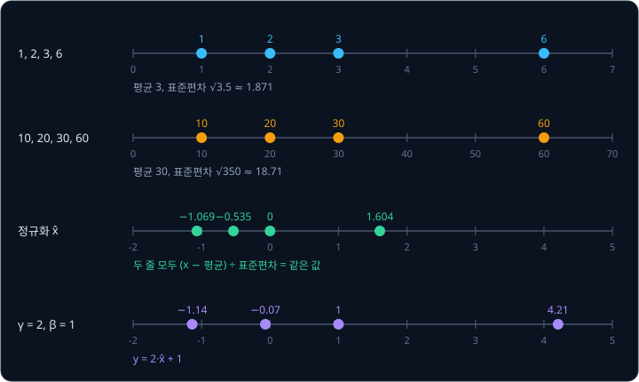

BatchNorm 논문에서는 이미지 분류 모델에 BatchNorm 을 넣자 학습 step 을 14 배 적게 쓰고도 같은 정확도에 도달했다. 평균을 빼는 순간
conv 의 bias 도 지워지므로 ResNet 의 conv 층에는 bias 가 없고, 평균 위치는 $\beta$ 로 정한다.

**흔한 오해.** "BatchNorm 이 효과가 있는 이유는 internal covariate shift 를 줄이기 때문이다." Santurkar 등(2018)은 층 입력의 분포를
일부러 흔들어도 BatchNorm 의 효과가 거의 그대로라는 것을 실험으로 보이고, BatchNorm 이 loss 의 모양을 매끄럽게 만들어 gradient 가 덜
급하게 바뀌는 것을 이유로 들었다.

<b>심화: 분산과 표준편차의 손계산, γ·β 와 bias</b>

2, 2, 6, 6 의 평균은 $16 \div 4 = 4$ 다.

| 값 | 평균에서 뺀 값 | 제곱 |
| --- | --- | --- |
| 2 | $-2$ | 4 |
| 2 | $-2$ | 4 |
| 6 | 2 | 4 |
| 6 | 2 | 4 |

분산은 $(4 + 4 + 4 + 4) \div 4 = 4$ 이고 표준편차는 $\sqrt 4 = 2$ 다. 평균에서 뺀 값을 그냥 평균하면 서로 지워져 0 이 되므로 제곱해서
부호를 없앤다. 1, 2, 3, 6 은 평균이 $12 \div 4 = 3$ 이고, 평균에서 뺀 값 $-2, -1, 0, 3$ 을 제곱하면 4, 1, 0, 9 다. 그래서 분산은
$14 \div 4 = 3.5$ 이고 표준편차는 $\sqrt{3.5} \approx 1.871$ 이며, 1 은 $(1 - 3) \div 1.871 \approx -1.069$ 가 된다.

2, 2, 6, 6 의 $\hat x$ 는 $-1, -1, 1, 1$ 이다. $\gamma = 2$, $\beta = 1$ 이면 $2 \times (-1) + 1 = -1$ 과 $2 \times 1 + 1 = 3$ 이
되어 평균 1, 표준편차 2 로 바뀐다. $\gamma = 2$(원래 표준편차), $\beta = 4$(원래 평균)이면 $2 \times (-1) + 4 = 2$, $2 \times 1 + 4 = 6$
으로 원래 값이 돌아온다.

1, 2, 3, 6 에 bias 5 를 더한 6, 7, 8, 11 은 평균이 8 이라 평균에서 뺀 값이 다시 $-2, -1, 0, 3$ 이므로, bias 를 더해도 정규화 결과는
같다.

**확인 문제.** 0, 4, 4, 8 을 정규화하면? ($\sqrt 8 \approx 2.83$)

답 보기

1. 평균: $(0 + 4 + 4 + 8) \div 4 = 4$
2. 분산: 평균에서 뺀 값 $-4, 0, 0, 4$ 의 제곱 16, 0, 0, 16 을 평균하면 $32 \div 4 = 8$ 이고, 표준편차는 $\sqrt 8 \approx 2.83$ 이다
3. 나누기: $-4 \div 2.83 \approx -1.41$, 0, 0, $4 \div 2.83 \approx 1.41$

답: $-1.41$, 0, 0, 1.41

### channel 마다 모으는 값

conv 층의 출력은 batch 크기 $N$, channel 수 $C$, feature map 의 세로 $H$·가로 $W$ 를 곱한 $N \times C \times H \times W$ 개 숫자다.
channel 마다 찾는 특징이 달라 값의 크기도 제각각이라, BatchNorm 은 평균과 분산을 channel 마다 따로 구한다. channel 하나의 통계는
batch 의 모든 사진에서 feature map 의 모든 칸을 모은 $N \times H \times W$ 개 값으로 구하고, $\mu$, $\sigma^2$, $\gamma$, $\beta$ 는
channel 마다 하나씩 $C$ 개다. batch 32, channel 64, 56×56 feature map 이라면 channel 하나의 평균을 $32 \times 56 \times 56 = 100{,}352$
개 값으로 구한다.

<b>심화: channel 하나에서 모으는 값</b>

사진 2 장, channel 2 개, 2×2 feature map 이면 0 번 channel 에서 모으는 값은 사진마다 4 칸씩 $2 \times 2 \times 2 = 8$ 개다.

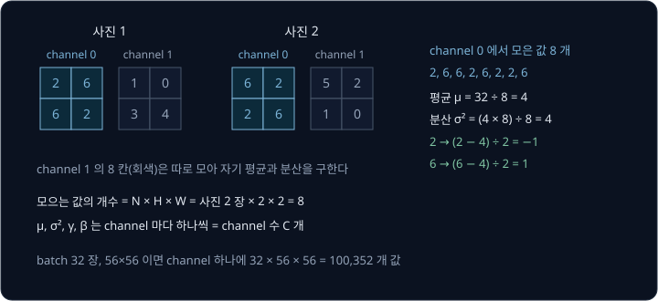

0 번 channel 의 8 칸은 2 와 6 이 네 개씩이라 평균 4, 분산 4 이고, 정규화하면 2 는 $-1$ 이 되고 6 은 1 이 된다.

### 학습 때와 평가 때의 통계

학습 때는 batch 마다 그 batch 의 평균과 분산으로 정규화하지만, 로봇에서 policy 를 실행할 때는 카메라 사진이 한 장씩 들어오고 같은
사진의 결과가 함께 들어온 사진에 따라 바뀌어서도 안 된다. 그래서 학습하는 동안 batch 의 평균과 분산을 moving average(지난 평균과
새 값을 일정 비율로 섞는 평균)로 따로 쌓아 두었다가, 평가 때는 그 값을 고정해 쓴다.

$$
\mu_{\text{run}} \leftarrow 0.9\, \mu_{\text{run}} + 0.1\, \mu_{\mathcal B}
$$

$\mu_{\text{run}}$ 은 쌓아 둔 평균(running mean)이고 $\mu_{\mathcal B}$ 는 이번 batch 의 평균인데, batch 를 수천 번 거치면 running
mean 이 데이터 전체의 평균에 가까워진다. PyTorch 는 섞는 비율 0.1 을 BatchNorm 의 `momentum` 이라고 부르는데, optimizer 의 momentum 과는 이름만 같은 다른
숫자다.

PyTorch 는 `model.eval()` 로 평가 모드로 바꿔야 쌓아 둔 통계를 쓰기 때문에, 이를 빠뜨리고 로봇에서 실행하면 같은 장면에서도 함께
계산한 사진에 따라 다른 action 이 나온다.

**확인 문제.** running mean 이 2 이고 이번 batch 평균이 12 면 새 running mean 은?

답 보기

$0.9 \times 2 + 0.1 \times 12 = 1.8 + 1.2 = 3$ 이다.

### 작은 batch 의 문제

batch 가 작으면 평균과 분산이 batch 마다 크게 흔들린다. 사진 2 장에 값이 하나씩이면 값이 무엇이든 정규화 결과가 $-1$ 과 1 이다.

| batch 의 두 값 | 평균 | 분산 | $\hat x$ |
| --- | --- | --- | --- |
| 1, 3 | 2 | 1 | $-1$, 1 |
| 100, 102 | 101 | 1 | $-1$, 1 |

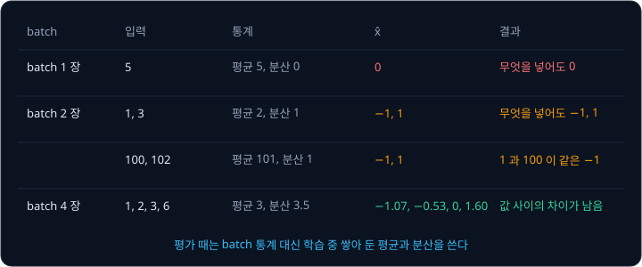

1 과 100 은 크기가 전혀 다른데 둘 다 $-1$ 이 됐고, 같은 사진이라도 batch 에 어떤 사진이 함께 들어왔는지에 따라 정규화한 값이
달라진다. Wu 와 He 는 GroupNorm 논문(2018)에서 ImageNet 의 ResNet-50 을 GPU 하나당 batch 를 줄여 가며 학습하고 검증 error 를 쟀다.

| GPU 하나의 batch | 32 | 16 | 8 | 4 | 2 |
| --- | --- | --- | --- | --- | --- |
| BatchNorm | 23.6% | 23.7% | 24.8% | 27.3% | 34.7% |
| GroupNorm | 24.1% | 24.2% | 24.0% | 24.2% | 24.1% |

로봇 policy 는 사진이 크고 카메라가 여러 대라 batch 를 작게 잡는 경우가 많은데, ACT 논문의 batch 는 8 이고 LeRobot 학습 설정의 기본
batch 도 8 이다. 그래서 로봇 policy 는 BatchNorm 대신 [로봇 policy 의 ResNet-18 encoder](#로봇-policy-의-resnet-18-encoder) 절에서 볼
FrozenBatchNorm 이나 GroupNorm 을 쓰기도 한다.

## BasicBlock 과 bottleneck block

### BasicBlock

ResNet-18 과 ResNet-34 의 residual block 은 3×3 conv 두 개로 된 BasicBlock 이다. 3×3 conv(padding 1) → BN → ReLU → 3×3 conv → BN 으로
$\mathcal F(x)$ 를 만들고, 입력 $x$ 를 더한 뒤 ReLU 를 한 번 더 거쳐 $y = \mathrm{ReLU}(\mathcal F(x) + x)$ 를 낸다. padding 1 인 3×3 conv
는 feature map 의 크기를 바꾸지 않는다.

$\mathcal F(x) + x$ 는 같은 자리의 숫자끼리 더하는 element-wise addition 이라서 두 값의 channel 수와 세로·가로가 모두 같아야 하고,
모양이 같으면 학습할 숫자가 없는 identity shortcut 으로 입력을 그대로 더한다. 그런데 ResNet 은 몇 block 마다 첫 conv 의 stride 를 2 로
하고 filter 수를 두 배로 늘려서, feature map 의 가로세로가 반이 되고 channel 이 두 배가 된다. 64 channel 의 56×56 입력이 들어오면
$\mathcal F(x)$ 는 128 channel 의 28×28 이 되어 입력을 그대로 더할 수 없으므로, shortcut 에 stride 2 의 1×1 conv 와 BN 을 두어 입력의
모양을 맞춘다.

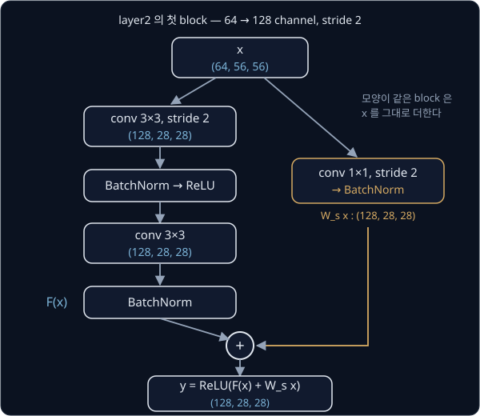

<b>심화: element-wise addition 과 1×1 conv shortcut 의 계산</b>

padding 1 인 3×3 conv 의 출력 크기는 공식 $\lfloor (H + 2p - k)/s \rfloor + 1$ 에 $H = 56$, $p = 1$, $k = 3$, $s = 1$ 을 넣으면
$\lfloor (56 + 2 - 3)/1 \rfloor + 1 = 56$ 이다.

$\mathcal F(x) = \begin{bmatrix} 1 & 0 \\ -1 & 2 \end{bmatrix}$, $x = \begin{bmatrix} 3 & 1 \\ 0 & 2 \end{bmatrix}$ 를 같은 자리끼리 더하면
$\begin{bmatrix} 4 & 1 \\ -1 & 4 \end{bmatrix}$ 이고, 마지막 ReLU 가 $-1$ 을 0 으로 바꿔 block 출력은 $\begin{bmatrix} 4 & 1 \\ 0 & 4 \end{bmatrix}$ 다.

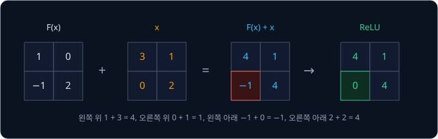

1×1 conv 는 한 칸에 쌓인 channel 값들만 weight 로 곱해 더하는 conv 다. 입력이 2 channel 이고 어느 칸의 두 channel 값이 3 과 1 이라고
하자. filter 의 weight 가 2 와 $-1$ 이면 그 칸의 출력은 $2 \times 3 + (-1) \times 1 = 5$ 이고, weight 가 1 과 1 인 filter 를 하나 더
두면 같은 칸에서 $3 + 1 = 4$ 가 나와서 출력 channel 이 filter 수만큼 생긴다. stride 2 는 한 칸씩 건너뛰므로 4×4 에서 $(0, 0)$, $(0, 2)$, $(2, 0)$, $(2, 2)$ 네 칸만 남아 2×2 가 되는데, 출력
크기 공식으로도 $\lfloor (4 + 0 - 1)/2 \rfloor + 1 = 2$ 다.

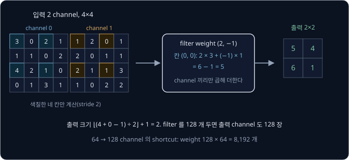

이 shortcut 의 출력은 $W_s x$ 로 쓰고 block 출력은 $y = \mathrm{ReLU}(\mathcal F(x) + W_s x)$ 다. 1×1 conv 의 weight 는 출력 channel 수 곱하기
입력 channel 수라서 64 → 128 shortcut 은 $128 \times 64 = 8{,}192$ 개다. 128 → 256 shortcut 은 weight 가 $256 \times 128 = 32{,}768$ 개이고,
28×28 입력에 stride 2 로 걸리므로 출력이 $\lfloor (28 - 1)/2 \rfloor + 1 = 14$ 라 14×14 다.

원 논문은 ResNet-18·34 실험(앞의 ImageNet error 그림)에서 이 1×1 conv 대신 늘어난 channel 을 0 으로 채우는 shortcut 을 썼고, ResNet-50
부터 1×1 conv 를 썼다. torchvision 의 ResNet 은 모든 깊이에서 1×1 conv 를 쓰며, 이 강의의 parameter 수는 torchvision 기준이다.

### bottleneck block

ResNet-50 부터는 계산량을 줄이려고 conv 세 개로 된 bottleneck block 을 쓴다. 1×1 conv 가 channel 을 4 분의 1 로 줄이고, 줄인 channel
에서 3×3 conv 를 한 뒤, 다시 1×1 conv 가 channel 을 원래대로 되돌린다. 이름은 channel 이 좁아지는 가운데 부분을 병의 목(bottleneck)에
빗댄 것이다.

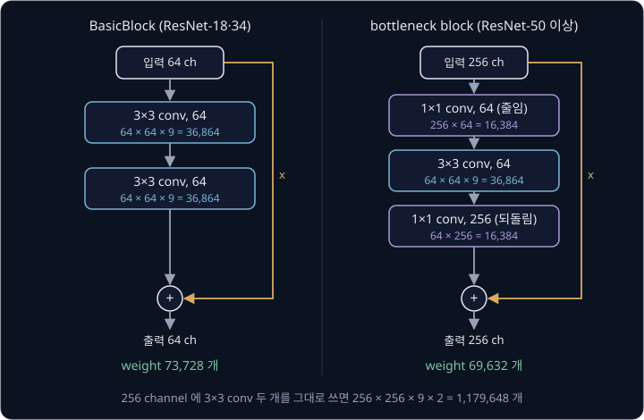

bottleneck block 은 64 channel BasicBlock 과 비슷한 수의 weight 로 네 배 넓은 256 channel 을 다루는데, 256 channel 에 3×3 conv 두 개를
그대로 쓰면 weight 가 1,179,648 개로 17 배쯤 많다. He 등에 따르면 이 block 의 shortcut 을 1×1 conv 로 바꾸면 channel 이 넓은 양 끝을
잇게 되어 계산량과 모델 크기가 두 배가 되므로, bottleneck 에서는 parameter 가 없는 identity shortcut 이 특히 중요하다.

**확인 문제.** layer4 의 bottleneck block 은 2048 channel 을 받아 1×1 conv 로 512 로 줄이고, 3×3 conv(512 → 512)를 지나, 1×1 conv 로
2048 로 되돌린다. weight 는 모두 몇 개일까?

답 보기

| conv | 계산 | weight |
| --- | --- | --- |
| 1×1, 2048 → 512 | $512 \times 2048$ | 1,048,576 |
| 3×3, 512 → 512 | $512 \times 512 \times 9$ | 2,359,296 |
| 1×1, 512 → 2048 | $2048 \times 512$ | 1,048,576 |

답: $1{,}048{,}576 + 2{,}359{,}296 + 1{,}048{,}576 = 4{,}456{,}448$ 개

## ResNet-18 과 ResNet-50

### stem 과 stage

사진을 받아 크기를 빨리 줄이는 맨 앞의 몇 층을 stem 이라고 하고, ResNet-18 과 ResNet-50 의 stem 은 같다.

| 층 | 설정 | 크기 계산 | 출력 |
| --- | --- | --- | --- |
| 입력 | 컬러 사진 | | $3 \times 224 \times 224$ |
| conv | 7×7 filter 64 개, stride 2, padding 3 | $\lfloor (224 + 6 - 7)/2 \rfloor + 1 = 112$ | $64 \times 112 \times 112$ |
| max pooling | 3×3, stride 2, padding 1 | $\lfloor (112 + 2 - 3)/2 \rfloor + 1 = 56$ | $64 \times 56 \times 56$ |

stem 의 conv 뒤에는 BN 과 ReLU 가 붙는다. stem 뒤로는 block 몇 개씩을 묶은 stage 네 개가 이어지고, 차례로 layer1 ~ layer4 라고 부른다.

| stage | 크기 | ResNet-18 block | ResNet-18 출력 channel | ResNet-50 block | ResNet-50 출력 channel |
| --- | --- | --- | --- | --- | --- |
| layer1 | 56×56 | BasicBlock 2 | 64 | bottleneck 3 | 256 |
| layer2 | 28×28 | BasicBlock 2 | 128 | bottleneck 4 | 512 |
| layer3 | 14×14 | BasicBlock 2 | 256 | bottleneck 6 | 1024 |
| layer4 | 7×7 | BasicBlock 2 | 512 | bottleneck 3 | 2048 |

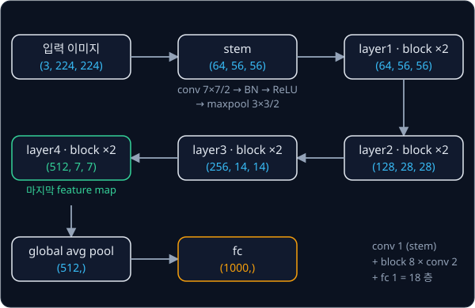

**흔한 오해.** "층이 18 개면 사진을 18 번 줄인다." 크기를 줄이는 곳은 stem 의 conv·max pooling 과 layer2·3·4 의 첫 block 다섯 곳이고,
각각 반으로 줄여 $2^5 = 32$ 분의 1 이 된다. 나머지 층은 크기를 그대로 두고 feature 를 다듬는다.

### global average pooling 과 fc

마지막 feature map 의 channel 마다 7×7 = 49 칸의 평균을 내 숫자 하나로 만드는 계산을 global average pooling 이라고 한다. 결과는
channel 수만큼이라 ResNet-18 은 512 개이고 ResNet-50 은 2048 개인데, 이 숫자들이 사진 한 장을 요약한 feature vector 다. 마지막으로
Linear layer 하나가 512 개를 1000 개 class 점수로 바꾸고, ResNet 에서는 이 층을 fc(fully connected)라고 부른다.

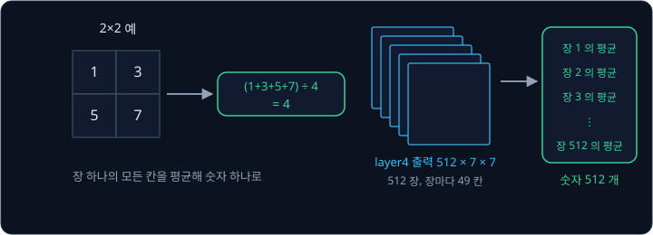

global average pooling 은 특징이 어디에 있었는지는 버리고 무엇이 얼마나 강하게 나타났는지만 남긴다. conv 층은 사진 크기와 상관없이
같은 filter 를 옮기므로 448×448 사진을 넣으면 layer4 가 $512 \times 14 \times 14$ 로 커지지만, 평균을 낸 결과는 여전히 512 개라 fc 를
바꾸지 않아도 된다.

### 층 수와 parameter 수

ResNet-18 의 층 수는 weight 가 있는 층을 센 값으로, stem conv 1 + BasicBlock 8 개 × conv 2 + fc 1 = 18 이다. ResNet-50 은 stem conv 1
\+ bottleneck 16 개 × conv 3 + fc 1 = 50 이다. shortcut 의 1×1 conv 는 He 등의 관례대로 세지 않는다.

| | ResNet-18 | ResNet-50 |
| --- | --- | --- |
| parameter (torchvision) | 11,689,512 | 25,557,032 |
| 사진 한 장의 계산량 (torchvision GFLOPS) | 1.81 | 4.09 |
| feature vector | 512 | 2048 |
| ImageNet top-1 정확도 (torchvision `IMAGENET1K_V1`) | 69.758% | 76.13% |
| layer4 가 차지하는 parameter 비율 | 71.8% | 58.6% |

GFLOPS 는 곱셈·덧셈을 10억 번 단위로 센 계산량이다. 학습법을 바꿔 다시 학습한 ResNet-50 의 `IMAGENET1K_V2` weight 는 정확도가
80.858% 다. 3×3 conv 의 weight 는 channel 수의 제곱에 비례해서 layer4 의 conv 하나($512 \times 512 \times 9 = 2{,}359{,}296$)가 layer1
의 conv 하나($64 \times 64 \times 9 = 36{,}864$)보다 64 배 크고, 그래서 parameter 가 layer4 에 몰린다.

<b>심화: stage 별 parameter 수</b>

conv 에는 bias 가 없어서 conv 의 parameter 는 $C_{\text{out}} \times C_{\text{in}} \times k \times k$ 이고, BatchNorm 은 channel 마다 $\gamma$·$\beta$
두 개다. 이 식으로 stage 마다 세면 아래와 같고, 합은 torchvision 의 parameter 수와 같다.

| 부분 | ResNet-18 | 비율 | ResNet-50 | 비율 |
| --- | --- | --- | --- | --- |
| stem | $64 \times 3 \times 49 + 2 \times 64 = 9{,}536$ | 0.1% | 9,536 | 0.04% |
| layer1 | 147,968 | 1.3% | 215,808 | 0.8% |
| layer2 | 525,568 | 4.5% | 1,219,584 | 4.8% |
| layer3 | 2,099,712 | 18.0% | 7,098,368 | 27.8% |
| layer4 | 8,393,728 | 71.8% | 14,964,736 | 58.6% |
| fc | $512 \times 1{,}000 + 1{,}000 = 513{,}000$ | 4.4% | $2048 \times 1{,}000 + 1{,}000 = 2{,}049{,}000$ | 8.0% |
| 합 | 11,689,512 | | 25,557,032 | |

ResNet-18 layer1 의 block 하나는 $2 \times (64 \times 64 \times 9) + 2 \times 128 = 73{,}984$ 개이고 block 이 두 개라 147,968 개다. layer2 의
첫 block 에서는 첫 3×3 conv 가 $128 \times 64 \times 9 = 73{,}728$ 개이고 둘째 3×3 conv 가 $128 \times 128 \times 9 = 147{,}456$ 개다. fc 를
뺀 ResNet-18 은 $11{,}689{,}512 - 513{,}000 = 11{,}176{,}512$ 개다.

## pretrained backbone 과 fine-tuning

### backbone 과 head

network 는 입력을 feature 로 바꾸는 앞부분 **backbone** 과, feature 를 원하는 출력으로 바꾸는 뒷부분 **head** 로 나눠 볼 수 있다.
ResNet-18 에서는 global average pooling 이 512 개를 내는 곳까지가 backbone 이고 fc 가 head 다. ImageNet 으로 학습해 둔 parameter 값을
**pretrained weight** 라고 하는데, 그 앞쪽 stage 의 filter 는 선과 색의 경계에 반응하고 뒤쪽 stage 의 filter 는 바퀴나 손잡이 같은
물체의 부분에 반응한다. 로봇 카메라 사진도 같은 세상을 찍은 것이라 이 filter 를 가져다 쓸 수 있다.

로봇이 물체 10 종류를 가려내야 한다면 ImageNet 용 fc(512 → 1000)를 떼고 512 → 10 짜리 새 head 를 붙인다. 이렇게 다른 데이터로 학습한
weight 를 가져다 새 일에 쓰는 것을 **transfer learning** 이라고 한다.

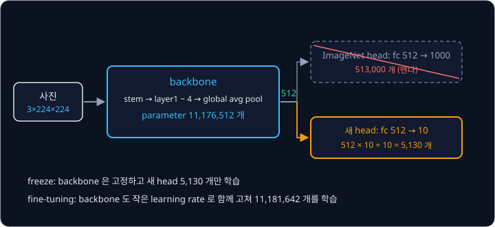

### freeze 와 fine-tuning

| 학습 방식 | backbone | head | 학습하는 parameter |
| --- | --- | --- | --- |
| freeze | pretrained weight 고정 | 새로 학습 | 5,130 |
| fine-tuning | pretrained weight 에서 출발해 작은 learning rate 로 고침 | 새로 학습 | 11,181,642 |
| 처음부터 학습 | 무작위 값에서 출발 | 새로 학습 | 11,181,642 |

11,181,642 는 backbone 11,176,512 개와 head $512 \times 10 + 10 = 5{,}130$ 개를 더한 값이다. freeze 는 학습이 빠르지만, ImageNet 의
feature 가 그 일에 맞지 않으면 head 만 학습해서는 그 차이를 바로잡을 수 없다. Diffusion Policy 논문의 저자들은 시뮬레이션 과제 robomimic
Square(사각 고리를 막대에 끼우는 과제)에서 ImageNet-21k 로 사전학습한 ResNet-18 encoder 를 세 방식으로 비교했다.

| encoder 학습 방식 | 성공률 |
| --- | --- |
| 처음부터 학습 | 0.94 |
| pretrained, freeze | 0.58 |
| pretrained, fine-tuning (policy 보다 10 배 작은 learning rate) | 0.92 |

freeze 한 encoder 만 성공률이 크게 떨어졌는데, 저자들은 이 policy 에 필요한 사진 요약이 흔한 사전학습으로 얻는 요약과 다르기
때문이라고 해석했다. ACT 는 pretrained ResNet-18 을 fine-tuning 하는데, 원 구현과 LeRobot 모두 backbone 의 learning rate 를 policy 의
나머지 부분과 같은 1e-5 로 둔다.

### pretrained weight 의 입력 전처리

torchvision 의 ResNet-18 weight 는 사진을 256 으로 줄여 가운데 224×224 를 자르고, 0 ~ 1 로 바꾼 뒤 channel 마다 평균 (0.485, 0.456, 0.406) 을 빼고 표준편차 (0.229, 0.224, 0.225) 로 나눈 입력으로 학습했다.
0 ~ 255 그대로의 사진을 넣으면 첫 층이 받는 값의 크기가 학습 때와 달라져 pretrained filter 가 제대로 반응하지 않는다. LeRobot 은
`use_imagenet_stats` 가 기본으로 켜져 있어 카메라 사진을 이 ImageNet 평균과 표준편차로 정규화한다.

**확인 문제.** ResNet-18 backbone 위에 관절 각도 7 개를 내는 head(Linear 512 → 7)를 붙이면 head 의 parameter 는 몇 개이고, freeze
방식으로 학습하면 학습하는 parameter 는 모두 몇 개일까?

답 보기

1. weight: $512 \times 7 = 3{,}584$
2. bias: 출력마다 하나라 7
3. head: $3{,}584 + 7 = 3{,}591$

freeze 는 backbone 을 고정하므로 학습하는 parameter 도 3,591 개다.

## 로봇 policy 의 ResNet-18 encoder

policy 는 지금 보이는 것(observation)을 받아 다음 행동(action)을 내는 모델이고, 사진을 policy 가 쓸 숫자로 바꾸는 부분을 image encoder
라고 한다. [ACT](../act/README.md) 와 [Diffusion Policy](../diffusion-policy/README.md) 는 둘 다 ResNet-18 을 image encoder 로 쓰지만
feature 를 꺼내는 방식과 normalization 이 다르다.

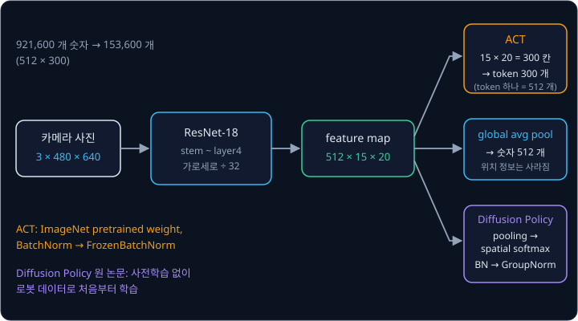

### ACT

ACT 는 카메라 4 대가 찍은 480×640 사진을 ResNet-18 에 넣는다. 가로세로가 32 분의 1 이 되므로 layer4 의 출력은 세로
$480 \div 32 = 15$, 가로 $640 \div 32 = 20$ 인 $512 \times 15 \times 20$ 이고, ACT 는 global average pooling 을 하지 않고 이 feature map 의 300 칸을 Transformer
에 넣을 token 300 개로 쓴다. 칸마다 token 을 두면 컵이 사진의 어느 구역에 있는지가 남지만, 평균을 내 512 개로 줄이면 그 위치가
사라진다. LeRobot 구현은 layer4 의 512 channel 을 1×1 conv 로 Transformer 의 폭 `dim_model` = 512 에 맞추므로, `vision_backbone` 을
ResNet-50 으로 바꾸면 같은 1×1 conv 가 2048 channel 을 512 로 줄인다.

ACT 의 ResNet-18 은 torchvision 의 ImageNet weight(`ResNet18_Weights.IMAGENET1K_V1`)에서 출발하고, BatchNorm 자리에 FrozenBatchNorm 을
쓴다. FrozenBatchNorm 은 ImageNet 학습 때 쌓아 둔 running mean·running variance 와 $\gamma$·$\beta$ 를 모두 고정한 BatchNorm 이다. 예를
들어 쌓아 둔 평균이 2, 분산이 4, $\gamma = 3$, $\beta = 1$ 이면 입력 6 은 batch 에 무엇이 함께 있든 언제나 $3 \times (6 - 2) \div 2 + 1 = 7$ 이 된다. conv 의 weight 는 fine-tuning 으로 고치되 정규화 숫자는 고정하므로, batch 8 로
학습해도 통계가 흔들리지 않는다.

### Diffusion Policy

Diffusion Policy 논문의 저자들은 ResNet-18 을 pretrained weight 없이 처음부터 학습하면서 두 곳을 바꿨다. global average pooling 자리에는
channel 마다 값이 큰 칸의 위치 $(x, y)$ 를 뽑는 spatial softmax 를 두었고, BatchNorm 은 GroupNorm 으로 바꿨다. GroupNorm 은 사진 한
장 안에서 channel 을 몇 개씩 묶어 그 묶음의 값으로 평균과 분산을 구하므로, batch 에 다른 사진이 몇 장 있든 결과가 같다. 저자들은
weight 의 moving average 를 따로 두는 EMA 와 함께 쓸 때 이 변경이 중요하다고 적었다. LeRobot 구현은 channel 16 개를 한 묶음으로 두어서,
64 channel 층은 묶음이 4 개이고 512 channel 층은 32 개다.

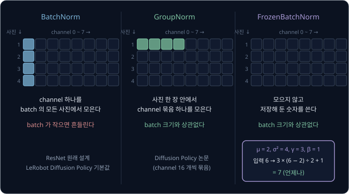

LeRobot 의 PushT 데이터는 사진이 96×96 이라 layer4 출력이 $512 \times 3 \times 3$ 이다. LeRobot 구현은 1×1 conv 로 512 channel 을 32
channel 로 줄인 뒤 channel 마다 위치 $(x, y)$ 하나를 뽑는데, 이 위치를 keypoint 라고 한다. keypoint 가 32 개라 사진 한 장은 숫자
$32 \times 2 = 64$ 개가 된다. spatial softmax 의 계산은 Diffusion Policy 강의에서 다룬다.

LeRobot 의 Diffusion Policy 기본 설정은 논문과 달리 ImageNet weight 에서 출발하고 BatchNorm 을 그대로 둔다. `use_group_norm` 을 켠 채
pretrained weight 를 지정하면 오류를 낸다. pretrained weight 의 conv weight 와 $\gamma$·$\beta$ 는 BatchNorm 통계로 정규화한 값에 맞춰
학습됐는데, GroupNorm 은 다른 값들로 평균과 분산을 구해서 다음 층이 받는 값이 달라지기 때문이다.

**확인 문제.** FrozenBatchNorm 의 쌓아 둔 평균이 1, 분산이 9, $\gamma = 2$, $\beta = 0$ 이면 입력 7 의 출력은? batch 에 다른 사진이 함께
들어오면 달라질까?

답 보기

1. 표준편차: $\sqrt 9 = 3$
2. 정규화: $(7 - 1) \div 3 = 2$
3. $\gamma$·$\beta$: $2 \times 2 + 0 = 4$

답: 4 다. 고정된 숫자만 쓰므로 batch 에 무엇이 함께 들어와도 같다.

## 정리

- 깊은 plain network 는 학습 사진에서조차 더 많이 틀리는 degradation 을 보인다. residual block $y = \mathcal F(x) + x$ 는 weight 를 0
  으로 보내면 identity 가 되고, gradient 비율이 $1 + \frac{\partial \mathcal F}{\partial x}$ 라서 weight 를 거치지 않는 길이 언제나 남는다
- BatchNorm 은 channel 마다 batch 의 값으로 평균 0, 분산 1 을 맞춘 뒤 $\gamma$·$\beta$ 로 퍼진 정도와 위치를 다시 정하고, 평가 때는
  학습 중 쌓아 둔 통계를 쓴다. batch 가 작으면 통계가 흔들려서 ACT 는 FrozenBatchNorm 을 쓰고 Diffusion Policy 논문은 GroupNorm 을 쓴다
- ResNet-18 은 BasicBlock 8 개로 사진을 숫자 512 개로 줄이고, ResNet-50 은 bottleneck block 16 개로 2048 개로 줄인다. pretrained
  backbone 은 fc 를 떼고 새 head 를 붙여 freeze 하거나 fine-tuning 해서 쓰는데, ACT 는 fine-tuning 한 ResNet-18 의
  $512 \times 15 \times 20$ feature map 을 token 300 개로 쓴다

ResNet 은 convolution 으로 가까운 칸끼리만 계산하므로, 사진에서 멀리 떨어진 두 구역의 관계는 층을 많이 쌓아야 반영된다. 사진을 patch
로 잘라 patch 끼리 서로 참고하게 하는 모델은 [ViT](../vit/README.md) 에서 다룬다. ResNet 의 feature map 을 token 으로 쓰는 policy 는
[ACT](../act/README.md) 에서 다루고, CNN 의 image token 에 지시 문장을 섞는 policy 는 [RT-1](../rt1/README.md) 에서 다룬다.

## 참고 자료

- Kaiming He et al., [Deep Residual Learning for Image Recognition](https://arxiv.org/abs/1512.03385) (2015) — ResNet 원 논문. 4.1절이
  degradation, 3절이 residual block 과 bottleneck, Table 1 이 ResNet-18 ~ 152 의 구조다
- Kaiming He et al., [Identity Mappings in Deep Residual Networks](https://arxiv.org/abs/1603.05027) (2016) — shortcut 이 identity 일 때
  gradient 가 어떤 block 에든 곧장 전해진다는 식 (4) ~ (5)
- Sergey Ioffe, Christian Szegedy, [Batch Normalization](https://arxiv.org/abs/1502.03167) (2015) — Algorithm 1 이 학습 때의 정규화, 3.1절이
  평가 때의 통계다
- Shibani Santurkar et al., [How Does Batch Normalization Help Optimization?](https://arxiv.org/abs/1805.11604) (2018) — BatchNorm 의 효과와
  internal covariate shift 의 관계를 따진 실험
- Yuxin Wu, Kaiming He, [Group Normalization](https://arxiv.org/abs/1803.08494) (2018) — GroupNorm 의 정의와 batch 크기별 error(Table 2)
- Cheng Chi et al., [Diffusion Policy](https://arxiv.org/abs/2303.04137) (2023) — 3.2절이 ResNet-18 encoder 의 변경, Table 5 가 encoder
  학습 방식 비교다
- torchvision, [`resnet18`](https://docs.pytorch.org/vision/stable/models/generated/torchvision.models.resnet18.html)·[`resnet50`](https://docs.pytorch.org/vision/stable/models/generated/torchvision.models.resnet50.html)
  문서 — pretrained weight 의 정확도, parameter 수, 입력 전처리
- PyTorch, [nn.BatchNorm2d](https://docs.pytorch.org/docs/stable/generated/torch.nn.BatchNorm2d.html) — `momentum`·`eps` 와 running 통계의 갱신 식
- LeRobot, [`modeling_act.py`](https://github.com/huggingface/lerobot/blob/main/src/lerobot/policies/act/modeling_act.py)·[`modeling_diffusion.py`](https://github.com/huggingface/lerobot/blob/main/src/lerobot/policies/diffusion/modeling_diffusion.py)
  — ACT 의 FrozenBatchNorm·1×1 conv token 과 Diffusion Policy 의 `DiffusionRgbEncoder` 구현
