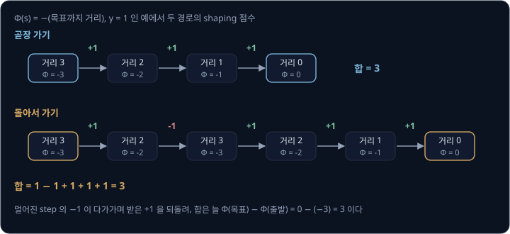
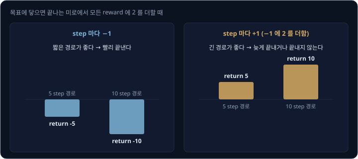
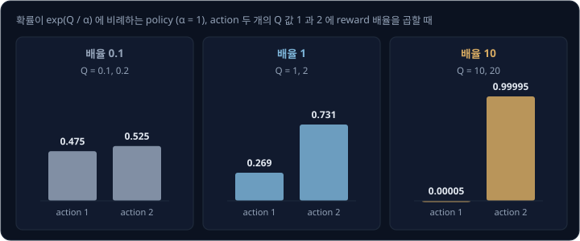
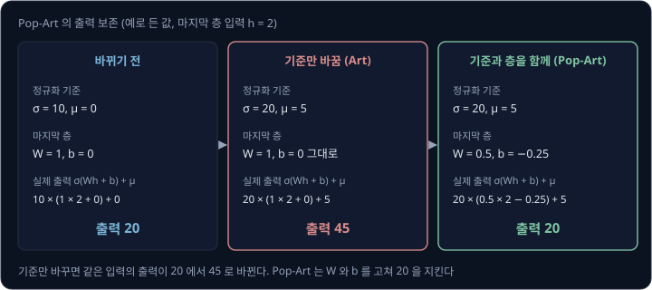
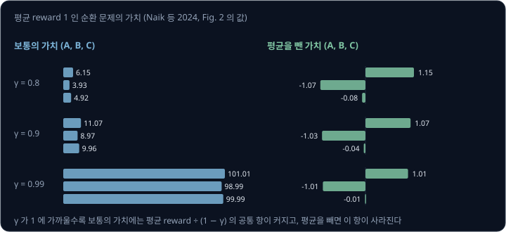

# Reward Scale & Shaping

로봇에 RL 을 쓰다 보면 reward 를 고칠 일이 자주 생긴다. 목표에 가까워질 때 점수를 더 주고(shaping), 넘어지지 않은 step 마다 1 씩 주고(생존
보너스), 값이 너무 커서 10 으로 나누거나 ±1 로 자른다. 어떤 변환은 로봇이 배울 최적 행동을 그대로 두고 학습만 빠르게 하지만, 어떤 변환은
최적 행동 자체를 바꾼다. 그리고 최적 행동을 바꾸지 않는 변환도 SAC 처럼 entropy 를 함께 키우는 알고리즘에서는 결과를 바꾼다. 어떤 변환이
무엇을 바꿀까?

이 강의는 reward 에 함수를 더하는 shaping, 상수를 더하는 shift, 수를 곱하는 scale 을 차례로 본다. shaping 은 Ng 등(1999)과 Wiewiora(2003)의
정리로 보고, shift 는 종료가 있는 문제에서 생기는 생존 보너스로 보고, scale 은 SAC 논문(Haarnoja 등 2018)의 ablation(설정 하나만 바꿔 가며
효과를 재는 실험)으로 본다. 끝으로 reward 의 크기를
알고리즘 안에서 다루는 Pop-Art(van Hasselt 등 2016)와 reward centering(Naik 등 2024)을 숫자로 따라간다.

## 학습 목표

- potential-based shaping 의 합이 경로와 상관없이 정해지는 이유와, 그것이 Q 초기화와 같은 효과를 내는 이유를 설명할 수 있다
- 모든 reward 에 상수를 더할 때 종료가 있는 문제에서 최적 행동이 바뀌는 이유를 숫자로 설명할 수 있다
- reward 배율이 일반 RL 의 최적 policy 는 바꾸지 않지만 SAC 의 policy 는 바꾸는 이유를 설명할 수 있다
- reward 자르기, Pop-Art, reward centering 이 각각 무엇을 바꾸고 무엇을 지키는지 구분할 수 있다

## potential-based shaping 과 Q 초기화

[Bandits & MDPs 의 reward 설계](../bandit-mdp/README.md#reward-설계) 에서 본 potential-based shaping 은 state 마다 점수 $\Phi(s)$ 를 정해 두고
transition 마다 $F = \gamma\Phi(s') - \Phi(s)$ 를 reward 에 더한다. $s$ 는 지금 state 이고, $s'$ 은 다음 state 이고, $\gamma$ 는 미래의 reward 를
깎아 더하는 discount factor 다. Ng 등은 이렇게 더한 shaping 이 최적 policy 를 바꾸지 않는다는 것을 증명했다.

shaping 점수를 episode 동안 더하면 가운데 항이 서로 지워진다. $\gamma = 1$ 로 두면 step 마다 $\Phi(\text{다음 state}) - \Phi(\text{지금 state})$ 를
더하므로, 합에는 마지막 state 의 $\Phi$ 에서 처음 state $s_0$ 의 $\Phi$ 를 뺀 값만 남는다. 끝 state 의 $\Phi$ 를 0 으로 두면 합은 $-\Phi(s_0)$ 이다.

예를 들어 목표까지 칸 수를 거리로 두고 $\Phi(s) = -(\text{목표까지 거리})$ 로 정한다. 출발점의 거리가 3 이면 $\Phi(s_0) = -3$ 이고 목표의
$\Phi$ 는 0 이다. 곧장 가는 경로와 한 번 돌아서 가는 경로의 shaping 점수는 아래와 같다.

| 경로 | 거리의 변화 | step 마다 받는 $F$ | 합 |
| --- | --- | --- | --- |
| 곧장 | 3 → 2 → 1 → 0 | +1, +1, +1 | 3 |
| 돌아서 | 3 → 2 → 3 → 2 → 1 → 0 | +1, −1, +1, +1, +1 | 3 |

돌아가는 경로에서 멀어진 step 은 −1 을 받아, 앞에서 다가가며 받은 +1 을 되돌려 놓는다. 그래서 shaping 점수의 합은 경로와 상관없이 3 이고, 어떤
경로가 더 좋은지는 원래 reward 만으로 정해진다. [Bandits & MDPs 의 reward 설계](../bandit-mdp/README.md#reward-설계) 에서 본, 목표 쪽으로 갈 때만
점수를 받은 자전거가 원을 돌며 점수를 모은 일이 potential-based shaping 에서는 생기지 않는 것도 이 때문이다.

Ng 등은 이 결과를 Q 값으로도 적었다. shaping 을 더한 문제의 최적 Q 는 원래 문제의 최적 Q 에서 $\Phi(s)$ 를 뺀 값이다. 같은 state 의 모든
action 에서 같은 값을 빼므로 어떤 action 의 Q 가 가장 큰지는 바뀌지 않는다.

$$
Q^*_{\text{shaped}}(s, a) = Q^*(s, a) - \Phi(s)
$$

shaping 이 같은 state 의 Q 값을 모두 같은 양만큼 옮긴다면, 처음부터 Q 의 시작값을 옮겨 두는 것과 효과가 같을 수 있다. Wiewiora(2003)는
Q-learning 에서 두 learner 를 비교했다. 하나는 shaping 점수를 받고, 다른 하나는 shaping 점수 없이 Q 의 시작값을 $\Phi(s)$ 만큼 올려 둔다. 같은
learning rate 로 같은 순서의 경험을 받으면 두 learner 의 Q 값 update 는 매번 똑같다. greedy·ε-greedy·Boltzmann(Q 가 큰 action 일수록 확률을
크게 주는 방식) policy 라면 다음 action 을 고를 확률도 같다. 저자는 Sarsa 같은 다른 TD 알고리즘과, 지나온 state 들에 TD 오차를 나눠 주는
eligibility trace 에도 이 결과가 이어진다고 적었다. 그래서 저자는 Q 값을 표로 저장하는 Q-learning 에서는 shaping 대신 Q 를 $\Phi$ 로
초기화하면 된다고 결론지었다.

이 동등성으로 shaping 이 학습을 빠르게 하는 이유도 설명할 수 있다. 목표에 가까운 state 의 Q 를 처음부터 높게 잡아 두는 것과 같아서, 탐색이 그쪽으로
먼저 끌린다. 다만 Q 를 network 로 나타내는 연속 state 문제에서는 초기화를 원하는 대로 정하기 어려워서, 저자는 그런 경우에는 shaping 이 여전히
쓸모가 있을 수 있다고 적었다.

<b>심화: γ 가 1 보다 작을 때의 shaping 합</b>

discount 를 쓰면 step $t$ 의 shaping 점수에 $\gamma^t$ 를 곱해 더한다. $F_t = \gamma\Phi(s_{t+1}) - \Phi(s_t)$ 이므로
$\gamma^t F_t = \gamma^{t+1}\Phi(s_{t+1}) - \gamma^t\Phi(s_t)$ 이고, $t = 0$ 부터 $T - 1$ 까지 더하면 가운데 항이 지워져
$\gamma^T\Phi(s_T) - \Phi(s_0)$ 만 남는다. 끝 state 의 $\Phi$ 가 0 이면 합은 $-\Phi(s_0)$ 이고 경로와 상관없다.

이 합은 출발 state 에만 달려 있으므로, 어느 state 에서 출발하든 그 뒤의 모든 경로에 같은 양이 더해진다. Ng 등의 Corollary 2 에서 Q 값이
$\Phi(s)$ 만큼 옮겨지는 것도 이 때문이다. 저자들은 $\gamma = 1$ 이면 끝 state 의 $\Phi$ 를 0 으로 두어야 한다는 조건을 붙였다. 또 shaping 이
이 꼴이 아니면, 환경의 transition 과 reward 에 따라 최적 policy 가 바뀌는 경우가 반드시 있다는 것도 보였다(Theorem 1 의 필요조건).

> **오해** potential-based shaping 은 최적 policy 를 바꾸지 않으므로 학습 과정에도 아무 영향이 없다.
>
> **사실** shaping 은 Q 의 시작값을 $\Phi(s)$ 만큼 옮겨 둔 것과 같아서, 탐색이 어디로 먼저 향할지를 바꾼다. 바뀌지 않는 것은 끝까지 학습했을 때의 최적 policy 다.

**확인 문제.** $\Phi(s) = -(\text{목표까지 거리})$ 이고 출발점의 거리가 4 다. 4 → 3 → 4 → 3 → 2 → 1 → 0 으로 간 경로의 shaping 점수의 합은 얼마일까($\gamma = 1$)?

답 보기

1. 거리가 줄면 $F = +1$ 이고 늘면 $F = -1$ 이다: +1, −1, +1, +1, +1, +1
2. 합은 $1 - 1 + 1 + 1 + 1 + 1 = 4$
3. 가운데 항이 지워진다는 규칙으로는 $\Phi(\text{목표}) - \Phi(s_0) = 0 - (-4) = 4$

답: 4 다. 곧장 갔을 때와 같다.

## 상수를 더한 reward

모든 reward 에 같은 상수 $c$ 를 더하면, 끝없이 이어지는 문제(continuing task)에서는 모든 state 의 가치가 같은 양만큼 올라간다.
Naik 등에 따르면 reward 를 $c$ 만큼 옮기면 discount 를 쓴 가치는 $c / (1 - \gamma)$ 만큼 커지는데, 모든 state 와 action 에 같은 양이 더해지므로
어떤 action 이 더 좋은지는 그대로다.

episode 가 끝나는 문제에서는 다르다. 끝난 뒤에는 reward 를 받지 않으므로, 상수를 더하면 오래 사는 것이 그 자체로 점수가 된다. 예를 들어
목표에 닿으면 끝나는 미로에서 step 마다 −1 을 받는다고 하자. 5 step 경로의 return 은 −5 이고 10 step 경로는 −10 이라서 짧은 경로가 좋다. 여기에
모든 reward 에 2 를 더하면 step 마다 +1 이 되어, 5 step 경로는 5 를 받고 10 step 경로는 10 을 받는다. 이제는 오래 걸리는 경로가 더 좋고, 목표에
닿지 않고 계속 돌아다닐 수 있다면 그것이 가장 좋다.

| reward | 5 step 경로 | 10 step 경로 | 배우는 행동 |
| --- | --- | --- | --- |
| step 마다 −1 | −5 | −10 | 빨리 끝낸다 |
| step 마다 +1 (−1 에 2 를 더함) | 5 | 10 | 늦게 끝내거나 끝내지 않는다 |

Naik 등도 episode 가 있는 문제에서는 reward 에서 상수를 빼는 것이 문제를 바꿀 수 있다고 적었다. 저자들이 든 예에서는 step 마다 −1 을 받는
격자에서 평균을 빼면 모든 reward 가 0 이 되어 모든 policy 가 똑같이 최적이 된다. 시연을 흉내 내도록 reward 를 학습해 쓰는 imitation learning
에서도 같은 효과가 나타난다. Kostrikov 등(2019)에 따르면 늘 양수인 reward 는 agent 가 더 오래 살아남으려 하게 만들어 최소 step 으로 과제를 풀지
못하게 하고, 늘 음수인 reward 는 agent 가 penalty 를 피하려고 episode 를 일찍 끝내게 한다.

이 효과를 일부러 쓰기도 한다. 한 다리로 뛰어 앞으로 가는 Gymnasium 의 시뮬레이션 로봇 Hopper 는 넘어지지 않은 step 마다
`healthy_reward`(기본값 1)를 받는데, 이 값이 넘어지지 않게 하는 생존 보너스다. 그래서 넘어져서 끝난 경우(terminated)와 시간 제한으로 끊긴
경우(truncated)를 구분해야 한다. 시간 제한을 진짜 종료로 다루면 [DQN → SAC 에서 본](../off-policy/README.md#dqn-의-loss) 것처럼 남은 미래를
지우게 되는데, Pardo 등(2018)은 이를 흔한 실수로 꼽았다.
저자들의 실험에서는 남은 시간을 모르는 PPO 가 $\gamma = 1$ 에서 생존 reward 를 모으려고 제자리에 머무는 법을 배웠다. 반대로 남은 시간을 아는
agent 는 시간 제한이 정말 과제의 끝인 Hopper 에서 시간 제한 직전에 앞으로 넘어지며 거리를 늘리는 동작을 배웠는데, 저자들은 시뮬레이션이 더
이어졌다면 넘어져 끝났을 동작이라고 적었다. 시간 제한을 과제의 끝으로 볼지 학습을 위해 자른 것으로 볼지에 따라 배워야 할 행동이 달라진다.

보행 학습 코드에도 이 효과를 다루는 설정이 있다. legged_gym 의 기본 설정에는 `only_positive_rewards = True` 가 있는데, 설정 파일의 주석에 따르면
이 설정은 step 마다 더한 reward 의 합이 음수이면 0 으로 잘라 일찍 끝내는 문제를 피한다. 보행 reward 는 torque·관절 가속도 같은 penalty 항이
많아서 학습 초반에는 합이 음수가 되기 쉬운데, 그대로 두면 일찍 넘어져 penalty 를 덜 받는 것이 오래 서 있는 것보다 나아진다. 반대로 Unitree 의
humanoid G1 학습 설정은 살아 있는 step 마다 0.15 를 주는 `alive` 항을 두어 생존 보너스를 직접 준다.

> **오해** 모든 reward 에 같은 상수를 더하면 어떤 행동이 더 좋은지는 바뀌지 않는다.
>
> **사실** episode 가 끝나는 문제에서는 끝난 뒤 받는 reward 가 없어서 상수가 생존 보너스나 penalty 가 된다. step 마다 −1 인 미로에 2 를 더하면 5 step 경로의 return 은 −5 에서 5 로 바뀌고 10 step 경로의 return 은 −10 에서 10 으로 바뀌어, 더 좋은 경로가 뒤집힌다.

**확인 문제.** step 마다 −0.5 를 받는 미로에서 3 step 경로와 8 step 경로가 있다. 모든 reward 에 1 을 더하면 두 경로의 return 은 각각 얼마이고, 어느 쪽이 더 좋아질까?

답 보기

1. 더한 뒤의 step 마다 reward 는 $-0.5 + 1 = 0.5$ 다
2. 3 step 경로는 $3 \times 0.5 = 1.5$ 이고 8 step 경로는 $8 \times 0.5 = 4$ 다
3. 원래는 $-1.5$ 와 $-4$ 라서 짧은 경로가 좋았다

답: 1.5 와 4 이고, 긴 경로가 더 좋아진다.

## reward 배율과 SAC 의 temperature

모든 reward 에 양수 $k$ 를 곱하면 모든 return 이 $k$ 배가 되므로, 일반 RL 에서는 어떤 policy 가 더 좋은지가 바뀌지 않는다. Ng 등도 양수를 곱하는
변환은 최적 policy 를 지킨다고 적었다.

SAC 에서는 결과가 달라진다. SAC 는 reward 에, policy 가 action 을 얼마나 고르게 고르는지를 재는 entropy 항을 더한 값을 키우므로
([DQN → SAC](../off-policy/README.md#sac)), reward 를 키우면 entropy 항의 비중이 상대적으로 줄어든다. SAC 의 policy 는 Q 값이 큰 action 일수록
확률이 커지는 꼴이라서, Q 값 사이의 차이가 entropy 항에 곱하는 가중치인 temperature $\alpha$ 에 비해 얼마나 큰지가 policy 의 모양을 정한다.

예를 들어 action 이 둘이고 Q 값이 1 과 2 이며, 확률이 $\exp(Q / \alpha)$($e \approx 2.718$ 을 $Q / \alpha$ 번 거듭제곱한 값)에 비례하는 policy 를
$\alpha = 1$ 로 쓴다고 하자. reward 배율을 바꾸면
Q 값도 같은 배율로 바뀐다.

| reward 배율 | Q 값 | 두 action 의 확률 | policy 의 모양 |
| --- | --- | --- | --- |
| 0.1 | 0.1, 0.2 | 0.475, 0.525 | 거의 고르게 고름 |
| 1 | 1, 2 | 0.269, 0.731 | 좋은 쪽을 더 자주 고름 |
| 10 | 10, 20 | 0.00005, 0.99995 | 거의 한쪽만 고름 |

reward 에 10 을 곱하는 것은 $\alpha$ 를 10 으로 나누는 것과 같은 효과를 낸다. SAC 논문의 저자들은 reward 배율이 temperature 의 역수 역할을 해서
SAC 가 이 값에 특히 민감하다고 적었다. 배율이 작으면 policy 가 거의 고르게 퍼져 reward 를 활용하지 못한다. 배율이 크면 거의 한 action 만 고르는
deterministic policy 가 되어, 탐색이 모자라 나쁜 local minimum 에 빠진다. 저자들은 실제로 reward 배율이 조정이 필요한 유일한 hyperparameter 였다고 적었고, 환경마다 다른 값을 썼다.

| 환경 (SAC 논문 부록 Table 2) | reward 배율 |
| --- | --- |
| Hopper-v1, Walker2d-v1, HalfCheetah-v1, Ant-v1 | 5 |
| Humanoid-v1 | 20 |
| Humanoid (rllab) | 10 |

같은 저자들은 후속 논문에서 reward 의 크기가 과제마다 다를 뿐 아니라 학습 중 policy 가 좋아지면서도 바뀐다는 점을 들어 temperature 를 자동으로
조정하는 방법을 내놓았다. 그 방법은 [DQN → SAC 의 temperature 자동 조정](../off-policy/README.md#temperature-자동-조정) 에서 다뤘다. 자동 조정을
쓰면 reward 배율의 영향이 줄지만, critic 이 다루는 값의 크기는 여전히 배율을 따라간다. 이 크기가 Huber loss 의 경계와 맞지 않을 때 생기는 문제는
[Critic Loss](../critic-loss/README.md#reward-크기와-huber-의-직선-구간) 에서 봤다.

> **오해** reward 에 양수를 곱하는 것은 어떤 RL 알고리즘에서나 결과를 바꾸지 않는다.
>
> **사실** 최적 policy 를 지키는 것은 return 만 키우는 일반 RL 의 경우다. SAC 에서는 배율이 temperature 의 역수처럼 작동해, 두 action 의 Q 값이 1 과 2 인 예에서 배율 10 이면 확률이 0.731 에서 0.99995 로 몰린다.

**확인 문제.** action 두 개의 Q 값이 0 과 1 이고, 확률이 $\exp(Q / \alpha)$ 에 비례하며 $\alpha = 0.5$ 다. 좋은 action 의 확률은 얼마일까? reward 를 2 배 하면 어떻게 될까?

답 보기

1. $\alpha = 0.5$ 이면 지수는 $0 / 0.5 = 0$ 과 $1 / 0.5 = 2$ 다. 확률은 $e^2 / (e^0 + e^2) = 7.39 / 8.39 \approx 0.88$
2. reward 를 2 배 하면 Q 값이 0 과 2 가 되어 지수는 0 과 4 다. 확률은 $e^4 / (1 + e^4) = 54.6 / 55.6 \approx 0.98$

답: 약 0.88 에서 약 0.98 로 커진다. reward 를 2 배 하는 것은 $\alpha$ 를 절반으로 줄이는 것과 같다.

## reward 자르기와 Pop-Art

DQN 논문(Mnih 등 2015)의 저자들은 Atari 게임마다 점수의 크기가 크게 달라서, 양수 reward 는 모두 1 로 자르고 음수 reward 는 모두 −1 로 잘랐다.
저자들은 그래야 오차의 미분이 커지는 것을 막고 모든 게임에 같은 learning rate 를 쓸 수 있다고 적었다. 하지만 이 자르기는 상수를 곱하는 것과 달리 reward 사이의 비율을
바꾼다. van Hasselt 등(2016)은 Ms. Pac-Man 에서 유령을 먹는 reward(100 이상)와 알약을 먹는 reward(25)가 잘린 뒤 모두 1 이 되어, 자른 agent 는
유령을 알약보다 더 노리지 않는다고 적었다. 저자들은 자르면 agent 가 reward 의 합 대신 reward 를 받는 횟수를 키우게 된다고 표현했다.

reward 를 자르지 않으면서 크기 문제를 푸는 방법으로 저자들은 **Pop-Art** 를 제안했다. Pop-Art 는 target 의 평균 $\mu$ 와 표준편차 $\sigma$ 를 학습
중에 이동 평균으로 추적하고, network 는 정규화한 target $(y - \mu) / \sigma$ 를 배운다. 그래서 network 의 출력은 늘 비슷한 크기에 머문다. 실제 Q
값은 network 의 출력에 $\sigma$ 를 곱하고 $\mu$ 를 더해 얻는다.

$\mu$ 와 $\sigma$ 가 바뀌는 순간에는 문제가 생긴다. 정규화 기준이 바뀌면 network 가 그대로여도 실제 Q 값이 바뀌어, 이미 배운 다른 state 의
값까지 흔들린다. Pop-Art 는 기준을 바꿀 때 network 의 마지막 층 weight $W$ 와 bias $b$ 를 함께 고쳐서 실제 출력이 그대로 남게 한다. 이름의 Pop 은
출력을 정확히 지킨다는 뜻의 Preserving Outputs Precisely 를 줄인 말이고, Art 는 target 의 크기를 맞춘다는 뜻의 Adaptively Rescaling Targets 를
줄인 말이다.

예를 들어 마지막 층에 들어오는 값이 $h = 2$ 이고 $W = 1$, $b = 0$, $\sigma = 10$, $\mu = 0$ 이면 실제 출력은 $10 \times (1 \times 2 + 0) + 0 = 20$ 이다.
큰 reward 를 받아 기준이 $\sigma = 20$, $\mu = 5$ 로 바뀌면 Pop-Art 는 마지막 층을 아래처럼 고친다.

| 값 | 식 | 결과 |
| --- | --- | --- |
| 새 $W$ | $W \times \sigma_{\text{old}} / \sigma_{\text{new}} = 1 \times 10 / 20$ | 0.5 |
| 새 $b$ | $(\sigma_{\text{old}} b + \mu_{\text{old}} - \mu_{\text{new}}) / \sigma_{\text{new}} = (0 + 0 - 5) / 20$ | −0.25 |
| 실제 출력 | $\sigma_{\text{new}}(W h + b) + \mu_{\text{new}} = 20 \times (0.5 \times 2 - 0.25) + 5$ | 20 |

기준이 바뀌어도 출력은 20 그대로다. 마지막 층만 고치므로 앞의 층이 배운 표현은 그대로 남는다.

저자들은 출력을 고치지 않고 기준만 바꾸면 어떻게 되는지도 보였다. 입력이 대부분 0 ~ 1023 인데 1000 번에 한 번 target 이 65,535 로 튀는
regression 문제에서, 기준만 바꾸는 방식(Art)에서는 큰 target 이 들어온 직후 오차가 커졌다. 바뀐 기준이 작은 입력에 대한 출력까지 함께 바꿨기 때문이다.

저자들의 Atari 실험에서 Pop-Art 를 쓴 Double DQN 은 Ms. Pac-Man 에서 유령을 적극적으로 쫓았다. 학습 중 gradient norm 의 범위는 자르지 않으면
여섯 자릿수 넘게 퍼졌고 자르면 네 자릿수 가까이 퍼졌지만, Pop-Art 에서는 두 자릿수 안이었다. Pop-Art 는 57 개 게임 가운데 32 개에서 자른 경우와
같거나 나았고, 점수의 중앙값은 0.4% 올랐고 평균은 34% 올랐다. Time Pilot 처럼 Pop-Art 가 더 나빴던 게임도 있었는데, 저자들은 자르기를 그만두면 문제
자체가 바뀌기 때문이라고 적었다.

> **오해** DQN 처럼 reward 를 ±1 로 자르면 크기만 줄어들 뿐 배우는 행동은 같다.
>
> **사실** 자르기는 reward 사이의 비율을 바꾼다. Ms. Pac-Man 에서 유령(100 이상)과 알약(25)이 모두 1 이 되어, 자른 agent 는 유령을 더 노리지 않는다. Pop-Art 는 자르지 않고 target 을 정규화해 이 차이를 지킨다.

<b>심화: Pop-Art 의 통계와 출력 보존 식</b>

Pop-Art 는 step 마다 target $Y_t$ 로 이동 평균을 고친다. $\beta$ 는 새 target 에 주는 비율이다.
$\mu_t = (1 - \beta)\mu_{t-1} + \beta Y_t$, $\nu_t = (1 - \beta)\nu_{t-1} + \beta Y_t^2$ 이고 $\sigma_t^2 = \nu_t - \mu_t^2$ 다. 저자들의 Proposition 2 에 따르면 정규화한 target 의 크기는 $\sqrt{(1 - \beta) / \beta}$ 를 넘지 않아서,
$\beta = 10^{-4}$ 이면 −100 과 100 사이에 머문다.

출력 $f(x) = \sigma(W h(x) + b) + \mu$ 를 지키려면 새 기준에서도 $\sigma_{\text{new}}(W_{\text{new}} h + b_{\text{new}}) + \mu_{\text{new}}$ 가 같아야 한다.
$h$ 에 곱해지는 부분과 상수 부분을 따로 맞추면 $W_{\text{new}} = (\sigma / \sigma_{\text{new}}) W$, $b_{\text{new}} = (\sigma b + \mu - \mu_{\text{new}}) / \sigma_{\text{new}}$
를 얻는다(Proposition 1). 본문의 표가 이 식에 숫자를 넣은 것이다.

저자들은 정규화하지 않으면 target 의 크기가 두 배가 될 때마다 아래 층의 update 가 네 배가 된다고 적었다. Pop-Art 에서 gradient norm 의 범위가
좁았던 것도 이 때문이다.

## reward centering

Pop-Art 가 target 의 크기를 network 밖에서 맞춘다면, reward centering 은 reward 자체에서 평균을 뺀다. Naik 등은 지금까지 받은 reward 의 평균
$\bar R$ 을 추정해 두고, 받은 reward 에서 $\bar R$ 을 뺀 값으로 학습하는 방법을 정리했다. $\bar R$ 은 step 마다 $\bar R \leftarrow \bar R + \beta(R - \bar R)$
로 고친다. $R$ 은 이번 step 에 받은 reward 이고, $\beta$ 는 0 과 1 사이의 작은 비율이며, $\leftarrow$ 는 왼쪽 값을 오른쪽 값으로 바꾼다는 뜻이다.

discount 를 쓴 가치에는 모든 state 에 공통인 큰 항이 들어 있어서 평균을 뺀다. 저자들에 따르면 가치는 policy 의 평균 reward $r(\pi)$ 를 $1 - \gamma$
로 나눈 항, state 마다 다른 부분, $\gamma$ 가 1 에 가까울수록 작아지는 나머지로 나뉜다. 첫 항은 모든 state 에 똑같이 들어 있어서 어떤 action 이
좋은지와는 상관없지만, $\gamma$ 가 1 에 가까울수록 커진다. 평균 reward 가 1 이고 $\gamma = 0.99$ 이면 이 항이 $1 / 0.01 = 100$ 이라서, network 는
state 사이의 차이가 1 정도인 값을 100 근처에서 나타내야 한다.

저자들이 든 state 세 개짜리 순환 문제(평균 reward 1)의 가치는 아래와 같다.

| $\gamma$ | 보통의 가치 (A, B, C) | 평균을 뺀 가치 (A, B, C) |
| --- | --- | --- |
| 0.8 | 6.15, 3.93, 4.92 | 1.15, −1.07, −0.08 |
| 0.9 | 11.07, 8.97, 9.96 | 1.07, −1.03, −0.04 |
| 0.99 | 101.01, 98.99, 99.99 | 1.01, −1.01, −0.01 |

이 공통 항이 크면 network 가 state 사이의 차이를 나타내기 어려워진다. 표의 $\gamma = 0.99$ 줄에서 A 와 B 의 차이는 $101.01 - 98.99 = 2.02$ 인데, network 의 출력이 1% 만 틀려도 그 오차는 약 1 이라서 두 state 의 차이의 절반에 이른다. 평균을 뺀 가치 1.01 과 −1.01 에서는 같은 1% 오차가 0.01 에 그친다.

$\gamma$ 가 0.8 에서 0.99 로 가면 보통의 가치는 5 근처에서 100 근처로 커지지만, 평균을 뺀 가치는 1, −1, 0 근처에 머문다. state 사이의 차이는
두 경우 모두 2 정도로 같다. reward 에 상수 $c$ 를 더해도 평균이 $c$ 만큼 커져 빼는 값도 커지므로, 평균을 뺀 가치는 바뀌지 않는다. 저자들은 서버에 들어오는
요청을 받을지 거절할지 고르는 Access-Control Queuing 문제에서 모든 reward 에 −8 에서 8 까지의 상수를 더해 보았고, 평균을 빼지 않은 Q-learning 은
상수마다 학습 결과가 크게 달랐다고 보고했다.

reward centering 은 끝없이 이어지는 문제를 위한 방법이다. 앞의 상수를 더한 reward 절에서 본 것처럼 episode 가 끝나는 문제에서는 상수를 빼는 것이 생존 보너스나
penalty 를 바꿔 문제 자체를 바꿀 수 있고, 저자들도 이 한계를 적었다. 저자들은 부록에서 reward centering 이 $\Phi(s) = r(\pi) / (1 - \gamma)$ 로
모든 state 에 같은 값을 쓰는 potential-based shaping 과 같다는 것도 보였다.

이 강의에서 본 변환을 무엇을 지키는지로 모으면 아래와 같다.

| 변환 | 일반 RL 의 최적 policy | SAC 의 policy | 함께 볼 것 |
| --- | --- | --- | --- |
| potential-based shaping | 지킨다 | 지킨다. Q 가 state 마다 같은 양만큼 옮겨진다 | 학습 초반의 탐색 방향이 바뀐다 |
| 모든 reward 에 상수 더하기 | 끝없는 문제는 지키고, episode 문제는 바꿀 수 있다 | 일반 RL 과 같다 | 생존 보너스와 일찍 끝내기 |
| 모든 reward 에 양수 곱하기 | 지킨다 | 바뀐다(temperature 의 역수) | critic 이 다루는 값의 크기 |
| ±1 로 자르기 | 바꿀 수 있다 | 바꿀 수 있다 | reward 사이의 비율이 사라진다 |
| Pop-Art | 지킨다 | 해당 없음(target 정규화) | 마지막 층을 고쳐 출력을 지킨다 |
| reward centering | 끝없는 문제는 지킨다 | 일반 RL 과 같다 | episode 문제에서는 상수 빼기와 같은 위험 |

> **오해** reward 의 평균을 빼는 것은 어떤 문제에서나 최적 행동을 바꾸지 않는다.
>
> **사실** 끝없이 이어지는 문제에서는 평균을 뺀 가치가 state 사이의 차이를 그대로 지킨다. episode 가 끝나는 문제에서는 step 마다 −1 인 격자에서 평균을 빼면 모든 reward 가 0 이 되어 모든 policy 가 똑같이 최적이 되는 것처럼 문제가 바뀐다.

**확인 문제.** 평균 reward 가 2 인 끝없이 이어지는 문제에서 $\gamma = 0.95$ 다. 모든 state 의 가치에 공통으로 들어가는 항은 얼마이고, reward 에서 평균을 빼면 이 항은 어떻게 될까?

답 보기

1. 공통 항은 평균 reward 를 $1 - \gamma$ 로 나눈 값이다: $2 \div (1 - 0.95) = 2 \div 0.05 = 40$
2. 평균 2 를 빼면 평균 reward 가 0 이 되므로 공통 항은 $0 \div 0.05 = 0$

답: 40 이고, 평균을 빼면 0 이 된다.

## 정리

- potential-based shaping 점수의 합은 경로와 상관없이 $\Phi(\text{끝}) - \Phi(s_0)$ 이다. 거리 3 에서 출발하면 곧장 가도 돌아가도 3 이고, Q-learning 에서는 Q 를 $\Phi$ 로 초기화한 것과 같다
- 상수를 더하면 끝없이 이어지는 문제에서는 가치가 $c / (1 - \gamma)$ 만큼 옮겨질 뿐이지만, episode 가 끝나는 문제에서는 생존 보너스나 penalty 가 된다. step 마다 −1 에 2 를 더하면 긴 경로가 더 좋아진다
- 양수 배율은 일반 RL 의 최적 policy 를 지키지만 SAC 에서는 temperature 의 역수처럼 작동한다. SAC 논문의 저자들은 reward 배율을 환경마다 5, 10, 20 으로 정했다
- reward 를 ±1 로 자르면 reward 사이의 비율이 바뀐다. Pop-Art 는 자르지 않고 target 을 정규화하면서 마지막 층을 고쳐 출력을 지킨다
- reward centering 은 평균 reward 를 빼서 $\gamma = 0.99$ 에서 100 근처이던 가치를 1, −1, 0 근처로 옮긴다. 끝없이 이어지는 문제를 위한 방법이다

다음 강의 [RL Experiments](../rl-experiments/README.md) 에서는 이런 변환이 정말 도움이 됐는지 확인하는 방법을 본다. 같은 알고리즘도 seed 만
바꾸면 결과가 크게 갈리므로, 두 설정을 비교할 때 seed 를 몇 개 쓰고 결과를 어떻게 적어야 하는지를 숫자로 따라간다.

## 참고 자료

- Andrew Y. Ng, Daishi Harada, Stuart Russell, [Policy Invariance Under Reward Transformations](https://people.eecs.berkeley.edu/~russell/papers/icml99-shaping.pdf)
  (ICML 1999) — Theorem 1 과 Corollary 2 의 $Q^*_{\text{shaped}} = Q^* - \Phi$
- Eric Wiewiora, [Potential-based Shaping and Q-Value Initialization are Equivalent](https://arxiv.org/abs/1106.5267) (JAIR 2003) — 2 절의 두
  learner 비교와 Theorem 1, 2. 네 쪽짜리라 한 번에 읽힌다
- Tuomas Haarnoja 외, [Soft Actor-Critic](https://arxiv.org/abs/1801.01290) (2018) — 5.2 절의 reward scale ablation(Fig. 3b)과 부록 Table 2 의
  환경별 배율
- Tuomas Haarnoja 외, [Soft Actor-Critic Algorithms and Applications](https://arxiv.org/abs/1812.05905) (2018) — 서론과 5 절의 temperature 자동
  조정을 도입한 이유
- Hado van Hasselt 외, [Learning values across many orders of magnitude](https://arxiv.org/abs/1602.07714) (NeurIPS 2016) — 2 절의 Pop-Art 식과
  4 절의 Atari 결과, Ms. Pac-Man 사례
- Abhishek Naik 외, [Reward Centering](https://arxiv.org/abs/2405.09999) (RLC 2024) — Fig. 2 의 세 state 예, 상수 shift 실험(Fig. 5), 5 절의 episode
  문제에 대한 한계
- Fabio Pardo 외, [Time Limits in Reinforcement Learning](https://arxiv.org/abs/1712.00378) (ICML 2018) — 시간 제한을 종료로 다루는 실수와 Hopper
  사례
- Ilya Kostrikov 외, [Discriminator-Actor-Critic](https://arxiv.org/abs/1809.02925) (ICLR 2019) — 4.1 절의 양수·음수 reward 가 만드는 생존 보너스와
  일찍 끝내기
- Volodymyr Mnih 외, [Human-level control through deep reinforcement learning](https://storage.googleapis.com/deepmind-media/dqn/DQNNaturePaper.pdf)
  (Nature 2015) — Methods 의 reward 자르기와 그 한계
- Gymnasium 문서, [Hopper](https://gymnasium.farama.org/environments/mujoco/hopper/) — `healthy_reward` 와 종료 조건
