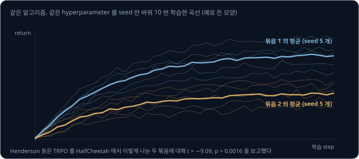
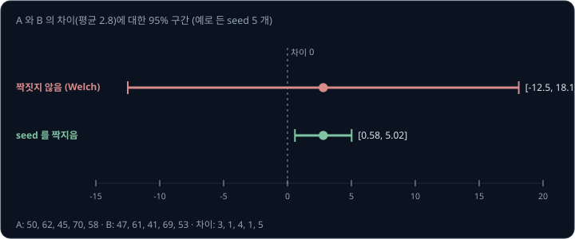
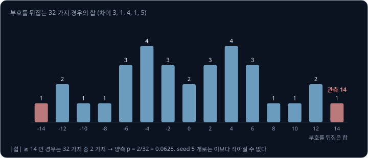
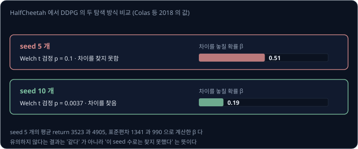
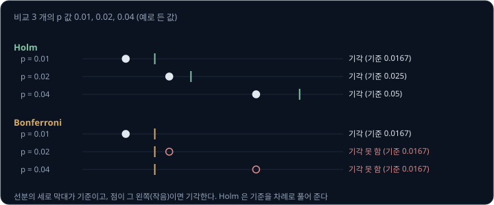
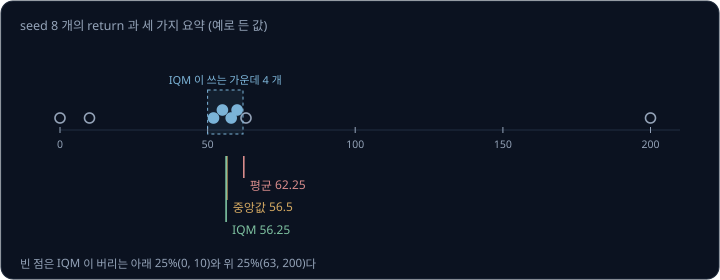
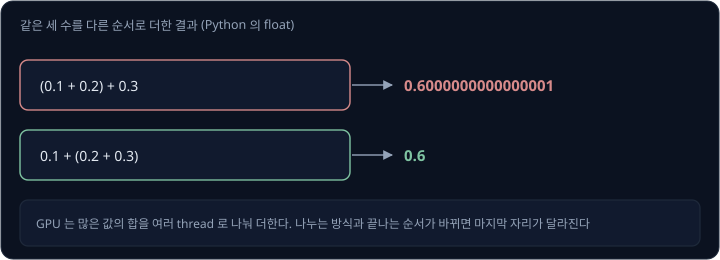

# RL Experiments

critic loss 를 바꾸거나 reward 를 고친 뒤 학습 곡선이 조금 올라갔다면, 그 변화가 정말 바꾼 것 덕분일까? RL 에서는 network 의 초기 weight,
탐색 noise, 환경의 무작위성이 모두 random seed 에 달려 있어서, 아무것도 바꾸지 않고 seed 만 바꿔도 결과가 크게 달라진다. Henderson 등(2018)은
같은 알고리즘과 같은 hyperparameter 로 seed 10 개를 학습한 뒤 5 개씩 두 묶음으로 나눴는데, 두 묶음의 평균 곡선이 통계적으로 다르다는 검정 결과가
나왔다. 그렇다면 두 설정을 비교할 때 seed 를 몇 개 쓰고, 결과를 어떻게 계산하고 적어야 차이를 믿을 수 있을까?

이 강의는 seed 가 만드는 분산을 먼저 보고, 비교 조건을 맞추는 방법, seed 를 짝지어 차이를 줄이는 방법, 작은 seed 수에서 쓸 수 있는 검정과
그 한계를 숫자로 따라간다. 이어서 Agarwal 등(2021)이 권한 IQM(가운데 50% 의 평균)과 구간 추정, 실험 전에 계획을 적어 두는 사전 등록, 같은 seed 로도 결과가 갈리는
이유를 본다.

## 학습 목표

- 같은 알고리즘도 seed 묶음에 따라 결과가 갈리는 이유와, 비교 조건(step 예산, 평가 방식, 기준선)을 맞추는 방법을 설명할 수 있다
- seed 를 짝지은 비교의 t 구간(t 분포로 구한 신뢰 구간)과 정확 sign-flip 검정(차이의 부호를 뒤집어 보는 검정)을 계산하고, seed 5 개로는
  양측 p 값(두 설정이 같을 때 이만큼 큰 차이가 우연히 나올 확률)이 0.0625 아래로 내려갈 수 없는 이유를 설명할 수 있다
- 여러 비교를 할 때 Holm 보정(p 값을 작은 것부터 차례로 다른 기준과 비교하는 보정)이 필요한 이유와, IQM 과 bootstrap 구간(가진 결과를 다시
  뽑아 구한 구간)이 평균이나 중앙값보다 나은 점을 설명할 수 있다
- 같은 seed 와 같은 코드로도 GPU 에서 결과가 달라지는 이유를 설명할 수 있다

## seed 와 분산

seed 는 무작위 수를 만드는 출발점이다. RL 에서는 network 의 초기 weight, action 을 고를 때의 탐색 noise, replay buffer 에서 뽑는 순서,
환경의 시작 상태가 모두 seed 에서 나온다. 학습 초반의 작은 차이가 어떤 경험을 모을지를 바꾸고, 그 경험이 다시 policy 를 바꾸므로 차이가
커진다.

Henderson 등은 policy gradient 알고리즘인 TRPO 를 치타 모양 로봇이 달리는 시뮬레이션 환경 HalfCheetah 에서 같은 hyperparameter 로 seed 10 개
학습한 뒤, 5 개씩 두 묶음으로 나눠 평균 곡선을 그렸다(Fig. 5). 두 묶음의 평균 차이를 그 흔들림의 크기로 나눈 값 $t$ 로 차이를 판정하는 t 검정을
학습 전체에 걸쳐 한 결과는 $t = -9.09$, $p = 0.0016$ 이었다. p 값은 두 묶음이 실제로 같을 때 이만큼 큰 차이가 우연히 나올 확률이다. 곡선의 점들이 서로
독립이 아니라서 이 p 값을 그대로 믿기는 어렵지만, 이 결과로 seed 만 달리한 두 묶음이 서로 다른 알고리즘처럼 보일 수 있다는 것은 알 수 있다.

Colas 등(2018)이 OpenAI 가 공개한 구현 모음 OpenAI Baselines 의 같은 DDPG 를 seed 5 개씩 두 번 학습해 비교한 예에서도, 두 묶음의 분산이 달라도
쓸 수 있는 Welch t 검정의 p 는 0.031 이었다. p 가 0.05 보다 작으면 다르다고 판정하는 5% 기준으로는 같은 DDPG 의 두 실행이 "다르다" 고
판정된다.

그런데 실제 논문에서는 seed 를 많이 쓰지 않는다. Henderson 등이 정리한 이전 연구들은 대개 3 ~ 5 번 학습한 결과를 냈고(Table 7), 일부는 가장
좋은 5 번이나 2 ~ 3 번만 골라 평균했다. 저자들은 정해진 seed 수를 권할 수는 없지만, 실제 차이를 찾아낼 확률을 미리 계산하는 검정력 분석으로
대략의 수를 정할 수 있다고 적었다. 저자들 자신은 기본으로 5 번 학습했다. Agarwal 등에 따르면 3 ~ 10 번이 흔한데, Atari 게임 50 여 개에서 5 번씩만
학습해도 GPU 로 1,000 일 넘게 걸리기 때문이다.

> **오해** seed 5 개의 평균이 다르면 두 알고리즘의 성능이 다르다.
>
> **사실** 같은 DDPG 를 seed 5 개씩 두 번 학습한 Colas 등의 실험에서도 Welch t 검정의 p 가 0.031 로 나왔다. seed 5 개의 평균 차이는 seed 의 분산만으로도 생긴다.

## 비교 조건 맞추기

두 설정을 비교하기 전에 seed 말고 다른 것이 달라지지 않게 맞춘다.

| 맞출 것 | 이유 | 근거 |
| --- | --- | --- |
| 환경 step 예산 | 더 오래 학습한 쪽이 이기는 것을 막는다 | Machado 등은 정해 둔 frame(게임 화면 한 장) 수에서 성능을 적으라고 권했다 |
| 평가 방식 | 평가 episode 수와 평가할 때의 탐색 여부가 점수를 바꾼다 | Agarwal 등은 Atari 알고리즘 DER(Data-Efficient Rainbow)을 다른 알고리즘 CURL 의 평가 방식으로 재면 CURL 보다 높게 나온다고 보였다 |
| 평가 시점 | 마지막 한 번의 점수는 흔들린다 | Machado 등은 마지막 $k$ 개 episode 의 평균을 적으라고 권했다 |
| 구현 | 같은 알고리즘도 코드마다 성능이 다르다 | Henderson 등은 세 가지 TRPO 구현이 같은 환경에서 크게 다른 곡선을 냈다고 보였다 |
| 기준선 | 학습 전 policy, 무작위 policy 의 점수를 알아야 차이의 크기를 읽는다 | |

평가에서는 탐색 noise 를 끄고 policy 가 정하는 action 하나만 쓰는 결정론적 평가가 흔하다. SAC 라면 Gaussian 의 평균 action 을 쓴다. 학습
중 모은 episode 의 return 은 탐색 noise 가 섞여 있어서 policy 자체의 성능보다 낮게 나온다. 학습 전 policy 의 점수는 0 이 아닐 수 있다. 예를 들어
넘어지지 않은 step 마다 1 을 주는 환경에서는 가만히 서 있기만 해도 점수가 쌓이므로, 이 점수를 알아야 학습으로 점수가 얼마나 올랐는지를 읽을 수
있다.

가장 좋은 점수만 골라 적어도 비교가 한쪽으로 기운다. Henderson 등은 최고 return 만 적는 것은 공정한 비교에 맞지 않고, 평균 return 도 seed 사이의
범위를 모르면 오해를 부를 수 있다고 적었다. 예를 들어 실제 성능이 50 이고 평가할 때마다 −5 ~ 5 의 noise 가 고르게 섞인다면, 평가 10 번 가운데
가장 높은 점수의 기댓값은 $50 + (-5 + 10 \times 10 / 11) \approx 54.1$ 이다. 학습이 전혀 나아지지 않아도 학습 중간에 저장한 network(checkpoint) 가운데
가장 좋은 것을 고르는 것만으로 4 점쯤 올라가므로, 비교하는 두 설정에 같은 규칙(예를 들어 마지막 평가의 점수)을 미리 정해 쓴다.

Henderson 등은 결과를 낼 때 hyperparameter, 구현 세부, 실험 설정, 평가 방법을 모두 적으라고 권했고, 이것이 재현성에서 가장 중요한 단계라고
적었다.

## seed 를 짝지은 비교

seed 마다 결과가 크게 다르면, 두 설정의 평균 차이를 seed 사이의 분산이 덮어 버린다. 이 분산을 줄이는 방법이 같은 seed 를 두 설정에 함께 쓰고
seed 마다 차이를 계산하는 짝지은 비교다. 같은 seed 는 같은 초기 weight 와 같은 환경 무작위성을 주므로, 어떤 seed 가 운 좋게 쉬운 시작 상태를
만들었다면 두 설정 모두 그 덕을 보고, 이 공통 부분은 차이를 계산할 때 지워진다.

예를 들어 설정 A(새 critic loss)와 설정 B(기존)를 seed 5 개로 학습한 마지막 return 이 아래와 같다고 하자.

| seed | A | B | 차이 A − B |
| --- | --- | --- | --- |
| 1 | 50 | 47 | 3 |
| 2 | 62 | 61 | 1 |
| 3 | 45 | 41 | 4 |
| 4 | 70 | 69 | 1 |
| 5 | 58 | 53 | 5 |

A 와 B 의 return 은 seed 에 따라 41 에서 70 까지 퍼져 있지만, 차이는 모두 1 ~ 5 의 양수다. 차이의 평균은 2.8 이고 표준편차는 1.79 다. 평균이
seed 묶음에 따라 흔들리는 정도인 표준오차는 $1.79 / \sqrt{5} = 0.8$ 이다. 95% 구간은 같은 실험을 되풀이하면 그렇게 만든 구간의 95% 가 실제
차이를 포함하는 범위로, 평균에서 표준오차의 몇 배만큼 양쪽으로 넓혀 만든다. 그 배수는 seed 가 적을 때 정규분포 대신 쓰는 t 분포에서 구하고,
차이가 5 개라서 자유도 $5 - 1 = 4$ 의 t 분포를 쓰면 2.776 이다. 그래서 95% 구간은 $2.8 \pm 2.776 \times 0.8$ 을 계산한 $[0.58, 5.02]$ 이고,
0 을 포함하지 않는다.

같은 return 을 짝짓지 않고 두 묶음으로 비교하면(Welch t 구간) 평균 차이는 똑같이 2.8 이지만, seed 사이의 큰 분산이 그대로 들어가 95% 구간이
$[-12.5, 18.1]$ 로 넓어지고 0 을 포함한다.

짝짓기가 효과를 내려면 같은 seed 가 두 설정에 비슷한 운을 줘야 한다. 바꾼 것이 학습 경로를 처음부터 크게 바꾸면 같은 seed 라도 공통 부분이
적어 구간이 덜 좁아진다. 같은 seed 로도 GPU 에서 결과가 갈리는 것도 짝짓기의 효과를 줄인다.

<b>심화: 짝지은 t 구간의 계산</b>

차이 $d_1, \dots, d_n$ 의 평균을 $\bar d$, 표본 표준편차를 $s = \sqrt{\sum_i (d_i - \bar d)^2 / (n - 1)}$ 로 두면 95% 구간은
$\bar d \pm t_{0.975,\, n-1} \cdot s / \sqrt n$ 이다. $t_{0.975,\, n-1}$ 은 자유도 $n - 1$ 인 t 분포의 97.5% 지점이다.

본문의 차이 3, 1, 4, 1, 5 에서 $\bar d = 14 / 5 = 2.8$ 이다. 평균과의 차이는 0.2, −1.8, 1.2, −1.8, 2.2 이고 제곱의 합은
$0.04 + 3.24 + 1.44 + 3.24 + 4.84 = 12.8$ 이라서 $s = \sqrt{12.8 / 4} = \sqrt{3.2} \approx 1.789$ 다. $t_{0.975,\,4} = 2.776$ 이므로 구간의 반폭은
$2.776 \times 1.789 / \sqrt 5 \approx 2.22$ 이고, 구간은 $[0.58, 5.02]$ 다. t 통계량은 $2.8 / 0.8 = 3.5$ 이고 양측 p 는 약 0.025 다.

이 계산은 차이가 정규분포를 따른다고 가정한다. seed 가 적으면 이 가정을 확인할 방법이 거의 없어서, 다음 절의 정확 검정을 쓴다.

**확인 문제.** seed 4 개의 짝지은 차이가 2, 2, 2, 2 다. 차이의 평균과 표준편차는 얼마이고, 짝지은 t 구간은 어떻게 될까?

답 보기

1. 평균은 $8 \div 4 = 2$ 다
2. 모든 차이가 평균과 같아서 표준편차는 0 이다
3. 구간의 반폭이 $t \times 0 / \sqrt 4 = 0$ 이라서 구간은 $[2, 2]$ 다

답: 평균 2, 표준편차 0 이고 구간은 한 점 2 가 된다. 실제 실험에서 차이가 이렇게 똑같이 나오는 일은 드물고, 나오면 측정이 너무 거칠지 않은지 먼저 의심한다.

## 정확 sign-flip 검정

t 구간은 차이가 정규분포를 따른다고 가정하지만, sign-flip 검정은 이 가정 없이 쓸 수 있다. 두 설정이 같다는 가정을 귀무가설(null hypothesis)
이라고 하는데, 귀무가설이 맞다면 각 seed 의 차이가 + 로 나올지 − 로 나올지는 반반이어야 한다. 그래서 차이의 부호를 뒤집는 모든 경우를 만들어,
관측한 차이의 합과 같거나 더 극단적인 합이 몇 번 나오는지 센다. 양측 p 는 + 쪽과 − 쪽의 극단을 모두 세는 p 값이다.

seed 5 개면 부호를 정하는 경우가 $2^5 = 32$ 가지다. 앞 절의 차이 3, 1, 4, 1, 5 는 모두 + 라서 합 14 는 32 가지 가운데 가장 크다. 합의 절댓값이
14 이상인 경우는 모두 + 와 모두 − 의 두 가지라서 양측 p 는 $2 / 32 = 0.0625$ 다. 같은 데이터의 짝지은 t 검정은 $t = 2.8 / 0.8 = 3.5$(자유도 4)
에서 p 가 약 0.025 였는데, 그 차이는 t 검정의 정규분포 가정에서 온다.

이 예에서 seed 5 개는 모두 같은 방향의 차이를 보였는데도 양측 p 가 0.05 아래로 내려가지 않는다. 어떤 데이터든 가장 극단적인 경우가 32 가지 가운데
2 가지(모두 + 와 모두 −)라서, seed 5 개로는 양측 p 가 0.0625 보다 작아질 수 없다. seed 수에 따른 가장 작은 양측 p 는 아래와 같다.

| seed 수 $n$ | 부호 경우의 수 $2^n$ | 가장 작은 양측 p |
| --- | --- | --- |
| 5 | 32 | $2 / 32 = 0.0625$ |
| 6 | 64 | $2 / 64 = 0.031$ |
| 10 | 1,024 | $2 / 1024 \approx 0.002$ |

<b>심화: sign-flip 검정의 일반 계산</b>

차이 $d_1, \dots, d_n$ 에 대해 통계량을 합 $T = \sum_i d_i$ 로 둔다. 귀무가설에서는 각 차이의 부호가 반반의 확률로 바뀌므로, 부호 vector
$\varepsilon \in \{+1, -1\}^n$ 의 $2^n$ 가지마다 $T_\varepsilon = \sum_i \varepsilon_i \lvert d_i\rvert$ 를 계산한다. 양측 p 는
$\lvert T_\varepsilon\rvert \ge \lvert T\rvert$ 인 경우의 비율이다.

본문의 차이 3, 1, 4, 1, 5 에서 32 가지 합은 −14 에서 14 까지 2 씩 떨어진 값으로 나오고, 0 이 2 번, ±2 가 3 번씩, ±4 가 4 번씩, ±6 이 3 번씩,
±8 과 ±10 이 1 번씩, ±12 가 2 번씩, ±14 가 1 번씩이다. 절댓값이 14 이상인 것은 2 개뿐이라 p 는 $2/32$ 다.

seed 가 많아 $2^n$ 가지를 다 셀 수 없으면 부호를 무작위로 수만 번 뽑아 비율을 어림한다. 통계량으로 합 대신 평균이나 t 통계량을 써도 되지만, 실험
전에 정해 둔다.

p 가 5% 기준보다 작아 차이가 있다고 판정할 수 있을 때 그 결과를 "유의하다" 고 하는데, sign-flip 검정에서 5% 기준으로 유의한 결과를 얻으려면
seed 가 6 개 이상 필요하다. 미리 정한 방향(A 가 B 보다 좋다)만 보는 단측 검정이면 seed 5 개의 가장
작은 p 는 $1 / 32 \approx 0.031$ 이지만, 방향은 결과를 보기 전에 정해야 한다.

> **오해** seed 5 개에서 다섯 번 모두 A 가 이겼다면 5% 기준으로 유의하다.
>
> **사실** 정확 sign-flip 검정에서 seed 5 개의 가장 작은 양측 p 는 $2 / 32 = 0.0625$ 라서, 다섯 번 모두 이겨도 5% 기준을 넘지 못한다. 5% 기준을 쓰려면 seed 가 6 개 이상이어야 한다.

**확인 문제.** seed 8 개의 차이가 모두 양수다. 정확 sign-flip 검정의 양측 p 는 얼마일까?

답 보기

1. 부호 경우의 수는 $2^8 = 256$ 이다
2. 모두 + 인 경우가 합이 가장 크고, 절댓값이 같거나 큰 경우는 모두 + 와 모두 − 의 2 가지다
3. 양측 p 는 $2 / 256 \approx 0.0078$

답: 약 0.0078 이다.

## seed 수 정하기

검정이 틀리는 방식은 두 가지다. 실제로는 차이가 없는데 있다고 판정하는 것을 **type I 오류**라고 하고, 실제로 차이가 있는데 찾지 못하는 것을
**type II 오류**라고 한다. 5% 기준은 type I 오류의 확률을 정한 것이고, type II 오류의 확률 $\beta$ 는 seed 수와 차이의 크기, seed 사이의 분산에 따라
정해진다. $1 - \beta$ 는 실제 차이를 찾아낼 확률이고, 검정력(power)이라고 한다.

Colas 등은 HalfCheetah 에서 DDPG 의 두 탐색 방식(action 에 noise 를 더하는 방식과 network parameter 에 noise 를 더하는 방식)을 비교했다. seed 5 개씩
학습했을 때 평균 return 은 3523 과 4905 였고 표준편차는 1341 과 990 이었다. Welch t 검정의 p 는 0.1 이라서 5% 기준으로는 차이를 찾지 못했다. 저자들이 이
분산으로 계산한 $\beta$ 는 0.51 이었다. 실제 차이가 이 정도라면 seed 5 개로는 절반의 확률로 놓친다는 뜻이다. 저자들이 seed 를 10 개로 늘리자
$\beta$ 는 0.19 로 내려갔고, 실제 실험에서 p 는 0.0037 이 되어 차이를 찾았다.

| seed 수 | Welch t 검정의 p | 차이를 놓칠 확률 $\beta$ |
| --- | --- | --- |
| 5 | 0.1 | 0.51 |
| 10 | 0.0037 | 0.19 |

필요한 seed 수를 정하려면 seed 사이의 표준편차를 먼저 알아야 하는데, 이 값도 몇 개의 seed 로 어림한 것이라 틀릴 수 있다. 저자들의 계산에서는
표준편차를 실제보다 40% 작게 어림하면 seed 17 개가 필요한 비교에 7 개면 된다고 잘못 정하게 됐다. 그래서 저자들은 본 실험 전에 seed 20 개 이상으로
분산을 어림하고, 계산으로 나온 수보다 seed 를 넉넉히 쓰라고 권했다. Agarwal 등은 게임마다 10 만 step 만 학습하는 Atari 100k benchmark 에서,
흔히 충분하다고 여기는 20 ~ 30 번보다 많은 50 ~ 100 번이 있어야 중앙값의 개선을 믿을 수 있었다고 보고했다.

로봇 학습에서 seed 하나에 몇 시간씩 걸리면 이런 수를 다 채우기 어렵다. 그럴 때는 seed 를 짝지어 분산을 줄이고, 비교할 설정의 수를 줄이고,
seed 수의 한계(seed 5 개면 양측 p 가 0.0625 아래로 내려가지 않는다)를 결과와 함께 밝힌다.

> **오해** seed 5 개로 비교해서 차이가 유의하지 않았으면 두 설정의 성능은 같다.
>
> **사실** 유의하지 않다는 것은 차이를 찾지 못했다는 뜻이다. Colas 등의 비교에서 seed 5 개는 p = 0.1 로 차이를 찾지 못했지만, 그때 차이를 놓칠 확률은 0.51 이었고 seed 10 개에서는 p = 0.0037 로 차이를 찾았다.

## 여러 비교와 Holm 보정

새 설정을 여러 개 만들어 기준과 하나씩 비교하면 검정을 여러 번 하게 된다. 각 검정의 5% 기준을 그대로 쓰면, 사실은 아무 차이가 없어도 하나쯤은
우연히 "유의" 로 나올 확률이 커진다. 검정 3 개가 서로 독립이면 적어도 하나가 잘못 유의로 나올 확률은 $1 - 0.95^3 \approx 0.143$ 이다.

이 확률을 5% 로 묶는 단순한 방법인 Bonferroni 보정은 기준을 검정 수로 나눈다. Colas 등도 여러 실험을 할 때 이 보정을 권했다. Holm 의
방법(1979)은 같은 보장을 하면서 덜 보수적이라서, 차이를 더 쉽게 찾는다. 검정이 $m$ 개일 때 Holm 의 방법은 p 값을 작은 것부터 늘어놓고, $k$ 번째
p 를 $0.05 / (m + 1 - k)$ 와 비교한다. p 가 기준을 넘지 않으면 귀무가설을 기각하고(차이가 없다는 가정을 버리고 차이가 있다고 판정하고) 다음 p 로
가며, 처음으로 기준을 넘는 곳에서 멈춘다. R 의 공식 문서에 따르면 Holm 의 방법은 같은 보장을 하면서 Bonferroni 보정보다 늘 같거나 많이
기각하므로, 원래의 Bonferroni 보정을 쓸 이유가 없다.

예를 들어 세 설정의 p 가 0.01, 0.02, 0.04 라고 하자.

| 순서 $k$ | p | Holm 의 기준 $0.05 / (m + 1 - k)$ | Holm | Bonferroni 의 기준 $0.05 / 3$ |
| --- | --- | --- | --- | --- |
| 1 | 0.01 | $0.05 / 3 = 0.0167$ | 기각 | 0.0167 → 기각 |
| 2 | 0.02 | $0.05 / 2 = 0.025$ | 기각 | 0.0167 → 기각 못 함 |
| 3 | 0.04 | $0.05 / 1 = 0.05$ | 기각 | 0.0167 → 기각 못 함 |

seed 수가 적으면 sign-flip 검정의 p 하한 때문에 보정한 기준을 통과하기가 더 어려워진다. seed 6 개의 가장 작은 양측 p 는 $2 / 64 \approx 0.031$
인데, 비교가 셋이면 Holm 의 첫 기준이 $0.05 / 3 \approx 0.0167$ 이라서 seed 6 개로는 어떤 결과도 기각할 수 없다. 비교할 설정의 수를 미리 줄이거나 seed 를 늘려야 한다.

> **오해** 설정 여러 개를 기준과 각각 비교할 때 검정마다 5% 기준을 쓰면 된다.
>
> **사실** 독립인 검정 3 개를 5% 로 하면 적어도 하나가 우연히 유의로 나올 확률이 약 14% 다. Holm 보정은 p 를 작은 것부터 0.0167, 0.025, 0.05 와 차례로 비교해 이 확률을 5% 로 묶는다.

**확인 문제.** 비교 4 개의 p 가 0.005, 0.03, 0.02, 0.2 다. Holm 보정(5%)으로 기각되는 것은 몇 개일까?

답 보기

1. 작은 것부터 늘어놓으면 0.005, 0.02, 0.03, 0.2 이고 $m = 4$ 다
2. 1 번째: $0.005 \le 0.05 / 4 = 0.0125$ → 기각
3. 2 번째: $0.02 \le 0.05 / 3 \approx 0.0167$ 인가? 0.02 가 더 크므로 여기서 멈춘다

답: 1 개다. 0.02 와 0.03 은 따로 보면 5% 보다 작지만 Holm 보정에서는 기각되지 않는다.

## IQM 과 구간 추정

seed 의 결과를 하나의 숫자로 요약할 때 평균은 극단값 하나에 크게 끌리고, 중앙값은 극단값에는 강하지만 가운데 한두 값만 써서 seed 가 적을 때
흔들린다. Agarwal 등은 그 중간 방법으로 **IQM**(interquartile mean)을 권했다. IQM 은 결과를 크기순으로 늘어놓고 아래 25% 와 위 25% 를 버린 뒤
가운데 50% 의 평균을 낸 값이다. 저자들은 IQM 이 극단값에 강하면서 중앙값보다 통계적으로 효율적이라서(같은 seed 수에서 덜 흔들려서), seed 가 적을
때 특히 낫다고 적었다.

예를 들어 seed 8 개의 return 이 0, 10, 52, 55, 58, 60, 63, 200 이라고 하자. 한 seed 는 학습이 실패했고, 한 seed 는 우연히 매우 좋았다.

| 요약 | 계산 | 값 |
| --- | --- | --- |
| 평균 | 8 개의 합 498 ÷ 8 | 62.25 |
| 중앙값 | 가운데 두 값 55, 58 의 평균 | 56.5 |
| IQM | 아래 2 개(0, 10)와 위 2 개(63, 200)를 버린 52, 55, 58, 60 의 평균 | 56.25 |

저자들은 점 하나보다 구간을 내라고 권했다. 구간은 bootstrap 으로 구한다. 가진 seed 결과에서 뽑은 값을 다시 넣고 뽑는 복원 추출로 같은 수의
결과를 다시 뽑아 IQM 을 계산하는 일을 여러 번 되풀이하고, 그 IQM 들의 2.5% 와 97.5% 지점을 구간으로 삼는다. 과제가 여러 개면 과제마다 따로 다시
뽑는 stratified bootstrap 을 쓴다. 저자들의 실험에서 이 구간은 seed 10 개부터 괜찮은 추정이 됐고, seed 3 개에서는 실제 95% 구간보다 좁게 나왔다.

저자들은 숫자 하나로 줄이지 않고 분포 전체를 보이는 방법도 함께 권했다. 점수 분포(performance profile)는 가로축에 점수 $\tau$ 를 두고, 모든 seed 와
과제의 결과 가운데 점수가 $\tau$ 보다 높은 비율을 세로축에 그린다. 앞의 seed 8 개(0, 10, 52, 55, 58, 60, 63, 200)라면 $\tau = 50$ 에서 0 과 10 을 뺀 6 개가 넘으므로 $6 / 8 = 0.75$
이고, $\tau = 100$ 에서는 200 하나만 넘어 $1 / 8 = 0.125$ 다. 두 설정의 곡선을 겹쳐 그리면 한쪽이 모든 점수대에서 위에 있는지, 일부 seed 의 큰
점수 때문에 평균만 높은지가 보인다. 저자들은 설정 X 의 학습 한 번(run)이 설정 Y 의 학습 한 번보다 높을 확률 $P(X > Y)$ 도 함께 보이라고 권했다.

<b>심화: IQM 의 bootstrap 구간 계산</b>

seed 결과가 $x_1, \dots, x_n$ 이면 한 번의 bootstrap 은 이 $n$ 개에서 복원 추출로 $n$ 개를 뽑는 것이다. 같은 값이 여러 번 뽑히고 어떤 값은 빠질 수
있다. 뽑은 묶음의 IQM 을 계산하는 일을 예를 들어 2,000 번 되풀이해 IQM 2,000 개를 얻고, 이를 늘어놓아 50 번째(2.5%)와 1,950 번째(97.5%) 값을 95%
구간으로 삼는다.

과제가 $M$ 개이고 과제마다 seed 가 $N$ 개면, 과제마다 따로 $N$ 개를 다시 뽑아 합친 $NM$ 개로 IQM 을 계산한다. 과제 사이를 섞어 뽑지 않으므로
모든 과제가 매번 같은 비중으로 들어간다. Agarwal 등은 이를 stratified bootstrap 이라 불렀다.

bootstrap 구간은 가진 seed 결과가 실제 분포를 대표한다고 가정한다. seed 가 3 개면 뽑을 수 있는 묶음의 종류가 적어서 구간이 실제보다 좁게
나온다.

Agarwal 등은 p < 0.05 처럼 결과를 둘로 가르는 유의성 검정보다 구간과 효과 크기(차이가 얼마나 큰지)를 함께 보이는 쪽을 택했다. 반면 Colas 등은
seed 가 적을 때 bootstrap 검정이 잘못 유의로 판정하는 비율이 높다며 Welch t 검정을 권했다. 두 권고는 같은 문제를 다른 쪽에서 본 것이라 함께 따를
수 있다. 실험 보고에는 구간을 함께 적고, 판정할 때는 미리 정한 검정을 쓴다.

> **오해** seed 결과는 평균으로 요약하면 충분하다.
>
> **사실** 평균은 극단값 하나에 끌린다. return 0, 10, 52, 55, 58, 60, 63, 200 에서 평균은 200 하나 때문에 62.25 로 올라가지만, IQM 은 가운데 네 값으로 56.25 를 낸다. Agarwal 등은 IQM 과 bootstrap 구간을 함께 내라고 권했다.

**확인 문제.** seed 4 개의 return 이 10, 20, 30, 100 이다. 평균과 IQM 은 각각 얼마이고, 점수 100 이 1,000 으로 바뀌면 어떻게 될까?

답 보기

1. 평균은 $(10 + 20 + 30 + 100) \div 4 = 40$ 이다
2. IQM 은 아래 25%(1 개, 10)와 위 25%(1 개, 100)를 버린 20 과 30 의 평균인 25 다
3. 100 이 1,000 으로 바뀌면 평균은 $(10 + 20 + 30 + 1000) \div 4 = 265$ 로 뛰지만, IQM 은 버린 값만 바뀌어 25 그대로다

답: 평균 40, IQM 25 이고, 바뀐 뒤에는 평균 265, IQM 25 다.

## 사전 등록

결과를 본 뒤에 비교 방법을 고르면, 여러 방법 가운데 유리한 것을 고르는 일이 생긴다. seed 를 몇 개 더 학습해 볼지, 어느 시점의 점수를 쓸지, 어떤
요약을 쓸지를 결과에 맞춰 정하면 앞에서 구한 p 값과 구간은 뜻을 잃는다.

**사전 등록**(pre-registration)은 실험 전에 계획을 적어 두는 것이다. machine learning 학회 NeurIPS 의 2020 년 pre-registration workshop 은 결과 없이 실험 계획만 담은
논문을 먼저 심사해 받아들이고, 실험 뒤에는 계획을 그대로 따랐는지를 다시 심사했다. 제안 73 편 가운데 38 편이 받아들여졌고, 그 가운데 25 편이
결과를 냈으며, 23 편이 최종 논문집에 실렸다.

개인 실험에서도 실험하기 전에 아래를 적어 두고, 실험 뒤에 바꾼 것이 있으면 그 이유와 함께 밝힌다.

| 미리 정할 것 | 예 |
| --- | --- |
| 비교할 설정과 기준 | A: Huber loss, B: squared error |
| seed 수와 짝짓기 | seed 0 ~ 9 를 두 설정에 함께 사용 |
| step 예산과 평가 방식 | 10 만 step, 결정론적 평가 10 episode 의 평균 |
| 요약과 검정 | 마지막 평가의 IQM 과 95% bootstrap 구간, 짝지은 sign-flip 검정(양측 5%) |
| 여러 비교의 보정 | 비교가 둘 이상이면 Holm 보정 |

## 같은 seed 가 갈리는 이유

seed 를 고정해도 결과가 완전히 같게 나온다는 보장은 없다. PyTorch 의 재현성 문서에 따르면 PyTorch 버전, commit(코드의 특정 판), 플랫폼이 다르면
완전히 같은 결과가 보장되지 않고, 같은 seed 로도 CPU 와 GPU 의 결과가 다를 수 있다.

근본 원인은 부동소수점(floating point) 덧셈의 순서다. 수학에서는 $(a + b) + c = a + (b + c)$ 지만, 컴퓨터의 부동소수점에서는 반올림 때문에 순서에
따라 결과가 다르다. Python 에서 $(0.1 + 0.2) + 0.3$ 은 0.6000000000000001 이고 $0.1 + (0.2 + 0.3)$ 은 0.6 이다. NVIDIA GPU 용 병렬 계산 플랫폼인
CUDA 의 문서에 따르면, 계산을 병렬로 나누면 연산 순서가 바뀌어 순서대로 계산한 결과와 다를 수 있다. CUDA 위의 deep learning 연산 library 인 cuDNN
의 문서에 따르면 일부 연산은 GPU 안에서 동시에 계산하는 여러 thread 가 같은 값에 동시에 더하는 방식(atomic 연산)을 써서 같은 GPU 에서도 실행마다 반올림이 달라지고, 다른 GPU 구조 사이에서는 어떤 연산도 비트 단위로 같은 결과를 보장하지
않는다.

RL 에서는 이 작은 차이가 커진다. 마지막 자리의 차이가 어떤 action 을 고를지를 한 번 바꾸면 그 뒤로 모으는 경험이 달라지기 때문이다.
PyTorch 에서는 `torch.use_deterministic_algorithms(True)` 로 같은 입력에 늘 같은 결과를 내는 결정론적 연산만 쓰게 하고,
`torch.backends.cudnn.benchmark = False` 로 cuDNN 이 실행마다 다른 알고리즘을 고르지 않게 할 수 있다. 다만 문서에 따르면 결정론적 연산은 대개
더 느리다. cuDNN 의 benchmark 기능을 켜 두면 실행할 때마다 가장 빠른 연산 방식을 재서 고르는데, 문서에 따르면 측정 noise 때문에 같은 기계에서도 실행마다 다른 방식이 골라질 수 있다.

그래서 seed 는 결과를 정확히 다시 만드는 값이라기보다 결과의 분포에서 하나를 뽑는 번호로 다룬다. 실험 기록에는 seed 와 함께 GPU 종류, CUDA·
cuDNN·PyTorch 버전을 적고, 다른 기계에서 다시 학습한 결과와 비교할 때는 한 seed 의 곡선이 아니라 seed 묶음의 구간을 비교한다.

> **오해** seed 를 고정하면 어느 컴퓨터에서 학습해도 같은 학습 곡선이 나온다.
>
> **사실** 부동소수점 덧셈은 순서에 따라 결과가 달라서 $(0.1 + 0.2) + 0.3$ 과 $0.1 + (0.2 + 0.3)$ 이 다르다. GPU 는 덧셈 순서가 실행과 기계마다 달라질 수 있고, PyTorch 문서도 플랫폼이나 CPU·GPU 가 다르면 같은 seed 의 재현을 보장하지 않는다고 적는다.

## 정리

- seed 만 달리한 같은 알고리즘의 두 묶음도 다르게 보인다. Henderson 등의 TRPO 에서 seed 5 개씩 두 묶음의 t 검정은 $p = 0.0016$ 이었다
- step 예산, 평가 방식, 구현, 기준선을 맞추고 모두 적는다. 실제 성능이 50 인 policy 도 평가 10 번 가운데 가장 높은 점수만 고르면 약 54 가 나온다
- seed 를 짝지으면 seed 사이의 분산이 지워진다. 같은 숫자에서 짝지은 95% 구간은 $[0.58, 5.02]$, 짝짓지 않은 구간은 $[-12.5, 18.1]$ 이었다
- 정확 sign-flip 검정에서 seed 5 개의 가장 작은 양측 p 는 0.0625 라서, 5% 기준에는 seed 6 개 이상이 필요하다. 비교가 여럿이면 Holm 보정을 쓴다
- IQM 과 bootstrap 구간으로 요약하고, 계획은 실험 전에 적는다. return 0, 10, 52, 55, 58, 60, 63, 200 에서 평균은 62.25 지만 IQM 은 56.25 다
- 같은 seed 도 GPU 의 덧셈 순서 때문에 갈린다

이 강의의 비교 방법은 RL 뿐 아니라 [Diffusion Policy](../diffusion-policy/README.md) 와 [ACT](../act/README.md) 의 성공률을 비교할 때에도
그대로 쓴다. 실물 로봇에서 성공률을 시도 수와 함께 적는 방법은 [Real Robot](../real-robot/README.md) 에서 다룬다.

## 참고 자료

- Peter Henderson 외, [Deep Reinforcement Learning that Matters](https://arxiv.org/abs/1709.06560) (AAAI 2018) — Fig. 5 의 seed 두 묶음 실험,
  Fig. 6 의 구현 비교, Table 7 의 이전 연구 seed 수, 7 쪽의 권고
- Cédric Colas, Olivier Sigaud, Pierre-Yves Oudeyer, [How Many Random Seeds?](https://arxiv.org/abs/1806.08295) (2018) — 같은 DDPG 두 번의 비교
  예, Welch t 검정과 bootstrap 검정의 오류율, 마지막 절의 권고
- Rishabh Agarwal 외, [Deep Reinforcement Learning at the Edge of the Statistical Precipice](https://arxiv.org/abs/2108.13264) (NeurIPS 2021) — IQM
  의 정의, stratified bootstrap 구간, 평가 방식에 따른 Atari 100k 결과의 차이
- Marlos C. Machado 외, [Revisiting the Arcade Learning Environment](https://arxiv.org/abs/1709.06009) (JAIR 2018) — 정해 둔 frame 수에서의 평가와
  마지막 $k$ 개 episode 의 평균
- Luca Bertinetto 외 편, [NeurIPS 2020 Workshop on Pre-registration in Machine Learning](https://proceedings.mlr.press/v148/) (PMLR 148) — 머리말의
  사전 등록 심사 방식과 제안·채택 수
- R 문서, [p.adjust](https://stat.ethz.ch/R-manual/R-devel/library/stats/html/p.adjust.html) — Holm 의 방법과 Bonferroni 의 비교
- PyTorch 문서, [Reproducibility](https://docs.pytorch.org/docs/stable/notes/randomness.html) — 재현성의 한계, 결정론적 연산과 cuDNN 설정
- NVIDIA, [CUDA C++ Best Practices Guide](https://docs.nvidia.com/cuda/cuda-c-best-practices-guide/index.html) 의 "Floating Point Math Is Not
  Associative" 절과 [cuDNN 의 재현성 설명](https://docs.nvidia.com/deeplearning/cudnn/backend/latest/developer/misc.html) — 병렬 계산과 atomic 연산이
  결과를 바꾸는 이유
