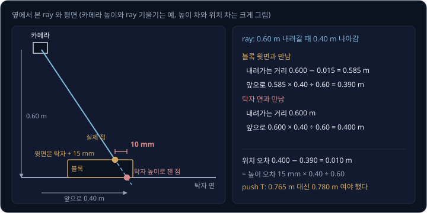
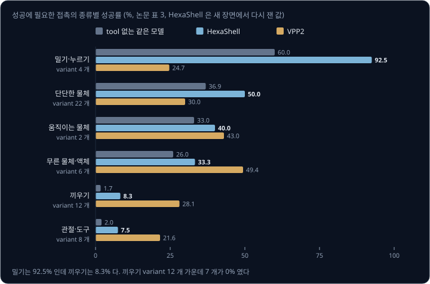

# Robot Coding Agent

[Reasoning VLA](../vla-reasoning/README.md#gemini-robotics-er-와-thinking-vla) 에서 본 Gemini Robotics-ER 는 물체 찾기, grasp 자세 구하기,
gripper 움직이기 같은 함수를 부르는 코드를 써서 로봇을 움직였다. 언어 모델이 로봇 코드를 쓰는 이런 방식에서는 대개 모델이 지시마다 코드를 새로
쓰고 버리며, 코드가 부르는 함수는 사람이 미리 만들어 둔다. 소프트웨어 저장소에서 일하는 coding agent 는 이와 달리 코드를 실행해 에러를 읽고
고치며, 고친 코드는 저장소에 남아 다음 일에도 쓰인다. coding agent 에게 같은 방식으로 로봇을 다루게 하면, 시연을 모으거나 network 를 학습하지
않고도 얼마나 잘하게 되고 어디서 막힐까?

이 물음에 답한 연구가 HexaFuture 의 HexaShell(2026)이다. HexaShell 은 로봇을 다루는 agent(acting agent)에게 로봇을 움직이는 명령줄 하나와
카메라 사진 세 장만 준다. episode(작업을 한 번 시도한 것)가 실패하면 같은 모델의 두 번째 agent(optimizer agent)가 기록을 읽어 작은
프로그램(tool)을 쓰거나 고친다. 작업 42 개로 된 simulation benchmark RoboDojo 에서 GPT-6-Astra 의 성공률은 benchmark 저자들이 만든 고정
harness(명령을 받아 로봇에 실행해 주는 프로그램)로 22.5% 였지만, 같은 모델이 HexaShell 로는 46.9% 를 받아 2026 년 10 월 20 일 기준
leaderboard 1 위에 올랐다. 반면 부품을 구멍에 끼우는 작업은 새 장면에서 다시 잰 성공률이 8.3% 에 머물렀다.

## 학습 목표

- 학습한 VLA, 고정 harness 의 VLM agent, 자기 tool 을 남기는 coding agent 가 로봇을 다루는 방식의 차이와, 결정을 하지 않는 thin harness 가
  맡는 일을 설명할 수 있다
- depth 없이 calibration 된 RGB 사진에서 높이를 잰 평면과 두 번째 view 로 3D 위치를 구하고, 높이 오차가 만드는 위치 오차와 카메라를 옮기는
  step(action 하나) 비용을 계산할 수 있다
- acting agent 와 optimizer agent 가 실패한 episode 를 unit test 가 붙은 tool 로 바꾸는 loop 와, 고정한 tool 을 hidden seed(공개하지 않은
  장면 묶음)에서 평가하고 누설을 감사하는 이유를 설명할 수 있다
- 성공률을 가르는 것이 추론이 아니라 접촉이라는 결과를 작업 분류와 실패한 episode 가 끝난 방식으로 설명할 수 있다

## VLA 와 coding agent

로봇 조작 benchmark 의 상위권은 그동안 학습한 policy 가 차지했다. [π0](../pi0/README.md) 같은 VLA 는 많은 시연으로 학습해 사진과 지시문에서
action 을 바로 낸다. HexaShell 저자들이 실험에 쓴 RoboDojo 는 팔이 둘인 ARX X5 로봇의 작업 42 개를 Isaac Sim 에 담은 benchmark 다. 작업은
Generalization, Memory, Long-Horizon, Precision, Open 의 다섯 종류로 나뉘고, Generalization 작업 12 개에는 상관없는 물체 13 ~ 18 개를 더
놓은 cluttered 판이 붙는다. 성공은 benchmark 의 판정 코드(checker)가 step 마다 판정하고, 성공하는 순간 episode 가 끝난다.

| | 학습한 policy | 고정 harness 의 VLM agent | HexaShell |
| --- | --- | --- | --- |
| 로봇에 내는 것 | network 가 낸 action | harness 가 받는 gripper 목표 | `robo` 명령과 agent 가 쓴 tool |
| 미리 필요한 것 | 시연 dataset 과 학습 | 없음 | 개발용 장면 10 개에서 실행한 episode 의 기록 |
| episode 사이에 남는 것 | 학습한 weight | 없음 | tool 코드와 unit test |
| RoboDojo 성공률 | VPP2 32.3% | GPT-6-Astra 22.5% | GPT-6-Astra 46.9% |

VPP2 의 점수는 leaderboard 에서 agent 없이 학습한 모델만으로 action 을 내는 방식 가운데 가장 높았다(HexaShell 저자들은 world action
model 로 분류했다). 저자들의 관련 연구 정리에 따르면 Code as Policies 는 사람이 만든 인식·제어 함수를 부르는 프로그램을 지시마다 쓰고,
SayCan 은 언어 지시를 정해진 기술 목록에 연결한다. 이런 연구에서는 프로그램을 지시 하나마다 쓰고 버리며, 프로그램이 부르는 기본 함수는 사람이
쓴다. HexaShell 은 이 분담을 뒤집어서, 기본 함수에 해당하는 tool 을 agent 가 쓰고 그 tool 을 episode 가 끝나도 남겨 계속 고친다. episode
마다 쓰는 명령은 짧다.

로봇에서는 저장소와 달리 무엇보다 위치를 재야 한다. 저장소에서는 agent 가 다루는 것이 모두 정확히 읽을 수 있는 글이지만,
로봇에서는 물체가 pixel 로 보인다. 그런데 명령에는 세상 좌표의 위치가 필요하고, grasp 에는 1 cm 안팎의 정확도가 필요하다. 저자들은 VLM 이
사진 속 거리를 잘 재지 못한다는 연구를 근거로, 위치는 모델이 아니라 코드가 재게 했다. 모델은 목표 물체 위의 pixel 을 고르고, tool 이 그
pixel 에서 세상 위치를 계산한다.

## thin harness

harness 는 agent 와 로봇 사이에서 명령을 받아 실행해 주는 프로그램이다. HexaShell 의 harness 는 명령을 관절 움직임으로 옮기기만 하고 무엇을
할지는 정하지 않아서 thin harness 라고 부른다. acting agent 는 고치지 않은 Codex 명령줄 agent 이고, network 에 직접 나갈 수 없고 API key 와 host 폴더도
없는 container(격리된 실행 환경) 안에서 실행된다. 밖으로 나가는 통신은 모델 API 와 harness 의 길만 통과시키는 proxy 를 거친다. agent 가 받는
것은 셋이다.

- 실행 파일 `robo` 하나. agent 가 로봇을 다루는 길은 이것뿐이다
- 요청할 때마다 새로 채워지는 `obs/` 폴더. 머리 카메라와 양쪽 손목 카메라의 640×480 RGB 사진, 카메라마다 intrinsics 와 세상 좌표의 pose,
  두 팔의 TCP(tool centre point, 두 손가락 끝의 가운데 점) pose 와 관절 각도가 들어 있다. depth 사진은 없다
- 60 줄 남짓한 설명서 한 장. 좌표축, 명령, 출력의 뜻, pixel 을 ray 로 바꾸는 식이 적혀 있다

| 명령 | 하는 일 | step 을 쓰는가 |
| --- | --- | --- |
| `obs`, `status` | `obs` 는 사진과 상태를 새로 받고, `status` 는 마지막 명령의 결과를 다시 보여 준다 | 쓰지 않는다 |
| `move` | TCP 를 세상 좌표축을 따라 옮긴다. 축마다 최대 0.20 m 다 | 쓴다 |
| `rotate` | TCP 를 중심으로 gripper 를 돌린다. 축마다 최대 90° 다 | 쓴다 |
| `point` | gripper 가 아래·앞·그 사이 45° 중 한 방향을 보게 하고, 손가락이 벌어지는 축을 정한다 | 쓴다 |
| `gripper`, `home`, `wait` | 손가락을 열고 닫거나, 처음 자세로 돌아가거나, 최대 5 초 기다린다 | 쓴다 |
| `done` | episode 를 끝낸다 | 쓰지 않는다 |

명령마다 돌아오는 JSON 기록에는 움직임 계획이 됐는지(`plan_ok`)와 안 된 이유(`ik_unreachable` 등), 도달한 pose 와 목표 사이의 오차, 남은
시간과 명령 수가 들어 있다. agent 가 쓴 tool 은 `robo` 의 새 sub-command 로 붙고, tool 마다 쓴 짧은 설명이 설명서 끝에 덧붙는다.

harness 의 server 는 명령을 받으면 먼저 검사한다. 그다음 TCP 가 지나갈 직선 경로를 2 cm 간격으로 나누고, 나눈 점(waypoint)마다 cuRobo 로
IK(TCP pose 에 맞는 관절 각도 계산)를 푼다. 관절 경로에는 로봇의 공식 한계 안에서 사다리꼴 속도 profile 로 시간을 배정하고, 그 경로를 1초에
25 번씩 잘라 benchmark 의 공식 action 함수로 보낸다. 예를 들어 `robo move left --dy 0.10` 은 왼쪽 TCP 를 앞으로 0.10 m 옮기는 명령이라서 2
cm 간격이면 $0.10 \div 0.02 = 5$ 구간이다. server 에는 장애물을 피해 가는 motion planner 가 없고, 충돌 검사도 로봇 자신과 탁자만 대상으로
한다. 탁자 위 물체를 피하는 일은 agent 와 tool 이 맡는다.

RoboDojo 는 작업마다 실행할 수 있는 action step 의 수를 200 ~ 1900 으로 정해 둔다. action 이 1초에 25 번이므로, 한도가 600 step 인 push T(T
모양 블록을 미는 작업)는 로봇 시간으로 $600 \div 25 = 24$ 초다. 사진을 보거나 측정하거나 모델이 생각하는 동안에는 step 이 들지 않고, 실행한
step 만 하나씩 센다. simulation 은 명령이 실행되는 동안에만 흐르기 때문이다. 그 대신 실제 시간은 길다. tool 을 고정한 뒤 다시 잰 episode
하나는 로봇 시간 26 초에 실제 시간 739 초(중앙값)가 걸렸고, 저자들은 그 시간이 거의 모두 모델의 응답을 기다린 시간이라고 적었다. 실제 시간이
로봇 시간의 약 28 배($739 \div 26$)다. simulation 은 agent 가 생각하는 동안 멈춰 있지만, 실물 장면에서는 그동안에도 시간이 흐른다. 추론
시간과 제어 주기의 관계는 [Reasoning VLA](../vla-reasoning/README.md#추론-token-의-비용과-제어-주기) 에서 따로 다룬다.

저자들은 harness 를 만든 원칙을 넷으로 적었다.

- harness 는 명령을 옮기기만 하고 결정하지 않는다
- acting agent 의 container 에는 simulator, 작업 정의, 채점 코드가 없어서 정답을 읽을 길이 구조적으로 막혀 있다
- 성공은 benchmark 의 checker 만 판정한다
- 설명서에는 interface(명령과 출력의 형식)만 적고, 작업을 푸는 전략은 tool 에 둔다

**확인 문제.** step 한도가 1100 인 tic tac toe 작업은 로봇 시간으로 몇 초인가? 그 가운데 520 step 을 상대 팔을 기다리는 데 썼다면 기다린
시간은 몇 초인가?

답 보기

1. RoboDojo 는 1초에 action 25 개를 받으므로, step 수를 25 로 나누면 로봇 시간이 된다
2. 한도 1100 step 은 $1100 \div 25 = 44$ 초다
3. 기다린 520 step 은 $520 \div 25 = 20.8$ 초로, 한도 44 초의 절반 가까이다

## ray 와 평면

[Camera Geometry](../camera-geometry/README.md#카메라-한-대로-알-수-없는-거리) 에서 본 대로 pixel 하나와 calibration 은 카메라에서 뻗는 ray
하나를 정할 뿐, 물체가 그 ray 위의 어디에 있는지는 정하지 못한다. depth 사진이 있으면 거리를 바로 읽지만 RoboDojo 의 표준 관측에는 depth 가
없다. HexaShell 의 tool 은 ray 에 조건을 하나 더 붙여 위치를 정한다. 첫째 조건은 높이를 아는 평면으로, 물체가 탁자 위에 있으면 그 점은 ray
가 탁자 면과 만나는 곳에 있다.

예를 들어 카메라가 탁자 면보다 0.60 m 위에 있고, 어떤 pixel 의 ray 가 0.60 m 내려가는 동안 앞으로 0.40 m 나아간다고 하자. 그 pixel 에 보이는
점이 탁자보다 15 mm 높은 블록 윗면에 있다면, 가정한 평면에 따라 위치가 달라진다.

| 가정한 평면 | ray 가 내려가는 거리 | ray 가 앞으로 간 거리 |
| --- | --- | --- |
| 블록 윗면, 탁자 + 15 mm | $0.600 - 0.015 = 0.585$ m | $0.585 \times 0.40 \div 0.60 = 0.390$ m |
| 탁자 면 | 0.600 m | $0.600 \times 0.40 \div 0.60 = 0.400$ m |

블록 윗면의 점에 탁자 높이를 쓰면 위치가 $0.400 - 0.390 = 0.010$ m(10 mm) 밀린다. 이 ray 는 0.60 m 내려갈 때 앞으로 0.40 m 나아간다.
따라서 높이를 15 mm 틀리면 위치는 15 mm 에 $0.40 \div 0.60$ 을 곱한 만큼 틀린다. 실제로 push T 작업의 한 시도에서 agent 가 블록 윗면(0.780
m) 대신 탁자 높이(0.765 m)를 쓰자 블록 윤곽이 10 mm 밀렸고, 그 episode 는 실패했다. 원인과 수리는
[acting agent 와 optimizer agent](#acting-agent-와-optimizer-agent) 절에서 다룬다.

그래서 평면의 높이부터 재야 한다. 공용 tool `table_plane` 은 episode 에서 처음 불릴 때 사진만으로 탁자 높이를 한 번 재므로 step 을 쓰지
않는다. 후보 높이마다 한 카메라의 사진을 그 높이의 평면을 거쳐 다른 카메라의 시점으로 옮겨 그리고(warp), 옮긴 사진과 실제 사진이 가장 잘
겹치는 높이를 고른다. 이 방법을 plane sweep 이라고 한다. 카메라 세 쌍이 잰 높이는 0.7646 ~ 0.7656 m 로 서로 1 mm 안에서 맞았다. 설명서에
적힌 탁자 높이는 0.74 m 라서, 이 값을 그대로 쓰면 높이를 25 mm 틀린다.

탁자가 아니어도 높이를 잰 수평면이면 같은 계산을 쓴다. 블록의 윗면, 그릇의 테두리, 상자의 홈은 모두 수평면 위에 있어서, 그 높이를 한 번 재면
그 면에 보이는 pixel 의 ray 로 위치가 나온다. 두 agent 는 물체에 관한 숫자를 모두 그 episode 안에서 재야 하고, 물체의 크기, 위치, 높이를
benchmark 의 asset·layout·설정 파일·log 에서 가져오면 안 된다. 실물 로봇에서도 RGB 사진, calibration, 팔의 상태를 똑같이 얻을 수 있으므로,
tool 이 실행 중에 읽는 것 가운데 simulation 에만 있는 것은 없다.

<b>심화: pixel 에서 평면 위의 점까지</b>

HexaShell 의 설명서에는 pixel $(u, v)$ 를 ray 로 바꾸는 식이 그대로 적혀 있다. 카메라 $k$ 의 intrinsics 를 $f_x, f_y, c_x, c_y$ 라 하고,
카메라 좌표를 세상 좌표로 바꾸는 회전을 $R$ 이라 하면 ray 의 방향은 아래와 같다.

$$
\mathbf{d} = R \begin{bmatrix} (u - c_x) / f_x \\ (v - c_y) / f_y \\ 1 \end{bmatrix}
$$

카메라 중심을 $\mathbf{o}$ 라고 하면 ray 위의 점은 $\mathbf{o} + t\,\mathbf{d}$ 이고, 높이 $h$ 인 평면과 만나는 점은 $z$ 성분이 $h$ 가 되는
$t$ 에서 나온다.

| 이 예의 값 | 기호로 쓴 값 |
| --- | --- |
| 카메라는 탁자 면보다 0.60 m 위에 있다 | $o_z - h = 0.60$ |
| ray 는 0.60 m 내려갈 때 앞으로 0.40 m 나아간다 | $\mathbf{d} = (0,\ 0.40,\ -0.60)$ |
| 탁자 면까지 가는 $t$ 는 1 이다 | $t = (h - o_z) \div d_z$ |
| 만나는 점은 앞으로 0.400 m 에 있다 | $\mathbf{p} = \mathbf{o} + t\,\mathbf{d}$ |

$h$ 를 $\Delta h$ 만큼 틀리면 $t$ 는 $\Delta h \div |d_z|$ 만큼 바뀌고, 수평 위치는 $\Delta h \times |\mathbf{d}_{xy}| \div |d_z|$ 만큼 바뀐다.
이 예에서는 $0.015 \times 0.40 \div 0.60 = 0.010$ m 다. ray 가 누울수록($|\mathbf{d}_{xy}| \div |d_z|$ 가 클수록) 같은 높이 오차가 더 큰
위치 오차가 된다. 그래서 멀리서 비스듬히 보는 머리 카메라는 손목 카메라보다 높이 오차에 약하다.

homography 는 [Camera Geometry](../camera-geometry/README.md#homography) 에서 본 평면 사이의 사상이다. plane sweep 은 높이 $h$ 의 평면을 거쳐
카메라 A 의 pixel 을 카메라 B 로 옮기는 homography 를 후보 $h$ 마다 만들고, 옮긴 사진과 B 의 사진이 가장 잘 맞는 $h$ 를 고른다.

**확인 문제.** 앞 예의 ray(0.60 m 내려갈 때 0.40 m 나아감)에서 탁자 높이를 잰 값 0.765 m 대신 설명서의 0.74 m 를 쓰면, 탁자 위 점의 위치는
얼마나 틀리는가?

답 보기

1. 높이 오차는 $0.765 - 0.74 = 0.025$ m 다
2. 이 ray 에서는 높이 오차에 $0.40 \div 0.60$ 을 곱한 만큼 위치가 틀린다
3. $0.025 \times 0.40 \div 0.60 \approx 0.017$ m, 약 17 mm 다. grasp 에 필요한 1 cm 를 넘는다

## 두 번째 view 와 active perception

손에 든 물체나 공중에 뜬 부분은 어느 수평면 위에도 있지 않아서, 높이를 아는 평면을 쓸 수 없다. 이때 쓰는 둘째 조건이 두 번째 view 다.
두 카메라가 같은 점을 보면 두 ray 는 그 점 근처에서 거의 만나므로, 두 ray 가 가장 가까워지는 두 점의 가운데를 위치로 삼는다. 방향 두 개로
위치를 구하는 이 계산을 triangulation 이라고 한다. triangulation 은 움직이는 카메라 하나에도 쓸 수 있어서
[Visual SLAM](../visual-slam/README.md#triangulation) 은 이 계산으로 지도를 만든다. 두 사진에서 같은 점의 pixel 은 acting agent 가 두
사진을 보고 직접 고르거나, tool 이 template matching, 윤곽선, 원 맞추기로 찾는다.

play Xylophone 작업에서 로봇은 말렛을 집어 실로폰 건반 여덟 개를 왼쪽부터 친다. checker 는 말렛 머리가 건반 위 1.0 ~ 3.6 cm 높이의 건반 상자
안에 들어왔다가 다음 건반 전에 2.5 cm 이상 올라가야 친 것으로 센다. 한 시도에서 agent 는 손에 든 공 모양의 말렛 머리를 머리 카메라 하나로
쟀고, 거리는 사진 속 공의 반지름으로 어림했다. 추정한 중심은 실제 중심에서 22.9 mm 떨어졌고, 로봇이 여덟 번을 쳤지만 checker
는 하나도 세지 않았다. 고친 tool 은 공 위의 pixel 하나를 받으면 다른 카메라 사진에서 같은 공을 찾아 triangulation 한다. 확실한 짝이 없으면
어림하지 않고 실패를 알린다. 다음 시도에서 오른쪽 손목 카메라가 공 전체를 보자 두 view 로 추정한 중심은 실제 중심에서 2.7 mm 떨어졌고, 두
ray 사이의 거리는 0.7 mm 였다. 이 시도는 500 step 중 377 번째 step 에서 성공했다.

사진 한 장에서 depth 를 추정하는 monocular depth network 도 있어서, 저자들은 Depth Anything V2 를 harness 안에 넣고 사진마다 탁자 평면으로
scale 을 맞춘 판도 만들었다. 8 개 작업의 사진 300 장에서 simulator 가 그린 정답 depth 와 비교하니, 물체 pixel 의 오차 중앙값은 머리
카메라에서 41 mm 였고 손목 카메라에서 약 100 mm 였다. 다른 network(Depth Pro, MoGe 두 판)를 써도 머리 카메라 오차는 20 ~ 31 mm 까지만
줄었고, 손목 카메라에서는 21 ~ 72 mm 가 남았다. grasp 와 놓기에는 1 cm 안팎이 필요하다. geometry 로 재는 방법에는 이런 하한이 없어서,
평면이나 두 view 라는 가정이 맞으면 오차는 calibration 과 pixel 에서만 온다.

| 3D 를 얻는 방법 | 개발용 장면의 점수(leaderboard 방식) |
| --- | --- |
| triangulation(RGB 만) | 38.3 |
| Depth Anything V2 | 29.6 |
| simulator 가 그린 depth(표준 관측에 없음) | 48.8 |

같은 harness, 수리 loop, 모델에서 triangulation 이 depth network 보다 8.7 점 높았다. 장면별로 짝지으면 triangulation 만 성공한 장면이 57
개였고 depth network 만 성공한 장면이 23 개였다(exact McNemar test, p < 0.001). simulator 가 그린 depth 를 쓰면 triangulation 보다 10 점
넘게 더 높았고, 저자들은 그 차이의 대부분이 끼우기 작업에서 나왔다고 적었다.

> **오해** monocular depth network 를 쓰면 RGB 사진 한 장으로도 grasp 에 충분한 depth 를 얻는다.
>
> **사실** RoboDojo 장면에서 Depth Anything V2 는 탁자로 scale 을 맞춘 뒤에도 depth 오차 중앙값이 머리 카메라에서 41 mm 였고 손목 카메라에서 약 100 mm 였다. grasp 와 놓기에는 1 cm 안팎이 필요하다.

두 번째 view 를 얻는 데는 비용이 든다. 머리 카메라는 탁자 전체를 보지만 물체를 멀리서 비스듬히 보고, 그 사진에서는 물체끼리 가린다. 손목
카메라는 팔을 움직여야 원하는 자리에서 볼 수 있다. 측정을 위해 센서를 옮기는 일을 active perception 이라고 하며, 손목 카메라를 옮기려면 팔을
움직여야 하므로 step 한도를 쓴다. 저자들은 손목 카메라 사진을 읽는 측정 바로 앞의 움직임을 보는 움직임(viewing move)으로 세었다. 큰 tool
안에 든 보는 단계는 세지 않았으므로 아래 비율은 최소값이다.

| 개발용 장면 420 episode | triangulation | depth network |
| --- | --- | --- |
| 실행한 step 가운데 보는 움직임의 비율 | 3.6% | 0.7% |
| 보는 움직임이 한 번 이상 있는 episode | 180 (43%) | 40 (10%) |
| 성공 | 152 | 118 |
| 보는 움직임이 있던 180 장면의 성공 | 39 | 22 |
| 나머지 240 장면의 성공 | 113 | 96 |

보는 움직임이 있는 episode 에서는 그 움직임이 step 한도의 4.9%(중앙값)를 썼지만, 비용은 몇 작업에 몰렸다. 달걀 판을 다루는 작업은 step 의
40% 를 보는 데 쓰고도 성공하지 못했고, 동전 홈을 찾는 작업도 16% 를 쓰고 성공하지 못했다. 반면 play Xylophone 은 17% 를 써서 성공한 장면이 0
개에서 6 개가 됐고, push T 는 8% 를 써서 4 개에서 10 개가 됐다(둘 다 depth network 판과 비교).

**확인 문제.** step 한도가 600 인 작업에서 보는 움직임이 한도의 4.9% 를 썼다면 몇 step 이고, 로봇 시간으로 몇 초인가?

답 보기

1. step 수는 $600 \times 0.049 \approx 29$ step 이다
2. RoboDojo 는 1초에 action 25 개를 받으므로 $29 \div 25 \approx 1.2$ 초다

## acting agent 와 optimizer agent

HexaShell 에서는 같은 모델(Codex 와 GPT-6-Astra)의 agent 두 개가 일을 나눈다. acting agent 는 지금 있는 tool 로 episode 를 하나 실행하고,
optimizer agent 는 episode 와 episode 사이에서 실패 기록을 읽고 tool 을 쓰거나 고친다. tool 은 `tool.py` 와 `interface.md` 가 든 폴더
하나다. `tool.py` 는 tool 의 이름과 sub-command 와 인자를 정하고 EpisodeAPI 위에서 실행되는데, EpisodeAPI 로는 관절 각도, TCP pose,
calibration 이 붙은 사진 세 장, 기본 명령과 같은 움직임 함수를 쓸 수 있다. tool 은 simulator 를 import 하지 못하고 물체 pose 도 읽지 못한다.
아무것도 움직이지 않는 측정 명령은 step 이 들지 않아서 agent 가 얼마든지 부를 수 있다.

수리 loop 는 benchmark 의 seed 0 에서 앞의 장면(layout) 10 개를 차례로 쓴다. 성공하면 optimizer 는 어떤 tool 이 왜 통했는지 `playbook.md` 에
짧게 적는다. 실패하면 명령 기록, 명령마다 찍은 카메라 사진, 지금의 tool 코드를 읽고 `skill.md` 에 진단을 쓴 뒤 tool 을 더하거나 고친다.
수정마다 배달 검사가 파일이 다 있는지, tool 이 불러와지는지, 설명 글에 작업이나 물체의 이름이 없는지를 확인하고, 통과하지 못한 수정은
되돌린다. 그다음 simulator 를 다시 켜고 같은 장면을 시도하며, 장면 하나에 수정은 다섯 번까지 한다. 열 번째 장면이 끝나면 optimizer 가 기록을
정리한다. 그 뒤 tool 을 고정(freeze)하고, optimizer 없이 개발용 장면 10 개와 새 장면 10 개에서 다시 잰다. optimizer 는 그 작업의 폴더에만 쓸
수 있고 harness, 설명서, 공용 tool 은 건드리지 못한다.

실패 뒤의 수리 한 번(round)에는 중앙값 6.3 분이 걸렸고, round 의 90% 가 11 분 안에 끝났다. round 하나에서 optimizer 는 shell 명령을 중앙값
16 개 실행했고, round 의 92% 에서 그 작업의 unit test 를 실행했다. 수정 한 번에 더한 줄과 지운 줄은 중앙값으로 각각 118 줄과 6 줄이었다(test
와 기록 포함). 모든 작업을 합하면 round 가 769 번이었고, 남은 것은 task 명령 327 개와 약 78,000 줄의 Python 이었다.

push T 는 T 모양 블록을 T 모양 표시 위로 밀어 놓는 작업이고, 블록이 표시에서 7 mm, 7° 안에 있고 두 팔이 처음 자세에 있어야 성공이다. 이
작업의 tool 은 머리 카메라로 본 블록의 윤곽을 블록 윗면 높이의 평면에 옮기고, 그 높이는 두 카메라로 재는 명령으로 구한다. 이 명령은 두 view
에서 잰 윗면의 넓이를 비교해 너무 다르면 높이를 거부한다. 한 시도에서 이 명령이 요청 10 번을 모두 거부하자, agent 는 대신 탁자 높이 0.765 m
를 썼다. 블록 윗면은 0.780 m 라서 [ray 와 평면](#ray-와-평면) 에서 본 대로 윤곽이 10 mm 밀렸다. 블록을 처음 옮겼을 때는 표시에서 3.2 mm 로
한계 안이었지만, 놓기 전 검사도 같은 틀린 높이를 써서 이 거리를 12.5 mm 로 쟀다. agent 는 블록을 세 번 다시 놓다가 13.6 mm 어긋난 채 멈췄다.

optimizer 는 tool 이 낸 에러 메시지에서 원인을 찾았다. 높이 명령이 넓이를 평면 위 1 mm 격자에서 pixel 이 떨어진 칸의 수로 세고 있어서, 먼
카메라에서는 같은 면의 넓이가 더 작게 나왔다. 예를 들어 블록 윗면의 한 부분이 20 mm × 20 mm = 400 mm² 라고 하자.

| | 손목 카메라(가까움) | 머리 카메라(멂) |
| --- | --- | --- |
| pixel 하나가 평면에서 덮는 넓이(예) | 1 mm² 이하 | 2 mm × 2 mm = 4 mm² |
| 이 면에 떨어지는 pixel | 400 개 이상 | $400 \div 4 = 100$ 개 |
| 칸 세기로 잰 넓이 | 400 mm² | 100 mm² |
| pixel 넓이의 합으로 잰 넓이 | 400 mm² | $100 \times 4 = 400$ mm² |

칸 세기로는 두 넓이의 비가 $100 \div 400 = 0.25$ 로 하한 0.85 보다 작아서 명령이 높이를 거부한다. 논문에서도 머리 카메라의 pixel 은 손목
카메라가 채우는 1 mm 칸의 약 4 분의 1 만 채웠고, 저장해 둔 사진에서 고치기 전 코드로 잰 비는 0.27 이었다. optimizer 는 칸 세기를 pixel 마다
평면에서 덮는 넓이의 합으로 바꿨다. 해상도가 다른 두 카메라로 만든 새 test 는 고치기 전에 실패하고 고친 뒤에 통과했으며, 기존 test 까지 합한
73 개도 모두 통과했다. 다음 시도에서 높이 명령은 0.780 m 를 냈고, 블록이 표시에서 3.0 mm 에 놓여 episode 가 600 step 중 354 번째 step 에서
성공했다. tool 을 고정한 뒤 push T 는 개발용 장면 10 개에서 모두 성공했고, 같은 작업을 depth network 로 한 판은 10 개 중 4 개였다.

논문에 실린 수리 사례 일곱 개는 아래와 같다.

| 작업 | 실패의 원인 | 고친 것 | 다음 시도 |
| --- | --- | --- | --- |
| push T | 두 카메라의 pixel 크기가 달라 넓이 검사가 높이를 거부 | 칸 세기를 pixel 넓이의 합으로 바꿈 | 354/600 step 에 성공 |
| swap T | 색 mask 가 블록의 윗면과 옆면을 섞어 높이 측정이 7 번 실패 | hue(색상)로 색을 맞추고 밝은 윗면만 남김 | 285/400 step 에 성공 |
| play Xylophone | 카메라 하나로 잰 말렛 머리가 23 mm 어긋남 | 다른 카메라에서 짝을 찾아 triangulation 함 | 377/500 step 에 성공 |
| 컨베이어에서 짝 맞춰 집기 | 집는 일정이 팔이 움직이는 시간보다 짧아 두 번 중단 | 움직임 시간을 먼저 재고 닫는 시각을 늦춤 | 587/700 step 에 성공 |
| tic tac toe | 마지막 고리에 146 step 이 필요한데 84 step 이 남음 | 옮기면서 gripper 를 돌리는 경로 | 1028/1100 step 에 성공 |
| 옷 개기(cluttered) | grasp 점이 천 가장자리에서 1.5 mm 거리에 있음 | 점의 사방에 천 12 mm 를 요구 | 344/500 step 에 성공 |
| 관 꽂기 | 잰 적 없는 ray 위의 voxel 28,935 개가 모든 경로를 막음 | 원래 경로를 도달한 관절에서 다시 검사 | 398/500 step 에 성공 |

일곱 개 가운데 셋은 측정을 고쳤고 둘은 시간을 고쳤다. 나머지 둘 가운데 하나는 잡는 자리를 고쳤고, 다른 하나는 tool 이 포기하는 조건을
고쳤다. optimizer 는 매번 tool 하나만 고치고 새 test 를 붙였으며, 작업을 푸는 전략은 acting agent 에게 남겼다.

> **오해** 실패를 고치는 agent 는 실패한 장면의 사진을 보고 원인을 찾는다.
>
> **사실** 수리 사례 일곱 개 가운데 다섯에서 optimizer 는 사진을 한 장도 보지 않고 명령 기록, tool 이 거부한 이유, 코드만으로 원인을 찾았다. 옷 개기에서는 저장해 둔 test 사진에 코드를 실행해 보았고, 실패한 episode 의 사진을 분석한 사례는 swap T 하나였다.

## frozen tool 의 평가

tool 은 seed 0 의 장면 10 개에서 만들었다. 같은 장면에서 다시 재면 tool 이 그 장면들에 맞춰졌는지 알 수 없으므로, 공식 평가에서는 RoboDojo 팀이
자기 machine 에서 공개하지 않은 seed(hidden seed)로 작업마다 50 episode 를 실행했다. 이 평가에서는 harness 가 benchmark 의 공식 평가 client 를
감싸서 실행되고, 장면을 처음으로 되돌리거나 물체의 실제 위치를 읽을 길이 없다. 개발 중에 쓴 실행기는 실제 위치를 log 에 남기지만 그 값은
container 로 보내지 않았다. 저자들은 모든 tool 이 공식 client 아래에서도 실행되도록 맞췄다.

| 작업 종류 | HexaShell | 비교 |
| --- | --- | --- |
| Memory | 81.0% | WorldScape-R2SI 63.7% |
| Open | 55.3% | WorldScape-R2SI 47.5% |
| Generalization | 34.5% | |
| Precision | 32.0% | VPP2 35.2% |
| Long-Horizon | 31.5% | VPP2 37.0% |
| 다섯 종류의 평균 | 46.9% | WorldScape-R2SI 39.4%, VPP2 32.3% |

leaderboard 점수는 다섯 종류의 성공률을 같은 무게로 평균한 값이라서, HexaShell 의 점수는 $(34.5 + 32.0 + 31.5 + 81.0 + 55.3) \div 5 = 46.9$
다. HexaShell 은 장면을 읽고 기억하는 Memory 와 Open 에서 모든 참가 방식보다 높았고, 정밀한 접촉이 성패를 가르는 Precision 과 Long-Horizon
에서는 학습한 policy 인 VPP2 가 앞섰다. Open 작업 8 개에는 작업별 tool 대신, 다른 작업 34 개에서 나온 tool 로 만든 공용 tool 한 벌을 썼다.
저자들은 이 공용 tool 을 Open 장면을 한 번도 보지 않은 채 고정했다.

Generalization 작업의 cluttered 판에서는 작업을 그대로 두고 주변만 바꾸므로, 두 판을 비교하면 각 방식이 주변에 얼마나 기대는지 알 수 있다.
HexaShell 은 standard 판에서 38.0% 를 받고 cluttered 판에서 31.0% 를 받아 성공의 $31.0 \div 38.0 \approx 82\%$ 를 지켰다. leaderboard 의
학습한 policy 31 개가 지킨 비율은 1 ~ 78% 였고 중앙값은 20% 였다. VPP2 는 46.4% 에서 12.6% 로 떨어졌다. agent 가 목표 물체 위의 pixel 을
고르면 tool 은 그 물체만 재기 때문에, 주변 물체가 늘어도 측정이 흔들리지 않는다. 다만 옷 개기는 56% 에서 24% 로 떨어졌다. 옷 개기 tool 은
색이 이어진 영역으로 옷을 찾아서, 옷 위나 옆에 물체가 놓이면 그 영역이 끊긴다.

평가를 읽을 때는 agent 에게 무엇을 줬는지도 함께 봐야 한다. acting agent 의 prompt 에는 benchmark 문서의 작업 설명과 점수표, 개발 중에 tool
이 어떻게 동작했는지 적은 짧은 기록이 들어간다. optimizer 는 작업 25 개에서 checker 가 무엇을 요구하는지 적은 짧은 note 를 읽었다. 저자들이
공개된 작업 정의를 보고 쓴 이 note 에는 성공 조건과 일부 작업의 물체 크기나 목표 위치가 들어 있다. acting agent 는 note 를 보지 못한다.
저자들은 RGB 실행이 끝난 뒤 tool 의 숫자 상수를 작업 정의와 log 에 적힌 크기·위치에 하나씩 대조했다. 그 결과 작업 7 개의 tool 에 부품 크기나
고정된 장면 부품의 template 같은 고정 geometry 가 들어 있었다.

> **오해** tool 이 simulator 의 물체 pose 를 읽지 못하게 막으면 benchmark 의 정보가 tool 에 새어 들어갈 길은 없다.
>
> **사실** 저자들의 감사에서 작업 7 개의 tool 에 부품 크기 같은 고정 geometry 가 상수로 들어 있었다. 이 작업들은 다시 잰 장면 70 개에서 3 번 성공했는데, 상수를 episode 안의 측정으로 바꾸자 일곱 작업 모두 0/10 이 됐다.

논문은 실물 로봇의 성공률을 보고하지 않았다. 저자들은 RoboDojo 장면을 본뜬 실물 장치에 simulation 의 ARX X5 가 아닌 PiPER X 팔 두 개와
calibration 한 RGB 카메라를 놓았다. 팔 모델에 맞춰 조금 고치자 simulation 에서 만든 인식·실행 tool 이 같은 명령줄로 실행됐고, 저자들은 블록
세 개를 탑으로 쌓는 episode 와 글자 블록 세 개를 막대를 따라 늘어놓는 episode 를 보였다. 저장소에는 고정한 tool, 설명서, 평가 결과가 공개돼
있지만 harness 의 server, 실행기, container, 수리 loop 는 빠져 있다.

**확인 문제.** VPP2 는 Generalization 의 standard 판에서 46.4% 를 받고 cluttered 판에서 12.6% 를 받았다. 성공의 몇 % 를 지켰고, HexaShell 의 82%
와 비교하면 어떤가?

답 보기

1. 지킨 비율은 cluttered 성공률을 standard 성공률로 나눈 값이다
2. VPP2 는 $12.6 \div 46.4 \approx 0.27$ 이므로 성공의 27% 를 지켰다
3. HexaShell 은 $31.0 \div 38.0 \approx 82\%$ 를 지켜서 VPP2 의 약 3 배다

## 접촉이라는 경계

평균 성공률만 보면 작업 사이의 큰 차이가 보이지 않는다. 저자들은 작업마다 성공에 필요한 접촉의 종류와, 위치 계산 말고 따로 결정해야 하는
것(기호 읽기, 기억)에 각각 이름을 붙였다. 아래 표의 variant 는 작업 42 개에 Generalization 작업의 cluttered 판 12 개를 더한 54 개의 판이다.
새 장면에서 다시 잰 HexaShell 의 성공률을 접촉의 종류로 나누면 차이가 크다.

| 성공에 필요한 접촉 | variant 수 | tool 없는 같은 모델 | HexaShell | VPP2 |
| --- | --- | --- | --- | --- |
| 밀기·밀어 옮기기·누르기 | 4 | 60.0% | 92.5% | 24.7% |
| 단단한 물체 집기·놓기·쌓기(cm 오차 허용) | 22 | 36.9% | 50.0% | 30.0% |
| 스스로 움직이는 물체 | 2 | 33.0% | 40.0% | 43.0% |
| 무른 물체·액체·알갱이 | 6 | 26.0% | 33.3% | 49.4% |
| mm·몇 도 오차의 끼우기 | 12 | 1.7% | 8.3% | 28.1% |
| 관절이 있는 물체·도구 쓰기 | 8 | 2.0% | 7.5% | 21.6% |

밀기는 92.5% 였지만 끼우기는 8.3% 였고, 끼우기 variant 12 개 가운데 7 개는 0% 였다. 기호를 읽거나 기억해야 하는 결정은 접촉보다 덜 중요했고,
기억 작업은 tool 없는 같은 모델의 38.7% 에서 65.0% 로 올랐다. VPP2 는 반대로 밀기와 단단한 물체에서는 약했고 끼우기, 무른 물체, 관절이 있는 물체에서는 강했다. tool 없는 같은
모델과 비교하면 tool 이 더한 몫은 밀기에서 33 점이었고 기억에서 26 점이었으며, 단단한 물체에서는 13 점이었다. 점수는 옳은 동작을 잰 geometry
에서 계산할 수 있는 곳에서 가장 크게 올랐다.

depth 없이 재는 데 드는 비용은 끼우기에서 가장 크다. 구멍과 부품을 같은 화면에서 몇 mm 안으로 맞춰야 하지만, 머리 카메라에서는 pixel 하나가
탁자 위 2 ~ 3 mm 를 덮는다. 구멍을 잘 볼 손목 view 는 gripper 가 부품을 든 채로 만들어야 한다. simulator 가 그린 depth 를 쓴 tool 은
끼우기에서 30.1%(열쇠 꽂기 80%, 쌓기 장난감 73%)를 받았지만 RGB tool 은 8.3% 였다. 액체를 따르는 작업 둘도 같은 비교에서 59 ~ 95% 가 0 ~ 10%
로 떨어졌다. 옷 개기에서는 tool 을 쓴 agent 가 tool 없는 agent 보다 못했다(50% 대 72%). tool 은 옷을 한 가지로 해석하고 동작을 미리 정해
두지만, 한 step 씩 움직이는 agent 는 도중에 보고 고칠 수 있다.

실패한 episode 가 어떻게 끝났는지 보면 무엇이 모자랐는지 알 수 있다. 개발용 장면 420 episode 가운데 268 개가 실패했고, 저자들은 tool 에러로
일찍 끝난 5 개를 뺀 263 개를 아래 셋으로 나눴다.

| 끝난 방식 | 전체 | 무른 물체·액체 | 끼우기 | 기억 작업 |
| --- | --- | --- | --- | --- |
| step 을 거의 다 씀(4 분의 1 미만 남음) | 57% | 77% | 53% | 25% |
| agent 가 끝났다고 했지만 checker 는 실패로 판정 | 30% | 15% | 32% | 50% |
| step 이 4 분의 1 이상 남았는데 agent 가 포기 | 13% | 8% | 15% | 13% |

step 을 다 쓴 실패에서는 agent 가 결과가 틀린 것을 보고 step 이 다할 때까지 다시 시도했다. 실패를 알면서도 동작을 해내지 못했으므로 실행이
모자란 실패다. 기억 작업에서는 실패의 절반이 agent 가 끝났다고 선언한 경우였다. agent 는 앞의 상태를 되살렸다고 믿었지만 checker 의 판정은
달랐다. 이런 실패는 인식이나 작업 조건의 이해가 모자라서 생기며, 저자들은 이 결과가 VLM 이 작은 시각적 차이와 성공 판정에 약하다는 기존
연구와 맞는다고 보았다. 움직이는 물체에서는 기다리던 물체가 지나간 뒤 포기하는 실패가 많았다(38%).

> **오해** 더 잘 추론하는 모델을 쓰면 정밀한 끼우기 작업도 풀린다.
>
> **사실** 같은 모델이 기억 작업에서 65.0% 를 받는 동안 끼우기는 8.3% 였고, 실패한 끼우기 episode 의 53% 는 agent 가 결과가 틀린 것을 본 채 다시 시도하다 step 을 다 써서 끝났다.

저자들은 다음 단계로, gripper 가 부품을 든 동안에도 계속 재고 접촉하는 도중에 동작을 고치는 tool 을 꼽았다. 동작을 미리 계획해 한 번에
실행하는 지금의 tool 로는 그 일을 하지 못한다.

**확인 문제.** 머리 카메라에서 pixel 하나가 탁자 위 2 ~ 3 mm 를 덮는다. agent 가 구멍의 중심을 2 pixel 틀리게 고르면 위치 오차는 얼마이고,
몇 mm 오차까지만 허용하는 끼우기에 왜 문제가 되는가?

답 보기

1. pixel 하나가 2 ~ 3 mm 이므로 2 pixel 은 $2 \times 2 = 4$ mm 에서 $2 \times 3 = 6$ mm 다
2. 끼우기는 구멍과 부품을 몇 mm 안으로 맞춰야 해서, 고르는 pixel 하나둘의 차이만으로 허용 오차를 넘을 수 있다
3. 그래서 가까운 손목 view 가 필요하지만, 그 view 는 부품을 든 채로 만들어야 한다

## 정리

- HexaShell 은 agent 에게 결정을 하지 않는 명령줄 `robo` 와 RGB 사진 세 장만 주고, agent 가 쓴 tool 을 episode 사이에 남긴다. 같은
  GPT-6-Astra 의 성공률이 고정 harness 의 22.5% 에서 46.9% 로 올라 RoboDojo 1 위가 됐지만, 다시 잰 episode 는 로봇 시간 26 초에 실제 시간
  739 초가 걸렸다
- tool 은 pixel 의 ray 를 높이를 잰 평면이나 두 번째 view 와 만나게 해 위치를 잰다. 0.60 m 내려갈 때 0.40 m 나아가는 ray 에서 높이 15 mm
  오차는 위치 10 mm 오차가 된다. depth network 대신 triangulation 을 쓰자 점수가 29.6 에서 38.3 으로 올랐다
- 실패하면 optimizer agent 가 기록을 읽고 unit test 가 붙은 tool 하나를 고친다(수리 한 번에 중앙값 6.3 분). 고정한 tool 은 hidden seed 에서
  평가하고 숫자 상수의 누설을 감사한다. 성공률은 추론이 아니라 접촉을 따라 갈려서, 밀기는 92.5% 였고 끼우기는 8.3% 였다

끼우기처럼 접촉 중에 정밀하게 움직여야 하는 작업에서는 시연으로 학습한 policy 가 앞섰다. 실제로 해 본 성공과 실패로 VLA 를 더 학습하는
방법은 [VLA + RL](../vla-rl/README.md) 에서 다루고, 카메라가 보지 못하는 접촉을 재는 센서는
[Tactile Sensing](../tactile-sensing/README.md#카메라가-보지-못하는-접촉) 에서 다룬다.

## 참고 자료

- H. Gao, A. Zhou 외, [HexaShell: A Thin Harness for Exploring the Limits of VLM Agents as Robot Coding Agents](https://arxiv.org/abs/2610.23479)
  (2026, v2) — harness(3.1 절), RGB 로 재는 3D(3.2 절), tool 과 수리 loop(3.3, 3.4 절), 공식 평가와 clutter(4.2, 4.3 절), triangulation 과
  depth network(4.4 절, 표 1), 두 번째 view 의 비용(4.5 절, 표 2), 접촉의 경계와 실패 유형(5 장, 표 3), 수리 사례(6 장, 표 4), 감사(부록 D)
- HexaFuture, [HexaShell 저장소](https://github.com/HexaFuture/HexaShell) — agent 가 받는 설명서 `interface/INTERFACE.md`(명령, 출력,
  pixel 을 ray 로 바꾸는 식), 작업별 tool 과 `interface.md`, 공식 평가와 다시 잰 결과(README)
