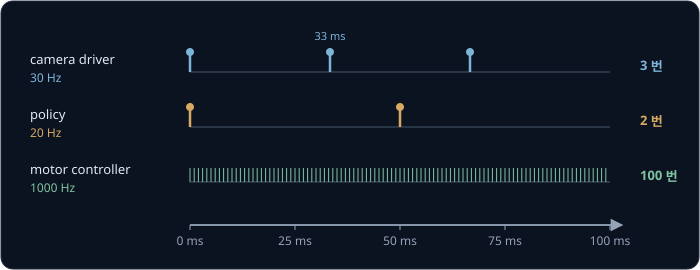
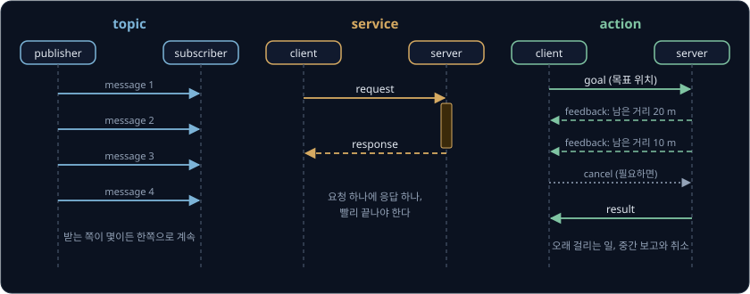
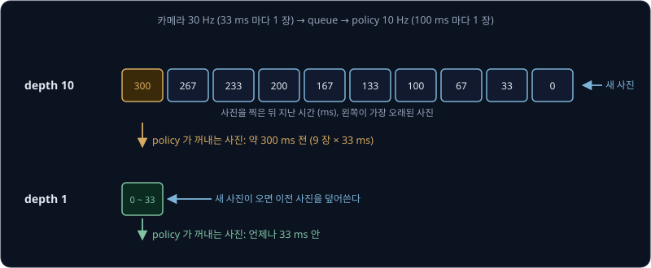
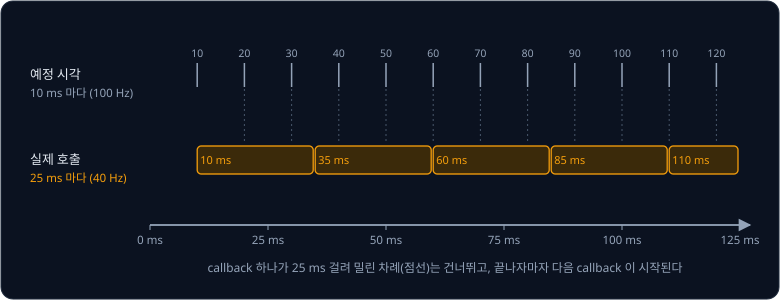
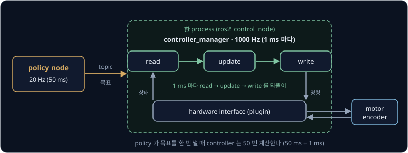
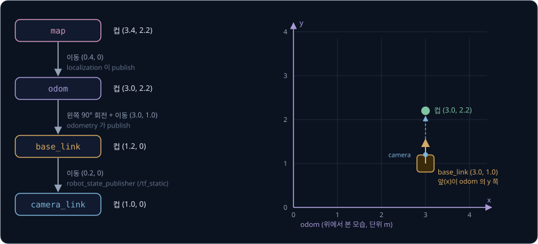

# ROS 2 Basics

로봇 팔 하나에도 프로그램 여러 개가 동시에 실행된다. 카메라 driver 는 1초에 사진을 30 장 찍고, 학습한 policy 는 그 사진을 보고 1초에
10 ~ 50 번 다음 자세를 정하며, motor controller 는 1초에 500 ~ 1000 번 motor 에 보낼 명령을 계산한다. 계산 주기가 이렇게 다른
프로그램들이 사진과 명령을 주고받으면서도, 그중 하나가 오류로 꺼졌을 때 나머지는 멈추지 않으려면 무엇이 필요할까?

ROS 2(Robot Operating System 2)는 이름과 달리 운영체제가 아니라, 따로 실행되는 프로그램들이 정해진 이름과 형식으로 데이터를 주고받게
해 주는 middleware 와 도구 묶음이다. **middleware** 는 운영체제와 응용 프로그램 사이에서 프로그램끼리의 통신을 맡는 소프트웨어를
말한다. Macenski 등이 2022 년 Science Robotics 에 실은 논문에 따르면 4 족 보행 로봇 회사 Ghost Robotics 는 자사 소프트웨어의 약 90% 가
ROS 2 로 통신하도록 만들었다. 이동 로봇의 경로 계획과 주행을 맡는 Nav2, 로봇 팔의 움직임을 계획하는 MoveIt, motor 제어 loop 를 맡는
ros2_control 도 ROS 2 위에서 동작한다. 이 강의의 명령과 기본값은 ROS 2 Jazzy 기준이다.

## 학습 목표

- 로봇 소프트웨어를 node 와 topic 으로 나누는 이유를 설명하고, message 크기와 주기로 필요한 bandwidth 를 계산할 수 있다
- topic·service·action 가운데 알맞은 통신 방식을 고르고, QoS 설정이 어긋나면 무슨 일이 생기는지 설명할 수 있다
- callback 이 timer 주기보다 오래 걸리면 어떻게 되는지, 제어 loop 를 왜 ros2_control 에 두는지 설명할 수 있다
- tf2 의 frame tree 에서 `map`·`odom`·`base_link` 가 각각 왜 있는지 설명할 수 있다

## 로봇 프로그램과 middleware

로봇 소프트웨어를 프로그램 하나로 짜면 사진 처리, policy 계산, motor 제어가 한 흐름 안에서 차례를 기다려야 한다. policy 가 사진 한 장을
보고 행동을 정하는 데 40 ms 가 걸린다면 그동안 motor 제어도 멈춘다. motor 명령은 1 ms 마다 고쳐야 하므로 그사이 계산을 40 번
건너뛰게 된다. 그래서 로봇 소프트웨어는 일을 나눠, 각자의 주기로 계산하는 프로그램 여러 개로 만든다.

| 프로그램 | 1초에 계산하는 횟수 | 한 번의 간격 | 내보내는 데이터 |
| --- | --- | --- | --- |
| camera driver | 30 Hz | 33 ms | 사진 |
| 학습한 policy | 10 ~ 50 Hz | 20 ~ 100 ms | 다음 자세나 속도 목표 |
| motor controller | 500 ~ 1000 Hz | 1 ~ 2 ms | motor 명령 |

Hz 는 1초에 몇 번 계산하는지를 뜻하고, 한 번의 간격은 1 ÷ Hz 다. 30 Hz 면 $1 \div 30 \approx 0.033$ 초라서 33 ms 마다 한 번 계산한다.

프로그램을 나누면 하나가 꺼져도 나머지는 계속 실행된다. 운영체제는 실행 중인 프로그램마다 **process** 라는 독립된 메모리 공간을 주기 때문에,
policy 의 process 가 오류로 강제 종료돼도 motor controller 의 process 는 그대로 남아 마지막 목표 자세를 계속 유지할 수 있다. 대신 process
끼리는 메모리를 나눠 쓰지 않아서 사진 한 장을 넘기는 데에도 누가 무엇을 어떤 형식으로 보낼지 정한 약속이 필요하고, 그 약속과 전달을
middleware 가 맡는다.

ROS 의 첫 버전인 ROS 1 에서는 `roscore` 라는 중앙 이름 서버 하나가 프로그램들을 이어 주었다. Macenski 등은 이 구조를 ROS 1 의 한계로 꼽는데,
`roscore` 가 멈추면 시스템 전체가 영향을 받는 single point of failure 였기 때문이다. ROS 2 는 중앙 서버 없이 프로그램들이 네트워크에서 서로를
직접 찾는 peer-to-peer 방식으로 바꿨다.

## node 와 topic

ROS 2 에서 한 가지 일을 맡는 계산 단위를 **node** 라고 한다. 공식 문서는 node 하나가 논리적으로 한 가지 일만 하도록 권하는데, 앞의 camera
driver, policy, motor controller 도 각각 node 하나다. node 는 보통 process 하나에서 실행되지만, 여러 node 를 한 process 에 넣을 수도
있다.

node 끼리 데이터를 계속 흘려보낼 때는 **topic** 을 쓴다. topic 은 `/camera/image_raw` 처럼 이름이 붙은 통로로, 데이터를 내보내는
**publisher** 는 그 이름으로 publish 하고, 받는 **subscriber** 는 같은 이름을 subscribe 한다. publisher 는 누가 받는지 모르고
subscriber 도 누가 보냈는지 따지지 않아서, 한 topic 에 publisher 와 subscriber 가 몇 개든 붙을 수 있다.

위 그림은 카메라로 길을 보고 바퀴로 움직이는 작은 이동 로봇의 node 와 topic 을 보여 준다. 타원은 node 이고 네모는 topic 이다. 녹화 도구인
`ros2 bag` 은 `/camera/image_raw` 에 subscriber 로 하나 더 붙을 뿐이라 policy 가 받는 사진에는 영향을 주지 않는다. 카메라를 다른 회사 제품으로 바꿔도
새 driver 가 같은 이름과 형식으로 publish 하면 policy node 는 고칠 필요가 없다.

### message 형식

topic 에 흐르는 데이터 하나를 **message** 라고 하고, message 마다 어떤 칸이 어떤 단위로 들어 있는지 정한 형식(type)이 있다. ROS 2 는 형식이
엄격해서(strongly-typed) 같은 topic 의 publisher 와 subscriber 는 같은 형식을 써야 한다. 단위도 REP-103 이라는 ROS 규약으로 정해 두어서
길이는 m, 각도는 rad(radian, 한 바퀴가 $2\pi \approx 6.28$ rad), 시간은 초다.

| 형식 | 칸 | 예 |
| --- | --- | --- |
| `sensor_msgs/Image` | `header`(찍은 시각 `stamp` 와 카메라의 frame 이름 `frame_id`), `height`·`width`(픽셀 수), `encoding`(픽셀 형식), `step`(한 줄의 byte 수), `data`(픽셀 값) | 640 × 480, `rgb8` 이면 `step` 은 1920, `data` 는 921,600 byte |
| `geometry_msgs/Twist` | `linear`(x·y·z 방향 속도, m/s), `angular`(x·y·z 축 회전 속도, rad/s) | 바퀴 로봇은 `linear.x`(앞으로) 와 `angular.z`(왼쪽으로 돌기)만 쓴다. 0.3 m/s 로 가며 0.5 rad/s 로 돈다 |
| `sensor_msgs/JointState` | `header`, `name`(관절 이름 목록), `position`(rad), `velocity`(rad/s), `effort`(N·m) | 바퀴 둘이면 `name` 이 left_wheel, right_wheel 이고 나머지 칸도 숫자 2 개씩이다 |

byte 는 0 ~ 255 사이의 정수 하나를 담는 저장 단위이고, `rgb8` 은 픽셀마다 빨강·초록·파랑을 byte 하나씩, 모두 3 byte 로 적는 형식이다. 그래서
가로 640 픽셀인 한 줄은 $640 \times 3 = 1920$ byte 다. `header` 의 `stamp` 와 `frame_id` 는 [tf2 와 frame tree](#tf2-와-frame-tree) 에서
다시 쓴다.

### bandwidth 계산

topic 하나가 1초에 실어 나르는 데이터의 양을 **bandwidth** 라고 하고, message 하나의 크기에 1초에 보내는 개수를 곱해 구한다. 압축하지 않은
640 × 480 컬러 사진을 30 Hz 로 보내면 아래와 같다.

| 단계 | 계산 | 결과 |
| --- | --- | --- |
| 픽셀 수 | $640 \times 480$ | 307,200 |
| 사진 한 장 | $307{,}200 \times 3$ byte | 921,600 byte ≈ 0.92 MB |
| 1초 | $921{,}600 \times 30$ | 27,648,000 byte ≈ 27.6 MB/s |
| bit 로 | $27{,}648{,}000 \times 8$ | 약 221 Mbit/s |

네트워크 속도는 bit(1 byte = 8 bit) 단위로 적으므로 마지막 줄에서 bit 로 바꿨다. 같은 로봇의 다른 topic 과 비교하면 차이가 크다.

| topic | message 하나 | 주기 | 1초에 흐르는 양 |
| --- | --- | --- | --- |
| `/camera/image_raw` | 921,600 byte | 30 Hz | 27,648,000 byte |
| `/cmd_vel` | 숫자 6 개 × 8 byte = 48 byte | 20 Hz | 960 byte |
| `/joint_states` (바퀴 둘) | 숫자 6 개 × 8 byte = 48 byte | 50 Hz | 2,400 byte |

`header` 를 빼고 숫자 칸만 세면, 카메라 topic 하나가 1초에 나르는 양은 나머지 둘을 합친 3,360 byte 의 약 8,000 배다. 221 Mbit/s 는
1,000 Mbit/s 유선 Ethernet 용량의 22% 정도라 여유가 있지만, 무선 연결에서는 문제가 된다. Macenski 등이 느린 무선 네트워크를 흉내 낸 실험의 속도 상한이
54 Mbit/s 였는데, 그 속도로는 1초에 $54{,}000{,}000 \div (921{,}600 \times 8) \approx 7.3$ 장만 보낼 수 있다. 노트북에서 policy 를 계산하려고
원본 사진을 Wi-Fi 로 보내면 30 장 가운데 23 장 넘게 도착하지 못하므로, 사진은 로봇의 컴퓨터 안에서 처리하거나 JPEG 로 압축해 보낸다.

같은 컴퓨터 안에서도 큰 message 는 전달하는 데 시간이 걸린다. 같은 논문의 측정에서 process 사이의 지연은 1 MB 까지 1 ms 아래였지만
8 MB 에서 7.85 ms 로 늘었다. 카메라 driver 와 사진 처리 node 를 한 process 에 넣고 intra-process 통신을 켜면 message 를 복사하지 않고
메모리 주소만 넘긴다. 같은 측정에서 이렇게 하자 8 MB 아래의 모든 크기에서 message 의 95% 가 1 ms 안에 도착했다.

**확인 문제.** 640 × 480 depth 카메라가 픽셀마다 거리를 2 byte 로 적어 30 Hz 로 보낸다. bandwidth 는 몇 Mbit/s 일까?

답 보기

한 장이 $640 \times 480 \times 2 = 614{,}400$ byte 이고, 1초에 $614{,}400 \times 30 = 18{,}432{,}000$ byte 다. bit 로 바꾸면
$18{,}432{,}000 \times 8 \approx 147$ Mbit/s 다.

## service 와 action

topic 은 한쪽으로 흘려보내기만 하고 결과를 돌려주지 않으므로, "이 일을 해 주고 결과를 알려 달라" 는 요청에는 service 와 action 을 쓴다.

**service** 는 client 가 request 를 보내면 server 가 계산해 response 하나를 돌려주는 방식이다. 공식 문서는 client 가 보통 결과를 기다리고
있으므로 service 는 빨리 끝나야 하고, 오래 걸리는 일에는 쓰지 말라고 적는다. ros2_control 에서 controller 를 켜고 끄는
`/controller_manager/switch_controller` 가 service 이고, node 의 설정값을 읽고 바꾸는 요청도 service 로 처리한다.

**action** 은 오래 걸리는 일에 쓰는 방식으로, client 가 goal 을 보내면 server 가 일하는 동안 feedback 을 주기적으로 보내고 끝나면
result 를 돌려준다. client 는 도중에 cancel 을 보내 일을 멈출 수도 있다. Nav2 의 `NavigateToPose` action 은 goal 로 목표 위치를 받고,
feedback 으로 지금 위치, 남은 거리, 남은 예상 시간, 길이 막혔을 때 회복 동작(recovery)을 한 횟수를 보낸다. 로봇이 0.5 m/s 로 30 m 를 가면
$30 \div 0.5 = 60$ 초가 걸린다. 이 일을 service 로 요청했다면 client 는 60 초 동안 진행 상황을 모른 채 기다려야 하고, 사람이 길을 막아도
멈추라고 할 수 없다. 로봇 팔의 MoveIt 도 `move_group` node 의 `move_action` 이라는 action 으로 목표 자세를 받는다.

| 방식 | 흐름 | 결과 | cancel | 로봇의 예 |
| --- | --- | --- | --- | --- |
| topic | publisher → subscriber, 한쪽으로 계속 | 없음 | 없음 | 사진, 속도 명령, 관절 상태 |
| service | request → response 하나 | 있음 | 없음 | controller 켜고 끄기, 설정값 읽기 |
| action | goal → feedback 여러 번 → result | 있음 | 있음 | 목표 위치로 이동, 팔을 목표 자세로 이동 |

action 은 따로 만든 새 통신 방식이 아니라 service 3 개(goal 보내기, cancel, result 받기)와 topic 2 개(feedback, 상태)를 묶어 만든 것이다.

### parameter 와 launch file

**parameter** 는 node 마다 붙은 설정값으로, 코드를 고치지 않고 node 를 시작할 때 값을 넣거나 실행 중에 `ros2 param set` 으로 바꿀 수 있다.
parameter 는 미리 선언한 형식의 값만 받아서 정수 parameter 에 true 를 넣는 것 같은 잘못을 막는다. ros2_control 의 `controller_manager` 에는
제어 loop 를 1초에 몇 번 실행할지 정하는 `update_rate` 가 있는데, 기본값은 100 Hz 이고 읽기 전용이라 시작할 때 정해야 한다.

**launch file** 은 어떤 프로그램을 어떤 parameter 와 topic 이름으로 실행할지 적어 둔 파일로, `ros2 launch` 명령 하나로 node 수십 개를
한꺼번에 시작한다. launch file 은 XML, YAML, Python 가운데 하나로 쓰고, 띄운 process 가 꺼지면 그 사실을 알리거나 launch file 에 적어 둔
대로 대응한다.

**확인 문제.** 다음 세 가지에 topic, service, action 가운데 무엇이 맞을까? (가) LiDAR 의 거리 측정 10 Hz (나) 지금까지 만든 지도를 파일로
저장하라는 요청 (다) 팔을 선반 위의 컵까지 5 초 동안 옮기되, 사람이 다가오면 멈출 수 있어야 하는 일

답 보기

(가) 는 계속 흘러가는 센서 데이터라 topic, (나) 는 금방 끝나고 성공 여부만 돌려받으면 되는 요청이라 service, (다) 는 오래 걸리고 진행
상황과 cancel 이 필요해서 action 이다.

## QoS

데이터마다 알맞은 전달 방식이 다르다. motor 를 멈추라는 명령은 늦더라도 꼭 도착해야 하지만, 카메라 사진은 하나쯤 빠져도 33 ms 뒤에 새
사진이 오므로 늦게 도착한 옛 사진보다 빠지는 편이 낫다. ROS 2 에서는 이 차이를 **QoS**(Quality of Service) 설정으로 publisher 와
subscriber 마다 정한다.

| 정책 | 선택지 | 뜻 |
| --- | --- | --- |
| reliability | reliable / best effort | reliable 은 도착을 확인할 때까지 다시 보내고, best effort 는 한 번 보내고 끝낸다 |
| history·depth | keep last N / keep all | 처리하지 못한 message 를 최근 N 개만 쌓아 두거나, 전부 쌓아 둔다 |
| durability | volatile / transient local | volatile 은 지난 message 를 버리고, transient local 은 publisher 가 지난 message 를 보관해 두었다가 늦게 들어온 subscriber 에게도 준다 |

ROS 2 가 미리 묶어 둔 설정(profile)은 아래와 같다.

| profile | history·depth | reliability | durability |
| --- | --- | --- | --- |
| 기본 | keep last 10 | reliable | volatile |
| sensor data | keep last 5 | best effort | volatile |
| parameter | keep last 1000 | reliable | volatile |

sensor data profile 이 best effort 를 쓰는 것은 새 측정이 들어오면 옛 측정은 쓸모가 없어지기 때문이다. reliable 로 보내다 무선 연결에서
조각이 빠지면 publisher 는 그 사진을 다시 보내느라 뒤의 사진까지 늦게 보내고, 그동안 policy 는 점점 오래된 장면을 보게 된다. ROS 1 은 빠진
데이터를 반드시 다시 보내는 TCP 위에 만들어져서 무선 연결에서 이런 지연을 피하기 어려웠다. ROS 2 에서는 다시 보낼지 말지를 QoS 로 고를 수 있다.

**흔한 오해.** "reliable 로 바꾸면 사진이 빠지지 않는다." 사진 한 장은 $921{,}600 \times 8 = 7{,}372{,}800$ bit 라서, 54 Mbit/s 무선 연결은 1초에
$54{,}000{,}000 \div 7{,}372{,}800 \approx 7.3$ 장만 실어 나를 수 있다. reliable 이어도 30 장이 다 도착할 수는 없고, keep last 의 queue 가 차면
가장 오래된 사진부터 버려진다. reliable 은 빠진 조각을 다시 보낼 뿐, 연결이 실어 나를 수 있는 양을 늘리지는 못한다.

### QoS 호환

QoS 는 publisher 와 subscriber 가 따로 정하고, 두 설정이 맞을 때만 연결된다. subscriber 는 받아야 하는 최소 품질을 요청하고 publisher 는
해 줄 수 있는 최대 품질을 제시하는데, 요청이 제시보다 높으면 ROS 2 는 둘을 연결하지 않는다.

| publisher | subscriber | 연결 |
| --- | --- | --- |
| best effort | best effort | 된다 |
| best effort | reliable | 안 된다 |
| reliable | best effort | 된다 |
| reliable | reliable | 된다 |

로봇에서 흔히 생기는 문제는 둘째 줄의 경우다. 카메라 driver 는 사진을 sensor data profile(best effort)로 publish 하는데, 새로 만든 node 가 기본
profile(reliable)로 subscribe 하면 연결이 맺어지지 않는다. 프로그램은 오류 없이 실행되고 topic 이름도 맞지만 callback 이 한 번도 불리지
않고, log 에 "requesting incompatible QoS. No messages will be sent to it." 라는 경고 한 줄만 남는다. `ros2 topic info -v` 로 topic 에
붙은 publisher 와 subscriber 의 QoS 를 하나씩 확인하고, subscriber 를 best effort 로 바꾸면 된다. best effort subscriber 는 셋째 줄처럼
reliable publisher 와도 연결되므로 센서 topic 을 받는 쪽은 best effort 로 두는 편이 안전하다.

durability 도 같은 규칙으로 판정한다. `robot_state_publisher` 는 로봇의 모양을 적은 URDF 문자열을 `/robot_description` topic 에 transient
local 로 한 번 publish 하고, 움직이지 않는 관절의 위치도 `/tf_static` 에 transient local 로 한 번 publish 한다. publisher 가 마지막 message 를
보관해 두었다가 보내 주므로, 나중에 시작한 node 도 transient local 로 subscribe 하면 이 값을 받는다. 늦게 시작한 node 가 volatile 로 subscribe
하면 연결은 되지만 시작 뒤에 새로 오는 message 만 받으므로, 한 번만 publish 되는 URDF 는 받지 못한다.

### history 와 depth

subscriber 가 message 를 처리하는 속도가 도착하는 속도보다 느리면 처리하지 못한 message 가 queue 에 쌓이고, queue 가 depth 만큼 차면
가장 오래된 것부터 버려진다. callback 은 queue 에서 가장 오래된 message 부터 꺼낸다.

카메라가 30 Hz 로 사진을 보내는데 policy 가 사진 한 장에 100 ms 를 써서 10 Hz 로만 처리한다고 하자. 100 ms 마다 사진이 3 장 들어오고 1 장만
나가므로 queue 는 곧 가득 찬다. depth 가 10 이면 queue 에는 최근 사진 10 장이 남고, policy 는 그중 가장 오래된 사진을 꺼낸다. 그 사진은 가장
최근 사진보다 9 장 앞이라 $9 \times 33 \approx 300$ ms 전에 찍은 것이다. 0.5 m/s 로 달리는 로봇은 그동안 $0.5 \times 0.3 = 0.15$ m 를 더 갔으므로
15 cm 뒤에서 본 장면으로 행동을 정한다. depth 를 1 로 두면 queue 에 가장 최근 사진 하나만 남아서 policy 가 보는 사진은 언제나 33 ms 안에 찍은 것이다.
그래서 최신 값만 의미가 있는 센서 topic 은 depth 를 작게 두고, 명령처럼 하나도 놓치면 안 되는 topic 은 depth 를 넉넉히 둔다.

**확인 문제.** 카메라 driver 가 reliable 로 publish 하고, 새 node 가 best effort 로 subscribe 한다. 둘은 연결될까?

답 보기

연결된다. subscriber 가 요청한 품질(best effort)이 publisher 가 제시한 품질(reliable)보다 낮기 때문이다. 반대로 publisher 가 best effort 이고
subscriber 가 reliable 이면 연결되지 않는다.

## executor 와 timer

node 가 message 를 받았을 때 실행하는 함수를 **callback** 이라고 한다. callback 의 내용은 node 를 만든 사람이 쓰지만, 언제 부를지는 ROS 2 가
정한다. message 가 도착하거나 timer 의 시각이 되면 그 callback 이 실행을 기다리는 상태가 되고, **executor** 가 운영체제의 thread 를 써서
기다리는 callback 을 부른다. thread 는 컴퓨터 안에서 동시에 진행되는 계산의 흐름 하나다. 가장 단순한 single-threaded executor 는 thread 하나로
callback 을 하나씩 차례로 부르므로, 한 callback 이 실행되는 동안 다른 callback 은 모두 기다린다.

**timer** 는 정해 둔 간격마다 callback 을 부른다. 100 Hz 로 계산하려는 controller node 라면 10 ms 간격의 timer 를 만드는데, callback 이
간격보다 오래 걸리면 이 주기를 지킬 수 없다.

10 ms 간격의 timer 에서 callback 이 한 번에 25 ms 걸린다고 하자. 10 ms 에 시작한 callback 은 35 ms 에 끝나는데, 그사이 20 ms 와 30 ms 의
차례가 지나갔다. ROS 2 의 timer 는 밀린 차례를 몰아서 실행하지 않고 건너뛰므로, 35 ms 에 한 번 부른 뒤 다음 차례를 40 ms 로 잡는다. 그런데
35 ms 에 시작한 callback 도 60 ms 에야 끝나서 40 ms 와 50 ms 의 차례가 또 지나간다. 결국 callback 은 끝나자마자 다시 불려 10, 35, 60, 85, 110 ms 에
실행되고, 계산은 1초에 $1000 \div 25 = 40$ 번에 그친다.

controller 의 gain 을 10 ms 간격(100 Hz)에 맞춰 두었는데 실제 간격이 25 ms 로 늘어나면 문제가 생긴다. [PID Control](../pid-control/README.md)
에서 본 것처럼 계산 간격이 바뀌면 같은 gain 이어도 I 항과 D 항의 크기가 달라지고, gain 이 크면 발산할 수도 있다. 같은 thread 를 쓰는 카메라
callback 도 그동안 기다리므로 사진 처리까지 늦어진다.

callback 을 짧게 만들 수 없다면 실행 구조를 나눈다. multi-threaded executor 는 thread 여러 개로 callback 을 동시에 부르는데, 같은
mutually exclusive callback group 에 넣은 callback 끼리는 동시에 실행하지 않는다. 오래 걸리는 사진 처리와 짧은 제어 timer 를 다른 group 에
두면 사진 처리가 제어를 막지 않는다. 사진 처리가 아주 무거우면 아예 다른 node 로 떼어 낸다.

**확인 문제.** 50 Hz timer 의 callback 이 한 번에 30 ms 걸린다. 실제로는 1초에 몇 번 실행될까?

답 보기

50 Hz 의 간격은 $1000 \div 50 = 20$ ms 인데 callback 이 30 ms 걸리므로, 밀린 차례는 건너뛰고 callback 이 끝나자마자 다시 불린다. 30 ms 마다
한 번이라 $1000 \div 30 \approx 33$ 번이다.

### wall time 과 sim time

컴퓨터의 시계를 그대로 쓰는 시각이 **wall time** 이고, simulator 가 `/clock` topic 으로 알려 주는 시각이 **sim time** 이다. node 의
`use_sim_time` parameter 를 true 로 두면 그 node 의 시계, timer, message 의 `stamp` 가 모두 `/clock` 을 따르고, `/clock` 을 받기 전에는 0 이다.

simulator 는 계산이 무거우면 실제 시간보다 느리게 진행된다. 실제 1초 동안 simulation 이 0.5 초만 나아가는 경우, sim time 을 쓰는 10 Hz
timer 는 실제 1초에 5 번 불려 simulation 1초에 정확히 10 번이 된다. wall time 을 쓰는 timer 는 실제 1초에 10 번 불리는데, 이는
simulation 1초에 20 번이라 simulation 속 로봇에게는 20 Hz controller 가 된다. 한 node 만 `use_sim_time` 을 빠뜨려도 문제가 생긴다.
simulator 가 찍은 `stamp` 는 시작부터 센 수십 초인데, 그 node 의 시계는 1970 년부터 센 약 17 억 9 천만 초다. 그래서 그 node 는 다른 node 의
message 를 아주 오래된 데이터로 보고, tf2 도 그 시각의 변환을 찾지 못한다.

### ros2_control 의 제어 loop

1000 Hz 로 motor 를 제어하는 loop 를 timer 와 topic 으로 만들면 주기를 지키기 어렵다. 공식 문서에 따르면 기본 executor 들은 실행 시간과
순서를 정확히 지켜야 하는 real-time 응용에 맞지 않고, 매 주기 topic 으로 message 를 주고받으면 그때마다 전달 시간도 더해진다.

그래서 로봇 팔과 바퀴의 제어 loop 는 보통 **ros2_control** 에 둔다. `controller_manager` 는 정해 둔 주기마다 hardware 에서 관절 상태를
읽고(read), 켜져 있는 controller 를 모두 계산하고(update), 그 결과를 hardware 에 쓰는(write) loop 를 실행한다. controller 와 hardware
interface 는 같은 process 에 plugin 으로 불러온 코드라서 둘 사이의 값은 topic 을 거치지 않고 메모리에서 바로 오간다. loop 의 thread 는 운영체제가
다른 일보다 먼저 실행하도록 우선순위를 높여 두는데, 기본값은 50 이다. Franka FR3 팔의 [ROS 2 설정](https://github.com/frankarobotics/franka_ros2/blob/jazzy/franka_bringup/config/controllers.yaml)은
`update_rate` 1000 Hz 에 우선순위 97 을 쓴다.

topic 은 이 loop 바깥에서 policy 나 planner 가 목표를 보낼 때만 쓴다. policy 가 20 Hz 로 목표를 publish 하면 controller 는 그 사이의
50 ms 동안 50 번 계산하며 목표를 따라간다. 이 loop 안에서 실행되는 controller 의 계산은 [PID Control](../pid-control/README.md) 에서 다룬다.

## tf2 와 frame tree

로봇이 다루는 위치는 모두 어떤 기준에서 잰 값이다. 카메라가 본 컵의 위치는 카메라를 기준으로 잰 값이고, 바퀴로 계산한 로봇의 위치는
출발점을 기준으로 잰 값이다. 기준이 되는 원점과 축의 묶음을 **frame**(좌표계)이라고 하고, message 의 `header.frame_id` 에 그 이름을 적는다.
**tf2** 는 frame 사이의 위치 관계를 시간과 함께 기록해 두는 library 로, 어떤 두 frame 사이든 점의 좌표를 바꿔 계산해 준다.

tf2 는 frame 을 tree 로 묶는다. frame 마다 부모가 하나뿐이고, 부모에서 자식으로 가는 변환 하나가 tree 의 변 하나다. 이동 로봇에서 쓰는
frame 의 이름과 관계는 REP-105 라는 ROS 규약이 정해 두었다.

| frame | 붙은 곳 | 성질 | 부모에서 오는 변환을 내는 node |
| --- | --- | --- | --- |
| `map` | 지도 | 오래 지나도 어긋나지 않지만, 위치 추정이 고쳐질 때 값이 갑자기 뛴다 | 위치 추정(localization) node 가 `map` → `odom` 을 낸다 |
| `odom` | 출발점 | 매끄럽게 이어지지만 바퀴 미끄러짐이 쌓여 점점 어긋난다 | 바퀴 odometry 같은 움직임 측정 node 가 `odom` → `base_link` 를 낸다 |
| `base_link` | 로봇 몸체 | 로봇과 함께 움직인다 | |
| `camera_link` 등 | 센서 | 몸체에 고정돼 있다 | `robot_state_publisher` 가 URDF 로 계산해 `/tf_static` 에 낸다 |

`map` 과 `odom` 을 따로 두는 것은 쓰임이 달라서다. 장애물을 피하는 제어는 위치가 갑자기 뛰면 엉뚱하게 움직이므로 매끄러운 `odom` 을 쓰고,
"주방으로 가라" 같은 목표는 오래 지나도 어긋나지 않는 `map` 에서 정한다. 위치 추정 node 가 계산하는 것은 `map` 에서 본 `base_link` 의 위치지만,
`base_link` 의 부모는 이미 `odom` 이라 그 위치를 그대로 내지 않는다. 위치 추정 node 는 `odom` → `base_link` 를 받아, 둘을 이었을 때 계산한
위치가 되도록 그 차이인 `map` → `odom` 을 낸다.

예를 들어 바퀴 odometry 는 로봇이 `odom` 의 $(3.0, 1.0)$ m 에 있다고 하는데, 벽과 지도를 맞춰 본 위치 추정은 `map` 의
$(3.4, 1.0)$ m 라고 한다. 두 frame 의 방향이 같다면 `map` → `odom` 은 $(0.4, 0)$ m 의 이동이다. 1초 뒤 위치 추정이 더 정확한 값을 찾으면
`map` → `odom` 은 $(0.5, 0.1)$ 처럼 갑자기 바뀌지만, `odom` → `base_link` 는 그동안에도 바퀴를 따라 매끄럽게 이어진다.

### frame 사이의 변환

tree 의 변 하나는 회전 하나와 이동 하나로 이루어진다. 자식 frame 에서 잰 점은 먼저 자식 frame 이 돌아간 만큼 돌린 뒤, 자식 frame 원점의 위치만큼
옮기면 부모 frame 의 좌표가 된다. 회전은 [Vectors & Matrices](../vectors-matrices/README.md) 에서 본 회전 행렬과 vector 의 곱이고, 이동은 vector 덧셈이다.

카메라가 정면 1.0 m 앞에서 컵을 보았다면, 바닥 위의 x(앞)·y(왼쪽) 두 축만 볼 때 컵은 `camera_link` 의 $(1.0, 0)$ 에 있다.

| 변 | 회전 | 이동 | 컵의 좌표 |
| --- | --- | --- | --- |
| `camera_link` 에서 | | | $(1.0, 0)$ |
| `base_link` → `camera_link` | 없음 | $(0.2, 0)$, 몸체 중심에서 0.2 m 앞 | $(1.0 + 0.2, 0) = (1.2, 0)$ |
| `odom` → `base_link` | 왼쪽으로 90° | $(3.0, 1.0)$ | $(1.2, 0)$ 을 돌리면 $(0, 1.2)$, 옮기면 $(3.0, 2.2)$ |
| `map` → `odom` | 없음 | $(0.4, 0)$ | $(3.4, 2.2)$ |

로봇이 왼쪽으로 90° 돌아 있으면 로봇의 앞(x)이 `odom` 의 y 방향을 가리키므로, 로봇 앞으로 1.2 m 는 `odom` 에서 y 쪽으로 1.2 m 다. tf2 는 이런
변을 tree 를 따라 차례로 곱해 어떤 두 frame 사이의 변환이든 구해 준다.

tf2 가 변환을 시간과 함께 기록하는 것은 로봇이 움직이는 동안 변환이 계속 바뀌기 때문이다. 사진의 `stamp` 가 0.1 초 전이고 로봇이
0.5 rad/s 로 돌고 있다면 그사이 로봇은 $0.5 \times 0.1 = 0.05$ rad(약 2.9°) 돌았다. 지금 시각의 변환으로 3 m 앞 컵의 좌표를 바꾸면 옆으로 약 $3 \times 0.05 = 0.15$ m 어긋나므로, 사진을 찍은
시각의 변환을 tf2 에 물어야 한다.

**확인 문제.** `camera_link` 는 `base_link` 의 $(0.1, 0)$ 에 같은 방향으로 붙어 있고, `base_link` 는 `odom` 의 $(5.0, 0)$ 에 같은 방향으로
서 있으며, `map` → `odom` 은 회전 없이 $(-0.2, 0.3)$ 이다. 카메라 정면 2.0 m 의 물체는 `map` 에서 어디일까?

답 보기

회전이 없으므로 이동만 차례로 더한다. `base_link` 에서 $(2.0 + 0.1, 0) = (2.1, 0)$, `odom` 에서 $(2.1 + 5.0, 0) = (7.1, 0)$, `map` 에서
$(7.1 - 0.2, 0 + 0.3) = (6.9, 0.3)$ 이다.

## 디버깅 도구

node 가 여럿으로 나뉘어 있으면 "데이터가 안 온다" 는 문제가 어느 node 와 topic 사이에서 생겼는지부터 찾아야 한다. ROS 2 의 `ros2` 명령과
GUI 도구는 실행 중인 node 를 고치지 않고 바깥에서 topic 을 들여다본다.

| 증상 | 도구 | 확인하는 것 |
| --- | --- | --- |
| 데이터가 오는지 모르겠다 | `ros2 topic echo /cmd_vel` | topic 에 흐르는 message 의 내용을 그대로 출력한다 |
| 주기가 이상하다 | `ros2 topic hz /camera/image_raw` | 실제 주기를 잰다. 30 Hz 여야 할 카메라가 7 Hz 로 나오면 bandwidth 를 의심한다 |
| 데이터가 너무 많다 | `ros2 topic bw` | 1초에 흐르는 byte 수를 잰다 |
| callback 이 불리지 않는다 | `ros2 topic info -v` | topic 에 붙은 publisher·subscriber 와 각자의 QoS 를 보여 준다 |
| 누가 누구와 이어졌는지 모르겠다 | `rqt_graph` | node 와 topic 의 연결을 [node 와 topic](#node-와-topic) 의 그림처럼 그려 준다 |
| 변환을 찾지 못한다 | `ros2 run tf2_tools view_frames` | frame tree 와 각 변환이 publish 되는 주기를 그림 파일로 만든다 |
| 문제를 다시 만들어 보고 싶다 | `ros2 bag record`, `ros2 bag play` | topic 을 파일로 녹화하고, 나중에 같은 시각 간격으로 다시 publish 한다 |

`ros2 bag record` 는 녹화할 topic 을 subscribe 하는 node 하나를 더 띄울 뿐이라 다른 node 의 흐름을 방해하지 않는다. 녹화 파일의 기본 형식은
ROS 2 Jazzy 기준으로 MCAP 이다. 로봇에서 녹화한 사진과 명령을 책상에서 다시 재생하면 로봇 없이도 같은 입력으로 새 policy 나 filter 를 시험할 수 있다. 재생할 때
`--clock` 을 붙이면 녹화 당시의 시각을 `/clock` 으로 publish 해서, `use_sim_time` 을 켠 node 들의 시계가 데이터와 맞는다.

## DDS 와 ROS_DOMAIN_ID

ROS 2 에서 개발자가 쓰는 client library(C++ 의 rclcpp, Python 의 rclpy) 아래에는 공통 C library 인 rcl 이 있고, 그 아래의
rmw(ROS middleware interface) 층이 실제 전달을 **DDS**(Data Distribution Service)에 맡긴다. DDS 는 군사·우주선·금융 시스템에서도 쓰는 산업
표준 통신 규격으로, UDP 로 데이터를 보내며 중앙 서버 없이 서로를 찾는다. ROS 2 Jazzy 기준으로 기본 DDS 구현은 eProsima 의 Fast DDS 이고
Cyclone DDS 등으로 바꿀 수 있다. 다만 구현이 다르면 서로 통신된다는 보장이 없어서 한 로봇 안에서는 같은 구현을 쓴다.

같은 네트워크의 node 가 서로를 찾는 범위는 `ROS_DOMAIN_ID` 라는 환경 변수로 나눈다. 기본값이 0 이라서, 같은 Wi-Fi 에 있는 두 팀의 로봇이
둘 다 0 이면 한 팀이 publish 한 `/cmd_vel` 이 다른 팀의 로봇을 움직일 수 있다. 공식 문서는 Linux 에서 0 ~ 101 사이의 값을 고르면 안전하다고 안내한다.

<b>심화: DDS discovery 와 domain ID 의 port</b>

node 가 시작되면 같은 domain 의 다른 node 에게 자기가 있다고 알리고, 알림을 받은 node 들이 자기 정보를 돌려줘 QoS 가 맞는 publisher 와
subscriber 끼리 연결을 맺는다. 시작한 뒤에도 주기적으로 다시 알려 늦게 켜진 node 와도 연결되고, 꺼질 때는 꺼진다고 알린다.

DDS 는 process 마다 participant 하나를 만들고 domain ID $d$ 로 UDP port 번호를 정한다. port 는 컴퓨터 안에서 통신 상대를 구분하는 0 ~ 65535
사이의 번호다. 서로를 찾는 multicast port 는 $7400 + 250d$ 라서 domain 0 이면 7400 이고 domain 1 이면 7650 이다. participant 마다 0 부터 매긴 번호 $p$ 가
있고, unicast port 는 $7400 + 250d + 10 + 2p$ 와 그다음 번호까지 2 개다. domain 1 에서 121 번째 process($p = 120$)는
$7400 + 250 + 10 + 240 = 7900$ 을 쓰는데, 이 번호는 domain 2 의 multicast port 다. 그래서 한 컴퓨터에서 process 를 120 개 넘게 띄우면 이웃
domain 과 port 가 겹칠 수 있다. domain ID 의 상한도 같은 식에서 나오는데, $7400 + 250 \times 232 = 65{,}400$ 은 65535 안에 들지만 233 이면
65535 를 넘는다. 여기서 Linux 가 임시로 쓰는 port 32768 ~ 60999 와 겹치는 domain 을 빼면 0 ~ 101 과 215 ~ 232 가 남는다.

## 정리

- 로봇 소프트웨어는 주기가 다른 일을 node 로 나눠 따로 실행하고, node 끼리는 topic(계속 흐르는 데이터), service(짧은 요청과 응답),
  action(feedback 과 cancel 이 있는 긴 일)으로 통신한다. bandwidth 는 message 크기에 1초에 보내는 개수를 곱한 값이라, 640 × 480 컬러 사진을
  30 Hz 로 보내면 약 221 Mbit/s 다
- QoS 는 publisher 와 subscriber 가 따로 정하고 요청이 제시보다 높으면 연결되지 않는데, 이때 프로그램은 오류 없이 실행되고 데이터만 오지 않는다. 센서 데이터는 옛 값의
  쓸모가 없으므로 best effort 와 작은 depth 를 쓴다
- timer callback 이 간격보다 오래 걸리면 밀린 차례를 건너뛰어 주기가 늘어나므로, 1000 Hz 제어 loop 는 ros2_control 에 둔다. tf2 는 `map` →
  `odom` → `base_link` → 센서 frame 의 tree 를 시간과 함께 기록해 어떤 두 frame 사이든 좌표를 바꿔 준다

**면접에서 "ROS 2 의 통신 구조를 설명해 보세요" 라고 물으면.** "ROS 2 는 기능별 node 가 DDS 위에서 중앙 서버 없이 서로를 찾아 통신하는
middleware 입니다. 센서처럼 계속 흐르는 데이터는 publish/subscribe 인 topic 으로, 짧은 요청은 request/response 인 service 로, Nav2 의
NavigateToPose 처럼 오래 걸리고 feedback 과 cancel 이 필요한 일은 action 으로 주고받습니다. topic 마다 QoS 를 정하는데, 센서 데이터는 최신 값이
중요해서 best effort 와 작은 depth 를 쓰고, publisher 가 best effort 인데 subscriber 가 reliable 을 요구하면 연결이 아예 맺어지지 않으니
`ros2 topic info -v` 로 확인합니다. 좌표는 tf2 가 REP-105 의 map, odom, base_link tree 로 관리하고, 1 kHz 급 관절 제어는 executor 의 timer 가
아니라 ros2_control 의 real-time loop 에서 합니다."

tf2 tree 의 변 하나는 회전과 이동인데, 이 강의에서는 바닥 위 2 차원에서 90° 회전만 다뤘다. 다음 강의 [Rigid Transforms](../transforms/README.md)
에서는 3 차원 회전을 rotation matrix, homogeneous transform, tf2 가 실제로 쓰는 quaternion 으로 다룬다. `odom` → `base_link` 와 `map` → `odom`
을 계산하는 위치 추정은 [Kalman Filter](../kalman-filter/README.md) 에서 `robot_localization` 과 함께 다룬다.

## 참고 자료

- S. Macenski, T. Foote, B. Gerkey, C. Lalancette, W. Woodall, [Robot Operating System 2: Design, Architecture, and Uses In The Wild](https://arxiv.org/abs/2211.07752)
  (Science Robotics, 2022) — ROS 1 과 ROS 2 의 차이, DDS 를 고른 이유, message 크기별 지연 측정과 Ghost Robotics 등 다섯 회사의 사용 사례
- ROS 2 Jazzy 문서, [Interfaces (topics, services, actions)](https://docs.ros.org/en/jazzy/Concepts/Basic/Interfaces-Topics-Services-Actions.html) —
  세 통신 방식의 차이를 표 하나로 정리했다
- ROS 2 Jazzy 문서, [Quality of Service settings](https://docs.ros.org/en/jazzy/Concepts/Intermediate/About-Quality-of-Service-Settings.html) —
  QoS 정책, 미리 정한 profile, 요청·제시 호환표 전체
- ROS 2 Jazzy 문서, [Executors](https://docs.ros.org/en/jazzy/Concepts/Intermediate/About-Executors.html) — executor 종류, callback group,
  callback 이 늦어질 때의 처리 순서와 real-time 에서의 한계
- ROS 2 Jazzy 문서, [Tf2](https://docs.ros.org/en/jazzy/Concepts/Intermediate/About-Tf2.html) 와
  [The ROS_DOMAIN_ID](https://docs.ros.org/en/jazzy/Concepts/Intermediate/About-Domain-ID.html) — tf2 가 답하는 질문들, domain ID 와 port 계산
- [REP-105: Coordinate Frames for Mobile Platforms](https://www.ros.org/reps/rep-0105.html) — `map`·`odom`·`base_link` 의 뜻과 각 변환을
  누가 publish 하는지. 단위와 축 방향은 [REP-103](https://www.ros.org/reps/rep-0103.html)
- ROS 2 design, [Clock and Time](https://design.ros2.org/articles/clock_and_time.html) — `use_sim_time` 과 `/clock` 으로 시각을 바꾸는 구조
- ros2_control, [controller_manager](https://control.ros.org/jazzy/doc/ros2_control/controller_manager/doc/userdoc.html) — `update_rate`,
  thread 우선순위, real-time loop 설정
