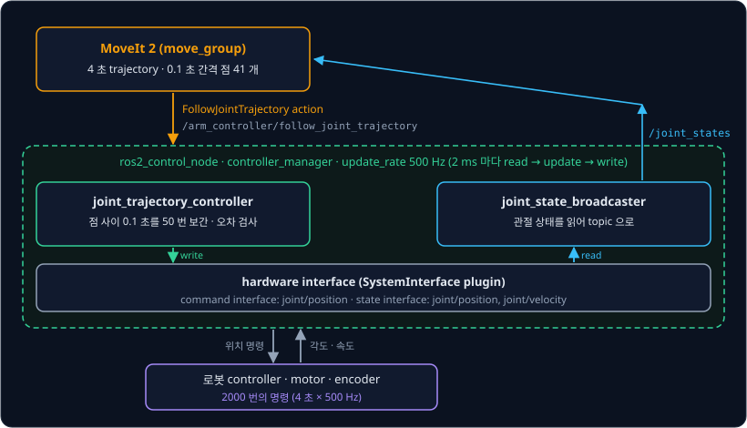
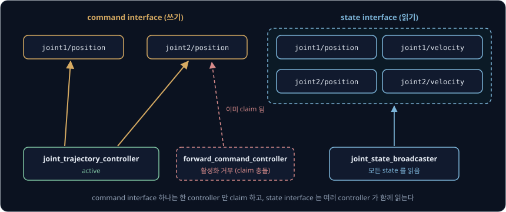
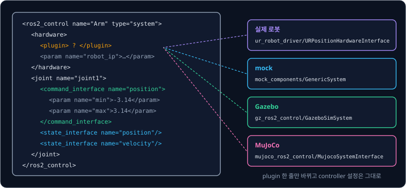
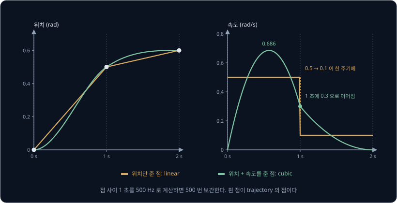
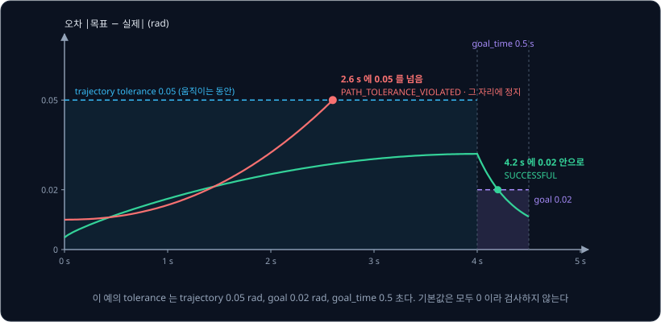
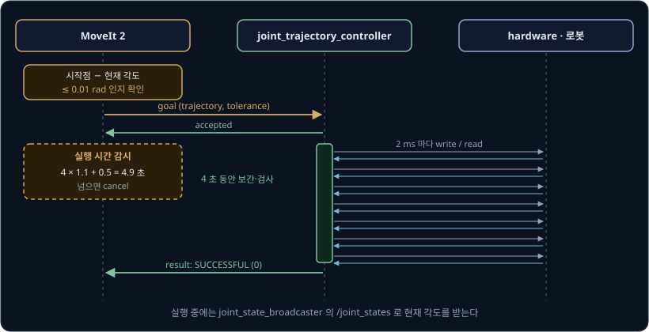
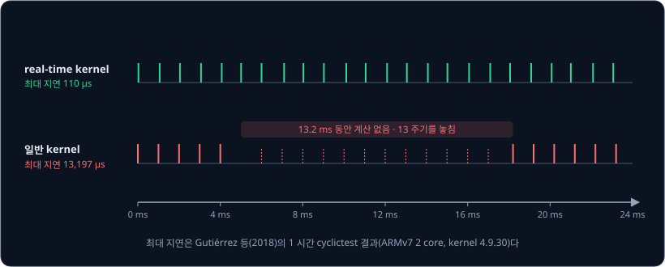
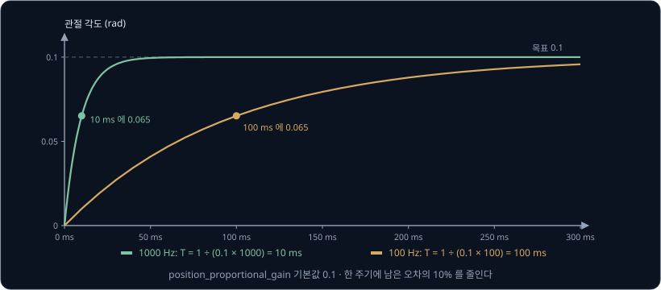

# ros2_control

MoveIt 2 로 UR5e 팔의 움직임을 계획하면 관절 6 개의 각도를 0.1 초 간격으로 적은 점 목록이 나온다. 4 초짜리 동작이면 점이 41 개인데, UR5e 의
ROS 2 driver 는 2 ms 마다 새 위치 명령을 보내므로 같은 4 초 동안 명령이 2000 번 필요하다. 점과 점 사이의 명령은 누가 채우고, 팔이 계획대로
따라가지 못하면 누가 알아채 MoveIt 2 에 알려 줄까?

**ros2_control** 은 정해 둔 주기마다 관절 상태를 읽고 controller 를 계산해 명령을 쓰는 ROS 2 framework 로, 점 사이의 명령을 채우는 일과
오차를 검사해 알리는 일을 함께 맡는다. 로봇과 통신하는 hardware 쪽 코드와 명령을 계산하는 controller 쪽 코드는 plugin 으로 나눠 둔다.
ROS 1 시절의 전신인 ros_control 은 Willow Garage 의 PR2 로봇 전용 controller manager 에서 출발했다. Chitta 등이 2017 년 JOSS 에 실은 논문은
이 구조를 쓰는 로봇으로 Clearpath 의 Husky, NASA 의 Valkyrie, PAL Robotics 의 TIAGo, Universal Robots 의 UR5 를 들고, 지금 Universal Robots 의
ROS 2 driver 도 ros2_control 위에서 UR5e 를 500 Hz 로 제어한다.

## 학습 목표

- planner 의 trajectory 와 motor 명령 사이에서 controller_manager, controller, hardware interface 가 각각 맡는 일을 설명할 수 있다
- command interface 와 state interface, URDF 의 `<ros2_control>` tag 로 hardware 를 바꿔 끼우는 방식을 설명할 수 있다
- joint_trajectory_controller 가 점 사이를 보간하는 방식과 tolerance 를 검사해 성공·실패를 정하는 방식을 숫자로 설명할 수 있다
- 제어 loop 에 real-time kernel 이 필요한 이유와 mock hardware·simulator plugin 의 한계를 설명할 수 있다

## 계획한 trajectory 와 motor 사이

[Trajectory Generation](../trajectory-generation/README.md) 에서 만든 trajectory 는 각 관절이 몇 초에 몇 rad 에 있어야 하는지 적은 점의
목록이다. MoveIt 2 의 기본 time parameterization 은 이 점을 0.1 초 간격으로 다시 샘플링해 보내는데, motor 쪽은 훨씬 짧은 주기로 명령을 받아야 한다.

| 단계 | 내는 것 | 주기 |
| --- | --- | --- |
| MoveIt 2 | 관절 각도·속도·가속도를 적은 점 목록 | 계획할 때 한 번, 점 간격 0.1 초 |
| joint_trajectory_controller | 이번 주기의 관절 위치 명령 | UR5e 500 Hz (2 ms) |
| 로봇 controller | motor 전류 | 로봇 안에서 더 짧은 주기 |

trajectory 를 motor 까지 보내려면 점과 점 사이 0.1 초를 500 Hz 로 나눈 50 주기 동안 쓸 위치를 계산해야 하고, 실제 관절이 목표에서 얼마나
벗어났는지 매 주기 검사해 너무 벗어나면 멈추고 알려야 한다. 계산한 명령은 그 로봇의 통신 방식(Ethernet, CAN, USB serial 등)에 맞게 보내야
한다. ros2_control 에서는 보간과 오차 검사를 controller 가 맡고 통신을 hardware interface 가 맡으며, controller_manager 가 둘을 정해 둔 주기로
차례대로 부른다.

이렇게 나누면 같은 joint_trajectory_controller 가 UR5e, Franka FR3, Gazebo 속 팔을 모두 움직이고, hardware interface 만 로봇마다 따로 쓴다.

## controller_manager

[ROS 2 Basics](../ros2-basics/README.md) 에서 본 것처럼 `controller_manager` 는 `update_rate`(기본 100 Hz)마다 hardware 에서 상태를 읽고(read),
켜져 있는 controller 를 모두 계산하고(update), 결과를 hardware 에 쓰는(write) loop 를 실행한다. `ros2_control_node` 의 소스를 보면 이 loop 는
ROS 의 executor 와 다른 thread 에서 실행된다. executor 의 thread 는 controller 를 켜고 끄는 service 와 topic 을 처리하고, loop 의 thread 는
read → update → write 를 마친 뒤 다음 주기의 시각까지 잠든다.

controller 와 hardware interface 는 모두 plugin 이라서 controller_manager 가 실행 중에 불러온다. controller 는 lifecycle 을 따라
unconfigured → inactive → active 로 바뀌는데, 이 과정은 `spawner` 가 대신 해 준다. controller_manager 는 update 에서 active 인 controller 만 계산한다. 켜고 끄는 일은 `/controller_manager/switch_controller` service 로 하므로 팔을 trajectory 제어에서 force 제어로 바꿀 때 process 를 다시 시작할 필요가 없다.

controller 마다 자기 `update_rate` 를 따로 줄 수 있고, controller_manager 는 그 controller 를 정해진 주기에만 계산한다. 이때
controller_manager 의 주기는 이 값으로 나누어떨어져야 한다. controller_manager 가 500 Hz 일 때 100 Hz 는 5 주기마다 한 번 계산하지만, 200 Hz 는
$500 \div 200 = 2.5$ 라서 간격이 일정하지 않다는 경고가 나온다. joint_state_broadcaster 처럼 1초에 500 번씩 publish 할 필요가 없는
controller 의 주기를 이렇게 낮춘다.

한 주기의 계산이 주기보다 오래 걸리면, 기본 설정(`overruns.manage: true`)의 loop 는 밀린 주기를 건너뛴다. 500 Hz loop 에서 한 주기가 5 ms
걸렸다면 2 ms 와 4 ms 의 차례를 건너뛰고 6 ms 에 다음 주기를 시작하며 "Overrun detected!" 경고를 낸다. 건너뛴 두 차례 동안 hardware 에는 새
명령이 가지 않는다.

**확인 문제.** controller_manager 의 `update_rate` 가 1000 Hz 다. controller 의 `update_rate` 를 250 Hz 로 주면 몇 주기마다 한 번 계산될까?
300 Hz 는 어떨까?

답 보기

$1000 \div 250 = 4$ 라서 4 주기(4 ms)마다 한 번이다. $1000 \div 300 \approx 3.33$ 은 나누어떨어지지 않아 계산 간격이 3 ms 와 4 ms 로 섞이고,
controller_manager 가 일정한 주기로 계산할 수 없다는 경고를 낸다.

## command interface 와 state interface

controller 와 hardware interface 는 topic 을 거치지 않고 메모리에 있는 값을 바로 주고받는데, 그 값 하나하나를 interface 라고 부른다. 이름은
`<관절 이름>/<종류>` 꼴이고, 종류는 `position`, `velocity`, `acceleration`, `effort` 가 표준이다. effort 는 회전 관절에서는 torque(N·m),
직선 관절에서는 힘(N)을 뜻한다.

- **state interface** 는 hardware 가 read 에서 채우고 controller 가 읽기만 하는 값이다. encoder 로 잰 `joint1/position` 이 여기에 들어간다
- **command interface** 는 controller 가 update 에서 쓰고 hardware 가 write 에서 로봇에 보내는 값이다. UR5e 는 `position`, Franka FR3 의 torque
  제어는 `effort` 를 command interface 로 쓴다

값은 기본으로 `double` 이고, 아무도 쓰지 않은 command interface 의 처음 값은 NaN(숫자가 아님을 뜻하는 값)이다. hardware interface 를 직접 짤
때는 NaN 을 받으면 로봇에 보내지 않도록 처리해야 한다.

controller 는 활성화될 때 쓸 command interface 를 요청하고, controller_manager 는 그 interface 를 그 controller 에게만 내준다. 이렇게
interface 를 차지하는 일을 **claim** 이라고 하고, command interface 하나는 한 controller 만 claim 할 수 있다. 위 그림처럼
joint_trajectory_controller 가 `joint2/position` 을 쥐고 있으면 같은 interface 를 쓰려는 forward_command_controller 는 활성화되지 않는다.
그래서 두 controller 가 한 관절에 서로 다른 명령을 써서 팔이 튀는 일이 생기지 않는다. 바꾸려면 switch_controller 로 하나를 끄면서 다른 하나를 켠다. state interface 는
읽기만 하므로 여러 controller 가 함께 읽는다.

motor 쪽 값과 관절 쪽 값 사이의 변환도 hardware interface 가 맡는다. 감속기가 있는 관절에서 motor 는 관절보다 감속비만큼 더 돈다. 예를 들어
감속비를 50 으로 두면, motor encoder 가 12.5 바퀴를 셌을 때 관절은 $12.5 \div 50 = 0.25$ 바퀴, $2\pi \times 0.25 \approx 1.571$ rad 를 돌았다.
read 는 이렇게 바꾼 관절 값을 state interface 에 넣고, write 는 반대로 관절 명령에 감속비를 곱해 motor 명령으로 바꾼다. ros2_control 의
transmission_interface 에 이 변환을 맡는 class 가 있고, Chitta 등의 논문은 transmission 의 예로 단순 감속기, four-bar linkage, differential
transmission 을 든다.

## URDF 의 ros2_control tag

어떤 관절에 어떤 interface 가 있고 어떤 hardware plugin 이 그 관절을 맡는지는 로봇의 URDF 안 `<ros2_control>` tag 에 적는다. URDF 는
[Forward Kinematics](../forward-kinematics/README.md) 에서 본 로봇 설명 파일이고, controller_manager 는 `robot_description` topic 으로 URDF 를
받는다. tag 안의 관절은 모두 URDF 에 있는 관절이어야 한다.

`type` 은 hardware 의 종류다.

| type | 쓰는 곳 | 읽기·쓰기 |
| --- | --- | --- |
| `system` | 통신 채널 하나로 관절 여러 개를 다루는 산업용 팔(KUKA RSI, UR 의 Ethernet 연결) | 둘 다 |
| `actuator` | 관절 하나를 맡는 motor·valve. 관절마다 따로 CAN 으로 통신하는 팔도 이것을 여러 개 쓴다 | 둘 다 |
| `sensor` | encoder, force-torque sensor 처럼 읽기만 하는 장치 | 읽기만 |

`<command_interface>` 안의 `min`, `max` 는 명령의 한계다. 다만 Jazzy 의 controller_manager 는 `enforce_command_limits` 가 기본으로 꺼져 있어
명령을 이 한계로 자르지 않는다. 자르려면 이 parameter 를 true 로 둔다.

`<plugin>` 한 줄을 바꾸면 같은 URDF 와 같은 controller 설정으로 실제 팔, 가짜 팔, simulator 속 팔을 오갈 수 있다. Universal Robots 의
[ROS 2 description](https://github.com/UniversalRobots/Universal_Robots_ROS2_Description/blob/humble/urdf/ur.ros2_control.xacro) Humble 판은 xacro
인자에 따라 이 자리에 `ur_robot_driver/URPositionHardwareInterface`, `mock_components/GenericSystem`, Gazebo plugin 가운데 하나를 넣는다.
controller 와 MoveIt 2 설정은 바꾸지 않으므로, simulator 에서 확인한 launch 파일을 인자만 바꿔 실제 팔에서 실행한다.

## hardware interface

hardware interface 는 `SystemInterface`(또는 `ActuatorInterface`, `SensorInterface`)를 상속한 C++ class 이고, controller_manager 는 그 함수를
아래 순서로 부른다.

| 함수 | 부르는 때 | 하는 일 |
| --- | --- | --- |
| `on_init` | 불러온 직후 한 번 | URDF 의 `<param>` 을 읽고 변수를 준비한다 |
| `on_configure` | configure 할 때 | 로봇과 통신을 연다. 이 상태에서 state 는 읽을 수 있다 |
| `on_activate` | activate 할 때 | brake 를 풀고 명령을 받을 준비를 한다 |
| `read(time, period)` | 매 주기 처음 | 로봇에서 상태를 받아 state interface 에 넣는다 |
| `write(time, period)` | 매 주기 끝 | command interface 의 값을 로봇에 보낸다 |

`period` 는 지난 주기 뒤로 실제로 흐른 시간이다. read 와 write 는 loop 의 thread 에서 매 주기 불리므로 주기 안에 끝나야 하고, 통신을 여는
일처럼 오래 걸리는 작업은 `on_configure` 에 둔다.

로봇 controller 가 정해진 주기로 상태 packet 을 보내는 팔에서는 read 가 그 packet 이 올 때까지 기다리게 해서 loop 의 주기를 로봇의 시계에
맞추기도 한다. controller_manager 의 `hardware_synchronization.expect_blocking_read_write` 를 true 로 두면 loop 는 따로 잠들지 않고 이렇게
동작한다. UR 의 ROS 2 driver 는 launch 인자 `blocking_read`(기본 true)로 이 설정을 켠다.

## joint_trajectory_controller

**joint_trajectory_controller**(JTC)는 관절 여러 개의 trajectory 를 받아 매 주기 그 시각의 목표를 계산해 command interface 에 쓰는
controller 다. trajectory 는 `<controller 이름>/follow_joint_trajectory` action 으로 받고, 결과를 알릴 필요가 없을 때는
`<controller 이름>/joint_trajectory` topic 으로도 받는다. 공식 문서는 실행 결과를 확인해야 하면 action 을 쓰라고 적는다.

JTC 는 매 주기 지금 시각에서 trajectory 를 샘플링한 목표와 측정한 상태를 비교해 오차를 구하고, 다음 주기의 시각에서 샘플링한 값을 명령으로
쓴다. command interface 가 `position` 이면 이 위치를 그대로 보내고, `velocity` 나 `effort` 이면 관절마다 설정한 PID gain 으로 위치·속도 오차를
명령으로 바꾼다. gain 의 기본값은 모두 0 이라서 velocity·effort 로 쓸 때는 [PID Control](../pid-control/README.md) 에서 본 방식으로 gain 을
직접 맞춰야 한다.

### 점 사이 보간

점과 점 사이의 목표는 `interpolation_method` 로 정하고, 기본값 `splines` 는 점에 적힌 값의 종류에 따라 곡선을 고른다.

| 점에 적힌 값 | 곡선 | 이어지는 것 |
| --- | --- | --- |
| 위치만 | linear | 위치만. 점에서 속도가 한 번에 바뀐다 |
| 위치, 속도 | cubic(3차 다항식) | 위치, 속도 |
| 위치, 속도, 가속도 | quintic(5차 다항식) | 위치, 속도, 가속도 |

위 그림은 예로 고른 점 세 개(0 초 0 rad, 1 초 0.5 rad, 2 초 0.6 rad)를 이은 결과다. 위치만 주면 JTC 는 점 사이를 직선으로 이어 0 ~ 1 초에는
0.5 rad/s, 1 ~ 2 초에는 0.1 rad/s 로 움직이게 하는데, 500 Hz 에서 이 속도 변화가 한 주기에 일어나면 가속도가 $(0.1 - 0.5) \div 0.002 = -200$
rad/s² 가 된다. motor 는 이 가속도를 낼 수 없어서 팔에 충격이 가거나 오차가 커진다. 공식 문서도 위치만 적은 trajectory 는 점에서 속도가
끊긴다며 권하지 않는다. 같은 점에 속도 0, 0.3, 0 rad/s 를 함께 주면 JTC 가 cubic 으로 보간해 1 초 앞뒤의 속도가 0.3 rad/s 로 같아진다. 다만
가속도는 1 초 직전 −1.8 rad/s² 에서 직후 −0.6 rad/s² 로 바뀌므로, 가속도까지 이으려면 점에 가속도도 적어 quintic 으로 보간하게 한다. MoveIt 2 가 보내는 trajectory 에는 time
parameterization 이 계산한 속도와 가속도가 들어 있어서 JTC 는 quintic 으로 보간한다.

trajectory 의 첫 점이 지금보다 미래 시각이면 JTC 는 현재 상태에서 첫 점까지도 같은 방식으로 이어 준다. 실행 중에 새 action goal 이 오면
지금 실행하던 trajectory 는 버리고 새 것을 따르며, 앞의 goal 은 abort 로 끝난다.

### tolerance 와 성공 판정

JTC 는 매 주기 관절마다 목표와 실제 위치의 차이를 검사한다. 기준은 `constraints` parameter 에 적는다.

| parameter | 뜻 | 기본값 |
| --- | --- | --- |
| `constraints.<관절>.trajectory` | 움직이는 동안 허용하는 위치 오차 | 0 (검사 안 함) |
| `constraints.<관절>.goal` | 마지막 점에서 허용하는 위치 오차 | 0 (검사 안 함) |
| `constraints.goal_time` | 마지막 점의 시각 뒤로 goal 안에 들어올 때까지 기다리는 시간 | 0 (무한히 기다림) |
| `constraints.stopped_velocity_tolerance` | 끝에서 멈췄다고 보는 속도 | 0.01 |

위 그림은 trajectory tolerance 를 0.05 rad, goal tolerance 를 0.02 rad, goal_time 을 0.5 초로 정해 본 예다. 초록 관절은 움직이는 동안 오차가
0.05 rad 를 넘지 않았고, 4 초에 마지막 점을 지난 뒤 4.2 초에 0.02 rad 안으로 들어와 action 이 SUCCESSFUL 로 끝난다. 빨강 관절은 2.6 초에
오차가 0.05 rad 를 넘었으므로 JTC 가 그 자리에서 팔을 세우고 action 을 `PATH_TOLERANCE_VIOLATED`(error code −4)로 abort 한다. 움직이는 동안
검사를 통과한 관절이라도 4.5 초까지 goal tolerance 안에 들어오지 못하면 `GOAL_TOLERANCE_VIOLATED`(−5)로 끝난다.

action goal 에 tolerance 를 함께 보내면 그 goal 에서만 parameter 대신 그 값을 쓴다. goal 에 적은 0 은 parameter 의 값을 그대로 쓰라는 뜻이고,
−1 은 그 검사를 하지 말라는 뜻이다.

위치 tolerance 의 기본값은 모두 0 이라서, 팔이 장애물에 걸려 계획에서 크게 벗어나도 JTC 는 abort 하지 않고 계속 명령을 쓴다. 마지막 점을 지난 뒤 관절 속도가 0.01 rad/s 아래로 떨어지기만 하면 목표에서 멀리 떨어져 있어도 SUCCESSFUL 을 돌려준다. 반대로 goal 만
정하고 goal_time 을 0 으로 두면 목표에 닿지 못한 팔을 끝없이 기다린다. UR 의 ROS 2 driver 는 모든 관절에 trajectory 0.2 rad, goal 0.1 rad,
stopped_velocity_tolerance 0.2 를 설정해 둔다.

> **오해** JTC 는 trajectory 를 따라가지 못하면 알아서 멈춘다.
>
> **사실** JTC 는 tolerance 를 설정했을 때만 멈추고, 기본값 0 은 검사하지 않는다는 뜻이다. 실제 로봇에 쓰기 전에 관절마다 `trajectory`, `goal`, `goal_time` 을 정해야 한다.

UR 의 teach pendant 에는 실행 속도를 0 ~ 100% 로 줄이는 slider 가 있다. JTC 는 hardware 가 내놓은 speed scaling state interface 로 이 값을 읽어
trajectory 의 시계를 매 주기 `period × scaling` 만큼만 진행시킨다. slider 가 50% 이면 2 ms 주기마다 trajectory 시간이 1 ms 씩만 흘러서 4 초짜리 동작이
8 초에 걸쳐 같은 경로로 실행되고, 목표 자체가 늦춰지므로 tolerance 검사도 어긋나지 않는다.

**확인 문제.** controller_manager 가 500 Hz 이고 MoveIt 2 가 점을 0.1 초 간격으로 보낸다. JTC 는 점 사이에서 몇 번 명령을 계산할까? 3 초짜리
trajectory 의 점은 몇 개이고 명령은 모두 몇 번일까?

답 보기

한 주기가 $1 \div 500 = 0.002$ 초라서 점 사이 0.1 초에 $0.1 \div 0.002 = 50$ 번이다. 3 초짜리 trajectory 의 점은 0, 0.1, …, 3.0 초의
$3 \div 0.1 + 1 = 31$ 개이고, 명령은 $3 \times 500 = 1500$ 번이다.

## 그 밖의 controller

JTC 말고도 ros2_controllers 에는 로봇 팔에 자주 쓰는 controller 가 있다.

| controller | 받는 것 | 하는 일 |
| --- | --- | --- |
| `joint_state_broadcaster/JointStateBroadcaster` | 없음 | state interface 를 모두 읽어 `/joint_states` 와 `/dynamic_joint_states` 로 publish |
| `forward_command_controller/ForwardCommandController` | `~/commands` topic (`Float64MultiArray`) | 받은 숫자를 보간 없이 command interface 에 그대로 씀 |
| `parallel_gripper_action_controller/GripperActionController` | `~/gripper_cmd` action | gripper 관절 하나를 목표 폭으로 움직이고 결과를 알림 |

joint_state_broadcaster 는 명령을 쓰지 않아서 broadcaster 라고 부른다. `/joint_states` 에는 position, velocity, effort 만 들어가고, 온도처럼
hardware 가 더 내놓은 값은 `/dynamic_joint_states` 에 들어간다. `robot_state_publisher` 는 `/joint_states` 로 tf2 의 link frame 을 계산하고,
MoveIt 2 도 이 topic 으로 팔의 현재 자세를 읽는다. 이 broadcaster 를 켜지 않으면 실제 팔이 움직여도 RViz 에 그린 팔과 MoveIt 2 가 아는 시작
자세는 바뀌지 않는다.

forward_command_controller 는 받은 값을 보간도 오차 검사도 하지 않고 다음 주기에 그대로 쓰므로, teleoperation 이나 학습한 policy 처럼
바깥에서 목표를 계속 새로 내는 경우에 쓴다. 예를 들어 policy 가 1초에 20 번 위치를 보내고 controller_manager 가 500 Hz 이면 같은 명령이
$500 \div 20 = 25$ 주기 동안 이어지다가 다음 명령이 오면 계단처럼 바뀐다. 계단을 줄이려면 policy 의 출력을 점 하나짜리 trajectory 로 JTC 에 보내 보간하게
하거나, policy 쪽에서 출력을 부드럽게 만든다.

gripper controller 로 물체를 쥘 때는 성공 판정을 따로 맞춰야 한다. 예를 들어 손가락 사이 폭을 m 단위로 재는 gripper 를 0(완전히 닫음)으로
보냈는데 폭 0.03 m 인 물체에 막혀 0.03 에서 멈추면, 목표와의 차이 0.03 이 `goal_tolerance` 기본값 0.01 보다 커서 성공으로 끝나지 않는다.
controller 는 손가락 속도가 `stall_velocity_threshold`(기본 0.001)보다 느린 상태가 `stall_timeout`(기본 1.0 초) 동안 이어지면 손가락이
멈췄다고 판단한다. 이때 `allow_stalling` 이 기본값 false 이면 물체를 잘 쥐었는데도 action 을 abort 한다. MoveIt 2 의 Panda 예제 설정은 `allow_stalling: true`, `stall_timeout: 0.05` 로 바꿔 둔다.

## MoveIt 2 와 FollowJointTrajectory

MoveIt 2 는 계획한 trajectory 를 `moveit_simple_controller_manager` 를 거쳐 controller 에 보낸다. `moveit_controllers.yaml` 에 controller
이름, `type: FollowJointTrajectory`, `action_ns: follow_joint_trajectory`, 관절 목록을 적으면 MoveIt 2 는
`/<controller 이름>/follow_joint_trajectory` action 의 client 가 된다. 이 이름과 관절 목록이 ros2_control 쪽 JTC 설정과 정확히 맞아야 한다.

MoveIt 2 의 trajectory execution manager 는 trajectory 를 보내기 전에는 시작점을 검사하고, 실행하는 동안에는 걸리는 시간을 감시한다.

| parameter | 기본값 | 하는 일 |
| --- | --- | --- |
| `trajectory_execution.allowed_start_tolerance` | 0.01 rad | trajectory 의 첫 점과 지금 관절 각도의 차이가 이보다 크면 보내지 않는다 |
| `trajectory_execution.allowed_execution_duration_scaling` | 1.1 | 예상 시간에 곱하는 여유 |
| `trajectory_execution.allowed_goal_duration_margin` | 0.5 초 | 곱한 뒤 더하는 여유 |

4 초짜리 trajectory 라면 $4 \times 1.1 + 0.5 = 4.9$ 초 안에 result 가 와야 하고, 넘으면 MoveIt 2 가 action 을 cancel 한다. Panda 예제처럼
scaling 을 1.2 로 두면 $4 \times 1.2 + 0.5 = 5.3$ 초다. 시작점 검사는 계획을 세우는 동안 팔이 움직였을 때 걸린다. 계획할 때의 자세에서
0.01 rad 넘게 벗어난 팔에 그 trajectory 를 그대로 보내면 JTC 가 첫 점까지 갑자기 움직이므로, MoveIt 2 가 보내기 전에 막는다.

실행이 실패하면 MoveIt 2 의 log 로 원인을 나눈다. start tolerance 오류는 실행 전에 팔이 움직였거나 상태 topic 이 늦은 경우다. action result 의
error code −4, −5 는 JTC 의 tolerance 에 걸린 경우이고, 시간 초과는 MoveIt 2 의 duration 감시에 걸린 경우다.

**확인 문제.** 기본 설정의 MoveIt 2 가 6 초짜리 trajectory 를 실행한다. 몇 초가 지나도 result 가 없으면 cancel 할까?

답 보기

$6 \times 1.1 + 0.5 = 7.1$ 초다.

## real-time loop

계산 주기가 일정해야 하는 이유는 [PID Control](../pid-control/README.md) 에서 본 그대로다. D 항과 I 항은 주기 $\Delta t$ 로 계산하고, gain 이
클수록 짧고 일정한 주기에서만 안정하다. 하지만 일반 Linux kernel 은 처리량을 높이도록 만들어져서, 다른 process 나 interrupt 가 CPU 를 차지하면
제어 loop 의 thread 가 정해진 시각보다 늦게 깨어난다. 정해진 시각에서 벗어나는 정도를 **jitter** 라고 한다.

Gutiérrez 등(2018)은 ARMv7 2 core 보드(kernel 4.9.30)에서 깨어나야 할 시각과 실제로 깨어난 시각의 차이를 재는 cyclictest 를 1 시간 실행했다. 일반
kernel 에서 가장 큰 지연은 13,197 µs 였고, PREEMPT-RT patch 를 적용한 real-time kernel 에서는 110 µs 였다. 제어용 CPU core 를 다른 일에서 떼어
놓은 경우에는 88 µs 까지 줄었다. 1 kHz loop 에서 13.2 ms 지연이 한 번 생기면 그동안 13 주기를 계산하지 못하지만, 110 µs 는 1 ms 주기의 11% 라서
주기를 놓치지 않는다.

로봇 쪽에서 시간 한계를 정해 두기도 한다. Franka 의 문서는 1 kHz 제어에서 network 왕복 시간과 제어 loop 의 계산 시간을 더한 값이 1 ms 보다
작아야 하고, read 와 write 사이는 500 µs 안에 끝나야 한다고 적는다. 같은 문서는 packet 을 잃어도 로봇이 `communication_constraints_violation`
오류로 멈출 수 있다고 적고, 제어 loop 를 늦추는 원인 가운데 하나로 real-time kernel 을 쓰지 않은 경우를 든다.

ros2_control 은 loop thread 의 지연을 줄이는 설정을 갖추고 있다.

| 설정 | 기본값 | 하는 일 |
| --- | --- | --- |
| `thread_priority` | 50 | loop thread 를 `SCHED_FIFO` 의 이 우선순위로 실행한다(0 ~ 99) |
| `lock_memory` | real-time kernel 이면 true, 아니면 false | process 의 메모리를 RAM 에 고정해 disk 로 밀려나지 않게 한다 |
| `cpu_affinity` | 없음 | loop thread 를 지정한 CPU core 에서만 실행한다 |

`SCHED_FIFO` 는 우선순위가 높은 thread 가 스스로 양보할 때까지 CPU 를 내주지 않는 Linux 의 scheduling 방식이다. 일반 사용자는 이 우선순위를
설정할 권한이 없어서, 공식 문서는 `realtime` group 을 만들고 `/etc/security/limits.conf` 에 `rtprio 99`, `memlock unlimited` 를 주라고 안내한다.
kernel 가운데서는 real-time kernel 이 jitter 를 가장 많이 줄이지만, 설치가 쉬운 `linux-lowlatency` kernel 로도 크게 나아진다고 적는다.

kernel 만으로는 부족하고 controller 와 hardware interface 의 코드도 real-time 규칙을 지켜야 한다. update, read, write 에서는 메모리를 새로
할당하지 않고(`on_init` 에서 미리 확보한다), 다른 thread 가 쥔 lock 을 기다리지 않으며, 보통의 ROS publisher 로 publish 하지 않는다.
realtime_tools package 에는 이 규칙을 지키면서 thread 사이에 값을 주고받는 도구가 있다. subscriber 가 받은 마지막 명령을 loop 가 기다리지
않고 가져가게 하는 `RealtimeThreadSafeBox`, 중간 message 를 하나도 잃으면 안 될 때 쓰는 `LockFreeQueue`, loop 안의 값을 별도 thread 로
publish 하는 `RealtimePublisher` 가 그 예다. JTC 도 action 으로 받은 새 trajectory 를 이런 buffer 에 넣어 두고, loop 는 다음 update 에서 그것을 꺼내 쓴다.

> **오해** `update_rate` 를 높이면 제어가 더 좋아진다.
>
> **사실** 한 주기 안에 read, update, write 가 끝나지 않으면 overrun 으로 주기를 건너뛰어 오히려 불규칙해진다. 로봇 controller 가 받는 주기(UR5e 500 Hz, UR5 같은 CB3 세대 125 Hz)와
> 컴퓨터가 지킬 수 있는 주기에 맞춰 정한다.

**확인 문제.** 1 kHz loop 에서 kernel 이 thread 를 4.5 ms 늦게 깨웠다. 몇 주기를 놓쳤을까? 같은 loop 를 500 Hz 로 실행하면?

답 보기

1 kHz 는 주기가 1 ms 라 4.5 ms 동안 4 주기를 놓친다. 500 Hz 는 주기가 2 ms 라 2 주기를 놓친다. 같은 지연도 주기가 짧을수록 더 많은 주기를
잃는다.

## simulation 과 mock hardware

실제 팔 없이 ros2_control 설정을 확인하려면 `<plugin>` 을 바꾼다.

| plugin | 상태를 만드는 방법 | 쓰는 곳 |
| --- | --- | --- |
| `mock_components/GenericSystem` | 명령을 그대로 상태로 복사 | launch 파일, controller 설정, MoveIt 2 연결 확인 |
| `gz_ros2_control/GazeboSimSystem` | Gazebo 의 물리 계산 | 동역학, 센서, 접촉까지 확인 |
| `mujoco_ros2_control/MujocoSystemInterface` | MuJoCo 의 물리 계산 | MJCF 모델로 정밀한 접촉 확인 |

mock_components 의 GenericSystem 은 이번 주기에 쓴 position 명령을 다음 read 에서 position 상태로 돌려준다. 오차가 늘 0 이라서 JTC 의
tolerance 에는 걸리지 않으므로, mock 으로는 topic 이름, controller 이름, 관절 목록처럼 연결만 확인할 수 있다. `position_state_following_offset`
으로 상태에 일정한 차이를 더하거나 `disable_commands` 로 상태가 바뀌지 않는 고장을 흉내 내면 오류 처리도 시험할 수 있다. `calculate_dynamics`
를 켜면 명령에서 속도와 가속도를 계산해 상태에 넣는다.

URDF 의 `<gazebo>` 안에 `gz_ros2_control::GazeboSimROS2ControlPlugin` 을 넣으면 gz_ros2_control 이 Gazebo 안에서 controller_manager 를
실행한다. gz_ros2_control 의 예제 launch 파일은 node 들을 `use_sim_time: true` 로 실행해 Gazebo 의 시계를 따르게 한다. position command 를 받으면
관절을 그 위치로 순간 이동시키지 않고, 관절 속도를 `position_proportional_gain × 위치 오차 × update_rate` 로 정해 따라가게 한다.

한 주기 동안 이 속도로 움직이면 위치는 gain × 오차만큼 바뀌므로, gain 기본값 0.1 은 매 주기 남은 오차의 10% 를 줄인다. 공식 문서는 이 응답의
time constant 를 `1 / (position_proportional_gain × update_rate)` 로 적는다. time constant 는 남은 오차가 처음의 약 3 분의 1 로 줄어드는
시간으로, 1000 Hz 에서는 $1 \div (0.1 \times 1000) = 10$ ms 이고 100 Hz 에서는 100 ms 다. 그래서 100 Hz 로 설정한 simulation 에서는 팔이
명령보다 눈에 띄게 늦게 따라온다. gain 을 키우면 빨라지지만, 문서는 gain 이 1 을 넘으면 진동하고 2 를 넘으면 불안정해진다고 적는다.

mujoco_ros2_control 은 `<plugin>` 에 `mujoco_ros2_control/MujocoSystemInterface` 를 적고 `mujoco_model` parameter 로 MJCF 파일을 준다. 이
package 가 제공하는 `ros2_control_node` 를 `use_sim_time: true` 로 실행해야 한다. MuJoCo 의 position actuator 와 torque actuator 가 어떻게
다른지는 [MuJoCo Simulation](../mujoco-sim/README.md) 에서 다룬다.

> **오해** mock hardware 에서 MoveIt 2 실행이 성공했으니 실제 팔에서도 된다.
>
> **사실** mock 은 명령을 그대로 상태로 돌려주므로 tracking 오차, gripper 의 stall, 통신 지연이 모두 0 이다. tolerance 와 gain 은 simulator 나 실제 팔에서 다시 확인해야 한다.

**확인 문제.** gz_ros2_control 의 `update_rate` 가 250 Hz 이고 `position_proportional_gain` 이 0.1 이다. position 명령에 대한 time constant 는?
gain 을 0.5 로 올리면?

답 보기

$T = 1 \div (0.1 \times 250) = 0.04$ 초, 40 ms 다. gain 0.5 이면 $1 \div (0.5 \times 250) = 0.008$ 초, 8 ms 다. 0.5 는 1 보다 작아 진동하지
않는다.

## 정리

- ros2_control 은 controller_manager 가 `update_rate` 마다 read → update → write 를 실행하는 loop 이고, 명령을 계산하는 controller 와 로봇과
  통신하는 hardware interface 를 plugin 으로 나눈다. 둘은 `<관절>/<종류>` 이름의 command interface 와 state interface 로 값을 주고받고,
  command interface 하나는 한 controller 만 claim 한다
- joint_trajectory_controller 는 FollowJointTrajectory 로 받은 점 사이를 점에 적힌 값에 따라 linear, cubic, quintic 으로 보간해 매 주기 명령을
  쓰고, `trajectory`·`goal`·`goal_time` tolerance 를 넘으면 그 자리에 멈추고 error code −4, −5 로 알린다. tolerance 기본값은 0 이라 검사하지 않는다
- 제어 loop 는 real-time kernel, `SCHED_FIFO` 우선순위, 메모리 고정으로 jitter 를 줄인다
- mock_components·gz_ros2_control·mujoco_ros2_control 은 `<plugin>` 한 줄로 바꿔 끼우지만, mock 은 오차가 늘 0 이라 연결 확인에만 쓴다

이 강의의 팔은 위치 명령을 따라가기만 해서, 물체에 닿으면 위치 오차를 줄이려고 힘을 motor 의 한계까지 키운다. 접촉한 뒤 손끝의 힘을 조절하는 방법은
[Force & Impedance Control](../impedance-control/README.md) 에서 effort command interface 와 함께 다루고, MoveIt 2 가 장애물을 피하는 경로를
찾아 이 강의의 controller 에 넘기기까지의 과정은 [Motion Planning](../motion-planning/README.md) 에서 다룬다.

## 참고 자료

- S. Chitta 외, [ros_control: A generic and simple control framework for ROS](https://doi.org/10.21105/joss.00456) (JOSS, 2017) — ros_control 의
  구성과 이 구조를 쓰는 로봇 목록
- ros2_control, [Getting Started](https://control.ros.org/jazzy/doc/getting_started/getting_started.html) — 전체 구조, system·sensor·actuator 의
  차이, `<ros2_control>` tag 예제
- ros2_control, [Controller Manager](https://control.ros.org/jazzy/doc/ros2_control/controller_manager/doc/userdoc.html) — loop 설정과
  real-time kernel 준비
- ros2_control, [Writing a Hardware Component](https://control.ros.org/jazzy/doc/ros2_control/hardware_interface/doc/writing_new_hardware_component.html)
  와 [Mock Components](https://control.ros.org/jazzy/doc/ros2_control/hardware_interface/doc/mock_components_userdoc.html) — lifecycle 함수와
  GenericSystem 의 parameter
- ros2_controllers, [joint_trajectory_controller](https://control.ros.org/jazzy/doc/ros2_controllers/joint_trajectory_controller/doc/userdoc.html) —
  interface 조합, 보간 방식 그림, tolerance parameter 전체
- ros2_controllers, [Parallel Gripper Action Controller](https://control.ros.org/jazzy/doc/ros2_controllers/parallel_gripper_controller/doc/userdoc.html)
  — `goal_tolerance`, `allow_stalling`, `stall_timeout` 의 뜻
- [realtime_tools](https://control.ros.org/jazzy/doc/realtime_tools/doc/index.html) — real-time thread 와 값을 주고받는 도구 고르는 법
- [gz_ros2_control](https://control.ros.org/jazzy/doc/gz_ros2_control/doc/index.html) — Gazebo plugin 설정과 position command 의 time constant 식
- MoveIt 2, [moveit_resources 의 Panda 설정](https://github.com/moveit/moveit_resources/tree/ros2/panda_moveit_config/config) —
  `moveit_controllers.yaml` 과 `ros2_controllers.yaml` 을 나란히 놓고 이어지는 이름을 확인한다
- Universal Robots, [ROS 2 driver 의 controller 설정](https://github.com/UniversalRobots/Universal_Robots_ROS2_Driver/tree/main/ur_robot_driver/config) —
  실제 팔에 쓰는 JTC tolerance, speed scaling, 모델별 `update_rate`
- Franka Robotics, [Troubleshooting](https://frankarobotics.github.io/docs/troubleshooting.html) — 1 kHz 제어의 시간 한계와
  `communication_constraints_violation` 의 원인
- C. S. V. Gutiérrez 외, [Real-time Linux communications](https://arxiv.org/abs/1808.10821) (2018) — 일반 kernel 과 PREEMPT-RT kernel 의
  지연 측정과 CPU 분리의 효과
