# RT-1

[Behavior Cloning](../behavior-cloning/README.md) 의 상자 앞 장면처럼 시연이 왼쪽 20° 와 오른쪽 20° 로 반반 갈리면, 핸들 각도를 숫자
하나로 내고 MSE 로 학습한 policy 는 두 정답의 평균인 0° 를 내서 상자로 곧장 간다. 로봇 여러 대와 조작자 여러 명이 1 년 넘게 모은
시연이라면 이렇게 갈리는 장면은 훨씬 많아진다. policy 가 action 을 숫자 하나 대신 무엇으로 내야 갈린 시연을 평균으로 뭉개지 않을까?

이 문제를 푸는 좋은 방법은 action 의 범위를 칸 256 개로 나누고 몇 번 칸인지를 분류 문제로 고르게 하는 것인데, 이렇게 하면 갈린 두
정답이 각자의 칸에 확률로 남는다. Google 이 2022 년에
발표한 RT-1 은 이 방식으로 카메라 사진과 영어 지시 문장을 받아 팔과 바퀴의 action 11 개를 1 초에 3 번 낸다. 로봇 13 대로 17 개월 동안
모은 시연 약 13 만 개로 학습해 지시 700 개 이상을 97% 의 성공률로 해냈다.

## 학습 목표

- action 의 차원마다 범위를 칸으로 나눠 분류로 학습하면 갈린 시연의 봉우리가 남는 이유를 cross-entropy 의 숫자로 설명할 수 있다
- 값을 칸 번호로 바꾸고 다시 값으로 되돌리는 계산을 하고, 칸 개수에 따라 오차와 칸 하나에 들어가는 시연 수가 어떻게 바뀌는지 설명할 수 있다
- FiLM 이 지시 문장을 사진 처리에 섞는 계산과, TokenLearner 가 token 을 줄여 1 초에 3 번 계산하는 제한을 맞추는 방식을 설명할 수 있다
- RT-1 의 일반화 실험에서 데이터 다양성의 효과와, 시연에 없는 동작은 하지 못한다는 한계를 설명할 수 있다

## RT-1 의 입력과 출력

RT-1 을 학습하고 시험한 로봇은 Everyday Robots 의 mobile manipulator 로, 관절 7 개짜리 팔과 손가락 두 개짜리 집게를 바퀴 달린 몸통에
얹은 로봇이다. 사람이 "pick iced tea can"(아이스티 캔을 집어) 이라고 지시하면 캔으로, "open the top drawer"(맨 위 서랍을 열어) 라고
하면 서랍 손잡이로 팔을 뻗는다. 같은 사진이 들어와도 지시에 따라 다른 동작을 해야 하므로, policy(관측을 받아 action 을 내는 규칙)는
사진과 지시 문장을 함께 받는다.

로봇이 사진을 보고 action 을 새로 계산해 움직이는 한 번을 step 이라고 한다. 입력 사진은 최근 6 step 에 찍은 6 장이고 한 장은 가로세로
300 pixel 이다. 출력은 숫자 11 개이고, 숫자 하나하나를 action 의 차원이라고 부른다.

| 묶음 | 차원 | 뜻 |
| --- | --- | --- |
| 팔 | x, y, z | 손끝을 앞뒤·좌우·위아래로 옮길 거리 |
| 팔 | roll, pitch, yaw | 손끝을 돌릴 각도. roll 은 손목을 비트는 회전이고, pitch 는 손끝을 위아래로 숙이는 회전이며, yaw 는 좌우로 돌리는 회전이다 |
| 팔 | 집게 | 집게를 벌리는 정도 |
| 바퀴 | x, y, yaw | 몸통을 앞뒤·좌우로 옮길 거리와 제자리에서 도는 각도 |
| mode | 1 개 | 팔을 움직일지, 바퀴를 움직일지, episode 를 끝낼지 셋 중 하나 |

표의 mode 에 나오는 episode 는 작업 하나를 처음부터 끝까지 한 번 한 기록이다. RT-1 은 1 초에 3 번 action 을 새로 내는데, 1 초에 몇 번
일어나는지를 세는 단위가 Hz 라서 3 Hz 로 제어한다고 말한다.

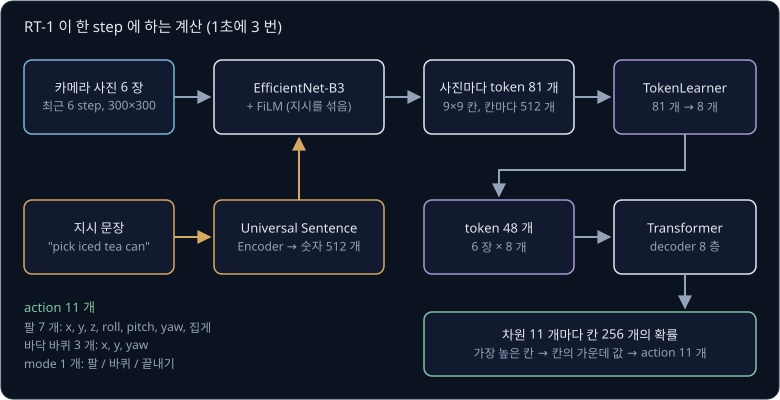

위 그림은 RT-1 이 한 step 에 하는 계산이다. 사진은 EfficientNet-B3 라는 CNN 이 요약하고, 지시 문장은 Universal Sentence Encoder 라는
pretrained 모델이 숫자 512 개로 바꾼 뒤 FiLM 이라는 계산으로 그 CNN 의 중간 값에 섞는다. 사진 한 장에서 나온 token 81 개를
TokenLearner 가 8 개로 줄이면, Transformer 가 6 장 몫 48 개를 받아 차원 11 개마다 칸 256 개의 확률을 낸다.

[Behavior Cloning](../behavior-cloning/README.md) 의 팔은 관절 6 개와 집게, 모두 7 개의 목표 각도를 action 으로 냈다. RT-1 의 팔 action
은 관절 각도 대신 손끝을 옮기고 돌릴 양이지만 둘 다 차원마다 범위가 정해진 연속된 숫자라서, 이 강의의 binning 계산은 따라가기 쉬운
관절 각도로 한다.

## 칸별 확률

상자 앞 장면에서 시연 10 개 가운데 5 개는 핸들을 $-20$° 로 꺾었고 나머지 5 개는 $+20$° 로 꺾었으며, $-10$° ~ $+10$° 로 꺾으면 상자에
부딪힌다. RT-1 의 방식에서는 각도가 나올 수 있는 범위를 칸 여러 개로 나누고, 칸마다 정답이 그 칸에 있을 확률을 낸다. 범위
$-50$° ~ $+50$° 를 폭 20° 인 칸 다섯 개로 나누면 칸의 가운데 값은 $-40$°, $-20$°, 0°, $+20$°, $+40$° 다.

여러 종류 가운데 하나를 고르는 문제를 분류(classification)라고 하고, 고를 수 있는 종류 하나하나를 class 라고 한다. 칸 하나하나를
class 로 삼으면 각도를 맞히는 regression 문제가 "몇 번 칸인가" 를 고르는 분류 문제가 된다. 모델은 칸마다 점수 하나를 내고,
softmax 가 점수를 합이 1 인 확률로 바꾼다. 예를 들어 모델이 점수 $(0, 2, 0, 2, 0)$ 을 냈다면 확률은 $-20$° 칸과 $+20$° 칸이 0.416
씩이고 나머지 세 칸이 0.056 씩이다.

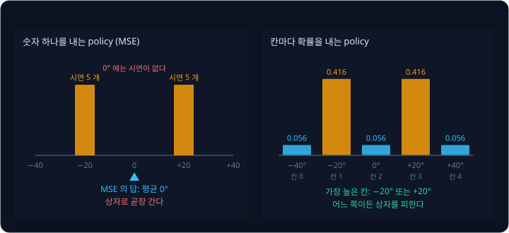

실행할 때 확률이 가장 높은 칸을 고르는 argmax 는 $-20$° 칸이나 $+20$° 칸을 고른다. 확률에 비례해 무작위로 고르는 sampling 은 100 번
가운데 약 42 번씩 두 칸을 고르고 0° 칸은 약 6 번만 고르므로, 늘 0° 를 내는 regression 과 다르다.

저자들은 RT-1 의 출력을 칸 분류 대신 봉우리가 하나인 연속 분포(Gaussian)로 바꾸는 실험도 했다. 학습한 지시의 성공률은 97% 에서 68% 로
떨어졌고, 처음 보는 지시의 성공률도 76% 에서 43% 로 떨어졌다. 논문은 칸 분류는 봉우리가 여럿인 분포를 나타낼 수 있지만 Gaussian 은
봉우리 하나만 나타낸다는 것을 이유로 들었다.

같은 관측에 정답 action 이 여럿이라 분포의 봉우리가 여럿인 시연을 multimodal 시연이라고 하고, 이때 modal 은 통계의 mode(가장 자주 나온
값)에서 왔다.

사진과 글을 함께 받는 모델을 multimodal 모델이라고 할 때는 입력의 종류가 여럿이라는 다른 뜻이다. RT-1 은 두 뜻 모두에 해당한다.

<b>심화: softmax 의 계산</b>

softmax 는 점수 $z$ 마다 $e^{z}$ 를 구하고, 모두 더한 뒤, 각 값을 그 합으로 나눈다. $e$ 는 약 2.718 인 정해진 수이고 $e^{z}$ 는 $z$ 가
음수여도 양수라서, 나눈 값은 0 과 1 사이이며 합이 1 이다.

| 칸 | 가운데 값 | 점수 $z$ | $e^{z}$ | 확률 $e^{z} \div 17.778$ |
| --- | --- | --- | --- | --- |
| 0 | $-40$° | 0 | 1 | 0.056 |
| 1 | $-20$° | 2 | 7.389 | 0.416 |
| 2 | 0° | 0 | 1 | 0.056 |
| 3 | $+20$° | 2 | 7.389 | 0.416 |
| 4 | $+40$° | 0 | 1 | 0.056 |
| 합 | | | 17.778 | 1 |

$e^{z}$ 의 합은 $1 + 7.389 + 1 + 7.389 + 1 = 17.778$ 이고, 1 번 칸은 $7.389 \div 17.778 \approx 0.416$, 0 번 칸은
$1 \div 17.778 \approx 0.056$ 이다. 식으로 쓰면 아래와 같다.

$$
p_k = \frac{e^{z_k}}{\sum_{j=0}^{K-1} e^{z_j}}
$$

$p_k$ 는 $k$ 번 칸의 확률이고, $z_k$ 는 $k$ 번 칸의 점수이며, $K$ 는 칸의 개수다. 분모는 0 번부터 $K - 1$ 번 칸까지의 $e^{z}$ 를 모두 더한
값이다. RT-1 은 차원마다 $K = 256$ 이라 점수 256 개로 같은 계산을 한다.

**확인 문제.** 칸 다섯 개(가운데 값 $-40$°, $-20$°, 0°, $+20$°, $+40$°)에 policy 가 확률 $(0.1, 0.6, 0.1, 0.1, 0.1)$ 을 냈다. argmax 로
고른 칸의 가운데 값은 몇 도이고, sampling 으로 100 번 고르면 0° 칸은 대략 몇 번 나올까?

답 보기

1. argmax: 확률이 가장 큰 칸은 0.6 인 1 번 칸이고, 가운데 값은 $-20$° 다
2. sampling: 0° 칸은 2 번 칸이라 확률이 0.1 이고, $100 \times 0.1 = 10$ 이다

답: argmax 는 $-20$°, sampling 은 0° 칸을 약 10 번 고른다.

## cross-entropy 와 두 봉우리

칸마다 확률을 내는 모델은 정답 칸이 받은 확률로 loss 를 매긴다. 시연의 정답 칸이 $b$ 번이고 모델이 그 칸에 준 확률이 $p_b$ 면 loss 는
아래와 같고, 이 loss 를 cross-entropy 라고 부른다.

$$
L = -\log p_{b}
$$

$\log$ 는 $e$ 를 몇 제곱해야 그 값이 되는지를 구하는 계산이다. $p_b = 1$ 이면 $\log 1 = 0$ 이라 loss 는 0 이고, $p_b$ 가 0 에 가까울수록
$\log p_b$ 가 음수로 끝없이 작아져서 loss 는 끝없이 커진다. 앞의 확률에서 정답이 $-20$° 칸이면 $L = -\log 0.416 \approx 0.878$ 이다.

상자 앞 시연 10 개로 두 모델을 비교한다. 모델 A 는 앞의 점수 $(0, 2, 0, 2, 0)$ 으로 두 정답 칸에 0.416 씩 주고, 모델 B 는 점수
$(0, 0, 3, 0, 0)$ 으로 0° 칸에 0.834 를 몰아주며 나머지 칸에 0.0415 씩 준다.

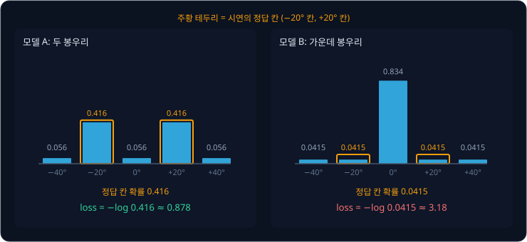

위 그림에서 주황 테두리를 친 칸이 시연의 정답 칸이다. 시연 10 개의 loss 를 평균하면 아래와 같다.

| 모델 | $-20$° 시연 5 개의 loss | $+20$° 시연 5 개의 loss | 평균 loss |
| --- | --- | --- | --- |
| A (두 봉우리) | $-\log 0.416 \approx 0.878$ | 0.878 | 0.878 |
| B (가운데 봉우리) | $-\log 0.0415 \approx 3.18$ | 3.18 | 3.18 |

> **오해** 칸으로 나눠도 결국 평균 근처 칸이 가장 좋은 답이 된다.
>
> **사실** MSE 는 정답과의 거리를 재므로 양쪽 정답의 가운데가 가장 가깝지만, cross-entropy 는 정답 칸이 받은 확률만 보고 칸 사이의 거리는 보지 않는다. 0° 칸은 $-20$° 칸 바로 옆이어도 정답이 아니면 틀린 칸일
> 뿐이라서, 두 정답 사이에 확률을 몰아준 모델 B 의 loss 가 3.18 로 모델 A 의 0.878 보다 크다.

loss 가 가장 작아지는 확률은 시연에서 각 칸이 정답으로 나온 비율이다. 시연이 반반이면 $(0, 0.5, 0, 0.5, 0)$ 의 평균 loss 가
$-\log 0.5 \approx 0.693$ 으로 모델 A 의 0.878 보다 작다. 학습은 loss 가 작아지는 쪽으로 가므로, 모델은 시연이 갈린 비율을 확률로
배우고 봉우리 두 개를 그대로 남긴다.

<b>심화: 비율대로 낸 확률과 cross-entropy 의 gradient</b>

모델 B 의 확률은 $e^{3} \approx 20.086$ 과 합 $20.086 + 4 = 24.086$ 에서 $20.086 \div 24.086 \approx 0.834$, $1 \div 24.086 \approx 0.0415$
로 구했다.

시연이 $-20$° 7 개, $+20$° 3 개라면 비율대로 0.7 과 0.3 을 낸 확률의 평균 loss 는 아래와 같다.

$$
\frac{7 \times (-\log 0.7) + 3 \times (-\log 0.3)}{10} = \frac{7 \times 0.357 + 3 \times 1.204}{10} \approx 0.611
$$

반반을 내면 열 개 모두 $-\log 0.5 = 0.693$ 이라 더 크다.

점수 $z_k$ 에 대한 cross-entropy 의 gradient 는 칸마다 "그 칸의 확률 − (정답 칸이면 1, 아니면 0)" 이다. 모델 A 에서 정답이 1 번 칸인
시연 하나의 gradient 는 아래와 같다.

$$
(0.056,\ 0.416 - 1,\ 0.056,\ 0.416,\ 0.056) = (0.056,\ -0.584,\ 0.056,\ 0.416,\ 0.056)
$$

학습은 gradient 의 반대 방향으로 점수를 고치므로, gradient 가 음수인 1 번 칸 점수는 올라가고 나머지 칸은 내려간다. 정답이 3 번 칸인
시연은 반대로 3 번 칸 점수를 올린다. 시연 10 개를 평균하면 1 번과 3 번 칸의 gradient 는 $0.416 - 0.5 = -0.084$ 로 음수라서 점수가 올라가고,
0, 2, 4 번 칸의 gradient 는 0.056 으로 양수라서 점수가 내려간다. 그래서 확률은 $(0, 0.5, 0, 0.5, 0)$ 쪽으로 움직인다.

정답 칸의 확률에 따른 loss 는 아래와 같다.

| 정답 칸의 확률 $p_b$ | 1 | 0.8 | 0.5 | 0.416 | 0.2 | 0.0415 |
| --- | --- | --- | --- | --- | --- | --- |
| loss $-\log p_b$ | 0 | 0.223 | 0.693 | 0.878 | 1.609 | 3.18 |

확률이 절반이 될 때마다 loss 는 $\log 2 \approx 0.693$ 씩 커진다.

**확인 문제.** 같은 장면의 시연 10 개 가운데 $-20$° 가 2 개, $+20$° 가 8 개다. 평균 cross-entropy 를 가장 작게 만드는 확률은 $-20$° 칸과
$+20$° 칸에 각각 얼마일까?

답 보기

1. loss 를 가장 작게 만드는 확률은 칸마다 정답이 나온 비율이다
2. $-20$° 칸: $2 \div 10 = 0.2$, $+20$° 칸: $8 \div 10 = 0.8$

답: $-20$° 칸 0.2, $+20$° 칸 0.8 이고 나머지 칸은 0 이다.

## action binning

연속된 값의 범위를 같은 폭의 칸 여러 개로 나누고 값 대신 칸 번호를 쓰는 일을 binning 이라고 한다. bin 은 물건을 나눠 담는 통이라는
뜻이고, 이 강의의 칸이 bin 이다. 논문에 따르면 RT-1 은 차원마다 그 차원의 범위 안에 같은 폭으로 놓인 칸 256 개 가운데 하나로 정답을
바꾼다.

범위 $-50$° ~ $+50$° 를 칸 다섯 개로 나누면 칸 폭은 $100 \div 5 = 20$° 이고, 칸에는 왼쪽부터 0 번 ~ 4 번 번호를 붙인다. 0 번 칸은
$-50$° ~ $-30$° 이고 3 번 칸은 $+10$° ~ $+30$° 다. 17° 는 왼쪽 끝 $-50$ 에서 $17 - (-50) = 67$ 떨어져 있고 $67 \div 20 = 3.35$ 라서,
칸 3 개를 꽉 채운 뒤 네 번째 칸의 35% 지점에 있는 3 번 칸이다. $-23$° 는 왼쪽 끝에서 27 떨어져 있어 $27 \div 20 = 1.35$ 이므로 1 번
칸이다. 이렇게 소수점 아래를 버리는 계산을 내림이라 하고 $\lfloor 3.35 \rfloor = 3$ 처럼 쓴다.

$$
b = \left\lfloor \frac{a - a_{\min}}{\Delta} \right\rfloor, \qquad \Delta = \frac{a_{\max} - a_{\min}}{K}
$$

- $a$ 는 칸으로 바꿀 원래 값으로, 첫 예시의 17 이다
- $a_{\min}$ 과 $a_{\max}$ 는 범위의 왼쪽 끝과 오른쪽 끝으로, $-50$ 과 $50$ 이다
- $K$ 는 칸의 개수로 5 이고, $\Delta$(delta)는 칸 하나의 폭으로 $(50 - (-50)) \div 5 = 20$ 이다
- $b$ 는 구한 칸 번호로, bin 의 첫 글자다

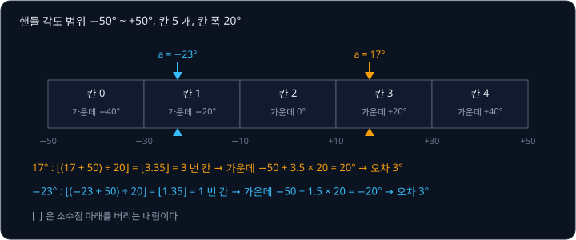

policy 가 칸 번호를 고르면 로봇에게는 다시 각도를 보내야 하므로, 각도가 여러 개 들어 있는 칸마다 대표값을 하나 정한다. 이 강의에서는
칸의 가운데 값을 대표값으로 쓰는데, 왼쪽 끝에서 칸 $b$ 개를 다 지나고 다음 칸의 절반까지 가면 되므로 식은 아래와 같다.

$$
\hat a = a_{\min} + (b + 0.5) \times \Delta
$$

$\hat a$ 는 "a 햇" 이라고 읽고, 칸 번호에서 되돌린 값이다. 3 번 칸은 $-50 + 3.5 \times 20 = 20$° 로 돌아와서 17° 의 오차는 $+3$° 이다. 값을
칸 번호로 바꾸는 일을 encode 라 하고, 칸 번호를 값으로 되돌리는 일을 decode 라고 한다.

칸 안의 값은 모두 같은 가운데 값으로 돌아오므로 대부분 오차가 생기지만, 칸 안 어디에 있든 가운데에서 칸 폭의 절반 넘게 떨어지지는
않는다. 그래서 오차의 크기는 $\Delta \div 2$ 이하이고, 다섯 칸 예에서는 $20 \div 2 = 10$° 다.

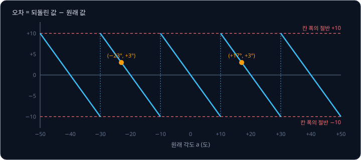

칸의 왼쪽 끝을 대표값으로 쓰면 $+29.9$° 가 $+10$° 로 돌아와 오차가 $-19.9$° 가 되므로, 양쪽 끝까지 거리가 같은 가운데 값을 쓸 때
최대 오차가 가장 작다.

<b>심화: 범위 끝값, 범위 밖의 값, 공식 구현의 식</b>

식에 오른쪽 끝 $a = 50$ 을 넣으면 $(50 + 50) \div 20 = 5$ 라서 없는 5 번 칸이 나온다. 그래서 계산 결과가 마지막 번호 $K - 1 = 4$ 를
넘으면 4 로 바꾼다. 시연에 범위 밖의 값이 섞여 들어오면 먼저 가장 가까운 끝값으로 자르는데, 이 처리를 clip 이라고 한다. $+70$° 는
$+50$° 로 잘린 뒤 4 번 칸에 들어가고, $-60$° 는 $-50$° 로 잘린 뒤 0 번 칸에 들어간다.

$$
b = \min\!\left(K - 1,\ \left\lfloor \frac{\mathrm{clip}(a) - a_{\min}}{\Delta} \right\rfloor\right)
$$

$\min(\ ,\ )$ 은 두 값 가운데 작은 것을 고르는 계산이다.

공식 TensorFlow 구현([`action_tokenizer.py`](https://github.com/google-research/robotics_transformer/blob/master/tokenizers/action_tokenizer.py))의
식은 조금 다르다. clip 한 값을 0 ~ 1 로 바꾼 뒤 $K - 1 = 255$ 를 곱하고 소수점 아래를 버려 칸 번호로 쓰고, decode 는 칸 번호를 255 로
나눠 범위에 다시 늘린다.

$$
b = \left\lfloor \frac{\mathrm{clip}(a) - a_{\min}}{a_{\max} - a_{\min}} \times 255 \right\rfloor, \qquad
\hat a = a_{\min} + \frac{b}{255} \times (a_{\max} - a_{\min})
$$

이 식에서는 0 번이 범위의 왼쪽 끝, 255 번이 오른쪽 끝에 놓인 점 256 개가 대표값이라서 끝값을 따로 처리할 필요가 없다. 다만 소수점
아래를 버리기만 하므로 원래 값은 늘 대표값보다 같거나 크고, 오차는 점 사이 간격 $(a_{\max} - a_{\min}) \div 255$ 까지 생긴다. 범위
$-128$° ~ $+128$° 에서 10.3° 는 $138.3 \div 256 \times 255 \approx 137.76$ 이라 137 번이 되고, $-128 + 137 \div 255 \times 256 \approx 9.54$° 로
돌아와 오차가 약 $-0.76$° 다. 같은 범위에서 이 강의의 가운데 값 방식은 최대 0.5° 이고, 공식 구현은 최대 $256 \div 255 \approx 1.004$° 다.

mode 처럼 처음부터 셋 중 하나인 차원은 공식 구현에서 binning 없이 그 번호(0, 1, 2)를 그대로 token 으로 쓴다.

**확인 문제.** 범위 0 ~ 100 을 칸 4 개로 나눴다. 값 62 는 몇 번 칸이고, 그 칸을 가운데 값으로 decode 하면 몇이며, 이 범위에서 오차는
최대 얼마일까?

답 보기

1. 칸 폭: $(100 - 0) \div 4 = 25$
2. 칸 번호: $(62 - 0) \div 25 = 2.48$ 이고 내리면 2 번 칸이다
3. decode: $0 + (2 + 0.5) \times 25 = 62.5$
4. 최대 오차: 칸 폭의 절반이라 $25 \div 2 = 12.5$

답: 2 번 칸, 62.5, 최대 12.5 다.

## 칸 256 개와 칸 개수

RT-1 은 칸 다섯 개와 똑같은 계산을 $K = 256$ 으로 한다. 관절 1 의 범위를 예를 들어 $-128$° ~ $+128$° 로 정하면 칸 폭은
$256 \div 256 = 1$° 다. 시연에서 관절 1 의 목표 각도가 10.3° 라면 $(10.3 + 128) \div 1 = 138.3$ 이라 138 번 칸이고, decode 하면
$-128 + 138.5 \times 1 = 10.5$° 로 돌아와 오차는 $+0.2$° 다.

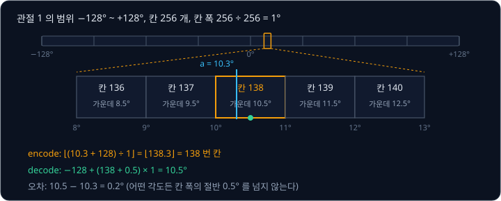

집게처럼 범위가 0° ~ 64° 로 좁은 차원은 칸 폭이 $64 \div 256 = 0.25$° 라서 최대 오차도 0.125° 로 작다.

칸 개수는 설계하는 사람이 정한다. 같은 범위 256° 를 칸 16 개, 256 개, 4096 개로 나눠 비교하면 아래와 같다. 맨 오른쪽 열은 시연에서
관절 각도 1000 개를 모았다고 할 때 칸 하나에 평균 몇 개가 들어가는지다.

| 칸 개수 $K$ | 칸 폭 $\Delta$ | 최대 오차 $\Delta \div 2$ | 칸 하나의 평균 시연 수 ($1000 \div K$) |
| --- | --- | --- | --- |
| 16 | 16° | 8° | 62.5 |
| 256 | 1° | 0.5° | 약 3.9 |
| 4096 | 0.0625° | 0.03125° | 약 0.24 |

칸이 16 개면 최대 오차 8° 가 너무 커서 컵 손잡이를 정확히 잡을 수 없다. 칸이 4096 개면 오차는 아주 작지만, 칸 하나에 평균 0.24 개라서
대부분의 칸에는 정답이 한 번도 들어오지 않는다. cross-entropy 는 거의 같은 각도인 이웃 칸도 서로 다른 class 로 따로 배우므로, 정답이
없던 칸에 줄 확률은 배울 근거가 없다. RT-1 은 그 사이의 256 을 골랐다.

칸 폭을 꼭 같게 할 필요는 없다. RT-1 과 같은 해에 나온 Behavior Transformers 는 시연의 action 을 k-means 로 비슷한 값끼리 $k$ 개의
무리로 묶고, 몇 번 무리인지를 분류로 고른다. 무리의 중심에서 벗어난 양(offset)은 regression 으로 따로 맞혀서 칸 폭 때문에 생기는 오차를
줄인다.

<b>심화: 관절 여러 개의 binning</b>

관절 다섯 개를 같은 범위 $-128$° ~ $+128$°, 칸 256 개로 바꾸면 아래와 같다. 각도는 계산을 보이려고 정한 예다.

| 관절 | 원래 각도 $a$ | $a + 128$ | 칸 번호 $b$ | 되돌린 값 $\hat a$ | 오차 |
| --- | --- | --- | --- | --- | --- |
| 1 | 10.3 | 138.3 | 138 | 10.5 | $+0.2$ |
| 2 | 45.8 | 173.8 | 173 | 45.5 | $-0.3$ |
| 3 | $-30.6$ | 97.4 | 97 | $-30.5$ | $+0.1$ |
| 4 | 60.2 | 188.2 | 188 | 60.5 | $+0.3$ |
| 5 | 0 | 128.0 | 128 | 0.5 | $+0.5$ |

음수 각도도 범위의 왼쪽 끝에서 잰 거리는 양수라서 같은 식이 그대로 통한다. 관절 5 의 0° 는 마침 128 번 칸의 왼쪽 끝이라 오차가 최대인
0.5° 다. 집게 30.4° 는 범위 0° ~ 64° 에서 $30.4 \div 0.25 = 121.6$ 이라 121 번 칸이고, $0 + 121.5 \times 0.25 = 30.375$° 로 돌아와
오차가 $-0.025$° 다.

**확인 문제.** 관절 범위 $-128$° ~ $+128$°, 칸 256 개일 때 $-0.4$° 는 몇 번 칸이고, 몇 도로 되돌아올까?

답 보기

1. 칸 폭: $256 \div 256 = 1$°
2. 칸 번호: $(-0.4 + 128) \div 1 = 127.6$ 이고 내리면 127 번 칸이다
3. decode: $-128 + 127.5 \times 1 = -0.5$°

답: 127 번 칸이고 $-0.5$° 로 돌아와 오차는 $-0.1$° 다.

## action token

글을 쓰는 Transformer 는 vocabulary(쓸 수 있는 token 을 모두 모아 번호를 붙인 목록)의 token 마다 점수를 내고 그 확률에서 다음 token
을 고른다. 차원 하나의 칸 256 개를 단어 256 개짜리 vocabulary 로 보면 칸 번호 138 은 138 번 token 이라서, RT-1 은 칸 번호를 action
token 이라 부르고 binning 을 action tokenization 이라 부른다. 한 step 의 action 은 action token 11 개다.

| 이름 | 가리키는 것 | RT-1 에서의 예 |
| --- | --- | --- |
| text token | 글을 자른 조각과 그 번호 | 쓰지 않는다. 지시 문장 전체를 숫자 512 개로 바꾼다 |
| image token | 사진의 한 구역을 요약한 숫자 묶음 | EfficientNet 이 사진의 한 구역을 요약한 숫자 512 개 |
| action token | action 한 차원의 칸 번호 | 관절 1 의 138 번 칸 |

RT-1 의 Transformer 는 image token 을 받아 차원 11 개마다 칸 256 개의 점수, 모두 $11 \times 256 = 2{,}816$ 개를 내고, 차원마다 softmax
를 따로 해서 확률 256 개짜리 묶음 11 개를 만든다. 학습할 때는 차원마다 구한 cross-entropy 를 더한 값이 그 step 의 loss 다.

<b>심화: 차원 11 개의 loss 합</b>

차원 3 개로 줄여 계산해 보자. 모델이 정답 칸에 준 확률은 계산을 보이려고 정한 예다.

| 차원 | 시연의 정답 칸 | 모델이 그 칸에 준 확률 | cross-entropy |
| --- | --- | --- | --- |
| 팔 x | 138 번 | 0.5 | $-\log 0.5 \approx 0.693$ |
| 팔 z | 97 번 | 0.8 | $-\log 0.8 \approx 0.223$ |
| 집게 | 121 번 | 0.25 | $-\log 0.25 \approx 1.386$ |
| 합 | | | 2.302 |

loss 는 $0.693 + 0.223 + 1.386 = 2.302$ 다. 정답 확률이 가장 낮은 집게 차원이 loss 에 가장 크게 보태므로, 학습은 집게 차원의 점수를
가장 크게 고친다.

$$
L = -\sum_{d=1}^{11} \log p_\theta\!\left(b^{(d)} \mid o, \ell\right)
$$

- $d$ 는 몇 번째 차원인지를 가리키고, 1 부터 11 까지 바꿔 가며 더한다
- $b^{(d)}$ 는 $d$ 번째 차원의 정답 칸 번호다. 괄호 안의 $d$ 는 거듭제곱이 아니라 차원 번호다
- $o$ 는 관측(사진 6 장), $\ell$ 은 지시 문장이다
- $p_\theta(b^{(d)} \mid o, \ell)$ 은 parameter 가 $\theta$ 인 모델이 사진과 지시를 보고 $d$ 번째 차원의 정답 칸에 준 확률이다.
  세로선 $\mid$ 는 "~ 를 보고" 라고 읽는다

실제 학습에서는 시연의 여러 step 에서 이 값을 구해 평균한다.

## 차원마다 따로 고르는 선택

RT-1 은 차원마다 확률을 따로 내고 칸도 차원마다 따로 고른다. 11 개 차원의 조합 하나하나를 class 로 두면 class 가 $256^{11}$ 개라
대부분은 시연에 한 번도 나오지 않으므로, 차원마다 256 개씩 점수를 내는 편이 현실적이다.

다만 이렇게 따로 고르면 차원 사이의 짝이 깨질 수 있다. 손끝 이동 x, y 두 차원에서 시연 A 는 손끝을 왼쪽 위로 $(x, y) = (-20, +20)$
만큼 옮겼고 시연 B 는 오른쪽 아래로 $(+20, -20)$ 만큼 옮겼으며, 둘 다 5 개씩이라고 하자. x 만 보면 $-20$ 과 $+20$ 이 반반이라 x 의
확률은 두 칸에 0.5 씩이고, y 도 마찬가지다. 두 차원을 서로 상관없이 고르면 두 결과가 함께 나올 확률은 각 확률의 곱이라서 네 조합이
$0.5 \times 0.5 = 0.25$ 씩 나온다.

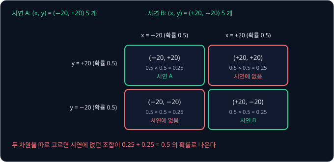

차원마다 따로 고르면 어느 시연에도 없는 $(-20, -20)$ 과 $(+20, +20)$ 이 $0.25 + 0.25 = 0.5$ 의 확률로 나온다. 칸 분류는 차원 하나
안의 봉우리는 지키지만, 차원 사이의 짝은 지키지 못한다.

[Transformer](../transformer/README.md) 에서 본 decoder 처럼 앞에서 고른 token 을 다시 입력으로 넣어 다음 token 을 고르면 이 문제가
줄어든다. x 에서 $-20$ 이 나왔다면 그 x 를 보고 y 를 고르므로 $+20$ 을 고를 수 있다. 이렇게 앞 출력을 다시 입력으로 넣어 하나씩 만드는
방식을 autoregressive 라고 한다. 저자들이 RT-1 의 출력을 autoregressive 로 바꿔 비교하자 계산 한 번의 시간이 15 ms 에서 36 ms 로 두 배
넘게 늘었다. 성공률은 오히려 낮아져서 학습한 지시에서는 97% 가 85% 가 되었고 처음 보는 지시에서는 76% 가 71% 가 되었다. 그래서 RT-1 은
11 개 차원의 확률을 한 번의 계산으로 함께 낸다.

**확인 문제.** 차원이 3 개이고 차원마다 두 칸에 0.5 씩 확률을 낸다. 시연에는 조합이 2 가지뿐이라면, 차원마다 따로 고를 때 시연에 있는
조합이 나올 확률은 얼마일까?

답 보기

1. 조합의 수: $2 \times 2 \times 2 = 8$ 가지
2. 조합 하나의 확률: $0.5 \times 0.5 \times 0.5 = 0.125$
3. 시연에 있는 2 가지의 합: $2 \times 0.125 = 0.25$

답: 0.25 이고, 나머지 0.75 는 시연에 없는 조합이 나온다.

## EfficientNet 의 image token

CNN 은 사진의 가로세로를 줄여 가며 feature map 을 만드는데, feature map 은 사진을 요약한 숫자를 가로세로 칸에 늘어놓은 것으로 칸마다
channel 수만큼 숫자가 있다. [ResNet](../resnet/README.md) 에서 본 ACT 는 480×640 사진을 ResNet-18 에 넣어 나온
$512 \times 15 \times 20$ feature map 의 칸 300 개를 token 300 개로 썼다.

RT-1 도 같은 방법을 쓰는데, CNN 으로는 EfficientNet-B3 를 쓴다. EfficientNet 은 2019 년 Tan 과 Le 가 발표한 CNN 으로, 층의 깊이·channel
수·입력 사진 크기를 함께 키우는 규칙에 따라 크기별로 B0 ~ B7 이 있다. RT-1 은 ImageNet(사진 약 128 만 장을 1000 가지 사물로 나눈
dataset)으로 학습한 pretrained weight 에서 시작한다. 300×300 사진 한 장을 넣으면 $9 \times 9 \times 512$ feature map 이 나오고, 칸
$9 \times 9 = 81$ 개를 그대로 숫자 512 개짜리 image token 81 개로 쓴다. 사진은 6 장이라 token 은 $6 \times 81 = 486$ 개다.

칸마다 token 을 두므로 캔이 사진의 어느 구역에 있는지가 token 의 위치로 남는다. 지시를 섞는 층까지 포함한 이 부분의 parameter 는 약
1,600 만 개다. ImageNet pretraining 없이 처음부터 학습하면 처음 보는 지시의 성공률이 76% 에서 43% 로 떨어졌는데, 저자들은 ImageNet 의
다양한 사진에서 배운 것이 일반화에 크게 도움이 된다고 보았다.

**확인 문제.** 사진이 6 장이 아니라 4 장이라면 EfficientNet 이 내는 image token 은 모두 몇 개일까?

답 보기

사진 한 장에 $9 \times 9 = 81$ 개이므로 $4 \times 81 = 324$ 개다.

## FiLM

책상 위에 빨간 캔과 초록 봉지가 함께 있을 때, CNN 이 지시를 모른 채 사진을 요약하면 두 물건을 모두 적당히 담아야 해서 정작 지시한
물건의 정보가 흐려질 수 있다. 그래서 RT-1 은 EfficientNet 이 사진을 다 요약하기 전, 처리하는 도중에 지시를 섞는다. 지시 문장은 먼저
Google 이 2018 년에 공개한 Universal Sentence Encoder 를 거쳐 숫자 512 개짜리 vector 가 된다. 이 모델은 뜻이 비슷한 문장에 비슷한
숫자를 주도록 학습한 모델이고, 이렇게 문장을 바꾼 숫자 묶음을 문장의 embedding 이라고 한다.

batch normalization 은 정규화한 값 $\hat x$ 에 channel 마다 학습한 숫자 두 개를 곱하고 더해 $y = \gamma \hat x + \beta$ 를 내는데, 학습이
끝나면 $\gamma$(gamma)와 $\beta$(beta)는 어떤 사진에나 똑같다. FiLM 은 같은 꼴의 계산을 하되 $\gamma$ 와 $\beta$ 를 지시의 embedding
에서 그때그때 만든다. FiLM 은 Feature-wise Linear Modulation 의 줄임말로 feature 의 channel 마다 곱하고 더해 값을 조절한다는 뜻이고,
Perez 등이 2018 년에 사진에 관한 질문에 답하는 모델을 위해 제안했다.

계산을 보이려고 크기를 줄인 이 예에서는 embedding 을 숫자 2 개로 줄여, "빨간 캔 집어" 는 $e = (1, 0)$ 으로 정하고 "초록 봉지 집어" 는
$e = (0, 1)$ 로 정한다. EfficientNet 중간의 feature map 은 가로세로 2 칸씩에 channel 2 개로 줄이는데, channel 1 은 빨간색이 얼마나
있는지를 나타내고 channel 2 는 초록색이 얼마나 있는지를 나타낸다. 빨간 캔은 왼쪽 위 칸에 있고 초록 봉지는 오른쪽 아래 칸에 있다.

| 칸 | 왼쪽 위 | 오른쪽 위 | 왼쪽 아래 | 오른쪽 아래 |
| --- | --- | --- | --- | --- |
| channel 1 (빨강) | 3 | 0 | 0 | 1 |
| channel 2 (초록) | 0 | 1 | 0 | 3 |

$\gamma$ 와 $\beta$ 는 학습하는 행렬을 embedding 에 곱해 만든다. 이 예에서는 "빨간 캔 집어" 가 $\gamma = (2, 0)$, $\beta = (0, -1)$ 이
되도록 행렬을 정했다(만드는 계산은 아래 심화). FiLM 은 channel 마다 그 channel 의 모든 칸에 $y = \gamma x + \beta$ 를 계산한다.
channel 1 은 $2x + 0$ 이라 $(3, 0, 0, 1)$ 이 $(6, 0, 0, 2)$ 가 되고, channel 2 는 $0 \times x - 1$ 이라 모두 $-1$ 이 된다. 같은 행렬에
"초록 봉지 집어" 를 넣으면 $\gamma = (0, 2)$, $\beta = (-1, 0)$ 이 나와서, 이번에는 channel 1 이 모두 $-1$ 이 되고 channel 2 가
$(0, 2, 0, 6)$ 이 된다.

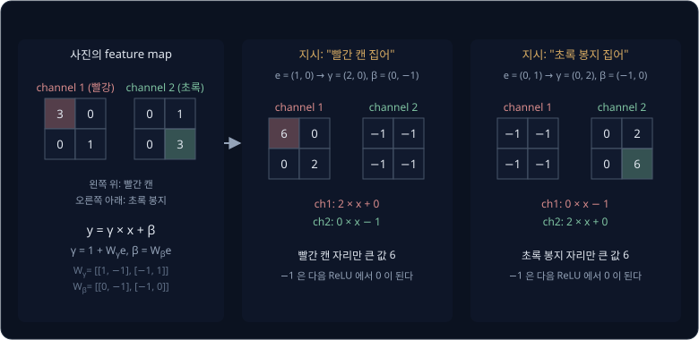

다음 층의 ReLU(음수는 0 으로 바꾸고 양수는 그대로 내보내는 함수)를 지나면 $-1$ 은 0 이 되므로, 같은 사진이라도 지시와 상관없는
channel 의 정보는 다음 층으로 넘어가지 않는다. 실제 RT-1 에서는 $e$ 가 숫자 512 개이고, EfficientNet 의 기본 층 묶음인 MBConv block 과
FiLM 층을 합친 26 개 층 안에 FiLM 이 여러 번 들어간다.

<b>심화: embedding 에서 γ 와 β 를 만드는 계산</b>

행렬과 vector 의 곱은 행렬의 행마다 vector 와 같은 자리끼리 곱해 더한 값을 차례로 적는 계산이다. 이 예의 두 행렬은 계산을 보이려고
정한 값이다.

$$
W_\gamma = \begin{bmatrix} 1 & -1 \\ -1 & 1 \end{bmatrix}, \qquad
W_\beta = \begin{bmatrix} 0 & -1 \\ -1 & 0 \end{bmatrix}, \qquad
\gamma = 1 + W_\gamma e, \quad \beta = W_\beta e
$$

| 지시 | $e$ | $W_\gamma e$ | $\gamma = 1 + W_\gamma e$ | $\beta = W_\beta e$ |
| --- | --- | --- | --- | --- |
| 빨간 캔 집어 | $(1, 0)$ | $(1 \times 1 - 1 \times 0,\ -1 \times 1 + 1 \times 0) = (1, -1)$ | $(2, 0)$ | $(0 \times 1 - 1 \times 0,\ -1 \times 1 + 0 \times 0) = (0, -1)$ |
| 초록 봉지 집어 | $(0, 1)$ | $(1 \times 0 - 1 \times 1,\ -1 \times 0 + 1 \times 1) = (-1, 1)$ | $(0, 2)$ | $(0 \times 0 - 1 \times 1,\ -1 \times 0 + 0 \times 1) = (-1, 0)$ |

$x_c$ 를 $c$ 번째 channel 의 값이라 하면 FiLM 은 $\gamma_c x_c + \beta_c$ 이고, 위 예에서 $\gamma_1 = 2$, $\beta_2 = -1$ 이었다.
$\gamma$ 에 1 을 더하는 이유는 아래 identity 초기화에서 설명한다.

pretrained EfficientNet 의 층 사이에 새 FiLM 을 아무 값으로나 시작해 끼워 넣으면, 그 뒤 층들은 ImageNet 에서 배울 때와 전혀 다른 값을
받는다. 예를 들어 처음 행렬이 $\gamma = 0.2$, $\beta = 5$ 를 만들면 pretrained 층이 낸 값 3 이 $0.2 \times 3 + 5 = 5.6$ 이 된다. 그래서
RT-1 은 $\gamma$ 와 $\beta$ 를 만드는 행렬을 처음에 모두 0 으로 둔다. 그러면 어떤 지시가 오든 $\gamma = 1 + 0 = 1$, $\beta = 0$ 이라
FiLM 이 $1 \times x + 0 = x$ 로 값을 그대로 내보내는데, 이렇게 입력을 그대로 내보내는 계산(identity)에서 시작하는 것을 identity
초기화라고 부른다.

DeepMind 가 2022 년에 발표한 Gato 는 여러 종류의 일을 Transformer 하나로 다루는 모델로, 사진 token 을 지시와 상관없이 만들고 나중에
지시와 합친다. RT-1 저자들이 Gato 를 RT-1 과 같은 데이터로 학습해 비교하자, 방해 물체를 여럿 놓은 시험에서 Gato 의 성공률은 43% 였고
RT-1 은 83% 였다. 저자들은 지시를 일찍 섞는 FiLM 을 그 차이의 원인으로 추정했다.

**확인 문제.** 어떤 channel 의 값이 $(1, 4)$ 이고 지시에서 만든 $\gamma = 3$, $\beta = -2$ 다. FiLM 을 거친 값은? FiLM 의 행렬이 모두
0 이었다면?

답 보기

1. $\gamma = 3$, $\beta = -2$: $3 \times 1 - 2 = 1$, $3 \times 4 - 2 = 10$ 이라 $(1, 10)$ 이다
2. 행렬이 0 이면 $\gamma = 1 + 0 = 1$, $\beta = 0$ 이라 $1 \times 1 + 0 = 1$, $1 \times 4 + 0 = 4$ 로 $(1, 4)$ 그대로다

답: $(1, 10)$ 이고, 행렬이 0 이면 값이 바뀌지 않는다.

## TokenLearner

[Transformer](../transformer/README.md) 에서 본 attention 은 모든 token 쌍에 점수를 매기므로 점수 표의 칸 수가 token 수의 제곱이다. 사진 6
장의 token 486 개를 그대로 넣으면 층 하나에서 점수가 $486 \times 486 = 236{,}196$ 개다. RT-1 은 사진 한 장의 token 81 개를 8 개로 줄여
6 장에 48 개만 넣고, 점수는 $48 \times 48 = 2{,}304$ 개가 된다.

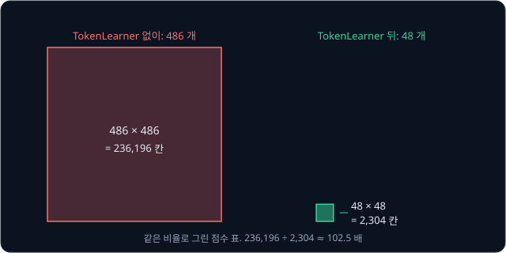

$236{,}196 \div 2{,}304 \approx 102.5$ 라서, token 수가 약 10 분의 1 이 되면 점수 표는 약 $10 \times 10 = 100$ 분의 1 이 된다.

token 81 개 가운데 8 개만 골라 남기면 나머지 73 개의 정보가 사라지므로, TokenLearner 는 고르지 않고 섞는다. 출력 token 하나마다 입력
token 81 개 각각에 weight 를 매기고, 그 weight 로 81 개를 가중 평균한다. 가중 평균은 값마다 정한 비율을 곱해 더하는 평균이고, 비율을
모두 더하면 1 이다. 크기를 줄여 입력 token 4 개를 출력 token 2 개로 합쳐 보자. token 하나는 숫자 2 개이고, 값과 weight 는 계산을
보이려고 정한 예다.

| 입력 token | 값 | 출력 A 의 weight | 출력 B 의 weight |
| --- | --- | --- | --- |
| 빨간 캔 | $(4, 0)$ | 0.7 | 0.1 |
| 책상 | $(0, 0)$ | 0.1 | 0.1 |
| 책상 | $(0, 0)$ | 0.1 | 0.1 |
| 초록 봉지 | $(0, 4)$ | 0.1 | 0.7 |

책상 token 은 $(0, 0)$ 이라 더해도 0 이므로, 출력 A 는 $0.7 \times (4, 0) + 0.1 \times (0, 4) = (2.8, 0.4)$ 이고 출력 B 는
$0.1 \times (4, 0) + 0.7 \times (0, 4) = (0.4, 2.8)$ 이다. 출력 A 는 빨간 캔을 주로 담은 token 이 되고, 출력 B 는 초록 봉지를 주로 담은 token 이 된다.

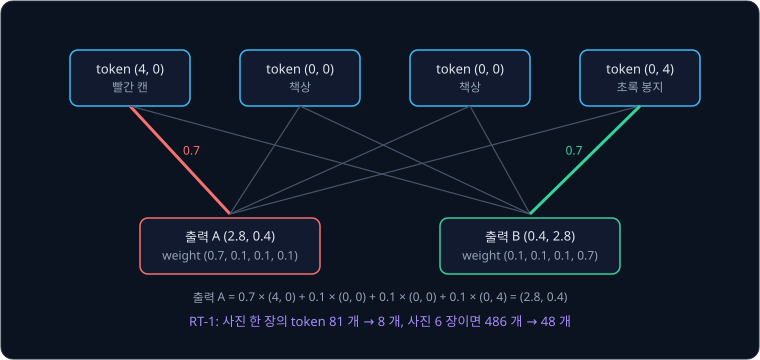

weight 는 사람이 정하지 않고 학습한다. 공식 구현([`token_learner.py`](https://github.com/google-research/robotics_transformer/blob/master/tokenizers/token_learner.py))에서는
작은 MLP 가 입력 token 마다 출력 token 8 개 몫의 점수를 내고, 출력 token 마다 81 개의 점수를 softmax 로 합이 1 인 weight 로 바꾼다.
weight 를 입력에서 계산하므로 사진마다 달라져서, 캔이 왼쪽에 있으면 왼쪽 구역 token 의 weight 가 커지고 오른쪽에 있으면 오른쪽 구역
token 의 weight 가 커질 수 있다. 어떤 token 을 얼마나 섞을지 배운다(learn)는 뜻에서 이름이 TokenLearner 이고, 2021 년 Ryoo 등이
이미지와 영상용으로 제안했다.

사진 6 장의 token 8 개씩을 이어 붙인 48 개에는 몇 번째 사진의 몇 번째 token 인지 알 수 있도록 positional encoding 을 더한다. 사진 6 장은
step 마다 한 장씩만 바뀌므로, 사진마다 한 번 계산한 token 을 다음 step 들에서 다시 쓸 수 있다. 논문에 따르면 TokenLearner 로 token 을
줄여 실행이 2.4 배 빨라졌고, token 재사용으로 1.7 배 더 빨라졌다. 사진을 6 장 보는 것은 서랍을 여는 중인지 닫는 중인지처럼 한
장으로는 알 수 없는 움직임의 방향을 보기 위해서이고, 사진을 한 장만 넣으면 방해 물체 시험의 성공률이 83% 에서 50% 로 떨어졌다.

**확인 문제.** token 이 100 개에서 25 개로 줄면 attention 점수 표의 칸 수는 몇 분의 1 이 될까?

답 보기

1. 줄이기 전: $100 \times 100 = 10{,}000$ 칸
2. 줄인 뒤: $25 \times 25 = 625$ 칸
3. 비율: $10{,}000 \div 625 = 16$

답: 16 분의 1 이다. token 수가 4 분의 1 이 되면 칸 수는 $4 \times 4 = 16$ 분의 1 이 된다.

## Transformer 와 계산 시간

RT-1 의 Transformer 는 encoder 없이 decoder 만 쌓은 decoder-only Transformer 로, self-attention 층 8 개에 parameter 가 약 1,900 만 개다.
앞의 EfficientNet 부분 약 1,600 만 개와 합친 RT-1 전체는 약 3,500 만 개로,
[ResNet](../resnet/README.md) 에서 본 ResNet-18 의 약 1,170 만 개의 세 배쯤이다.

모델 크기는 계산 시간에 맞춰 정했다. 저자들은 사람이 이 지시들을 하는 데 2 ~ 4 초가 걸린다고 보고, 로봇이 그보다 크게 느리지 않으려면
1 초에 3 번 이상 action 을 내야 한다고 적었다. 카메라와 통신 같은 다른 지연까지 따지면 모델 계산 한 번은 100 ms 안에 끝나야 한다. 논문의
측정에서 RT-1 의 계산 한 번은 15 ms 였고, 비슷한 크기(parameter 약 3,700 만 개)로 줄인 Gato 는 129 ms 였으며, ResNet 으로 사진을 읽고
action 을 연속된 숫자로 내는 BC-Z 는 5.3 ms 였다.

계산마다 걸리는 시간이 다르면 action 이 로봇에 닿는 시점도 매번 달라진다. 그래서 RT-1 시스템은 action 계산에 쓴 관측을 찍은 뒤 언제나
280 ms 를 기다렸다가 action 을 적용한다. 280 ms 는 시스템의 모든 부분에서 관측한 지연 가운데 가장 긴 값이라서, 어느 step 이든 관측에서
action 적용까지의 간격이 같다.

**확인 문제.** parameter 12 억 개인 원래 크기의 Gato 는 로봇에서 계산 한 번에 1.9 초가 걸려서, 저자들은 비교 실험에서 RT-1 과
비슷한 크기로 줄였다. 원래 크기로는 1 초에 action 을 몇 번 낼 수 있고, 3 Hz 를 맞출 수 있을까?

답 보기

1. 1 초에 내는 횟수: $1 \div 1.9 \approx 0.53$ 번
2. 3 Hz 에 필요한 간격: $1 \div 3 \approx 0.33$ 초

답: 약 0.53 번이라 3 Hz 를 맞출 수 없다. 계산 한 번이 0.33 초보다 짧아야 하는데 1.9 초가 걸린다.

## 시연 데이터와 일반화

로봇 13 대로 17 개월 동안 모은 episode 약 13 만 개는 조작자가 로봇을 직접 보면서 VR controller 두 개로 원격 조종해 보인 시연이다.
controller 의 3 차원 위치·회전 변화는 손끝의 이동·회전이 되고, joystick 의 x, y 는 바퀴의 회전 각도와 주행 거리가 되었다. 지시는 "pick iced tea can" 처럼 동사 하나에 물체 이름이 붙은 문장이고, 지시를 동사로 묶은 skill 9 가지에 지시가 모두
744 개다. 지시 하나에 평균 $130{,}000 \div 744 \approx 175$ 개의 episode 가 있다.

<b>심화: skill 별 지시 개수</b>

| skill | 지시 개수 | 지시 예 |
| --- | --- | --- |
| 물체 집기 | 130 | pick iced tea can |
| 물체를 다른 물체 옆으로 옮기기 | 337 | move pepsi can near rxbar blueberry |
| 세워 놓기 | 8 | place water bottle upright |
| 넘어뜨리기 | 8 | knock redbull can over |
| 서랍 열기 | 3 | open the top drawer |
| 서랍 닫기 | 3 | close the middle drawer |
| 그릇에 넣기 | 84 | place brown chip bag into white bowl |
| 그릇에서 꺼내 책상에 놓기 | 162 | pick green jalapeno chip bag from paper bowl and place on counter |
| 길고 현실적인 작업 | 9 | pull napkin out of dispenser |
| 합 | 744 | |

옮기기 지시가 $337 \div 744 \approx 45$% 로 절반 가까이를 차지하고, 서랍 열기·닫기는 3 개씩뿐이다.

학습 데이터에 없던 경우에도 해내는 능력을 일반화(generalization)라고 한다. 논문은 RT-1 을 아래 네 조건에서 시험했다.

- 학습한 지시: 시연에 있던 지시 200 개 이상을 물체 배치와 로봇 위치를 바꿔 가며 시험했다
- 처음 보는 지시: 학습에서 뺀 지시 21 개로, 동작과 물체는 각각 다른 지시에서 본 적이 있고 그 조합만 처음이다
- 방해 물체: 책상 위에 상관없는 물건을 여럿 더 놓았다
- 처음 보는 배경: 조명과 배경이 다른 새 부엌이나 무늬 있는 식탁보 위에서 시험했다

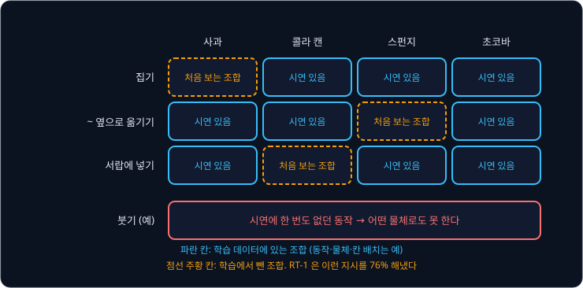

위 그림은 처음 보는 지시를 동작과 물체의 표로 나타낸 것으로, 물체와 동작과 칸의 배치는 설명을 위해 정한 예다. 점선 주황 칸은 그
조합만 학습에서 뺀 지시라서, 사과의 생김새는 같은 열의 다른 동작에서 배우고 집는 동작은 같은 줄의 다른 물체에서 배운다.

비교한 모델은 앞에서 본 Gato 와 BC-Z, BC-Z 를 RT-1 만큼 키운 BC-Z XL 이고, 모두 RT-1 과 같은 데이터로 학습했다.

| 모델 | 학습한 지시 | 처음 보는 지시 | 방해 물체 | 처음 보는 배경 |
| --- | --- | --- | --- | --- |
| Gato | 65% | 52% | 43% | 35% |
| BC-Z | 72% | 19% | 47% | 41% |
| BC-Z XL | 56% | 43% | 23% | 35% |
| RT-1 | 97% | 76% | 83% | 59% |

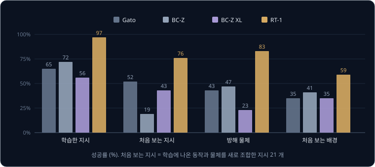

처음 보는 지시에서 RT-1 은 다음으로 좋은 Gato(52%)보다 24%p 높은 76% 를 냈다. %p 는 퍼센트끼리의 차이를 나타내는 단위로,
$76 - 52 = 24$ 다. RT-1 도 처음 보는 배경에서는 59% 로 네 항목 가운데 가장 낮았다.

저자들은 데이터를 두 방식으로 줄여 양과 다양성의 효과를 나눠 보았다. 하나는 지시마다 episode 수에 상한을 두어 지시의 종류는 그대로
두고 양만 줄이는 것이고, 다른 하나는 데이터가 가장 적은 지시들을 통째로 빼서 종류를 줄이는 것이다.

| 줄인 방식 | 남은 지시 | 남은 데이터 | 학습한 지시 | 일반화 세 항목의 평균 |
| --- | --- | --- | --- | --- |
| 줄이지 않음 | 100% | 100% | 97% | 73% |
| 지시마다 최대 200 개 | 100% | 51% | 71% | 50% |
| 시연이 적은 지시를 뺌 | 75% | 97% | 86% | 54% |

맨 오른쪽 열은 처음 보는 지시, 방해 물체, 처음 보는 배경의 성공률 평균이다. 지시의 25% 를 빼도 데이터가 97% 남는 것은 빠진 지시들의
데이터가 원래 적었기 때문이다. 데이터를 3% 만 잃은 이 모델의 일반화가 데이터를 49% 줄인 모델과 비슷하게(54%, 50%) 떨어지자, 논문은
데이터의 양보다 다양성이 더 중요하다고 결론지었다.

저자들은 종류가 다른 데이터도 섞어 보았다. simulator 에서만 본 물체를 실제 로봇이 다루는 성공률은 simulation 데이터를 섞자 23% 에서
87% 로 올랐다. 다른 로봇인 Kuka 가 상자 속 물건을 집은 episode 20 만 9 천 개를 섞자, 비슷한 상자 집기 시험의 성공률도 22% 에서 39% 로
올랐다.

**확인 문제.** 처음 보는 지시에서 RT-1 과 BC-Z 의 성공률 차이는 몇 %p 일까?

답 보기

$76 - 19 = 57$%p 다. BC-Z 는 학습한 지시에서는 72% 를 해냈지만 처음 보는 지시에서는 19% 로 크게 떨어졌다.

## 시연에 없는 동작의 한계

논문은 RT-1 의 일반화가 본 적 있는 개념의 조합에 그치고, 한 번도 본 적 없는 새 동작으로는 일반화하지 못한다고 밝혔다. 동작과 물체의
조합 표 맨 아래 붓기 줄처럼 붓는 동작이 시연에 없다면, 사과든 콜라 캔이든 부을 수 없다.

RT-1 이 칸마다 내는 확률은 시연에서 각 칸이 정답으로 나온 비율을 배운 것인데, 시연에 없던 손끝 움직임의 순서는 어느 칸에서도 정답으로
나온 적이 없으니 모델이 그 순서를 만들 근거가 없다. 지시 문장도 Universal Sentence Encoder 가 숫자로 바꿔 줄 뿐이라서, "pour" 라는
단어를 받아도 그 단어에 짝지어 배운 action 이 없다. 논문은 RT-1 이 시연을 따라 배우는 imitation learning 이라 시연한 사람보다 잘하기
어렵다는 것도 한계로 적었다. 다룬 작업도 집기·옮기기·서랍 열기 같은 큰 동작뿐이고, 섬세한(dexterous) 손 작업은 시험하지 않았다.

> **오해** 시연 13 만 개로 학습했으니 RT-1 은 부엌일을 이해해서 처음 듣는 일도 해낸다.
>
> **사실** 처음 보는 지시에서 낸 76% 는 동작과 물체를 모두 본 적 있는 조합에서 잰 값이다.

**확인 문제.** RT-1 의 시연에 "집기" 와 "서랍 열기" 는 있고 "병뚜껑 돌려 열기" 는 없다. "사과 집기" 와 "병뚜껑 돌려 열기" 가운데 RT-1
이 해낼 가능성이 높은 것은?

답 보기

1. "사과 집기": 집는 동작은 시연에 있고, 사과가 다른 지시에 나왔다면 본 적 있는 개념의 조합이다
2. "병뚜껑 돌려 열기": 돌려 여는 동작이 시연에 한 번도 없어서 어떤 칸의 확률로도 배운 적이 없다

답: "사과 집기" 다.

## 정리

- 정답이 여럿인 시연에서 숫자 하나를 내는 regression 은 평균을 내지만, RT-1 은 차원마다 범위를 칸 256 개로 나눠 분류하고
  cross-entropy 로 학습한다. $\pm 20$° 로 반반 갈린 시연에서 두 봉우리 모델의 loss(0.878)가 가운데 봉우리 모델(3.18)보다 작아서,
  학습한 확률에 봉우리 두 개가 남고 실행할 때는 그중 하나를 고른다
- 칸 번호는 $\lfloor (a - a_{\min}) \div \Delta \rfloor$ 로 구해 칸의 가운데 값으로 되돌리고, 오차는 칸 폭의 절반 이하다. 차원 11 개의
  action token 을 한 번의 계산으로 함께 내서 빠르지만, 차원 사이의 짝은 지키지 못한다
- FiLM 이 지시 문장으로 EfficientNet 의 channel 마다 $\gamma x + \beta$ 를 하고, TokenLearner 가 token 486 개를 48 개로 줄여 3 Hz 를
  맞춘다. 시연 약 13 만 개로 처음 보는 지시를 76% 해냈지만, 시연에 없던 동작은 하지 못한다

RT-1 은 사진·지시와 action 의 짝을 로봇 시연에서만 배워서, 시연에 나오지 않은 물체 이름이나 "가장 작은 것" 처럼 상식이 필요한 지시는
이해하지 못한다. 다음 강의
[RT-2 → OpenVLA](../vla-tokens/README.md) 에서는 RT-1 의 action token 을 인터넷의 사진과 글로 학습한 vision-language model 의 vocabulary
에 넣어, 모델이 글을 쓰듯 action token 을 쓰게 하는 방법을 다룬다. 칸 폭의 오차 없이 연속된 action 여러 step 을 한꺼번에 만드는 방법은
[Diffusion Policy](../diffusion-policy/README.md) 에서 다룬다.

## 참고 자료

- Anthony Brohan et al., [RT-1: Robotics Transformer for Real-World Control at Scale](https://arxiv.org/abs/2212.06817) (2022) — 구조와
  계산 시간(5.1 절), 일반화 결과(Table 2), 데이터 양과 다양성 실험(Table 7), 구성 요소별 ablation(부록 D.4, Table 13)을 읽는다
- [RT-1 project page](https://robotics-transformer1.github.io/) — 구조 그림과 데이터 규모, 로봇이 지시를 수행하는 영상
- 공식 TensorFlow 구현 [google-research/robotics_transformer](https://github.com/google-research/robotics_transformer) — action
  tokenizer 와 TokenLearner(`tokenizers/`), FiLM 층(`film_efficientnet/`)을 짧은 파일로 볼 수 있다
- Ethan Perez et al., [FiLM: Visual Reasoning with a General Conditioning Layer](https://arxiv.org/abs/1709.07871) (2018) — channel
  마다 곱하고 더하는 조건 입력을 제안한 원 논문
- Michael S. Ryoo et al., [TokenLearner: What Can 8 Learned Tokens Do for Images and Videos?](https://arxiv.org/abs/2106.11297) (2021) —
  token 여러 개를 weight 로 섞어 적은 수로 줄이는 모듈. RT-1 이 token 81 개를 8 개로 줄이는 데 쓴다
- Mingxing Tan, Quoc V. Le, [EfficientNet: Rethinking Model Scaling for Convolutional Neural Networks](https://arxiv.org/abs/1905.11946) (2019) —
  RT-1 의 image encoder. 층의 깊이·channel 수·사진 크기를 함께 키우는 규칙이 나온다
- Nur Muhammad Mahi Shafiullah et al., [Behavior Transformers: Cloning k modes with one stone](https://arxiv.org/abs/2206.11251) (2022) —
  action 을 k-means 로 묶어 분류하고 offset 을 regression 하는 방식. 그림 2 가 multimodal 시연에서 MSE 가 0 을 내는 예를 보인다
