# Sim-to-Real Locomotion

simulation 에서 넘어지지 않고 잘 걷던 보행 policy 를 실제 4족 로봇에 올리면 한 걸음도 못 떼고 넘어지는 일이 흔하다. Hwangbo 등(2019)이
motor 를 이상적인 PD 식으로 흉내 낸 simulation 에서 학습한 policy 를 실제 ANYmal 에 올렸을 때도 다리가 심하게 떨리며 한 걸음도 내딛지
못했다. 로봇도 policy 도 그대로인데, 실물에서 한 번도 학습하지 않은 policy 를 실물에서 걷게 하려면 simulation 을 어떻게 바꿔야
할까?

simulation 과 실물 사이의 이런 차이를 **reality gap**(sim-to-real gap)이라고 한다. 보행 학습에서는 실제 motor 의 반응을 neural network 로
배워 simulation 에 넣고, 마찰과 질량 같은 숫자를 episode 마다 바꿔 이 차이를 메운다. 센서 값에 noise 를 더하고 쉬운 지형에서 어려운 지형으로
옮겨 가며 학습하는 것도 같은 목적이다. Rudin 등(2021)은 이렇게 꾸민 simulation 에서 GPU 한 장으로 ANYmal 의 평지 보행은 4 분 안에 학습했고,
계단과 경사가 있는 지형의 보행은 20 분 안에 학습해 실제 로봇에 옮겼다. 이 논문의 코드가 legged_gym 이다.

## 학습 목표

- 보행 policy 의 observation·action·reward 를 설명하고, 목표 각도가 실제 로봇과 simulation 에서 각각 어떻게 torque 가 되는지 설명할 수 있다
- 마찰·질량·지연·센서 noise·actuator 반응이 reality gap 을 만드는 방식을 숫자로 보일 수 있다
- actuator network, domain randomization 범위, observation noise, 지형 curriculum 이 각각 어떤 차이를 메우는지 설명할 수 있다
- teacher-student 학습에서 privileged information 을 teacher 에게만 주는 이유를 설명할 수 있다

## 보행 policy 의 observation 과 action

simulator 에는 몸통의 정확한 속도, 바닥의 마찰 계수, 다리 부품의 무게까지 모든 것이 숫자로 들어 있고, 이 숫자 전체를 state 라고 한다.
policy 에는 그 가운데 실제 로봇의 센서로도 얻을 수 있는 숫자만 주는데, 이 목록이 **observation** 이다. legged_gym 의
[ANYmal C 평지 설정](https://github.com/leggedrobotics/legged_gym/blob/master/legged_gym/envs/anymal_c/flat/anymal_c_flat_config.py)은
observation 48 개를 쓴다.

| 숫자 묶음 | 개수 | 실제 로봇에서 얻는 곳 |
| --- | --- | --- |
| 몸통 속도 | 3 | 센서 값을 합쳐 몸통의 속도와 자세를 추정하는 state estimator |
| 몸통 회전 속도 | 3 | 몸통 안의 IMU(회전 속도와 가속도를 재는 센서) |
| 중력 방향 | 3 | IMU 로 계산한, 몸통에서 본 중력의 방향 |
| 속도 명령 | 3 | 조종기가 주는 앞뒤 속도, 옆 속도, 회전 속도 |
| 관절 각도 | 12 | 관절마다 motor 의 각도 센서. 기본 자세에서 벗어난 양으로 적는다 |
| 관절 속도 | 12 | 관절 각도가 1초에 변하는 양 |
| 직전 action | 12 | policy 가 바로 앞 step 에 낸 값 |

다리 넷에 관절이 셋씩이라 관절은 12 개다. 계단 지형용 설정은 몸통 주변 지형 높이 187 개를 더 받는데, 실제 로봇에서는 LiDAR 로 만든 높이
지도에서 이 값을 읽는다(Rudin 등 2021).

**흔한 오해.** simulator 에 있는 마찰 계수를 policy 의 observation 에 넣어 주면 더 잘 걷지 않을까 생각하기 쉽다. simulation 에서는 실제로 더 잘 걷지만,
실제 로봇에는 마찰 계수를 재는 센서가 없어서 그 policy 는 옮길 수 없다. 그 숫자를 학습에만 쓰는 방법은
[teacher-student 학습](#teacher-student-학습) 에서 다룬다.

policy 의 **action** 은 관절 12 개의 목표 각도다. policy 가 $-1$ 에서 $1$ 근처의 작은 숫자 $a$ 를 내면, 여기에 배율 $s$ 를 곱해 기본
자세의 각도에 더한 값이 목표 각도가 된다.

$$
q_{\text{목표}} = q_{\text{기본}} + s \times a
$$

그 목표와 지금 각도 $q$ 의 차이로 torque $\tau$ 를 계산하는 것이 PD controller 다. $K_p$ 는 각도 차이 1 rad 당 낼 torque(N·m)이고, $K_d$ 는
관절의 각속도 $\dot q$ 에 비례해 움직임을 늦추는 힘의 세기다.

$$
\tau = K_p\,(q_{\text{목표}} - q) - K_d\,\dot q
$$

legged_gym 의 Unitree A1 설정값은 배율 $s = 0.25$, $K_p = 20$, $K_d = 0.5$ 이고 무릎의 기본 각도는 $-1.5$ rad 다. policy 가 $a = 0.4$ 를 내고
무릎이 $-1.45$ rad 에 멈춰 있다면 아래처럼 계산한다.

| 단계 | 계산 | 값 |
| --- | --- | --- |
| 목표 각도 | $-1.5 + 0.25 \times 0.4$ | $-1.4$ rad |
| 각도 차이 | $-1.4 - (-1.45)$ | 0.05 rad |
| P 항 | $20 \times 0.05$ | 1.0 N·m |
| D 항 | $0.5 \times 0$ (멈춰 있음) | 0 |
| torque | $1.0 - 0$ | 1.0 N·m |

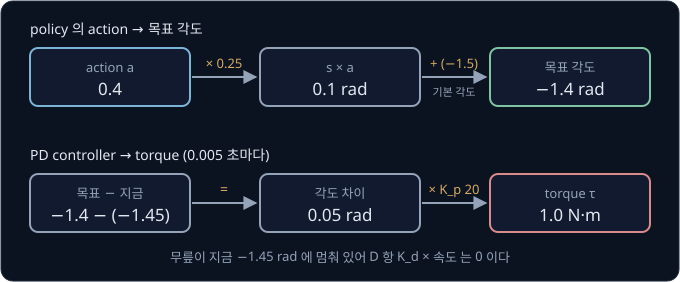

policy 는 0.02 초마다(1초에 50 번) action 을 내고 simulation 은 0.005 초마다 torque 를 다시 계산하므로, action 하나가 physics step 4 번 동안
쓰인다. policy 가 torque 대신 목표 각도를 내는 것은 더 자주 계산하는 PD controller 가 그사이에도 관절을 목표 쪽으로 계속 당겨 주기 때문이다.

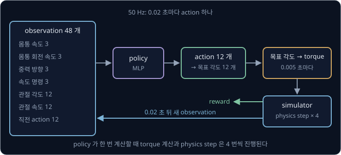

Rudin 등에 따르면 실제 ANYmal 에서는 목표 각도를 motor 에 그대로 보내고 motor 안의 PD controller 가 torque 를 만든다. simulation 에서는 A1
처럼 위의 PD 식을 그대로 계산하는 로봇도 있지만, legged_gym 의 ANYmal C 는 실제 motor 의 반응을 흉내 내도록 학습한
[actuator network](#actuator-network) 로 torque 를 계산한다.

<b>심화: D 항의 브레이크와 학습·실행의 action</b>

policy 가 $a = -0.8$ 을 내면 목표는 $-1.5 + 0.25 \times (-0.8) = -1.7$ rad 다. 무릎이 지금 $-1.6$ rad 에 있고 $-2$ rad/s 로 돌고 있으면 P 항은
$20 \times (-1.7 - (-1.6)) = -2$ N·m 이고 D 항은 $0.5 \times (-2) = -1$ 이라서 torque 는 $-2 - (-1) = -1$ N·m 다. 이미 목표 쪽으로 빠르게 돌고 있어서
D 항이 torque 를 절반으로 줄였다.

[Policy Gradient](../policy-gradient/README.md) 에서 본 Gaussian policy 는 관절마다 평균과 퍼진 정도(standard deviation)로 정한 분포에서
action 을 뽑는다. 학습할 때는 뽑은 action 으로 여러 행동을 시도하고, 실제 로봇에 옮길 때는 평균을 그대로 쓴다. legged_gym 은 standard
deviation 의 시작값을 1.0 으로 둔다.

**확인 문제.** 기본 각도 $0.8$ rad, 배율 $s = 0.25$, action $a = -0.4$ 다. 관절이 지금 $0.75$ rad 에 멈춰 있고 $K_p = 20$ 이면 torque 는?

답 보기

1. 목표 각도: $0.8 + 0.25 \times (-0.4) = 0.8 - 0.1 = 0.7$ rad
2. 각도 차이: $0.7 - 0.75 = -0.05$ rad
3. 멈춰 있어서 D 항은 0 이고, torque 는 $20 \times (-0.05) = -1$ N·m

답: $-1$ N·m 다. 목표가 지금보다 작은 쪽이라 음의 방향으로 돌린다.

## 보행 reward

사람이 원하는 걸음은 조건 하나로 적을 수 없다. 명령한 속도로 가야 하고, 몸통이 위아래로 크게 흔들리지 않아야 하며, torque 를 쓸데없이 많이
쓰지 않아야 한다. 그래서 보행 reward 는 항목마다 점수를 계산해 weight 를 곱해 더한다. Rudin 등의 reward 는 아홉 항목의 합인데, legged_gym 의
기본 weight 는 아래와 같다.

| 항목 | 계산 | weight |
| --- | --- | --- |
| 속도 추종 | $e^{-(\text{명령 속도} - \text{실제 속도})^2 / 0.25}$ (앞뒤·옆) | $+1.0$ |
| 회전 속도 추종 | 같은 꼴의 식을 회전 속도로 계산 | $+0.5$ |
| 위아래 속도 | $v_z^2$ | $-2.0$ |
| 앞뒤·옆으로 기우는 회전 속도 | $\omega_x^2 + \omega_y^2$ | $-0.05$ |
| torque | 관절 12 개의 $\tau^2$ 합 | $-0.00001$ (A1 은 $-0.0002$) |
| 관절 가속도 | 관절 12 개의 $\ddot q^2$ 합 | $-2.5 \times 10^{-7}$ |
| action 변화 | 관절마다 $(a_t - a_{t-1})^2$ 의 합 | $-0.01$ |
| 충돌 | 허벅지·정강이가 무언가에 닿은 수 | $-1$ |
| 발이 공중에 있던 시간 | 발이 닿는 순간 (공중 시간 $- 0.5$ 초) | $+1.0$ |

weight 가 음수인 항목은 클수록 reward 를 깎는 penalty 다. 속도 추종 점수는 속도가 명령과 같으면 $e^0 = 1$ 이고 멀어질수록 0 에
가까워진다($e \approx 2.718$). legged_gym 은 모든 weight 에 0.02 를 곱해 쓰지만 항목 사이의 비율은 그대로다.

명령이 앞으로 0.5 m/s 일 때 두 걸음의 reward 를 위 표의 네 항목만으로 비교한다. torque weight 는 A1 의 값을 쓴다. 걸음 1 은 0.4 m/s 로 조금
느리지만 차분하고, 걸음 2 는 0.7 m/s 로 뛰듯이 걷는다. 두 걸음의 측정값은 예로 든 값이다.

| 항목 | 걸음 1 의 값 | 걸음 1 의 점수 | 걸음 2 의 값 | 걸음 2 의 점수 |
| --- | --- | --- | --- | --- |
| 속도 추종 | $v = 0.4$ | $+0.9608$ | $v = 0.7$ | $+0.8521$ |
| 위아래 속도 | $v_z = 0.1$ | $-2 \times 0.01 = -0.02$ | $v_z = 0.3$ | $-2 \times 0.09 = -0.18$ |
| torque | $\sum \tau^2 = 500$ | $-0.0002 \times 500 = -0.1$ | $\sum \tau^2 = 1500$ | $-0.0002 \times 1500 = -0.3$ |
| action 변화 | 2 | $-0.01 \times 2 = -0.02$ | 10 | $-0.01 \times 10 = -0.1$ |
| reward | | $0.8208$ | | $0.2721$ |

속도 점수의 차이는 0.11 정도지만 penalty 까지 더하면 걸음 1 이 세 배 가까이 높아서, PPO 는 걸음 1 같은 걸음을 배운다.

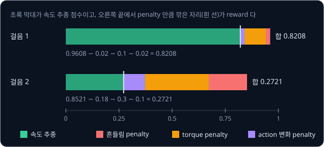

<b>심화: 속도 추종 점수의 계산</b>

명령이 0.5 m/s 일 때 $x = (v - 0.5)^2 \div 0.25$ 이고 점수는 $e^{-x}$ 다.

| 속도 $v$ (m/s) | 0.5 | 0.4 또는 0.6 | 0.3 또는 0.7 | 0.2 또는 0.8 | 0 |
| --- | --- | --- | --- | --- | --- |
| $x$ | 0 | 0.04 | 0.16 | 0.36 | 1 |
| 점수 $e^{-x}$ | 1 | 0.9608 | 0.8521 | 0.6977 | 0.3679 |

차이를 제곱하므로 0.1 느린 0.4 와 0.1 빠른 0.6 이 같은 점수를 받는다. 나누는 수 0.25 를 legged_gym 은 `tracking_sigma` 라고 부르는데, 이 값이
작을수록 명령에서 조금만 벗어나도 점수가 빨리 떨어진다.

penalty 를 빼면 0.6 m/s 로 몸통이 크게 흔들리며 뛰는 걸음도 0.4 m/s 의 차분한 걸음과 똑같이 0.9608 을 받는다. simulation 의 motor 는 열이
나지도 부서지지도 않으므로 policy 는 그런 걸음을 배워도 손해가 없다. 의도하지 않은 방법이라도 reward 만 커지면 policy 가 그 방법을 배우는 것을 reward hacking 이라고
한다.

| reward 의 빈틈 | policy 가 배우는 걸음 |
| --- | --- |
| action 변화 penalty 가 없다 | 관절을 아주 빠르게 떨며 미끄러지듯 간다 |
| 몸통 흔들림 penalty 가 없다 | 몸을 던지듯 크게 뛴다 |
| 발의 공중 시간 항목이 없다 | 발을 거의 들지 않고 끌며 간다 |
| torque penalty 가 없다 | 모든 관절에 큰 torque 를 걸고 버틴다 |

Rudin 등의 policy 는 걸음 모양을 정해 주지 않았는데도 늘 trot(대각선 두 다리를 함께 딛는 걸음)으로 수렴했다. 그러나 다리 하나를 끌거나
몸통 높이가 지나치게 높거나 낮은 걸음도 자주 나와서, 저자들은 reward weight 를 조정한 뒤에야 실제 로봇에 옮길 수 있었다.

몸통이 바닥에 닿으면 넘어진 것으로 보고 episode 를 끝내는데, 남은 step 의 reward 를 잃으므로 이것만으로도 큰 벌이 된다. 한 step 의 reward 가
음수일 수 있으면 오히려 일찍 넘어지는 쪽이 이득이라서, legged_gym 은 한 step 의 합이 음수이면 0 으로 자른다(`only_positive_rewards`).

<b>심화: 넘어짐으로 잃는 return</b>

step 마다 0.8208 을 받는 걸음으로 1000 step 을 채우면 return 은 $0.8208 \times 1000 = 820.8$ 이다. 같은 걸음으로 100 step 째에 넘어지면
$0.8208 \times 100 = 82.08$ 에서 끝나서 $820.8 - 82.08 = 738.72$ 를 잃는다. 반대로 step 마다 $-0.1$ 을 받는 policy 라면 1000 step 을 버틴 return 은
$-100$ 이고 10 step 만에 넘어진 return 은 $-1$ 이라서, 빨리 넘어질수록 return 이 커진다.

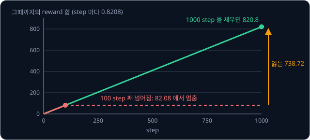

**확인 문제.** 명령이 0.5 m/s 일 때 $v = 0.5$, $v_z = 0.2$, $\sum \tau^2 = 1000$, action 변화 4 인 걸음의 reward 는? weight 는 위 예와 같다.

답 보기

| 항목 | 계산 | 점수 |
| --- | --- | --- |
| 속도 추종 | 속도가 명령과 같아 $e^0$ | $+1$ |
| 위아래 속도 | $-2 \times 0.2^2 = -2 \times 0.04$ | $-0.08$ |
| torque | $-0.0002 \times 1000$ | $-0.2$ |
| action 변화 | $-0.01 \times 4$ | $-0.04$ |

답: $1 - 0.08 - 0.2 - 0.04 = 0.68$ 이다.

## reality gap 의 원인

[PPO](../ppo/README.md) 에서 본 legged_gym 설정은 env 4096 개를 동시에 움직여 iteration 마다 $4096 \times 24 = 98{,}304$ step 을 모으고,
1500 iteration 동안 $1500 \times 98{,}304 = 147{,}456{,}000$ step 을 모은다. 실제 로봇 한 대가 0.02 초에 1 step 씩 모으면
$147{,}456{,}000 \times 0.02 = 2{,}949{,}120$ 초, 약 34 일 동안 쉬지 않고 걷고 넘어지기를 되풀이해야 모이는 양이다. 그래서 보행 policy 는
simulation 에서 배우는데, simulation 의 숫자나 계산이 실물과 다르면 simulation 에서 배운 걸음이 실물에서 어긋난다. [MuJoCo Simulation](../mujoco-sim/README.md) 에서 본 것처럼 원인은 모델 숫자가 실물과 다른 경우와 실물의 현상이 모델에 아예 없는
경우로 나뉘고, 4족 보행에서는 아래 다섯 가지가 특히 문제가 된다. 마찰과 질량의 예는 무게 12 kg 인 4족 로봇을 가정한 값이다.

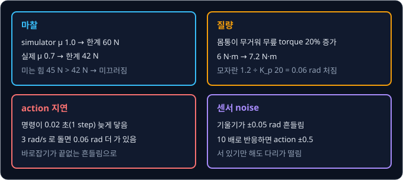

마찰 힘은 마찰 계수 $\mu$ × 바닥이 발을 떠받치는 힘(normal force)까지만 생긴다. 12 kg 로봇의 무게는 $12 \times 9.81 \approx 118$ N 이라서
대각선의 두 발로 번갈아 디디면 발 하나가 약 60 N 을 받친다. simulation 의 바닥이 $\mu = 1.0$ 이고 policy 가 발마다 바닥을 뒤로 45 N 씩 밀어
나아가는 걸음을 배웠다면, 바닥에 따라 결과가 갈린다.

| 바닥의 $\mu$ | 마찰 힘의 한계 $\mu \times 60$ | 미는 힘 45 N 과 비교 | 결과 |
| --- | --- | --- | --- |
| 1.0 (simulation) | 60 N | 45 ≤ 60 | 버틴다 |
| 0.8 | 48 N | 45 ≤ 48 | 버틴다 |
| 0.7 | 42 N | 45 > 42 | 미끄러진다 |
| 0.6 | 36 N | 45 > 36 | 미끄러진다 |

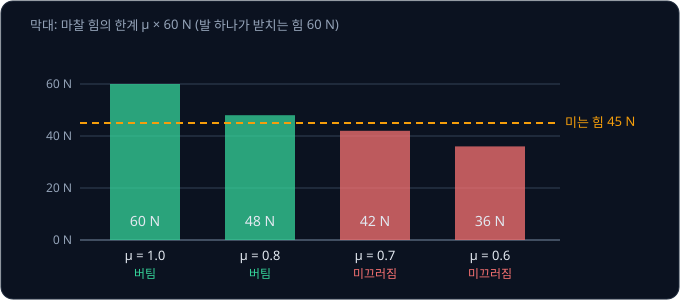

질량도 실물과 다르다. Hwangbo 등은 CAD 모델로 계산한 ANYmal 부품의 관성값이 모델에 없는 전선과 전자 부품 때문에 20% 가까이 틀릴 수 있다고
보았다. 예를 들어 몸통이 무거워져 서 있는 무릎이 버틸 torque 가 6 N·m 에서 20% 늘어 7.2 N·m 가 되면, $K_p = 20$ 인 PD controller 는 모자란 1.2 N·m 를
더 내려고 목표에서 $1.2 \div 20 = 0.06$ rad(약 3.4°) 더 접힌 자리에서 버틴다. 몸통이 낮아진 이 자세는 policy 가 학습 중에 본 적이 없다.

명령이 motor 에 닿기까지의 지연도 simulation 에는 보통 없다. Tan 등(2018)이 Minitaur 4족 로봇에서 명령을 보낸 뒤 motor 가 움직인 결과가 보고되기까지의 시간을
재 보니, motor 쪽 microcontroller 의 PD controller 에서는 3 ms 였지만 보행 policy 를 계산하는 컴퓨터(Jetson TX2)를 거치면 15 ~ 19 ms 였다.
1초에 50 번 action 을 내는 policy 에게 20 ms 는 한 step 이다. 몸통이 4° 기울었을 때 policy 가 매 step 기울기 전체를 반대로 바로잡는다면, 지연이
없을 때는 한 step 만에 0° 로 돌아온다. 명령이 한 step 늦게 닿으면 이미 0° 가 된 뒤에 옛 명령이 도착해 반대로 4° 기울고, 이 일이 끝없이
되풀이된다.

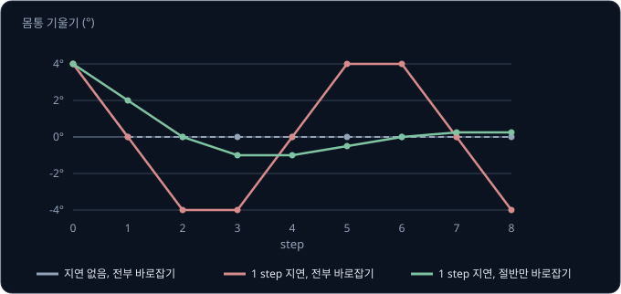

<b>심화: 한 step 지연의 기울기 계산</b>

명령은 적용되는 step 에 기울기를 그만큼 바꾼다고 하자. 4° 기운 채 있던 로봇에서 직전 step 에 고른 $-4$ 가 step 0 에 닿는다.

| step | 기울기 | 이번에 고르는 명령 | 이번에 적용되는 명령 (직전 step 에 고른 것) | 다음 기울기 |
| --- | --- | --- | --- | --- |
| 0 | 4 | $-4$ | $-4$ | $4 - 4 = 0$ |
| 1 | 0 | 0 | $-4$ | $0 - 4 = -4$ |
| 2 | $-4$ | $+4$ | 0 | $-4 + 0 = -4$ |
| 3 | $-4$ | $+4$ | $+4$ | $-4 + 4 = 0$ |
| 4 | 0 | 0 | $+4$ | $0 + 4 = 4$ |
| 5 | 4 | $-4$ | 0 | $4 + 0 = 4$ |

기울기는 4, 0, $-4$, $-4$, 0, 4 를 6 step 마다 되풀이한다. 기울기의 절반만 바로잡으면(명령 = 기울기 × $(-0.5)$) 같은 한 step 지연에서도
4, 2, 0, $-1$, $-1$, $-0.5$, 0, 0.25 로 흔들림이 점점 작아진다. 지연이 있는 로봇은 덜 세게 바로잡아야 안정한데, 지연 없이 학습한 policy 는 세게
바로잡는 쪽을 배우기 쉽다.

센서 noise 는 측정할 때마다 무작위로 끼어드는 작은 오차다. 실제 IMU 로 읽은 기울기가 예를 들어 ±0.05 rad 쯤 흔들리면, 작은 기울기에도 세게
반응하도록 배운 policy 는 서 있기만 해도 다리를 떤다.

**확인 문제.** 발이 바닥을 30 N 으로 미는 걸음이라면, 발 하나가 60 N 을 받칠 때 미끄러지지 않으려면 $\mu$ 가 얼마 이상이어야 할까?

답 보기

마찰 힘의 한계 $\mu \times 60$ 이 미는 힘 30 N 이상이어야 하므로 $\mu \ge 30 \div 60 = 0.5$ 다.

## actuator network

ANYmal 의 관절에 달린 series elastic actuator(SEA)는 motor 와 기어 뒤에 spring 을 달아 spring 이 휜 양으로 torque 를 재는 장치다. Hwangbo
등에 따르면 목표 각도는 여러 단계를 거쳐 관절 torque 가 된다. motor 안의 PD controller 가 목표 torque 를 정하고, 전류 PID 가 목표 전류를
정하며, FOC(field-oriented control, motor 전류를 제어하는 방식)가 motor 전압을 정한다. 그 뒤 기어를 지나 spring 이 휘어야 torque 가 나온다.
단계마다 지연과 밖에서 잴 수 없는 내부 상태가 있어서, 같은 목표 각도라도 앞서 어떤 명령이 들어왔는지에 따라 나오는 torque 가 다르다.
Hwangbo 등이 소개한 이전의 SEA 분석 모델에는 parameter 가 100 개 가까이 들어간다.

**actuator network** 는 이 관계를 식 대신 실제 측정 데이터로 배운 neural network 다. Hwangbo 등은 ANYmal 의 발을 사인파 경로로 움직이며
(진폭 5 ~ 10 cm, 1 ~ 25 Hz) 관절의 각도 오차(목표 − 지금), 각속도, 실제 torque 를 1초에 400 번 기록했다. 관절 12 개에서 동시에 모아 4 분이
안 걸렸는데도 sample 이 100만 개를 넘었다. network 는 지금과 0.01 초 전, 0.02 초 전의 각도 오차와 각속도, 모두 6 개를 받아 torque 를 내는
MLP(32 unit 층 셋)다. 저자들은 데이터의 90% 를 학습에 썼다.

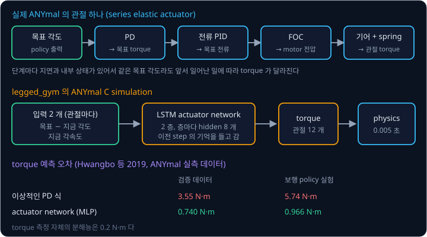

| torque 예측의 평균 오차 | 검증 데이터 | 학습한 보행 policy 로 걸을 때의 데이터 |
| --- | --- | --- |
| 이상적인 PD 식 (지연 0, torque 를 즉시 냄) | 3.55 N·m | 5.74 N·m |
| actuator network | 0.740 N·m | 0.966 N·m |

이상적인 PD 식으로 만든 simulation 과, motor 안의 제어 코드에 측정한 parameter 를 넣은 분석 모델로 만든 simulation 에서 학습한 policy 는 둘 다
실제 ANYmal 에서 한 걸음도 걷지 못하고 넘어졌다. actuator network 를 넣은 simulation 에서 학습한 policy 는 실물에서 명령 속도를 따라 걸었고,
1.5 m/s 로 달려 ANYmal 의 이전 기록 1.2 m/s 를 25% 앞섰다.

legged_gym 은 이 방법을 단순하게 바꿔, ANYmal C 의 관절마다 지금의 각도 오차와 각속도 2 개만 LSTM 에 넣는다. LSTM 은 이전 step 의
정보를 내부 상태로 기억해 두는 network 라서, 지난 값을 입력으로 붙이지 않아도 그 기억이 지연과 motor 의 내부 상태를 흉내 낸다. legged_gym 의
LSTM 은 층이 2 개이고 층마다 내부 상태가 8 개다. 예로 ANYmal C 의 무릎 위 관절(기본 각도 0.4 rad, 배율 0.5)에 policy 가 $a = 0.2$ 를 내면 목표는 $0.4 + 0.5 \times 0.2 = 0.5$ rad
이고, 관절이 지금 0.45 rad 에서 1.0 rad/s 로 돌고 있으면 network 입력은 (0.05, 1.0) 이다. 같은 설정에 적힌 PD gain($K_p = 80$, $K_d = 2$)으로
계산하면 torque 는 $80 \times 0.05 - 2 \times 1.0 = 2$ N·m 로 언제나 같지만, LSTM 은 바로 앞까지의 움직임에 따라 다른 torque 를 낸다. Rudin 등은
A1 을 학습할 때는 이 motor 모델을 빼고 PD gain 과 torque penalty 를 줄였다.

**흔한 오해.** actuator network 가 실제 로봇의 PD controller 를 대신한다고 생각하기 쉽다. 실제 로봇에서는 목표 각도를 여전히 motor 안의 PD
controller 가 torque 로 바꾸고, actuator network 는 simulation 안에서만 그 PD controller 와 그 뒤의 전류 제어·기어·spring 전체가 내는 torque 를
흉내 낸다.

**확인 문제.** 입력으로 지금과 0.01 초 전, 0.02 초 전의 각도 오차와 각속도를 쓰면 입력은 몇 개일까? 관절 12 개에서 1초에 400 번씩 4 분 동안
기록하면 sample 은 몇 개일까?

답 보기

1. 입력: 시점 3 개 × 값 2 개 = 6 개
2. 관절 하나의 sample: $400 \times 240$ 초 $= 96{,}000$ 개
3. 관절 12 개: $96{,}000 \times 12 = 1{,}152{,}000$ 개

답: 입력 6 개, sample 약 115만 개다. Hwangbo 등이 4 분이 안 걸려 100만 개 넘게 모았다고 한 숫자와 맞는다.

## domain randomization

actuator network 로 motor 를 맞춰도 바닥의 마찰이나 실제 질량은 로봇이 걸을 때마다 다르다. **domain randomization** 은 episode 를 시작할 때마다
이런 숫자를 정해 둔 범위 안에서 무작위로 다시 뽑아, policy 가 그 범위 전체에서 버티는 걸음을 배우게 한다. 이 방법은 Tobin 등(2017)이 simulation 그림의
질감을 바꿔 물체 검출기를 학습한 데서 시작했다. 이어서 Peng 등(2018)이 질량·마찰 같은 dynamics(움직임을 정하는 물리값)를 바꿔 로봇 팔 policy
를 실물로 옮겼다. 보행 논문들이 쓴 범위는 아래와 같다.

| 무작위로 바꾼 숫자 | 범위 | 로봇과 출처 |
| --- | --- | --- |
| 발과 바닥의 마찰 계수 | 0.5 ~ 1.25 | ANYmal C, legged_gym 기본값 (Rudin 등) |
| 몸통에 더하는 질량 | $-5$ ~ $+5$ kg | ANYmal C, legged_gym 계단 지형 설정 |
| 몸통 밀기 | 15 초마다 앞뒤·옆 속도를 $-1$ ~ $1$ m/s 로 바꿈 | legged_gym 기본값 (논문 본문에는 10 초) |
| link 질량, 무게중심 위치 | ±15%, ±2 cm | ANYmal, 모델 30 개 (Hwangbo 등) |
| 질량, motor 세기 | 80 ~ 120% | Minitaur (Tan 등) |
| 지연 | 0 ~ 40 ms | Minitaur (Tan 등) |
| 마찰 계수, 짐 무게 | 0.05 ~ 4.5, 0 ~ 6 kg | A1 (Kumar 등 2021) |

legged_gym 의 평지 설정은 마찰 범위를 0 ~ 1.5 로 적었는데, 평평한 바닥에서는 simulator 가 발의 마찰과 바닥의 마찰 1.0 의 평균을 쓰므로 실제
범위는 $(0 + 1) \div 2 = 0.5$ 부터 $(1.5 + 1) \div 2 = 1.25$ 까지로 기본값과 같다.

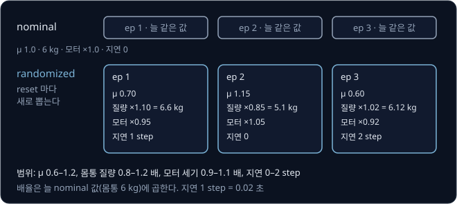

발 하나가 60 N 을 받치는 로봇이 55 N 으로 밀어 0.55 m/s 로 가는 걸음 A, 45 N 으로 0.45 m/s 로 가는 B, 35 N 으로 0.35 m/s 로 가는 C
가운데 하나를 고른다고 하자. 미끄러지지 않으면 속도만큼 점수를 받고, 미끄러지면 $-1$ 을 받는다. 바꾸지 않은 기본값(nominal 값)
$\mu = 1.0$ 에서는 셋 다 버티므로 nominal 값에서만 학습한 policy 는 가장 빠른 A 를 배운다. $\mu$ 를 0.6, 0.8, 1.0, 1.2 가운데 하나로 같은
가능성으로 뽑으면 결과가 달라진다.

| 걸음 | $\mu = 0.6$ (36 N) | $\mu = 0.8$ (48 N) | $\mu = 1.0$ (60 N) | $\mu = 1.2$ (72 N) | 네 바닥의 평균 |
| --- | --- | --- | --- | --- | --- |
| A (55 N) | $-1$ | $-1$ | 0.55 | 0.55 | $-0.225$ |
| B (45 N) | $-1$ | 0.45 | 0.45 | 0.45 | 0.0875 |
| C (35 N) | 0.35 | 0.35 | 0.35 | 0.35 | 0.35 |

nominal 에서 가장 좋던 A 는 두 바닥에서 미끄러져 평균이 가장 나쁘고, 가장 미끄러운 바닥에서도 버티는 C 가 가장 좋다. domain randomization 으로
학습한 policy 는 C 를 배우고, 실제 바닥의 $\mu$ 가 0.7 이어도 C 의 35 N 은 한계 42 N 보다 작아 버틴다. 실제 로봇의 숫자가 범위 안에 있으면
policy 는 학습 중에 이미 겪어 본 조건에서 걷게 된다.

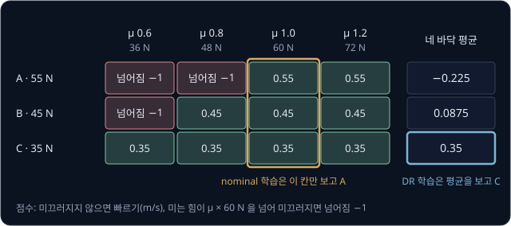

<b>심화: domain randomization 의 목표 식</b>

$$
\max_\pi\ \mathbb E_{\xi \sim p(\xi)}\big[\, J(\pi;\ \xi) \,\big]
$$

$\xi$(xi)는 episode 하나의 물리값 묶음이고 위 예에서는 $\mu$ 하나였다. $p(\xi)$ 는 $\xi$ 를 뽑는 분포로, 위 예에서는 0.6, 0.8, 1.0, 1.2 를 각각
$\frac{1}{4}$ 의 확률로 뽑는다. $J(\pi; \xi)$ 는 물리값이 $\xi$ 일 때 policy $\pi$ 가 받는 return 의 기댓값으로 위 표의 칸 하나다. $\mathbb E_{\xi \sim p(\xi)}$ 는
$\xi$ 를 $p(\xi)$ 에서 뽑아 가며 평균한다는 뜻이라서 표의 마지막 열이 되고, $\max_\pi$ 는 그 평균이 가장 큰 policy 를 찾는다는 뜻이다. nominal
학습은 $\xi$ 를 1.0 하나로 고정한 경우다. PPO 의 계산은 그대로이고, env 를 처음 상태로 되돌리는 reset 때 물리값을 새로 뽑는 것만 달라진다.

범위는 너무 좁아도 너무 넓어도 문제다. 10 N 만 밀어 0.10 m/s 로 가는 걸음 D 를 더해 세 범위를 비교한다.

| 범위 (뽑는 $\mu$) | A | B | C | D | 고르는 걸음 | 실제 $\mu = 0.7$ 에서 |
| --- | --- | --- | --- | --- | --- | --- |
| 좁게 0.95 ~ 1.05 (0.95, 1.0, 1.05) | 0.55 | 0.45 | 0.35 | 0.10 | A | 55 > 42 라서 미끄러진다 |
| 알맞게 0.6 ~ 1.2 (0.6, 0.8, 1.0, 1.2) | $-0.225$ | 0.0875 | 0.35 | 0.10 | C | 35 ≤ 42 라서 버틴다 |
| 넓게 0.2 ~ 1.4 (0.2, 0.6, 1.0, 1.4) | $-0.225$ | $-0.275$ | 0.0125 | 0.10 | D | 버티지만 0.10 m/s 다 |

좁은 범위에서는 가장 미끄러운 0.95 에서도 한계가 57 N 이라 policy 가 A 를 배우고, 넓은 범위에서는 한계 12 N 인 $\mu = 0.2$ 까지 넣어서
거의 기어가는 D 를 고른다. 여러 조건에서 버티는 성질을 robustness 라고 하는데, robustness 를 얻으면 좋은 조건에서의 성능을 잃는다.
$\mu = 1.0$ 에서 A 대신 C 로 걸으면 $(0.55 - 0.35) \div 0.55 \approx 36\%$ 느리고, D 로 걸으면 $(0.55 - 0.10) \div 0.55 \approx 82\%$ 느리다.

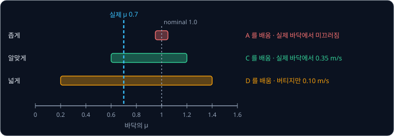

그래서 범위는 실제 로봇이 겪을 값을 담되 지나치게 넓지 않게 잡는다. Tan 등은 지나치게 조심스러운 걸음을 피하려고 범위를 값의 불확실성에 맞췄다. 직접 잰 질량은
80 ~ 120% 로 좁게 잡고, 균일한 밀도를 가정해 계산한 관성은 50 ~ 150% 로 넓게 잡았다.

**확인 문제.** 범위에서 $\mu$ 가 0.7, 1.0, 1.3 세 값으로 같은 가능성으로 나온다면 A, B, C 의 평균은 각각 얼마이고 무엇을 고를까?

답 보기

한계는 $0.7 \times 60 = 42$, $1.0 \times 60 = 60$, $1.3 \times 60 = 78$ N 이다.

| 걸음 | $\mu = 0.7$ (42 N) | $\mu = 1.0$ (60 N) | $\mu = 1.3$ (78 N) | 평균 |
| --- | --- | --- | --- | --- |
| A (55 N) | $-1$ | 0.55 | 0.55 | $(-1 + 0.55 + 0.55) \div 3 \approx 0.0333$ |
| B (45 N) | $-1$ | 0.45 | 0.45 | $(-1 + 0.45 + 0.45) \div 3 \approx -0.0333$ |
| C (35 N) | 0.35 | 0.35 | 0.35 | 0.35 |

답: C 를 고른다.

## observation noise 와 지연의 학습

센서 noise 에 대비하려면 학습할 때부터 observation 에 noise 를 더해 policy 에 준다. legged_gym 은 observation 숫자마다 $-1$ 에서 $1$ 사이의
값을 같은 가능성으로 뽑아 아래 크기를 곱해 더한다. Rudin 등에 따르면 이 크기는 실제 로봇에서 잰 데이터로 정한 값이다.

| observation 묶음 | 더하는 noise 의 범위 (legged_gym 기본값) |
| --- | --- |
| 관절 각도 | ±0.01 rad |
| 관절 속도 | ±1.5 rad/s |
| 몸통 속도 | ±0.1 m/s (논문 Table 4 에는 ±0.01 m/s) |
| 몸통 회전 속도 | ±0.2 rad/s |
| 중력 방향 (길이 1 인 vector 의 성분) | ±0.05 |
| 지형 높이 | ±0.1 m |
| 속도 명령, 직전 action | 더하지 않음 |

관절 속도는 각도의 변화로 계산해서 noise 가 크고, 속도 명령과 직전 action 은 센서로 잰 값이 아니라서 noise 를 더하지 않는다.

noise 를 더하고 학습하면 작은 흔들림에 세게 반응하는 policy 는 reward 를 잃는다. 실제 기울기는 0 인데 센서로 읽은 값이 0.04, $-0.03$, 0.05, $-0.05$,
0.02 rad 로 흔들린다고 하자. 기울기의 10 배만큼 반대로 action 을 내는 policy 는 action 이 $-0.5$ 와 $0.5$ 사이에서 뒤집혀 action 변화의 제곱
합이 2.62 가 되고, 2 배만큼 내는 policy 는 0.1048 로 25 배 작다. noise 만으로 action 변화 penalty 가 커지므로 PPO 는 덜 민감한 쪽으로 policy 를
고친다. 다만 반응이 작으면 실제 기울기를 바로잡는 데도 오래 걸리므로 noise 를 실제보다 지나치게 크게 잡지 않는다.

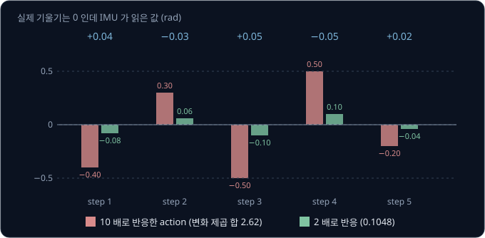

<b>심화: 두 policy 의 action 변화 계산</b>

| step | 읽힌 기울기 | 10 배로 반응한 action | 2 배로 반응한 action |
| --- | --- | --- | --- |
| 1 | 0.04 | $-0.4$ | $-0.08$ |
| 2 | $-0.03$ | $+0.3$ | $+0.06$ |
| 3 | 0.05 | $-0.5$ | $-0.1$ |
| 4 | $-0.05$ | $+0.5$ | $+0.1$ |
| 5 | 0.02 | $-0.2$ | $-0.04$ |

10 배 policy 의 이웃한 step 사이 차이는 0.7, $-0.8$, 1.0, $-0.7$ 이라서 제곱의 합은 $0.49 + 0.64 + 1 + 0.49 = 2.62$ 다. 2 배 policy 는 0.14,
$-0.16$, 0.2, $-0.14$ 라서 $0.0196 + 0.0256 + 0.04 + 0.0196 = 0.1048$ 이다. 반응 배수가 5 배 차이 나므로 제곱한 값은 $5 \times 5 = 25$ 배 차이 난다.

legged_gym 의 기본 설정에는 지연을 넣는 항목이 없지만, ANYmal 에서는 actuator network 가 motor 안의 지연까지 함께 흉내 낸다. Hwangbo 등은 이상적인 PD 식과
분석 모델로 학습한 policy 가 다리를 심하게 떤 원인으로 여러 지연을 제대로 반영하지 못한 점을 꼽았다. actuator network 가 없는 로봇이라면
지연을 따로 넣는다. Tan 등은 Minitaur 의 observation 을 시각과 함께 쌓아 두었다가 잰 지연만큼 지난 값을 꺼내 policy 에 주었고, 지연 자체도
0 ~ 40 ms 범위에서 무작위로 바꿨다. 지연이 있으면 이미 보냈지만 아직 닿지 않은 action 이 로봇을 움직이는데, observation 에 직전 action 을
넣어 두면 policy 가 그 action 까지 고려해 다음 action 을 정할 수 있다.

<b>심화: action 의 k step 지연</b>

policy 가 고른 action 을 줄에 세워 두었다가 $k$ step 뒤에 env 에 넣으면 지연을 흉내 낼 수 있다. step $t$ 에 고른 $a_t$ 가 step $t + k$ 에
적용되고, 50 Hz 에서 $k = 2$ 는 $2 \times 0.02 = 0.04$ 초의 지연이다.

| step | policy 가 고른 action | env 에 적용되는 action ($k = 2$) |
| --- | --- | --- |
| 0 | $a_0$ | 정해 둔 값 (0, 기본 자세) |
| 1 | $a_1$ | 정해 둔 값 |
| 2 | $a_2$ | $a_0$ |
| 3 | $a_3$ | $a_1$ |
| 4 | $a_4$ | $a_2$ |

episode 의 처음 $k$ step 에는 아직 도착한 action 이 없으므로 0 action 을 넣는다. action 0 은 목표 각도가 기본 각도라는 뜻이라 로봇은 기본 자세를
유지한다. $k$ 도 episode 마다 0, 1, 2 가운데서 뽑으면 policy 는 지연이 얼마인지 모르는 채로도 버티는 법을 배운다.

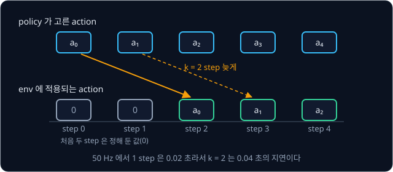

**확인 문제.** 관절 속도가 실제로 2 rad/s 이고 legged_gym 기본값만큼 noise 를 더한다. policy 가 받을 수 있는 가장 작은 값과 가장 큰 값은?

답 보기

관절 속도의 noise 는 ±1.5 rad/s 라서 $2 - 1.5 = 0.5$ rad/s 부터 $2 + 1.5 = 3.5$ rad/s 까지다.

## 지형 curriculum

계단과 경사가 섞인 지형에서 처음부터 학습하면 policy 는 걷는 법을 찾기도 전에 넘어지고, episode 가 일찍 끝나 배울 데이터도 적어진다. 그래서
쉬운 지형에서 시작해 잘 걷게 될수록 어려운 지형으로 옮기는데, 쉬운 과제부터 차례로 어렵게 해 가는 이 방법을 **curriculum** 이라고 한다.
Lee 등(2020)의 실험에서도 지형을 처음부터 고르게 섞어 학습한 policy 는 reward 가 더 낮은 수준에서 더 오르지 않았다.

legged_gym 은 한 변이 8 m 인 지형 칸을 가로 20 줄(지형 종류) × 세로 10 줄(어려운 정도 단계)로 늘어놓는다. 지형 종류의 비율은 매끈한 경사 10%, 울퉁불퉁한
경사 10%, 오르는 계단 35%, 내려가는 계단 25%, 흩어진 장애물 20% 다. 단계 $i$ 의 계단 한 칸 높이는 $0.05 + 0.18 \times i \div 10$ m 라서, 단계 0
은 5 cm, 단계 9 는 $0.05 + 0.18 \times 0.9 = 0.212$ m 다. 논문 본문의 값은 계단 높이 5 ~ 20 cm, 경사 0 ~ 25° 라서 계단의 최대 높이가 코드와 조금 다르다.

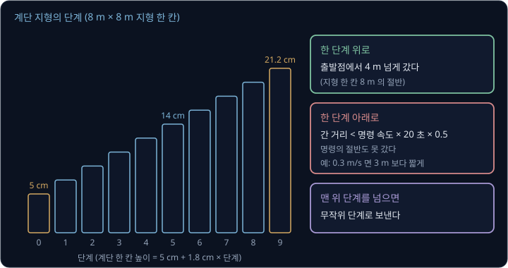

로봇은 지형 칸의 가운데에서 출발하고, episode 가 끝나 reset 할 때 간 거리로 다음 단계를 정한다.

| 조건 (episode 20 초) | 다음 단계 |
| --- | --- |
| 출발점에서 4 m(지형 칸의 절반)보다 멀리 갔다 | 한 단계 위 |
| 4 m 를 넘지 못했고, 간 거리가 명령 속도 × 20 초 × 0.5 보다 짧다 | 한 단계 아래 |
| 둘 다 아니다 | 그대로 |
| 맨 위 단계를 넘었다 | 무작위 단계 |

명령이 0.3 m/s 면 기준 거리는 $0.3 \times 20 \times 0.5 = 3$ m 라서 3 m 보다 짧게 가면 내려가고, 3 ~ 4 m 면 그대로이며, 4 m 를 넘으면 올라간다.
맨 위 단계를 넘은 로봇을 무작위 단계로 돌려보내는 것은 쉬운 지형에서 걷는 법을 잊지 않게 하려는 장치다. 로봇마다 자기 실력에 맞는 단계에
머물므로 사람이 난이도를 조정할 필요도 없다. Rudin 등의 학습에서는 1000 iteration 뒤에 로봇들이 모든 지형 종류에서 맨 위 단계에 이르렀다.
실제 로봇에서는 LiDAR 높이 지도가 완벽하지 않아 빨리 걸을 때 실패가 늘어서, 명령 속도의 최댓값을 0.6 m/s 로 낮춰 계단을 오르내렸다.

Lee 등은 policy 가 지나갈 확률이 0.5 ~ 0.9 인 지형이 많이 뽑히도록 지형 parameter 의 분포를 particle filter 로 고쳐 갔다. curriculum 은
reward 에도 쓴다. Hwangbo 등은 penalty 가 처음부터 크면 policy 가 가만히 서 있기를 배워서, penalty weight 에 처음에는 0.3 을 곱했다가
iteration 마다 1 에 가깝게 키웠다.

**확인 문제.** 명령 속도가 0.5 m/s 인 로봇이 episode 를 마칠 때 출발점에서 4.5 m 떨어져 있었다. 다른 로봇은 3 m 떨어져 있었다. 두 로봇은
다음 episode 에 어느 단계로 갈까?

답 보기

1. 기준 거리: $0.5 \times 20 \times 0.5 = 5$ m
2. 4.5 m 인 로봇: 4 m 를 넘었으므로 한 단계 위로 간다
3. 3 m 인 로봇: 4 m 를 넘지 못했고 기준 5 m 보다 짧으므로 한 단계 아래로 간다

답: 첫 로봇은 올라가고 둘째 로봇은 내려간다. 명령이 0.5 m/s 이상이면 기준 거리가 4 m 이상이라 그대로 머무는 경우가 없다.

## teacher-student 학습

domain randomization 으로 학습한 policy 는 지금 바닥이 미끄러운지 모른 채 모든 바닥에서 무난한 걸음을 고른다. 앞 예에서 바닥을 알고 바닥마다 가장 좋은
걸음(0.6 에서 C, 0.8 에서 B, 1.0 과 1.2 에서 A)을 고르면 평균이 $(0.35 + 0.45 + 0.55 + 0.55) \div 4 = 0.475$ 로 C 하나의 0.35 보다 크다. 마찰 계수를 센서로 잴 수는 없지만 최근 몇 초의 움직임에는
단서가 남는다. 같은 힘으로 밀었는데 발이 평소보다 많이 미끄러졌다면 바닥이 미끄럽다는 뜻이다.

Lee 등(2020)은 지형 위를 걷는 policy 를 처음부터 reinforcement learning 으로 학습하려 했지만, 학습 신호가 드물어 policy 가 적당한 시간 안에
걷는 법을 배우지 못했다. 그래서 저자들은 학습을 아래 두 단계로 나눴다. 실제 로봇에서는 얻을 수 없고 simulation 에만 있는 정보를
**privileged information** 이라고 한다.

1. teacher policy 는 observation 에 privileged information 을 더해 받는다. 여기에는 각 발 주변 반지름 10 cm 원 위 9 개 점의 지형 높이, 발이
   닿았는지와 닿은 힘, 마찰 계수, 학습 중 몸통을 미는 외력이 들어간다. 이 정보로 teacher 는 reinforcement learning 으로 빨리 잘 걷게 된다
2. student policy 는 센서로 얻을 수 있는 observation 의 최근 100 step(2 초) 이력만 받는 TCN(시간 축으로 convolution 을 하는 network)이다.
   student 는 teacher 의 출력을 정답으로 삼아 supervised learning 으로 따라 배운다

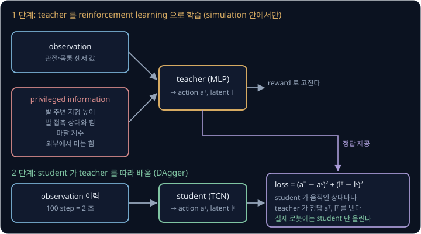

student 의 loss 는 teacher 가 낸 action $a^T$ 와 student 의 action $a^S$ 의 차이 제곱에, teacher 가 privileged information 을 요약한 latent
vector $l^T$ 와 student 가 이력으로 추정한 $l^S$ 의 차이 제곱을 더한 값이다.

$$
\mathcal L = (a^T - a^S)^2 + (l^T - l^S)^2
$$

데이터는 student 가 직접 움직이며 모으고, student 가 지나간 상태마다 teacher 가 정답을 낸다. [DAgger](../dagger/README.md) 에서 본 방식이라서
student 가 실수로 들어간 낯선 상태에서도 정답을 배운다.

Lee 등의 실험에서 50 N 의 힘으로 몸통을 5 초 동안 옆으로 밀었을 때, 2 초 이력의 student 는 0.02 초 이력만 보는 student 보다 진행 방향에서 벗어난 정도가 35.5%
작았다. 같은 구조를 teacher 없이 reinforcement learning 으로 바로 학습하면 teacher 를 거친 student 만큼의 reward 에 이르지 못했다. 이 controller
는 학습에 없던 진흙, 눈, 덤불, 흐르는 물을 지났고, 이끼 위에서 0.452 m/s 로 걸어 비교한 기존 controller 의 0.199 m/s 보다 빨랐다.

Kumar 등(2021)의 RMA(Rapid Motor Adaptation)도 같은 구조다. 저자들은 마찰·짐 무게·motor 세기 같은 17 개 숫자를 8 개로 요약한 값을 받는
base policy 를 먼저 학습하고, 최근 50 step(0.5 초)의 상태와 action 으로 그 8 개를 추정하는 adaptation module 을 따로 학습해 Unitree A1 에 올렸다.

**흔한 오해.** teacher 가 더 잘 걸으니 실제 로봇에도 teacher 를 올리면 된다고 생각하기 쉽다. teacher 는 발 주변 지형 높이와 마찰 계수를 받아야
움직이는데 실제 로봇에서는 그 숫자를 얻을 수 없다. 그래서 실제 로봇에는 student 만 올라간다.

**확인 문제.** policy 가 1초에 50 번 계산하고 student 가 최근 50 step 의 observation 을 받는다면 몇 초 동안의 이력을 볼까? RMA 처럼 1초에
100 번 계산하는 로봇에서 50 step 이면?

답 보기

1. 50 Hz 의 한 step 은 $1 \div 50 = 0.02$ 초라서 $50 \times 0.02 = 1$ 초다
2. 100 Hz 의 한 step 은 $1 \div 100 = 0.01$ 초라서 $50 \times 0.01 = 0.5$ 초다

답: 1 초와 0.5 초다. 같은 step 수라도 계산 주기에 따라 보는 시간이 다르다.

## 정리

- 보행 policy 는 실제 센서로도 얻을 수 있는 observation 48 개를 받아 관절 12 개의 목표 각도를 0.02 초마다 낸다. 실제 ANYmal 에서는 motor 안의
  PD controller 가 그 목표를 torque 로 바꾸고, legged_gym 의 ANYmal C simulation 에서는 LSTM actuator network 가 바꾼다. reward 에서 penalty 가
  빠지면 policy 는 실물에서 쓸 수 없는 걸음을 배운다
- reality gap 은 마찰·질량·지연·센서 noise·actuator 반응에서 생긴다. actuator network 는 motor 의 반응을 실측 데이터로 배워 torque 예측 오차를
  3.55 N·m 에서 0.740 N·m 로 줄였다. domain randomization 은 마찰(0.5 ~ 1.25) 같은 숫자를 episode 마다 바꾸는데, 범위가 실제 값을 담지 못하면
  로봇이 미끄러지고 너무 넓으면 걸음이 지나치게 조심스러워진다
- 지형 curriculum 은 4 m 를 넘게 간 로봇을 더 어려운 단계로 옮겨 계단 높이를 5 cm 에서 21.2 cm 까지 올린다
- teacher-student 학습에서는 privileged information 으로 학습한 teacher 를 2 초의 센서 이력만 보는 student 가 따라 배워서, student 가 지금의
  지형과 바닥을 짐작하며 걷는다

PPO 로 보행을 학습하는 데는 simulation 이 만든 1억 개가 넘는 step 이 들었는데, 지난 데이터를 쌓아 두고 다시 써서 필요한 데이터를 줄이는
reinforcement learning 은 [DQN → SAC](../off-policy/README.md) 에서 다룬다. 사람의 시연으로 학습한 큰 로봇 모델을 reinforcement learning 으로 다시
학습하는 방법은 [VLA + RL](../vla-rl/README.md) 에서 다루고, 다음 장면을 예측하는 model 을 배워 그 안에서 행동을 미리 비교해 보는 방법은
[World Model](../world-model/README.md) 에서 다룬다.

## 참고 자료

- Jemin Hwangbo 외, [Learning agile and dynamic motor skills for legged robots](https://arxiv.org/abs/1901.08652) (2019) — actuator network 의 데이터
  수집과 검증(Fig. 6), 이상적인 PD 식·분석 모델과의 비교. [actuator network](#actuator-network) 절과 함께 읽는다
- Joonho Lee 외, [Learning Quadrupedal Locomotion over Challenging Terrain](https://arxiv.org/abs/2010.11251) (2020) — teacher-student 학습, TCN 의
  이력 길이 실험, particle filter 지형 curriculum. Fig. 4 가 두 단계 학습의 전체 그림이다
- Nikita Rudin 외, [Learning to Walk in Minutes Using Massively Parallel Deep Reinforcement Learning](https://arxiv.org/abs/2109.11978) (2021) —
  병렬 simulation 의 batch 크기 실험, 게임식 지형 curriculum, 부록의 reward 표(Table 2)와 noise 표(Table 4)
- [legged_gym](https://github.com/leggedrobotics/legged_gym) — 위 논문의 코드. `legged_robot_config.py` 에서 reward weight·noise·마찰 범위를,
  `anymal.py` 에서 LSTM actuator network 의 입력을, `terrain.py` 에서 단계별 계단 높이를 확인할 수 있다
- Jie Tan 외, [Sim-to-Real: Learning Agile Locomotion For Quadruped Robots](https://arxiv.org/abs/1804.10332) (2018) — Minitaur 의 지연 측정과
  지연을 넣는 방법, randomization 범위 표(Table I)
- Ashish Kumar 외, [RMA: Rapid Motor Adaptation for Legged Robots](https://arxiv.org/abs/2107.04034) (2021) — 최근 이력으로 환경 숫자를 요약한
  vector 를 추정하는 adaptation module, 학습·시험 범위 표(Table I)
- Xue Bin Peng 외, [Sim-to-Real Transfer of Robotic Control with Dynamics Randomization](https://arxiv.org/abs/1710.06537) (2018) — dynamics
  randomization 으로 simulation 에서만 학습한 로봇 팔의 물체 밀기 policy 를 실물로 옮긴 논문
- Josh Tobin 외, [Domain Randomization for Transferring Deep Neural Networks from Simulation to the Real World](https://arxiv.org/abs/1703.06907)
  (2017) — simulation 그림의 질감과 렌더링을 무작위로 바꿔 실제 영상에서 쓰는 물체 검출기를 학습한 논문
