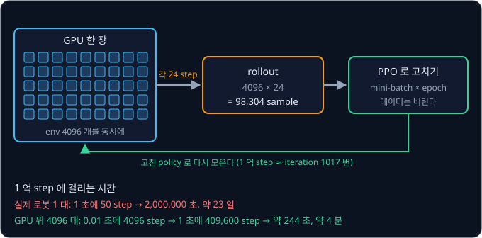
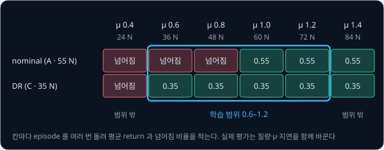

# Sim-to-Real Locomotion

## 학습 목표

- 다리 넷 달린 로봇이 걷는 법을 컴퓨터 속에서 시행착오로 배울 때, 학습하는 규칙이 무엇을 보고 무엇을 내는지 숫자 목록으로 설명할 수 있다
- 빠르기, 흔들림, 모터에 들인 힘, 명령의 급한 변화 같은 점수 항목을 더해 한 순간의 점수를 직접 계산하고, 항목이 빠지면 어떤 걸음이 나오는지 설명할 수 있다
- 컴퓨터 속 로봇 수천 대를 동시에 움직이는 이유를 걸리는 시간으로 계산할 수 있다
- 바닥의 미끄러운 정도, 무게, 명령이 늦게 닿는 시간, 센서 값의 흔들림이 컴퓨터 속과 실제 로봇에서 다르면 걸음이 어떻게 망가지는지 숫자로 보일 수 있다
- 학습할 때마다 물리값을 정해 둔 범위 안에서 무작위로 바꾸면 왜 실제 로봇에서도 통하는지, 범위를 어떻게 정해야 하는지 표로 설명할 수 있다
- 실제 로봇에서 학습한 규칙이 실패하는 대표적인 경우와 각 경우를 학습 때 미리 막는 방법을 짝지을 수 있다

## simulation 에서의 보행 학습

### 걷기를 배우는 데 드는 시도

다리 넷 달린 로봇을 생각하자. 다리마다 관절이 셋(엉덩이를 옆으로 벌리는 관절, 엉덩이를 앞뒤로 흔드는 관절, 무릎)이라 관절이 모두
12 개이고, 무게는 12 kg 정도다. Unitree Go1 같은 연구용 4족 로봇이 이런 모양이다. 이 로봇이 앞으로 걸으려면 1 초에 수십 번씩 12 개 관절의
각도를 동시에 정해야 하고, 어느 다리를 언제 들고 얼마나 세게 밀지가 모두 맞아떨어져야 넘어지지 않는다. 사람이 이 규칙을 손으로 짜기는 아주
어렵고, 바닥이 조금만 달라져도 다시 고쳐야 한다.

그래서 걷는 규칙을 시행착오로 배우게 한다. 시행착오로 배우는 방법을 reinforcement learning 이라고 하는데, 정답 행동을 알려 주는 대신
잘했는지 못했는지를 점수로만 알려 주고 점수가 커지는 쪽으로 규칙을 고친다. 다만 이렇게 배우려면 시도가 아주 많이 들어서, 보행 학습에는 짧은 행동이 수천만에서
수억 번 필요하다. 1 억은 1 뒤에 0 이 8 개 붙은 수라 $10^8$ 으로 쓴다. 행동 하나를 0.02 초마다 고른다면 1 억 번은
$10^8 \times 0.02 = 2{,}000{,}000$ 초, 쉬지 않고 걸어도 약 23 일이다. 그동안 로봇은 수만 번 넘어지고, 넘어질 때마다 사람이 일으켜 세워야
하며, 모터와 기어가 닳고 부서진다.

실제 장치 대신 컴퓨터 속에서 물리 법칙을 계산해 움직여 보는 것을 simulation 이라고 하고, 그 프로그램을 simulator 라고 한다.
[MuJoCo Simulation](../mujoco-sim/README.md) 에서 본 것처럼 simulator 속 로봇은 넘어져도 부서지지 않고, 실제보다 빠르게, 여러 대를 동시에
돌릴 수 있다. 그래서 걷는 규칙은 simulator 에서 배우고, 다 배운 규칙을 실제 로봇에 옮겨 쓴다. simulation(sim)에서 배운 것을 현실(real)로
옮기는 이 과정을 sim-to-real 이라고 부르고, 다리로 걷는 움직임을 locomotion 이라고 해서 이 강의의 제목이 Sim-to-Real Locomotion 이다.

**확인 문제.** 행동을 0.05 초마다 하나씩 고르는 로봇이 2000 만 번의 행동으로 걷기를 배운다면, 실제 로봇으로는 몇 초가 걸릴까?

답 보기

$20{,}000{,}000 \times 0.05 = 1{,}000{,}000$ 초로, 약 11.6 일이다.

### 앞 강의의 용어

[Bandits & MDPs](../bandit-mdp/README.md) 와 [PPO](../ppo/README.md) 에서 쓴 용어를 그대로 쓴다.

- **agent 와 environment** — 행동을 고르는 쪽이 agent, agent 가 행동하는 세계가 environment 다. 여기서 agent 는 로봇의 걷는 규칙, environment 는
  simulator 속 로봇과 바닥이다. environment 를 줄여 env 라고도 쓴다
- **action 과 step** — agent 가 고르는 행동 하나가 action 이고, action 을 한 번 하고 결과를 받는 한 번이 step 이다
- **reward** — action 을 한 뒤에 받는 점수다. 앞에서 말한 "잘했는지 못했는지의 점수" 가 이것이다
- **episode 와 return** — 시작부터 끝까지의 step 묶음이 episode 이고, 한 episode 동안 받은 reward 를 더한 값이 return 이다. 앞 강의에서는 늦게
  받는 reward 를 discount factor $\gamma$(gamma, 감마)로 조금씩 깎아 더했는데, 이 강의의 손 계산에서는 깎지 않고 그냥 더한다
- **policy** — 지금 보이는 것을 받아 action 을 고르는 규칙이다. 걷는 로봇의 policy 는 숫자를 곱하고 더하는 층을 여러 겹 쌓은 neural network 다
- **PPO** — policy 를 고치는 방법이다. 지금 policy 로 env 여러 개를 움직여 데이터를 모으고(rollout), 그 데이터를 작은 묶음(mini-batch)으로
  나눠 여러 바퀴(epoch) 돌며 policy 를 조금씩 고친 뒤, 데이터를 버리고 다시 모은다. 이 한 바퀴를 iteration 이라고 했다

policy 라는 말은 강의마다 같은 뜻이다. 다만 앞 강의의 policy 는 슬롯머신 두 대 가운데 하나를 고르는 확률이었고, 이 강의의 policy 는 관절 12
개의 각도를 숫자로 내는 neural network 다.

**확인 문제.** reward 가 1000 step 동안 매 step 0.8 씩 들어왔다면 이 episode 의 return 은(깎지 않고 더한다)?

답 보기

$0.8 \times 1000 = 800$ 이다.

**요약**

- 걷는 규칙을 시행착오로 배우려면 action 이 수천만에서 수억 번 필요해서, 실제 로봇 대신 simulator 에서 배운다
- simulator 에서 배운 policy 를 실제 로봇으로 옮기는 과정이 sim-to-real 이고, 이 강의는 4족 로봇의 보행으로 그 과정을 따라간다

## observation 과 action

### policy 가 보는 숫자

policy 가 action 을 고르려면 지금 로봇이 어떤 상태인지 알아야 한다. simulator 는 몸통의 정확한 위치와 속도, 바닥의 미끄러운 정도, 다리
부품의 무게까지 로봇에 대한 모든 것을 숫자로 정확히 안다. 이렇게 세계를 완전히 나타내는 숫자 묶음을 state 라고 한다.

하지만 policy 에 state 를 통째로 주면 안 된다. 실제 로봇에는 바닥이 얼마나 미끄러운지 재는 센서가 없어서, 그 숫자를 받아야 움직이는 policy 는
실제 로봇에서 쓸 수 없다. 그래서 policy 에는 실제 로봇의 센서로도 잴 수 있는 숫자만 준다. 이 숫자 목록을 observation(관측)이라고 한다.
state 는 simulator 가 아는 전부이고, observation 은 그 가운데 로봇이 직접 볼 수 있는 부분이다.

4족 로봇의 observation 으로 흔히 쓰는 구성은 아래 표와 같다. 표의 IMU(Inertial Measurement Unit)는 몸통에 붙은 작은 센서로, 몸통이
도는 빠르기와 몸통에 걸리는 가속도를 잰다. rad(radian, 라디안)은 각도의 단위로 1 rad 는 약 57.3° 이고, rad/s 는 1 초에 몇 rad 를 도는지, m/s 는 1 초에 몇 m 를 가는지다.

| 숫자 묶음 | 개수 | 재는 장치와 뜻 |
| --- | --- | --- |
| 몸통이 도는 빠르기 | 3 | 몸통 안의 IMU 가 앞뒤·좌우·제자리 회전 세 방향으로 잰다 |
| 몸통의 기울기 | 3 | IMU 로 계산한, 몸통에서 본 중력의 방향 |
| 속도 명령 | 3 | 사람이 조종기로 준 "앞으로 몇 m/s, 옆으로 몇 m/s, 몇 rad/s 로 돌아라" |
| 관절 각도 | 12 | 관절마다 모터 안의 센서가 잰 각도. 기본 자세에서 벗어난 양으로 적는다 |
| 관절 속도 | 12 | 관절마다 도는 빠르기 |
| 직전 action | 12 | 바로 앞 step 에 policy 가 낸 action |
| 합계 | 45 | |

가만히 서 있는 로봇에 걸리는 가속도는 중력뿐이라서, IMU 로 중력이 몸통의 어느 쪽을 향하는지 알면 몸통이 얼마나 기울었는지 알 수 있다.

몸통이 앞으로 가는 빠르기는 표에 없다. 그 값은 simulator 에서는 정확히 알지만 실제 로봇에는 바로 재는 센서가 없어서 빼는 경우가 많다.
직전 action 을 넣는 이유는 뒤의 "action 의 지연 적용" 에서 다룬다. 45 개의 숫자 하나하나가 policy 의 입력이고, policy 는 이 45 개를 보고 다음 action 을
정한다.

**흔한 오해.** "simulator 가 바닥의 마찰을 아니 policy 에 알려 주면 더 잘 걷지 않을까" 라고 생각하기 쉽다. simulator 에서는 실제로 더 잘 걷지만,
실제 로봇에서는 그 숫자를 줄 방법이 없어서 그 policy 를 쓸 수 없다. policy 의 입력은 실제 로봇에서도 똑같이 만들 수 있는 숫자로만 짜야 한다.

**확인 문제.** 다리가 둘이고 다리마다 관절이 다섯인 로봇에 위 표와 같은 구성으로 observation 을 만들면 숫자는 몇 개일까?

답 보기

관절이 $2 \times 5 = 10$ 개다. 몸통 회전 3, 기울기 3, 속도 명령 3 에 관절 각도 10, 관절 속도 10, 직전 action 10 을 더하면
$3 + 3 + 3 + 10 + 10 + 10 = 39$ 개다.

### 목표 각도로 내는 action

policy 의 action 은 관절 12 개에 하나씩, 숫자 12 개다. 이 숫자는 모터에 거는 힘이 아니라 관절의 목표 각도를 정한다. [MuJoCo
Simulation](../mujoco-sim/README.md) 에서 본 position 제어처럼, 목표 각도를 받으면 그 아래에서 목표와의 차이(P)와 도는 빠르기(D)로 힘을 정하는 PD controller 가 모터의 torque 를 계산한다.
torque 는 관절을 돌리는 힘으로 단위는 N·m(뉴턴미터)다.

action 은 보통 $-1$ 에서 $1$ 사이 정도의 작은 숫자로 나오기 때문에, 정해 둔 배율을 곱해 기본 자세의 각도에 더한다.

$$
q_{\text{목표}} = q_{\text{기본}} + s \times a
$$

$q_{\text{목표}}$ 는 관절의 목표 각도, $q_{\text{기본}}$ 은 로봇이 똑바로 서 있을 때의 그 관절의 각도, $a$ 는 policy 가 낸 action, $s$ 는 action 을
각도로 바꾸는 배율이다. 식은 "action 에 배율을 곱해 기본 각도에 더하면 목표 각도가 된다" 로 읽는다. 무릎의 기본 각도가 $-1.5$ rad 이고 배율이
$s = 0.25$ 일 때 policy 가 $a = 0.4$ 를 내면 아래처럼 계산한다.

| 단계 | 계산 | 값 |
| --- | --- | --- |
| action × 배율 | $0.25 \times 0.4$ | 0.1 rad |
| 목표 각도 | $-1.5 + 0.1$ | $-1.4$ rad |

그다음 PD controller 가 목표 각도와 지금 각도의 차이로 torque 를 계산한다.

$$
\tau = K_p\,(q_{\text{목표}} - q) - K_d\,\dot q
$$

$\tau$ 는 tau(타우)라고 읽고 모터가 낼 torque 다. $q$ 는 지금 각도, $\dot q$ 는 "q 닷" 이라고 읽는 지금 각속도(1 초에 각도가 변하는 양)다.
$K_p$ 는 각도 차이 1 rad 당 몇 N·m 를 낼지 정하는 P gain, $K_d$ 는 도는 빠르기에 맞서는 D gain 이다. 식은 "목표와의 차이에 비례해 목표 쪽으로
돌리고, 돌고 있는 빠르기에 비례해 브레이크를 건다" 로 읽는다. $K_p = 20$, $K_d = 0.5$ 이고 무릎이 지금 $-1.45$ rad 에 멈춰 있으면 계산은 아래와 같다.

| 단계 | 계산 | 값 |
| --- | --- | --- |
| 각도 차이 | $-1.4 - (-1.45)$ | 0.05 rad |
| P 항 | $20 \times 0.05$ | 1.0 N·m |
| D 항 | $0.5 \times 0$ | 0 |
| torque | $1.0 - 0$ | 1.0 N·m |

숫자만 바꿔 한 번 더 계산해 본다. policy 가 $a = -0.8$ 을 내면 목표는 $-1.5 + 0.25 \times (-0.8) = -1.5 - 0.2 = -1.7$ rad 다. 무릎이 지금
$-1.6$ rad 에 있고 $-2$ rad/s 로 돌고 있으면 P 항은 $20 \times (-1.7 - (-1.6)) = 20 \times (-0.1) = -2$, D 항은 $0.5 \times (-2) = -1$ 이라서
torque 는 $-2 - (-1) = -1$ N·m 다. 이미 목표 쪽으로 빠르게 돌고 있으니 D 항이 브레이크를 걸어 torque 를 줄인 것이다.

policy 는 0.02 초마다(50 Hz) action 을 내고, PD controller 는 그보다 빠른 0.005 초마다(200 Hz) torque 를 다시 계산한다. Hz 는 1 초에 몇 번
계산하는지를 나타내는 단위다. simulator 가 시간을 한 칸 앞으로 진행하는 계산 한 번을 physics step 이라고 하는데, physics step 도 PD
controller 와 함께 0.005 초마다 돌기 때문에 action 하나가 physics step 4 번 동안 그대로 쓰인다. torque 를 policy 가 직접 내게 하지 않고 목표 각도를 내게 하는 것은, 빠르게 도는 PD controller 가 관절을 붙잡아
주어서 policy 가 0.02 초마다 한 번씩만 결정해도 다리가 흔들리지 않기 때문이다.

[PPO](../ppo/README.md) 의 "연속 action 의 ratio" 에서 본 것처럼, policy network 는 관절마다 평균을 내고 그 평균의 종 모양 곡선(Gaussian)에서
action 을 뽑는다. 학습할 때는 이렇게 뽑아서 여러 action 을 해 보고, 실제 로봇에 옮길 때는 뽑지 않고 평균을 그대로 쓰는 경우가 많다.

**확인 문제.** 기본 각도 $0.8$ rad, 배율 $s = 0.25$, action $a = -0.4$ 다. 관절이 지금 $0.75$ rad 에 멈춰 있고 $K_p = 20$ 이면 torque 는?

답 보기

목표는 $0.8 + 0.25 \times (-0.4) = 0.8 - 0.1 = 0.7$ rad 다. 차이는 $0.7 - 0.75 = -0.05$ rad, 멈춰 있어 D 항은 0 이므로 torque 는
$20 \times (-0.05) = -1$ N·m 다.

**요약**

- observation 은 실제 로봇의 센서로도 잴 수 있는 숫자만 모은 policy 의 입력이고, 4족 로봇에서는 몸통 회전·기울기·속도 명령·관절 각도·관절 속도·
  직전 action 의 45 개를 흔히 쓴다
- action 은 관절 12 개의 목표 각도를 정하고, 그 아래의 PD controller 가 0.005 초마다 torque 를 계산한다

## reward 설계

### 여러 항목을 더한 reward

policy 가 무엇을 잘해야 하는지는 reward 로만 알려 줄 수 있는데, 사람이 원하는 걸음은 한 가지 조건으로 적을 수 없다. 명령한 빠르기로 가야 하고,
몸통이 위아래로 덜컹거리지 않아야 하고, 모터에 힘을 쓸데없이 많이 들이지 않아야 하고, action 이 step 마다 갑자기 바뀌지 않아야 한다. 그래서
reward 는 이런 항목을 하나씩 점수로 만들어 weight 를 곱해 더한다. weight 는 각 항목을 얼마나 중요하게 볼지 정하는 곱셈 계수다.

이 강의에서 쓸 reward 는 아래 네 항목의 합이다. 속도 명령은 "앞으로 0.5 m/s" 라고 하자.

| 항목 | 계산 | weight | 뜻 |
| --- | --- | --- | --- |
| 속도 추종 | $e^{-(v - 0.5)^2 / 0.25}$ | $+1$ | 앞으로 가는 빠르기 $v$ 가 명령 0.5 에 가까울수록 1 에 가깝다 |
| 위아래 흔들림 | $v_z^2$ | $-2$ | 몸통이 위아래로 움직이는 빠르기 $v_z$ 의 제곱 |
| torque | $\sum \tau^2$ | $-0.0002$ | 관절 12 개 torque 의 제곱을 모두 더한 값 |
| action 변화 | $\sum (a_t - a_{t-1})^2$ | $-0.01$ | 관절마다 이번 action 과 직전 action 의 차이를 제곱해 더한 값 |

weight 가 음수인 항목은 클수록 reward 를 깎는 벌점, 곧 penalty 다. 표의 $\sum$ 는 sigma(시그마)라고 읽고 "모두 더하라" 는 기호로,
$\sum \tau^2$ 는 관절 12 개의 $\tau^2$ 를 모두 더한 값이다. 제곱을 쓰는 이유는
음수와 양수가 서로 지워지지 않고 큰 값을 더 크게 벌하기 때문이다.

속도 추종 항의 $e$ 는 약 2.718 인 정해진 수이고, $e^{-x}$ 는 $e$ 를 $x$ 번 곱한 수의 역수, 곧 $1 \div e^x$ 다. $x$ 가 0 이면 1 이고, $x$ 가
커질수록 0 에 가까워진다. 빠르기가 명령과 같으면 차이가 0 이라 점수가 가장 큰 1 이고, 명령에서 멀어질수록 점수가 작아진다.

| 빠르기 $v$ (m/s) | 0.5 | 0.4 또는 0.6 | 0.3 또는 0.7 | 0.2 또는 0.8 | 0 |
| --- | --- | --- | --- | --- | --- |
| $x = (v - 0.5)^2 \div 0.25$ | 0 | 0.04 | 0.16 | 0.36 | 1 |
| 속도 추종 점수 $e^{-x}$ | 1 | 0.9608 | 0.8521 | 0.6977 | 0.3679 |

차이를 제곱했기 때문에 명령보다 0.1 느린 0.4 와 0.1 빠른 0.6 이 같은 점수를 받는다.

### 두 걸음의 reward 비교

두 가지 걸음에서 한 step 의 reward 를 계산해 본다. 걸음 1 은 0.4 m/s 로 조금 느리지만 차분하게 걷고, 걸음 2 는 0.7 m/s 로 명령보다 빠르게
뛰듯이 걷는다.

| 항목 | 걸음 1 의 값 | 걸음 1 의 점수 | 걸음 2 의 값 | 걸음 2 의 점수 |
| --- | --- | --- | --- | --- |
| 속도 추종 | $v = 0.4$ | $+1 \times 0.9608 = +0.9608$ | $v = 0.7$ | $+1 \times 0.8521 = +0.8521$ |
| 위아래 흔들림 | $v_z = 0.1$ | $-2 \times 0.01 = -0.02$ | $v_z = 0.3$ | $-2 \times 0.09 = -0.18$ |
| torque | $\sum \tau^2 = 500$ | $-0.0002 \times 500 = -0.1$ | $\sum \tau^2 = 1500$ | $-0.0002 \times 1500 = -0.3$ |
| action 변화 | 2 | $-0.01 \times 2 = -0.02$ | 10 | $-0.01 \times 10 = -0.1$ |
| reward | | $0.8208$ | | $0.2721$ |

걸음 1 의 합은 $0.9608 - 0.02 - 0.1 - 0.02 = 0.8208$, 걸음 2 의 합은 $0.8521 - 0.18 - 0.3 - 0.1 = 0.2721$ 이다. 속도 점수만 보면 두 걸음의 차이는
0.11 정도인데, penalty 까지 더하면 걸음 1 이 세 배 가까이 높다. PPO 는 reward 가 높은 쪽으로 policy 를 고치므로 결국 걸음 1 같은 차분한 걸음을
배운다.

**확인 문제.** $v = 0.5$, $v_z = 0.2$, $\sum \tau^2 = 1000$, action 변화 4 인 걸음의 reward 는?

답 보기

속도 추종은 $e^0 = 1$, 흔들림은 $-2 \times 0.04 = -0.08$, torque 는 $-0.0002 \times 1000 = -0.2$, action 변화는 $-0.01 \times 4 = -0.04$ 다.
합은 $1 - 0.08 - 0.2 - 0.04 = 0.68$ 이다.

### penalty 가 빠진 reward

penalty 를 빼고 속도 추종만 남겨도 걸음 1 은 0.9608, 걸음 2 는 0.8521 이라 걸음 1 이 낫다. 하지만 걸음 2 를 조금만 늦춰
0.6 m/s 로 뛰게 하면 0.9608 로 걸음 1 과 같아진다. reward 가 두 걸음을 가르지 못하니 policy 는 덜컹거리고 모터를 혹사하는 걸음을 배워도 손해가
없다. simulator 의 모터는 열이 나지 않고 부서지지 않아서, 이런 걸음도 simulator 안에서는 아무 문제 없이 잘 걷는 것처럼 보인다.

policy 는 reward 를 키우는 일만 하므로, 설계한 사람이 의도하지 않은 방법이라도 reward 만 커지면 그 방법을 배운다. 이것을 reward hacking 이라고
한다. 보행 학습에서 흔히 나오는 예는 아래와 같다.

| reward 의 빈틈 | policy 가 배우는 걸음 |
| --- | --- |
| action 변화 penalty 가 없다 | 관절을 아주 빠르게 떨며 미끄러지듯 앞으로 간다 |
| 몸통 기울기나 흔들림 penalty 가 없다 | 몸을 앞으로 던지며 껑충껑충 뛴다 |
| 발을 드는 것에 대한 항목이 없다 | 발을 거의 들지 않고 바닥에 끌며 간다 |
| torque penalty 가 없다 | 모든 관절에 최대 torque 를 걸고 버틴다 |

이런 걸음은 simulator 에서는 reward 가 높아도 실제 로봇에서는 모터가 뜨거워지거나, 기어가 상하거나, 바닥 상태에 따라 쉽게 넘어진다. 그래서
보행의 reward 에는 대개 10 개 넘는 항목이 들어가고, weight 를 고르는 데 많은 시행착오가 든다.

**흔한 오해.** "목표가 앞으로 가는 것이니 reward 도 빠르기 하나면 충분하다" 고 생각하기 쉽다. 앞에서 본 것처럼 0.6 m/s 의 덜컹거리는 걸음과
0.4 m/s 의 차분한 걸음이 똑같이 0.9608 을 받아, reward 가 둘을 구별하지 못한다. 원하는 걸음의 성질은 하나하나 reward 항목으로 적어 줘야 한다.

**확인 문제.** 속도 추종 항만 있는 reward 에서 $v = 0.3$ 인 걸음과 $v = 0.7$ 인 걸음의 점수는 각각 얼마이고, 이 reward 로 둘을 구별할 수 있을까?

답 보기

둘 다 차이가 0.2 라서 $x = 0.04 \div 0.25 = 0.16$, 점수는 0.8521 로 같다. 이 reward 로는 둘을 구별할 수 없다.

### 넘어짐과 episode 의 끝

몸통이 바닥에 닿거나 너무 많이 기울면 로봇이 넘어진 것으로 보고 episode 를 그 자리에서 끝낸다. 이렇게 episode 가 중간에 끝나는 것을
termination 이라고 한다. 넘어지지 않으면 정해 둔 길이, 예를 들어 1000 step(0.02 초 × 1000 = 20 초)에서 끝난다.

termination 은 그 자체로 큰 벌이 된다. 걸음 1 처럼 step 마다 0.8208 을 받는 policy 가 1000 step 을 채우면 return 은 $0.8208 \times 1000 = 820.8$
이다. 같은 걸음으로 걷다 100 step 째에 넘어지면 $0.8208 \times 100 = 82.08$ 에서 끝나서, 남은 900 step 동안 받을 수 있던 738.72 를 잃는다.
그래서 넘어짐에 따로 penalty 를 주지 않아도 policy 는 넘어지지 않는 쪽을 배운다. 단, reward 가 step 마다 음수가 될 수 있다면 일찍 넘어져
episode 를 끝내는 쪽이 오히려 이득이라 policy 가 일부러 넘어지는 것을 배울 수 있으므로, 살아 있는 동안 받는 reward 가 양수가 되게 짠다.

**확인 문제.** step 마다 0.6 을 받는 policy 가 250 step 째에 넘어졌다. episode 길이가 1000 step 이라면 넘어지지 않았을 때보다 return 이 얼마나
작은가?

답 보기

넘어지지 않으면 $0.6 \times 1000 = 600$, 넘어지면 $0.6 \times 250 = 150$ 이라 $600 - 150 = 450$ 이 작다.

**요약**

- 보행 reward 는 속도 추종 점수에 흔들림·torque·action 변화 같은 penalty 를 weight 와 곱해 더한 값이다
- penalty 가 빠지면 reward 가 원하는 걸음과 원치 않는 걸음을 구별하지 못하고, policy 는 reward hacking 으로 실제 로봇에서 쓸 수 없는 걸음을 배운다
- 넘어지면 episode 가 끝나 남은 reward 를 잃으므로 termination 이 곧 벌이 된다

## 수천 개 env 의 병렬 simulation

### 필요한 step 수와 시간

simulator 는 실제 로봇보다 빠르지만 하나만 돌려서는 여전히 오래 걸린다. 같은 계산을 여러 개 동시에 하는 것을 병렬(parallel) 계산이라고 한다.
보행 학습에서는 simulator 속에 똑같은 로봇을 수천 대 띄우고 모두 동시에 움직인다.

숫자를 하나씩 계산하지 않고 행렬로 묶어 한꺼번에 계산하면 훨씬 빠르다.
GPU(Graphics Processing Unit)는 원래 화면을 그리려고 만든 장치인데, 똑같은 곱셈과 덧셈을 수천 개의 숫자에 동시에 하는 데 뛰어나다. 로봇 4096
대의 physics step 은 모두 같은 계산을 숫자만 바꿔 하는 일이라, GPU 에 맡기면 한 대를 계산하는 시간과 크게 다르지 않은 시간에 4096 대를
계산한다.

1 억 step 이 필요하다고 하고, GPU 가 4096 대의 policy step 하나를 함께 계산하는 데 0.01 초가 걸린다고 가정해 보자.

| 방법 | 1 초에 모이는 step | 1 억 step 에 걸리는 시간 |
| --- | --- | --- |
| 실제 로봇 1 대 (0.02 초에 1 step) | 50 | $10^8 \div 50 = 2{,}000{,}000$ 초, 약 23 일 |
| GPU 위의 4096 대 (0.01 초에 4096 step) | $4096 \times 100 = 409{,}600$ | $10^8 \div 409{,}600 \approx 244$ 초, 약 4 분 |

simulation 계산만 놓고 보면 23 일이 4 분으로 줄어든다. Rudin 등(2021)은 실제로 GPU 한 장에서 수천 개의 env 를 동시에 돌려 평지 보행을 4 분
안쪽에 학습했고, 이 결과가 논문 제목 "몇 분 만에 걷기를 배운다(Learning to Walk in Minutes)" 가 되었다. 지금은 NVIDIA 의 GPU simulator 인 Isaac Gym 이나 MuJoCo 의 GPU
판인 MJX 위에서 이렇게 학습하는 것이 보통이고, MuJoCo Playground 가 MJX 로 보행 학습 예제를 제공한다.

**확인 문제.** GPU 가 2048 대의 step 하나를 0.004 초에 계산한다면 1 초에 step 이 몇 개 모일까?

답 보기

1 초에 $1 \div 0.004 = 250$ 번 계산하고 한 번에 2048 step 이므로 $2048 \times 250 = 512{,}000$ 개다.

### 병렬 env 로 모은 rollout

[PPO](../ppo/README.md) 의 rollout 수집에서는 막대를 세운 수레 문제인 CartPole 의 env 4 개를 각 128 step 씩 움직여 sample 512 개를
모았다. sample 은 rollout 에서 기록한 step 하나(observation, action, reward 등)다. 보행 학습에서는 env 수가
훨씬 많은 대신 env 마다 짧게 움직인다. env 4096 개를 각 24 step 씩 움직이면 한 iteration 의 sample 은 $4096 \times 24 = 98{,}304$ 개다. 24 step
은 $24 \times 0.02 = 0.48$ 초밖에 안 되지만, PPO 강의의 "rollout 이 중간에 끊긴 경우" 에서 본 것처럼, 그 뒤에 받을 reward 는 critic(앞으로 받을 reward 의 합을
예측하는 network)의 예측으로 메워서 advantage(고른 action 이 평균보다 얼마나 나았는가)를 계산할 수 있다.

| 설정 | env 수 | env 마다 step | 한 iteration 의 sample |
| --- | --- | --- | --- |
| PPO 강의의 CartPole | 4 | 128 | 512 |
| 보행 학습의 예 | 4096 | 24 | 98,304 |

1 억 step 을 모으려면 iteration 이 $10^8 \div 98{,}304 \approx 1017$ 번 필요하다. env 를 많이 띄우면 데이터도 다양해진다. env 하나를 오래
돌리면 비슷한 순간이 이어져 sample 들이 서로 닮지만, 4096 대는 저마다 다른 자세와 다른 순간에 있어서 한 iteration 의 데이터가 훨씬 다양해진다.
policy 를 고칠 방향, 곧 gradient 도 다양한 데이터로 계산해야 특정 순간에 덜 휘둘린다.

PPO 는 한 iteration 의 데이터를 쓰고 버리는 on-policy 방법이라 데이터가 많이 드는 것이 약점이었다. 수천 대의 병렬 simulation 은 새 데이터를
아주 싸게 만들어 주므로 이 약점이 크게 문제 되지 않고, 그래서 보행 학습에는 PPO 가 가장 널리 쓰인다.

**확인 문제.** env 2048 개를 각 48 step 씩 움직이면 한 iteration 의 sample 은 몇 개이고, 4096 × 24 와 비교하면 어떤가?

답 보기

$2048 \times 48 = 98{,}304$ 개로 같다. env 수를 반으로 줄이고 env 마다 step 을 두 배로 늘린 것이다.

**요약**

- GPU 는 같은 계산을 수천 개의 숫자에 동시에 해서, 로봇 4096 대를 함께 돌리면 23 일 걸릴 1 억 step 이 몇 분으로 준다
- env 를 많이 띄우고 env 마다 짧게 움직이면 한 iteration 에 다양한 sample 이 많이 모여 PPO 의 데이터 부족이 해결된다

## sim-to-real gap 의 숫자

### 실제 로봇에서 넘어지는 policy

simulator 에서 1000 step 을 한 번도 넘어지지 않고 걷던 policy 를 실제 로봇에 옮기면 몇 걸음 만에 넘어지는 일이 흔하다.
simulation 과 현실의 이런 차이를 sim-to-real gap 이라고 부른다. gap 은 "틈, 차이" 라는 뜻이다.
4족 보행에서 특히 문제가 되는 차이는 바닥의 마찰, 무게, 명령이 늦게 닿는 시간, 센서 값의 흔들림이다. 아래 그림의 $\mu$(mu, 뮤)는 바닥이
미끄러지기 어려운 정도를 나타내는 숫자로, 작을수록 미끄럽다.

### 마찰

발이 바닥을 뒤로 밀어야 로봇이 앞으로 간다. 마찰 힘은
$\mu \times (\text{normal force})$ 까지만 생긴다. $\mu$ 는 mu(뮤)라고 읽는 friction coefficient(마찰 계수)로 두 면이 얼마나 미끄러지기
어려운지를 나타내고, normal force 는 바닥이 발을 수직으로 떠받치는 힘이다. [PPO](../ppo/README.md) 에서는 같은 글자 $\mu$ 를 Gaussian 의
평균으로 썼지만, 이 강의의 $\mu$ 는 마찰 계수다.

N(뉴턴)은 힘의 단위로, 지구가 1 kg 을 끌어당기는 힘이 약 9.81 N 이다. 그래서 12 kg 로봇의 무게는
$12 \times 9.81 \approx 118$ N 이다. 대각선의 두 발로 번갈아 디디는 걸음이라면 바닥에 닿은 발 하나가 약 60 N 을 받친다.
simulator 의 바닥은 $\mu = 1.0$ 이고, policy 는 발마다 바닥을 뒤로 45 N 씩 밀어 나아가는 걸음을 배웠다고 하자. 바닥이 바뀌면 마찰 힘의 한계가
아래처럼 달라진다.

| 바닥의 $\mu$ | 마찰 힘의 한계 $\mu \times 60$ | 미는 힘 45 N 과 비교 | 결과 |
| --- | --- | --- | --- |
| 1.0 (simulator) | 60 N | 45 ≤ 60 | 미끄러지지 않는다 |
| 0.8 | 48 N | 45 ≤ 48 | 미끄러지지 않는다 |
| 0.7 | 42 N | 45 > 42 | 미끄러진다 |
| 0.6 | 36 N | 45 > 36 | 미끄러진다 |

실제 바닥의 $\mu$ 가 0.7, 곧 simulator 의 70% 뿐이면 policy 가 늘 하던 대로 45 N 으로 밀어도 발이 미끄러진다. 발이 뒤로 미끄러지면 다리가
벌어지며 몸통이 주저앉고, policy 는 이런 상황을 한 번도 겪어 보지 못했으니 어떻게 버틸지 모른다.

**확인 문제.** 발이 바닥을 30 N 으로 미는 걸음이라면 normal force 60 N 에서 미끄러지지 않으려면 $\mu$ 가 얼마 이상이어야 할까?

답 보기

$\mu \times 60 \ge 30$ 이어야 하므로 $\mu \ge 30 \div 60 = 0.5$ 다.

### 질량

실제 로봇에 배터리나 카메라를 달면 몸통이 simulator 의 모델보다 무거워진다. 몸통이 무거워져 무릎이 버텨야 할 torque 가 20% 늘었다고 하자. simulator 에서 서 있을 때
무릎 하나가 6 N·m 를 버티면 됐다면, 실제로는 $6 \times 1.2 = 7.2$ N·m 를 버텨야 한다.

PD controller 는 각도 차이에 $K_p$ 를 곱해 torque 를 내므로, 모자란 $7.2 - 6 = 1.2$ N·m 를 더 내려면 목표에서 더 멀어져야 한다.
$K_p = 20$ 이면 그 차이는 $1.2 \div 20 = 0.06$ rad, 약 3.4° 다. 무릎이 policy 가 정한 목표보다 0.06 rad 더 접힌 자리에서 버티게 되어
몸통이 simulator 에서보다 낮아진다. policy 는 이 자세를 한 번도 본 적이 없어서 낼 action 도 어긋나기 시작한다.

**확인 문제.** 몸통이 10% 무거워 무릎이 버텨야 할 torque 가 6 N·m 에서 6.6 N·m 가 됐다. $K_p = 20$ 이면 무릎은 목표에서 몇 rad 더 접힐까?

답 보기

모자란 torque 는 $6.6 - 6 = 0.6$ N·m 라서 $0.6 \div 20 = 0.03$ rad 더 접힌다.

### action 지연

simulator 에서는 policy 가 action 을 내면 그 step 에 바로 적용되지만, 실제 로봇에서는 센서 값을 읽고, 계산하고, 명령을 통신선으로
모터까지 보내는 데 시간이 걸린다. 이 지연을 latency 라고 하는데, latency 가 0.02 초라면 50 Hz 로 도는 policy 의 action 은 한 step 늦게 닿는다.
관절이 3 rad/s 로 돌고 있었다면 명령이 닿을 때까지 $3 \times 0.02 = 0.06$ rad 를 더 가 있다.

몸통이 앞으로 4° 기울었고, policy 가 step 마다 "지금 기울기만큼 반대로 바로잡는" 명령을 낸다고 하자.
명령은 적용되는 step 에 기울기를 그만큼 바꾼다. 지연이 없으면 첫 step 에 $-4$ 를 내 바로 0° 로 돌아오고 그대로 멈춘다.

명령이 한 step 늦게 닿는 경우는 아래 표와 같다. 로봇이 4° 기울어진 채 잠시 있었다고 하면, 직전 step 에 고른 명령 $-4$ 가 step 0 에 닿는다.

| step | 기울기 | 이번에 고르는 명령 | 이번에 적용되는 명령 (직전 step 에 고른 것) | 다음 기울기 |
| --- | --- | --- | --- | --- |
| 0 | 4 | $-4$ | $-4$ | $4 - 4 = 0$ |
| 1 | 0 | 0 | $-4$ | $0 - 4 = -4$ |
| 2 | $-4$ | $+4$ | 0 | $-4 + 0 = -4$ |
| 3 | $-4$ | $+4$ | $+4$ | $-4 + 4 = 0$ |
| 4 | 0 | 0 | $+4$ | $0 + 4 = 4$ |
| 5 | 4 | $-4$ | 0 | $4 + 0 = 4$ |

step 1 에서 기울기는 이미 0° 인데, 한 step 전에 4° 를 보고 고른 $-4$ 가 이제야 닿아 반대로 4° 기울어 버린다. 기울기는 4, 0, $-4$, $-4$, 0, 4,
4, … 로 6 step 마다 같은 모양을 되풀이하며 영원히 흔들린다. 지연이 없을 때 완벽했던 바로잡기가 한 step 지연 때문에 멈추지 않는 흔들림이 된다.

숫자만 바꿔 지금 기울기의 절반만 바로잡게 하면(명령 = 기울기 × $(-0.5)$), 같은 한 step 지연에서도 기울기가 4, 2, 0, $-1$, $-1$, $-0.5$, 0,
0.25, … 로 흔들리며 점점 작아진다. 지연이 있는 로봇에서는 덜 세게, 더 부드럽게 바로잡아야 안정하다는 뜻이다. 지연 없이 학습한 policy 는 세게
바로잡는 쪽을 배우기 쉬워서, 실제 로봇의 지연을 만나면 흔들리다 넘어진다.

**확인 문제.** 위 표를 이어서, step 6 의 기울기는 4 이고 직전 step 5 에 고른 명령은 $-4$ 다. step 6 이 지난 뒤의 기울기는?

답 보기

step 6 에 적용되는 명령은 step 5 에 고른 $-4$ 라서 $4 - 4 = 0$ 이다. step 0 과 같은 모양이 되풀이된다.

### 센서 noise

simulator 의 센서는 값을 정확히 알려 주지만, 실제 IMU 와 관절 센서의 값은 잴 때마다 조금씩 흔들린다. 측정할 때마다 무작위로 끼어드는 이 작은
차이를 noise 라고 한다.

로봇이 똑바로 서 있어서 실제 기울기는 0 인데, IMU 가 알려 주는 기울기에 $-0.05$ 와 $+0.05$ rad 사이의 noise 가 끼어 5 step 동안 0.04, $-0.03$,
0.05, $-0.05$, 0.02 rad 로 읽혔다고 하자. simulator 에서 정확한 값만 보고 학습한 policy 는 작은 기울기에도 세게 반응하도록 배웠을 수 있다.
기울기의 10 배만큼 반대로 action 을 내는 policy 와 2 배만큼 내는 policy 를 비교한다.

| step | 읽힌 기울기 | 10 배로 반응한 action | 2 배로 반응한 action |
| --- | --- | --- | --- |
| 1 | 0.04 | $-0.4$ | $-0.08$ |
| 2 | $-0.03$ | $+0.3$ | $+0.06$ |
| 3 | 0.05 | $-0.5$ | $-0.1$ |
| 4 | $-0.05$ | $+0.5$ | $+0.1$ |
| 5 | 0.02 | $-0.2$ | $-0.04$ |

실제로는 전혀 기울지 않았는데, 10 배로 반응하는 policy 는 action 을 $-0.4$ 와 $+0.5$ 사이에서 step 마다 크게 뒤집는다. 이웃한 step 사이의 차이는
0.7, $-0.8$, 1.0, $-0.7$ 이고, 제곱해 더하면 $0.49 + 0.64 + 1 + 0.49 = 2.62$ 다. 2 배로 반응하는 policy 는 차이가 0.14, $-0.16$, 0.2, $-0.14$ 라
제곱의 합이 $0.0196 + 0.0256 + 0.04 + 0.0196 = 0.1048$ 로 25 배 작다. 반응의 배수가 5 배 차이 나니 제곱한 값은 $5 \times 5 = 25$ 배 차이 난다.

크게 뒤집히는 action 은 다리를 떨게 만들고, 떨림이 몸통을 흔들어 실제 기울기를 만들며, 그 기울기에 다시 세게 반응하는 일이 이어진다.

**확인 문제.** 기울기의 5 배만큼 반대로 반응하는 policy 에 0.04 와 $-0.02$ 가 이어서 읽혔다. 두 action 의 차이는?

답 보기

action 은 $-5 \times 0.04 = -0.2$ 와 $-5 \times (-0.02) = +0.1$ 이라서 차이는 $0.1 - (-0.2) = 0.3$ 이다.

### 모델에 없는 현상

마찰, 질량, 지연, noise 는 simulator 의 숫자를 바꾸거나 계산을 하나 더해 흉내 낼 수 있다. simulator 에 아예 없는 현상도 있다.

| 현상 | 실제 로봇에서 일어나는 일 | 흔한 simulator |
| --- | --- | --- |
| 모터의 한계 변화 | 빠르게 돌수록, 뜨거워질수록, 배터리가 닳을수록 낼 수 있는 torque 가 줄어든다 | torque 한계가 늘 같다 |
| 기어의 헐거움 | 기어 사이의 틈만큼 다리가 흔들린다 | 관절이 틈 없이 돈다 |
| 고르지 않은 바닥 | 잔디, 자갈, 문턱, 경사 | 평평한 바닥 |
| 발의 고무 | 눌리면 찌그러지고 닳는다 | 단단한 공 모양 |

Hwangbo 등(2019)은 실제 모터에 명령을 넣고 나온 torque 를 기록해, 명령에서 실제 torque 를 예측하는 작은 neural network 를 학습했다. 이것을
actuator network 라고 하는데, actuator 는 관절을 돌리는 장치다. simulator 안에서 모터 대신 이 network 가 torque 를 내게 해서 모델에 없던
모터의 반응을 학습에 넣었다.

**요약**

- 실제 바닥의 $\mu$ 가 0.7 이면 한계 42 N 이 미는 힘 45 N 보다 작아 미끄러지고, 무릎이 버틸 torque 가 20% 늘면 $K_p = 20$ 인 무릎이 0.06 rad 처진다
- 한 step 의 지연은 지연 없이 완벽하던 바로잡기를 끝없는 흔들림으로 바꾸고, 센서 noise 에 세게 반응하는 policy 는 서 있기만 해도 action 이 크게 뒤집힌다
- 모터 한계의 변화, 기어의 헐거움, 고르지 않은 바닥처럼 simulator 에 아예 없는 현상도 있다

## domain randomization

### 한 값에만 맞춘 policy

sim-to-real gap 을 줄이는 첫 방법은 simulator 의 숫자를 실제 로봇에 맞추는 것이다. 실제 로봇의 무게를 달고 바닥의 마찰을 재서 모델을 고치는
일을 system identification 이라고 한다. 하지만 실제 값을 정확히 재기는 어렵고, 로봇이 걸을 바닥은 매번 다르다. 사무실 바닥, 타일, 카펫의
$\mu$ 가 모두 다르니 값 하나로 맞출 수 없다.

simulator 의 기본값 하나에서만 학습한 policy 가 어떤 걸음을 배우는지 단순한 예로 본다. 앞의 "마찰" 에서처럼 발 하나가 60 N 을 받치고, policy 가
고를 수 있는 걸음이 세 가지라고 하자.

| 걸음 | 발이 미는 힘 | 미끄러지지 않을 때의 빠르기 |
| --- | --- | --- |
| A | 55 N | 0.55 m/s |
| B | 45 N | 0.45 m/s |
| C | 35 N | 0.35 m/s |

episode 의 점수는 미끄러지지 않으면 그 걸음의 빠르기, 미끄러져 넘어지면 $-1$ 이라고 하자. 미는 힘이 $\mu \times 60$ 보다 크면 미끄러진다.
simulator 의 기본값 $\mu = 1.0$ 에서는 한계가 60 N 이라 세 걸음 모두 미끄러지지 않고, 가장 빠른 A 가 0.55 로 점수가 가장 높다. 기본값 하나에서
학습한 policy 는 A 를 배운다.

이렇게 바꾸지 않은 기본값을 nominal 값이라고 하고, nominal 값에서만 학습한 policy 를 nominal policy 라고 부른다. 앞에서 본 것처럼 실제 바닥의
$\mu$ 가 0.7 이면 한계가 42 N 이라 A 의 55 N 은 미끄러진다. nominal policy 는 simulator 의 바닥 하나에 지나치게 맞춰져 있다.

### 무작위로 바꾸는 물리값

domain randomization 은 episode 를 시작할 때마다 simulator 의 물리값을 정해 둔 범위 안에서 무작위로 다시 뽑는다. domain 은 "학습하는 환경",
randomization 은 "무작위로 바꾸기" 다. 정해 둔 범위 안의 아무 값이나 같은 가능성으로 뽑는 것을 uniform distribution(균등분포)에서 뽑는다고
한다. 무작위로 바꾸는 값으로는 아래가 흔하다.

| 바꾸는 값 | 범위의 예 | 흉내 내는 차이 |
| --- | --- | --- |
| 바닥의 $\mu$ | 0.6 ~ 1.2 | 바닥 재질 |
| 몸통 질량 | nominal 6 kg 의 0.8 ~ 1.2 배 | 배터리·장비의 무게, 모델의 오차 |
| 모터 세기 | nominal torque 의 0.9 ~ 1.1 배 | 모터마다, 배터리 상태마다 다른 힘 |
| action 지연 | 0 ~ 2 step | 계산·통신 시간 |
| 몸통 밀기 | 몇 초마다 무작위 방향으로 | 부딪힘, 바람 |

몸통 질량을 0.8 ~ 1.2 배에서 뽑을 때 1.10 이 나오면 그 episode 의 몸통은 $6 \times 1.10 = 6.6$ kg, 0.85 가 나오면 $6 \times 0.85 = 5.1$ kg 이다.
병렬 env 4096 개는 저마다 다른 값을 뽑으므로, 한 iteration 의 데이터 안에 미끄러운 바닥과 뻑뻑한 바닥, 무거운 몸통과 가벼운 몸통이 모두 섞인다.

**확인 문제.** 몸통 nominal 질량 6 kg 에 0.8 ~ 1.2 배를 곱한다면 episode 에서 나올 수 있는 가장 가벼운 몸통과 가장 무거운 몸통은?

답 보기

$6 \times 0.8 = 4.8$ kg 과 $6 \times 1.2 = 7.2$ kg 이다.

### 여러 바닥의 평균 점수

domain randomization 으로 학습하면 policy 는 한 바닥이 아니라 범위 안 모든 바닥에서의 평균 점수를 키운다. 계산을 쉽게 하려고 범위 0.6 ~ 1.2
에서 $\mu$ 가 0.6, 0.8, 1.0, 1.2 의 네 값 가운데 하나로 같은 가능성으로 나온다고 하자. 한계는 각각 36, 48, 60, 72 N 이다.

| 걸음 | $\mu = 0.6$ (36 N) | $\mu = 0.8$ (48 N) | $\mu = 1.0$ (60 N) | $\mu = 1.2$ (72 N) | 네 바닥의 평균 |
| --- | --- | --- | --- | --- | --- |
| A (55 N) | $-1$ | $-1$ | 0.55 | 0.55 | $(-1 - 1 + 0.55 + 0.55) \div 4 = -0.225$ |
| B (45 N) | $-1$ | 0.45 | 0.45 | 0.45 | $(-1 + 0.45 \times 3) \div 4 = 0.0875$ |
| C (35 N) | 0.35 | 0.35 | 0.35 | 0.35 | $0.35 \times 4 \div 4 = 0.35$ |

nominal 에서 가장 좋던 A 는 네 바닥 가운데 둘에서 넘어져 평균이 $-0.225$ 로 가장 나쁘다. C 는 가장 미끄러운 0.6 에서도 35 ≤ 36 이라 버텨서
평균 0.35 로 가장 좋다. domain randomization 으로 학습한 policy(DR policy)는 C 를 배운다.

이것을 식으로 쓰면 아래와 같다.

$$
\max_\pi\ \mathbb E_{\xi \sim p(\xi)}\big[\, J(\pi;\ \xi) \,\big]
$$

$\xi$ 는 그리스 문자 xi(크사이)로, episode 하나의 물리값 묶음이다. 위 예에서는 $\mu$ 하나였고, 실제로는 $\mu$, 질량, 모터 세기, 지연을 모두 담는다.
$p(\xi)$ 는 $\xi$ 를 뽑는 분포로, 위 예에서는 "0.6, 0.8, 1.0, 1.2 가 각각 $\frac{1}{4}$" 이다. $J(\pi; \xi)$ 는 물리값이 $\xi$ 일 때 policy $\pi$
가 받는 return 의 기댓값으로, 위 표의 칸 하나다. 기댓값은 "값 × 그 값이 나올 확률" 을 모두 더한 평균이고, $\mathbb E_{\xi \sim p(\xi)}$ 는
"$\xi$ 를 $p(\xi)$ 에서 뽑아 가며 평균한다" 는 뜻이다. 표의 마지막 열이 이 평균이다. $\max_\pi$ 는 "그 평균이 가장 큰 policy 를 찾는다" 로 읽는다.

nominal 학습은 $\xi$ 를 1.0 하나로 고정한 경우라서 표의 $\mu = 1.0$ 열만 보고 A 를 고르고, domain randomization 은 네 열의 평균을 보고 C 를
고른다. PPO 의 계산은 그대로이고, episode 를 새로 시작하려고 env 를 처음 상태로 되돌리는 reset 때 물리값을 새로 뽑는 것만
달라진다. policy 는 여러 물리값에서 모은 rollout 으로 평소처럼 고친다.

**확인 문제.** 범위에서 $\mu$ 가 0.8, 1.0, 1.2 세 값만 같은 가능성으로 나온다면 B 의 평균 점수는 얼마이고, A·B·C 가운데 가장 좋은 걸음은?

답 보기

B 는 세 바닥 모두 버텨서 $0.45 \times 3 \div 3 = 0.45$ 다. A 는 $(-1 + 0.55 + 0.55) \div 3 = 0.0333$, C 는 0.35 라서 B 가 가장 좋다.

### 현실에 통하는 이유

DR policy 가 실제 로봇에서 통하는 이유는 실제 로봇을 "범위에서 한 번 더 뽑은 물리값" 으로 볼 수 있기 때문이다. policy 는 학습 중에 0.6 부터
1.2 사이의 온갖 바닥을 겪었고, 그 모든 바닥에서 버티는 걸음을 배웠다. 실제 바닥의 $\mu = 0.7$ 이 이 범위 안에 있으면, policy 입장에서는
학습 중에 수없이 본 바닥 가운데 하나일 뿐이다. C 의 35 N 은 한계 42 N 보다 작아 실제 바닥에서도 미끄러지지 않는다.

질량, 지연, noise 도 마찬가지라서, 실제 로봇의 값이 정확히 얼마인지 몰라도 범위 안 어딘가에 있기만 하면 policy 는 그 값에서도 버티는 행동을 이미
배웠다. Tobin 등(2017)은 렌더링(그림의 색, 조명, 질감)을 무작위로 바꿔 simulator 그림으로만 학습한 물체 검출기를 실제 카메라 영상에 썼고,
Peng 등(2018)은 질량·마찰·지연 같은 dynamics(움직임을 정하는 물리값)를 무작위로 바꿔 simulator 에서만 학습한 policy 를 실제 로봇 팔로 옮겼다.
Tan 등(2018)은 4족 보행에 지연과 모터 모델까지 simulator 에 넣었다. 지금은 GPU 병렬 simulation, PPO, domain randomization 의 조합이 보행
학습의 표준 구성이다.

### 범위를 정하는 기준

범위가 너무 좁거나 너무 넓으면 둘 다 문제다. 걸음 D(10 N, 0.10 m/s)를 하나 더 넣고 세 가지 범위를 비교한다.

| 범위 (뽑는 $\mu$) | A | B | C | D | 고르는 걸음 | 실제 $\mu = 0.7$ 에서 |
| --- | --- | --- | --- | --- | --- | --- |
| 좁게 0.95 ~ 1.05 (0.95, 1.0, 1.05) | 0.55 | 0.45 | 0.35 | 0.10 | A | 55 > 42, 미끄러진다 |
| 알맞게 0.6 ~ 1.2 (0.6, 0.8, 1.0, 1.2) | $-0.225$ | 0.0875 | 0.35 | 0.10 | C | 35 ≤ 42, 버틴다 |
| 넓게 0.2 ~ 1.4 (0.2, 0.6, 1.0, 1.4) | $-0.225$ | $-0.275$ | 0.0125 | 0.10 | D | 버티지만 0.10 m/s |

좁은 범위에서는 가장 미끄러운 0.95 도 한계가 57 N 이라 A 가 계속 버티므로 nominal 과 똑같이 A 를 배우고, 실제 바닥에서 미끄러진다. 넓은 범위는
$\mu = 0.2$(한계 12 N)라는 얼음 같은 바닥까지 넣어서, C 마저 그 바닥에서 넘어지고 평균이 0.0125 로 떨어진다. 10 N 만 미는 D 가 0.10 으로 가장
좋아지는데, D 는 실제 바닥에서 버티기는 해도 0.10 m/s 로 거의 기어간다.

범위를 넓혀서 치르는 비용은 nominal 조건에서 잃는 성능으로 잴 수 있다. $\mu = 1.0$ 에서 A 는 0.55 m/s 인데 C 는 0.35 m/s 라서
$(0.55 - 0.35) \div 0.55 \approx 36\%$ 를 잃고, D 는 $(0.55 - 0.10) \div 0.55 \approx 82\%$ 를 잃는다. 여러 조건에서 버티는 성질을 robustness
라고 하는데, robustness 를 얻는 대신 가장 좋은 조건의 성능을 내준다.

그래서 범위는 실제 로봇이 겪을 값을 담을 만큼 넓되 그보다 지나치게 넓지 않게 잡는다. 실제 바닥 몇 곳의 $\mu$ 와 로봇의 무게를 system
identification 으로 재서 범위의 가운데와 폭을 정하는 것이 좋은 출발점이다. 처음부터 넓은 범위로 학습하면 PPO 가 걷는 법을 찾기도 전에 넘어지기만
해서 배우지 못하는 경우가 많다. 그때는 범위를 좁게 시작해 policy 가 잘 걷게 될수록 넓히는데, 쉬운 것부터 차례로 어렵게 해 가며 가르치는 이런
방법을 curriculum 이라고 한다. Rudin 등(2021)은 바닥의 높낮이도 같은 식으로 평지에서 시작해 점점 험하게 바꿨다.

**흔한 오해.** "범위는 넓을수록 안전하다" 고 생각하기 쉽다. 위 표에서 범위를 0.2 까지 넓히자 policy 는 얼음 위에서도 버티려고 10 N 만 미는
걸음을 골랐고, 평범한 바닥에서도 0.10 m/s 로 기어간다. 범위 밖의 값에는 대비하지 못하지만, 범위 안의 극단값에는 지나치게 대비한다.

**확인 문제.** 범위에서 $\mu$ 가 0.7, 1.0, 1.3 세 값으로 같은 가능성으로 나온다면 A, B, C 의 평균은 각각 얼마이고 무엇을 고를까?

답 보기

한계는 42, 60, 78 N 이다. A(55 N)는 0.7 에서 넘어져 $(-1 + 0.55 + 0.55) \div 3 = 0.0333$, B(45 N)도 0.7 에서 넘어져
$(-1 + 0.45 + 0.45) \div 3 = -0.0333$, C(35 N)는 모두 버텨 0.35 다. C 를 고른다.

### 지금의 물리값을 모르는 policy

DR policy 의 observation 에는 바닥의 $\mu$ 가 없다. 그래서 policy 는 지금 바닥이 미끄러운지 모른 채 모든 바닥에서 무난한 C 를 고른다. $\mu = 1.2$
처럼 A 로 더 빨리 갈 수 있는 바닥에서도 C 로 걷는다.

바닥을 알 수 있다면 바닥마다 가장 좋은 걸음을 고를 수 있다. 0.6 에서는 C(0.35), 0.8 에서는 B(0.45), 1.0 과 1.2 에서는 A(0.55)를 고르면 네 바닥의
평균이 $(0.35 + 0.45 + 0.55 + 0.55) \div 4 = 0.475$ 로 C 하나의 0.35 보다 크다.

센서로 $\mu$ 를 바로 잴 수는 없지만, 최근 몇 step 의 observation 과 action 을 보면 짐작할 수 있다. 같은 힘으로 밀었는데 발이 평소보다 많이
미끄러졌다면 바닥이 미끄럽다는 뜻이다. Kumar 등(2021)의 RMA(Rapid Motor Adaptation)는 최근 이력에서 물리값을 요약한 숫자를 추정하는 작은 network 를
따로 학습해 policy 의 입력에 넣었다. 그러면 policy 는 걸으면서 바닥에 맞춰 걸음을 바꿀 수 있다. observation 에 직전 action 을 넣는 것도 같은
목적으로, "내가 무엇을 했는데 어떻게 됐나" 를 policy 가 볼 수 있게 한다.

**요약**

- domain randomization 은 episode 마다 마찰·질량·모터 세기·지연 같은 물리값을 범위 안에서 다시 뽑아, policy 가 범위 전체의 평균 return 을 키우게 한다
- 실제 로봇의 값이 범위 안에 있으면 policy 에게는 학습 중에 본 값 가운데 하나라서 통한다. 범위가 좁으면 실제 값을 놓치고, 너무 넓으면 걸음이 지나치게 조심스러워진다
- DR policy 는 지금의 물리값을 모르고 무난한 행동을 고르며, RMA 처럼 최근 이력으로 물리값을 짐작하면 더 나은 행동을 고를 수 있다

## observation noise 와 action 지연의 학습

### observation 에 더하는 noise

센서 noise 에 대비하려면 학습할 때부터 observation 에 noise 를 더해 policy 에 준다. simulator 가 아는 정확한 값에 정해 둔 범위 안의 무작위 값을
더하는 것이다. 예를 들어 몸통 기울기에는 $-0.05$ 와 $+0.05$ rad 사이의 값을 균등분포로 뽑아 더한다. 실제 기울기가 0.10 rad 이고 이번에 뽑힌
noise 가 $-0.03$ 이면 policy 는 0.07 을 받는다. noise 를 Gaussian, 곧 평균 0 인 종 모양 곡선에서 뽑기도 한다.

숫자 묶음마다 noise 크기를 실제 센서에 맞춰 다르게 잡는다. 아래는 흔히 쓰는 크기의 예다.

| observation 묶음 | 더하는 noise 의 범위 |
| --- | --- |
| 관절 각도 | ±0.01 rad |
| 관절 속도 | ±1.5 rad/s |
| 몸통이 도는 빠르기 | ±0.2 rad/s |
| 몸통의 기울기 | ±0.05 rad |

관절 각도는 모터 안의 센서가 정밀하게 재서 noise 가 작고, 관절 속도는 각도의 변화로 계산해서 흔들림이 크다.

noise 를 넣고 학습하면 앞의 "센서 noise" 에서 본 10 배 반응 policy 는 reward 를 잃는다. noise 만으로도 action 이 크게 뒤집혀 action 변화 penalty
가 커지고, 다리가 떨려 흔들림 penalty 도 커지기 때문이다. 그래서 PPO 는 작은 값에 덜 민감한 2 배 반응 쪽으로 policy 를 고친다. 대신 반응이
작으면 실제 기울기를 바로잡는 데도 더 오래 걸리므로, noise 의 범위를 실제보다 지나치게 크게 잡지 않는다.

**확인 문제.** 관절 속도가 실제로 2 rad/s 이고 ±1.5 rad/s 범위에서 noise 를 더한다. policy 가 받을 수 있는 가장 작은 값과 가장 큰 값은?

답 보기

$2 - 1.5 = 0.5$ rad/s 부터 $2 + 1.5 = 3.5$ rad/s 까지다.

### action 의 지연 적용

지연을 흉내 내려면 policy 가 고른 action 을 바로 쓰지 않고 줄을 세워 두었다가 $k$ step 뒤에 env 에 넣는다. step $t$ 에 고른 action $a_t$ 가 step
$t + k$ 에 적용되는 것이다. $k = 2$ 이고 policy 가 50 Hz 로 돌면 지연은 $2 \times 0.02 = 0.04$ 초다.

| step | policy 가 고른 action | env 에 적용되는 action ($k = 2$) |
| --- | --- | --- |
| 0 | $a_0$ | 정해 둔 값 (예: 0, 기본 자세) |
| 1 | $a_1$ | 정해 둔 값 |
| 2 | $a_2$ | $a_0$ |
| 3 | $a_3$ | $a_1$ |
| 4 | $a_4$ | $a_2$ |

episode 의 첫 $k$ step 에는 아직 도착한 action 이 없으므로 0 action 처럼 정해 둔 값을 넣는다. action 0 은 목표 각도가 기본 각도라는 뜻이라
로봇은 기본 자세를 유지한다. domain randomization 으로 $k$ 도 episode 마다 0, 1, 2 가운데서 뽑으면 policy 는 지연이 얼마인지 모르는 채로도
버티는 법을 배운다.

지연이 있으면 지금 observation 만으로는 부족하다. $k = 2$ 라면 이미 내보냈지만 아직 적용되지 않은 action 이 둘 있고, 그 두 action 이 앞으로 두
step 동안 로봇을 움직인다. observation 에 직전 action 을 넣어 두면 policy 는 "곧 무엇이 적용될지" 를 알고 그것까지 고려해 다음 action 을 정할 수
있다. 앞의 기울기 예에서 지연된 $-4$ 가 아직 오는 중이라는 것을 알았다면, step 1 에서 추가로 바로잡을 필요가 없다는 것도 알 수 있었다.

**확인 문제.** $k = 3$ 이고 policy 가 50 Hz 로 돈다. 지연은 몇 초이고, step 7 에 적용되는 action 은 몇 번째 step 에 고른 것일까?

답 보기

지연은 $3 \times 0.02 = 0.06$ 초다. step 7 에는 $7 - 3 = 4$, 곧 step 4 에 고른 $a_4$ 가 적용된다.

**요약**

- observation noise 는 학습 때 observation 에 범위 안의 무작위 값을 더해, policy 가 작은 흔들림에 세게 반응하지 않게 만든다
- action 지연은 고른 action 을 $k$ step 뒤에 적용해 흉내 내고, 처음 $k$ step 에는 정해 둔 action 을 넣는다. 직전 action 을 observation 에 넣으면 policy 가 오는 중인 action 을 고려할 수 있다

## 실제 로봇에서의 실패와 대비

### 대표적인 실패 사례

simulator 에서 잘 걷던 policy 가 실제 로봇에서 실패하는 모습은 몇 가지로 나뉜다. 각 실패는 지금까지 본 원인 가운데 하나와 짝이 맞고, 학습 때
미리 대비할 방법도 짝이 있다.

| 실제 로봇에서 보이는 모습 | 원인 | 학습 때의 대비 |
| --- | --- | --- |
| 발이 뒤로 미끄러지며 다리가 벌어지고 주저앉는다 | 실제 바닥의 $\mu$ 가 학습한 값보다 작다 | $\mu$ 를 실제 바닥이 들어가는 범위에서 randomization |
| 처음 몇 걸음은 걷다가 몸이 점점 크게 흔들려 넘어진다 | action 지연을 학습에서 겪지 않았다 | action 지연 넣기와 지연 randomization, observation 에 직전 action |
| 서 있기만 해도 다리가 떨리고 모터에서 소리가 난다 | 센서 noise 에 세게 반응한다 | observation noise, action 변화 penalty |
| 몸통이 낮게 처지고 걸음이 무겁다 | 실제 무게가 모델과 다르거나 모터가 약하다 | 질량·모터 세기 randomization, system identification |
| 모터가 뜨거워져 보호 기능으로 멈춘다 | reward hacking 으로 torque 를 많이 쓰는 걸음을 배웠다 | torque penalty, 모터 모델 개선(actuator network) |
| 평지에서는 잘 걷다가 문턱이나 잔디에서 넘어진다 | 학습한 바닥이 평평했다 | 높낮이가 있는 바닥과 curriculum |
| simulator 에서만 통하는 이상한 걸음(발 끌기, 떨며 미끄러지기) | simulator 의 접촉 계산의 허점을 이용했다 | 걸음 모양에 대한 reward 항목, 다른 simulator 로 점검 |

마지막 줄의 "접촉 계산의 허점" 은 [MuJoCo Simulation](../mujoco-sim/README.md) 의 soft contact 처럼 발이 바닥에 아주 조금 파고들 수 있는 계산
방식을 policy 가 이용하는 경우다. 같은 policy 를 다른 simulator 나 다른 계산 설정에서 돌려 보면 이런 걸음은 금방 넘어져서 드러난다.

**확인 문제.** 실제 로봇이 첫 2 초 동안은 잘 걷다가 몸통이 앞뒤로 점점 크게 흔들려 넘어졌다. 바닥은 simulator 와 비슷한 마찰이었다. 위 표에서
가장 의심되는 원인과 대비는?

답 보기

점점 커지는 흔들림은 action 지연의 전형적인 모습이다. 학습 때 action 을 $k$ step 늦게 적용하고 $k$ 를 randomization 하며, observation 에
직전 action 을 넣는다.

### sim-to-sim 점검

실제 로봇에서 넘어지면 로봇이 상할 수 있으니, 옮기기 전에 simulator 안에서 먼저 점검한다. 학습에 쓰지 않은 물리값을 "실제 로봇 대신" 으로 정해
두고 policy 가 거기서 버티는지 보는 것이다. simulator 에서 simulator 로 옮겨 본다는 뜻에서 sim-to-sim 평가라고 부른다.

물리값을 몇 개씩 골라 모든 조합의 칸을 만든 표를 평가 격자라고 한다. 칸마다 episode 를 여러 번 돌려 평균 return 과 넘어짐 비율(정해진 길이를
채우기 전에 넘어진 episode 의 비율)을 적는다. 격자는 학습 범위보다 넓게 잡아야 범위 밖에서 얼마나 버티는지 드러난다. 앞의 걸음 예로 $\mu$ 하나의
격자를 만들면 아래와 같다. nominal policy 는 A, 범위 0.6 ~ 1.2 로 학습한 DR policy 는 C 다.

| $\mu$ | 0.4 | 0.6 | 0.8 | 1.0 | 1.2 | 1.4 |
| --- | --- | --- | --- | --- | --- | --- |
| 한계 $\mu \times 60$ | 24 N | 36 N | 48 N | 60 N | 72 N | 84 N |
| 학습 범위 | 밖 | 안 | 안 | 안 | 안 | 밖 |
| nominal policy (A, 55 N) | 넘어짐 | 넘어짐 | 넘어짐 | 0.55 | 0.55 | 0.55 |
| DR policy (C, 35 N) | 넘어짐 | 0.35 | 0.35 | 0.35 | 0.35 | 0.35 |

nominal policy 는 여섯 칸 가운데 셋에서 넘어지고, DR policy 는 학습 범위 밖인 0.4 에서만 넘어진다. 범위 밖의 1.4 에서는 DR policy 도 버텼는데,
더 뻑뻑한 바닥은 미끄러지기 더 어려우니 당연하다. 실제 평가에서는 질량, $\mu$, 지연을 함께 바꿔 칸이 수십 개인 격자를 만들고, 칸마다 20 episode
쯤 돌린다.

nominal 조건($\mu = 1.0$)의 칸도 함께 본다. A 는 0.55, C 는 0.35 라서 DR policy 가 36% 느리다. 이 숫자가 robustness 의 비용이고, 비용이 너무
크면 범위를 다시 줄이거나 RMA 처럼 지금의 물리값을 짐작하는 방법을 붙인다. sim-to-sim 평가를 통과한 뒤에도 실제 로봇에서는 처음에 줄에 매달거나
사람이 옆에서 잡을 준비를 하고 천천히 시험한다.

**확인 문제.** 위 격자에 $\mu = 0.5$ 칸을 더하면 한계는 몇 N 이고, nominal policy 와 DR policy 는 각각 어떻게 될까?

답 보기

한계는 $0.5 \times 60 = 30$ N 이다. A 의 55 N 도, C 의 35 N 도 30 N 보다 커서 둘 다 넘어진다. 0.5 는 학습 범위 0.6 ~ 1.2 밖이다.

**요약**

- 실제 로봇의 실패는 미끄러짐(마찰), 커지는 흔들림(지연), 떨림(noise), 처짐(질량·모터), 과열(reward hacking), 지형 같은 원인과 짝을 이루고, 각각 randomization·noise·지연·penalty·curriculum 으로 대비한다
- 옮기기 전에 학습 범위보다 넓은 평가 격자에서 sim-to-sim 으로 점검하고, nominal 조건에서 잃은 성능으로 robustness 의 비용을 잰다

## 정리

- 걷는 policy 는 action 이 수천만에서 수억 번 필요해서 simulator 에서 PPO 로 학습한다. observation 은 실제 로봇의 센서로도 잴 수 있는 45 개의
  숫자이고, action 은 관절 12 개의 목표 각도를 정해 PD controller 가 torque 로 바꾼다
- reward 는 속도 추종 점수 $e^{-(v - 0.5)^2 / 0.25}$ 에 흔들림·torque·action 변화 penalty 를 더한 값이다. 차분한 걸음은 0.8208, 덜컹거리는
  걸음은 0.2721 을 받고, penalty 가 빠지면 policy 는 reward hacking 으로 실제 로봇에서 쓸 수 없는 걸음을 배운다
- GPU 에서 env 4096 개를 동시에 돌리면 실제 로봇으로 23 일 걸릴 1 억 step 이 몇 분으로 줄고, iteration 마다 sample 98,304 개가 모여 PPO 의
  데이터 부족이 해결된다
- sim-to-real gap 은 마찰($\mu$ 0.7 에서 한계 42 N < 미는 힘 45 N), 질량(무릎이 버틸 torque 가 20% 늘면 0.06 rad 처짐), 지연(한 step 늦으면 끝없이 흔들림),
  센서 noise(10 배 반응이면 서 있어도 action 이 뒤집힘)에서 생긴다
- domain randomization 은 episode 마다 물리값을 범위 안에서 다시 뽑아 $\mathbb E_{\xi}[J(\pi; \xi)]$ 를 키운다. 실제 값이 범위 안에 있으면 통하고,
  범위가 너무 넓으면 robustness 의 비용으로 nominal 조건의 성능을 잃는다
- 학습 때 observation 에 noise 를 더하고 action 을 $k$ step 늦게 적용하며, 실물에 옮기기 전에 학습 범위보다 넓은 격자로 sim-to-sim 평가를 한다

domain randomization 으로 학습한 policy 는 지금의 물리값을 모른 채 범위 전체에서 무난한 행동을 고른다. 최근 이력으로 물리값을 짐작해 걸음을
바꾸는 RMA, 실제 모터의 반응을 network 로 배우는 actuator network, 계단과 경사를 다니는 지형 curriculum 이 그 다음 단계다. 지난 데이터를 쌓아
두고 계속 다시 쓰는 reinforcement learning 은 [DQN → SAC](../off-policy/README.md), 시연으로 배운 큰 로봇 모델을 PPO 로 다시 다듬는 방법은
[VLA + RL](../vla-rl/README.md), 다음 장면을 예측하는 model 을 배워 그 안에서 행동을 미리 비교해 보는 방법은
[World Model](../world-model/README.md) 에서 다룬다.

## 참고 자료

- Nikita Rudin 외, [Learning to Walk in Minutes Using Massively Parallel Deep Reinforcement Learning](https://arxiv.org/abs/2109.11978)
  (2021) — GPU 한 장에서 수천 개 env 를 돌려 PPO 로 4족 보행을 학습한 논문. reward 항목 표와 지형 curriculum 을 이 강의의 "reward 설계" 와 함께 읽는다
- Xue Bin Peng 외, [Sim-to-Real Transfer of Robotic Control with Dynamics Randomization](https://arxiv.org/abs/1710.06537) (2018) —
  dynamics randomization 으로 simulator 에서만 학습한 policy 를 실제 로봇 팔로 옮긴 논문. 무작위로 바꾼 물리값과 범위 표가 범위를 정할 때 참고가 된다
- Josh Tobin 외, [Domain Randomization for Transferring Deep Neural Networks from Simulation to the Real World](https://arxiv.org/abs/1703.06907)
  (2017) — 렌더링을 무작위로 바꿔 simulator 그림으로만 학습한 물체 검출기를 실제 영상에 쓴 첫 사례
- Jie Tan 외, [Sim-to-Real: Learning Agile Locomotion For Quadruped Robots](https://arxiv.org/abs/1804.10332) (2018) — 지연과 모터 모델을
  simulator 에 넣은 4족 보행. [action 지연](#action-지연) 절의 실제 사례다
- Jemin Hwangbo 외, [Learning agile and dynamic motor skills for legged robots](https://arxiv.org/abs/1901.08652) (2019) — 실제 모터 데이터로
  actuator network 를 학습해 simulator 에 넣은 논문
- Ashish Kumar 외, [RMA: Rapid Motor Adaptation for Legged Robots](https://arxiv.org/abs/2107.04034) (2021)·[프로젝트 페이지](https://ashish-kmr.github.io/rma-legged-robots/)
  — 최근 이력으로 물리값을 짐작하는 adaptation module 과 여러 바닥에서 걷는 실물 영상
- Lilian Weng, [Domain Randomization for Sim2Real Transfer](https://lilianweng.github.io/posts/2019-05-05-domain-randomization/)
  — randomization 의 종류와 범위 정하는 방법을 정리한 글
- Kevin Zakka 외, [MuJoCo Playground](https://arxiv.org/abs/2502.08844) (2025)·[웹사이트](https://playground.mujoco.org/) — MJX 로 GPU 에서
  보행 policy 를 학습하고 실제 로봇으로 옮긴 예제 모음
- [legged_gym](https://github.com/leggedrobotics/legged_gym)·[rsl_rl](https://github.com/leggedrobotics/rsl_rl) — Rudin 외의 보행 환경과 PPO
  구현. 실제 reward 항목, observation noise 크기, randomization 범위의 설정값을 볼 때 연다
- MuJoCo Menagerie [unitree_go1](https://github.com/google-deepmind/mujoco_menagerie/tree/main/unitree_go1) — 이 강의의 예와 같은 관절 12 개짜리
  4족 로봇의 simulator 모델
