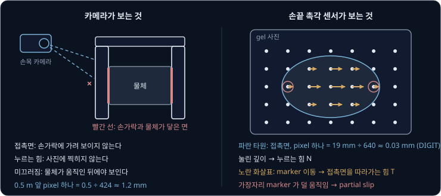
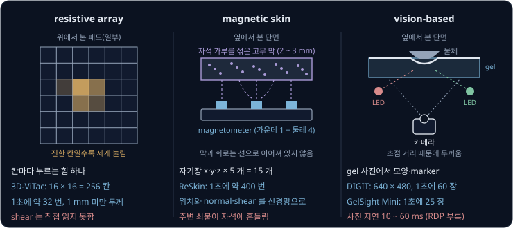
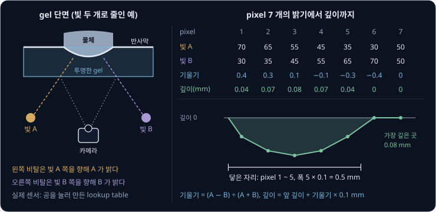
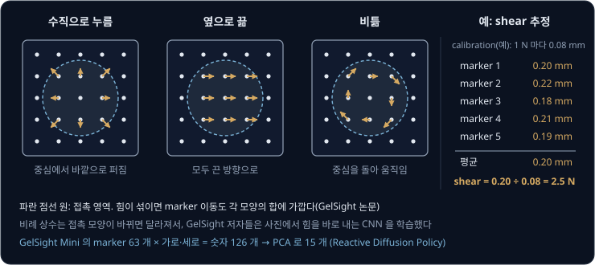
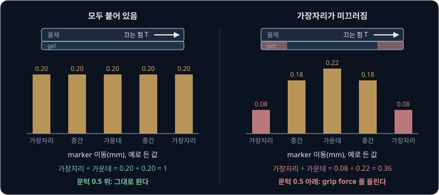
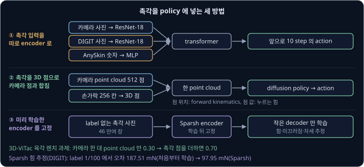
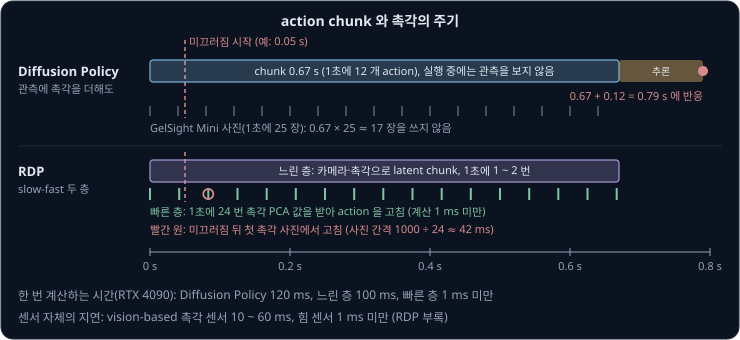

# Tactile Sensing

로봇 손이 USB 플러그를 쥐고 구멍에 꽂을 때, 손목 카메라에는 손가락 바깥면과 플러그 뒷부분만 보인다. 손가락과 플러그가 맞닿은 면은
손가락에 가려 있고, 얼마나 세게 쥐었는지는 사진 어디에도 찍히지 않는다. 플러그가 손가락 사이에서 미끄러지기 시작해도 가려진 면에서
일어나는 일이라 사진으로는 알기 어렵다. 손가락이 물체에 닿은 바로 그 자리에서 무엇을 재야 하고, 그 값은 어떻게 얻을 수 있을까?

이 물음에 답하는 장치인 **tactile sensor**(촉각 센서)는 손끝에 붙인 무른 면이 눌리고 끌리는 모양을 재서, 닿은 자리의 모양과 힘, 미끄러지기
시작하는 순간을 숫자로 낸다. 2024 년의 AnySkin 실험에서 손끝 하나에 촉각 skin 을 붙인 xArm 은 플러그를 꽂는 과제에서 카메라만 보는 policy
로는 10 번 중 평균 1.7 번 성공했고, 촉각을 함께 넣은 policy 로는 6.7 번 성공했다.

## 학습 목표

- 카메라가 접촉 순간에 보지 못하는 것(가려진 접촉면, 힘, 미끄러지기 시작하는 순간)과 resistive array·magnetic skin·vision-based 센서가 그것을 재는 방식의 차이를 숫자로 설명할 수 있다
- GelSight 류 센서가 gel 뒤의 카메라로 색에서 기울기와 깊이를 얻고, marker 의 이동에서 shear 와 미끄러짐을 얻는 과정을 설명할 수 있다
- TACTO·Taxim 같은 촉각 simulation 이 실물과 어긋나는 이유와, 학습한 policy 에 촉각을 넣는 방법(visuo-tactile policy, Sparsh, slow-fast policy)을 설명할 수 있다
- gel 마모, drift(시간이 지나며 같은 힘에도 신호가 변하는 현상), 센서마다 다른 신호가 학습한 모델을 어떻게 망가뜨리고 무엇으로 막는지 설명할 수 있다

## 카메라가 보지 못하는 접촉

물체를 쥐는 동안 카메라가 놓치는 정보는 세 가지다. 첫째는 접촉면의 모양이다. 접촉면은 손가락과 물체 사이에 끼어 있어서 어느 카메라에서든
손가락에 가려 보이지 않고, 보이는 부분도 거칠게 찍힌다. [Camera Geometry](../camera-geometry/README.md) 에서 구한 focal length $f = 424$
pixel 인 카메라로 0.5 m(500 mm) 앞을 찍으면 pixel 하나가 $500 \div 424 \approx 1.2$ mm 를 덮는다. 손끝 촉각 센서 DIGIT 는 가로 19 mm 를 640 pixel 로
찍어서 pixel 하나가 $19 \div 640 \approx 0.03$ mm 를 덮으므로, 카메라보다 약 40 배 촘촘하다.

둘째는 힘이다. [Grasp Planning](../grasping/README.md) 의 예에서는 0.5 kg 물체를 5 m/s² 로 들 때 $\mu = 0.5$ 이고 안전율이 2 이면 손가락
하나가 14.8 N 이상으로 눌러야 했다. 5 N 으로 쥐었는지 25 N 으로 쥐었는지는 사진으로 구별할 수 없다. GelSight 논문에 따르면 손끝용 GelSight 는 대부분의
조건에서 0.05 N 보다 작은 힘도 구분했다.

셋째는 미끄러지기 시작하는 순간이다. 접촉면을 따라 걸리는 힘 $T$ 가 수직으로 누르는 힘 $N$ 에 $\mu$ 를 곱한 friction cone 의 한계 $\mu N$ 에
다가가면 물체가 통째로 미끄러지기 전에
접촉면의 가장자리부터 조금씩 미끄러진다. 이 변화는 가려진 면 안에서 일어나서, 사진에는 물체가 실제로 움직인 뒤에야
나타난다. 접촉면 일부만 미끄러지는 이 상태를 **partial slip**(incipient slip)이라고 한다.

손목의 F/T(force/torque) sensor 는 모든 접촉을 합친 힘과 torque 숫자 6 개만 내서 어느 손가락의 어느 자리가 닿았는지 알 수 없고,
가격도 비싸다(Reactive Diffusion Policy 논문에 따르면 ATI mini45 가 약 3,000 달러).

미끄러짐을 미리 보면 grip force 를 정하는 방식이 달라진다. 앞의 0.5 kg 예에서 안전율 2 는 $\mu$ 를 모르므로 늘 두 배로 세게 쥐려고 둔
값이었다. 손가락 하나에 걸리는 접선 힘은 0.5 kg 에 중력과 들어 올리는 가속도의 합 14.81 m/s² 를 곱해 둘로 나눈
$0.5 \times 14.81 \div 2 = 3.70$ N 이다. 14.8 N 으로 누르면 $T \div N = 0.25$ 라서 $\mu = 0.5$ 의 절반에 머문다. partial slip 을 볼 수 있으면
안전율 1 에 해당하는 7.4 N 근처로 쥐다가 미끄러지기 시작할 때만 힘을 올릴 수 있다. ReSkin 의 저자들은 촉각 되먹임을 받는 gripper 가
블루베리를 터뜨리지 않고 쥐는 장면을 보였다.

**확인 문제.** 손가락 하나가 접촉면에 수직으로 10 N 의 힘을 주고, 접촉면을 따라 3 N 의 힘이 걸린다. $\mu = 0.5$ 면 friction cone 안에 있는가? 접선
힘이 몇 N 을 넘으면 미끄러지는가?

답 보기

$T = 3$ N, $N = 10$ N 이라 $T \div N = 0.3$ 이고, 이 값이 $\mu = 0.5$ 이하라서 friction cone 안이다. 미끄러지지 않는 조건은 $T \le \mu N$ 이므로
$T$ 가 $0.5 \times 10 = 5$ N 을 넘으면 미끄러진다.

## 촉각 센서의 종류

촉각 센서는 손끝의 무른 면이 변형된 것을 어떤 물리량으로 바꿔 읽느냐로 나뉜다.

**resistive array** 는 누르면 전기 저항이 바뀌는 얇은 막을 가로세로 전극 사이에 끼워, 전극이 엇갈리는 칸마다 누르는 힘을 잰다. 3D-ViTac
의 패드는 Velostat 막을 쓰고, 손가락 하나에 16 × 16 = 256 칸이 있으며 한 칸이 3 mm² 를 덮는다. 패드는 1 mm
보다 얇고 1초에 약 32 번 읽히며, 패드와 읽기 회로를 합쳐 약 20 달러다(Arduino 제외). 칸마다 누르는 힘 하나만 재므로 접촉면을 따라 끄는
힘(shear)은 직접 읽지 못한다. 정전용량 변화를 읽는 capacitive 센서는 예민하지만, AnySkin 논문에 따르면 shear 를 다루기 어렵고 회로가 무른
면에 직접 이어져 잘 끊어진다.

**magnetic skin** 은 자석 가루를 섞어 굳힌 고무 막을 자기장 센서(magnetometer) 위에 얹어, 막이 눌리거나 끌릴 때 바뀌는 자기장을 읽는다.
ReSkin 에서는 20 mm × 20 mm 면 아래의 magnetometer 5 개가 x·y·z 세 방향 자기장을 1초에 약 400 번 읽어 숫자 $5 \times 3 = 15$ 개를 내고,
신경망이 이 15 개를 받아 닿은 위치와 normal(수직)·shear 힘을 계산한다. 막은 2 ~ 3 mm 두께이고 30 달러가 안 된다. 회로와 막이 선으로
이어져 있지 않아 닳은 막만 갈아 끼울 수 있지만, 주변에 자석이나 쇠붙이가 있으면 자기장 값이 흔들린다.

**vision-based** 센서는 투명한 gel 뒤에 작은 카메라를 두고 gel 이 눌린 모양을 사진으로 찍는다. MIT 의 GelSight 를 Facebook(지금의 Meta)
연구진이 작게 다시 설계한 것이 DIGIT 다. DIGIT 는 크기가 20 × 27 × 18 mm 이고 무게가 20 g 이며, 19 × 16 mm 면을 640 × 480 사진으로 1초에
60 장 찍는다. 1000 개를 만들 때 부품값은 약 15 달러다. 상용 제품인 GelSight Mini 는 Reactive Diffusion Policy 논문에 따르면 1초에 25 장
찍고 549 달러다. 카메라가 초점을 맞추려면 gel 에서 일정 거리 떨어져야 해서, vision-based 센서는 다른 방식보다 두껍다.

세 방식이 한 번에 내는 숫자와 1초에 읽는 횟수를 곱하면 차이가 크다. 사진은 pixel 마다 RGB 세 숫자를 압축하지 않은 값으로 센다.

| 센서 | 재는 것 | 한 번에 내는 숫자 | 1초에 읽는 횟수 | 1초에 들어오는 숫자 |
| --- | --- | --- | --- | --- |
| resistive array (3D-ViTac 손가락 하나) | 칸마다 누르는 힘 | 256 | 약 32 | 약 8,200 |
| magnetic skin (ReSkin) | 자기장 → 위치, normal·shear | 15 | 약 400 | 6,000 |
| vision-based (DIGIT) | gel 사진 → 모양, marker | $640 \times 480 \times 3 = 921{,}600$ | 60 | 약 5,500 만 |

> **오해** 해상도가 높은 vision-based 센서가 어떤 과제에서든 촉각 센서로 가장 낫다.
>
> **사실** AnySkin 논문의 플러그 꽂기 실험에서 같은 policy 구조에 DIGIT 를 넣으면 10 번 중 평균 2.3 번 성공했고, AnySkin 을 넣으면 6.7 번 성공했다. vision-based 센서는 보통 1초에 30 ~ 60 장 찍고(ReSkin 논문), 카메라 때문에 두꺼워서 손가락 모양을 바꾸기도 어렵다.

**확인 문제.** 3D-ViTac 은 양팔 gripper 의 손가락 4 개에 모두 16 × 16 패드를 붙인다. 1초에 32 번 읽으면 1초에 숫자가 몇 개 들어오는가?

답 보기

손가락 하나가 $16 \times 16 = 256$ 칸이라 4 개면 $256 \times 4 = 1{,}024$ 칸이다. 1초에 32 번 읽으므로 $1{,}024 \times 32 = 32{,}768$ 개다.

## gel 과 카메라로 재는 모양

GelSight 의 gel 은 투명한 고무 위에 빛을 고르게 반사하는 불투명한 막을 입힌 것이다. 물체를 누르면 막이 물체 모양대로 패이는데, 막의 색과
반사 성질은 어디서나 같으므로 카메라에 찍힌 밝기는 막의 기울기에만 달려 있다. 빨강·초록·파랑 LED 를 서로 다른 방향에 두면 기울어진 면은
자기가 향한 쪽에서 오는 빛을 더 많이 반사해서, 한 장의 컬러 사진에 세 방향 빛의 밝기가 함께 찍힌다. 여러 방향의 빛에서 밝기를 재어 면의 기울기를
구하는 방법을 **photometric stereo** 라고 한다.

빛을 두 개로 줄여, gel 아래 왼쪽에 둔 빛 A 와 오른쪽에 둔 빛 B 가 각각 45° 기울어 막을 비춘다고 하자. 그러면 한 pixel 의
기울기는 두 밝기의 차이를 합으로 나눈 $(A - B) \div (A + B)$ 다. 여기서 기울기는 오른쪽으로 갈 때 깊이가 늘어나는 비율이다. 이렇게
깊어지는 왼쪽 비탈은 빛 A 쪽을 향하므로 A 가 더 밝다. 계산을 쉽게 하려고 pixel 간격을 0.1 mm 로 두고, 패인 자리를 가로지르는 pixel 7 개의
밝기가 아래와 같다고 하자. 깊이는 왼쪽 끝을 0 으로 두고 pixel 마다 기울기 × 0.1 mm 씩 더해 구한다.

| pixel | 1 | 2 | 3 | 4 | 5 | 6 | 7 |
| --- | --- | --- | --- | --- | --- | --- | --- |
| 빛 A 의 밝기 | 70 | 65 | 55 | 45 | 35 | 30 | 50 |
| 빛 B 의 밝기 | 30 | 35 | 45 | 55 | 65 | 70 | 50 |
| 기울기 $(A - B) \div (A + B)$ | 0.4 | 0.3 | 0.1 | −0.1 | −0.3 | −0.4 | 0 |
| 깊이(mm) | 0.04 | 0.07 | 0.08 | 0.07 | 0.04 | 0 | 0 |

깊이가 0 보다 큰 pixel 1 ~ 5 가 물체에 닿은 자리라서 접촉 폭은 $5 \times 0.1 = 0.5$ mm 이고, 그 가운데인 pixel 3 이 0.08 mm 로 가장 깊다.
사진 한 장에서 접촉면의 모양(깊이 지도)과 넓이를 함께 얻는다. 기울기를 더해 깊이를 얻는 계산을 적분이라고 하고, 실제 사진에서는 가로·세로
기울기를 모두 써서 2차원으로 계산한다.

실제 센서에서는 이 공식을 그대로 쓰지 않는다. LED 가 gel 가까이 있어 빛이 나란하지 않아서, 같은 기울기라도 사진의 어디에 있느냐에 따라 밝기가
다르기 때문이다. 그래서 GelSight 의 저자들은 지름 3.96 mm 처럼 크기를 아는 작은 공을 여러 자리에 눌러 찍었다. 공의 모양을 알면 pixel 마다
진짜 기울기를 알 수 있으므로, 손끝용 GelSight 에서는 RGB 세 값의 변화를 기울기에 대응시키는 80 × 80 × 80 크기의 lookup table 을 만들었다.
밝기 대신 아무것도 닿지 않은 사진과의 차이를 써서 LED 가 고르지 않게 비추는 영향도 지운다. GelSight 논문에 따르면 센서마다 조립이 조금씩
달라서 이 calibration 은 센서마다 반드시 해야 한다. 이 손끝용 GelSight 는 18 × 14 mm 면을 USB webcam 으로 1초에 30 장 찍고, 공간 해상도는 20 ~ 30 μm 다.

<b>심화: 두 빛의 밝기로 기울기를 구하는 식과 2차원 적분</b>

막이 고르게 빛을 흩뜨리면(Lambertian) 밝기는 면의 법선과 빛 방향이 이루는 각의 cosine 에 반사율 $\rho$ 를 곱한 값이다. 카메라 쪽을 향한
법선이 빛 A 쪽으로 $\varphi$ 만큼 기울었으면 깊이의 기울기는 $p = \tan\varphi$ 이고, 45° 기울어 들어오는 두 빛과 법선이 이루는 각은 $45° - \varphi$ 와
$45° + \varphi$ 다. 빛을 반대쪽에 두면 부호가 바뀐다.

$$
\frac{A - B}{A + B} = \frac{\rho\cos(45° - \varphi) - \rho\cos(45° + \varphi)}{\rho\cos(45° - \varphi) + \rho\cos(45° + \varphi)}
= \frac{2\sin 45°\sin\varphi}{2\cos 45°\cos\varphi} = \tan\varphi = p
$$

$\rho$ 가 분자와 분모에서 지워지므로 막의 밝기가 조금 달라도 기울기는 그대로 나온다. 예를 들어 $p = 0.4$ 면 $\varphi = 21.8°$ 이고, $\rho = 100$
이면 $A = 100\cos 23.2° = 91.9$, $B = 100\cos 66.8° = 39.4$ 라서 $(91.9 - 39.4) \div (91.9 + 39.4) = 0.400$ 이다.

실제 센서에서는 RGB 세 빛으로 가로 기울기 $\partial f / \partial x$ 와 세로 기울기 $\partial f / \partial y$ 두 개를 구한다. 두 기울기에서 깊이
$f(x, y)$ 를 얻으려면 가로 기울기를 $x$ 로 한 번 더 미분한 값과 세로 기울기를 $y$ 로 한 번 더 미분한 값의 합 $g$ 를 구한 뒤, 아래
Poisson 방정식을 푼다.

$$
\frac{\partial^2 f}{\partial x^2} + \frac{\partial^2 f}{\partial y^2} = g
$$

GelSight 의 저자들은 이 방정식을 discrete sine transform 으로 빠르게 풀어서 깊이 지도를 실시간으로 계산했다. 잰 기울기에 noise 가 있으면
가로로 더한 길과 세로로 더한 길의 결과가 어긋난다. Poisson 방정식을 풀면 두 길의 결과에 함께 맞춘 깊이가 나온다.

**확인 문제.** 어떤 pixel 에서 빛 A 의 밝기는 60 이고 빛 B 의 밝기는 40 이다. 기울기는 얼마이고, pixel 간격이 DIGIT 처럼 0.03 mm 면 이 pixel 에서
깊이가 얼마나 늘어나는가?

답 보기

기울기는 두 밝기의 차이를 합으로 나눈 $(60 - 40) \div (60 + 40) = 20 \div 100 = 0.2$ 다. 깊이는 기울기에 간격을 곱한 만큼 늘어나므로 $0.2 \times 0.03 = 0.006$ mm 다.

## marker 로 재는 shear 와 힘

photometric stereo 로 얻는 깊이는 막이 수직으로 패인 양이라, 막이 옆으로 끌려간 양은 알 수 없다. 그래서 GelSight 는 고무와 반사막 사이에
작고 검은 점(marker)을 찍어 둔다. 손끝용 GelSight 의 한 판은 25 × 25 mm gel 조각에 평균 1.1 mm 간격으로 찍었고, GelSight Mini 의
robotics 판에는 7 × 9 개가 있다. 아무것도 닿지 않은 사진에서 marker 의 위치를 기록해 두고, 사진마다 검은 점의 중심을 다시 찾아 처음 위치에서 얼마나 움직였는지
계산한다.

marker 가 움직인 모양은 힘의 종류마다 다르다. 수직으로 누르면 접촉 중심에서 바깥으로 퍼지고, 옆으로 끌면 모두 끈 방향으로 움직이며, 접촉면에
수직인 축으로 비틀면 중심을 돌아 움직인다. 힘이 섞이면 이동도 각 모양의 합에 가깝다. 접촉면을 따라 끄는 힘을 **shear** force 라고 한다.

GelSight 논문의 실험에서 접촉 영역 안 marker 이동의 평균은 shear force 에 비례했고, 미끄러지기 시작한 뒤에도 이 비례가 유지됐다. 예를 들어 지름 25 mm 공으로 calibration 했더니 shear
1 N 마다 평균 이동이 0.08 mm 였다고 하자. 같은 공으로 누른 채 끌었을 때 접촉 영역 marker 5 개가 끈 방향으로 아래처럼 움직였다면 shear 는
평균 이동을 0.08 mm 로 나눈 값이다.

| marker | 1 | 2 | 3 | 4 | 5 | 평균 |
| --- | --- | --- | --- | --- | --- | --- |
| 이동(mm) | 0.20 | 0.22 | 0.18 | 0.21 | 0.19 | 0.20 |
| shear 추정 | | | | | | $0.20 \div 0.08 = 2.5$ N |

수직 힘도 같은 방법으로 얻는데, 논문의 실험에서 수직 힘은 눌린 깊이에 비례했다. 예를 들어 같은 공에서 깊이 0.1 mm 마다 1 N 이고 지금
0.6 mm 눌렸다면 $N = 6$ N 이다. $T \div N = 2.5 \div 6 = 0.42$ 를 그 물체의 $\mu$ 와 비교해 friction cone 의
한계까지 얼마나 남았는지 본다.

이 비례 상수는 접촉 모양이 바뀌면 달라져서, 같은 2.5 N 이라도 납작한 판으로 끌면 공으로 끌 때와 marker 가 다르게 움직인다. 그래서
GelSight 논문의 저자들은 모양마다 상수를 재는 대신 사진 한 장에서 세 방향 힘과 비트는 torque 를 바로 내는 CNN 을 학습했고, 처음 보는
공·원기둥·평면에서 힘의 $R^2$ 가 0.9 를 넘었다. $R^2$ 는 예측이 실제 값의 변화를 얼마나 설명하는지 나타내는 숫자로 1 이면 완벽하다. 고무가
천천히 되돌아오는 viscoelasticity 때문에 gel 은 누를 때와 뗄 때 같은 깊이에서도 힘이 다르다.

marker 이동을 그대로 쓰면 숫자가 많아서, GelSight Mini 의 marker 7 × 9 = 63 개는 가로·세로 이동을 합해 사진 한 장에 숫자 126 개를 낸다.
Reactive Diffusion Policy 의 저자들은 이 126 개를 principal component analysis(PCA)로 15 개로 줄였다. PCA 는 데이터가 가장 크게 퍼진 방향부터
차례로 뽑는 방법이다. 첫 성분 몇 개는 접선 힘, 비트는 torque, 수직 힘에 해당하는 이동 모양으로 나왔다.

<b>심화: GelSight 의 CNN 힘 추정</b>

저자들은 ImageNet 으로 pretraining 한 VGG-16 의 마지막 fully connected 층을 출력 4 개($F_x$, $F_y$, $F_z$, $T_z$)짜리로 바꾸고, 아무것도 닿지
않은 사진과의 차이를 입력으로 넣어 MSE loss 로 학습했다. 정답 힘은 GelSight 아래에 단 ATI Nano17 F/T sensor 로 쟀다. 학습에는 지름 12 ~ 87 mm 공
여섯 개, 지름 10 ~ 70 mm 원기둥 다섯 개, 평면 두 개로 모은 사진 약 28,815 장을 썼고, 처음 보는 지름 25 mm 공, 지름 22 mm 원기둥, 평면의
사진 6,705 장으로 시험했다. viscoelasticity 의 영향을 줄이려고 누르는 동안의 데이터만 썼다.

저자들은 남은 오차의 대부분이 접촉 모양에서 왔다고 분석했다. 시간 순서로 늘어놓으면 예측이 실제 힘을 잘 따라가지만, 접촉 한 번 전체가
다른 접촉보다 한쪽으로 치우쳐 틀리는 경우가 있었다. 그래서 모든 모양을 담은 더 큰 dataset(simulation 으로 만든 것 포함)이나 다른 방법이
필요하다고 적었다.

**확인 문제.** 위의 공 calibration(shear 1 N 당 0.08 mm, 수직 힘 깊이 0.1 mm 당 1 N)을 그대로 쓴다. 접촉 영역 marker 의 평균 이동이 0.12 mm
이고 깊이가 0.5 mm 면 $T \div N$ 은 얼마인가?

답 보기

shear 는 $0.12 \div 0.08 = 1.5$ N 이고 수직 힘은 $0.5 \div 0.1 \times 1 = 5$ N 이라서 $T \div N = 1.5 \div 5 = 0.3$ 이다. 이 상수는 같은 공으로 누를 때만 맞으므로 다른 모양의 물체에는 다시
calibration 하거나 학습한 모델을 쓴다.

## 미끄러짐 감지

friction cone 의 조건대로라면 $T > \mu N$ 일 때 미끄러지지만, 로봇은 잡은 물체의 $\mu$ 를 미리 모른다. 그래서 촉각 센서로는 $\mu$ 대신
partial slip 이 남기는 흔적을 찾는다. GelSight 논문에 따르면 무른 접촉에서 미끄러짐은 접촉면 가장자리에서 시작하고, 가운데는 전체가 미끄러질
때까지 물체에 붙어 있다. 붙어 있는 marker 는 물체와 함께 끌려가고 미끄러진 가장자리의 marker 는 덜 끌려가므로, 가장자리 marker 가 가운데보다
눈에 띄게 덜 움직이면 미끄러짐이 시작됐거나 곧 시작된다.

접촉면을 가로지르는 marker 5 개의 이동을 예로 들면 아래와 같다. 문턱 0.5 는 이 예에서 정한 값이다.

| 상태 | 가장자리 | 중간 | 가운데 | 중간 | 가장자리 | 가장자리 ÷ 가운데 |
| --- | --- | --- | --- | --- | --- | --- |
| 모두 붙어 있음 | 0.20 | 0.20 | 0.20 | 0.20 | 0.20 | $0.20 \div 0.20 = 1$ |
| 가장자리가 미끄러짐 | 0.08 | 0.18 | 0.22 | 0.18 | 0.08 | $0.08 \div 0.22 = 0.36$ |

둘째 줄처럼 비율이 0.5 아래로 떨어지면 물체가 통째로 미끄러지기 전에 grip force 를 올려 $\mu N$ 을 키운다. GelSight 의
저자들은 marker 이동이 고르지 않은 정도를 histogram 의 entropy 로 재고 경고 문턱을 두는 방법을 제안했다.

<b>심화: marker 이동 histogram 의 entropy</b>

GelSight 의 저자들은 이동 값들의 분포 $p(x)$ 로 entropy $H = -\int p(x)\log p(x)\,dx$ 를 계산했다. $H$ 는 값이 모두 같으면 0 이고, 여러
값으로 흩어질수록 커진다. 위 예의 이동을 폭 0.05 mm 구간으로 나눠 세면 아래와 같다(자연로그).

| 상태 | 구간별 개수 | 비율 $p$ | $H = -\sum p \ln p$ |
| --- | --- | --- | --- |
| 모두 붙어 있음 | 0.20 ~ 0.25 에 5 개 | 1 | $-1 \times \ln 1 = 0$ |
| 가장자리가 미끄러짐 | 0.05 ~ 0.10 에 2 개, 0.15 ~ 0.20 에 2 개, 0.20 ~ 0.25 에 1 개 | 0.4, 0.4, 0.2 | $-(2 \times 0.4\ln 0.4 + 0.2\ln 0.2) = 0.733 + 0.322 = 1.055$ |

partial slip 이 진행될수록 $H$ 가 커지므로 $H$ 에 문턱을 두면 경고로 쓸 수 있다. 구간 폭과 문턱은 센서와 물체에 맞춰 실험으로 정한다. 논문은 접촉면이
넓고 평평해 marker 여러 개가 접촉 영역에 들어올 때 이 방법이 잘 맞고, 무늬가 뚜렷한 물체는 gel 위 무늬의 움직임과 marker 의 움직임을
비교하는 편이 쉽다고 적었다.

손으로 정한 규칙 대신 미끄러짐을 학습할 수도 있다. AnySkin 논문의 저자들은 물건 30 개로 모은 AnySkin 신호(1초에 100 번)로, 시간 순서의
신호를 차례로 읽는 신경망인 LSTM 을 학습했고, 이 모델은 처음 보는 물건 10 개에서 미끄러짐 여부를 92% 맞혔다. Sparsh 의 저자들은 공 모양 probe 를 센서 위에서 미끄러뜨린 데이터에
friction cone 과 실험으로 잰 $\mu$ 로 미끄러짐 label 을 붙이고, 학습에 쓴 label 을 줄여 가며 F1 점수를 비교했다. F1 점수는 미끄러짐 sample 이
13% 뿐이라 정확도 대신 쓴 점수이고, 1 에 가까울수록 좋다.

| 학습에 쓴 label | 처음부터 학습(E2E) | Sparsh(V-JEPA) encoder |
| --- | --- | --- |
| 전부 | 0.767 | 0.820 |
| 1/3 | 0.238 | 0.828 |
| 1/100 | 0.214 | 0.760 |

label 이 1/3 로 줄자 처음부터 학습한 모델은 0.238 로 떨어졌지만, 미리 학습한 encoder 를 쓴 모델은 0.828 을 지켰다(이 encoder 는
[촉각을 넣은 학습한 policy](#촉각을-넣은-학습한-policy) 절에서 다룬다).

미끄러짐을 늦게 보면 소용이 없다. Sparsh 의 저자들은 사람이 partial slip 을 느끼고 grip force 를 고치는 데 약 80 ms 가 걸린다는 연구를
인용하고, 1초에 60 장 찍는 센서에서 5 장 떨어진 두 사진(약 80 ms)을 함께 넣었다. 80 ms 동안 1초에 25 장 찍는 GelSight Mini 는 $0.08 \times 25 = 2$ 장을
찍고, 1초에 400 번 읽는 ReSkin 은 $0.08 \times 400 = 32$ 번 읽는다.

**확인 문제.** 접촉면을 가로지르는 marker 5 개의 이동이 0.10, 0.20, 0.25, 0.20, 0.10 mm 다. 이 절의 비율과 문턱 0.5 를 쓰면 grip force 를
올려야 하는가?

답 보기

가장자리 이동은 0.10 mm 이고 가운데 이동은 0.25 mm 라서 비율은 $0.10 \div 0.25 = 0.4$ 다. 문턱 0.5 아래라서 가장자리가 미끄러지기 시작한 것으로 보고 grip
force 를 올린다.

## 촉각 simulation 과 실물의 차이

강화학습이나 큰 dataset 에는 simulation 이 필요하지만, 촉각 센서를 흉내 내려면 접촉의 역학과 함께 gel 안의 빛과 카메라까지 계산해야 한다.
TACTO 는 이 일을 둘로 나눴다. 물체가 어디 있고 얼마나 세게 닿았는지는 PyBullet 같은 physics engine 이 rigid body 로 계산하고, TACTO 는 그
pose 를 받아 gel 과 물체 mesh 를 OpenGL 로 그려 깊이와 RGB 사진을 낸다. physics engine 이 준 수직 힘은 물체를 gel 쪽으로 밀어 넣는 깊이로
바뀐다. 소스 코드의 DIGIT 기본 설정은 0 ~ 100 N 을 0 ~ 5 mm 에 직선으로 대응시키고 100 N 이 넘으면 5 mm 에서 멈추므로, 10 N 이면
$10 \div 100 \times 5 = 0.5$ mm 다. 같은 설정은 사진의 0 ~ 255 밝기에 표준편차 7 인 Gaussian noise 를 더한다.

TACTO 는 GPU 에서 DIGIT 하나를 160 × 120 해상도로 1초에 약 200 장 그린다. 저자들은 grasp 100 만 번의 데이터를 하루 만에 모아, 들어 올린 뒤에도
버틸 grasp 인지 맞히는 모델을 학습했는데, 카메라 사진만 쓴 모델은 촉각을 쓴 모델을 따라잡는 데 데이터가 1,000 ~ 10,000 배 더 필요했다.

저자들은 simulation 과 실물의 차이를 펜을 누른 자리와 각도를 사진에서 추정하는 실험으로 쟀다. simulation 사진 10,000 장과 사람이 위치 label 을
붙인 실물 사진 200 장으로 같은 CNN 을 학습했다.

| 학습 데이터 → 시험 | 접촉 중심 위치 오차 | 각도 오차 |
| --- | --- | --- |
| 무작위로 찍기 | 11.75 mm | 46.56° |
| simulation → simulation | 0.41 mm | 3.48° |
| simulation → 실물, augmentation 없음 | 4.56 mm | 17.64° |
| simulation → 실물, 색 흔들기 | 1.66 mm | 11.60° |
| 실물 64 장 → 실물 | 2.01 mm | 10.96° |
| 실물 128 장 → 실물 | 0.76 mm | 4.96° |
| simulation + 실물 128 장 → 실물 | 0.52 mm | 4.14° |

simulation 에서 학습해 실물에서 시험하면 위치 오차가 $4.56 \div 0.41 \approx 11$ 배로 커진다. RGB 채널마다 밝기와 대비를 무작위로 바꾸는
color jittering 을 더하자 1.66 mm 로 줄어 실물 64 장으로 학습한 모델과 비슷해졌다. 저자들은 이 augmentation 이
모델을 조명 차이에 강하게 만든다고 보았다. simulation 에 실물 데이터를 조금 섞으면 같은 양의 실물만 쓴 것보다 늘 좋았다.

TACTO 의 저자들은 접촉 경계에서 gel 이 늘어나는 모양을 잘 흉내 내지 못한다는 한계를 적었다. 실물 센서에서는 빛이 멀리 갈수록
어두워진다. TACTO 는 이를 맞추려고 실물 센서에서 아무것도 닿지 않은 사진을 한 장 받아 simulation 의 접촉 전후 차이에 더한다. 실물 센서의
예시 사진으로 빛의 반응을 맞추는 Taxim 은 실물 사진과의 pixel 오차(MSE)가 58.4 로 TACTO 의 215.9 보다 작았다.

<b>심화: Taxim 의 example-based simulation</b>

Taxim 은 빛을 물리 법칙으로 계산하는 대신 실물 센서의 예시 사진으로 맞춘다. 지름 4 mm 공을 50 곳에 눌러 법선을 밝기로 바꾸는
2 차 다항식 표를 calibration 하고, 지름 1 mm 핀을 10 번 눌러 그림자 모양을 모은다. 이 작업은 센서마다 따로 해야 하지만, 저자들은 정밀한
위치 제어 없이 손으로 1시간 안에 끝난다고 적었다. 이 표는 LED 가 gel 가까이 있어 빛이 나란하지 않은 효과를 사진 위치 $(x, y)$ 의 2 차식 $[x^2, y^2, xy, x, y, 1]$ 으로
반영한다.

marker 이동은 gel 을 작은 조각으로 나눠 변형을 계산하는 FEM 소프트웨어(ANSYS)로 gel 의 한 점을 눌렀을 때 다른 점들이 움직이는 양을 미리 계산해 두고, 실제 접촉에서는 접촉한 점들의
영향을 더해(중첩 원리) 구한다. FEM 으로 직접 계산한 결과와의 차이는 수 μm 였다. Taxim 은 CPU 에서 그림자 없이 1초에 18.1 장을 그렸고, 같은
CPU 에서 TACTO 는 1초에 1.9 장을 그렸다. TACTO 는 GPU 에서 빨라지는 구조인데 이 비교에서는 GPU 를 쓰지 않았다.

**확인 문제.** TACTO 의 펜 실험에서 실물 64 장으로 학습한 모델의 위치 오차는 2.01 mm 다. 실물 사진 없이 simulation 데이터와 color jittering
만으로 학습한 모델은 이보다 나은가, 못한가? 각도 오차도 비교하라.

답 보기

simulation + color jittering 은 위치 오차가 1.66 mm 로 실물 64 장의 2.01 mm 보다 작아서 낫지만, 각도 오차는 11.60° 로 실물 64 장의
10.96° 보다 조금 크다. 두 값이 비슷해서 저자들도 실물 64 장과 견줄 만한 결과로 보았다.

## 촉각을 넣은 학습한 policy

학습한 policy 에 촉각을 넣는 방법은 크게 세 가지다. 첫째는 촉각 신호를 카메라 사진과 나란한 입력으로 넣는 방법이다. AnySkin 의 플러그 꽂기
실험에서는 카메라 사진과 DIGIT 사진을 ResNet-18 로 vector 로 바꾸고, AnySkin 의 숫자를 fully connected 층을 쌓은 MLP 로 vector 로 바꾼 뒤 transformer 에 함께
넣었다. 이 policy 는 시연 96 개로 학습해 앞으로 10 step 의 action 을 한 덩어리로 낸다.

둘째는 촉각 값을 카메라 point cloud 와 같은 3차원 공간에 놓는 방법이다. 3D-ViTac 은 forward kinematics 로 손가락 패드 256 칸의 위치를 계산해
칸마다 3차원 점을 만들고, 누르는 힘을 그 점의 값으로 붙인다. 이 촉각 점을 카메라에서 뽑은 점 512 개와 한 point cloud 로 합쳐 diffusion policy
에 넣고, 점마다 카메라 점인지 촉각 점인지 표시해 둔다. 그러면 닿은 자리가 카메라로 본 물체와 같은 좌표에 놓인다.

3D-ViTac 의 실험에서는 시연 30 개로 학습한 policy 를 과제마다 20 번 실행했다. 아래 성공률은 과제 전체를 끝낸 비율이다.

| 입력 | 달걀 찌기 | 육각 렌치 꽂기 |
| --- | --- | --- |
| 카메라 RGB 만 | 0.50 | 0.45 |
| 카메라 point cloud 만 | 0.55 | 0.65 |
| 카메라 point cloud + 촉각 점 | 0.85 | 0.90 |
| 촉각 점만 | 0.10 | 0.15 |
| 카메라 한 대 point cloud 만 | 0.50 | 0.30 |
| 카메라 한 대 point cloud + 촉각 점 | 0.80 | 0.70 |

촉각만으로는 거의 실패하므로 촉각이 카메라를 대신하지는 않는다. 카메라를 한 대로 줄여 많이 가려진 경우에 촉각을 더한 효과가 커서, 육각 렌치
과제는 0.30 이 0.70 으로 올랐다. 저자들의 분석에 따르면 카메라만 쓴 policy 는 너무 약하게 쥐어 달걀을 놓치거나, 포도 여러 알을 한꺼번에
쥐면서 너무 세게 눌러 짓눌렀고, 손 안에서 렌치의 위치를 고치는 단계에서 자주 실패했다.

셋째는 label 없는 촉각 사진으로 encoder 를 미리 학습하는 방법이다. 힘이나 미끄러짐 label 은 F/T sensor 같은 장비로 모아야 해서 많이 얻기
어렵다. 그래서 Sparsh 는 DIGIT, GelSight 2017, GelSight Mini 사진 46 만여 장을 label 없이 self-supervised learning 으로 학습했다. self-supervised learning 은 사진 일부를
가리고 나머지로 그 부분을 맞히게 하는 것처럼 데이터 자체에서 정답을 만드는 학습이다. 나중 과제에서는 encoder 를 고정한 채 작은 decoder 만
학습한다. 오차를 제곱해 평균한 뒤 제곱근을 씌운 RMSE 로 잰 DIGIT 의 힘 추정 오차(단위 mN, 1 mN 은 0.001 N)는 아래와 같았다.

| 학습에 쓴 label | 처음부터 학습(E2E) | Sparsh(DINO) encoder |
| --- | --- | --- |
| 전부 | 39.34 | 36.09 |
| 1/10 | 98.22 | 51.89 |
| 1/100 | 187.51 | 97.95 |

label 을 전부 쓰면 둘이 비슷하지만, label 이 1/100 로 줄면 처음부터 학습한 모델의 오차는 약 4.8 배가 되고 Sparsh 는 약 2.7 배에 머문다.
다만 구슬을 철사 미로를 따라 옮기는 과제에서 Sparsh 를 diffusion policy 의 encoder 로 넣었을 때는 어느 모델도 실물 로봇에서 미로 끝까지 가지
못했다.

<b>심화: Sparsh 의 입력과 평가 방식</b>

촉각 사진 한 장은 접촉 한 자리만 담아서, 같은 사진이 다른 힘이나 물체에서도 나올 수 있다. 그래서 Sparsh 는 사진 한 장 대신 5 장 떨어진 두
사진을 채널 방향으로 붙여 6 채널 입력을 만든다. 1초에 60 장이면 두 사진의 간격은 약 80 ms 다. V-JEPA 처럼 영상을 받는 방식은 2 장 간격의 4 장(약
100 ms)을 쓴다. marker 가 없는 DIGIT 와 GelSight Mini 사진에서는 아무것도 닿지 않은 사진을 뺀다. 저자들은 이 처리가 LED 배치나 제작
차이처럼 센서마다 다른 부분을 줄여, 같은 종류의 다른 센서로 일반화하는 데 도움이 됐다고 적었다.

저자들은 학습 방식으로 가린 pixel 을 되살리는 MAE, 두 network 의 출력을 맞추는 DINO·DINOv2, 가린 부분의 feature 를 예측하는 I-JEPA·V-JEPA 를 비교했다.
평가할 때는 encoder 를 고정하고 cross-attention 하나와 2 층 MLP 로 된 decoder 만 학습해서, pretraining 만으로 무엇을 배웠는지 본다. 같은 크기의
encoder 와 decoder 를 무작위 weight 에서 함께 학습한 것이 표의 E2E 다. feature 공간에서 예측하는 DINO·I-JEPA 는 pixel 을 되살리는 MAE
보다 대체로 나았고, 저자들은 이 방식이 조명 차이나 noise 를 걸러 내기 때문으로 해석했다.

**확인 문제.** 3D-ViTac 의 양팔 과제에서는 손가락 4 개에 패드를 붙이고 카메라 점을 512 개 뽑는다. policy 가 한 번에 받는 점은 모두 몇 개인가?

답 보기

촉각 점은 $256 \times 4 = 1{,}024$ 개이고 카메라 점이 512 개라서 $1{,}024 + 512 = 1{,}536$ 개다.

## 촉각의 주기와 slow-fast policy

[Diffusion Policy](../diffusion-policy/README.md) 처럼 action chunk 를 내는 policy 는 chunk 하나를 실행하는 동안 새 관측을 보지 않는다.
Reactive Diffusion Policy(RDP) 논문의 baseline 은 action 을 1초에 12 개씩 실행하는 약 0.67 초 길이의 chunk 를 냈고, Diffusion Policy 한 번의
계산에 RTX 4090 에서 120 ms 가 걸렸다. chunk 를 다 실행한 뒤 다음 chunk 를 계산한다면, chunk 를 내자마자 시작된 미끄러짐에는
$0.67 + 0.12 = 0.79$ 초 뒤에야 반응한다. 그사이 1초에 25 장 찍는 GelSight Mini 는 사진 $0.67 \times 25 \approx 17$ 장을 보내지만 policy 는 하나도 보지 않는다.

RDP 는 policy 를 두 층으로 나눴다. 느린 층은 latent diffusion policy 로, 카메라와 촉각을 보고 1초에 1 ~ 2 번 chunk 를 짧은 숫자 묶음으로
줄인 꼴(latent)로 낸다. 빠른 층은
asymmetric tokenizer 라는 작은 network 로, 1초에 24 번 들어오는 촉각 PCA 값을 받아 latent chunk 를 실제 action 으로 풀면서 고친다. 빠른 층의
계산은 1 ms 가 안 걸린다. 저자들은 빠른 층을 학습하는 impedance controller 에 비유했다. policy 가 10 Hz 로 목표를 내고 impedance controller 가 1 kHz 로 따라가는
[Force & Impedance Control](../impedance-control/README.md) 의 구조와 같은 생각이다. 빠른 층의 24 FPS(1초에 24 번)는 GelSight Mini 가
1초에 25 장 찍는 것에 맞춘 값이다.

오이 껍질 깎기 과제의 점수(1 이 만점)는 아래와 같았다. 접촉 뒤 방해는 필러가 닿은 뒤 사람이 오이를 옮겨 접촉을 깨뜨린 경우다.

| policy | 방해 없음 | 접촉 뒤 방해 | 전체 |
| --- | --- | --- | --- |
| Diffusion Policy (카메라) | 0.56 | 0.19 | 0.44 |
| Diffusion Policy + 촉각 사진 | 0.60 | 0.16 | 0.41 |
| Diffusion Policy + 촉각 PCA 값 | 0.48 | 0.15 | 0.39 |
| RDP (GelSight Mini) | 0.98 | 0.80 | 0.90 |

촉각을 관측에 더하기만 한 두 policy 는 chunk 를 실행하는 동안 새 촉각을 보지 않아서 카메라만 쓴 policy 보다 나아지지 않았다.
chunk 를 짧게 해서 자주 보게 하는 방법도 시험했는데, 닦기 과제에서 chunk 를 action 8 개에서 2 개로 줄이자 지우개를 쥐는 단계의
성공률이 100% 에서 20% 로 떨어졌다. 저자들은 chunk 가 짧은 policy 가 사람 시연에 섞인, 공중에서 잠시 멈추는 것 같은 동작에 민감해서 쥐기
전에 멈춰 버린다고 보았다.

센서 자체의 지연도 있다. RDP 논문에 따르면 vision-based 센서는 노출 시간, USB 대역폭, 해상도에 따라 사진을 10 ~ 60 ms 늦게 전달하고, 힘
센서의 지연은 1 ms 를 넘지 않는다. 촉각 policy 를 설계할 때는 이 지연과 사진 간격(25 FPS 면 40 ms)을 합친 값이 과제가 허락하는 반응 시간보다 짧은지
따져야 한다.

**확인 문제.** 빠른 층이 DIGIT 처럼 1초에 60 장 찍는 센서를 따라 1초에 60 번 계산한다면, 한 번 고친 뒤 다음에 고칠 때까지 몇 ms 인가? 센서 지연을
최대 60 ms 로 보면 접촉이 바뀐 뒤 action 이 바뀌기까지 최대 몇 ms 인가?

답 보기

계산 간격은 $1000 \div 60 \approx 16.7$ ms 다. 접촉이 계산 직후에 바뀌면 다음 사진까지 16.7 ms 를 기다린다. 그 사진은
최대 60 ms 늦게 도착하고 빠른 층의 계산에 1 ms 가 걸리므로, 최대 약 $16.7 + 60 + 1 \approx 78$ ms 다.

## gel 마모와 센서마다 다른 신호

촉각 센서는 물체와 직접 닿는 무른 면 때문에 카메라보다 빨리 닳고, 같은 공정으로 만들어도 하나하나 신호가 달라서 학습한 모델을 실물에서
오래 쓰기 어렵다.

먼저 gel 이 닳는다. DIGIT 의 저자들은 1.7 N 으로 누른 연마 팁으로 gel 을 문지르면서, 아래에서 비춘 빛이 찢긴 막 사이로 새어 나오는 양이
몇 % 늘었는지 쟀다. 문지른 횟수를 5, 10, 15 번으로 늘리자 이 양은 DIGIT 의 gel 에서 0, 0.3, 0.3% 늘었고, 이전 GelSight 논문의 gel 에서
276, 482, 805% 늘었다. 저자들은 반사막이 두꺼우면 덜 패여 해상도가 떨어지고 얇으면 쉽게 상하므로, 그 사이에서 두께를 골랐다고 적었다.

같은 센서의 신호가 시간이 지나며 한쪽으로 변하는 drift 도 있다. ReSkin 의 저자들이 한 센서를 50,000 번 눌러 보니, 처음 5,000 번으로 학습한
모델은 누를수록 오차가 커졌고 힘을 실제보다 크게 추정했다. 저자들은 고무가 물러졌기 때문으로 보았고, 아무것도 닿지 않았을 때의 값(영점)을 자주
다시 재면 drift 를 어느 정도 상쇄할 수 있다고 보고했다.

센서마다 신호도 다르다. ReSkin 은 손으로 쉽게 만드는 대신 센서마다 자기장 값이 달라서, 한 센서로 학습한 모델을 다른 센서에 쓰면 닿은 위치를
±1 mm 안으로 맞히는 비율이 25.24% 로 떨어졌다. 여러 센서의 데이터로 학습하자 84.43% 가 되었고, 새 센서를 390 번 누른 label 없는 데이터로
적응시키자 87.00% 가 되었다. 후속 센서인 AnySkin 은 막을 만들고 붙이는 방법을 바꿔 센서 간 차이 자체를 줄였다.

<b>심화: AnySkin 이 센서 간 차이를 줄인 방법</b>

ReSkin 은 막이 굳는 동안 위아래에 작은 자석을 대어 자화했는데, 자석을 대는 순서와 시점에 따라 아직 액체인 고무 속의 자석 가루가 다르게
움직였다. AnySkin 은 막을 다 굳힌 뒤 pulse magnetizer 의 강한 자기장으로 한 번에 자화하고, 가루가 굳기 전에 바닥으로 가라앉지 않도록 약 100 배
작은 가루를 썼으며, 막이 회로에 제자리로 끼워지게 모양을 바꿨다. 그 결과 수직 자기장의 센서 간 표준편차(평균으로 나눈 값)가 ReSkin 의 0.87 에서
0.10 으로 줄었다. ReSkin 에서는 막을 1 mm 어긋나게 붙인 것만으로 이 값이 1.43 이 되어 센서 간 차이 0.87 보다 컸으므로, 막이 제자리에
끼워지는 설계가 중요했다.

AnySkin 논문의 플러그 꽂기 성공 횟수(10 번 중 평균)는 아래와 같다.

| skin | 카메라만 | 학습에 쓴 skin | 새 skin 으로 교체 |
| --- | --- | --- | --- |
| AnySkin | 1.7 | 6.7 | 5.3 |
| ReSkin | 1.7 | 6.0 | 1.7 |
| DIGIT | 1.7 | 2.3 | 1.3 |

저자들은 두 DIGIT 사이의 pixel 차이가 과제 내내 한 DIGIT 사진이 변한 최대 폭과 비슷해서, DIGIT policy 는 센서를 바꾸면 일반화되기 어렵다고 분석했다. RDP 의
저자들은 사진 대신 marker 이동을 PCA 로 줄인 값을 쓰면 gel 을 바꾸거나 gel 이 조금 상해도 입력 값이 덜 흔들린다고 적었다.

| 문제 | 일어나는 일 | 대응 |
| --- | --- | --- |
| gel·막 마모 | 반사막이 찢겨 사진에 빛이 새고 신호가 바뀜 | 내마모 gel(DIGIT), 막만 쉽게 교체(ReSkin·AnySkin) |
| drift | 고무가 물러져 같은 힘에도 신호가 달라짐 | 영점 자주 재기, 접촉 전 사진 빼기 |
| 센서마다 다른 신호 | 한 센서로 학습한 모델이 다른 센서에서 실패 | 여러 센서로 학습, label 없는 적응, 정렬 설계 |
| 주변 자기장 | 쇠붙이와 자석이 magnetic skin 신호를 흔듦 | 차폐 설계, noise 를 거르는 학습(AnySkin 이 제안한 방향) |

> **오해** 같은 제품의 촉각 센서로 바꿔 끼우면 학습한 모델을 그대로 쓸 수 있다.
>
> **사실** ReSkin 에서는 한 센서로 학습한 모델이 다른 센서에서 위치를 25.24% 만 맞혔고, 플러그 꽂기 policy 는 skin 을 바꾸자 10 번 중 6.0 번에서 1.7 번으로 떨어졌다. 여러 센서로 학습하거나 새 센서에 적응시키고, 센서 간 차이가 작게 센서를 만들어야 한다.

**확인 문제.** 위 성공 횟수 표에서 카메라만 쓴 policy 보다 더 성공한 몫을 촉각의 기여라고 하자. skin 을 바꾼 뒤 AnySkin 과 ReSkin 은 그 기여의 몇 % 를
지켰는가?

답 보기

AnySkin 의 기여는 $6.7 - 1.7 = 5.0$ 번이고 바꾼 뒤에는 $5.3 - 1.7 = 3.6$ 번이라 $3.6 \div 5.0 = 72\%$ 를 지켰다. ReSkin 은 $6.0 - 1.7 = 4.3$ 번에서
$1.7 - 1.7 = 0$ 번이 되어 0% 다.

## 정리

- 카메라는 가려진 접촉면, 누르는 힘, partial slip 을 보지 못한다. 0.5 m 앞 카메라의 pixel 하나는 1.2 mm 를 덮고, DIGIT 의 pixel 하나는 0.03 mm
  를 덮는다
- resistive array 는 칸마다 누르는 힘을 재고(3D-ViTac 256 칸, 약 32 Hz), magnetic skin 은 자기장 15 개로 위치와 힘을 재며(ReSkin 약
  400 Hz), vision-based 센서는 gel 사진으로 모양과 marker 를 잰다(DIGIT 640 × 480, 60 FPS)
- GelSight 는 밝기에서 기울기를 구해(두 빛이면 $(A - B) \div (A + B)$) 더해서 깊이를 얻고, marker 이동의 평균으로 shear 를 재며,
  가장자리와 가운데 이동의 차이로 partial slip 을 본다
- TACTO 의 펜 실험에서 위치 오차는 simulation 안에서 0.41 mm 였고 실물에서는 4.56 mm 였다. 촉각은 카메라를 보완한다(3D-ViTac 육각 렌치
  0.65 → 0.90). chunk 실행 중에도 촉각에 반응하려면 RDP 처럼 빠른 층을 둔다
- 마모, drift, 센서마다 다른 신호는 영점 재기, 여러 센서로 학습, label 없는 적응으로 다룬다(ReSkin 25.24% → 87.00%)

촉각을 넣은 policy 를 실물 팔에서 실행하면 센서의 주기와 지연에 policy 추론과 chunk 를 잇는 문제가 더해진다. 학습한 policy 를 실물에서
비동기로 추론하고 chunk 를 이어 붙이는 방법, 성공률을 믿을 만하게 재는 방법은 [Real Robot](../real-robot/README.md) 에서 다룬다.

## 참고 자료

- W. Yuan 외, [GelSight](https://pmc.ncbi.nlm.nih.gov/articles/PMC5751610/) (Sensors 2017) — 3 절의 photometric stereo·marker·미끄러짐 원리,
  Table 1 의 최소 힘, 5 절의 CNN 힘 추정
- M. Lambeta 외, [DIGIT](https://arxiv.org/abs/2005.14679) (RA-L 2020) — Table I 의 크기·해상도·가격 비교와 Table II 의 gel 마모 시험
- R. Bhirangi 외, [ReSkin](https://arxiv.org/abs/2111.00071) (CoRL 2021) — magnetometer 구조, 50,000 번 누른 drift 실험, Table 2 의 센서 간 일반화
- R. Bhirangi 외, [AnySkin](https://arxiv.org/abs/2409.08276) (2024) — Table I 의 센서 간 신호 차이, 미끄러짐 감지, Table III 의 skin 교체
- S. Wang 외, [TACTO](https://arxiv.org/abs/2012.08456) (RA-L 2022) — 3 절의 렌더링 구조, Table I 의 속도, Table II 의 sim-to-real 펜 실험
- Z. Si, W. Yuan, [Taxim](https://arxiv.org/abs/2109.04027) (RA-L 2022) — 다항식 표 calibration, FEM 중첩으로 만드는 marker 이동, TACTO 와의 비교
- C. Higuera 외, [Sparsh](https://arxiv.org/abs/2410.24090) (CoRL 2024) — 3 절의 입력 구성, 부록 Table 5·7 의 label 양에 따른 힘·미끄러짐 결과
- B. Huang 외, [3D-ViTac](https://arxiv.org/abs/2410.24091) (CoRL 2024) — 3 절의 resistive 패드, 4 절의 촉각 point cloud, Table 1·2
- H. Xue 외, [Reactive Diffusion Policy](https://arxiv.org/abs/2503.02881) (RSS 2025) — 4 절의 slow-fast 구조, Table II·V, 부록의 센서 지연
- [TACTO 소스 코드](https://github.com/facebookresearch/tacto) — `tacto/config_digit.yml` 의 힘·noise 기본값과 PyBullet 예제
