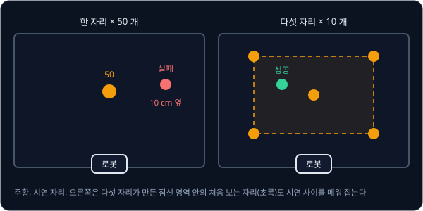

# Teleop Dataset

## 학습 목표

- 사람이 로봇 팔을 원격으로 조종하는 세 방법(똑같이 생긴 조종용 팔, 게임 조종기, 키보드)이 각각 무엇을 읽어 로봇 명령으로
  바꾸는지 비교할 수 있다
- 시연 한 번을 기록하면 짧은 순간마다 카메라 사진, 관절 각도, 로봇에게 보낸 명령, 시각이 어떻게 쌓이는지 시간 순서의 표로 적을
  수 있다
- 1초에 30 번 찍는 카메라와 1초에 100 번 읽는 관절 센서의 기록을 같은 시각끼리 짝짓고, 짝이 어긋나면 각도가 몇 도 틀리는지
  계산할 수 있다
- 머뭇거린 시연, 실패한 시연, 사람마다 다르게 한 시연이 학습한 로봇의 동작을 어떻게 망치는지 평균 계산으로 보일 수 있다
- 물체를 여러 자리에 골고루 놓고 시연을 모아야 하는 이유와, 간단한 집기 작업에서 시연 수를 어디서부터 시작하는지 설명할 수 있다
- 로봇 학습 데이터를 저장하는 공통 형식이 표, 영상, 설명 파일에 각각 무엇을 담는지 설명할 수 있다

## 시연을 모으는 teleoperation

### 시연 데이터가 필요한 이유

[Behavior Cloning](../behavior-cloning/README.md) 에서는 사람이 직접 해 보인 기록을 정답으로 삼아 로봇이 따를 규칙을 학습했다.
사람이 직접 해 보이는 것을 시연(demonstration)이라 하고, 시연을 보여 주는 사람을 expert 라고 불렀다. 시연 기록은 짧은 순간마다
"그때 로봇이 본 것" 과 "그때 사람이 낸 명령" 이 짝을 이룬 목록이었다. 앞의 것을 관측(observation), 뒤의 것을 action 이라고 했고,
관측을 받아 action 을 내는 규칙을 policy 라고 했다.

[MuJoCo Simulation](../mujoco-sim/README.md) 의 팔은 사람이 짠 계산 규칙(controller)을 따라 목표 각도로 움직였다. "컵을 집어 상자에
넣어라" 같은 작업은 그런 규칙을 손으로 짜기 어렵다. 컵이 어디 있는지 사진에서 찾고, 어느 방향에서 다가가 얼마나 세게 쥘지를 모두
식으로 적어야 하기 때문이다. behavior cloning 은 그 대신 사람이 로봇을 움직이는 모습을 기록해 그대로 배우게 한다. 그러려면 먼저
사람이 로봇 팔을 손쉽게 움직일 방법이 있어야 하고, 움직이는 동안 무엇을 어떻게 남길지를 정해야 한다. 이 강의는 그 두 가지를
다룬다.

**확인 문제.** 시연 기록에서 "관측" 과 "action" 은 각각 누구의 무엇일까?

답 보기

관측은 그 순간 로봇이 센서로 받은 값(카메라 사진, 관절 각도)이고, action 은 그 순간 사람이 로봇에게 내린 명령이다. 학습할 policy 는
나중에 관측을 받아 사람이 냈던 action 을 따라 내야 한다.

### teleoperation

사람이 떨어진 곳에서 장치를 조작해 로봇을 움직이는 것을 teleoperation 이라고 한다. tele 는 "멀리", operation 은 "조작" 이라는
뜻이고, 줄여서 teleop 이라고도 쓴다. 텔레비전(멀리 보기), 전화기를 뜻하는 telephone(멀리 소리 내기)과 같은 tele 다. 사람이 쥐고
움직이는 장치를 입력 장치라고 부른다.

로봇 팔은 관절(joint)이 여러 개 이어진 구조다. 이 강의의 팔은 SO-101 이라는 작은 팔로, 관절 5 개와 물건을 쥐는 집게(gripper) 1 개에
각각 모터가 달려 있어 숫자 6 개로 자세가 정해진다. SO-101 의 관절은 아래부터 차례로 좌우 회전, 어깨, 팔꿈치, 손목 꺾기, 손목 돌리기이고
여섯째 숫자가 집게의 벌림이다. 로봇 팔이 받는 명령은 이 6 개의 목표 각도다. 그래서 어떤 입력 장치를 쓰든 장치가 내는 값을 결국
"관절 6 개의 목표 각도" 로 바꿔야 한다.

입력 장치는 크게 두 갈래다. 관절 각도를 직접 내는 장치가 있고, "집게 끝을 어느 쪽으로 얼마나 옮길지" 를 내서 한 번 더 계산을 거쳐야
하는 장치가 있다. 아래에서 하나씩 본다.

**확인 문제.** 입력 장치가 키보드든 조종용 팔이든 로봇 팔에 보내는 명령은 숫자 몇 개일까?

답 보기

관절 5 개와 집게 1 개의 목표 각도라 6 개다.

### leader-follower 팔

가장 직관적인 방법은 로봇 팔과 똑같이 생긴 작은 팔을 하나 더 두는 것이다. 사람이 손으로 잡고 움직이는 팔을 leader(이끄는 쪽),
그 움직임을 따라 하는 로봇 팔을 follower(따르는 쪽)라고 부른다. leader 팔의 관절에도 각도를 재는 센서가 있어서, 짧은 순간마다
leader 의 관절 각도 6 개를 읽어 follower 의 목표 각도로 보낸다. 2023년 ALOHA 는 이 방식으로 양손 작업 시연을 모았고, SO-101 도
leader 와 follower 를 한 쌍으로 쓰도록 만든 팔이다.

숫자로 보면 단순하다. 사람이 leader 의 어깨를 30° 로 들면 follower 의 어깨 목표 각도도 30° 다. 다만 두 팔의 센서가 0° 로 읽는
자세가 조금 다를 수 있다. leader 가 20° 로 읽을 때 follower 는 같은 자세에서 25° 로 읽는다면, 목표 각도는 leader 각도에 5° 를
더해 정한다.

| leader 어깨 각도 | 더할 값 | follower 어깨 목표 각도 |
| --- | --- | --- |
| 20° | +5° | 25° |
| 30° | +5° | 35° |
| 40° | +5° | 45° |

이처럼 두 기준이 어긋난 만큼을 offset 이라고 한다. 관절마다 offset 을 한 번 재어 두면 그 뒤로는 더하기 한 번으로 끝난다. 어떤
관절은 돌아가는 방향이 반대로 달려 있어서 부호를 뒤집어야 하기도 한다.

leader 팔은 사람이 로봇과 같은 모양의 팔을 직접 쥐고 움직이므로, 손목을 비틀거나 팔꿈치를 접는 동작을 생각한 그대로 할 수 있다.
ALOHA 논문은 VR 조종기를 쥐고 움직이는 방식보다 관절 각도를 그대로 옮기는 방식이 정밀한 작업에서 더 잘 됐다고 적었다. 대신
로봇마다 같은 모양의 leader 팔을 한 대 더 만들어야 한다.

**확인 문제.** 손목 관절의 offset 이 $-10$° 이다. 사람이 leader 손목을 50° 로 꺾으면 follower 손목의 목표 각도는?

답 보기

$50 + (-10) = 40$° 다.

### 게임패드와 키보드

leader 팔이 없으면 게임패드(게임기 조종기)나 키보드로도 조종할 수 있다. 이 장치들은 관절 각도를 내지 않고 "집게 끝을 어느 쪽으로
얼마나 옮길지" 를 낸다. 로봇 팔의 맨 끝, 곧 물건에 닿는 부분을 end-effector 라고 부른다. end 는 "끝", effector 는 "일을 하는 부분"
이라는 뜻이고, 이 팔에서는 집게 끝이다.

키보드로 예를 들자. 오른쪽 화살표 키를 누르고 있는 동안, 짧은 순간마다 end-effector 를 오른쪽으로 5 mm 씩 옮기도록 정했다고 하자.
이 짧은 순간이 1초에 30 번 돌아오면 1초에 옮기는 거리는 $5 \times 30 = 150$ mm, 곧 15 cm 다. 키를 2초 누르면 30 cm 를 간다. 게임패드의
막대(stick)는 기울인 정도를 0 에서 1 사이 숫자로 알려 주므로, 절반만 기울였을 때 $5 \times 0.5 = 2.5$ mm 씩 옮기게 하면 1초에
7.5 cm 로 천천히 움직인다.

그런데 로봇 팔이 받는 명령은 관절 각도다. "집게 끝을 5 mm 오른쪽으로" 를 "어느 관절을 몇 도" 로 바꾸는 계산을 IK(inverse
kinematics, 역기구학)라고 한다. 관절 각도에서 집게 끝 위치를 구하는 쪽이 forward kinematics 이고, 그 반대 방향이라서 inverse 가
붙었다. 자세한 계산은 [Inverse Kinematics](../inverse-kinematics/README.md) 에서 다룬다. 간단한 경우만 숫자로 보자. 집게 끝이 첫째
관절(좌우 회전)에서 30 cm 떨어져 있으면, 첫째 관절이 한 바퀴 360° 돌 때 집게 끝은 둘레 $2 \times 3.14 \times 300 \approx 1885$ mm 를
간다. 1° 에는 $1885 \div 360 \approx 5.2$ mm 이므로 5 mm 를 옮기려면 첫째 관절을 1° 조금 못 미치게 돌리면 된다.

**확인 문제.** 짧은 순간마다 4 mm 씩 옮기고, 그 순간이 1초에 30 번 온다. 키를 3초 누르면 집게 끝은 몇 cm 움직일까?

답 보기

1초에 $4 \times 30 = 120$ mm 이고, 3초면 $120 \times 3 = 360$ mm, 곧 36 cm 다.

### 세 입력 장치의 비교

세 장치는 사람이 무엇을 조작하는지가 다르고, 그 차이가 시연의 모양에 남는다.

위 그림은 세 입력 장치가 내는 값과 그 값이 관절 목표 각도로 바뀌는 길을 보여 준다. 위쪽 길은 장치가 관절 각도를 직접 내고, 아래쪽
두 길은 end-effector 이동량을 낸 뒤 IK 계산을 거친다.

| 입력 장치 | 장치가 내는 값 | 관절 목표 각도로 바꾸는 법 | 장점 | 단점 |
| --- | --- | --- | --- | --- |
| leader 팔 | leader 관절 각도 6 개 | 관절마다 offset 과 부호만 맞춘다 | 손목 비틀기 같은 복잡한 동작도 손으로 한 그대로 나온다 | 같은 모양 팔이 한 대 더 필요하다 |
| 게임패드 | 막대 기울기(집게 끝 이동량) | IK 로 관절 각도 변화를 구한다 | 흔한 장치이고 속도를 막대 기울기로 조절한다 | 여러 방향을 동시에 맞추기 어렵다 |
| 키보드 | 키 누름(정해진 이동량) | IK 로 관절 각도 변화를 구한다 | 장치가 따로 필요 없다 | 움직임이 5 mm 씩 끊기고 한 번에 한두 방향만 움직인다 |

키보드로 모은 시연은 움직임이 계단처럼 끊기고 속도가 늘 같다. 사람이 대각선으로 가고 싶어도 오른쪽 키와 위쪽 키를 번갈아 누르기
쉬워서 길이 지그재그가 된다. leader 팔로 모은 시연은 사람 팔처럼 부드럽게 빨라졌다가 느려진다. policy 는 시연을 그대로 따라
배우므로, 키보드 시연으로 학습한 policy 는 지그재그를, leader 팔 시연으로 학습한 policy 는 부드러운 움직임을 따라 한다. 2018년의
RoboTurk 는 스마트폰을 손에 쥐고 움직이면 그 움직임대로 end-effector 를 옮기는 방식으로 여러 사람에게서 시연을 모았는데, 이것도
end-effector 이동량을 내는 쪽에 속한다.

**확인 문제.** 컵을 대각선 방향으로 30 cm 떨어진 곳에 옮기는 시연을 키보드로 모았다. 학습한 policy 의 움직임에는 어떤 특징이
남을까?

답 보기

키를 번갈아 누른 지그재그 길과 일정한 속도가 시연에 남고, policy 는 시연을 따라 배우므로 그 지그재그 움직임도 따라 한다.

**요약**

- teleoperation 은 사람이 입력 장치로 로봇을 원격 조종하는 것이고, 어떤 장치든 결국 관절 6 개의 목표 각도를 만든다
- leader 팔은 관절 각도를 offset 만 더해 그대로 옮기고, 게임패드와 키보드는 end-effector 이동량을 IK 로 관절 각도로 바꾼다
- 입력 장치의 버릇(지그재그, 끊김, 부드러움)이 시연에 남고 policy 가 그것까지 배운다

## episode 에 기록되는 것

### episode 와 frame

시연을 처음부터 끝까지 한 번 한 것을 episode 라고 했다. "컵을 집어 상자에 넣기" 를 한 번 하면 episode 하나다. 기록 장치는 episode
동안 일정한 간격으로 그 순간의 값을 한 묶음씩 남긴다. 이 한 묶음을 frame 이라고 부른다. 원래 frame 은 영화 필름의 한 칸, 곧 정지
사진 한 장을 뜻하는 말인데, 로봇 기록에서는 사진에 더해 그 순간의 관절 각도와 명령까지 함께 묶은 것을 가리킨다.

1초에 frame 을 몇 개 남기는지를 fps(frames per second)로 적는다. 1초에 몇 번 일어나는지를 세는 단위 Hz(헤르츠)와 같은 뜻이라서
30 fps 는 30 Hz 와 같다. 30 fps 로 기록하면 frame 사이 간격은 $1 \div 30 \approx 0.0333$ 초, 곧 33.3 ms 다. ms 는 millisecond 로 1000 분의
1 초다. 10 초짜리 episode 는 $10 \times 30 = 300$ frame 이다.

frame 에는 0 부터 번호를 붙인다. $k$ 번째 frame 의 시각은 episode 를 시작한 때부터 잰

$$
t_k = \frac{k}{\text{fps}}
$$

초다. 이 식은 "frame 번호 $k$ 를 fps 로 나누면 그 frame 의 시각이 된다" 로 읽는다. 30 fps 에서 frame 3 은 $3 \div 30 = 0.1$ 초, frame
57 은 $57 \div 30 = 1.9$ 초다. 이렇게 기록에 붙인 시각을 timestamp 라고 부른다. time 은 시각, stamp 는 도장이라서 "시각 도장" 이라는
뜻이다.

**확인 문제.** 20 fps 로 기록한 8 초짜리 episode 는 frame 이 몇 개이고, frame 30 의 timestamp 는 몇 초일까?

답 보기

$8 \times 20 = 160$ frame 이고, frame 30 의 timestamp 는 $30 \div 20 = 1.5$ 초다.

### frame 하나의 내용

frame 하나에는 아래 값이 들어간다.

- **카메라 사진** — 카메라마다 한 장. 가로 640 칸, 세로 480 칸 사진이면 칸(pixel) 하나의 색을 빨강·초록·파랑 밝기 세 숫자로 적으므로
  $480 \times 640 \times 3 = 921{,}600$ 개의 숫자다. 책상 전체를 보는 고정 카메라와 집게 근처를 보는 손목 카메라 두 대를
  쓰는 일이 많은데, 고정 카메라는 "책상 어디에 컵이 있나" 를, 손목 카메라는 "마지막 몇 cm 를 어떻게
  맞추나" 를 보여 준다
- **관절 상태(state)** — 그 순간 follower 관절 6 개의 각도. 로봇이 자기 몸을 잰 값이라서 사진과 함께 관측에 들어간다
- **action** — 그 순간 follower 에게 보낸 목표 각도 6 개. leader 팔로 조종했다면 offset 을 더한 leader 의 각도다
- **timestamp** — 그 frame 의 시각
- **task** — "빨간 컵을 집어 상자에 넣어라" 처럼 이 episode 에서 한 작업을 적은 짧은 문장. 한 episode 안에서는 모든 frame 이 같은
  문장을 가진다

task 문장은 한 dataset 에 작업이 여러 가지일 때 쓸모가 있다. 같은 책상에서 episode 30 개는 "빨간 컵을 상자에", 30 개는 "파란 컵을
상자에" 를 했다면, 사진과 관절 상태만으로는 지금 어느 컵을 집어야 하는지 알 수 없다. 문장도 함께 받는 policy 라야 두 작업을 구별해
배울 수 있다. 사진과 글 명령을 함께 받아 action 을 내는 VLA(vision-language-action) 모델이 이 문장을 입력으로 쓴다.

관절 상태와 action 은 둘 다 관절 각도 6 개라서 헷갈리기 쉽다. 상태는 "지금 팔이 실제로 있는 곳" 이고 action 은 "이제 가라고 보낸
곳" 이다. 모터가 목표에 닿는 데 시간이 걸리므로 두 값은 대개 조금 다르다.

**확인 문제.** 가로 320 칸, 세로 240 칸 사진은 숫자가 몇 개일까?

답 보기

$240 \times 320 = 76{,}800$ 칸이고 칸마다 3 개라 $76{,}800 \times 3 = 230{,}400$ 개다. $480 \times 640$ 사진의 정확히 4 분의 1 이다.

### 시간축 표

어깨 관절 하나만 보며 frame 다섯 개를 적어 보자. 사람이 leader 를 1초에 30° 빠르기로 들어 올리고 있어서, frame 하나(33.3 ms) 동안
어깨가 1° 씩 올라간다고 하자.

| frame $k$ | timestamp $t_k$ (초) | 사진 | 관절 상태: 어깨 (°) | action: 어깨 목표 (°) |
| --- | --- | --- | --- | --- |
| 0 | 0.000 | 사진 0 | 10 | 11 |
| 1 | 0.033 | 사진 1 | 11 | 12 |
| 2 | 0.067 | 사진 2 | 12 | 13 |
| 3 | 0.100 | 사진 3 | 13 | 14 |
| 4 | 0.133 | 사진 4 | 14 | 15 |

frame 0 에서 팔은 10° 에 있고 사람은 11° 로 가라는 명령을 보냈다. 그 명령대로 움직인 결과가 frame 1 의 상태 11° 다. 표를 대각선으로
읽으면 frame $k$ 의 action 이 frame $k+1$ 의 상태와 같다.

실제 모터는 명령을 받자마자 목표에 닿지 못하고 조금 늦게 따라간다. 숫자만 바꿔, 모터가 목표에 닿는 데 frame 두 개가 걸린다고 하자.
그러면 frame $k$ 의 action 이 frame $k+2$ 의 상태가 된다.

| frame $k$ | action: 어깨 목표 (°) | 관절 상태: 어깨 (°) | action − 상태 (°) |
| --- | --- | --- | --- |
| 0 | 11 | 10 | 1 |
| 1 | 12 | 10 | 2 |
| 2 | 13 | 11 | 2 |
| 3 | 14 | 12 | 2 |
| 4 | 15 | 13 | 2 |

frame 2 의 상태 11° 는 frame 0 에 보낸 목표이고, frame 3 의 상태 12° 는 frame 1 에 보낸 목표다. 팔이 일정한 빠르기로 움직이는 동안
상태는 action 보다 늘 2° 뒤처진다. 늦게 따라가든 바로 따라가든 "지금의 action 이 다음 순간들의 상태를 만든다" 는 순서는 같다.

**확인 문제.** 첫째 표(모터가 바로 따라가는 경우)에서 사람이 frame 2 부터 들어 올리기를 멈추고 어깨를 그대로 두었다면 frame 2·3·4 의 action 은 몇 도일까?

답 보기

frame 2 의 상태가 12° 이고 더 올리지 않으므로 action 은 12°, 12°, 12° 다. 그러면 frame 3·4 의 상태도 12° 에 머문다.

### 관측과 action 의 순서

frame $k$ 의 관측은 action 을 보내기 **전에** 잰 값이다. 기호로 쓰면 frame $k$ 에는 관측 $o_k$ 와 action $a_k$ 가 짝으로 들어가고,
$o_k$ 는 "$a_k$ 를 보내기 직전의 사진과 관절 상태" 다. 학습할 policy 는 실행 때 지금 보이는 것만 받아 다음 명령을 정해야 하므로,
학습 데이터도 "명령 전에 본 것 → 그때 보낸 명령" 의 짝이어야 한다.

이 순서가 한 칸 밀리면 어떻게 될까? 기록할 때 실수로 action 을 먼저 보내고 그 결과를 관측으로 적었다고 하자. 위 표로 치면 상태
11° 와 action 11° 가 한 frame 에 들어간다. 이 데이터로 학습한 policy 는 "지금 각도를 그대로 내라" 를 배워서, 실행 때 팔이 10° 에서
움직이지 않는다. 기록 안에서는 이미 일어난 움직임을 보고 그 움직임을 맞히면 되니 학습이 얼마나 틀렸는지를 나타내는 loss 는 낮게
나오는데, 실제로 돌려 보면 쓸모가 없다.

**확인 문제.** 순서가 밀린 데이터에서 어깨 상태가 13° 인 frame 의 action 은 몇 도로 적혀 있을까? 그 데이터로 학습한 policy 는
어깨가 13° 일 때 몇 도를 낼까?

답 보기

결과를 관측으로 적었으니 상태 13° 와 action 13° 가 짝이다. policy 도 13° 를 내서 팔이 제자리에 머문다. 올바른 기록이었다면
상태 13° 의 짝은 14° 다.

**요약**

- episode 는 시연 한 번이고, 그 안에 fps 로 정한 간격마다 frame 이 쌓인다. frame $k$ 의 timestamp 는 $k / \text{fps}$ 초다
- frame 하나에는 카메라 사진, 관절 상태, action, timestamp, task 문장이 들어간다
- frame $k$ 의 관측은 action $a_k$ 를 보내기 전의 값이고, $a_k$ 가 다음 frame 의 상태를 만든다

## 카메라와 관절 기록의 시간 맞추기

### 서로 다른 주기

센서마다 값을 내는 빠르기가 다르다. 흔한 USB 카메라는 1초에 30 장(30 Hz)을 찍고, 관절 모터는 각도를 1초에 100 번(100 Hz) 이상
알려 주기도 한다. 30 Hz 카메라는 33.3 ms 마다, 100 Hz 관절 센서는 10 ms 마다 새 값을 낸다. 둘을 한 frame 에 넣으려면 "같은 순간"
의 값끼리 골라 짝지어야 한다.

| 카메라 사진 번호 | 찍힌 시각 (ms) | 관절 값이 나온 시각 가운데 가장 가까운 것 (ms) | 시각 차이 (ms) |
| --- | --- | --- | --- |
| 0 | 0 | 0 | 0 |
| 1 | 33.3 | 30 | 3.3 |
| 2 | 66.7 | 70 | 3.3 |
| 3 | 100 | 100 | 0 |
| 4 | 133.3 | 130 | 3.3 |

관절 값은 0, 10, 20, 30, … ms 에 나오므로, 사진이 찍힌 시각에서 가장 가까운 관절 값을 고르면 차이는 아무리 커도 10 ms 의 절반인
5 ms 다. 이렇게 짝을 고르고 나면 1초에 나온 관절 값 100 개 가운데 30 개만 frame 에 들어가고 나머지 70 개는 쓰지 않는다. frame 의
빠르기는 가장 느린 센서인 카메라에 맞춘다.

**확인 문제.** 카메라가 25 Hz, 관절 센서가 100 Hz 다. 사진 1·2 는 몇 ms 에 찍히고, 가장 가까운 관절 값과의 차이는 각각 얼마일까?

답 보기

카메라는 $1000 \div 25 = 40$ ms 마다 찍으므로 사진 1 은 40 ms, 사진 2 는 80 ms 다. 관절 값도 40 ms, 80 ms 에 나오므로 차이는 둘 다 0 이다.
40 이 10 으로 나누어떨어져서 생긴 일이다.

### 시간 어긋남이 만드는 오차

짝이 몇 ms 어긋나면 각도는 얼마나 틀릴까? 어깨가 1초에 60° 빠르기로 돌고 있다고 하자. 1 ms 동안에는 $60 \div 1000 = 0.06$° 를 돈다.

| 시각 어긋남 | 계산 | 각도 오차 |
| --- | --- | --- |
| 3.3 ms | $0.06 \times 3.3$ | 약 0.2° |
| 33.3 ms (frame 1 개) | $0.06 \times 33.3$ | 약 2° |
| 100 ms (frame 3 개) | $0.06 \times 100$ | 6° |

가장 가까운 값을 골라 생기는 3.3 ms 의 어긋남은 0.2° 라서 문제가 되지 않는다. 큰 어긋남은 사진이 찍힌 시각을 잘못 알 때 생긴다.
카메라 사진은 찍힌 뒤 컴퓨터에 도착하기까지 시간이 걸리는데, 도착한 시각을 찍힌 시각으로 적으면 사진은 실제보다 늦은 순간의 것으로
기록된다. 이렇게 신호가 늦게 도착하는 시간을 latency(지연 시간)라고 한다. latency 가 100 ms 인 카메라의 사진을 도착 시각으로
적으면, 사진 속 팔은 같은 frame 의 관절 상태보다 6° 덜 올라간 100 ms 전의 자세다.

6° 는 얼마나 클까? 집게 끝이 관절에서 30 cm 떨어져 있으면, 앞에서처럼 1° 에 약 5.2 mm 이므로 6° 는 약 3.1 cm 다. policy 는 "사진에서
팔이 이만큼 와 있을 때 이 명령을 낸다" 를 배우는데, 사진과 각도가 3 cm 어긋난 짝으로 배우면 실행 때 컵을 3 cm 빗나가 집기 쉽다.

**확인 문제.** 손목이 1초에 90° 빠르기로 돌고 있다. 사진의 시각이 20 ms 어긋나면 손목 각도는 몇 도 틀릴까?

답 보기

1 ms 에 $90 \div 1000 = 0.09$° 이므로 $0.09 \times 20 = 1.8$° 다.

### 한 시계로 맞춘 기록

어긋남을 막는 가장 단순한 방법은 기록을 시계 하나로 돌리는 것이다. 기록 장치는 frame 마다 아래 일을 차례로 하고, 다음 frame 의
시각까지 기다렸다가 되풀이한다.

1. 카메라의 가장 최근 사진과 관절의 가장 최근 각도를 읽는다(관측)
2. 입력 장치를 읽어 관절 목표 각도를 만든다(action)
3. action 을 follower 에게 보낸다
4. 관측, action, task 문장을 frame 하나로 저장한다
5. 시작한 지 $1 / \text{fps}$ 초가 될 때까지 기다린다

이렇게 한 번 도는 것을 loop 라고 한다. loop 하나가 33.3 ms 안에 끝나야 30 fps 가 지켜진다. 사진 저장이 밀려 어떤 frame 이 50 ms
걸리면, 그 뒤 frame 의 실제 시각과 $k / 30$ 으로 적은 timestamp 가 어긋난다.

| frame $k$ | 적힌 timestamp $k/30$ (ms) | 실제 시각 (ms) | 어긋남 (ms) |
| --- | --- | --- | --- |
| 0 | 0 | 0 | 0 |
| 1 | 33.3 | 33.3 | 0 |
| 2 | 66.7 | 83.3 | 16.7 |
| 3 | 100 | 116.7 | 16.7 |

frame 1 에서 frame 2 로 가는 데 50 ms 가 걸려 16.7 ms 가 밀렸고, 그 뒤로는 밀린 만큼이 그대로 남는다. 그래서 기록을 마친 뒤에는
loop 의 실제 주기를 재서 목표 주기에서 크게 벗어나지 않았는지 확인한다. 예를 들어 33.3 ms 의 ±10%, 곧 30 ms 에서 36.7 ms 사이에
들면 괜찮다고 정할 수 있다.

**확인 문제.** 위 표에서 frame 3 에서 frame 4 로 가는 데 다시 50 ms 가 걸렸다. frame 4 의 적힌 timestamp, 실제 시각, 어긋남은?

답 보기

적힌 timestamp 는 $4 \div 30 \times 1000 \approx 133.3$ ms, 실제 시각은 $116.7 + 50 = 166.7$ ms 라서 어긋남은 33.3 ms, frame 하나만큼이다.

### simulation 에서의 시간 맞추기

simulation 에서 시연을 모을 때도 같은 문제가 있다. MuJoCo 같은 physics engine 은 정해진 짧은 시간 간격(timestep)마다 한 step 씩
계산을 진행했다. SO-101 모델의 timestep 은 5 ms 다. 30 fps 로 기록하려면 frame 하나마다 simulation(줄여서 sim)을 33.3 ms 진행해야 하는데,
$33.3 \div 5 \approx 6.67$ 이라 step 수가 정수로 떨어지지 않는다. 계산을 frame 마다 6 step 만 하면 어떻게 될까?

| 항목 | frame 하나 | frame 300 개 |
| --- | --- | --- |
| 적힌 timestamp | 33.3 ms | $300 \div 30 = 10$ 초 |
| sim 이 실제로 진행한 시간 | $6 \times 5 = 30$ ms | $300 \times 0.03 = 9$ 초 |

기록에는 10 초로 적혔지만 팔은 9 초 동안의 움직임만 했다. 이 기록을 실물 팔에서 30 fps 로 따라 하면 frame 마다 33.3 ms 가 걸려
같은 움직임에 10 초가 걸리므로, 시연보다 느리게 움직이고 중력이나 관성이 작용하는 시간도 달라진다. 그래서 fps 와 timestep 을 frame
하나가 정수 step 이 되도록 고른다. 25 fps 면 frame 하나가 40 ms 라 정확히 8 step 이고, 40 fps 면 25 ms 라 정확히 5 step 이다.

**확인 문제.** timestep 이 2 ms 다. 50 fps 로 기록하면 frame 하나마다 몇 step 을 계산하면 될까?

답 보기

50 fps 의 frame 간격은 $1000 \div 50 = 20$ ms 이고 $20 \div 2 = 10$ step 이다. 정수로 떨어지므로 시각이 어긋나지 않는다.

**요약**

- 카메라(30 Hz)와 관절 센서(100 Hz)는 주기가 달라서, frame 마다 사진 시각에 가장 가까운 관절 값을 짝짓는다. 이때 차이는 5 ms 를
  넘지 않는다
- 사진 시각을 잘못 적으면(latency 100 ms) 1초에 60° 도는 팔에서 6°, 집게 끝으로 약 3 cm 가 어긋난 짝을 배운다
- 기록은 시계 하나의 loop 로 돌리고 실제 주기를 확인한다. simulation 에서는 frame 하나가 정수 개의 physics step 이 되게 fps 를 고른다

## 시연 데이터의 품질

behavior cloning 은 policy 의 출력과 시연 action 의 차이(오차)를 제곱해 평균한 값, 곧 MSE(mean squared error)가 가장 작아지도록
policy 를 학습한다. 평균은 모두 더해 개수로 나눈 값이다. Behavior Cloning 에서 계산했듯이 같은 관측에 시연 action 이 여러 개 있으면
MSE 를 가장 작게 만드는 출력은 그 action 들의 평균이다. 아래 세 절의 문제는 모두 이 성질에서 나온다.

### 머뭇거림

사람이 시연하다 보면 집게를 컵 위에 가져간 뒤 "어디로 내려야 하지?" 하며 잠깐 멈추기도 한다. 멈춘 동안에도 기록은 1초에 30
frame 씩 쌓이고, 그 frame 들의 action 은 "그대로 있어라" 다.

"집게가 컵 바로 위에 있는" 장면을 시연 10 개에서 모아 보자. 7 개는 머뭇거리지 않아서 이 장면이 frame 2 개 동안만 이어졌고, 그동안
집게를 frame 마다 1 cm 씩 내렸다. 3 개는 1초를 멈춰서 이 장면이 frame 30 개 동안 이어졌고, 그동안 집게를 움직이지 않았다.

| 시연 종류 | 시연 수 | 이 장면의 frame 수 | action: frame 마다 내리는 거리 (cm) |
| --- | --- | --- | --- |
| 바로 내림 | 7 | $7 \times 2 = 14$ | 1 |
| 1초 멈춤 | 3 | $3 \times 30 = 90$ | 0 |

같은 장면의 frame 이 모두 $14 + 90 = 104$ 개이고, policy 는 그 action 들의 평균을 배운다.

$$
\frac{14 \times 1 + 90 \times 0}{104} = \frac{14}{104} \approx 0.13 \text{ cm}
$$

머뭇거린 시연은 10 개 중 3 개뿐이었지만 frame 수로는 104 개 중 90 개를 차지해서, policy 는 frame 마다 0.13 cm, 바로 내린 시연의
7 분의 1 도 안 되는 빠르기로 내려간다. 게다가 집게가 거의 움직이지 않으면 다음 frame 의 관측도 거의 같아서, policy 는 다시 같은
장면을 보고 다시 거의 멈추라는 action 을 낸다. 그래서 실행해 보면 집게가 컵 위에서 한참 머문다. ALOHA 논문도 시연
중의 멈춤은 지금 관측 하나만 보고 다음 action 하나를 내는 policy 가 따라 하기 어렵다고 적었다.

**흔한 오해.** 시연 10 개 중 3 개만 머뭇거렸으니 영향도 30% 쯤일 것이라고 생각하기 쉽다. policy 는 시연이 아니라 frame 을 하나씩
정답으로 쓰므로, 오래 멈춘 시연일수록 더 많은 정답을 차지한다. 그래서 시연은 망설임 없이 일정한 빠르기로 하고, 시작 전과 끝난
뒤에 가만히 있는 구간도 길게 남기지 않는다.

이미 모은 시연이라면 멈춘 구간을 잘라 내는 방법도 있다. 같은 예에서 멈춘 시연 3 개의 정지 구간을 30 frame 에서 3 frame 으로 줄이면
계산이 아래처럼 바뀐다.

| 시연 종류 | 이 장면의 frame 수 | action (cm) |
| --- | --- | --- |
| 바로 내림 7 개 | $7 \times 2 = 14$ | 1 |
| 멈춤 3 개 (잘라 낸 뒤) | $3 \times 3 = 9$ | 0 |

평균은 $14 \times 1 \div (14 + 9) = 14 \div 23 \approx 0.61$ cm 로, 0.13 cm 보다 바로 내린 시연 쪽으로 훨씬 가까워진다.

**확인 문제.** 같은 장면에서 시연 8 개는 frame 2 개 동안 1 cm 씩 내렸고, 시연 2 개는 frame 12 개 동안 멈췄다. policy 가 배우는
평균은?

답 보기

내린 frame 은 $8 \times 2 = 16$ 개, 멈춘 frame 은 $2 \times 12 = 24$ 개라 모두 40 개다. 평균은 $16 \times 1 \div 40 = 0.4$ cm 다.

### 실패한 시연

사람도 실수한다. 집게를 너무 높은 곳에서 닫아 컵을 놓치거나, 컵을 쳐서 넘어뜨리기도 한다. 실패한 episode 를 지우지 않고 남기면
policy 는 그 실수도 정답으로 배운다.

컵을 집는 시연 50 개에서 집게를 닫은 높이를 보자. 45 개는 컵 바닥에서 2 cm 높이에서 닫아 성공했고, 5 개는 6 cm 높이에서 닫아
컵을 놓쳤다. 집게를 닫는 순간의 높이를 policy 가 배운다면

$$
\frac{45 \times 2 + 5 \times 6}{50} = \frac{90 + 30}{50} = \frac{120}{50} = 2.4 \text{ cm}
$$

다. 실패 시연 10% 때문에 집는 높이가 0.4 cm 위로 끌려 올라갔다. 실패가 10 개(20%)면 $(40 \times 2 + 10 \times 6) \div 50 = 140 \div 50 = 2.8$ cm
로 더 올라간다. 컵의 잡기 좋은 높이가 좁을수록 이 차이로 성공과 실패가 갈린다.

그래서 실패한 episode 는 그 자리에서 지우고 다시 찍는다. 다만 컵을 놓쳤다가 다시 집어 끝내 성공한 시연은 "놓쳤을 때 다시
잡는 법" 을 보여 주므로 남겨 두기도 한다. 시연에 없는 상황으로 벗어나면 policy 가 점점 더 틀린다는 compounding error 를
Behavior Cloning 에서 보았는데, 다시 잡는 장면은 그런 벗어난 상황의 정답이 된다.

**확인 문제.** 시연 40 개 중 36 개는 2 cm, 4 개는 7 cm 에서 집게를 닫았다. 모두 남겨 학습하면 몇 cm 에서 닫을까?

답 보기

$(36 \times 2 + 4 \times 7) \div 40 = (72 + 28) \div 40 = 100 \div 40 = 2.5$ cm 다.

### 시연의 일관성

성공한 시연끼리도 방식이 다를 수 있다. 어떤 시연에서는 컵을 위에서 내려와 집고(손목 0°), 어떤 시연에서는 옆에서 다가가 집는다
(손목 90°). 두 방식 모두 옳지만, 같은 장면에서 두 방식이 섞이면 policy 는 평균을 낸다.

| 위에서 집은 시연 (0°) | 옆에서 집은 시연 (90°) | 평균 손목 각도 |
| --- | --- | --- |
| 25 개 | 25 개 | $(25 \times 0 + 25 \times 90) \div 50 = 45$° |
| 40 개 | 10 개 | $(40 \times 0 + 10 \times 90) \div 50 = 18$° |
| 50 개 | 0 개 | 0° |

45° 로 비스듬히 다가간 집게는 위에서도 옆에서도 제대로 잡지 못한다. Behavior Cloning 에서 상자를 왼쪽과 오른쪽으로 피한 시연의
평균이 상자로 돌진하는 0° 였던 것과 같은 일이다. 거기서처럼 같은 관측에 정답 action 이 여럿이라 action 의 분포에 봉우리가 여럿인
것을 multimodal 이라고 했고, 여기서 말하는 multimodal 도 그 뜻이다. 사진과 글을 함께 받는 VLA 모델을 multimodal 모델이라고 부를 때는 받는 입력의
종류가 여럿이라는 다른 뜻이다.

[ACT](../act/README.md) 나 [Diffusion Policy](../diffusion-policy/README.md) 처럼 봉우리 하나를 골라 내는 policy 는 이 문제를 줄여
주지만, 처음 모으는 데이터에서는 한 사람이 한 방식으로 일관되게 시연하는 편이 학습이 훨씬 쉽다. 컵을 늘 위에서, 늘 같은
빠르기로 집는 식이다.

**확인 문제.** 같은 장면에서 손목 0° 시연이 30 개, 60° 시연이 20 개다. MSE 로 학습한 policy 의 손목 각도는?

답 보기

$(30 \times 0 + 20 \times 60) \div 50 = 1200 \div 50 = 24$° 다. 두 방식 어디에도 없는 각도다.

### 카메라와 장면의 조건

policy 는 사진을 보고 action 을 정하므로, 사진이 담는 정보가 시연마다 들쭉날쭉하면 배울 것이 흐려진다. 시연을 모을 때는 아래를
지킨다.

- **카메라 고정** — 시연 내내, 그리고 나중에 policy 를 실행할 때도 카메라를 같은 자리, 같은 방향에 둔다. Behavior Cloning 에서
  카메라가 밀려 사진 속 위치가 50 pixel 바뀌자 관절이 10° 틀렸던 것을 떠올리면 된다
- **물체가 보이는 화면** — 집을 물체가 카메라 화면 안에 들어와야 한다. 사람이 카메라 사진만 보고 그 작업을 할 수 있는지 스스로
  확인해 보면 좋다. 사람이 사진만으로 못 하는 작업은 사진만 받는 policy 도 하기 어렵다
- **움직이는 것은 로봇과 물체뿐** — leader 팔이나 사람의 손·몸이 화면에 들어오지 않게 한다. 실행 때는 사람이 없으므로, 사람의 손을
  보고 움직이는 법을 배우면 쓸모가 없다
- **일정한 조명** — 햇빛이 들어오는 창가처럼 시간에 따라 밝기가 바뀌는 곳은 피한다

**확인 문제.** 시연 때 leader 팔이 고정 카메라 화면 한쪽에 늘 보였다. 실행 때 leader 팔을 치우면 어떤 문제가 생길 수 있을까?

답 보기

policy 는 사진 속 leader 팔의 자세를 단서로 삼아 action 을 정하도록 배웠을 수 있다. 실행 때는 그 단서가 사라져서 시연에서 본 적
없는 사진이 들어오고, action 이 틀어진다.

**요약**

- policy 는 같은 장면에서 시연 action 들의 평균을 배우고, 그 평균은 frame 수로 무게가 매겨진다. 오래 머뭇거린 시연은 frame 을 많이
  차지해 policy 를 느리게 만든다
- 실패한 시연은 평균을 실패 쪽으로 끌어당기므로 지우고 다시 찍는다. 방식이 다른 시연이 섞이면 두 방식 어디에도 없는 평균이 나온다
- 카메라를 고정하고, 물체가 보이게 하고, 사람과 leader 팔이 화면에 들어오지 않게 한다

## 물체 위치의 다양성

### 한 자리에서만 모은 시연

시연 50 개를 모두 책상 한가운데에 컵을 놓고 모았다고 하자. 시연끼리 사진이 거의 같으니 policy 는 이 자리의 컵은 잘 집는다. 그런데
실행 때 컵이 10 cm 오른쪽에 놓이면, 그 자리의 사진은 한 번도 본 적이 없다. Behavior Cloning 의 "시연 범위 밖의 실패" 에서 본 것처럼
숫자를 곱하고 더하는 층을 여러 겹 쌓은 모델인 neural network 는 시연 사이를 메우는 것은 잘하지만 시연 바깥으로 늘려 가는 것은
보장하지 못한다. 시연이 덮지 않은 자리에서 policy 는 무엇을 낼지 알 수 없다.

**확인 문제.** 시연 50 개를 모두 책상 왼쪽 끝 한 자리에서 모았다. 실행 때 컵을 같은 자리에 놓으면 잘 집을까, 책상 가운데에 놓으면
잘 집을까?

답 보기

같은 자리에 놓으면 시연과 거의 같은 사진이라 잘 집는다. 가운데는 시연에 없던 자리라서 policy 가 무엇을 낼지 알 수 없다.

### 골고루 나눈 위치

같은 50 개를 컵 자리 다섯 곳에 10 개씩 나눠 모으면 사정이 달라진다. 다섯 자리가 책상 위에 넓은 영역을 만들고, policy 는 그 영역
안이면 시연 사이를 메워 처음 보는 자리도 집을 수 있다. 로봇 학습 도구 모음인 LeRobot 의 SO-101 안내서도 물체를 여러 자리에서
집어 상자에 넣는 작업을 첫 작업으로 권하며, 자리마다 10 개씩 시연 50 개 이상을 모으라고 적었다.

물체 위치를 바꾸는 것만 다양성은 아니다. 컵 색깔, 조명, 책상 위의 다른 물건도 바꿀 수 있다. 바꾸는 항목이 늘면 조합의 수가 곱으로
는다. 위치 5 곳 × 컵 색 2 가지 × 조명 2 가지면 조합이 $5 \times 2 \times 2 = 20$ 가지이고, 조합마다 10 개씩이면 시연이 200 개 필요하다.
그래서 처음에는 위치만 바꿔 50 개로 시작하고, policy 가 잘 집는 것을 확인한 뒤에 바꾸는 항목을 하나씩 늘린다. 한꺼번에 너무 많이
바꾸면 조합마다 시연이 모자라 어느 조합도 잘 배우지 못한다.

**확인 문제.** 컵 자리 4 곳, 컵 종류 3 가지를 모두 조합해 조합마다 시연을 10 개씩 모으려면 몇 개가 필요할까?

답 보기

조합이 $4 \times 3 = 12$ 가지이고 $12 \times 10 = 120$ 개다.

**요약**

- 한 자리에서만 모은 시연으로 학습한 policy 는 그 자리 밖의 물체를 집지 못한다
- 같은 수의 시연을 여러 자리에 골고루 나누면 그 자리들이 만드는 영역 안을 메울 수 있다. 바꾸는 항목은 하나씩 늘린다

## 필요한 시연 수

### 출발점 50 개

시연이 몇 개면 충분한지는 작업의 어려움, 물체 위치의 범위, policy 의 종류에 따라 달라서 정해진 답이 없다. 다만 컵이나 블록 하나를
집어 옮기는 단순한 작업이라면 50 개 안팎에서 시작하는 것이 흔한 출발점이다. LeRobot 의 안내서는 자리마다 10 개씩 50 개 이상을 권하고,
ALOHA 논문은 작업마다 시연을 50 개씩 모았다(벨크로 끈을 꿰는 작업만 100 개). 이 숫자는 첫 학습을 돌려 보기 위한 출발점이지
어떤 작업에도 맞는 규칙이 아니다.

**흔한 오해.** 시연은 많을수록 무조건 좋다고 생각하기 쉽다. 앞의 손목 예에서 위에서 집은 시연 250 개와 옆에서 집은 시연 250 개를
모아도 평균은 그대로 $(250 \times 0 + 250 \times 90) \div 500 = 45$° 다. 머뭇거림, 실패, 방식 차이가 섞인 시연은 수를 늘려도 같은
비율로 섞여 있으므로 평균이 나아지지 않는다. 일관된 시연 50 개가 들쭉날쭉한 시연 500 개보다 나을 수 있다.

50 개를 모으는 데 드는 시간과 frame 수를 계산해 보자. episode 하나가 8 초이고, 다음 시연을 위해 컵을 제자리에 놓는 데 12 초가
걸린다고 하자.

| 항목 | 계산 | 값 |
| --- | --- | --- |
| episode 하나에 드는 시간 | $8 + 12$ | 20 초 |
| 50 개에 드는 시간 | $50 \times 20 = 1000$ 초 | 약 17 분 |
| episode 하나의 frame 수 (30 fps) | $8 \times 30$ | 240 |
| 50 개의 frame 수 | $50 \times 240$ | 12,000 |

학습에 쓰려고 모아 둔 기록 묶음을 dataset 이라고 한다. 실물 SO-101 로 모은 공개 dataset 인 lerobot/svla_so101_pickplace 는 30 fps 로
episode 50 개에 frame 이 모두 11,939 개라서, episode 하나에 평균 $11{,}939 \div 50 \approx 239$ frame, 곧 8 초쯤이다. 위 계산과 거의 같다.

**확인 문제.** episode 하나가 10 초, 정리에 10 초가 걸린다. 30 fps 로 시연 60 개를 모으면 시간은 몇 분이고 frame 은 몇 개일까?

답 보기

하나에 20 초라 $60 \times 20 = 1200$ 초, 곧 20 분이다. frame 은 $60 \times 10 \times 30 = 18{,}000$ 개다.

### 성공률을 보고 늘리는 방법

50 개로 학습한 policy 를 자리마다 몇 번씩 실행해 보고 성공한 비율을 잰다. 성공한 횟수를 시도한 횟수로 나눈 값을 성공률이라고 한다.

| 컵 자리 | 시도 | 성공 | 성공률 |
| --- | --- | --- | --- |
| A (왼쪽 앞) | 10 | 9 | 90% |
| B (오른쪽 앞) | 10 | 8 | 80% |
| C (가운데) | 10 | 10 | 100% |
| D (왼쪽 뒤) | 10 | 7 | 70% |
| E (오른쪽 뒤) | 10 | 3 | 30% |

전체 성공률은 $(9 + 8 + 10 + 7 + 3) \div 50 = 37 \div 50 = 74\%$ 다. 그런데 표를 자리별로 보면 E 만 유난히 낮다. 이때 모든 자리에 시연을
고르게 더하기보다 E 에 시연을 10 개쯤 더 모아 다시 학습하는 편이 효율적이다. E 가 팔에서 멀어 사진에서 작게 보이거나 팔을 길게
뻗어야 하는 자리라면, 그 자리의 시연이 더 많이 필요할 수 있다.

**확인 문제.** 자리 네 곳에서 10 번씩 실행해 성공이 8, 6, 9, 1 번이었다. 전체 성공률은 얼마이고, 시연을 어디에 더 모을까?

답 보기

$(8 + 6 + 9 + 1) \div 40 = 24 \div 40 = 60\%$ 다. 10 번 중 1 번만 성공한 넷째 자리에 시연을 더 모은다.

**요약**

- 단순한 집기 작업은 시연 50 개 안팎, 자리마다 10 개 정도에서 시작하는 것이 흔한 출발점이다. 작업마다 필요한 수는 다르다
- 학습한 policy 를 자리별로 실행해 성공률을 재고, 낮은 자리에 시연을 더 모은다

## LeRobot dataset 형식

### 공통 형식이 필요한 이유

연구실마다 시연을 다른 방식으로 저장하면, 어떤 곳은 관절 각도를 radian 으로, 어떤 곳은 degree(도, °)로 적는다. radian 은 한 바퀴를
360° 대신 $2\pi \approx 6.28$ 로 재는 각도 단위다. $\pi$ 는 pi(파이)라고 읽고 원의 둘레를 지름으로 나눈 값 약 3.14 이며, 그래서
1 radian 은 $360 \div 6.28 \approx 57.3$° 다. 카메라 이름도 어떤 곳은 "cam0", 어떤 곳은 "front" 로 붙인다. 이렇게 저장 방식이 다르면
남이 모은 데이터로 학습하려 할 때마다 읽는 방법부터 새로 짜야 한다. 2023년 Open X-Embodiment 는 21 개 기관의 로봇 데이터를 한
형식으로 모아 여러 로봇의 데이터로 policy 하나를 학습했다.

**확인 문제.** 연구실 A 는 관절 각도를 radian 으로, 연구실 B 는 degree 로 저장했다. 두 곳의 데이터에 똑같이 "1.0" 이 적혀 있으면
같은 자세일까?

답 보기

아니다. 1 radian 은 약 57.3° 라서 A 의 1.0 은 57.3°, B 의 1.0 은 1° 다. 형식과 단위를 맞추지 않고 섞으면 policy 는 전혀 다른 자세를
같은 숫자로 배운다.

### LeRobotDataset 의 구성

LeRobot 은 Hugging Face 라는 AI 회사가 만든 로봇 학습 도구 모음이고, 시연을 LeRobotDataset 이라는 형식(지금 v3.0)으로 저장한다. 같은 형식으로
저장한 dataset 은 Hugging Face Hub 라는 공개 저장소에 올려 다른 사람과 나누고, 같은 학습 도구로 바로 읽을 수 있다. 이 형식은 기록을
세 종류로 나눠 담는다.

위 그림은 폴더 구조를 보여 준다. `meta` 폴더에는 dataset 을 설명하는 정보, `data` 폴더에는 숫자로 된 표, `videos` 폴더에는 카메라
영상이 들어간다. 아래에서 하나씩 본다.

### 표 데이터

관절 상태, action, timestamp 처럼 frame 마다 숫자 몇 개인 값은 표 하나에 모은다. frame 하나가 표의 한 행(가로줄)이고, 값의 종류마다
한 열(세로줄)이다.

| 전체 번호 | episode 번호 | episode 안의 frame 번호 | timestamp (초) | 관절 상태 (6 개) | action (6 개) | task 번호 |
| --- | --- | --- | --- | --- | --- | --- |
| 0 | 0 | 0 | 0.000 | 10, … | 11, … | 0 |
| 1 | 0 | 1 | 0.033 | 11, … | 12, … | 0 |
| … | … | … | … | … | … | … |
| 297 | 1 | 57 | 1.900 | … | … | 0 |

episode 안의 frame 번호는 episode 마다 0 부터 다시 세고, 전체 번호는 dataset 전체에서 이어진다. timestamp 는 episode 안의 frame 번호를
fps 로 나눈 값이라 $57 \div 30 = 1.9$ 초다. task 문장은 행마다 반복해 적지 않고 번호로 적은 뒤, 번호와 문장을 짝지은 작은 표를 따로
둔다.

이 표는 Parquet 이라는 파일 형식으로 저장한다. Parquet 은 표를 열 단위로 모아 저장하는 형식이라서 "action 열만 읽기" 처럼 필요한
열만 빠르게 꺼낼 수 있다. 관절 6 개 값은 작아서, svla_so101_pickplace 의 frame 11,939 개짜리 표 전체가 약 370 KB 에 불과하다. KB 는
킬로바이트로, byte(바이트)는 0 부터 255 까지의 정수 하나를 담는 저장 단위이고 1 KB 는 약 1000 byte 다.

**확인 문제.** episode 0 이 240 frame, episode 1 이 250 frame 이다. episode 1 의 frame 10 은 전체 번호가 몇이고 timestamp 는 몇 초일까
(30 fps)?

답 보기

episode 0 이 전체 번호 0 부터 239 까지 쓰므로 episode 1 은 240 부터 시작한다. frame 10 은 $240 + 10 = 250$ 번이고, timestamp 는
$10 \div 30 \approx 0.33$ 초다.

### 영상 데이터

카메라 사진은 표에 넣기에 너무 크다. 사진 한 장이 숫자 921,600 개이고 숫자 하나가 1 byte 라서 약 0.92 MB(메가바이트, 약 100 만
byte)다. 30 fps 로 8 초면 240 장, 약 221 MB 이고, svla_so101_pickplace 의 frame 11,939 개를 그대로 저장하면 카메라 하나에 약 11 GB
(기가바이트, 약 10 억 byte)가 된다.

그래서 사진은 MP4 라는 영상 파일 형식으로 압축해 저장한다. 압축은 같은 정보를 더 적은 byte 로 적는 것이다. 이웃한 frame 의 사진은 거의 같아서,
영상은 몇 장마다 한 번만 사진 전체를 적고 그 사이에는 바뀐 부분만 적는다. svla_so101_pickplace 의 실제 영상 파일은 카메라 하나에
40~46 MB 로, 압축하지 않은 11 GB 의 약 250 분의 1 이다. 학습할 때는 표의 timestamp 로 영상에서 그 시각의 사진을 찾아 꺼낸다.

v3.0 에서는 episode 마다 파일을 따로 만들지 않고 여러 episode 를 한 파일에 이어 붙인다. 파일 수가 적어야 수천 개 episode 도 빨리
열 수 있기 때문이다. 그러면 "episode 1 은 파일의 어디부터 어디까지인가" 를 따로 적어 두어야 하고, 이것이 다음 절의 episode 정보다.

**확인 문제.** 영상 파일에 episode 0(240 frame)과 episode 1 이 30 fps 로 이어 붙어 있다. episode 1 의 timestamp 1.9 초 사진은 파일의
몇 초에 있을까?

답 보기

episode 0 이 $240 \div 30 = 8.0$ 초를 차지하므로 episode 1 은 8.0 초에 시작하고, 그 안의 1.9 초는 파일의 $8.0 + 1.9 = 9.9$ 초다.

### 메타데이터

데이터를 설명하는 데이터를 메타데이터(metadata)라고 한다. meta 는 "한 단계 위의" 라는 뜻이다. LeRobotDataset 의 `meta` 폴더에는
아래가 들어 있다.

| 파일 | 담는 정보 | svla_so101_pickplace 의 예 |
| --- | --- | --- |
| info | 형식 버전, fps, 값마다의 이름·개수·숫자 종류, 파일 위치 규칙 | v3.0, 30 fps, action 6 개, 카메라 두 대(480×640×3) |
| stats | 값마다의 최솟값·최댓값·평균·흩어진 정도 | action 과 관절 상태는 숫자 6 개마다 따로 |
| tasks | task 문장과 번호의 짝 | 작업 1 가지 |
| episodes | episode 마다의 길이, task, 표와 영상 파일 안의 시작·끝 위치 | episode 50 개 |

info 파일은 JSON 이라는 글자 형식으로 적힌다. JSON 은 "이름: 값" 짝을 중괄호로 묶어 적는 형식이라서 사람이 열어 읽을 수 있다.
info 의 이름 목록 덕분에 action 의 여섯 숫자가 각각 `shoulder_pan.pos`, `shoulder_lift.pos`, `elbow_flex.pos`, `wrist_flex.pos`,
`wrist_roll.pos`, `gripper.pos`, 곧 좌우 회전, 어깨, 팔꿈치, 손목 꺾기, 손목 돌리기, 집게의 위치라는 것을 알 수 있다.

stats 는 학습 전에 숫자의 크기를 맞추는 데 쓴다. 어떤 관절은 $-90$ 에서 $90$ 사이를 오가고 집게는 0 에서 30 사이만 오간다고 하자.
두 값을 그대로 넣으면 큰 숫자 쪽의 gradient(parameter 를 조금 바꿨을 때 loss 가 변하는 비율)가 커진다.
같은 learning rate(한 번에 고치는 크기)로 고쳐도 큰 숫자 쪽 값이 튀어 오르기
쉽다. 그래서 최솟값과 최댓값으로 모든 값을 $-1$ 에서 $1$ 사이로 옮긴다. 평균과 흩어진 정도로 맞추는 방법도 있다.

$$
x' = 2 \times \frac{x - \min}{\max - \min} - 1
$$

이 식은 "값에서 최솟값을 빼고 범위(최댓값 − 최솟값)로 나누면 0 에서 1 사이가 되고, 거기에 2 를 곱하고 1 을 빼면 $-1$ 에서 $1$ 사이가
된다" 로 읽는다. 관절이 $45$ 이면 $2 \times \frac{45 - (-90)}{90 - (-90)} - 1 = 2 \times \frac{135}{180} - 1 = 1.5 - 1 = 0.5$ 이고, 집게가
15 면 $2 \times \frac{15 - 0}{30 - 0} - 1 = 1 - 1 = 0$ 이다. 이렇게 값의 범위를 맞추는 것을 normalization(정규화)이라고 한다.

**확인 문제.** 범위가 $0$ 에서 $30$ 인 집게 값 $30$ 과 $0$ 은 normalization 뒤에 각각 얼마가 될까?

답 보기

$2 \times \frac{30 - 0}{30} - 1 = 2 - 1 = 1$ 이고, $2 \times \frac{0 - 0}{30} - 1 = 0 - 1 = -1$ 이다. 범위의 양 끝이 $1$ 과 $-1$ 로 간다.

### 실물 데이터와 같은 이름

simulation 에서 시연을 모을 때도 실물 SO-101 dataset 과 같은 이름, 같은 개수, 같은 단위로 저장하면 실물 데이터와 같은 학습 도구로
학습할 수 있다. 예를 들어 sim 은 관절 각도를 radian 으로 계산하는데, 실물 기록이 degree 라면 저장할 때 degree 로 바꿔 둔다. 앞에서 본
것처럼 1 radian 은 약 57.3° 다. 이 변환을 빼먹으면 sim 의 30° 가 $30 \div 57.3 \approx 0.52$ radian 그대로 0.52 로 저장되어, 실물
데이터와 섞었을 때 0.52° 로 읽힌다.

**확인 문제.** sim 에서 어깨가 0.5 radian 이다. degree 로 저장하면 몇 도일까?

답 보기

$0.5 \times 57.3 \approx 28.7$° 다.

**요약**

- LeRobotDataset 은 frame 마다 한 행인 숫자 표(Parquet), 카메라 영상(MP4), 설명 정보(meta)의 세 가지로 시연을 저장한다
- v3.0 은 여러 episode 를 한 파일에 이어 붙이고, episode 마다의 시작·끝 위치를 meta 의 episode 정보에 적는다. 사진은 timestamp 로
  영상에서 찾는다
- meta 에는 fps, 값의 이름과 개수, normalization 에 쓰는 통계, task 문장이 들어간다. 다른 데이터와 섞으려면 이름과 단위를 맞춘다

## replay 로 하는 기록 확인

기록이 제대로 저장됐는지는 replay 로 확인한다. replay 는 기록한 episode 와 같은 처음 상태에서, 저장된 action 만 frame 순서대로
로봇에게 다시 보내는 것이다. policy 처럼 관측을 보고 action 을 고르지 않고 적힌 action 을 그대로 보낸다.

simulation 은 같은 처음 상태에 같은 action 을 넣으면 매번 같은 결과를 낸다. 그래서 sim 시연을 replay 하면 관절 상태가 기록과 거의
그대로 겹쳐야 한다.

| frame | 기록된 어깨 상태 (°) | replay 한 어깨 상태 (°) | 차이 (°) |
| --- | --- | --- | --- |
| 0 | 10.0 | 10.0 | 0.0 |
| 100 | 42.3 | 42.3 | 0.0 |
| 200 | 35.1 | 35.2 | 0.1 |

차이가 0.5° 안이면 기록이 빠짐없이 저장된 것으로 본다. replay 를 하려면 action 말고도 처음 상태를 함께 저장해 두어야 한다. 팔의
처음 관절 각도는 frame 0 의 관절 상태에 들어 있지만, 컵이 처음에 어디 놓였는지는 관절 상태에 없으므로 simulation 에서는 따로 적어
둔다. 차이가 크면 컵의 처음 위치까지 다 저장했는지, 기록한 action 과 실제로 보낸 action 이 같은지, 앞에서 본 시간 맞추기가 어긋나지
않았는지를 확인한다.

실물 팔에서는 replay 가 기록과 정확히 겹치지 않는다. 컵이 1 cm 다른 곳에 놓였거나, 모터가 조금 다르게 반응하거나, 접촉이 미세하게
달라지기 때문이다. 기록된 action 을 그대로 보내면 처음의 작은 차이가 바로잡히지 않고 그대로 남는다. 그래서 시연을 그대로 다시
보내는 대신, 지금 보이는 것을 보고 그때그때 action 을 정하는 policy 를 학습한다.

**확인 문제.** 실물 팔에서 시연 때보다 컵을 2 cm 오른쪽에 놓고 그 시연을 replay 했다. 집게는 어디로 갈까?

답 보기

replay 는 사진을 보지 않고 기록된 action 만 보내므로 집게는 시연 때 컵이 있던 자리로 가고, 2 cm 옆의 컵을 놓친다.

## 정리

- teleoperation 은 사람이 입력 장치로 로봇을 원격 조종하는 것이다. leader 팔은 관절 각도에 offset 만 더해 follower 의 목표 각도로
  쓰고(20° → 25°), 게임패드와 키보드는 end-effector 이동량(frame 마다 5 mm, 30 fps 면 1초에 15 cm)을 IK 로 관절 각도로 바꾼다.
  입력 장치의 버릇은 시연에 남아 policy 가 따라 한다
- episode 는 fps 간격의 frame 들로 기록되고, frame 하나에 카메라 사진(480×640×3 = 921,600 개의 숫자), 관절 상태 6 개, action 6 개,
  timestamp $k / \text{fps}$, task 문장이 들어간다. frame $k$ 의 관측은 action $a_k$ 를 보내기 전의 값이다
- 30 Hz 카메라와 100 Hz 관절 센서는 사진 시각에 가장 가까운 관절 값으로 짝지어 5 ms 안에서 맞춘다. 사진 시각이 100 ms 어긋나면
  1초에 60° 도는 팔에서 6°, 집게 끝으로 약 3 cm 가 틀린 짝을 배운다. simulation 에서는 frame 하나가 정수 개의 physics step 이 되게 한다
- policy 는 같은 장면의 시연 action 을 frame 수로 무게를 매겨 평균한다. 그래서 머뭇거린 frame(104 개 중 90 개)은 policy 를 느리게
  만들고(0.13 cm), 실패 시연은 집는 높이를 2 cm 에서 2.4 cm 로 끌어올리고, 위에서·옆에서 집는 시연이 섞이면 손목이 45° 가 된다
- 물체 위치를 다섯 자리에 10 개씩처럼 골고루 나눠 모아야 그 영역 안의 처음 보는 자리도 집는다. 단순한 집기 작업은 시연 50 개
  안팎에서 시작하는 것이 흔한 출발점이고, 자리별 성공률을 보고 낮은 곳에 시연을 더한다
- LeRobotDataset 은 frame 마다 한 행인 Parquet 표, 압축한 MP4 영상, fps·이름·통계·task·episode 위치를 적은 meta 로 시연을 저장한다

이 강의의 시연은 사람이 직접 조종한 기록이라서 사람이 지나간 상태만 담는다. policy 가 실행 중 시연에 없는 상태로 벗어날 때의
정답을 더 받는 방법은 [DAgger](../dagger/README.md) 에서, 머뭇거림처럼 한 step 씩 따라 하기 어려운 시연을 여러 step 묶음의 action 으로
배우는 방법은 [ACT](../act/README.md) 에서 다룬다. 같은 형식으로 실물 SO-101 시연을 모아 학습한 policy 를 실제 팔에서 돌려 보는 과정은
[Real Robot](../real-robot/README.md) 에서 다룬다.

## 참고 자료

- LeRobot, [Imitation Learning on Real-World Robots](https://huggingface.co/docs/lerobot/il_robots) — SO-101 leader·follower 로 시연을
  기록하고 학습하는 안내서. "Tips for gathering data" 에 자리마다 10 개씩 50 개 이상, 카메라 고정, 일관된 집기 방식 같은 수집 요령이 있다
- LeRobot, [LeRobotDataset v3.0 문서](https://huggingface.co/docs/lerobot/lerobot-dataset-v3) — 표·영상·meta 의 폴더 구조와 여러
  episode 를 한 파일에 담는 방식. "Format design" 절을 읽는다
- Hugging Face 블로그, [LeRobot Community Datasets](https://huggingface.co/blog/lerobot-datasets) (2025) — "What makes a good dataset?"
  절에 카메라 두 대, 흔들림 없는 영상, 일정한 조명, 화면에 사람이 들어오지 않게 하기 같은 품질 기준이 정리돼 있다
- [lerobot/svla_so101_pickplace](https://huggingface.co/datasets/lerobot/svla_so101_pickplace) — 실물 SO-101 로 모은 v3.0 dataset(30 fps,
  episode 50 개, 카메라 두 대). meta 폴더의 info 파일을 열어 이 강의의 표와 비교해 본다
- [visualize_dataset](https://huggingface.co/spaces/lerobot/visualize_dataset) Space — Hub 에 올린 dataset 의 영상과 관절 곡선을 브라우저에서
  나란히 본다
- LeRobot, [SO-101 문서](https://huggingface.co/docs/lerobot/so101) — 실물 leader·follower 팔의 조립과 calibration(관절의 0° 와 범위를
  맞추는 과정)
- Tony Z. Zhao et al., [Learning Fine-Grained Bimanual Manipulation with Low-Cost Hardware](https://arxiv.org/abs/2304.13705) (2023) —
  ALOHA 의 leader·follower 구성과 ACT. 하드웨어 절에 관절 각도를 그대로 옮기는 방식을 고른 이유, 데이터 절에 50 Hz 기록과 작업당 시연
  50 개가 나온다
- Ajay Mandlekar et al., [RoboTurk](https://arxiv.org/abs/1811.02790) (2018) — 스마트폰으로 end-effector 를 조종해 여러 사람에게서
  시연을 모으는 방식
- Open X-Embodiment Collaboration, [Open X-Embodiment](https://arxiv.org/abs/2310.08864) (2023) — 여러 기관의 로봇 데이터를 한 형식으로
  모은 이유와 그 데이터로 학습한 결과
- Remi Cadene et al., [LeRobot: An Open-Source Library for End-to-End Robot Learning](https://arxiv.org/abs/2602.22818) (2026) —
  LeRobotDataset 형식을 정한 이유와 데이터 수집 흐름
