# Teleop Dataset

같은 SO-101 팔로 블록을 집어 상자에 넣는 시연을 똑같이 50 개씩 모아도, 어떤 dataset 으로 학습한 policy 는 블록을 잘 집는 반면 어떤
dataset 으로 학습한 policy 는 블록 위에서 한참 멈추거나 엉뚱한 높이에서 집게를 닫기도 한다. 시연을 모을 때 무엇을 어떻게 기록해야 학습에
쓸 수 있는 dataset 이 될까?

사람이 로봇을 조종하는 동안 그 순간의 카메라 사진, 관절 각도, 보낸 명령을 같은 시각끼리 묶어 쌓은 기록이 teleop dataset 이고, 이 강의는
그 기록을 만드는 장치와 기록 방식, 저장 형식, 품질 기준을 다룬다. LeRobot 논문에 따르면 2025 년 9 월 기준으로 2,200 명 넘는 기여자가
LeRobotDataset 형식의 dataset 16,000 개 이상을 공개했고, 그중 절반 넘는 dataset 을 SO-100·SO-101 계열의 값싼 팔로 모았다.

## 학습 목표

- leader-follower 팔과 VR 조종기·spacemouse·키보드가 각각 무엇을 읽어 관절 목표 각도로 바꾸는지, 그 차이가 시연에 어떻게 남는지 설명할 수 있다
- frame 하나에 담기는 사진·state·action·timestamp 와 그 기록 순서, 주기가 다른 센서를 한 시각으로 맞추는 방법을 설명할 수 있다
- LeRobotDataset 이 Parquet 표, MP4 영상, info.json·stats 같은 meta 파일로 episode 를 저장하는 방식을 설명할 수 있다
- 머뭇거림·실패·방식 차이가 policy 를 망치는 이유와, 시연 수와 물체 위치를 정하는 기준을 설명할 수 있다

## teleoperation 과 입력 장치

사람이 떨어진 곳에서 장치를 조작해 로봇을 움직이는 것을 **teleoperation**(줄여서 teleop)이라 하고, 사람이 일을 처음부터 끝까지 한 번 해 보인
기록을 **시연**(demonstration) 또는 **episode** 라고 한다.

이 강의의 예시 로봇인 SO-101 은 관절 5 개(좌우 회전 `shoulder_pan`, 어깨 `shoulder_lift`, 팔꿈치 `elbow_flex`, 손목 꺾기 `wrist_flex`, 손목
돌리기 `wrist_roll`)와 집게(`gripper`) 하나에 모터가 하나씩 달린 팔이라서, 팔에 보내는 명령은 목표 각도 6 개다. 사람이 쥐는 입력 장치가
무엇이든 장치가 내는 값은 결국 이 6 개로 바뀌어야 한다.

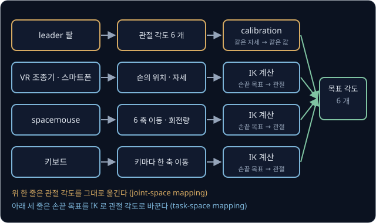

위 그림처럼 leader 팔은 관절 각도를 직접 내므로 그대로 옮기면 되고(joint-space mapping), 나머지 장치는 손끝(end-effector)의 목표 위치를
낸 뒤 그 목표를 관절 각도로 바꾸는 IK(inverse kinematics) 계산을 한 번 더 거친다(task-space mapping). LeRobot 에서는 SO-101 의 leader 팔
말고도 키보드, 게임패드, 스마트폰, NVIDIA Isaac Teleop 의 XR(VR) 조종기로 같은 팔을 움직일 수 있다.

## leader-follower 팔과 calibration

로봇 팔과 같은 모양의 작은 팔을 하나 더 두고 사람이 그 팔을 손으로 움직이면, 로봇 팔이 그 관절 각도를 따라 한다. 사람이 움직이는 쪽을
**leader** 라 하고, 따라 하는 로봇 쪽을 **follower** 라고 한다. leader 의 관절에도 각도 센서가 있어서, 짧은 간격마다 leader 의 각도 6 개를 읽어
follower 의 목표 각도로 보낸다.

두 팔은 같은 자세에서 센서가 같은 값을 읽어야 한다. 예를 들어 같은 자세에서 leader 의 어깨 센서가 20° 를 읽고 follower 의
어깨 센서가 25° 를 읽는다면, leader 각도에 5° 를 더해야 같은 자세가 된다. 이 어긋남을 offset 이라고 하는데, 모터가 반대 방향으로 달린 관절이라면 부호도 뒤집어야 한다.

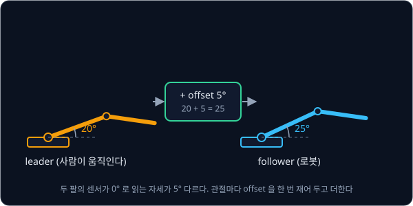

LeRobot 은 이 맞춤을 calibration 이라는 절차로 한 번에 한다. SO-101 문서에 따르면 모든 관절을 움직일 수 있는 범위의 가운데에 두고 Enter 를
누른 뒤 관절마다 끝에서 끝까지 움직이면, 모터마다 기준점(`homing_offset`), 방향(`drive_mode`), 움직인 범위의 양 끝(`range_min`, `range_max`)이
파일에 저장된다. 이 과정은 leader 와 follower 에 각각 한다.

ACT 논문의 ALOHA 도 이 방식으로 양팔 시연을 모았다. 저자들은 VR 조종기로 손끝 목표를 주지 않고 관절 각도를 그대로 옮긴 이유를 두 가지
들었다. 정밀한 작업은 특이 자세(singularity) 근처에서 할 때가 많은데 관절 6 개짜리 팔에서는 기성 IK 가 그 근처에서 자주 실패하고, leader 팔은
무게가 있어서 너무 빠른 움직임과 작은 떨림을 줄여 준다. 다만 로봇마다 같은 모양의 팔을 한 대 더 갖춰야 한다.

leader 팔로 모은 시연은 action 에 follower 의 각도가 아니라 leader 의 각도를 적는다. 집게가 블록을 쥐면 follower 는 블록에 막혀 덜 닫히고
leader 는 더 닫혀 있는데, 모터는 그 차이에 비례한 힘으로 블록을 쥐므로 follower 의 각도를 적으면 쥐는 힘이 기록에서 사라진다. 자세한 계산은
[ACT](../act/README.md#aloha-와-시연-데이터) 에서 다룬다. SO-101 팔로 레고 블록을 집어 상자에 넣는 시연 50 개를 모은 공개 dataset
lerobot/svla_so101_pickplace 의 episode 0 을 열어 보면, 블록을 쥔 frame 170 ~ 210 동안 집게의 action 은 1.0 ~ 1.2 이고 follower 의 집게 값은
7.0 이다. 집게 값은 0 ~ 100 범위다.

## end-effector 를 움직이는 입력 장치

VR 조종기와 스마트폰은 손에 쥔 장치의 위치와 자세를 재서 손끝 목표로 쓰고, spacemouse 는 손잡이를 밀고 비튼 양을 손끝의 이동·회전량으로
쓴다. 키보드는 키 하나에 한 축으로 정해진 거리를 붙인다. 예를 들어 오른쪽 키를 누르는 동안 frame 마다 손끝을 5 mm 씩 옮기게 정했다면, frame 이
1초에 30 번 올 때 손끝은 1초에 $5 \times 30 = 150$ mm 를 간다. 어느 장치든 손끝 목표가 나오면, 그다음은
[Inverse Kinematics](../inverse-kinematics/README.md) 에서 본 IK 로 관절 각도를 구한다.

장치에 따라 사람이 일을 끝내는 데 걸리는 시간이 크게 다르다. RoboTurk 저자들은 대학생 8 명에게 simulation 속 Sawyer 팔로 물체를 골라 통에
넣는 picking 작업을 네 장치로 시키고 평균 완료 시간을 쟀다.

| 입력 장치 | 사람이 조작하는 값 | picking 작업 평균 완료 시간 |
| --- | --- | --- |
| VR 조종기 (HTC Vive) | 손의 위치·자세를 그대로 손끝에 | 79.36 초 |
| 스마트폰 (iPhone, ARKit) | 휴대폰의 위치·자세를 손끝에 | 89.97 초 |
| spacemouse (3D mouse) | 손잡이를 민 방향·비튼 방향 | 112.57 초 |
| 키보드 | 키마다 한 축으로 정해진 거리 | 151.45 초 |

키보드와 spacemouse 는 다른 두 장치보다 통계적으로 유의하게 느렸지만, 스마트폰과 VR 의 차이는 통계적으로 확인되지 않았다. 저자들은
키보드로는 3차원 움직임을 자연스럽게 내기 어려워서 축에 나란한 움직임만 이어 붙인 시연이 되기 쉽다고 적었다. policy 는 시연을 그대로 따라
배우므로, 키보드 시연으로 학습한 policy 는 축을 하나씩 따라 꺾이는 길과 늘 같은 속도까지 따라 한다.

<b>심화: 손끝 이동량과 관절 각도</b>

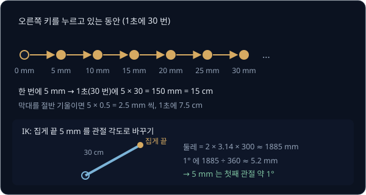

좌우 회전 관절에서 손끝까지의 거리를 반지름 $r$ 이라 하면, 관절이 한 바퀴(360°) 돌 때 손끝은 원 둘레 $2\pi r$ 을 간다.
$r = 300$ mm 이면

$$
2 \times 3.14 \times 300 \approx 1885 \text{ mm}
$$

이고 1° 에는 $1885 \div 360 \approx 5.2$ mm 다. 그래서 키보드의 5 mm 는 이 관절을 $5 \div 5.2 \approx 0.96$° 돌리는 양이다. 각도를 radian 으로 쓰면 손끝
이동 거리는 $r \times$ 회전각(radian) 으로 간단히 쓸 수 있다. 실제 팔은 어깨·팔꿈치를 함께 움직여 손끝의 높이와 거리도 맞추므로, IK 는
관절 여러 개의 각도를 한꺼번에 푼다.

키보드 조종에서 frame 마다 4 mm 씩 옮기고 frame 이 1초에 30 번 오면, 3 초 동안 누른 키는 손끝을 $4 \times 30 \times 3 = 360$ mm(36 cm)
옮긴다.

## episode 와 frame

기록 장치는 episode 동안 일정한 간격으로 그 순간의 값을 한 묶음씩 남기고, 이 한 묶음을 **frame** 이라고 부른다. 1초에 frame 을 몇 개
남기는지를 fps(frames per second)로 적는데, 30 fps 면 frame 사이 간격은 $1000 \div 30 \approx 33.3$ ms 다. frame 에는 episode 마다 0 부터
번호 $k$ 를 붙이고, $k$ 번째 frame 의 시각인 **timestamp** 는

$$
t_k = \frac{k}{\text{fps}}
$$

초다. 30 fps 에서 frame 57 은 $57 \div 30 = 1.9$ 초다. LeRobot 도 frame 을 저장할 때 시계를 읽지 않고 이 식으로 timestamp 를 적는다.

svla_so101_pickplace 의 frame 하나에는 아래 값이 들어 있다.

| 이름 | 크기 | 내용 |
| --- | --- | --- |
| `observation.images.up`, `observation.images.side` | 480×640×3 씩 | 위와 옆에서 찍은 카메라 사진 두 장 |
| `observation.state` | 6 | 그 순간 follower 관절 5 개와 집게의 값 |
| `action` | 6 | 그 순간 follower 에 보낸 목표 값(leader 의 값) |
| `timestamp` | 1 | episode 안에서의 시각, 위 식 |
| `frame_index`, `episode_index`, `index` | 1 씩 | episode 안의 번호, episode 번호, dataset 전체의 번호 |
| `task_index` | 1 | "pink lego brick into the transparent box" 같은 작업 문장의 번호 |

policy 가 입력으로 받는 사진과 state 를 관측(observation)이라 하고, action 은 policy 가 맞혀야 할 정답이다. state 와 action 은 둘 다 관절 값 6 개라 헷갈리기 쉬운데, state 는
지금 팔이 실제로 있는 자세이고 action 은 이제 가라고 보낸 목표다. task 문장은 빨간 컵과 파란 컵을 옮기는 시연이
섞인 dataset 처럼 사진만으로 작업을 가를 수 없을 때 쓴다.

**확인 문제.** 20 fps 로 기록한 8 초짜리 episode 는 frame 이 몇 개이고, frame 30 의 timestamp 는 몇 초일까?

답 보기

1. frame 수: $8 \times 20 = 160$ 개
2. frame 30 의 timestamp: $30 \div 20 = 1.5$ 초

## action 과 state 의 시간 차이

frame $k$ 의 관측은 그 frame 의 action 을 보내기 직전에 읽은 값이라서, 그 action 의 결과는 다음 frame 부터 state 에 나타난다. 예를 들어 어깨
관절 하나만 놓고 보면서 사람이 leader 를 1초에 30° 씩 들어 올리고 모터가 명령을 곧바로 따라간다고 하면, frame $k$ 의 action 이 frame $k+1$ 의 state 가 된다.

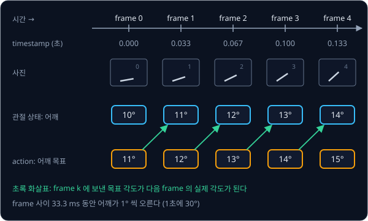

실제 모터는 이보다 늦게 따라간다. svla_so101_pickplace 의 episode 50 개 전체에서 action 을 몇 frame 뒤의 state 와 견줘야 차이가 가장 작은지
계산하면, 관절 6 개 모두 4 frame 이 나온다. 좌우 회전 관절의 평균 차이는 아래와 같다(이 dataset 의 관절 값은 −100 ~ 100 범위에 적혀 있다).

| 비교한 state | 같은 frame | 1 frame 뒤 | 2 frame 뒤 | 3 frame 뒤 | 4 frame 뒤 | 5 frame 뒤 | 6 frame 뒤 |
| --- | --- | --- | --- | --- | --- | --- | --- |
| \|action − state\| 평균 | 4.14 | 3.13 | 2.12 | 1.09 | 0.26 | 1.20 | 2.24 |

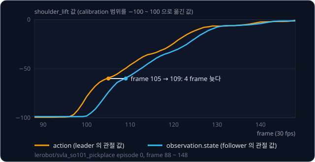

30 fps 에서 4 frame 은 $4 \times 33.3 \approx 133$ ms 라서, 이 dataset 의 팔은 명령을 받고 그 자리에 닿기까지 0.13 초쯤 걸렸다. 그래서 state 와
action 은 같은 frame 안에서 늘 조금 다르며, 이 차이는 정상이다.

**흔한 오해.** action 을 먼저 보내고 그 결과를 같은 frame 의 관측으로 적어도 상관없다고 생각하기 쉽다. 위의 곧바로 따라가는 예에서 이렇게
적으면 state 11° 와 action 11° 가 한 frame 에 들어가서, policy 는 지금 각도를 그대로 내는 법을 배운다. 그러면 학습 loss 는 낮은데 실행하면 팔이
처음 자세에서 움직이지 않는다.

## 기록 loop 와 주기

기록 프로그램은 frame 마다 같은 일을 같은 순서로 되풀이하고, 이 한 바퀴를 loop 라고 한다. LeRobot 의 `lerobot-record` 는 frame 마다 follower 의
관절 값과 카메라의 가장 최근 사진을 읽고, leader 를 읽어 만든 action 을 follower 에 보낸 뒤, 관측·action·task 를 frame 하나로 저장하고
$1 / \text{fps}$ 초가 될 때까지 기다린다.

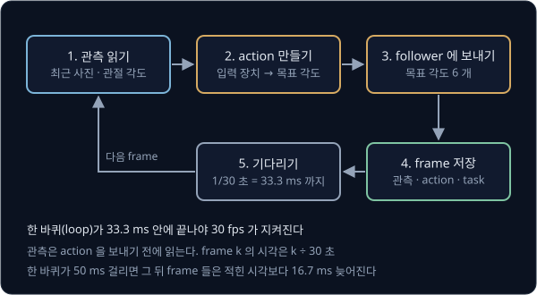

`lerobot-record` 의 기본값은 30 fps 에 episode 길이 60 초, episode 사이 정리 시간 60 초, episode 50 개다. 기록 중에 오른쪽 화살표를 누르면
episode 를 일찍 끝내고, 왼쪽 화살표를 누르면 지금 episode 를 지우고 다시 찍는다. loop 한 번이 33.3 ms 안에 끝나야 30 fps 가 지켜지는데, timestamp 는 실제 시각이 아니라 $k / 30$
으로 적으므로 loop 가 늦어지면 기록 속 시각이 실제와 어긋난다. 그래서 `lerobot-record` 는 실제로 지킨 주기를 episode 마다 보고하고 loop 가
느리면 경고한다. 공식 문서의 예시 보고에서는 주기가 29.88 Hz 였고, loop 599 번 중 8 번이 33.3 ms 를 넘었다.

주기는 사람이 조종하기 쉬운 정도에도 영향을 준다. ALOHA 는 조종과 기록을 50 Hz 로 했는데, leader 를 5 Hz 로만 읽게 바꾸자
같은 작업을 하는 데 걸린 시간이 62% 늘었다. 그 실험은 [ACT](../act/README.md#aloha-와-시연-데이터) 에서 다룬다. Hugging Face 의 dataset
수집 안내는 영상을 30 fps 안팎으로 기록하라고 권한다.

<b>심화: 늦은 loop 가 남기는 timestamp 의 어긋남</b>

사진 저장이 밀려 frame 1 에서 frame 2 로 가는 loop 가 50 ms 걸렸다고 하자. 적힌 timestamp 는 $k / 30$ 이므로 그 뒤의 frame 은 모두 적힌
시각보다 늦게 기록된다.

| frame $k$ | 적힌 timestamp $k/30$ (ms) | 실제 시각 (ms) | 어긋남 (ms) |
| --- | --- | --- | --- |
| 0 | 0 | 0 | 0 |
| 1 | 33.3 | 33.3 | 0 |
| 2 | 66.7 | $33.3 + 50 = 83.3$ | 16.7 |
| 3 | 100 | 116.7 | 16.7 |

밀린 16.7 ms 는 그 뒤로 그대로 남는다. frame 3 에서 frame 4 로 가는 데 다시 50 ms 가 걸리면 frame 4 의 적힌 시각은 $4 \div 30 \times 1000 \approx 133.3$ ms 인데
실제 시각은 $116.7 + 50 = 166.7$ ms 라서, 어긋남이 frame 하나만큼인 33.3 ms 로 커진다. 그래서 기록을 마친 뒤 loop 의 실제 주기가 목표에서 크게
벗어나지 않았는지 확인한다.

<b>심화: simulation 의 기록 주기</b>

MuJoCo Menagerie 의 SO-101 모델은 physics 를 5 ms 마다 한 step 씩 계산하는데, 30 fps 의 frame 하나는 33.3 ms 라서 $33.3 \div 5 \approx 6.67$ step
이 되어 정수로 떨어지지 않는다. 예를 들어 frame 마다 6 step 만 계산하면 frame 300 개가 기록에는 $300 \div 30 = 10$ 초로 적히지만 simulation 은
$300 \times 6 \times 5 = 9000$ ms(9 초)만 진행된다. 이 기록을 실물 팔에서 30 fps 로 따라 하면 같은 움직임에 10 초가 걸려 시연보다 느리고, 중력과
관성이 작용하는 시간도 달라진다.

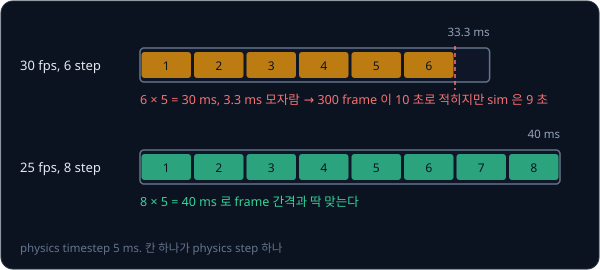

그래서 frame 하나가 정수 개의 step 이 되도록 fps 를 고르거나(25 fps 는 8 step, 40 fps 는 5 step 이 된다), simulation 시각이 frame 시각을 처음 넘는 step
에서 기록한다. 뒤의 방식은 [MuJoCo Simulation](../mujoco-sim/README.md#physics-step-제어-주기-카메라-frame) 에서 본 카메라 그리기와 같다.
timestep 이 2 ms 이고 50 fps 로 기록한다면 frame 간격 $1000 \div 50 = 20$ ms 가 정확히 $20 \div 2 = 10$ step 이라 시각이 어긋나지 않는다.

## 주기가 다른 센서의 시각 맞추기

센서마다 값을 내는 주기가 다르다. 예를 들어 카메라는 1초에 30 장(30 Hz, 33.3 ms 마다) 찍고 관절 센서는 1초에 100 번(10 ms 마다) 값을 낸다면,
사진마다 찍힌 시각에서 가장 가까운 관절 값을 골라 짝짓는다. 관절 값은 10 ms 마다 있으므로 이렇게 고른 짝의 시각 차이는 아무리 커도 그 절반인
5 ms 다.

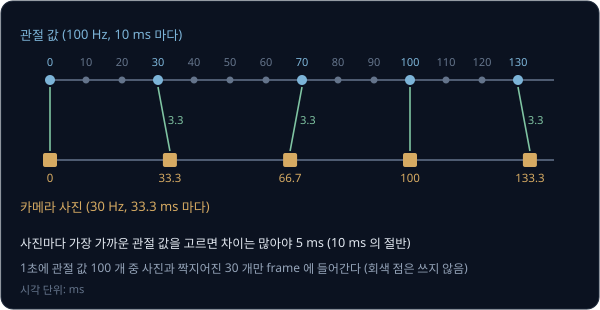

LeRobot 은 카메라마다 따로 실행되는 thread 가 사진을 계속 받아 두고, loop 는 관측을 읽는 순간 그때까지 들어온 가장 최근 사진을 가져간다. 사진이
500 ms 보다 오래됐으면 카메라가 멈춘 것으로 보고 오류를 낸다. 30 fps 카메라라면 가져간 사진은 0 ~ 33 ms 전에 찍힌 것이고, 여기에 카메라가 사진을
컴퓨터로 넘기는 데 걸리는 시간(latency)이 더해진다.

시각이 어긋나면 사진과 관절 값이 서로 다른 순간을 담게 된다. 예를 들어 어깨가 1초에 60° 씩 돌고 있으면 1 ms 에 0.06° 를 돌기 때문에, 짝의
시각이 어긋난 만큼 그대로 각도 오차가 생긴다.

| 시각 어긋남 | 계산 | 각도 오차 | 손끝 오차 (반지름 30 cm) |
| --- | --- | --- | --- |
| 3.3 ms (가장 가까운 값 고르기) | $0.06 \times 3.3$ | 약 0.2° | 약 1 mm |
| 33.3 ms (frame 하나) | $0.06 \times 33.3$ | 약 2° | 약 1 cm |
| 100 ms (예로 든 카메라 latency) | $0.06 \times 100$ | 6° | 약 3.1 cm |

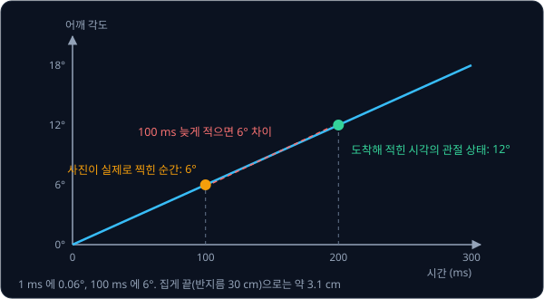

사진이 100 ms 늦게 도착하는데 도착한 시각을 찍힌 시각으로 적으면 policy 는 사진 속 팔과 관절 값이 3 cm 어긋난 짝으로 배우고, 실행 때 블록을
그만큼 빗나가 집기 쉽다.

<b>심화: 각도 오차에서 손끝 오차로</b>

각도 오차는 (각속도) × (시각 어긋남)이다. 1초에 60° 면 100 ms 에 $60 \times 0.1 = 6$° 다. 손끝이 회전축에서 $r$ 떨어져 있으면 1° 에 손끝이
$2\pi r \div 360$ 만큼 움직이므로, $r = 300$ mm 에서는 1° 에 약 5.2 mm, 6° 에 약 31 mm 다. 같은 식으로 3.3 ms 어긋나면 0.2° 에 약 1 mm 이고, 33.3 ms
어긋나면 2° 에 약 10 mm 다.

카메라가 25 Hz 이고 관절이 100 Hz 이면 사진은 $1000 \div 25 = 40$ ms 마다 찍히는데, 40 이 10 으로 나누어떨어져서 사진마다 같은 시각의 관절 값이
있고 짝의 차이는 0 이다.

## 공통 dataset 형식

연구실마다 시연을 다른 방식으로 저장하면 남이 모은 데이터를 쓸 때마다 읽는 방법부터 새로 짜야 한다. 예를 들어 어떤 곳은 관절 각도를
radian 으로 적고 어떤 곳은 degree 로 적는다. 1 radian 은 $360 \div (2 \times 3.14) \approx 57.3$° 라서 두 곳에 적힌 "1.0" 은 57.3° 와 1° 로
전혀 다른 자세다. Open X-Embodiment 연구진은 34 개 연구실의 robot dataset 60 개를 RLDS 라는 한 형식으로 바꿔, 로봇 22 종의 trajectory
100 만 개 이상을 한 곳에 모았다.

같은 SO-101 이라도 LeRobot 의 설정에 따라 단위가 다르다. 지금 LeRobot 의 SO-101 설정은 관절 값을 degree 로 적는 것이 기본이지만, 관절마다
calibration 에서 잰 범위를 −100 ~ 100 으로 옮겨 적는 방식도 있다(집게는 어느 쪽이든 0 ~ 100). svla_so101_pickplace 의 stats 를 보면 action 의
최솟값과 최댓값이 정확히 −100 과 100 인 관절이 있어서, 범위를 옮기고 그 밖을 잘라 내는 뒤의 방식으로 기록한 것으로 보인다. 두 방식의 dataset
을 섞거나 한쪽으로 학습한 policy 를 다른 쪽 설정의 팔에 올리면, 같은 숫자가 다른 자세를 뜻하게 된다.

Hugging Face 의 dataset 수집 안내는 로봇 종류(`robot_type`)를 정확히 적고, 카메라 이름은 `images.top`, `images.wrist.left` 처럼 위치로 짓고,
task 문장은 25 ~ 50 글자로 쓰라고 권한다. svla_so101_pickplace 의 info.json 에는 SO-101 로 모았는데도 `robot_type` 이 `so100_follower` 로 적혀 있다.

## LeRobotDataset 의 표와 영상

LeRobot 은 시연을 LeRobotDataset 형식(지금 v3.0)으로 저장해 Hugging Face Hub 에 올린다. 이 형식은 기록을 숫자 표, 카메라 영상, 그 둘을 설명하는
meta 파일의 세 가지로 나눠 담는다.

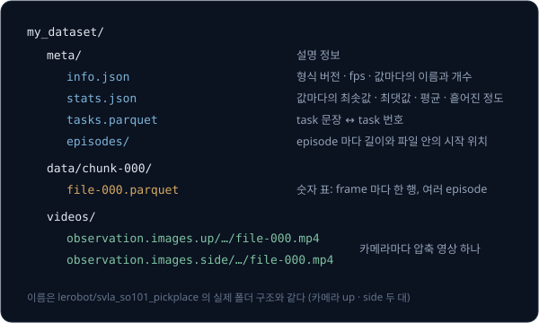

관절 state, action, timestamp 처럼 frame 마다 숫자 몇 개인 값은 Parquet 파일 하나에 모은다. frame 하나가 한 행이고 값의 종류마다 한 열이다.
Parquet 는 값을 열 단위로 모아 저장하는 형식이라 action 열처럼 필요한 열만 빠르게 꺼낼 수 있다. svla_so101_pickplace 의 frame 11,939 개짜리
표는 전체가 370 KB 다. task 문장은 행마다 적지 않고 번호로 적은 뒤 번호와 문장의 짝을 tasks 파일에 따로 둔다.

카메라 사진은 표에 넣기에 너무 크다. frame 11,939 개의 사진을 그대로 두면 카메라 하나에 약 11 GB 라서, 사진은 MP4 영상으로 압축한다. 이웃한
frame 의 사진은 거의 같으므로 영상은 몇 frame 마다 사진 전체를 적고 그 사이에는 바뀐 부분만 적는다. 이렇게 압축한 이 dataset 의 영상 파일은
두 카메라가 각각 40.1 MB 와 45.5 MB 다. 학습할 때는 표의 timestamp 로 영상에서 그 시각의 사진을 찾아 꺼낸다.

<b>심화: 사진 크기와 영상 압축</b>

480×640 사진은 pixel 마다 빨강·초록·파랑 밝기 세 숫자를 1 byte 씩 적으므로 $480 \times 640 \times 3 = 921{,}600$ byte, 약 0.92 MB 다. frame
11,939 개면 $11{,}939 \times 921{,}600 \approx 110$ 억 byte(약 11 GB) 다.

ffprobe 로 이 dataset 의 위 카메라 영상을 열어 보면 AV1 방식으로 압축되어 있다. 2 frame 마다 사진 전체를 적은 frame(keyframe)은 평균
6.2 KB 이고, 그 사이에 바뀐 부분만 적은 frame 은 평균 0.46 KB 다. 파일 전체는 40.1 MB 라서 압축하지 않은 11 GB 의 약 270 분의 1 이고, 옆 카메라는
45.5 MB 로 약 240 분의 1 이다. keyframe 을 촘촘히 두면 파일은 조금 커지지만, 학습 중에 아무 frame 이나 꺼낼 때 앞쪽 frame 을 많이 decode 하지
않아도 된다. 지금 LeRobot 의 영상 기본 설정도 AV1(`libsvtav1`)에 keyframe 간격 2 다.

v3.0 은 episode 마다 파일을 만들지 않고 여러 episode 를 한 파일에 이어 붙인다. 파일이 적어야 episode 가 수천 ~ 수백만 개인 dataset 도 빨리 열 수
있기 때문이다. 그 대신 episode 하나가 파일의 어디부터 어디까지인지를 meta 의 episodes 파일에 적는다.

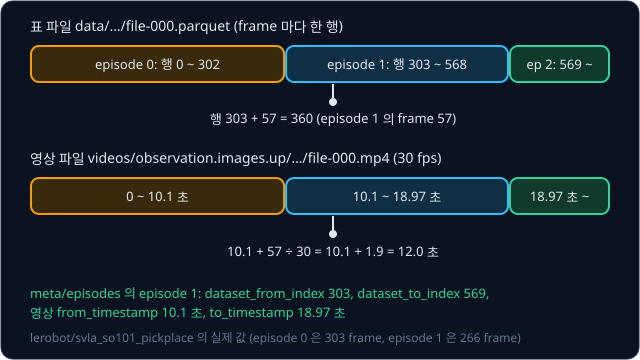

위 그림은 svla_so101_pickplace 의 실제 값이다. episode 0 이 303 frame($303 \div 30 = 10.1$ 초)이라서 episode 1 은 표의 행 303, 영상의 10.1 초에서
시작한다. 학습할 때 episode 1 의 frame 57 이 필요하면 표에서 행 $303 + 57 = 360$ 을 읽고, 영상에서는 $10.1 + 57 \div 30 = 12.0$ 초의 사진을 꺼낸다.

**확인 문제.** episode 0 이 240 frame, episode 1 이 250 frame 이고 30 fps 다. episode 1 의 frame 10 은 표의 몇 번 행이고 영상의 몇 초에 있을까?

답 보기

1. episode 0 이 행 0 ~ 239 를 쓰므로 episode 1 은 행 240 에서 시작하고, frame 10 은 $240 + 10 = 250$ 번 행이다
2. episode 0 이 영상의 $240 \div 30 = 8.0$ 초를 차지하므로 frame 10 은 $8.0 + 10 \div 30 \approx 8.33$ 초에 있다

## meta 폴더와 stats

`meta` 폴더에는 데이터를 설명하는 파일이 들어 있다.

| 파일 | 담는 정보 | svla_so101_pickplace 의 값 |
| --- | --- | --- |
| info.json | 형식 버전, fps, 값마다 이름·크기·자료형, 파일 경로 규칙 | v3.0, 30 fps, episode 50 개, frame 11,939 개 |
| stats.json | 값마다 최솟값·최댓값·평균·표준편차·개수 | action·state 는 관절마다 따로 |
| tasks | task 문장과 번호의 짝 | 작업 1 가지 |
| episodes | episode 마다 길이, task, 표의 시작·끝 행, 영상의 시작·끝 시각 | episode 길이 183 ~ 306 frame |

info.json 은 사람이 열어 읽을 수 있는 JSON 텍스트 파일이다. 그 안의 이름 목록을 보면 action 의 여섯 숫자가 `shoulder_pan.pos` 부터 `gripper.pos` 까지
어느 관절의 값인지 알 수 있다.

stats 는 학습 전에 숫자의 크기를 맞추는 데 쓴다. 관절마다 범위가 다른 숫자를 그대로 넣으면 범위가 큰 관절의 오차가 loss 를 거의 다 차지하므로,
최솟값·최댓값으로 모든 값을 −1 ~ 1 로 옮기거나(MIN_MAX) 평균을 빼고 표준편차로 나눈다(MEAN_STD). 이렇게 크기를 맞추는 일을 normalization 이라고 한다. LeRobot
의 기본 설정에서 ACT 는 MEAN_STD 를 쓰고, Diffusion Policy 는 state 와 action 에 MIN_MAX 를 쓴다. stats 는 dataset 전체에서 계산한 값이라 episode 를
지우거나 다른 dataset 과 합치면 다시 계산해야 한다.

episode 경계도 학습에 직접 쓰인다. [ACT](../act/README.md) 처럼 action 100 개를 한 번에 내는 policy 는 frame $k$ 의 관측에 frame $k$ ~ $k+99$
의 action 을 정답으로 붙여 읽는데, LeRobot 은 이 묶음을 timestamp 의 간격($1 / \text{fps}$)으로 찾는다. episode 끝에 가까워 뒤 frame 이 모자라면
마지막 행을 되풀이해 채우고 `action_is_pad` 라는 표시를 붙여 loss 에서 빼게 한다. 경계를 잘못 적으면 다음 episode 의 action 이 정답으로 섞인다.

<b>심화: MIN_MAX normalization 계산</b>

MIN_MAX 는 값 $x$ 를

$$
x' = 2 \times \frac{x - \min}{\max - \min} - 1
$$

로 옮긴다. 값에서 최솟값을 빼고 범위(최댓값 − 최솟값)로 나누면 0 ~ 1 이 되고, 거기에 2 를 곱하고 1 을 빼면 −1 ~ 1 이 된다.
svla_so101_pickplace 의 stats 에서 집게 action 은 최솟값 0, 최댓값 33.0 이다.

| 집게 action $x$ | 계산 | $x'$ |
| --- | --- | --- |
| 0 | $2 \times \frac{0 - 0}{33.0} - 1$ | −1 |
| 16.5 | $2 \times \frac{16.5 - 0}{33.0} - 1$ | 0 |
| 33.0 | $2 \times \frac{33.0 - 0}{33.0} - 1$ | 1 |

좌우 회전 관절 action 은 최솟값이 −93.5 이고 최댓값이 88.0 이라서 0 은 $2 \times \frac{0 + 93.5}{181.5} - 1 \approx 0.03$ 으로 옮겨진다. MEAN_STD 는
$(x - \text{평균}) \div \text{표준편차}$ 이고, 이 관절은 평균이 8.0 이고 표준편차가 44.6 이라서 0 은 $(0 - 8.0) \div 44.6 \approx -0.18$ 이 된다.

## 머뭇거림과 정지 구간

behavior cloning 은 policy 의 출력과 시연 action 의 차이를 제곱해 평균한 MSE 를 줄이도록 학습하므로, 같은 장면에 시연 action 이 여러 개면 그
평균을 배운다. 이 평균은 시연 수가 아니라 frame 수로 무게가 매겨진다.

예를 들어 집게가 블록 바로 위에 있는 장면이 시연 10 개에 모두 들어 있는데, 7 개는 이 장면을 frame 2 개 동안만 지나며 frame 마다 1 cm 씩
내렸고, 3 개는 1초(frame 30 개) 동안 멈췄다고 하자.

| 시연 종류 | 시연 수 | 이 장면의 frame 수 | action: frame 마다 내리는 거리 |
| --- | --- | --- | --- |
| 바로 내림 | 7 | $7 \times 2 = 14$ | 1 cm |
| 1초 멈춤 | 3 | $3 \times 30 = 90$ | 0 cm |

policy 가 배우는 평균은 $(14 \times 1 + 90 \times 0) \div 104 \approx 0.13$ cm 다. 머뭇거린 시연은 10 개 중 3 개였지만 frame 으로는 104 개 중 90 개를
차지해서, policy 는 바로 내린 시연의 7 분의 1 도 안 되는 빠르기로 내려간다. 집게가 거의 움직이지 않으면 다음 frame 의 관측도 거의 같아서 policy 는
다시 거의 멈추라는 action 을 내고, 실행하면 집게가 블록 위에서 한참 머문다.

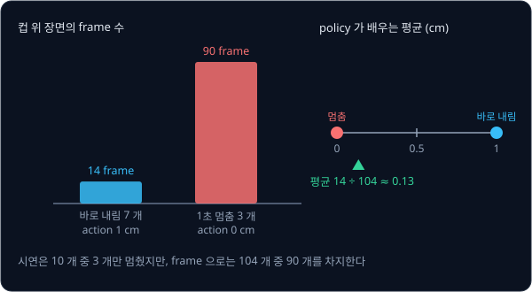

공개 dataset 에도 멈춘 frame 이 많다. svla_so101_pickplace 에서 episode 의 처음과 끝에 어느 관절의 action 도 frame 사이에 0.5 넘게 바뀌지 않는
구간을 세면, 처음 구간은 평균 26 frame(약 0.9 초)이고 끝 구간은 평균 25 frame 이다. 두 구간을 합치면 frame 11,939 개 중 2,556 개(21%)가 멈춘
frame 이다. ACT 저자들도 시연 중의 멈춤은 지금 관측 하나만 보고 다음 action 하나를 내는 policy 가 따라 하기 어렵고, action 여러 개를 묶어 내는
action chunking 이 이 문제를 덜어 준다고 설명했다.

그래서 시연은 망설임 없이 일정한 빠르기로 하고 시작 전과 끝난 뒤의 정지 구간을 짧게 남긴다. 이미 모은 시연은 멈춘 구간을 잘라 낼 수 있는데, 위
예에서 정지 구간을 30 frame 에서 3 frame 으로 줄이면 평균이 $14 \div (14 + 3 \times 3) \approx 0.61$ cm 로 올라간다.

**확인 문제.** 같은 장면에서 시연 8 개는 frame 2 개 동안 1 cm 씩 내렸고, 시연 2 개는 frame 12 개 동안 멈췄다. policy 가 배우는 평균은?

답 보기

| 시연 종류 | frame 수 | action |
| --- | --- | --- |
| 바로 내림 | $8 \times 2 = 16$ | 1 cm |
| 멈춤 | $2 \times 12 = 24$ | 0 cm |

평균은 $16 \times 1 \div (16 + 24) = 16 \div 40 = 0.4$ cm 다.

## 실패한 시연

사람도 시연 중에 집게를 너무 높은 곳에서 닫아 블록을 놓치거나 블록을 쳐서 넘어뜨리곤 한다. 실패한 episode 를 지우지 않으면 policy 는 그 실수도 정답으로 배운다.
예를 들어 시연 50 개 중 45 개는 블록 바닥으로부터 2 cm 높이에서 집게를 닫아 성공했고 5 개는 6 cm 높이에서 닫아 놓쳤다면, policy 가 배우는 높이는

$$
\frac{45 \times 2 + 5 \times 6}{50} = \frac{120}{50} = 2.4 \text{ cm}
$$

다. 실패 시연 10% 가 집는 높이를 0.4 cm 끌어올렸고, 실패가 10 개(20%)면 $(40 \times 2 + 10 \times 6) \div 50 = 2.8$ cm 까지 올라간다. 잡을 수
있는 높이의 범위가 좁은 물체일수록 이 차이로 성공과 실패가 갈린다.

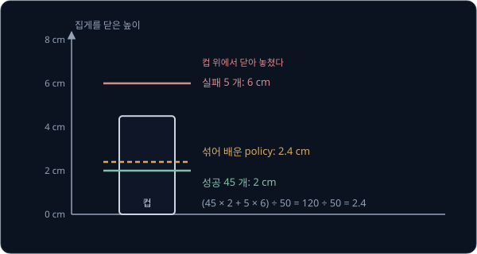

그래서 실패한 episode 는 그 자리에서 왼쪽 화살표로 지우고 다시 찍는다. 다만
블록을 놓쳤다가 다시 집어 끝내 성공한 시연은 시연 범위를 벗어난 상황에서 돌아오는 법을 보여 주므로 남겨 두기도 한다. 그런 상황에서 policy 가 점점
더 틀리는 compounding error 는 [Behavior Cloning](../behavior-cloning/README.md#compounding-error) 에서 다룬다.

## 시연자와 방식의 일관성

성공한 시연끼리도 방식이 다를 수 있다. 어떤 시연은 블록을 위에서 내려와 집고(손목 0°) 어떤 시연은 옆에서 다가가 집는다면(손목 90°), 두 방식이
반씩 섞인 장면에서 MSE 로 학습한 policy 는 평균인 45° 로 비스듬히 다가가 어느 쪽으로도 잡지 못한다. 같은 관측에 정답이 여럿인 시연에서 평균이
나오는 이유와 그 평균을 피하는 policy 는 [Behavior Cloning](../behavior-cloning/README.md#multimodal-시연과-평균) 에서 다룬다.

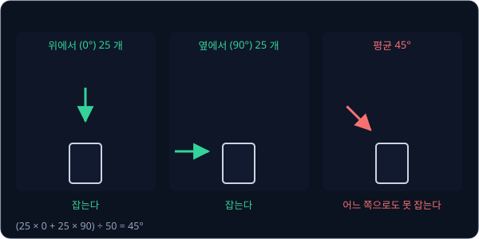

시연자가 여럿이면 숙련도와 방식이 함께 섞인다. robomimic 논문의 저자들은 simulation 속 팔로 사각 너트를 막대에 끼우는 Square 작업의 시연을 RoboTurk
로 모아, 같은 behavior cloning 으로 학습한 policy 의 성공률을 데이터 묶음마다 쟀다. 이 실험의 policy 는 사진 대신 물체 위치를 숫자로 받았다.

| 데이터 묶음 | 시연 수 | 성공률 (BC) |
| --- | --- | --- |
| 숙련자 한 명 (Proficient-Human) | 200 | 78.7% |
| 숙련도가 다른 6 명 (Multi-Human) | 300 | 52.7% |
| 숙련된 2 명 (Better) | 100 | 58.7% |
| 서툰 2 명 (Worse) | 100 | 22.0% |
| Better + Worse | 200 | 46.7% |

여섯 명의 묶음은 시연이 100 개 더 많은데도 성공률이 낮았는데, 저자들은 서툴거나 방식이 갈리는 시연이 섞인 것이 원인일 가능성이 크다고 봤다. 숙련된 2 명의
시연 100 개에 서툰 2 명의 100 개를 더하자 성공률이 58.7% 에서 46.7% 로 떨어졌다. LeRobot 의 수집 안내도 처음에는 한 가지 집기 방식을 지키고, policy 가 잘
집게 된 뒤에 집는 자리·방식·카메라 위치 같은 변화를 조금씩 늘리라고 권한다.

## 카메라와 장면 조건

policy 는 사진을 보고 action 을 정하므로, 사진이 담는 정보가 시연마다 들쭉날쭉하면 사진의 어디를 보고 움직여야 하는지 배우기 어렵다.
카메라를 고정해야 하는 이유는 [Behavior Cloning](../behavior-cloning/README.md#end-to-end-policy) 에서 숫자로 다뤘다. Hugging Face 의 dataset
수집 안내는 사진에 관한 조건을 아래처럼 정리한다.

| 조건 | 이유 |
| --- | --- |
| 카메라 두 대, 흔들림 없이 고정 | 고정 카메라로 블록의 자리를 보고 손목 카메라로 마지막 몇 cm 를 본다 |
| 일정한 조명, 일정한 노출과 초점 | 시간에 따라 밝기가 바뀌면 같은 장면이 다른 사진이 된다 |
| leader 팔과 사람의 손·몸은 화면 밖 | 실행 때는 leader 와 사람이 없어서, 그것을 보고 움직이는 법은 쓸모가 없다 |
| 움직이는 것은 follower 와 물체뿐, 배경은 고정 | 사진의 변화가 작업과 관계있는 것에서만 생긴다 |
| 480×640 이상의 해상도 | 작은 물체와 집게 끝이 보여야 한다 |

LeRobot 의 SO-101 학습 안내는 물체가 카메라 화면 안에 들어오게 하고, 사람이 카메라 사진만 보고도 그 일을 할 수 있는지를 기준으로 삼으라고
권한다. 사람이 사진만으로 못 하는 일은 사진만 받는 policy 도 하기 어렵다.

## 시연 수와 물체 위치

시연이 몇 개면 충분한지는 작업의 어려움, 물체 위치의 범위, policy 의 종류에 따라 다르다. 단순한 집기 작업의 출발점으로 LeRobot 의 안내서는
물체를 놓는 자리마다 10 개씩 50 개 이상을 권하는데, 그 숫자와 자리를 고루 나눠야 하는 이유는 [Behavior Cloning](../behavior-cloning/README.md#end-to-end-policy)
에서 다뤘다. ALOHA 는 작업마다 시연 50 개(벨크로 끈을 꿰는 작업만 100 개)를 모았는데, 저자들에 따르면 10 ~ 20 분 분량의 데이터를 모으는 데 정리와 조종
실수 때문에 30 ~ 60 분이 걸렸다.

바꾸는 조건이 늘면 조합의 수가 곱셈으로 늘어난다. 예를 들어 위치 5 곳 × 블록 색 2 가지 × 조명 2 가지면 조합이 $5 \times 2 \times 2 = 20$ 가지이고,
조합마다 10 개씩이면 시연이 200 개 필요하다. 그래서 위치만 바꾼 50 개로 시작해 policy 가 잘 집는 것을 확인한 뒤 조건을 하나씩 늘린다.

시연을 더할 곳은 학습한 policy 를 자리마다 실행해 보고 정한다. 예를 들어 다섯 자리에서 10 번씩 실행한 결과가 아래와 같다면 전체 성공률은
$(9 + 8 + 10 + 7 + 3) \div 50 = 74\%$ 지만 E 만 유난히 낮으므로, 모든 자리에 고루 더하기보다 E 에 시연을 10 개쯤 더 모아 다시 학습한다.

| 블록 자리 | 시도 | 성공 | 성공률 |
| --- | --- | --- | --- |
| A (왼쪽 앞) | 10 | 9 | 90% |
| B (오른쪽 앞) | 10 | 8 | 80% |
| C (가운데) | 10 | 10 | 100% |
| D (왼쪽 뒤) | 10 | 7 | 70% |
| E (오른쪽 뒤) | 10 | 3 | 30% |

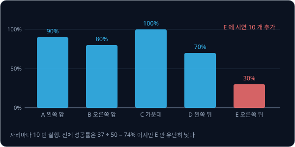

**흔한 오해.** 시연은 많을수록 무조건 좋다고 생각하기 쉽다. 위에서 집은 시연 250 개와 옆에서 집은 시연 250 개를 모아도 평균은
$(250 \times 0 + 250 \times 90) \div 500 = 45$° 그대로라서, 머뭇거림·실패·방식 차이가 섞인 시연은 수를 늘려도 나아지지 않는다.

**확인 문제.** 학습한 policy 를 네 자리에서 10 번씩 실행해 8, 6, 9, 1 번 성공했다. 전체 성공률은 얼마이고, 시연을 어디에 더 모을까?

답 보기

1. 전체 성공률: $(8 + 6 + 9 + 1) \div 40 = 24 \div 40 = 60\%$
2. 10 번 중 1 번만 성공한 넷째 자리에 시연을 더 모은다

## replay 로 하는 기록 확인

기록이 제대로 저장됐는지는 replay 로 확인한다. replay 는 기록한 episode 와 같은 처음 상태에서 저장된 action 만 frame 순서대로 다시 보내는
일이라서, policy 처럼 관측을 보고 action 을 고르지 않는다. LeRobot 에서는 `lerobot-replay` 가 이 일을 한다.

simulation 은 같은 처음 상태에 같은 action 을 넣으면 매번 같은 결과를 내므로, replay 한 관절 state 가 기록과 거의 그대로 겹쳐야 한다(예를 들어
0.5° 안). 크게 벌어지면 먼저 블록의 처음 위치를 저장했는지 본다. 팔의 처음 자세는 frame 0 의 state 에 있지만 블록 위치는 따로 적어야 하기 때문이다.
그다음 기록한 action 과 실제로 보낸 action 이 같은지, 시각 맞추기가 어긋나지 않았는지를 확인한다.

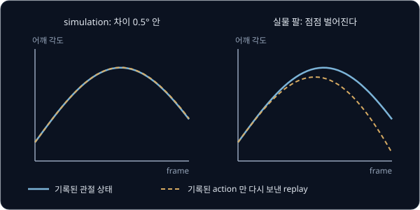

실물 팔에서는 블록이 1 cm 다른 곳에 놓이거나 모터 반응과 접촉이 조금씩 달라서 replay 가 기록과 정확히 겹치지 않는다. 기록된 action 을 그대로
보내면 처음의 작은 차이가 바로잡히지 않고 남는다. 그래서 시연을 그대로 재생하지 않고, 지금 보이는 것을 보고 그때그때 action 을 정하는
policy 를 학습한다.

**확인 문제.** 실물 팔에서 시연 때보다 블록을 2 cm 오른쪽에 놓고 그 시연을 replay 했다. 집게는 어디로 갈까?

답 보기

replay 는 사진을 보지 않고 기록된 action 만 보내므로 집게는 시연 때 블록이 있던 자리로 가고, 2 cm 옆의 블록을 놓친다.

## 정리

- teleoperation 의 입력 장치는 관절 각도를 그대로 옮기는 leader 팔과, 손끝 목표를 IK 로 바꾸는 VR 조종기·스마트폰·spacemouse·키보드로 나뉜다.
  RoboTurk 의 picking 작업에서 평균 완료 시간은 VR 로는 79 초, 키보드로는 151 초가 걸렸고, 장치의 버릇은 시연에 남아 policy 가 따라 한다
- frame 은 사진, state, action(leader 의 값), timestamp $k / \text{fps}$, task 로 이루어지고 관측은 action 을 보내기 전에 읽는다. svla_so101_pickplace
  에서 SO-101 의 state 는 action 을 4 frame(약 133 ms) 늦게 따라갔다. 주기가 다른 센서는 가까운 시각끼리 짝지어 시각 어긋남이 각도 오차로 커지지
  않게 한다
- LeRobotDataset v3.0 은 여러 episode 를 Parquet 표와 MP4 영상에 이어 붙이고, meta 폴더의 파일에 형식, normalization 통계, task 문장, episode
  경계를 적는다. policy 는 frame 수로 무게를 매긴 평균을 배우므로 정지 구간·실패·방식 차이를 줄인 일관된 시연이 수보다 중요하다

이렇게 모은 시연에도 policy 가 실행 중 시연 밖 상태로 벗어났을 때의 정답은 없다. 그런 상태에서 expert 에게 정답을 다시 묻는 방법은
[DAgger](../dagger/README.md) 에서 다룬다. 머뭇거림처럼 한 step 씩 따라 하기 어려운 시연을 action 묶음으로 배우는 방법은 [ACT](../act/README.md)
에서 다룬다. 같은 형식으로 모은 SO-101 시연으로 학습한 policy 를 실제 팔에서 실행하고 평가하는 과정은 [Real Robot](../real-robot/README.md) 에서 다룬다.

## 참고 자료

- LeRobot, [Imitation Learning on Real-World Robots](https://huggingface.co/docs/lerobot/il_robots) — `lerobot-record` 의 설정과 키보드 조작,
  "Tips for gathering data" 의 수집 요령, "Cadence reporting" 의 주기 보고
- LeRobot, [LeRobotDataset v3.0](https://huggingface.co/docs/lerobot/lerobot-dataset-v3) — "Format design" 절의 표·영상·meta 구성과 여러 episode
  를 한 파일에 담는 방식
- LeRobot, [SO-101](https://huggingface.co/docs/lerobot/so101) — leader·follower 팔의 조립과 calibration 절차
- Hugging Face 블로그, [LeRobot Community Datasets](https://huggingface.co/blog/lerobot-datasets) (2025) — "What Makes a Good Dataset?" 절의 사진
  품질·metadata·이름 짓기·task 문장 기준
- [lerobot/svla_so101_pickplace](https://huggingface.co/datasets/lerobot/svla_so101_pickplace) — 이 강의의 숫자를 가져온 dataset. `meta/info.json`
  을 열어 보고, [visualize_dataset](https://huggingface.co/spaces/lerobot/visualize_dataset) Space 에서 영상과 관절 곡선을 함께 본다
- Mandlekar et al., [RoboTurk](https://arxiv.org/abs/1811.02790) (2018) — 3.2 절에 키보드·spacemouse·VR·스마트폰의 완료 시간 비교가 있다
- Zhao et al., [Learning Fine-Grained Bimanual Manipulation with Low-Cost Hardware](https://arxiv.org/abs/2304.13705) (2023) — ALOHA 의
  joint-space mapping 을 고른 이유, 50 Hz 기록, 작업당 시연 50 개
- Mandlekar et al., [What Matters in Learning from Offline Human Demonstrations](https://arxiv.org/abs/2108.03298) (2021) — 4.2 절과 Table 2 에
  시연자 숙련도에 따른 성공률이 나온다
- Open X-Embodiment Collaboration, [Open X-Embodiment](https://arxiv.org/abs/2310.08864) (2023) — 여러 연구실의 dataset 을 한 형식으로 모은 과정
- Cadene et al., [LeRobot](https://arxiv.org/abs/2602.22818) (2026) — 3.2 절에 LeRobotDataset 의 설계와 Hub 에 공개된 dataset 의 규모가 나온다
