# BPE Tokenizer

## 학습 목표

- 컴퓨터가 글자를 0 부터 255 까지의 숫자(byte) 몇 개로 저장하는 방식을 숫자로 따라가고, 한글 한 글자가 왜 3 byte 인지 설명할 수 있다
- 문장을 조각으로 잘라 조각마다 번호를 붙이는 일이 왜 필요한지, 조각을 크게 자를 때와 작게 자를 때 무엇이 달라지는지 설명할 수 있다
- 짧은 문장에서 이웃한 두 조각이 몇 번 나오는지 세어 가장 많은 쌍을 하나로 합치는 과정(BPE 학습)을 표로 한 단계씩 계산할 수 있다
- 배운 합치기 규칙으로 새 문장을 번호 열로 바꾸고, 번호 열을 다시 문장으로 되돌릴 수 있다
- "token" 이라는 말이 글자 조각, 이미지 조각, 로봇 움직임 값의 번호에서 각각 무엇을 뜻하는지 구분할 수 있다
- 같은 뜻의 한국어 문장이 영어 문장보다 조각을 훨씬 많이 쓰는 이유를 설명할 수 있다

## 숫자만 다루는 모델

[Linear Regression](../linear-regression/README.md) 에서 모델은 입력을 받아 예측을 내는 규칙이었다. 모델 $\hat y = wx + b$ 는
입력 $x$ 에 숫자 $w$ 를 곱하고 $b$ 를 더하는 계산이라서, 입력이 2 V 같은 숫자일 때만 쓸 수 있다.

로봇에게 "빨간 컵을 집어" 라고 말로 시키는 장면을 생각해 보자. 이 문장을 받아 무엇을 할지 정하는 모델도 결국 곱하고 더하는
계산을 하는데, "빨간 컵" 에는 곱할 숫자가 없다. 그래서 글자를 다루는 모델은 모두 첫 단계에서 문장을 숫자 열로 바꾸고, 계산을
마친 뒤 나온 숫자 열을 다시 글자로 되돌린다. 이렇게 사람이 읽는 글자로 된 데이터를 text 라고 하고, 다음에 올 글자를 예측하는
식으로 text 를 다루는 모델을 language model 이라고 한다.

text 를 숫자로 바꾸는 방법은 여러 가지인데, 어떻게 바꾸느냐에 따라 모델이 받는 숫자의 개수와 종류가 달라진다. 이 강의는
컴퓨터가 글자를 저장하는 가장 낮은 단계의 숫자부터 시작해, 그 숫자들을 쓸모 있는 크기로 묶는 BPE 라는 방법까지 차례로 다룬다.

**확인 문제.** 모델 $\hat y = 2x + 1$ 에 입력 "cat" 을 그대로 넣을 수 없는 이유는?

답 보기

이 모델은 $x$ 에 2 를 곱하고 1 을 더하는 계산인데, "cat" 은 숫자가 아니라서 곱하거나 더할 수 없다. 먼저 "cat" 을 숫자로 바꾸는
단계가 있어야 한다.

## 문자 코드

컴퓨터 안에는 글자가 없고 숫자만 있다. 그래서 컴퓨터는 글자마다 번호를 하나씩 정해 두고, 글자 대신 그 번호를 저장한다. 글자와
번호를 짝지은 이 약속을 문자 코드라고 한다.

1960년대에 미국에서 정한 ASCII(아스키)라는 문자 코드는 영어 대문자·소문자, 숫자, 문장부호, 공백에 0 부터 127 까지의 번호를
붙였다. 대문자 A 는 65, 소문자 a 는 97, 공백은 32 다. 소문자는 a 부터 z 까지 차례로 번호가 이어져서, b 는 98, c 는 99 이고 h 는
104, t 는 116 이다.

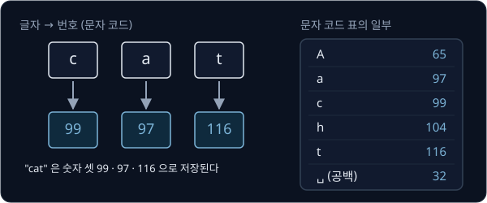

위 그림은 "cat" 이 컴퓨터 안에서 99, 97, 116 이라는 숫자 셋으로 저장되는 모습을 보여 준다. 오른쪽 표는 이 강의에서 계속 쓰는
글자의 번호다. 공백은 눈에 보이지 않아서 이 강의에서는 ␣ 기호로 적는다.

문자 코드가 있으면 text 를 숫자 열로 바꿀 수 있다. "hat" 은 104, 97, 116 이고 "cat hat" 은 99, 97, 116, 32, 104, 97, 116 의
숫자 일곱 개다. 숫자 열을 받은 쪽은 같은 표를 거꾸로 찾아 글자로 되돌린다.

**확인 문제.** 소문자 a 가 97 이면 소문자 d 의 번호는? 그리고 숫자 열 104, 97, 100 은 어떤 단어일까?

답 보기

a, b, c, d 로 하나씩 이어지므로 d 는 $97 + 3 = 100$ 이다. 104 는 h, 97 은 a, 100 은 d 라서 "had" 다.

## bit 와 byte

### 스위치 8개로 적는 숫자

컴퓨터의 기억 장치는 전기가 켜졌는지 꺼졌는지만 구분하는 아주 작은 스위치 수십억 개로 되어 있다. 켜짐을 1, 꺼짐을 0 으로 적고,
이 스위치 하나를 bit 라고 부른다. bit 는 binary digit, 곧 "0 과 1 두 가지만 쓰는 숫자 한 자리" 의 줄임말이다.

bit 하나로는 0 과 1 두 가지밖에 적지 못하므로 컴퓨터는 bit 8개를 한 묶음으로 쓴다. 이 묶음이 byte 다. 8개 자리에는 왼쪽부터
128, 64, 32, 16, 8, 4, 2, 1 이라는 값이 정해져 있고, 켜진 자리의 값을 모두 더한 수가 그 byte 가 나타내는 숫자다.

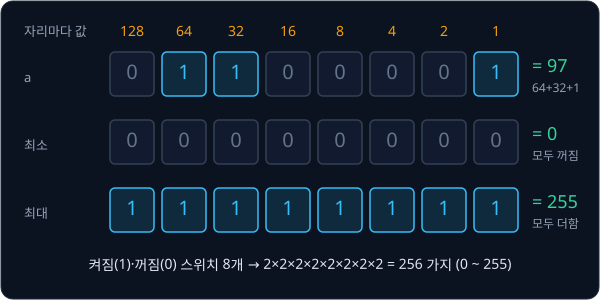

위 그림의 첫 줄은 소문자 a 의 번호 97 을 적은 byte 다. 64, 32, 1 자리가 켜져 있으므로 $64 + 32 + 1 = 97$ 이다. 같은 방식으로
h 의 104 는 $64 + 32 + 8$ 이라서 64, 32, 8 자리를 켜고, t 의 116 은 $64 + 32 + 16 + 4$ 라서 네 자리를 켠다.

### byte 하나가 나타내는 범위

모두 꺼지면 0 이고, 모두 켜지면 $128 + 64 + 32 + 16 + 8 + 4 + 2 + 1 = 255$ 다. 그래서 byte 하나는 0 부터 255 까지의 정수를
나타낸다.

개수로 세면 256 가지다. 스위치마다 켜짐과 꺼짐 두 경우가 있고 스위치가 8개이므로, 경우의 수는 2 를 8 번 곱한
$2 \times 2 \times 2 \times 2 \times 2 \times 2 \times 2 \times 2 = 256$ 이다. 같은 수를 여러 번 곱한 것을 짧게 $2^8$ 처럼 적고
"2 의 8 제곱" 이라고 읽는다. 0 부터 세기 시작하므로 256 가지는 0 부터 255 까지다.

ASCII 의 번호는 모두 0 부터 127 사이라서 영어 글자 하나는 byte 하나에 들어간다. 이 256 이라는 숫자는 뒤에서 BPE 가 처음 쓰는
조각의 개수로 다시 나온다.

**확인 문제.** 128, 64, 32, 16, 8, 4, 2, 1 자리 가운데 64, 2, 1 자리만 켜진 byte 는 몇이고, 어떤 글자의 번호일까? (A 가 65)

답 보기

$64 + 2 + 1 = 67$ 이다. A 가 65, B 가 66 이므로 67 은 대문자 C 다.

**요약**

- 컴퓨터는 글자마다 번호를 정한 문자 코드로 글자를 숫자로 저장한다. ASCII 에서 a 는 97, 공백은 32 다
- bit 는 0 또는 1 인 스위치 하나이고, byte 는 bit 8개 묶음이다. byte 하나는 0 부터 255 까지 256 가지 수를 나타낸다

## Unicode 와 UTF-8

### 256 가지로는 모자란 글자

ASCII 의 128 글자에는 한글이 없다. 한글로 쓸 수 있는 글자(가, 각, 간, …, 힣)만 11,172 개이고, 한자·아랍 문자·emoji(🙂 같은
그림 문자)까지 합치면 세상의 글자는 byte 하나가 나타내는 256 가지보다 훨씬 많다.

그래서 세계의 글자에 한 번호 체계로 번호를 붙인 Unicode 라는 문자 코드가 만들어졌다. Unicode 는 지금 15만 개가 넘는 글자에
번호를 붙여 두었다. 영어 글자는 ASCII 와 같은 번호를 그대로 써서 h 는 104 이고, 한글 "안" 은 50504, "🙂" 는 128578 이다.

### UTF-8 의 byte 수

Unicode 번호는 128578 처럼 255 보다 클 수 있으므로 byte 하나에 들어가지 않는다. Unicode 번호를 byte 몇 개로 나눠 적는 규칙이
필요한데, 가장 널리 쓰는 규칙이 UTF-8 이다. UTF-8 은 번호가 작은 글자는 byte 하나에, 번호가 큰 글자는 byte 2 ~ 4 개에 나눠
적는다.

| 글자 | Unicode 번호 | UTF-8 byte | byte 수 |
| --- | --- | --- | --- |
| h | 104 | 104 | 1 |
| é | 233 | 195 169 | 2 |
| 안 | 50504 | 236 149 136 | 3 |
| 🙂 | 128578 | 240 159 153 130 | 4 |

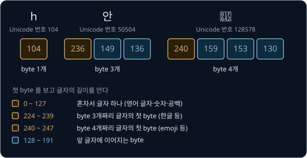

위 그림은 세 글자의 byte 를 나란히 놓은 것이다. 주황 칸은 글자의 첫 byte, 파란 칸은 그 글자에 이어지는 byte 다. 영어 글자는
ASCII 번호가 그대로 byte 하나가 되고, 한글은 3 byte, emoji 는 4 byte 다.

byte 가 줄줄이 이어져 있어도 글자가 어디서 끊기는지 알 수 있는 것은 첫 byte 의 크기 덕분이다. 0 ~ 127 이면 그 byte 혼자 글자
하나이고, 192 ~ 223 이면 2 byte, 224 ~ 239 이면 3 byte, 240 ~ 247 이면 4 byte 짜리 글자의 첫 byte 다. 128 ~ 191 은 앞 글자에
이어지는 byte 에만 쓴다. 예를 들어 byte 열 104, 236, 149, 136 을 받으면 104 는 혼자 글자 h 이고, 236 은 224 ~ 239 사이라서
236, 149, 136 세 개가 한 글자 "안" 이다.

**확인 문제.** "안h" 를 UTF-8 로 적으면 byte 가 몇 개일까? 그리고 첫 byte 가 240 인 글자는 byte 몇 개짜리일까?

답 보기

"안" 이 3 byte, h 가 1 byte 라서 모두 4 개(236, 149, 136, 104)다. 240 은 240 ~ 247 사이라서 4 byte 짜리 글자의 첫 byte 다.

### 3 byte 로 나누는 계산

한글 한 글자가 왜 236, 149, 136 이 되는지는 곱셈과 나눗셈으로 직접 계산할 수 있다. 10진수의 자릿값을 떠올리면 쉽다.
$345 = 3 \times 100 + 4 \times 10 + 5$ 처럼 10진수는 한 자리에 0 ~ 9 를 적고 자리가 올라갈 때마다 10 배가 된다.

UTF-8 의 이어지는 byte 는 128 ~ 191 사이라서, 128 을 빼면 0 ~ 63 의 64 가지 수를 담는다. 그래서 3 byte 글자는 Unicode 번호를
"64 를 64 번 곱한 4096 짜리 묶음 몇 개 + 64 짜리 묶음 몇 개 + 나머지" 로 나눠 적는다. "안" 의 50504 로 해 본다.

| 단계 | 계산 | 결과 |
| --- | --- | --- |
| 4096 짜리 묶음 수 | $50504 \div 4096$ 의 몫 | 12 (나머지 1352) |
| 64 짜리 묶음 수 | $1352 \div 64$ 의 몫 | 21 (나머지 8) |
| 남은 수 | | 8 |
| 검산 | $12 \times 4096 + 21 \times 64 + 8 = 49152 + 1344 + 8$ | 50504 |

첫 byte 에는 "3 byte 글자의 첫 byte" 라는 표시로 224 를 더하고, 나머지 두 byte 에는 "이어지는 byte" 라는 표시로 128 을 더한다.

| byte | 계산 | 값 |
| --- | --- | --- |
| 첫째 | $224 + 12$ | 236 |
| 둘째 | $128 + 21$ | 149 |
| 셋째 | $128 + 8$ | 136 |

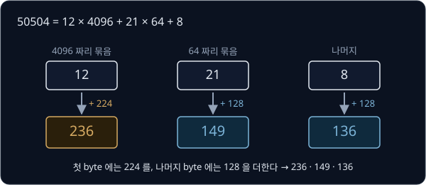

숫자만 바꿔 "가"(Unicode 번호 44032)로 한 번 더 한다. $44032 \div 4096$ 의 몫은 10 이고 나머지는 $44032 - 40960 = 3072$ 다.
$3072 \div 64 = 48$ 로 나누어떨어져 나머지는 0 이다. 그래서 byte 는 $224 + 10 = 234$, $128 + 48 = 176$, $128 + 0 = 128$ 이다.

한글 음절의 Unicode 번호는 모두 44032 ~ 55203 사이이고, 이 범위의 번호는 모두 이 계산으로 3 byte 가 된다. 한글 한 글자가 영어
글자의 세 배인 3 byte 를 쓰는 이유이고, 이 차이는 강의 끝에서 한국어 text 가 token 을 더 많이 쓰는 이유로 다시 나온다.

**확인 문제.** "하" 의 Unicode 번호는 54616 이다. UTF-8 세 byte 를 구해 보자.

답 보기

$54616 \div 4096$ 의 몫은 13 이고 나머지는 $54616 - 53248 = 1368$ 이다. $1368 \div 64$ 의 몫은 21 이고 나머지는
$1368 - 1344 = 24$ 다. byte 는 $224 + 13 = 237$, $128 + 21 = 149$, $128 + 24 = 152$ 다.

**요약**

- Unicode 는 세계의 글자에 번호를 붙인 문자 코드이고, UTF-8 은 그 번호를 byte 1 ~ 4 개로 나눠 적는 규칙이다
- 첫 byte 의 크기로 그 글자가 byte 몇 개짜리인지 알 수 있다. 한글은 224 ~ 239 로 시작하는 3 byte 다
- 어떤 text 든 UTF-8 로 바꾸면 0 ~ 255 사이의 숫자 열이 된다

## token 과 vocabulary

### token 과 token id

UTF-8 로 바꾼 byte 열을 그대로 모델에 넣을 수도 있지만, 모델이 숫자 열을 읽는 단위를 byte 보다 크게 잡을 수도 있다. text 를
모델이 읽는 단위로 자른 조각 하나를 token 이라고 한다. 쓸 수 있는 token 을 모두 모아 번호를 붙인 목록이 vocabulary 이고,
vocabulary 에서 token 에 붙은 번호를 token id 라고 한다.

가장 단순한 vocabulary 는 byte 256 개를 그대로 token 으로 쓰고 byte 값을 그대로 token id 로 쓰는 것이다. 이 vocabulary 로
"cat hat" 을 자르면 token 7개 c, a, t, ␣, h, a, t 가 되고 token id 는 99, 97, 116, 32, 104, 97, 116 이다.

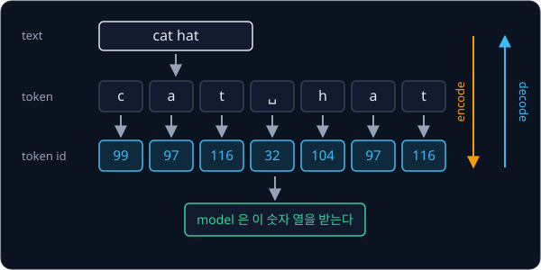

위 그림은 text "cat hat" 이 token 으로 잘리고, token 마다 id 가 붙어 모델에 들어가는 길을 보여 준다. 모델이 받는 것은 맨 아래의
숫자 열뿐이다.

이 강의에서 token 은 text 를 자른 조각인 text token 을 뜻한다. 같은 낱말이 이미지나 로봇 움직임을 다루는 강의에서는 조금 다른
뜻으로 쓰이는데, 그 차이는 뒤의 [문맥에 따른 token 의 뜻](#문맥에-따른-token-의-뜻) 절에서 따로 정리한다.

### encode 와 decode

text 를 token id 열로 바꾸는 일을 encode, token id 열을 text 로 되돌리는 일을 decode 라고 한다. 이 두 일을 하는 프로그램이
tokenizer 다. 그림의 주황 화살표가 encode, 파란 화살표가 decode 다.

decode 는 id 마다 vocabulary 에서 token 을 찾아 이어 붙이면 된다. id 열 104, 97, 116 은 h, a, t 를 이어 붙인 "hat" 이다. encode
로 바꿨다가 decode 로 되돌리면 처음 text 가 그대로 나와야 하는데, 이 성질이 깨지면 모델이 쓴 답을 사람이 읽을 수 없다.

token 이 줄줄이 이어진 열을 sequence 라고 하고, 그 안의 token 개수를 sequence 길이라고 한다. "cat hat" 은 이 vocabulary 에서
sequence 길이가 7 이다.

**확인 문제.** byte vocabulary 에서 "tea" 를 encode 하면 token id 열은? (e 는 101) 그리고 id 열 99, 97, 116 을 decode 하면?

답 보기

t 는 116, e 는 101, a 는 97 이라서 116, 101, 97 이다. 99, 97, 116 은 c, a, t 를 이어 붙인 "cat" 이다.

## 자르는 단위의 선택

### 글자·단어·subword

token 을 얼마나 크게 잡느냐에 따라 vocabulary 크기와 sequence 길이가 반대로 움직인다. 영어 단어 unbelievable 을 글자, 단어,
subword 의 세 가지 단위로 잘라 보자. subword 는 단어보다 작고 글자보다 큰 조각이다. 표의 GPT-2 는 OpenAI 가 2019년에 낸
language model 이고, 이 강의에서 실제 tokenizer 의 예로 계속 쓴다.

| 단위 | unbelievable 을 자른 결과 | token 수 | vocabulary 크기 |
| --- | --- | --- | --- |
| 글자 | u n b e l i e v a b l e | 12 | 글자 종류 수 (영어는 100 개 안팎) |
| 단어 | unbelievable | 1 | 단어 종류 수 (수만 ~ 수십만) |
| subword | un bel iev able | 4 | 정하기 나름 (GPT-2 는 50,257) |

글자 단위는 vocabulary 가 작지만 sequence 가 길다. 모델은 token 을 하나씩 받아 계산하므로 token 이 많을수록 계산이 늘고, 한 번에
읽을 수 있는 token 수에 한도가 있는 모델은 같은 한도 안에 담는 내용이 줄어든다. 모델이 한 번에 읽을 수 있는 token 수의 한도를
context 길이라고 한다.

단어 단위는 sequence 가 짧지만 vocabulary 가 아주 커지고, vocabulary 에 없는 단어를 다루지 못한다. vocabulary 는 학습 corpus 로
한 번 만든 뒤 고정한다. 모델은 token id 마다 따로 숫자를 학습해 두므로, 쓰는 도중에 새 token 을 만들어 넣으면 모델은 그 token 을
다루는 법을 배운 적이 없기 때문이다. 단어 단위 vocabulary 는 보통 corpus 에서 자주 나온 단어 수만 개만 담아서, 한두 번 나온 오타는
학습 corpus 에 있었더라도 목록에서 빠진다. 새로 생긴 말이나 오타 "unbelievabel" 처럼 목록에서 찾아도 나오지 않는 단어는 번호가
없어서 "모르는 단어" 를 뜻하는 특별한 token 하나로 바뀐다. 이 token 을 흔히 `<unk>`(unknown)라고 적는데, 서로 다른 모르는 단어가 모두 같은 `<unk>` 로 뭉개지므로 decode 해도 원래 단어를 되살릴 수 없다.

subword 단위에서는 자주 나오는 단어는 통째로 token 하나가 되고, 드문 단어는 자주 나오는 조각 몇 개로 나뉜다. 위 표의 un, bel,
iev, able 은 GPT-2 의 tokenizer 가 실제로 자른 결과다. 오타 unbelievabel 도 GPT-2 에서는 un, bel, iev, abel 의 token 4 개로
잘려서 `<unk>` 가 생기지 않는다.

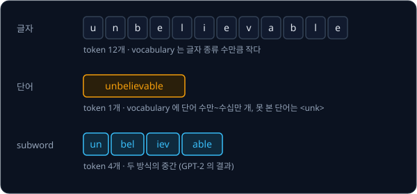

위 그림은 세 단위의 결과를 위아래로 놓은 것이다. 글자 단위는 칸이 12 개로 가장 많고, 단어 단위는 한 칸이지만 vocabulary 가 가장
크며, subword 는 그 사이다.

### byte 를 시작 vocabulary 로 쓰는 이유

subword 를 사람이 일일이 정할 수는 없으니 데이터에서 찾아야 한다. 그 출발점으로 GPT-2 는 byte 256 개를 vocabulary 에 먼저 넣었다.
어떤 text 든 UTF-8 로 바꾸면 0 ~ 255 사이의 byte 열이 되므로, 처음 보는 단어나 한글·emoji 가 나와도 최악의 경우 byte 하나하나가
token 이 될 뿐 `<unk>` 는 생기지 않는다.

대신 잃는 것도 있다. 한글 한 글자는 byte 3 개라서 그대로 두면 token 3 개가 되어 sequence 가 길어지고, token 하나가 글자의
일부 byte 만 담는 일도 생긴다. 이 두 문제는 뒤의 [decode](#decode) 절과 [한국어 text 의 token 수](#한국어-text-의-token-수) 절에서 숫자로 다시 본다.

**흔한 오해.** token 을 "단어" 와 같은 말로 여기기 쉽지만, token 은 tokenizer 가 정한 조각일 뿐이다. unbelievable 은 단어 하나지만
GPT-2 에서는 token 4 개이고, 반대로 앞에 공백이 붙은 "␣unbelievable" 은 GPT-2 에서 token 1 개다.

**확인 문제.** 글자 단위 vocabulary 로 "hello world"(공백 포함)를 자르면 token 이 몇 개일까? 단어 단위로 자르면?

답 보기

글자 단위로는 h, e, l, l, o, ␣, w, o, r, l, d 의 11 개다. 단어 단위로 공백을 경계로 자르면 hello, world 의 2 개다.

**요약**

- token 은 text 를 모델이 읽는 단위로 자른 조각이고, vocabulary 는 token 목록, token id 는 vocabulary 안의 번호다
- 단위가 작으면 sequence 가 길고, 크면 vocabulary 가 커지며 못 본 단어가 `<unk>` 로 뭉개진다. subword 는 그 중간이다
- byte 256 개에서 시작하면 어떤 text 든 encode 할 수 있어서 `<unk>` 가 없다

## 문맥에 따른 token 의 뜻

뒤의 강의들에서 token 이라는 말이 계속 나오는데, 문맥마다 가리키는 대상이 다르다. 셋 모두 "모델이 한 번에 하나씩 받거나 내는
단위" 라는 점은 같고, 그 단위가 무엇에서 왔는지와 번호가 있는지가 다르다.

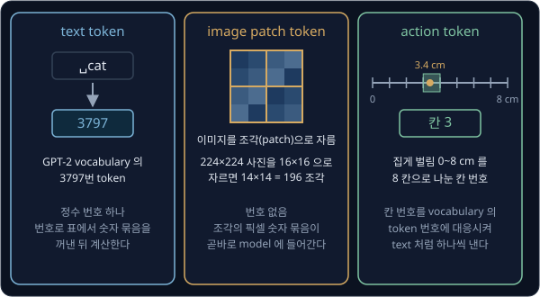

위 그림은 세 가지 쓰임을 나란히 놓은 것이다.

- **text token** — 이 강의의 token 이다. text 를 자른 조각이고 vocabulary 안의 정수 번호 하나로 나타낸다. GPT-2 에서 "␣cat"
  은 3797 번 token 이다
- **image patch token** — 사진은 작은 점(pixel)이 가로세로로 늘어선 것이고, 점마다 빨강·초록·파랑의 밝기가 숫자로 적혀 있다.
  이미지를 읽는 모델 [ViT](../vit/README.md) 는 가로세로 224 pixel 인 사진을 16×16 pixel 크기의 조각(patch)으로 잘라
  $14 \times 14 = 196$ 개의 token 을 만든다. text 는 글자라서 번호를 붙여야 숫자가 되지만, 사진은 처음부터 pixel 마다 밝기 숫자가
  적혀 있어서 번호로 바꿀 필요가 없다. 그래서 이 token 에는 vocabulary 번호가 없고, 조각 안 pixel 의 숫자 $16 \times 16 \times 3 = 768$
  개를 한 줄로 묶은 것이 곧바로 모델에 들어간다. 숫자 여러 개를 순서대로 묶은 이런 것을 vector 라고 한다
- **action token** — 로봇 팔의 움직임은 "집게를 3.4 cm 벌린다" 처럼 연속된 숫자다. 사진과 지시문을 받아 로봇 팔의 움직임을
  내는 모델 RT-2·OpenVLA([RT-2 → OpenVLA](../vla-tokens/README.md))는 text 를 쓰던 language model 을 고쳐 만들어서, 답을 낼 때
  vocabulary 의 token 가운데 하나를 고를 수만 있고 3.4 같은 실수를 직접 적어 내지 못한다. 그래서 움직임 숫자의 범위를 칸으로
  나누고, 칸 번호마다 vocabulary 의 token 번호 하나를 짝지어 둔다. 그러면 모델이 text 를 쓰듯 token 을 고르는 것만으로 움직임을
  낼 수 있다. 그림처럼 0 ~ 8 cm 를 1 cm 씩 8 칸(칸 0 ~ 칸 7)으로 나누면 3.4 cm 는 3 이상 4 미만이라서 칸 3 이다. 실제
  RT-2·OpenVLA 는 한 값을 256 칸으로 나누고, 이 칸을 bin 이라고 부른다

세 가지를 견주면 text token 과 action token 은 vocabulary 의 정수 번호이고, image patch token 은 번호 없이 숫자 묶음 그대로다. 앞으로
"token 이 몇 개" 라는 말이 나오면 어느 쪽 token 인지 먼저 확인한다.

**확인 문제.** 0 ~ 8 cm 를 1 cm 씩 8 칸(칸 0 ~ 칸 7)으로 나눌 때 6.7 cm 는 몇 번 칸일까? 그리고 224×224 사진을 16×16 patch 로
자르면 token 이 몇 개일까?

답 보기

6.7 은 6 이상 7 미만이라서 칸 6 이다. 가로로 $224 \div 16 = 14$ 개, 세로로 14 개라서 $14 \times 14 = 196$ 개다.

## BPE 의 아이디어

### 쌍과 빈도

subword vocabulary 를 데이터에서 찾는 대표적인 방법이 BPE(byte pair encoding)다. 이름 그대로 원래는 byte 쌍(pair)을 새 기호로
바꿔 적어 파일을 줄이는 압축 방법으로, 1994년 Philip Gage 가 냈다. 2016년 Sennrich 등이 이 방법을 번역 모델의 subword
vocabulary 를 만드는 데 썼고, 2019년 GPT-2 는 byte 에서 시작하는 BPE 를 tokenizer 로 썼다.

BPE 는 sequence 에서 바로 옆에 붙어 있는 두 token 을 하나의 쌍으로 본다. 쌍은 (왼쪽 token, 오른쪽 token) 처럼 괄호로 적는다.
"abab" 의 token a, b, a, b 에는 이웃한 자리가 세 군데 있어서 쌍이 (a, b), (b, a), (a, b) 로 세 번 나온다. 같은 쌍이 몇 번 나오는지가
그 쌍의 빈도이고, "abab" 에서 (a, b) 의 빈도는 2, (b, a) 의 빈도는 1 이다.

순서가 다르면 다른 쌍이다. (a, b) 는 a 다음에 b 가 오는 것이고 (b, a) 는 b 다음에 a 가 오는 것이라서 따로 센다.

**확인 문제.** "aba" 와 "abcab" 에서 각 쌍의 빈도를 세어 보자.

답 보기

"aba" 는 (a, b) 1, (b, a) 1 이다. "abcab" 는 이웃한 자리 네 군데가 (a, b), (b, c), (c, a), (a, b) 라서 (a, b) 2, (b, c) 1,
(c, a) 1 이다.

### merge

BPE 학습은 byte vocabulary 에서 시작해 아래 세 단계를 정한 횟수만큼 되풀이한다.

1. 지금 sequence 에서 쌍마다 빈도를 센다
2. 빈도가 가장 큰 쌍에 새 token id 를 붙인다. 새 id 는 256, 257, 258, … 순서로 늘어나고, 새 token 은 두 token 을 이어 붙인 것이다
3. sequence 에서 그 쌍이 나오는 자리를 모두 새 token 하나로 바꾼다

두 token 을 하나로 합치는 이 일을 merge 라고 한다. merge 한 번에 vocabulary 는 token 하나가 늘고, sequence 는 바뀐 자리 수만큼
짧아진다. 자주 붙어 나오는 쌍부터 합치므로 자주 쓰는 글자 묶음일수록 먼저 token 이 된다.

몇 번 되풀이할지는 원하는 vocabulary 크기로 정한다. byte 256 개에서 시작하므로 vocabulary 를 259 로 만들려면 merge 를
$259 - 256 = 3$ 번, 512 로 만들려면 256 번 한다.

## BPE 학습의 손 계산

### 1회차

학습에 쓰는 text 묶음을 corpus(말뭉치)라고 한다. corpus 가 "cat hat cat that" 한 줄이고 vocabulary 를 259 로 만든다고 하자.
merge 는 3 번이다. 처음에는 byte 하나가 token 하나라서 sequence 가 c a t ␣ h a t ␣ c a t ␣ t h a t 의 token 16 개다.

이웃한 자리는 15 군데이고, 쌍마다 빈도를 세면 아래와 같다. 표는 text 앞쪽에서 처음 나온 순서로 적었다.

| 쌍 | 나오는 자리 | 빈도 |
| --- | --- | --- |
| (c, a) | **ca**t, **ca**t | 2 |
| (a, t) | c**at**, h**at**, c**at**, th**at** | 4 |
| (t, ␣) | ca**t␣**, ha**t␣**, ca**t␣** | 3 |
| (␣, h) | **␣h**at | 1 |
| (h, a) | **ha**t, t**ha**t | 2 |
| (␣, c) | **␣c**at | 1 |
| (␣, t) | **␣t**hat | 1 |
| (t, h) | **th**at | 1 |

빈도를 모두 더하면 $2 + 4 + 3 + 1 + 2 + 1 + 1 + 1 = 15$ 로 이웃한 자리 수와 같다. 빈도가 가장 큰 쌍은 4 번 나온 (a, t) 다.

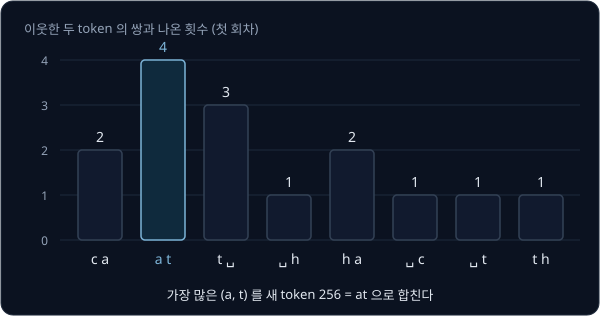

(a, t) 에 새 id 256 을 붙이고 이 token 을 at 이라고 적는다. sequence 에서 (a, t) 가 나오는 네 자리를 모두 256 으로 바꾸면
c at ␣ h at ␣ c at ␣ t h at 이 되어 token 이 $16 - 4 = 12$ 개다.

| 회차 | 고른 쌍 | 빈도 | 새 id | 새 token | sequence 길이 |
| --- | --- | --- | --- | --- | --- |
| 1 | (a, t) | 4 | 256 | at | 16 → 12 |

### 2회차

바뀐 sequence c at ␣ h at ␣ c at ␣ t h at 에서 쌍을 다시 센다. at 은 이제 token 하나라서 (c, a) 같은 쌍은 없어지고, (c, at) 처럼
새 token 이 든 쌍이 생긴다.

| 쌍 | 빈도 |
| --- | --- |
| (c, at) | 2 |
| (at, ␣) | 3 |
| (␣, h) | 1 |
| (h, at) | 2 |
| (␣, c) | 1 |
| (␣, t) | 1 |
| (t, h) | 1 |

빈도가 가장 큰 쌍은 3 번 나온 (at, ␣) 다. id 257 을 붙이고 at␣ 이라고 적는다. 세 자리를 바꾸면 c at␣ h at␣ c at␣ t h at 의
token $12 - 3 = 9$ 개가 된다. 마지막 at 은 뒤에 공백이 없어서 그대로 남는다.

### 3회차

sequence c at␣ h at␣ c at␣ t h at 의 쌍은 아래와 같다.

| 쌍 | 빈도 |
| --- | --- |
| (c, at␣) | 2 |
| (at␣, h) | 1 |
| (h, at␣) | 1 |
| (at␣, c) | 1 |
| (at␣, t) | 1 |
| (t, h) | 1 |
| (h, at) | 1 |

2 번 나온 (c, at␣) 에 id 258 을 붙이고 cat␣ 이라고 적는다. 두 자리를 바꾸면 cat␣ h at␣ cat␣ t h at 의 token $9 - 2 = 7$ 개다.

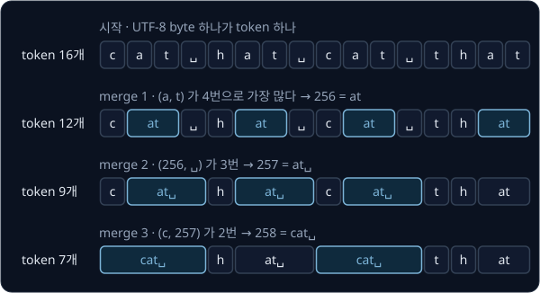

위 그림은 세 회차를 위에서 아래로 이어 놓은 것이다. 파란 칸이 그 회차에 새로 합쳐진 token 이고, token 수는 바뀐 자리 수만큼
$16 \to 12 \to 9 \to 7$ 로 준다.

### 학습 결과

BPE 학습이 남기는 것은 두 가지다. 하나는 어떤 쌍을 어떤 순서로 합쳤는지 적은 merge 목록이고, 다른 하나는 id 마다 어떤 byte 를
뜻하는지 적은 vocabulary 다.

| 순서 | merge | 새 id | 새 token 의 byte |
| --- | --- | --- | --- |
| 1 | (97, 116) = (a, t) | 256 | 97 116 = at |
| 2 | (256, 32) = (at, ␣) | 257 | 97 116 32 = at␣ |
| 3 | (99, 257) = (c, at␣) | 258 | 99 97 116 32 = cat␣ |

vocabulary 는 byte 256 개(id 0 ~ 255)에 이 세 token 을 더한 259 개다. 새 token 은 늘 두 token 을 이어 붙인 것이라서, id 258 을
풀면 99 와 257 이고, 257 을 다시 풀면 256 과 32, 256 을 풀면 97 과 116 이 된다. 결국 모든 token 은 byte 몇 개로 풀린다.

학습한 corpus 를 이 vocabulary 로 적으면 id 열 258, 104, 257, 258, 116, 104, 256 이다.

**확인 문제.** corpus "ab ab abc" 의 첫 회차에서 빈도가 가장 큰 쌍과 그 빈도는? merge 한 뒤 sequence 는 token 몇 개일까?

답 보기

token 은 a b ␣ a b ␣ a b c 의 9 개다. 쌍은 (a, b) 3, (b, ␣) 2, (␣, a) 2, (b, c) 1 이라서 (a, b) 가 3 번으로 가장 많다. 세 자리를
256 하나로 바꾸면 $9 - 3 = 6$ 개(ab ␣ ab ␣ ab c)가 된다.

### 빈도가 같은 쌍

숫자만 바꿔 corpus "banana bandana" 로 merge 세 번을 다시 한다. 처음 sequence 는 b a n a n a ␣ b a n d a n a 의 token 14 개다.

1회차의 쌍은 (b, a) 2, (a, n) 4, (n, a) 3, (a, ␣) 1, (␣, b) 1, (n, d) 1, (d, a) 1 이다. (a, n) 이 4 번으로 가장 많아서 256 = an
이 되고, sequence 는 b an an a ␣ b an d an a 의 10 개가 된다.

2회차에서는 빈도가 가장 큰 쌍이 둘이다.

| 쌍 | 빈도 |
| --- | --- |
| (b, an) | 2 |
| (an, an) | 1 |
| (an, a) | 2 |
| (a, ␣) | 1 |
| (␣, b) | 1 |
| (an, d) | 1 |
| (d, an) | 1 |

(b, an) 과 (an, a) 가 똑같이 2 번이다. 같은 corpus 로 학습할 때마다 결과가 달라지면 안 되므로, 이럴 때 어느 쪽을 고를지는
규칙으로 미리 정해 둬야 한다. 이 강의에서는 "빈도가 같으면 text 앞쪽에서 먼저 나온 쌍을 고른다" 는 규칙을 쓴다. 구현에
따라서는 사전에서 뒤에 오는 쪽을 고르는 등 다른 규칙을 쓰기도 하는데, 규칙이 하나로 정해져 있기만 하면 된다.

먼저 나온 (b, an) 을 골라 257 = ban 이 되고, sequence 는 ban an a ␣ ban d an a 의 8 개가 된다. 3회차에서는 (an, a) 가 2 번으로
가장 많아서 258 = ana 가 되고, sequence 는 ban ana ␣ ban d ana 의 6 개가 된다.

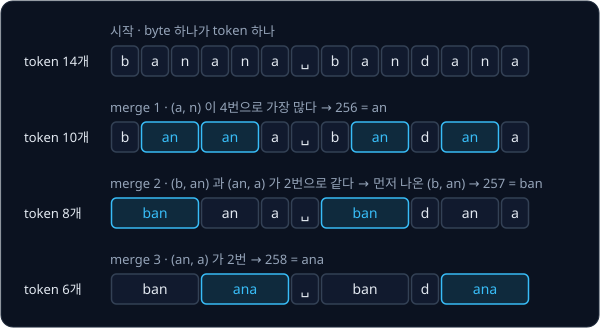

| 회차 | 고른 쌍 | 빈도 | 새 id | 새 token | sequence 길이 |
| --- | --- | --- | --- | --- | --- |
| 1 | (a, n) | 4 | 256 | an | 14 → 10 |
| 2 | (b, an) | 2 | 257 | ban | 10 → 8 |
| 3 | (an, a) | 2 | 258 | ana | 8 → 6 |

두 예 모두 앞 회차에서 만든 token 이 다음 회차의 쌍 안에 들어가서 점점 긴 token 이 만들어진다. cat hat 에서는 at → at␣ → cat␣,
banana 에서는 an → ban 과 an → ana 순서였다.

**확인 문제.** banana bandana 의 2회차에서 (an, a) 를 골랐다면 sequence 는 token 몇 개가 될까?

답 보기

b an an a ␣ b an d an a 에서 (an, a) 가 나오는 자리는 셋째·넷째 token(an a)과 끝의 두 token(an a)이라서 두 자리가 바뀐다. 그래서
$10 - 2 = 8$ 개(b an ana ␣ b an d ana)다. token 수는 같지만 만들어진 token 이 달라서, 다음 회차부터는 다른 merge 가 나온다.

### 같은 글자가 이어지는 자리

**흔한 오해.** "merge 한 번에 줄어드는 token 수는 그 쌍의 빈도와 같다" 고 생각하기 쉽지만, 같은 글자가 셋 이상 이어지면 다르다.
"aaa" 에는 이웃한 자리가 두 군데라서 (a, a) 의 빈도는 2 다. 그런데 왼쪽부터 바꾸면 앞의 a a 가 256 하나가 되고 남은 a 하나는 짝이
없어서, 실제로 바뀌는 자리는 하나뿐이고 sequence 는 256 a 의 2 개가 된다. 가운데 a 는 두 쌍에 함께 세어졌지만 한 번만 합쳐질
수 있기 때문이다. 그래서 줄어드는 token 수는 빈도가 아니라 실제로 바뀐 자리 수다.

**확인 문제.** "aaaa" 에서 (a, a) 의 빈도는? (a, a) 를 왼쪽부터 merge 하면 token 이 몇 개 남을까?

답 보기

이웃한 자리가 세 군데라서 빈도는 3 이다. 왼쪽부터 바꾸면 aa aa 로 두 자리가 바뀌어 token 2 개가 남는다.

**요약**

- BPE 학습은 쌍의 빈도를 세고, 가장 많은 쌍을 새 id 로 merge 하는 일을 정한 횟수만큼 되풀이한다
- 학습 결과는 merge 목록(합친 순서)과 vocabulary(id → byte)다. vocabulary 크기는 256 에 merge 횟수를 더한 값이다
- 빈도가 같은 쌍은 미리 정한 규칙으로 고른다. 줄어드는 token 수는 실제로 바뀐 자리 수다

## encode

### merge 를 배운 순서대로 적용

학습이 끝나면 처음 보는 text 도 token 으로 바꿀 수 있어야 한다. encode 는 text 를 UTF-8 byte 열로 바꾼 다음, merge 목록을 배운
순서대로 하나씩 적용한다. 각 merge 는 sequence 에서 그 쌍이 나오는 자리를 왼쪽부터 모두 바꾸고, 적용할 자리가 없으면 그냥
넘어간다.

cat hat cat that 으로 배운 merge 세 개로 "that cat" 을 encode 해 본다. 학습 corpus 에 없던 문장이다.

| 단계 | 적용한 merge | sequence | token 수 |
| --- | --- | --- | --- |
| 시작 | 없음 | t h a t ␣ c a t | 8 |
| 1 | (a, t) → 256 | t h at ␣ c at | 6 |
| 2 | (at, ␣) → 257 | t h at␣ c at | 5 |
| 3 | (c, at␣) → 258 | 바뀌는 자리 없음 | 5 |

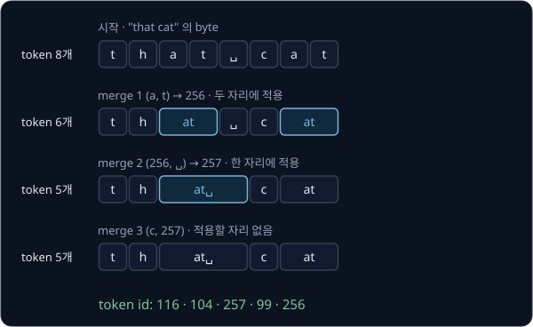

3 단계에서 (c, at␣) 는 적용되지 않는다. 문장 끝의 cat 뒤에는 공백이 없어서 c 다음에 at␣ 가 아니라 at 이 오기 때문이다. 결과
token id 열은 116, 104, 257, 99, 256 이다.

숫자만 바꿔 "hat cat " (끝에 공백 하나)을 encode 한다. byte 는 h a t ␣ c a t ␣ 의 8 개다. merge 1 로 h at ␣ c at ␣ (6 개),
merge 2 로 h at␣ c at␣ (4 개), merge 3 으로 h at␣ cat␣ (3 개)가 되어 id 열은 104, 257, 258 이다.

### 순서가 중요한 이유

merge 를 다른 순서로 적용하면 결과가 달라진다. "cat␣" 을 배운 순서(1 → 2 → 3)로 encode 하면 c at ␣ → c at␣ → cat␣ 으로 token
하나가 된다. 거꾸로 3 → 2 → 1 순서로 적용하면, merge 3 은 at␣ 가 아직 없어서 적용되지 않고 merge 2 도 at 이 아직 없어서 적용되지
않는다. 마지막 merge 1 만 적용되어 c at ␣ 의 token 3 개로 끝난다.

뒤에 배운 merge 는 앞에서 만든 token 을 재료로 쓰므로 재료가 먼저 만들어져 있어야 한다. 그래서 encode 는 학습 때 merge 를 만든
순서를 우선순위로 그대로 쓴다. 학습 corpus 를 이 순서로 encode 하면 학습 마지막의 sequence 와 똑같은 결과가 나온다.

### 학습 때 못 본 글자

학습 corpus 에 없던 글자가 나와도 encode 는 실패하지 않는다. "cat dog" 을 encode 하면 d, o, g 가 든 merge 가 하나도 없으므로
그 byte 들은 byte token 그대로 남는다. c a t ␣ d o g 에서 merge 1 이 c at ␣ d o g, merge 2 가 c at␣ d o g, merge 3 이 cat␣ d o g 를
만들어 id 열은 258, 100, 111, 103 이다. 한글이나 emoji 도 byte 로 바뀌므로 같은 방식으로 encode 된다.

**확인 문제.** 같은 merge 세 개로 "chat" 을 encode 하면 token id 열은? (h 는 104)

답 보기

byte 는 c h a t 이다. merge 1 로 c h at 이 되고, 뒤에 공백이 없어서 merge 2·3 은 적용되지 않는다. id 열은 99, 104, 256 이다.

## decode

### id 에서 byte 로

decode 는 id 마다 vocabulary 에서 byte 를 찾아 이어 붙인 뒤, 그 byte 열을 UTF-8 규칙으로 글자로 읽는다. 위에서 만든 id 열
116, 104, 257, 99, 256 을 decode 해 본다.

| id | vocabulary 의 byte | 글자 |
| --- | --- | --- |
| 116 | 116 | t |
| 104 | 104 | h |
| 257 | 97 116 32 | at␣ |
| 99 | 99 | c |
| 256 | 97 116 | at |

이어 붙인 byte 열 116 104 97 116 32 99 97 116 은 "that cat" 이다. encode 한 뒤 decode 하면 처음 text 로 돌아온다.

### 글자 중간에서 끊긴 token

byte 에서 시작하는 BPE 는 쌍을 byte 단위로 세기 때문에, 한 글자의 byte 가운데 일부만 합친 token 이 만들어질 수 있다. 실제로
GPT-2 의 vocabulary 에는 "하" 의 세 byte 237, 149, 152 가운데 앞의 두 byte 237, 149 만 담은 token(id 47991)이 있다.

이 token 을 혼자 decode 하면 byte 열이 237, 149 에서 끝난다. 237 은 3 byte 글자의 첫 byte 인데 이어지는 byte 가 하나뿐이라서
UTF-8 규칙으로 읽을 수 없다. 이런 자리는 오류를 내는 대신 "읽을 수 없는 글자" 를 뜻하는 � 기호로 바꿔 보여 준다. 다음 token 이
152 를 담고 있어서 둘을 이어 붙여 decode 하면 "하" 가 제대로 나온다.

language model 은 token 을 하나씩 만들어 내므로, 한글을 쓰는 도중에 token 하나만 decode 해서 화면에 띄우면 잠깐 � 가 보였다가
다음 token 이 나온 뒤 글자가 완성되는 일이 생긴다.

**확인 문제.** byte 열 104, 236, 149 를 UTF-8 로 읽으면 어떻게 될까?

답 보기

104 는 혼자 글자 h 다. 236 은 3 byte 글자의 첫 byte 인데 뒤에 149 하나만 있어서 글자를 완성하지 못하므로 � 가 된다. 결과는
"h�" 다.

**요약**

- encode 는 text 를 byte 열로 바꾼 뒤 merge 를 배운 순서대로 적용한다. 순서를 바꾸면 결과가 달라진다
- decode 는 id 마다 byte 를 찾아 이어 붙이고 UTF-8 로 읽는다. 글자 일부만 담은 token 을 혼자 decode 하면 � 가 나온다

## pre-tokenization

### 단어 경계를 넘는 merge

cat hat cat that 의 학습 결과를 다시 보면 두 번째 merge 는 at␣ 이고 세 번째 merge 는 cat␣ 인데, 둘 다 단어 끝과 그 뒤의
공백을 한 token 으로 묶었다. 문장부호에서도 같은 일이 생겨서, corpus 에 "dog." "dog!" "dog?" 가 자주 나오면 BPE 는 dog 다음의 문장부호까지 묶어
dog., dog!, dog? 같은 token 을 따로따로 만든다. 뜻은 같은 dog 인데 vocabulary 자리를 세 칸이나 쓰고, 문장부호가 바뀔 때마다 모델은
다른 token 을 보게 된다.

그래서 GPT-2 는 BPE 를 하기 전에 text 를 단어와 문장부호 단위의 조각으로 먼저 나누고, merge 가 조각 경계를 넘지 못하게 했다. BPE
앞에서 하는 이 나누기를 pre-tokenization 이라고 한다.

### GPT-2 의 조각 규칙

GPT-2 는 아래 규칙으로 text 를 조각낸다. 이런 글자 모양 규칙을 적는 표기법을 정규식(regular expression)이라고 하는데, 표기법 대신
규칙의 뜻만 적으면 다음과 같다.

| 조각 종류 | 예 |
| --- | --- |
| 영어 축약 부분 | 's, 'll, 're |
| 앞의 공백 하나 + 이어지는 글자(한글 포함) | Hello, ␣world, 안녕 |
| 앞의 공백 하나 + 이어지는 숫자 | ␣123 |
| 앞의 공백 하나 + 이어지는 기호 | !!, ␣. |
| 그 밖의 공백 | 공백 여러 개, 줄바꿈 |

공백은 대부분 다음 단어의 앞에 붙는다. "Hello world's 123 dogs!!" 를 자르면 Hello, ␣world, 's, ␣123, ␣dogs, !! 의 여섯 조각이 되고,
"dog. dog! dog?" 는 dog, ., ␣dog, !, ␣dog, ? 가 되어 dog 와 문장부호가 다른 조각으로 갈린다. 공백이 여러 개 이어진 "a␣␣␣b" 는
a, ␣␣, ␣b 로 잘려 마지막 공백 하나가 다음 단어 앞에 붙는다.

앞의 흔한 오해에서 "␣unbelievable" 이 token 1 개였던 것도 이 규칙 때문이다. 문장 가운데의 단어는 거의 늘 앞에 공백이 붙은 조각으로 나오므로, GPT-2 의 vocabulary 에는 공백이 앞에 붙은 단어가 통째로 많이 들어 있다.

### 조각 안에서만 세는 학습

pre-tokenization 을 하면 쌍은 조각 안에서만 센다. cat hat cat that 은 cat, ␣hat, ␣cat, ␣that 의 네 조각이 되고, 조각과 조각
사이에 걸친 (t, ␣) 는 세지 않는다.

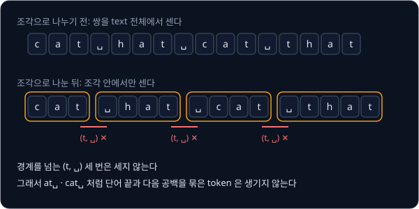

1회차의 쌍은 (c, a) 2, (a, t) 4, (␣, h) 1, (h, a) 2, (␣, c) 1, (␣, t) 1, (t, h) 1 이다. 앞에서 3 번이던 (t, ␣) 만 빠졌다. 첫
merge 는 그대로 (a, t) → 256 이다.

2회차에는 네 조각이 c at, ␣ h at, ␣ c at, ␣ t h at 이 되고 쌍은 아래와 같다.

| 쌍 | 빈도 |
| --- | --- |
| (c, at) | 2 |
| (␣, h) | 1 |
| (h, at) | 2 |
| (␣, c) | 1 |
| (␣, t) | 1 |
| (t, h) | 1 |

(c, at) 과 (h, at) 이 2 번으로 같아서 먼저 나온 (c, at) 을 골라 257 = cat 이 된다. 3회차에는 (h, at) 이 2 번으로 가장 많아서
258 = hat 이 된다. 결과 vocabulary 의 새 token 은 at, cat, hat 으로, pre-tokenization 없이 배운 at, at␣, cat␣ 과 달리 공백을
단어 뒤에 붙인 token 이 없다.

### 같은 조각의 횟수

pre-tokenization 을 하면 "␣the" 처럼 같은 조각이 corpus 에 수없이 되풀이된다. 그래서 학습은 조각마다 몇 번 나왔는지만 세어 두고, 조각 안의 쌍 빈도에 그 횟수를 곱해서 더한다. 같은 조각을 매번 다시 훑지 않아도 되므로
계산이 크게 준다.

단어 다섯 종류와 그 횟수로 된 corpus 로 해 본다.

| 조각 | hug | pug | pun | bun | hugs |
| --- | --- | --- | --- | --- | --- |
| 나온 횟수 | 10 | 5 | 12 | 4 | 5 |

1회차의 쌍 빈도는 조각마다 "그 쌍이 조각 안에 몇 번 있는지 × 조각 횟수" 를 더해 구한다.

| 쌍 | 들어 있는 조각 | 계산 | 빈도 |
| --- | --- | --- | --- |
| (h, u) | hug, hugs | $10 + 5$ | 15 |
| (u, g) | hug, pug, hugs | $10 + 5 + 5$ | 20 |
| (p, u) | pug, pun | $5 + 12$ | 17 |
| (u, n) | pun, bun | $12 + 4$ | 16 |
| (b, u) | bun | $4$ | 4 |
| (g, s) | hugs | $5$ | 5 |

(u, g) 가 20 으로 가장 커서 256 = ug 가 된다. 조각은 h ug, p ug, p u n, b u n, h ug s 로 바뀐다.

2회차에는 pug 의 u 가 ug 안으로 들어갔으므로 (p, u) 는 pun 에서만 나와 12 가 된다.

| 쌍 | 계산 | 빈도 |
| --- | --- | --- |
| (h, ug) | $10 + 5$ | 15 |
| (p, ug) | $5$ | 5 |
| (p, u) | $12$ | 12 |
| (u, n) | $12 + 4$ | 16 |
| (b, u) | $4$ | 4 |
| (ug, s) | $5$ | 5 |

(u, n) 이 16 으로 가장 커서 257 = un 이 된다. 3회차에는 (h, ug) 15, (p, ug) 5, (p, un) 12, (b, un) 4, (ug, s) 5 가운데
(h, ug) 가 15 로 가장 커서 258 = hug 가 된다.

| 회차 | 고른 쌍 | 빈도 | 새 id | 새 token | corpus 전체 token 수 |
| --- | --- | --- | --- | --- | --- |
| 시작 | | | | | 113 |
| 1 | (u, g) | 20 | 256 | ug | 113 − 20 = 93 |
| 2 | (u, n) | 16 | 257 | un | 93 − 16 = 77 |
| 3 | (h, ug) | 15 | 258 | hug | 77 − 15 = 62 |

시작의 113 은 조각 길이에 횟수를 곱해 더한 값 $3 \times 10 + 3 \times 5 + 3 \times 12 + 3 \times 4 + 4 \times 5 = 113$ 이다.
이 예에서는 같은 글자가 이어지는 자리가 없어서 빈도만큼 token 이 준다.

**확인 문제.** 위 corpus 의 1회차에서 (p, u) 의 빈도는 17 이다. pug 가 5 번이 아니라 15 번 나왔다면 (p, u) 의 빈도는 얼마이고,
1회차에 가장 많은 쌍은 무엇일까?

답 보기

(p, u) 는 $15 + 12 = 27$ 이다. (u, g) 도 $10 + 15 + 5 = 30$ 으로 늘어서, 가장 많은 쌍은 여전히 (u, g) 의 30 이다.

**요약**

- pre-tokenization 은 BPE 앞에서 text 를 단어·숫자·기호 조각으로 나눠, merge 가 조각 경계를 넘지 못하게 한다
- 쌍은 조각 안에서만 세고, 같은 조각은 횟수를 곱해 한 번에 센다

## special token

학습 데이터에는 문서 여러 개가 이어 붙어 있다. 모델이 "여기서 한 문서가 끝나고 다른 문서가 시작된다" 는 것을 알 수 있도록
GPT-2 는 문서와 문서 사이에 `<|endoftext|>` 라는 표시를 넣었다. 이처럼 text 에서 배우지 않고 미리 정해 vocabulary 에 넣어 두는
token 을 special token 이라고 한다.

`<|endoftext|>` 를 보통 text 처럼 다루면 pre-tokenization 이 `<|`, endoftext, `|>` 같은 여러 조각으로 잘라 버린다. 그래서 encode
는 pre-tokenization 보다 먼저 text 에서 special token 을 찾아 떼어 내고, 그 자리를 정해 둔 id 하나로 바꾼다.

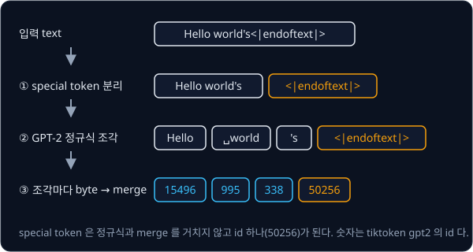

위 그림은 GPT-2 의 encode 를 세 단계로 보여 준다. ① special token 을 먼저 떼어 내고, ② 남은 text 를 조각내고, ③ 조각마다 byte
에 merge 를 적용한다. "Hello world's" 는 15496, 995, 338 이 되고 `<|endoftext|>` 는 merge 를 거치지 않고 id 50256 하나가 된다.

vocabulary 크기는 세 부분의 합이다.

$$
V = 256 + M + S
$$

$V$ 는 vocabulary 크기, 256 은 처음 넣은 byte 개수, $M$ 은 merge 횟수, $S$ 는 special token 개수다. 이 식은 "byte 256 개에
merge 로 만든 token 과 special token 을 더한 것이 vocabulary 다" 로 읽는다. GPT-2 는 merge 50,000 번과 special token 하나라서
$256 + 50000 + 1 = 50257$ 이고, 마지막 번호 50256 이 `<|endoftext|>` 다.

**확인 문제.** special token 2 개를 두고 vocabulary 크기를 1000 으로 만들려면 merge 를 몇 번 해야 할까?

답 보기

$1000 = 256 + M + 2$ 이므로 $M = 1000 - 256 - 2 = 742$ 번이다.

## vocabulary 크기와 압축률

### bytes per token

tokenizer 가 text 를 얼마나 짧은 sequence 로 만드는지는 token 하나에 평균 몇 byte 가 담기는지로 잰다. 평균은 모두 더한 값을
개수로 나눈 것이므로, text 의 전체 byte 수를 token 수로 나누면 된다.

$$
\text{bytes per token} = \frac{\text{text 의 UTF-8 byte 수}}{\text{encode 한 token 수}}
$$

분자는 text 를 UTF-8 로 바꾼 byte 개수, 분모는 같은 text 를 encode 한 token 개수다. 이 식은 "byte 수를 token 수로 나눈다" 로
읽고, 값이 클수록 같은 text 가 짧은 sequence 가 된다.

cat hat cat that 은 16 byte 가 token 7 개가 되었으므로 $16 \div 7 \approx 2.29$ 다. 숫자만 바꿔 "that cat" 은 8 byte 가 token 5 개라서
$8 \div 5 = 1.6$ 이다. byte vocabulary 만 쓰면 byte 하나가 token 하나라서 언제나 1 이다.

### vocabulary 크기의 영향

merge 를 많이 할수록 긴 token 이 생기므로 bytes per token 이 커진다. Shakespeare 희곡을 모은 약 110만 byte 의 영어 text(Tiny
Shakespeare)로 재면 아래와 같다. 앞 90% 로 학습하고, 학습에 쓰지 않은 뒤 10% 에서 쟀다.

| vocabulary 크기 | merge 횟수 | bytes per token |
| --- | --- | --- |
| 256 (byte 만) | 0 | 1.00 |
| 512 | 256 | 약 1.88 |
| 1024 | 768 | 약 2.26 |
| GPT-2 의 50,257 | 50,000 | 약 3.09 |

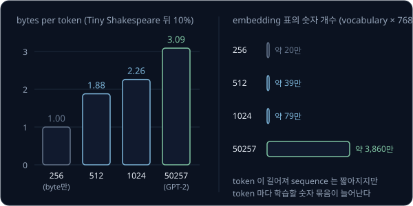

vocabulary 를 키우면 sequence 는 짧아지지만, 모델이 구분해야 할 token 종류가 늘어나고 드물게 나오는 token 은 학습할 예가 적어진다.
그래서 vocabulary 크기는 무조건 크게 잡는 값이 아니라 sequence 길이와 맞바꿔 정하는 값이다.

학습에 쓴 text 에서 재지 않는 이유도 있다. merge 는 학습 corpus 에서 자주 나온 쌍으로 만들어졌으므로 그 corpus 에서 재면 값이
실제보다 좋게 나온다. 모델이 앞으로 볼 text 는 학습에 쓰지 않은 text 이므로, 학습에 쓰지 않은 부분에서 재야 실제 성능에 가깝다.

**확인 문제.** 어떤 text 가 60 byte 이고 encode 했더니 token 이 24 개였다. bytes per token 은?

답 보기

$60 \div 24 = 2.5$ 다. token 하나에 평균 2.5 byte 가 담긴다.

### 한국어 text 의 token 수

같은 뜻의 문장도 언어에 따라 token 수가 크게 다르다. GPT-2 tokenizer 로 세면 아래와 같다.

| 문장 | 글자 수 | UTF-8 byte 수 | GPT-2 token 수 |
| --- | --- | --- | --- |
| The cat wore a hat. | 19 | 19 | 6 |
| 고양이가 모자를 썼다. | 12 | 30 | 26 |

한국어 문장은 글자 수가 더 적은데도 token 은 4 배 넘게 많다. 한글 한 글자가 3 byte 라서 시작부터 byte 수가 많은 데다,
GPT-2 의 학습 text 는 대부분 영어라서 merge 50,000 개 가운데 한국어 byte 쌍을 합친 merge 가 적기 때문이다. 그래서 한국어 byte 는
대부분 합쳐지지 못하고 byte 하나가 token 하나로 남는다. "안녕" 은 6 byte 가 그대로 token 6 개가 된다.

token 이 많으면 같은 내용을 처리하는 데 계산이 더 들고, 모델의 context 길이 안에 담을 수 있는 내용도 줄어든다. 한국어 text 를
많이 넣어 학습한 tokenizer 는 한국어 쌍을 merge 로 많이 배우므로 이 차이가 줄어든다.

**확인 문제.** "안녕" 이 6 byte 이고 GPT-2 에서 token 6 개라면 bytes per token 은? "hello" 는 5 byte 이고 token 1 개라면?

답 보기

"안녕" 은 $6 \div 6 = 1$ 이라서 merge 가 하나도 적용되지 않은 것과 같다. "hello" 는 $5 \div 1 = 5$ 다.

**요약**

- bytes per token 은 byte 수 ÷ token 수이고, 학습에 쓰지 않은 text 에서 잰다
- merge 를 늘리면 sequence 는 짧아지지만 vocabulary 가 커진다
- 학습 text 에 적게 나온 언어는 merge 를 적게 배워 같은 뜻에도 token 을 훨씬 많이 쓴다

## 정리

- 컴퓨터는 글자를 Unicode 번호로 정하고 UTF-8 규칙으로 byte(0 ~ 255) 1 ~ 4 개에 적는다. 영어 글자는 1 byte, 한글은 3 byte 다
- tokenizer 는 text 를 token 으로 잘라 vocabulary 의 token id 열로 바꾸고(encode), 그 반대로 되돌린다(decode). 단위가 작으면
  sequence 가 길고, 크면 vocabulary 가 커지며 못 본 단어가 `<unk>` 가 된다
- byte 256 개에서 시작하는 BPE 는 쌍의 빈도를 세어 가장 많은 쌍을 새 token 으로 merge 하기를 되풀이한다. cat hat cat that 은
  merge 세 번(at, at␣, cat␣)으로 16 → 12 → 9 → 7 token 이 되었다. 빈도가 같으면 정해 둔 규칙(먼저 나온 쌍)으로 고른다
- encode 는 merge 를 배운 순서대로 적용하고, decode 는 byte 를 이어 붙여 UTF-8 로 읽는다. 글자 일부만 담은 token 을 혼자
  decode 하면 � 가 나온다
- pre-tokenization 은 merge 가 단어·문장부호 경계를 넘지 않게 하고, special token 은 그보다 먼저 떼어 id 하나로 바꾼다. GPT-2 의
  vocabulary 는 $256 + 50000 + 1 = 50257$ 이다
- text token 은 vocabulary 번호이고, image patch token 은 번호 없는 숫자 묶음, action token 은 움직임 값의 칸 번호를 token 번호에
  대응시킨 것이다

tokenizer 는 text 와 id 열을 오갈 뿐, 다음에 올 token 을 예측하지는 못한다. 모델 안에서 id 하나하나를 숫자 묶음으로 바꿔
계산하고, 이 id 열로 다음 token 을 맞히도록 language model 을 학습시키는 과정은 [GPT-2](../gpt/README.md) 에서 다룬다. 그 모델의
구조는 [Transformer](../transformer/README.md) 에서 먼저 다룬다.

## 참고 자료

- Andrej Karpathy, [Let's build the GPT Tokenizer](https://www.youtube.com/watch?v=zduSFxRajkE) — BPE 학습, encode·decode, GPT-2 의
  조각 규칙, special token 을 처음부터 만들어 보이는 영상. 이 강의의 각 절에 해당하는 구간만 골라 봐도 된다
- Rico Sennrich, Barry Haddow, Alexandra Birch, [Neural Machine Translation of Rare Words with Subword Units](https://arxiv.org/abs/1508.07909) —
  3.2절에서 BPE 로 subword vocabulary 를 만드는 과정과 짧은 예시를 다룬다
- Alec Radford 등, [Language Models are Unsupervised Multitask Learners](https://cdn.openai.com/better-language-models/language_models_are_unsupervised_multitask_learners.pdf) —
  2.2절 Input Representation 이 byte 단위 BPE 와 pre-tokenization 을 쓰는 이유를 설명한다
- Hugging Face LLM Course, [Byte-Pair Encoding tokenization](https://huggingface.co/learn/llm-course/chapter6/5) — 이 강의의 hug·pug
  corpus 로 쌍을 세고 합치는 과정을 표로 따라가는 예제
- [tiktokenizer](https://tiktokenizer.vercel.app/) — text 를 넣으면 GPT 계열 tokenizer 가 자른 token 경계와 id 를 보여 주는 웹 도구.
  한국어와 영어 문장을 넣어 token 수를 비교해 볼 수 있다
- [Wikipedia — UTF-8](https://en.wikipedia.org/wiki/UTF-8) — 글자를 byte 1 ~ 4 개로 적는 규칙 표
- Stanford CS336, [assignment1-basics](https://github.com/stanford-cs336/assignment1-basics) — handout 의 BPE 절에 빈도가 같은 쌍을
  고르는 규칙과 학습을 빠르게 하는 방법이 정리되어 있다
