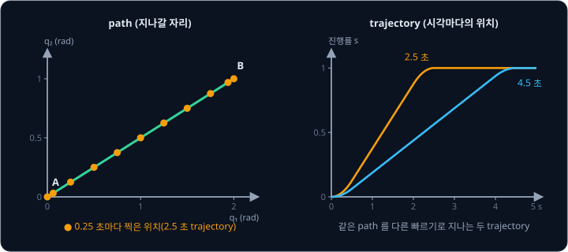
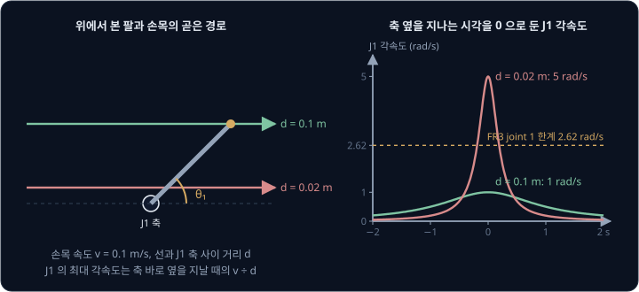
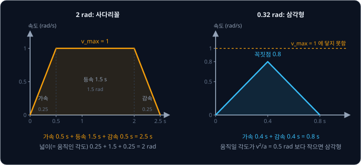
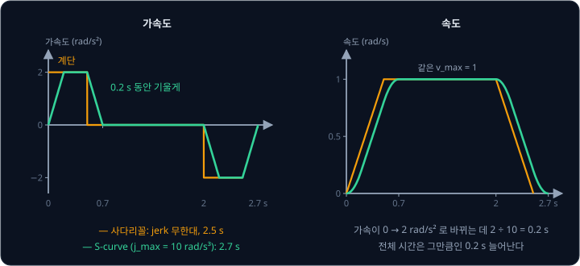
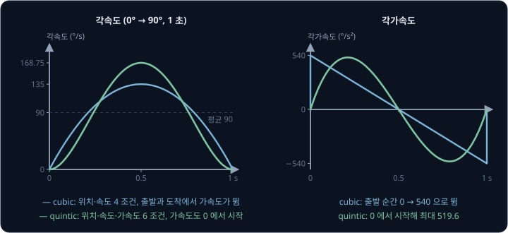
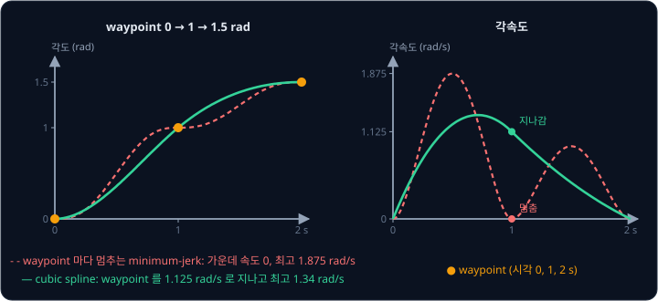
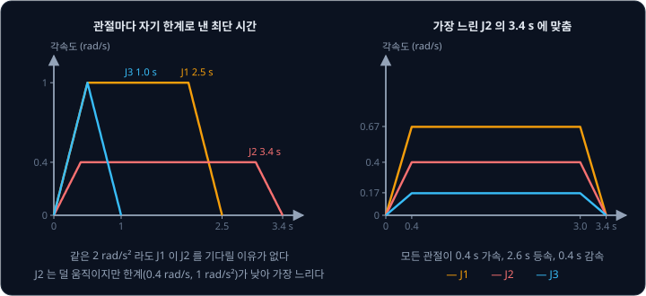

# Trajectory Generation

MoveIt 2 에서 목표 자세를 정하고 plan 을 누르면 planner 는 장애물을 피해 지나갈 자세의 목록을 돌려주는데, 이 목록에는 언제 어느 자세에
있어야 하는지가 적혀 있지 않다. 관절 여섯 개는 저마다 최고 속도와 가속도가 다르고, 한계를 넘는 명령을 받으면 driver 가 동작을 멈추거나
팔이 목표를 따라가지 못한다. 모든 관절이 한계를 넘지 않으면서 같은 순간에 도착하고, 그러면서도 가장 빨리 끝나게 하려면 목록의 자세마다 시각을 어떻게 붙여야 할까?

자세의 목록에 시각을 붙여 매 순간의 목표 자세를 정하는 일을 **trajectory generation** 이라고 한다. MoveIt 2 는 마지막 단계에서
planner 가 낸 경로에 TOTG(Time-Optimal Trajectory Generation)로 시각을 붙인다. TOTG 는 Kunz 와 Stilman 이 2012 년에 발표한 방법으로,
MoveIt 2 공식 문서는 이 방법을 MoveIt 2 의 모든 곳에서 쓰는 기본값이라고 적는다.

## 학습 목표

- path 와 trajectory 의 차이와, joint space 보간과 Cartesian 보간이 각각 어떤 문제를 일으키는지 설명할 수 있다
- 속도·가속도·jerk 한계로 사다리꼴 profile 과 S-curve 의 시간을 계산하고, cubic·quintic 다항식과 spline 의 경계 조건을 설명할 수 있다
- 관절마다 한계가 다를 때 가장 느린 관절이 전체 시간을 정하는 이유와 관절을 동기화하는 방법을 설명할 수 있다
- TOTG·TOPP-RA 같은 time-optimal parameterization 이 하는 일과 MoveIt 2 의 velocity·acceleration scaling factor 가 바꾸는 것을 설명할 수 있다

## path 와 trajectory

**path** 는 로봇이 지나갈 자세를 이어 놓은 선이고 시간 정보가 없다. 관절 각도를 모은 vector 를 $\mathbf q$ 라고 하면, path 위의 위치는
출발점에서 잰 거리나 진행률 $s$ 하나로 정해지고 path 는 $\mathbf q(s)$ 로 적는다. **trajectory** 는 시각 $t$ 마다 어느 자세에 있을지
정한 것이고 $\mathbf q(t)$ 로 적는다. path 에 시간을 붙이는 함수 $s(t)$ 를 정하면 $\mathbf q(t) = \mathbf q(s(t))$ 로 trajectory 가 된다.
Lynch 와 Park 의 Modern Robotics 는 이 $s(t)$ 를 time scaling 이라고 부르고, MoveIt 은 time parameterization 이라고 부른다.

위 그림의 path 는 두 관절을 $(0, 0)$ 에서 $(2, 1)$ rad 로 곧게 옮기는 선 하나다. 0.25 초마다 찍은 점이 처음과 끝에서 촘촘한 것은 정지 상태에서
천천히 출발해 천천히 멈추기 때문이다. 같은 path 를 오른쪽 그림처럼 4.5 초에 지나는 trajectory 도 만들 수 있다. 장애물을 피하는 일은
path 를 찾을 때 이미 끝났으므로, trajectory generation 은 그 선을 벗어나지 않으면서 관절의 속도·가속도 한계만 따져 얼마나 빨리
지날지 정한다.

## joint space 보간과 Cartesian 보간

두 자세 사이는 joint space 보간이나 Cartesian 보간으로 잇는다. joint space 보간은 관절 각도를 시작값에서 끝값까지 같은 진행률로 움직이고,
Cartesian 보간은 손끝을 공간에서 곧은 선으로 움직인다. joint space 보간은 관절마다 식 하나로 계산이 끝나고 관절 한계를 확인하기 쉽지만 손끝은
휘어진 길을 간다. [Classical Pick](../classical-pick/README.md) 에서 본 pre-grasp → grasp 이동도 두 끝 자세가 같은 수직선 위에 있었지만
손끝은 가운데에서 2.5 cm 벗어났다.

Cartesian 보간은 손끝의 곧은 선을 잘게 나누고 나눈 점마다 IK 를 풀어 관절 각도를 구한다. MoveIt 의 `computeCartesianPath` 는 손끝이 지날 선을
`eef_step`(튜토리얼 값 0.01 m) 간격으로 나누는데, 위치는 직선 위에서 고르게 나누고 손의 방향은 [Rigid Transforms](../transforms/README.md) 에서
본 slerp 로 보간한다. 점마다 IK 를 풀기 때문에 아래 문제가 생긴다.

- 중간 점에 IK 해가 없을 수 있다. 팔이 닿지 않거나 관절 한계에 걸리면 `computeCartesianPath` 는 거기서 멈추고, 목표 경로를 어디까지
  만들었는지를 0 ~ 1 의 비율로 돌려준다
- 이웃한 두 점의 IK 해가 elbow-up 과 elbow-down 처럼 다른 갈래로 바뀌면 손끝은 조금 움직였는데 관절은 크게 뛴다. MoveIt 은 관절 공간에서
  이런 jump 가 있는지 검사한다
- 손끝 속도가 일정해도 singularity 에 다가갈수록 관절 속도가 한없이 커진다

6 관절 팔의 joint 1 은 바닥에 수직인 축을 중심으로 팔 전체를 돌린다. 위에서 내려다볼 때 손목이 이 축에서 $d$ 만큼 떨어진 곧은 선을
속도 $v$ 로 지나간다면, 손목이 축에 가장 가까워지는 순간 joint 1 은 $v \div d$ 의 각속도로 돌아야 한다.

| 선과 축 사이 거리 $d$ | 0.1 m | 0.05 m | 0.02 m | 0 m |
| --- | --- | --- | --- | --- |
| joint 1 의 최대 각속도 ($v = 0.1$ m/s) | 1 rad/s | 2 rad/s | 5 rad/s | 한순간에 180° |

Franka Research 3(FR3)의 joint 1 은 최고 각속도가 2.62 rad/s 라서, 손목을 0.1 m/s 로 움직이려면 선이 축에서 $0.1 \div 2.62 \approx 0.038$ m
보다 멀리 지나야 한다. 손목이 축 위에 오면 joint 1 을 돌려도 손목이 움직이지 않는다. Lynch 와 Park 의 Modern Robotics 는 offset 이 없는
6 관절 팔에서 손목 중심이 joint 1 축 위에 오는 이 자세를 singular configuration 으로 들고(6.1 절), 로봇 제조사 manual 은 이 자세를
shoulder singularity 라고 부른다. [Inverse Kinematics](../inverse-kinematics/README.md) 에서 본 것처럼 singularity 에서는 Jacobian 의 rank 가
줄어 손끝이 어느 한 방향으로 움직일 수 없게 되고, 그 근처에서 손끝을 조금 옮기려면 관절이 크게 움직여야 한다. 그래서 Cartesian 경로가
singularity 근처를 지나면 그 구간의 속도를 줄이거나, 곧은 선이 꼭 필요하지 않은 구간을 joint space 보간으로 바꾼다.

**확인 문제.** 손목이 0.2 m/s 로 joint 1 축에서 0.05 m 떨어진 곧은 선을 지난다. joint 1 의 최대 각속도는? FR3 의 joint 1 한계 2.62 rad/s
안에 들어가는가?

답 보기

최대 각속도는 $v \div d = 0.2 \div 0.05 = 4$ rad/s 로 2.62 rad/s 를 넘는다. 속도를 $2.62 \times 0.05 \approx 0.13$ m/s 아래로 줄이거나 선을
축에서 $0.2 \div 2.62 \approx 0.076$ m 보다 멀리 옮겨야 한다.

## 사다리꼴 속도 profile

관절 하나를 정지 상태에서 각도 $d$ 만큼 옮겨 다시 세우는 가장 빠른 방법은 최대 가속도 $a_{\max}$ 로 속도를 올리고, 최고 속도 $v_{\max}$ 로
가다가, 최대 가속도로 줄여 멈추는 것이다. 속도를 시간축 위에 그리면 사다리꼴이 되어서 **사다리꼴 속도 profile**(trapezoidal velocity
profile)이라고 부른다. 각도 그래프는 등속 구간의 직선과 그 양 끝의 포물선으로 이뤄지는데, 가속하는 동안 각도가 시간의 제곱에 비례해 늘기
때문이다. 그래서 교과서에서는 linear segment with parabolic blends(LSPB)라고도 부른다.

$v_{\max} = 1$ rad/s, $a_{\max} = 2$ rad/s² 인 관절을 2 rad 옮겨 보자. 속도 그래프 아래 넓이가 움직인 각도다.

| 구간 | 시간 | 움직인 각도 |
| --- | --- | --- |
| 가속 | $v_{\max} \div a_{\max} = 1 \div 2 = 0.5$ s | $\tfrac12 \times 2 \times 0.5^2 = 0.25$ rad |
| 등속 | $(2 - 0.25 - 0.25) \div 1 = 1.5$ s | 1.5 rad |
| 감속 | 0.5 s | 0.25 rad |
| 합 | 2.5 s | 2 rad |

전체 시간은 $T = d / v_{\max} + v_{\max} / a_{\max} = 2 + 0.5 = 2.5$ s 로 한 번에 구할 수도 있다. 같은 관절을 0.32 rad 만 옮기면 가속과 감속에만
0.25 + 0.25 = 0.5 rad 가 들어서 최고 속도에 닿지 못한다. 이렇게 움직일 각도가 $v_{\max}^2 / a_{\max} = 0.5$ rad 보다 작으면 속도는 꼭짓점에서
바로 내려오는 삼각형이 되는데, 꼭짓점 속도는 $\sqrt{a_{\max} d} = \sqrt{2 \times 0.32} = 0.8$ rad/s 이고 전체 시간은 $2 \times 0.8 \div 2 = 0.8$ s 다.
짧은 이동에서는 최고 속도 한계가 시간에 영향을 주지 않고 가속도 한계만 시간을 정한다.

실제 팔의 한계를 넣어 보자. FR3 의 joint 1 은 `franka_description` 의 `joint_limits.yaml` 에 최고 각속도가 2.62 rad/s 로 적혀 있다. Franka 의
제어 library `libfranka` 는 FR3 에 맞춰 rate limiter 값을 바꾼 0.10.0 부터 `rate_limiting.h` 의 관절 가속도 상한을 모든 관절 10 rad/s² 로 두는데,
그 전의 Panda 용 0.9.x 에서는 joint 1 이 15 rad/s² 였다. FR3 의 값으로 90°(1.571 rad)를 돌리면 가속에 $2.62 \div 10 = 0.262$ s 가 걸리고
전체 시간은 $1.571 \div 2.62 + 0.262 \approx 0.86$ s 다.

사다리꼴 profile 은 속도·가속도 한계를 꽉 채워 쓰므로 그 두 한계 아래에서는 가장 빠르지만, 가속도는 0 에서 2 rad/s² 로, 다시 2 에서 0 으로
한순간에 바뀐다.

<b>심화: 사다리꼴 profile 의 일반식</b>

$d \ge v_{\max}^2 / a_{\max}$ 이면 사다리꼴이고 시간 $t$ 의 각도는 세 구간으로 나눠 쓴다. $t_a = v_{\max}/a_{\max}$, $T = d/v_{\max} + t_a$ 이다.

$$
q(t) = \begin{cases} \tfrac12 a_{\max} t^2 & 0 \le t \le t_a \\ v_{\max}\,(t - \tfrac12 t_a) & t_a \le t \le T - t_a \\ d - \tfrac12 a_{\max} (T - t)^2 & T - t_a \le t \le T \end{cases}
$$

$d < v_{\max}^2 / a_{\max}$ 이면 등속 구간이 없어지고 $t_a = \sqrt{d / a_{\max}}$, $T = 2t_a$ 다. 가운데 줄에 $t = t_a$ 를 넣으면
$v_{\max} t_a / 2 = \tfrac12 a_{\max} t_a^2$ 로 첫 줄과 이어지는 것을 확인할 수 있다.

**확인 문제.** $v_{\max} = 1$ rad/s, $a_{\max} = 2$ rad/s² 인 관절을 0.18 rad 옮긴다. profile 의 모양, 꼭짓점 속도, 걸리는 시간은?

답 보기

$v_{\max}^2 / a_{\max} = 1 \div 2 = 0.5$ rad 보다 짧으므로 삼각형이다. 꼭짓점 속도는 $\sqrt{2 \times 0.18} = \sqrt{0.36} = 0.6$ rad/s 이고, 가속
시간이 $0.6 \div 2 = 0.3$ s 라서 전체 시간은 $2 \times 0.3 = 0.6$ s 다.

## jerk 제한과 S-curve

가속도가 1초에 변하는 양을 **jerk** 라고 하는데, 사다리꼴 profile 에서는 가속도가 계단처럼 바뀌어 그 순간의 jerk 가 무한대다. motor 가 내는
torque 가 계단처럼 바뀌면 탄성이 있는 감속기와 link 가 흔들리고, 그 흔들림이 팔 끝에 진동으로 남는다. Ruckig 논문에 따르면 Franka 로봇은 내부
controller 에서 jerk 를 감시하다가 가속도가 끊기면 동작을 멈춘다. `libfranka` 0.10.0 이후의 `rate_limiting.h` 는 관절 jerk 상한을 모든 관절
5000 rad/s³ 로 두고, Panda 용 0.9.x 에서는 joint 1 이 7500 rad/s³ 였다.

jerk 를 $j_{\max}$ 로 제한하면 가속도가 0 에서 $a_{\max}$ 까지 $a_{\max} / j_{\max}$ 동안 비스듬히 올라간다. 그러면 속도 곡선의 모서리가
둥글어져 S 자 모양이 되므로 **S-curve** profile 이라고 부른다. 가속과 감속에 jerk 가 $\pm j_{\max}$, 0, $\mp j_{\max}$ 인 구간이 세 개씩 있고
가운데 등속 구간이 하나 더 있어서, S-curve 는 모두 일곱 구간으로 이뤄진다.

앞의 2 rad 이동에 jerk 한계 $j_{\max} = 10$ rad/s³ 를 더하면 가속도가 2 rad/s² 까지 오르는 데 $2 \div 10 = 0.2$ s 가 걸리고, 가속 구간 전체는
$0.2 + 1 \div 2 = 0.7$ s 로 늘어난다. 가속 구간의 평균 속도가 0.5 rad/s 라서 이 동안 $0.7 \times 0.5 = 0.35$ rad 를 가고, 가속과 감속을 빼고
남은 $2 - 0.7 = 1.3$ rad 를 1.3 s 동안 등속으로 간다. 전체 시간은 $0.7 + 1.3 + 0.7 = 2.7$ s 로, 사다리꼴보다 $a_{\max} / j_{\max} = 0.2$ s 만
길다. 모든 한계에 닿는 이동에서는 S-curve 의 시간이 늘 이만큼만 늘어나서, jerk 를 제한해도 이동 시간은 크게 늘지 않는다.

Berscheid 와 Kröger 가 2021 년에 발표한 Ruckig 는 이 S-curve 를 실시간으로 계산하는 library 다. Ruckig 는 위 예처럼 정지에서 정지로 가는
경우뿐 아니라 속도와 가속도가 0 이 아닌 상태에서 출발하는 경우도 다룬다. 목표 위치·속도·가속도에 도착하는 시간 최적 trajectory 를
jerk·가속도·속도 한계 안에서 구하고, 여러 관절이 같은 시각에 도착하도록 맞춘다. 논문은 7 관절 계산 한 번에 평균 19.8 µs 가 걸렸고 가장 오래
걸린 경우도 123 µs 였다고 보고했다(Intel i7-8700K, thread 하나). Franka 팔의 제어 주기 1 ms 안에 충분히 들어가는 시간이라, 센서 입력 때문에
목표가 바뀌면 다음 제어 주기에 바로 새 trajectory 를 계산할 수 있다. 이런 방식을 online trajectory generation 이라고 한다.

## cubic 과 quintic 다항식

이동 시간 $T$ 를 먼저 정해 두는 경우에는 시간의 다항식으로 trajectory 를 만든다. 다항식의 계수 개수만큼 조건을 걸 수 있는데, 3차식인
**cubic** 은 계수가 넷이라 출발·도착의 위치와 속도 네 가지를 맞추고, 5차식인 **quintic** 은 계수가 여섯이라 출발·도착의 가속도까지 맞춘다.
출발과 도착에서 속도와 가속도를 모두 0 으로 둔 quintic 이 [PID Control](../pid-control/README.md) 에서 본 minimum-jerk 목표
$10s^3 - 15s^4 + 6s^5$ 다.

처음과 끝에 정지한 상태로 관절을 1 초 동안 0° 에서 90° 로 옮기는 두 다항식은 아래와 같다($s = t / T$).

| | cubic $90(3s^2 - 2s^3)$ | quintic $90(10s^3 - 15s^4 + 6s^5)$ |
| --- | --- | --- |
| 맞추는 조건 | 위치·속도 (4개) | 위치·속도·가속도 (6개) |
| 최고 각속도 | 평균 90 °/s 의 1.5 배인 135 °/s | 1.875 배인 168.75 °/s |
| 출발 순간 각가속도 | 540 °/s² (정지 상태의 0 에서 뜀) | 0 |
| 가장 큰 각가속도 | 540 °/s² | 519.6 °/s² ($s = 0.211$) |

cubic 은 속도만 0 에서 시작하고 가속도는 출발 순간 0 에서 540 °/s² 로 뛰므로, 사다리꼴처럼 출발과 도착에서 jerk 가 무한대다. quintic 은
가속도도 0 에서 시작해서 끊기는 곳이 없고, 가장 큰 가속도도 cubic 보다 작다.

다항식을 만드는 식에는 속도·가속도 한계가 들어가지 않으므로, 한계를 지키려면 $T$ 를 넉넉히 골라야 한다. $v_{\max} = 1$ rad/s,
$a_{\max} = 2$ rad/s² 인 관절을 2 rad 옮길 때 quintic 은 최고 속도 조건 $1.875 \times 2 \div T \le 1$ 에서 $T \ge 3.75$ s 여야 한다. 같은 이동의 사다리꼴은 2.5 s 였는데, quintic 은 한계에
한순간만 닿고 나머지 시간에는 한계보다 느리게 움직여서 1.25 s 가 더 걸린다.

<b>심화: cubic 계수 구하기</b>

$q(t) = a_0 + a_1 t + a_2 t^2 + a_3 t^3$ 에 출발 위치 $q_0$, 출발 속도 $v_0$, 도착 위치 $q_f$, 도착 속도 $v_f$ 를 넣는다.

$$
a_0 = q_0, \quad a_1 = v_0, \quad a_2 = \frac{3(q_f - q_0) - (2v_0 + v_f)T}{T^2}, \quad a_3 = \frac{-2(q_f - q_0) + (v_0 + v_f)T}{T^3}
$$

$q_0 = 0$, $q_f = 90$, $v_0 = v_f = 0$, $T = 1$ 이면 $a_2 = 270$, $a_3 = -180$ 이라 $q = 270t^2 - 180t^3 = 90(3t^2 - 2t^3)$ 이다. 속도
$540t - 540t^2$ 는 $t = 0.5$ 에서 135, 가속도 $540 - 1080t$ 는 $t = 0$ 에서 540 이다. quintic 은 가속도 조건 두 개를 더해 6 원 연립방정식을
푼다. 다음 절의 spline 은 도착 속도 $v_f$ 를 0 이 아닌 값으로 둔 cubic 을 이어 붙인다.

**확인 문제.** cubic 으로 관절을 0° 에서 60° 로 2 초 동안 옮긴다(처음과 끝은 정지). 최고 각속도와 출발 순간의 각가속도는?

답 보기

최고 각속도는 평균 각속도 $60 \div 2 = 30$ °/s 의 1.5 배인 45 °/s 다. 출발 순간 각가속도는 $6 \times 60 \div 2^2 = 90$ °/s² 이다(1 초 예의
$6 \times 90 \div 1^2 = 540$ 과 같은 식).

## waypoint 와 spline

planner 가 내는 path 는 자세 두 개가 아니라 waypoint 여러 개를 이은 것인데, waypoint 마다 멈추게 하면 계산은 쉽지만 느리다. 관절 하나가
0 → 1 → 1.5 rad 를 시각 0, 1, 2 초에 지나야 할 때 구간마다 minimum-jerk 로 이으면, 가운데 waypoint 에서 속도가 0 이 되었다가 다시 출발해야
하므로 첫 구간에서 최고 1.875 rad/s 가 필요하다.

구간마다 cubic 을 쓰되 가운데 waypoint 의 속도를 0 이 아닌 값으로 두고, 양쪽 구간의 가속도가 그 waypoint 에서 같아지게 고른 것이 **cubic
spline** 이다. 구간 시간이 모두 $h$ 로 같으면 waypoint $i$ 의 속도 $v_i$ 는 $v_{i-1} + 4v_i + v_{i+1} = 3(q_{i+1} - q_{i-1}) / h$ 를 만족해야
하고, 위 예에서는 $0 + 4v_1 + 0 = 3 \times 1.5$ 에서 $v_1 = 1.125$ rad/s 다. 이렇게 이으면 가운데 waypoint 에서 가속도가 양쪽 모두
−1.5 rad/s² 로 이어지고, 최고 각속도는 1.875 rad/s 에서 1.34 rad/s 로 내려간다.

위 예의 cubic spline 도 $t = 0$ 에서는 가속도가 0 에서 3.75 rad/s² 로 뛰어서, 처음과 끝의 가속도까지 맞추려면 quintic spline 처럼 차수를
올려야 한다. 또 spline 은 가속도가 이어지도록 waypoint 의 속도를 정하므로, 값이 올라갔다가 내려오는 waypoint 에서도 속도가 0 이 아닐 수 있다.
처음과 끝에 정지한 채 0 → 1 → 0.5 rad 를 1 초 간격으로 지나면 가운데 waypoint 의 속도가 0.375 rad/s 라서 곡선은 1 rad 를 지나쳐 약 1.02 rad 까지 올라갔다가
돌아온다. 그래서 waypoint 가 관절 한계 근처에 있으면 waypoint 사이에서도 한계를 넘는지 따로 확인해야 한다. 무엇보다 spline 은 waypoint 를
지날 시각을 미리 알아야 계산할 수 있는데, planner 의 path 에는 시각이 없다. 그 시각을 한계에 맞춰 정하는 방법은 뒤의 time-optimal
parameterization 에서 다룬다.

## 여러 관절의 동기화

관절마다 따로 사다리꼴을 만들면 도착 시각이 관절마다 달라진다. 세 관절이 아래처럼 움직여야 하는 경우를 보자.

| 관절 | 움직일 각도 | $v_{\max}$ | $a_{\max}$ | 혼자 갈 때의 최단 시간 |
| --- | --- | --- | --- | --- |
| J1 | 2 rad | 1 rad/s | 2 rad/s² | $2 \div 1 + 1 \div 2 = 2.5$ s |
| J2 | 1.2 rad | 0.4 rad/s | 1 rad/s² | $1.2 \div 0.4 + 0.4 \div 1 = 3.4$ s |
| J3 | 0.5 rad | 1 rad/s | 2 rad/s² | $0.5 = v_{\max}^2 / a_{\max}$ 라 삼각형, 1.0 s |

가장 많이 움직이는 J1 이 아니라 한계가 낮은 J2 가 3.4 s 로 가장 느리다. 관절마다 motor 와 감속기가 달라 한계도 다르므로, 조금만
움직이는 관절이 가장 늦게 도착할 수도 있다.

왼쪽 그림처럼 관절이 제각각 움직이면 J3 가 1 초에 도착한 뒤 J1 과 J2 만 움직이므로, joint 공간에서 곧은 선이었던 path 가 꺾인다. planner 는
곧은 선을 충돌 검사했으니 꺾인 경로는 검사하지 않은 자세를 지나게 된다. 그래서 모든 관절의 이동 시간을 가장 느린 관절에 맞추는데, 이를
**동기화**(synchronization)라고 한다. 오른쪽 그림은 모든 관절이 J2 와 같은 0.4 s 가속, 2.6 s 등속, 0.4 s 감속을 쓰고 등속 각속도만 움직일
각도에 비례하게 줄인 경우다. 등속 각속도는 J1 이 $2 \div (3.4 - 0.4) = 0.67$ rad/s 이고 J3 가 $0.5 \div 3.0 = 0.17$ rad/s 다. 모든 관절의
진행률이 매 순간 같아서 path 는 곧은 선 그대로 남는다.

Ruckig 논문은 Ruckig 가 jerk 를 제한하면서 여러 관절의 시간을 완전히 맞추는 time-optimal online trajectory generation 의 첫 open-source 구현이라고
적었다. Ruckig 는 관절마다 낼 수 있는 도착 시간을 모두 구한 뒤 모든 관절이 맞출 수 있는 가장 빠른 공통 시간을 고르고, 어떤 관절이 낼 수 없는
시간 구간이 중간에 끼는 경우도 처리한다.

**확인 문제.** J1 은 1 rad 를 $v_{\max} = 1$ rad/s, $a_{\max} = 2$ rad/s² 로, J2 는 0.6 rad 를 $v_{\max} = 0.5$ rad/s, $a_{\max} = 1$ rad/s² 로
움직인다. 동기화한 전체 시간은?

답 보기

J1 은 $1 \ge 1^2 / 2$ 라 사다리꼴이고 시간은 $1 \div 1 + 1 \div 2 = 1.5$ s 다. J2 도 $0.6 \ge 0.5^2 / 1 = 0.25$ 라 사다리꼴이고 시간은
$0.6 \div 0.5 + 0.5 \div 1 = 1.7$ s 다. 느린 J2 에 맞춘 1.7 s 가 전체 시간이고, J1 은 이보다 천천히 움직인다.

## time-optimal path parameterization

path 가 정해져 있을 때 모든 관절의 속도·가속도 한계를 지키면서 그 path 를 가장 빨리 지나는 $s(t)$ 를 찾는 문제를 **TOPP**(Time-Optimal Path
Parameterization)라고 한다. 앞 절의 곧은 선 하나에서는 가장 느린 관절의 사다리꼴이 답이었다. waypoint 에서 방향이 꺾이는 path 는 꺾인
점에서 움직이는 방향이 한순간에 바뀌므로, 그 path 를 정확히 따르려면 꺾인 점에서 멈춰야 한다.

두 관절이 모두 $v_{\max} = 1$ rad/s, $a_{\max} = 2$ rad/s² 이고 path 가 A $(0, 0)$ → B $(1, 0)$ → C $(1, 1)$ rad 로 꺾이는 경우를 보자.
B 에서 멈추면 A → B 와 B → C 가 각각 1 rad 짜리 사다리꼴($1 \div 1 + 1 \div 2 = 1.5$ s)이라 3.0 s 가 걸린다. TOTG 는 꺾인 waypoint 를 원호로
깎아 path 를 매끄럽게 만든 뒤 시간을 붙인다. 원호는 waypoint 에서 정해 둔 거리 $\delta$ 안쪽을 지나게 고르는데, $\delta = 0.1$ rad 이면 이 90°
모서리는 반지름 0.24 rad 의 원호가 되어 B 를 0.1 rad 안쪽으로 돈다.

오른쪽 그림처럼 path 위의 거리 $s$ 를 가로축, path 를 지나는 속도 $\dot s$ 를 세로축으로 둔 평면을 **phase plane** 이라고 한다. path 위의
위치마다 관절 한계가 허용하는 $\dot s$ 의 최댓값이 정해지고, 이 값을 이은 빨간 선을 limit curve 라고 한다. 곧은 구간에서는 한 관절만 움직이므로
그 관절의 속도 한계 때문에 $\dot s \le 1$ rad/s 다. 원호에 들어서면 두 관절이 같이 움직이는데, 원을 따라 돌려면 방향을 바꾸는 가속도가 필요해서
이번에는 가속도 한계가 $\dot s$ 의 상한을 정한다. 원호에 들어서는 순간에는 J2 가 방향을 바꾸는 가속도 $\dot s^2 / r$ 을 혼자 내야 하므로
$\dot s^2 \div 0.24 \le 2$ 에서 $\dot s \le 0.7$ rad/s 다.

시간 최적 profile 은 limit curve 아래에서 할 수 있는 만큼 빨리 가속하고, 다음 제한에 맞추려면 늦지 않게 최대로 감속하며, 그 사이에는 limit
curve 를 따라간다. 그림의 초록 선은 MoveIt 의 TOTG 가 낸 결과가 아니라, path 를 3000 칸으로 나눠 아래의 TOPP-RA 와 같은 방식으로 계산한
예시 profile 이다. 이 profile 은 2.59 s 가 걸려 B 에서 멈추는 3.0 s 보다 0.41 s 빠르고, 대신 path 가 B 를 정확히 지나지 않고 0.1 rad 안쪽으로
돈다.

Kunz 와 Stilman 의 TOTG 는 limit curve 위에서 가속과 감속이 바뀌는 switching point 를 찾는다. 그 점에서 앞쪽으로는 최대 가속도로 적분하고
뒤쪽으로는 최소 가속도로 적분해 profile 을 잇는다. 논문은 7 관절 팔이 선반의 병을 집어 옮기는 작업 100 번을 RRT 로 계획한 path 로 시험했는데, 적분 step 에
따른 결과는 아래와 같다. 논문은 수치 오차 때문에 적분이 limit curve 에 잘못 닿는 경우를 잡으려고 source/sink 검사를 더했고, 표의 마지막 두 열이
이 검사를 뺐을 때와 넣었을 때의 실패율이다.

| 적분 step | 계산 시간 | 실행 시간 | 실패율 (검사 없음) | 실패율 (검사 있음) |
| --- | --- | --- | --- | --- |
| 10 ms | 0.2 s | 4.74 s | 13% | 0% |
| 1 ms | 0.9 s | 4.71 s | 3% | 0% |
| 0.1 ms | 31.8 s | 4.70 s | 0% | 0% |

Pham 과 Pham 이 2018 년에 발표한 **TOPP-RA**(reachability analysis)는 path 를 $N$ 칸으로 나눈 뒤 두 번만 훑는다. 먼저 끝에서 거꾸로 훑으며
칸마다 controllable set 을 구한다. controllable set 은 그 칸에서 한계를 지키며 낼 수 있고 끝에서 멈출 수도 있는 $\dot s^2$ 의 범위로, 변수
두 개짜리 작은 linear program 으로 구한다. 그다음 처음부터 다시 훑으며 그 범위 안에서 가장 큰 가속도를 고른다. switching point 를 찾을 필요가
없어서 구현도 단순하다. 논문의 비교에서는 $N = 500$ 칸, 부등식 30 개인 문제를 29.8 ms 에 풀어 수치 적분 방식(455.3 ms)보다 빨랐고, 모든
시험에서 한 번도 실패하지 않았다. 관절 torque 한계처럼 가속도의 linear 식으로 쓸 수 있는 다른 제약도 같은 틀로 넣을 수 있다. 공개 library `toppra` 가 이 방법을 구현하고, MATLAB 의 `contopptraj` 도 TOPP-RA 를
쓴다.

<b>심화: phase plane 의 제약식</b>

$\mathbf q(s)$ 를 $s$ 로 미분한 것을 $\mathbf q'$, 두 번 미분한 것을 $\mathbf q''$ 라 하면 chain rule 로 관절 속도와 가속도는 아래와 같다.

$$
\dot{\mathbf q} = \mathbf q'\,\dot s, \qquad \ddot{\mathbf q} = \mathbf q'\,\ddot s + \mathbf q''\,\dot s^2
$$

관절 $j$ 의 속도 한계 $|q'_j \dot s| \le v_j$ 는 $\dot s \le v_j / |q'_j|$ 를 주고, 가속도 한계 $|q'_j \ddot s + q''_j \dot s^2| \le a_j$ 는
지금 $\dot s$ 에서 허용되는 $\ddot s$ 의 범위를 준다. $x = \dot s^2$, $u = \ddot s$ 로 두면 가속도 제약이 $x$ 와 $u$ 의 linear 식이 되고, 칸
사이는 $x_{i+1} = x_i + 2\Delta u_i$ 로 이어진다($\Delta$ 는 칸의 길이). TOPP-RA 의 linear program 에 변수가 두 개뿐인 것도 이 때문이다.

본문의 원호 입구에서는 $\mathbf q' = (1, 0)$, $\mathbf q'' = (0, 1/r)$ 이다. J2 의 식은 $\ddot s$ 와 상관없이 $\dot s^2 / r \le 2$ 가 되어
$\dot s \le \sqrt{2 \times 0.2414} = 0.695$ rad/s 다. 원호 가운데에서는 $\mathbf q'$ 와 $\mathbf q''$ 가 두 관절에 $1/\sqrt2$ 씩 나뉘어 한계가
$\sqrt{2 \times 0.2414 \times \sqrt2} = 0.826$ rad/s 로 올라간다. 원호의 반지름은 waypoint 와 원호 사이 거리가 $\delta$ 가 되도록
$r = \delta \cos(\alpha/2) / (1 - \cos(\alpha/2))$ 로 정하고($\alpha$ 는 꺾인 각도), $\alpha = 90°$, $\delta = 0.1$ 이면
$0.1 \times 0.7071 \div 0.2929 = 0.2414$ 다.

## MoveIt 2 의 time parameterization

MoveIt 2 에서 planner 가 path 를 내면 planning pipeline 의 response adapter 들이 차례로 후처리를 하는데, 그 가운데
`AddTimeOptimalParameterization` 이 TOTG 로 시각을 붙인다. 이 adapter 의 parameter 와 기본값은 아래와 같다(`moveit_ros_planning` 의
`default_response_adapter_params.yaml`).

| parameter | 기본값 | 뜻 |
| --- | --- | --- |
| `path_tolerance` | 0.1 | 원호가 원래 path 에서 벗어나도 되는 거리. 회전 관절이면 rad |
| `resample_dt` | 0.1 | 결과 trajectory 의 점 사이 시간 간격(s) |
| `min_angle_change` | 0.001 | 이보다 덜 변한 이웃 waypoint 는 같은 점으로 본다 |

`path_tolerance` 가 앞 절의 $\delta$ 라서 결과 trajectory 는 원래 path 에서 조금 벗어날 수 있고, MoveIt 문서는 필요하면 충돌 검사를 한 번 더
하라고 권한다. 한계는 URDF 나 `joint_limits.yaml` 에서 읽는데, URDF 의 `<limit>` 에는 위치·effort·속도만 있고 가속도가 없다. 그래서 MoveIt
Setup Assistant 가 만드는 `joint_limits.yaml` 에 `has_acceleration_limits` 와 `max_acceleration` 을 채워야 하고, 가속도 한계가 없는 관절이 있으면
TOTG 는 "No acceleration limit was defined for joint" 라는 오류를 내고 실패한다.

TOTG 는 관절 한계에 motion plan 요청에 담긴 `max_velocity_scaling_factor` 와 `max_acceleration_scaling_factor` 를 곱해서 쓴다. 두 값은 0 보다
크고 1 이하여야 하며, 0 처럼 범위를 벗어난 값이 오면 TOTG 는 경고를 남기고 1.0 을 쓴다. `MoveGroupInterface` 와 RViz 의 MotionPlanning plugin 은
처음에 `joint_limits.yaml` 의 `default_velocity_scaling_factor` 와 `default_acceleration_scaling_factor` 를 읽고, 값이 없으면 0.1 을 쓴다. Setup
Assistant 도 "For beginners, we downscale velocity and acceleration limits." 라는 주석과 함께 두 값을 0.1 로 적어 둔다. MoveIt 으로 처음 띄운
팔이 느린 것도 이 때문이고, MoveIt 의 migration 문서는 두 값을 0.2 ~ 0.6 사이로 두기를 권한다. 앞의 관절($v_{\max} = 1$ rad/s, $a_{\max} = 2$ rad/s²)에
scaling factor 를 곱하면 시간이 아래처럼 바뀐다.

| velocity / acceleration scaling | 2 rad 이동 | 0.32 rad 이동 |
| --- | --- | --- |
| 1.0 / 1.0 | 2.5 s | 0.8 s |
| 0.5 / 0.5 | 4.5 s | 1.14 s |
| 0.1 / 1.0 | 20.05 s | 3.25 s |
| 1.0 / 0.1 | 6.32 s (삼각형) | 2.53 s (삼각형) |
| 0.1 / 0.1 (Setup Assistant 기본값) | 20.5 s | 3.7 s |

velocity scaling 0.1 은 등속 구간을 10 배로 늘려 긴 이동을 거의 10 배 느리게 만든다. acceleration scaling 0.1 을 주면 최고 속도에 닿기 전에
감속해야 해서 profile 이 삼각형이 되는데, 삼각형의 시간은 $2\sqrt{d / a_{\max}}$ 라서 가속도를 10 분의 1 로 줄이면 시간이 $\sqrt{10} \approx 3.16$
배가 된다.

TOTG 는 jerk 를 제한하지 않아서, MoveIt 문서는 이렇게 만든 trajectory 가 움직임을 거칠게 하거나 하드웨어를 상하게 할 수 있다고 경고한다.
response adapter 목록에서 TOTG 뒤에 `AddRuckigTrajectorySmoothing` 을 더하면 Ruckig 가 jerk 한계 안으로 trajectory 를 다듬는다. jerk 한계는
`joint_limits.yaml` 의 `has_jerk_limits` 와 `max_jerk` 로 정한다. 한계를 정하지 않은 관절에는 MoveIt 이 소스에 적힌 기본값 1000 rad/s³ 를 쓰고
경고를 남긴다.

> **오해** scaling factor 를 0.5 로 주면 시간이 정확히 두 배가 된다.
>
> **사실** velocity 와 acceleration 을 함께 0.5 로 줄이면 위 표처럼 2 rad 이동은 2.5 s 에서 4.5 s 로 1.8 배가 되고, 0.32 rad 이동은 0.8 s 에서 1.14 s 로 1.43 배가 된다. 사다리꼴의
> 시간 $T = d / v_{\max} + v_{\max} / a_{\max}$ 에서 두 값을 같이 0.5 배 하면 첫 항만 두 배가 되고 둘째 항은 그대로이기 때문이다. 0.32 rad 이동은 원래 삼각형이라 배율이 더 작다.

**확인 문제.** $v_{\max} = 1$ rad/s, $a_{\max} = 2$ rad/s² 인 관절을 1 rad 옮긴다. scaling factor 를 둘 다 0.5 로 주면 시간은?

답 보기

한계가 $v_{\max} = 0.5$ rad/s, $a_{\max} = 1$ rad/s² 가 된다. $0.5^2 \div 1 = 0.25 \le 1$ 이라 사다리꼴이고,
$T = 1 \div 0.5 + 0.5 \div 1 = 2.5$ s 다. scaling 전의 $1 \div 1 + 1 \div 2 = 1.5$ s 보다 1.67 배 길다.

## 정리

- path 는 지나갈 자세의 선이고 trajectory 는 시각마다 정한 자세다. planner 가 path 를 정하면 trajectory generation 이 관절 한계 안에서 $s(t)$ 를
  붙인다. Cartesian 직선은 점마다 IK 를 풀어야 해서 IK 실패, 해의 갈래 jump, singularity 근처의 관절 속도 급증(축에서 0.02 m 를 0.1 m/s 로
  지나면 5 rad/s)을 겪는다
- 사다리꼴 profile 은 속도·가속도 한계를 꽉 채워 $T = d / v_{\max} + v_{\max} / a_{\max}$ 로 가장 빠르지만 jerk 가 무한대이고, S-curve 는 jerk 를
  제한하는 대가로 $a_{\max} / j_{\max}$ 만큼만 길어진다. 시간을 정해 둔 경우에는 cubic(위치·속도)과 quintic(가속도까지)을 쓰고, waypoint 여러 개는 spline
  으로 멈추지 않고 지난다
- 관절이 여럿이면 가장 느린 관절이 시간을 정하고 나머지를 거기에 맞춰야 path 가 유지된다. TOTG 와 TOPP-RA 는 꺾인 path 를 한계 안에서 가장
  빨리 지나는 $s(t)$ 를 phase plane 에서 찾고, MoveIt 2 는 TOTG 에 scaling factor(Setup Assistant 기본 0.1)를 곱한 한계를 쓴다

이 강의는 path 가 이미 주어졌다고 보고 시간만 붙였다. 장애물을 피하는 path 를 joint 공간에서 찾는 방법은 [Motion Planning](../motion-planning/README.md)
에서 다루고, 완성된 trajectory 를 controller 가 1초에 수백 번 motor 명령으로 바꾸는 과정은 [ros2_control](../ros2-control/README.md) 에서 다룬다.

## 참고 자료

- Lynch & Park, [Modern Robotics](https://hades.mech.northwestern.edu/index.php/Modern_Robotics) — 9장 trajectory generation 에서 path 와 time
  scaling, 사다리꼴·S-curve·다항식, waypoint 와 phase plane 의 time-optimal 문제를 수식으로 정리한다
- Kunz & Stilman, [Time-Optimal Trajectory Generation for Path Following with Bounded Acceleration and Velocity](https://www.roboticsproceedings.org/rss08/p27.pdf)
  (RSS 2012) — 원호 blend 와 phase plane 의 switching point, 수치 오차 대책을 다룬 TOTG 논문. MoveIt 2 의 기본 time parameterization 이다
- Pham & Pham, [A New Approach to Time-Optimal Path Parameterization based on Reachability Analysis](https://arxiv.org/abs/1707.07239)
  (IEEE T-RO 2018) — controllable set 과 두 번의 pass 로 TOPP 를 푸는 TOPP-RA 논문. 구현은 [toppra](https://github.com/hungpham2511/toppra)
- Berscheid & Kröger, [Jerk-limited Real-time Trajectory Generation with Arbitrary Target States](https://arxiv.org/abs/2105.04830)
  (RSS 2021) — 일곱 구간 jerk profile 과 다관절 시간 동기화를 다룬 Ruckig 논문. 구현은 [ruckig](https://github.com/pantor/ruckig)
- MoveIt 2, [Time Parameterization](https://moveit.picknik.ai/main/doc/examples/time_parameterization/time_parameterization_tutorial.html)
  — TOTG, scaling factor, `joint_limits.yaml`, Ruckig smoothing adapter 설정을 설명하는 공식 튜토리얼
- MoveIt 2 source, [default_response_adapter_params.yaml](https://github.com/moveit/moveit2/blob/main/moveit_ros/planning/planning_response_adapter_plugins/res/default_response_adapter_params.yaml)
  — `path_tolerance`·`resample_dt`·`min_angle_change` 의 기본값과 설명
- Franka Robotics, [libfranka rate_limiting.h](https://github.com/frankarobotics/libfranka/blob/main/include/franka/rate_limiting.h) 와
  [FR3 joint_limits.yaml](https://github.com/frankarobotics/franka_description/blob/main/robots/fr3/joint_limits.yaml) — 실제 팔의 관절
  속도·가속도·jerk 한계 값
