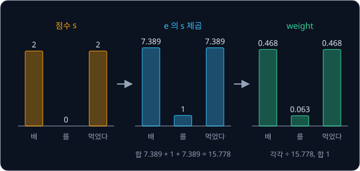
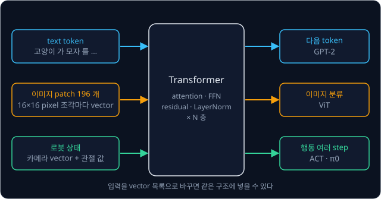

# Transformer

## 학습 목표

- 같은 token(글을 자른 조각)이라도 문장에 따라 뜻이 달라져서, 각 token 이 같은 문장의 다른 token 을 참고해야 하는 이유를 설명할 수 있다
- token 번호를 숫자 몇 개짜리 목록으로 바꾸는 표 찾기를 따라 할 수 있다
- token 3개짜리 문장에서 token 마다 다른 token 과의 점수를 매기고, 점수를 합이 1 인 비율로 바꾸고, 그 비율로 숫자 목록을 섞는 계산을 손으로 할 수 있다
- 점수를 숫자 목록 길이의 제곱근으로 나누는 이유와, 같은 계산을 여러 갈래로 나눠 따로 하는 이유를 설명할 수 있다
- token 의 순서를 따로 더해 알려 주어야 하는 이유, 한 층을 이루는 나머지 부품, 입력을 읽는 쪽과 출력을 쓰는 쪽의 차이를 설명할 수 있다
- Transformer 가 글뿐 아니라 이미지와 로봇 행동을 다루는 모델에도 쓰이는 구조라는 것을 예를 들어 설명할 수 있다

## 문맥에 따라 달라지는 뜻

### 같은 token, 다른 뜻

[BPE Tokenizer](../tokenizer/README.md) 에서 tokenizer 는 text(사람이 읽는 글)를 token 이라는 조각으로 자르고, token 마다
vocabulary(쓸 수 있는 token 을 모두 모아 번호를 붙인 목록)의 번호인 token id 를 붙였다. 이 강의에서는 계산을 쉽게 하려고
단어 하나를 token 하나로 자른다고 하자.

아래 두 문장을 보자.

- 배 를 먹었다
- 배 를 탔다

두 문장의 첫 token "배" 는 글자도 같고 token id 도 같다. 그런데 첫 문장의 배는 과일이고, 둘째 문장의 배는 물 위를 다니는
탈것이다. 어느 뜻인지는 "배" 만 봐서는 알 수 없고, 같은 문장에 "먹었다" 가 있는지 "탔다" 가 있는지를 봐야 정해진다.

로봇에게 시키는 말에서도 같은 일이 생긴다. "빨간 컵 집어" 에서 "컵" 은 그냥 컵이 아니라 빨간 컵이고, "집어" 가 무엇을
집으라는 말인지는 "컵" 에 적혀 있다. "그것을 상자에 넣어" 의 "그것" 은 앞 문장을 봐야 무엇인지 안다.

그래서 문장을 이해하는 모델은 token 을 하나씩 따로 보지 않고, 각 token 이 같은 문장의 다른 token 을 참고해 자기 뜻을 고치게
해야 한다. token 들이 서로를 얼마나 참고할지 정해 정보를 모으는 이 계산을 attention 이라고 하고, attention 을 중심으로 쌓은
모델 구조를 Transformer 라고 한다. attention 은 "주의" 라는 뜻으로, 지금 token 이 문장의 어느 token 에 주의를 기울일지 정한다는
데서 이름이 왔다.

**확인 문제.** "눈 이 온다" 와 "눈 이 아프다" 에서 "눈" 의 뜻을 정해 주는 token 은 각각 무엇일까?

답 보기

"온다" 가 있으면 하늘에서 내리는 눈이고, "아프다" 가 있으면 몸의 눈이다. 두 문장에서 "눈" 의 token id 는 같으므로, 뜻은 다른
token 을 봐야 정해진다.

### 한 token 씩 읽던 방식

Transformer 가 나오기 전에는 문장을 다루는 모델의 대부분이 RNN(recurrent neural network)이었다. neural network 는 곱하고 더하는
단순한 계산을 여러 층 쌓은 모델이고([Backpropagation](../autograd/README.md) 에서 다룬다), recurrent 는 "되풀이되는" 이라는
뜻이다. RNN 은 token 을 앞에서부터 하나씩 읽으면서, 읽을 때마다 정해진 개수의 숫자로 된 기억을 고쳐 쓴다. "빨간 컵 집어" 라면
"빨간" 을 읽어 기억을 만들고, 그 기억에 "컵" 을 합쳐 새 기억을 만든 뒤, 다시 "집어" 를 합친다.

이 방식에는 두 가지 문제가 있었다.

- **긴 문장의 앞부분이 흐려진다** — 기억에 쓰는 숫자의 개수는 문장 길이와 상관없이 정해져 있다. 단어 3개짜리 문장이든 100개짜리
  문장이든 같은 크기의 기억에 담아야 해서, 문장이 길수록 앞쪽 token 의 정보가 뒤에 덮여 흐려진다
- **차례로만 계산할 수 있다** — 셋째 token 을 읽으려면 둘째 token 까지 읽은 기억이 먼저 있어야 한다. 그래서 token 100개는
  100번을 차례로 계산해야 하고, 같은 계산을 수천 개의 숫자에 동시에 하는 계산 장치인 GPU 의 장점을 살리기 어렵다

2014년 Bahdanau, Cho, Bengio 는 번역 모델에서 첫째 문제를 덜었다. 번역문의 단어를 하나 만들 때마다 기억 하나에만 기대지 않고
입력 문장의 모든 위치를 다시 보면서, 지금 필요한 위치에 큰 비중을 주어 정보를 모으게 했다. 이것이 attention 의 시작이다.
2017년 Vaswani 등은 "Attention Is All You Need"("attention 만 있으면 된다") 라는 논문에서 RNN 의 차례대로 읽는 부분을 아예 빼고
attention 만으로 모델을 만들었는데, 이 모델이 Transformer 다. 모든 token 이 다른 모든 token 을 한 번에 보므로 앞부분이 흐려지는
문제가 없고, token 마다의 계산을 동시에 할 수 있다.

위 그림의 위쪽은 RNN 이다. 기억 상자가 하나씩 이어져서 오른쪽 상자는 왼쪽 상자가 끝나야 계산할 수 있다. 아래쪽은 attention 으로,
세 token 이 선으로 모두 이어져 있고 이 선들의 계산은 서로를 기다리지 않는다.

**확인 문제.** token 50개짜리 문장을 RNN 이 읽으려면 기억을 몇 번 차례로 고쳐 써야 할까? attention 은 어떤가?

답 보기

RNN 은 token 하나를 읽을 때마다 기억을 고치므로 50번을 차례로 계산해야 한다. attention 은 token 마다의 계산이 서로를 기다리지
않으므로 50개를 동시에 계산할 수 있다.

**요약**

- 같은 token 도 문장에 따라 뜻이 달라서, token 마다 다른 token 을 참고해 뜻을 고쳐야 한다
- RNN 은 token 을 차례로 읽어 크기가 정해진 기억에 담기 때문에 긴 문장의 앞부분이 흐려지고, 계산을 동시에 할 수 없다
- Transformer 는 attention 만으로 모든 token 이 다른 모든 token 을 한 번에 보게 한 구조다

## embedding

### token id 를 그대로 쓰지 않는 이유

모델은 곱하고 더하는 계산만 하므로 token 을 숫자로 넣어야 한다. 가장 쉬운 방법은 token id 를 그대로 넣는 것이다. 이 강의에서
쓸 작은 vocabulary 가 아래와 같다고 하자.

| token id | token |
| --- | --- |
| 0 | 배 |
| 1 | 를 |
| 2 | 먹었다 |
| 3 | 탔다 |

id 는 vocabulary 에 넣은 차례일 뿐이라서 숫자의 크기에 뜻이 없다. "먹었다"(2) 와 "탔다"(3) 는 id 가 1 차이라 가까워 보이지만
뜻이 가까워서가 아니고, "탔다" 의 id 가 "먹었다" 의 1.5 배인 것도 아무 의미가 없다. 그런데 모델이 id 에 숫자를 곱하면 이 의미
없는 크기 차이가 그대로 계산에 들어간다. GPT-2 의 vocabulary 는 token 50,257개라 id 가 0 부터 50,256 까지 퍼져 있어서, 같은
문제가 훨씬 크게 생긴다.

**확인 문제.** id 를 그대로 입력으로 쓰는 모델이 입력에 3 을 곱한다면 "먹었다" 와 "탔다" 는 각각 얼마가 될까? 이 차이가 뜻의
차이를 나타낼까?

답 보기

$2 \times 3 = 6$ 과 $3 \times 3 = 9$ 다. 차이 3 은 vocabulary 에 넣은 차례에서 생긴 것이라 두 단어의 뜻과 아무 관계가 없다.

### embedding 표

그래서 token 마다 숫자 몇 개짜리 목록을 따로 정해 둔다. 숫자를 순서대로 묶은 목록을 vector 라고 하고
([Linear Regression](../linear-regression/README.md) 의 "vector 와 행렬 곱" 절), vector 안 숫자의 개수를 그 vector 의 차원이라고
한다. $[1, 1]$ 은 2차원 vector 다.

token 마다 vector 하나를 적어 둔 표를 embedding 표라고 하고, token id 로 이 표에서 행(가로줄) 하나를 꺼내는 일을 embedding
이라고 한다. 꺼낸 vector 도 그 token 의 embedding 이라고 부른다. embed 는 "끼워 넣다" 라는 뜻으로, token 을 숫자 공간 안의 한
점으로 끼워 넣는다는 데서 이름이 왔다.

| token id | token | embedding (2차원) |
| --- | --- | --- |
| 0 | 배 | $[1, 1]$ |
| 1 | 를 | $[0, 0]$ |
| 2 | 먹었다 | $[2, 0]$ |
| 3 | 탔다 | $[0, 2]$ |

이 표는 이해를 돕기 위해 첫째 칸을 "먹는 것과 관련된 정도", 둘째 칸을 "타는 것과 관련된 정도" 로 정해 숫자를 넣었다. "먹었다"
는 첫째 칸만 2 이고 "탔다" 는 둘째 칸만 2 이며, 두 뜻을 다 가진 "배" 는 두 칸 모두 1, 조사 "를" 은 두 칸 모두 0 이다.

"배 를 먹었다" 는 tokenizer 를 거쳐 id 열 0, 1, 2 가 되고, 표에서 행 0, 1, 2 를 꺼내면 vector 세 개 $[1, 1]$, $[0, 0]$, $[2, 0]$
이 된다. 모델은 이제 id 대신 이 vector 들로 계산한다.

![token id 0, 1, 2 로 embedding 표의 행을 꺼내 배 를 먹었다 가 vector 세 개 [1, 1], [0, 0], [2, 0] 이 되는 모습](figures/embedding-table.svg)

위 그림은 id 열이 embedding 표의 행을 가리키고, 꺼낸 행들이 모델의 입력이 되는 과정을 보여 준다. "배" 는 어느 문장에서든 id 0
이라서 언제나 같은 행 $[1, 1]$ 을 꺼낸다. embedding 만으로는 과일인 배와 탈것인 배를 구분할 수 없고, 그 구분은 뒤에서 다룰
attention 이 맡는다.

**확인 문제.** 위 표에서 "배 를 탔다" 의 id 열과 embedding 세 개는?

답 보기

id 열은 0, 1, 3 이고, embedding 은 $[1, 1]$, $[0, 0]$, $[0, 2]$ 다.

### embedding 값의 출처

실제 모델에서는 embedding 표의 숫자를 사람이 정하지 않는다. 처음에는 아무 숫자(무작위 값)로 채워 두고, 학습하면서
[Linear Regression](../linear-regression/README.md) 의 $w$, $b$ 처럼 loss(모델이 틀린 정도를 나타낸 숫자)가 줄어드는 쪽으로
조금씩 고친다. 그래서 embedding 표의 숫자는 모두 parameter(데이터를 보고 채우는 숫자)이고, 칸마다의 뜻도 위 예처럼 사람이 읽을
수 있게 정해지지 않는다.

차원도 설계하는 사람이 정한다. Transformer 논문은 512차원을 썼고, GPT-2 의 가장 작은 모델은 768차원을 쓴다. 그래서 GPT-2 의
embedding 표는 행이 50,257개, 열이 768개이고, 숫자가 $50257 \times 768 = 38{,}597{,}376$ 개 들어 있다.

**확인 문제.** vocabulary 가 token 10개이고 embedding 이 4차원이면 embedding 표에는 숫자가 몇 개 들어 있을까?

답 보기

행 10개, 열 4개라서 $10 \times 4 = 40$ 개다. 모두 학습으로 고쳐지는 parameter 다.

### 문맥에 따른 embedding 과 token 의 뜻

embedding 이라는 말은 강의마다 조금씩 다르게 쓰인다.

- **이 강의의 embedding** — token id 로 표에서 행을 꺼내는 일, 또는 꺼낸 vector 다
- **[ViT](../vit/README.md) 의 patch embedding** — 이미지를 잘라 만든 조각의 숫자들에 행렬을 곱해 만든 vector 다. 표에서
  꺼내지 않고 계산으로 만든다
- **넓은 뜻의 embedding** — 단어, 이미지, 문장처럼 어떤 대상을 나타내는 숫자 vector 를 통틀어 embedding 이라고도 부른다.
  [CLIP](../clip/README.md) 의 "이미지 embedding" 이 이 뜻이다

셋 모두 어떤 대상을 나타내는 숫자 vector 다. token 도 마찬가지로, Transformer 안에서는 embedding 을 거친 뒤의 vector
하나하나를 그대로 token 이라고 부른다. "token 3개" 는 이 강의 안에서 vector 3개를 뜻한다.

**요약**

- token id 는 차례 번호라서 크기에 뜻이 없으므로, token 마다 vector 하나를 적은 embedding 표에서 행을 꺼내 쓴다
- embedding 표의 숫자는 학습으로 정해지는 parameter 이고, 같은 token 은 어느 문장에서든 같은 vector 를 꺼낸다
- 문맥에 따라 다른 뜻을 갖게 하는 일은 embedding 이 아니라 attention 이 한다

## dot product 로 매기는 관련도 점수

### dot product

두 vector 의 같은 자리 칸끼리 곱한 뒤 모두 더한 값을 dot product(내적)라고 하고, 두 vector 사이에 가운뎃점을 찍어
$\mathbf{a} \cdot \mathbf{b}$ 로 쓴다([Linear Regression](../linear-regression/README.md) 에서 처음 다뤘다).

$$
[1, 1] \cdot [2, 0] = 1 \times 2 + 1 \times 0 = 2
$$

이 식은 "첫째 칸끼리 곱한 $1 \times 2$ 와 둘째 칸끼리 곱한 $1 \times 0$ 을 더한다" 로 읽는다. 차원이 $d$ 인 vector 라면 칸 $d$ 개를
곱해 더한다.

$$
\mathbf{a} \cdot \mathbf{b} = a_1 b_1 + a_2 b_2 + \cdots + a_d b_d
$$

$a_1$ 은 $\mathbf{a}$ 의 첫째 칸, $b_1$ 은 $\mathbf{b}$ 의 첫째 칸이고, 가운데 점 세 개 $\cdots$ 는 같은 꼴의 덧셈이 $d$ 번째
칸까지 이어진다는 뜻이다.

### 관련도 점수

두 vector 가 같은 칸에서 함께 크면 dot product 가 크고, 한쪽이 0 인 칸은 보태는 것이 없으며, 한쪽은 양수이고 다른 쪽은 음수인
칸은 값을 깎는다. 그래서 dot product 는 두 token 이 얼마나 관련 있는지를 재는 점수로 쓸 수 있다.

"배 를 먹었다" 에서 "배" 가 문장의 세 token 과 얻는 점수는 아래와 같다. token 은 자기 자신과도 점수를 매긴다.

| 상대 token | 상대 embedding | dot product 계산 | 점수 |
| --- | --- | --- | --- |
| 배 | $[1, 1]$ | $1 \times 1 + 1 \times 1$ | 2 |
| 를 | $[0, 0]$ | $1 \times 0 + 1 \times 0$ | 0 |
| 먹었다 | $[2, 0]$ | $1 \times 2 + 1 \times 0$ | 2 |

"배 를 탔다" 에서는 셋째 token 만 바뀐다. $[1, 1] \cdot [0, 2] = 1 \times 0 + 1 \times 2 = 2$ 라서 점수는 역시 $[2, 0, 2]$ 다.
"배" 는 두 문장 모두에서 동사와 2점, 조사 "를" 과 0점으로 관련된다.

**확인 문제.** "배 를 먹었다" 에서 "먹었다"($[2, 0]$) 가 세 token(배, 를, 먹었다)과 얻는 점수는?

답 보기

$[2, 0] \cdot [1, 1] = 2$, $[2, 0] \cdot [0, 0] = 0$, $[2, 0] \cdot [2, 0] = 4 + 0 = 4$ 라서 $[2, 0, 4]$ 다.

## softmax

### 점수를 비율로 바꾸는 이유

점수를 매긴 뒤에는 "각 token 에서 정보를 몇 퍼센트씩 가져올지" 를 정해야 한다. 이 비율은 모두 0 이상이고 합이 1(100%)이어야
한다. 점수 $[2, 0, 2]$ 라면 점수의 합 4 로 나눠 $[0.5, 0, 0.5]$ 로 만들면 될 것 같지만, 점수에는 음수도 나온다. 점수가
$[3, -1, -1]$ 이면 합이 1 이라 나눠도 $[3, -1, -1]$ 그대로이고, 음수 비율 $-1$ 은 뜻이 없다. 점수가 $[1, -1, 0]$ 이면 합이 0 이라
나눌 수조차 없다. 그래서 점수를 먼저 모두 양수로 바꾸되, 큰 점수는 큰 양수로 바꿔 순서를 지키는 방법이 필요하다.

### 지수와 e

수의 오른쪽 위에 작게 쓴 숫자를 지수라고 하고, 그 수를 몇 번 곱하는지를 나타낸다. $2^3 = 2 \times 2 \times 2 = 8$ 이다. 지수가
0 이면 값은 1 로 정하고, 지수에 마이너스가 붙으면 1 을 그만큼 곱한 수로 나눈다. $2^{-1} = 1 \div 2 = 0.5$ 다.

softmax 에서는 2 대신 약 2.718 인 정해진 수 $e$ 를 쓴다([Backpropagation](../autograd/README.md) 의 sigmoid 에서도 나왔다).
지수가 정수가 아니어도 계산기로 값을 구할 수 있다.

| $s$ | $-2$ | $-1$ | $0$ | $1$ | $2$ | $3$ | $4$ |
| --- | --- | --- | --- | --- | --- | --- | --- |
| $e^{s}$ | 0.135 | 0.368 | 1 | 2.718 | 7.389 | 20.086 | 54.598 |

표에서 두 가지 성질이 보인다. $e^{s}$ 는 $s$ 가 음수여도 언제나 양수이고, $s$ 가 클수록 커진다. 점수를 $e^{s}$ 로 바꾸면 음수가
사라지면서 점수의 순서는 그대로 남는다.

### softmax 계산

softmax 는 점수 하나하나를 $e^{s}$ 로 바꾸고, 그 합으로 나눠 비율을 만든다. "배" 의 점수 $[2, 0, 2]$ 로 계산한다.

| 상대 token | 점수 $s$ | $e^{s}$ | $e^{s} \div 15.778$ |
| --- | --- | --- | --- |
| 배 | 2 | 7.389 | 0.468 |
| 를 | 0 | 1 | 0.063 |
| 먹었다 | 2 | 7.389 | 0.468 |
| 합 | | 15.778 | 1 (반올림 때문에 0.999) |

"배" 는 자기 자신과 "먹었다" 에서 46.8% 씩, "를" 에서 6.3% 를 가져온다. softmax 가 낸 이 비율을 attention weight 라고 한다.

숫자만 바꿔 점수 $[1, 0, -1]$ 로 한 번 더 계산하면 $e^{s}$ 는 2.718, 1, 0.368 이고 합은 4.086 이라, weight 는
$2.718 \div 4.086 = 0.665$, $1 \div 4.086 = 0.245$, $0.368 \div 4.086 = 0.090$ 이다. 음수 점수 $-1$ 도 작은 양수 weight 0.090 이
되었다.

위 그림은 왼쪽부터 점수, $e^{s}$, weight 를 막대로 그린 것이다. 가운데 막대들의 합 15.778 로 나누면 오른쪽 막대들의 합이 1 이 된다.

두 계산을 기호로 쓰면 아래와 같다.

$$
\mathrm{softmax}(\mathbf{s})_j = \frac{e^{s_j}}{e^{s_1} + e^{s_2} + \cdots + e^{s_n}}
$$

$\mathbf{s}$ 는 점수 $n$ 개를 묶은 vector, $s_j$ 는 그 가운데 $j$ 번째 점수다. 이 식은 "$j$ 번째 weight 는 $e^{s_j}$ 를 모든
$e^{s}$ 의 합으로 나눈 값이다" 로 읽는다. "배" 의 예에서 $n = 3$, 분모는 15.778 이고 $j = 1$ 의 weight 가 0.468 이다.

softmax 라는 이름은 가장 큰 값 하나만 고르는 max 를 부드럽게(soft) 만들었다는 뜻이다. 가장 큰 점수가 가장 큰 weight 를 받지만,
나머지도 0 이 아닌 몫을 받는다.

softmax 에는 쓸모 있는 성질이 하나 더 있다. 점수 모두에 같은 수를 더해도 weight 가 그대로다. $[2, 1, 0]$ 은 $[1, 0, -1]$ 에 1 을
더한 것인데, $e^{s}$ 가 7.389, 2.718, 1 로 모두 $e^{1} = 2.718$ 배가 되고 합도 2.718 배가 되어서, 나누면 똑같이 0.665, 0.245,
0.090 이 나온다. weight 를 정하는 것은 점수의 크기 자체가 아니라 점수끼리의 차이다.

**흔한 오해.** 점수가 두 배면 weight 도 두 배라고 생각하기 쉽다. 점수 $[2, 1]$ 을 softmax 하면 $e^{2} = 7.389$, $e^{1} = 2.718$,
합 10.107 이라 weight 는 $[0.731, 0.269]$ 다. 점수의 비 $2 : 1$ 을 그대로 쓴 $[0.667, 0.333]$ 이 아니고, 점수가 1 차이 날 때마다
weight 는 약 2.718 배 차이가 난다.

**확인 문제.** 점수 $[0, 0, 0]$ 과 $[1, 0]$ 을 각각 softmax 하면?

답 보기

$[0, 0, 0]$ 은 $e^{0} = 1$ 이 셋이라 합 3 으로 나눠 $[0.333, 0.333, 0.333]$ 이다. 점수가 모두 같으면 똑같이 나눈다.
$[1, 0]$ 은 $e^{1} = 2.718$, $e^{0} = 1$, 합 3.718 이라 $[0.731, 0.269]$ 다.

## 가중 평균으로 만드는 attention 출력

### 가중 평균

평균은 모두 더한 뒤 개수로 나눈 값이다. 시험 점수 80 과 60 의 평균은 $(80 + 60) \div 2 = 70$ 인데, 이것은
$0.5 \times 80 + 0.5 \times 60$ 과 같다. 두 점수에 똑같이 0.5 씩 곱해 더한 것이다.

곱하는 비율을 서로 다르게 주면 가중 평균이 된다. 80 에 0.75, 60 에 0.25 를 주면 $0.75 \times 80 + 0.25 \times 60 = 60 + 15 = 75$
로, 비율을 많이 받은 80 쪽에 가까워진다. 비율의 합이 1 이기만 하면 결과는 언제나 섞은 값들 사이에 놓인다.

vector 를 가중 평균할 때는 칸마다 따로 계산한다. $0.75 \times [4, 0] + 0.25 \times [0, 8]$ 은 첫째 칸
$0.75 \times 4 + 0.25 \times 0 = 3$, 둘째 칸 $0.75 \times 0 + 0.25 \times 8 = 2$ 라서 $[3, 2]$ 다.

**확인 문제.** 10 과 20 을 비율 0.9 와 0.1 로 가중 평균하면?

답 보기

$0.9 \times 10 + 0.1 \times 20 = 9 + 2 = 11$ 이다. 비율을 많이 받은 10 쪽에 가깝다.

### "배" 의 새 vector

attention 의 마지막 단계는 softmax 로 얻은 weight 로 문장의 vector 들을 가중 평균하는 것이다. "배 를 먹었다" 의 "배" 는 weight
$[0.468, 0.063, 0.468]$ 로 세 embedding 을 섞는다.

| 상대 token | weight | embedding | weight × embedding |
| --- | --- | --- | --- |
| 배 | 0.468 | $[1, 1]$ | $[0.468, 0.468]$ |
| 를 | 0.063 | $[0, 0]$ | $[0, 0]$ |
| 먹었다 | 0.468 | $[2, 0]$ | $[0.936, 0]$ |
| 합 | | | $[1.404, 0.468]$ |

"배 를 탔다" 에서도 점수가 $[2, 0, 2]$ 라서 weight 는 똑같이 $[0.468, 0.063, 0.468]$ 이다. 섞는 재료만 다르다.

| 상대 token | weight | embedding | weight × embedding |
| --- | --- | --- | --- |
| 배 | 0.468 | $[1, 1]$ | $[0.468, 0.468]$ |
| 를 | 0.063 | $[0, 0]$ | $[0, 0]$ |
| 탔다 | 0.468 | $[0, 2]$ | $[0, 0.936]$ |
| 합 | | | $[0.468, 1.404]$ |

같은 embedding $[1, 1]$ 에서 출발한 "배" 가 첫 문장에서는 $[1.404, 0.468]$ 로 "먹는 것" 칸이 커졌고, 둘째 문장에서는
$[0.468, 1.404]$ 로 "타는 것" 칸이 커졌다. 이렇게 attention 을 거친 새 vector 를 attention 출력이라고 하고, 다음 계산에서는
처음의 embedding 대신 이 출력을 쓴다.

![embedding 의 점들을 좌표평면에 찍은 그림. 배 [1, 1] 이 배 를 먹었다 에서는 먹었다 쪽인 [1.404, 0.468] 로, 배 를 탔다 에서는 탔다 쪽인 [0.468, 1.404] 로 옮겨 간다](figures/context-shift.svg)

위 그림은 2차원 vector 를 좌표평면(가로축이 첫째 칸, 세로축이 둘째 칸)의 점으로 찍은 것이다. 회색 점이 embedding 이고, 주황
화살표는 "배 를 먹었다" 에서, 파란 화살표는 "배 를 탔다" 에서 "배" 가 옮겨 간 자리다. 문장에 함께 있는 동사 쪽으로 끌려간다.

여기까지 한 계산을 순서대로 다시 적으면 attention 은 세 단계다.

1. **점수** — 지금 token 의 vector 와 문장의 모든 token 의 vector 사이의 dot product 를 구한다
2. **weight** — 점수를 softmax 로 합이 1 인 비율로 바꾼다
3. **출력** — 그 비율로 문장의 vector 들을 가중 평균한다

문장의 모든 token 이 이 계산을 각자 한다. "를" 의 점수는 세 token 모두와 0 이라서 weight 가 $[0.333, 0.333, 0.333]$ 이고, 출력은
"배 를 먹었다" 에서 $0.333 \times [1, 1] + 0.333 \times [0, 0] + 0.333 \times [2, 0] = [0.999, 0.333]$ 이다. 반올림하지 않으면
$[1, 0.333]$ 이다.

**확인 문제.** "배 를 먹었다" 의 "먹었다" 는 점수 $[2, 0, 4]$ 를 softmax 해 weight $[0.117, 0.016, 0.867]$ 을 얻는다. "먹었다" 의
attention 출력은?

답 보기

$0.117 \times [1, 1] + 0.016 \times [0, 0] + 0.867 \times [2, 0]$ 이다. 첫째 칸은 $0.117 + 0 + 1.734 = 1.851$, 둘째 칸은
$0.117 + 0 + 0 = 0.117$ 이라서 $[1.851, 0.117]$ 이다.

**요약**

- attention 은 dot product 로 점수를 매기고, softmax 로 합이 1 인 weight 를 만들고, 그 weight 로 vector 들을 가중 평균한다
- softmax 는 $e^{s}$ 로 점수를 양수로 바꾼 뒤 합으로 나누며, 점수끼리의 차이가 weight 를 정한다
- 같은 embedding 이라도 문장의 다른 token 이 다르면 attention 출력이 달라진다. "배" 는 $[1.404, 0.468]$ 과 $[0.468, 1.404]$ 가 되었다

## query·key·value

### 자기 자신을 가장 많이 보는 문제

지금까지는 embedding 을 그대로 써서 점수를 매겼다. 이 방식에는 문제가 있다. 로봇에게 시키는 문장 "빨간 컵 집어" 의 embedding
이 아래와 같다고 하자.

| token | embedding |
| --- | --- |
| 빨간 | $[1, 0]$ |
| 컵 | $[0, 1]$ |
| 집어 | $[1, -1]$ |

"집어" 가 세 token 과 얻는 점수는 $[1, -1] \cdot [1, 0] = 1$, $[1, -1] \cdot [0, 1] = -1$, $[1, -1] \cdot [1, -1] = 1 + 1 = 2$ 라서
$[1, -1, 2]$ 이고, softmax 하면 weight 는 $[0.259, 0.035, 0.705]$ 다. "집어" 는 무엇을 집을지 알려면 "컵" 을 봐야 하는데, 정작
"컵" 에는 3.5% 만 주고 자기 자신에게 70.5% 를 준다.

자기 자신과의 dot product 는 같은 칸끼리 곱하는 것이라 칸마다 제곱이 되고, 제곱은 음수가 없어서 크게 나오기 쉽다. 게다가
embedding 하나가 세 가지 일을 한꺼번에 맡고 있다. 다른 token 을 찾을 때의 기준, 다른 token 이 나를 찾을 때 보여 주는 표지,
내가 뽑혔을 때 넘겨주는 내용이 모두 같은 vector 다. "집어" 는 "물건" 을 찾아야 하지만 자기는 동작이라서, 찾는 것과 보여 주는
것이 같으면 이런 관계를 담을 수 없다.

### 행렬과 vector 의 곱

세 가지 일을 나누려고 embedding 에 서로 다른 행렬을 곱한다. 행렬은 숫자를 가로줄(행)과 세로줄(열)로 늘어놓은 직사각형 모양의
묶음이고, 행렬과 vector 의 곱은 행렬의 각 행과 vector 의 dot product 를 차례로 계산해 세로로 쌓은 것이다
([Linear Regression](../linear-regression/README.md) 의 "행렬과 행렬 곱" 절).

$$
\begin{bmatrix} 0 & 1 \\ 1 & 0 \end{bmatrix}
\begin{bmatrix} 1 \\ -1 \end{bmatrix}
=
\begin{bmatrix} 0 \times 1 + 1 \times (-1) \\ 1 \times 1 + 0 \times (-1) \end{bmatrix}
=
\begin{bmatrix} -1 \\ 1 \end{bmatrix}
$$

첫째 행 $[0, 1]$ 과 $[1, -1]$ 의 dot product 가 $-1$, 둘째 행 $[1, 0]$ 과의 dot product 가 1 이다. 이 행렬은 두 칸을 맞바꾸는
일을 한다. 이처럼 vector 에 행렬을 곱하는 층을 Linear layer 라고 부르고, 행렬의 숫자는 모두 학습으로 정해지는 parameter 다
([PyTorch Training Loop](../pytorch-mlp/README.md) 에서 Linear layer 를 쌓아 모델을 만든다). 이 강의에서는 행렬과 vector 의 곱을
$W\mathbf{x}$ 처럼 붙여 쓴다.

**확인 문제.** $\begin{bmatrix} 1 & 1 \\ 0 & 1 \end{bmatrix}$ 에 vector $[1, -1]$ 을 곱하면?

답 보기

첫째 행: $1 \times 1 + 1 \times (-1) = 0$, 둘째 행: $0 \times 1 + 1 \times (-1) = -1$ 이라서 $[0, -1]$ 이다.

### query, key, value 의 세 역할

Transformer 는 token 의 embedding $\mathbf{x}$ 에 행렬 세 개를 따로 곱해 vector 세 개를 만든다.

$$
\mathbf{q} = W_Q\,\mathbf{x}, \qquad \mathbf{k} = W_K\,\mathbf{x}, \qquad \mathbf{v} = W_V\,\mathbf{x}
$$

- $\mathbf{q}$ 는 query(질의)로, 이 token 이 다른 token 에서 찾는 것을 나타낸다
- $\mathbf{k}$ 는 key(열쇠)로, 이 token 이 다른 token 의 query 에게 보여 주는 표지다
- $\mathbf{v}$ 는 value(값)로, 이 token 이 뽑혔을 때 넘겨주는 내용이다
- $W_Q$, $W_K$, $W_V$ 는 각각을 만드는 행렬이고, 아래첨자 Q, K, V 는 query, key, value 의 첫 글자다

점수는 token $i$ 의 query 와 token $j$ 의 key 의 dot product $\mathbf{q}_i \cdot \mathbf{k}_j$ 로 매기고, 가중 평균은 embedding 대신
value 로 한다. 찾는 기준(query)과 보여 주는 표지(key)가 다른 행렬로 만들어지므로, 자기 자신과의 점수가 저절로 커지지 않는다.

이름은 데이터를 찾아 꺼내는 일에서 왔다. 찾고 싶은 것을 query 로 내면, 저장된 항목마다 붙은 key 와 맞춰 보고, 맞는 항목의
value 를 돌려준다. 도서관에서 검색어를 책마다 붙은 분류 표지와 맞춰 보고 잘 맞는 책의 내용을 가져오는 것과 같다. 다만 attention
은 가장 잘 맞는 하나만 꺼내지 않고, 맞는 정도(weight)만큼 모든 value 를 섞는다.

"빨간 컵 집어" 에 아래 세 행렬을 쓴다. 실제 모델에서는 학습으로 정해지는 값이고, 여기서는 손으로 계산하기 쉬운 숫자를 골랐다.

$$
W_Q = \begin{bmatrix} 0 & 1 \\ 1 & 0 \end{bmatrix}, \qquad
W_K = \begin{bmatrix} 1 & 0 \\ 0 & 1 \end{bmatrix}, \qquad
W_V = \begin{bmatrix} 1 & 1 \\ 0 & 1 \end{bmatrix}
$$

$W_Q$ 는 두 칸을 맞바꾸고, $W_K$ 는 vector 를 그대로 두며, $W_V$ 는 첫째 칸에 둘째 칸을 더한다.

| token | $\mathbf{x}$ | $\mathbf{q} = W_Q\mathbf{x}$ | $\mathbf{k} = W_K\mathbf{x}$ | $\mathbf{v} = W_V\mathbf{x}$ |
| --- | --- | --- | --- | --- |
| 빨간 | $[1, 0]$ | $[0, 1]$ | $[1, 0]$ | $[1, 0]$ |
| 컵 | $[0, 1]$ | $[1, 0]$ | $[0, 1]$ | $[1, 1]$ |
| 집어 | $[1, -1]$ | $[-1, 1]$ | $[1, -1]$ | $[0, -1]$ |

**확인 문제.** 위 $W_V$ 로 embedding $[2, 3]$ 의 value 를 구하면?

답 보기

첫째 행 $[1, 1]$ 과의 dot product 는 $2 + 3 = 5$, 둘째 행 $[0, 1]$ 과는 3 이라서 $[5, 3]$ 이다.

### 칸마다 따라가는 attention 계산

"집어" 의 attention 출력을 한 칸씩 계산한다. query 는 $\mathbf{q}_{\text{집어}} = [-1, 1]$ 이다.

| 상대 token | key | 점수 $\mathbf{q}_{\text{집어}} \cdot \mathbf{k}$ | $e^{\text{점수}}$ | weight | value | weight × value |
| --- | --- | --- | --- | --- | --- | --- |
| 빨간 | $[1, 0]$ | $-1 + 0 = -1$ | 0.368 | 0.114 | $[1, 0]$ | $[0.114, 0]$ |
| 컵 | $[0, 1]$ | $0 + 1 = 1$ | 2.718 | 0.844 | $[1, 1]$ | $[0.844, 0.844]$ |
| 집어 | $[1, -1]$ | $-1 - 1 = -2$ | 0.135 | 0.042 | $[0, -1]$ | $[0, -0.042]$ |
| 합 | | | 3.221 | 1 | | $[0.958, 0.802]$ |

weight 열은 $e^{\text{점수}}$ 를 합 3.221 로 나눈 값이다. embedding 을 그대로 썼을 때 "컵" 에 3.5% 만 주던 "집어" 가 이제 84.4%
를 "컵" 에서 가져온다. 출력 $[0.958, 0.802]$ 는 대부분 "컵" 의 value $[1, 1]$ 로 채워져서, "집어" 의 새 vector 에 무엇을 집을지가
담긴다.

![집어 의 query [−1, 1] 이 세 key 와 dot product 해 점수 −1, 1, −2 가 되고, softmax 로 weight 0.114, 0.844, 0.042 가 된 뒤 value 를 가중 평균해 출력 [0.958, 0.802] 가 되는 계산 흐름](figures/attention.svg)

위 그림은 같은 계산을 상자와 화살표로 그린 것이다. 왼쪽 위의 query 가 key 세 개와 각각 만나 점수가 되고, softmax 를 거친
weight 가 value 를 섞어 오른쪽의 출력이 된다.

### 세 token 의 점수 표

다른 두 token 도 같은 계산을 한다. 점수를 표 하나에 모으면 행은 query 를 낸 token, 열은 key 를 낸 token 이다.

| query \ key | 빨간 $[1, 0]$ | 컵 $[0, 1]$ | 집어 $[1, -1]$ | weight (softmax) |
| --- | --- | --- | --- | --- |
| 빨간 $[0, 1]$ | 0 | 1 | $-1$ | $[0.245, 0.665, 0.090]$ |
| 컵 $[1, 0]$ | 1 | 0 | 1 | $[0.422, 0.155, 0.422]$ |
| 집어 $[-1, 1]$ | $-1$ | 1 | $-2$ | $[0.114, 0.844, 0.042]$ |

"빨간" 은 자기가 꾸미는 "컵" 을 가장 많이 보고, "컵" 은 어떤 컵인지 알려 주는 "빨간" 과 무엇을 할지 알려 주는 "집어" 를
반씩 보며, "집어" 는 집을 대상인 "컵" 을 본다. 세 token 모두 자기 자신보다 다른 token 에 더 큰 weight 를 준다. 출력은 각 행의
weight 로 value 를 섞어 "빨간" 이 $[0.910, 0.575]$, "컵" 이 $[0.577, -0.267]$, "집어" 가 $[0.958, 0.802]$ 다.

위 그림의 왼쪽은 점수 표, 오른쪽은 행마다 softmax 한 weight 표다. 오른쪽 표에서 진한 칸이 대각선(자기 자신) 밖에 놓여 있다.

### 행렬로 쓰는 attention

query 세 개를 행으로 쌓은 행렬을 $Q$, key 를 쌓은 행렬을 $K$, value 를 쌓은 행렬을 $V$ 라고 하면 위의 계산 전체를 한 줄로 쓸 수
있다.

$$
\mathrm{Attention}(Q, K, V) = \mathrm{softmax}\!\left(QK^\top\right) V
$$

- $K^\top$ 은 "K transpose" 라고 읽고, $K$ 의 행과 열을 맞바꾼 행렬이다. key 가 행에서 열로 옮겨 간다
- $QK^\top$ 은 $Q$ 의 각 행(query)과 $K^\top$ 의 각 열(key)의 dot product 를 모은 표로, 위의 3 × 3 점수 표다
- softmax 는 이 표의 행마다 따로 적용한다. 그래서 행마다 weight 의 합이 1 이다
- weight 표에 $V$ 를 곱하면 weight 표의 각 행으로 value 들을 가중 평균한 결과가 행마다 나온다. 결과의 행 하나가 token 하나의
  attention 출력이다

query, key, value 를 모두 같은 문장에서 만드는 이 attention 을 self-attention 이라고 한다. self 는 "자기 자신" 이라는 뜻으로,
문장이 자기 자신을 참고한다는 의미다.

**확인 문제.** query $[2, 1]$ 과 key $[1, 3]$ 의 점수는? 그리고 token 이 5개인 문장의 점수 표에는 칸이 몇 개 있을까?

답 보기

$2 \times 1 + 1 \times 3 = 5$ 다. 점수 표는 query 5개 × key 5개라서 $5 \times 5 = 25$ 칸이다.

**요약**

- embedding 을 그대로 쓰면 자기 자신과의 점수가 크게 나오기 쉽고, 찾는 기준·보여 주는 표지·넘겨주는 내용을 나눌 수 없다
- 행렬 $W_Q$, $W_K$, $W_V$ 를 곱해 query, key, value 를 따로 만들고, 점수는 query·key 로, 가중 평균은 value 로 한다
- 한 문장의 계산은 $\mathrm{softmax}(QK^\top)V$ 로 쓸 수 있다. "집어" 는 "컵" 에서 84.4% 를 가져와 $[0.958, 0.802]$ 가 되었다

## √d 로 나누는 scaling

### 제곱근

제곱해서 어떤 수가 되는 양수를 그 수의 제곱근이라고 하고, 기호 $\sqrt{\ }$ 로 쓴다. $2 \times 2 = 4$ 라서 $\sqrt{4} = 2$,
$8 \times 8 = 64$ 라서 $\sqrt{64} = 8$ 이다. 딱 떨어지지 않는 수도 있어서 $\sqrt{2} \approx 1.414$ 다
($1.414 \times 1.414 = 1.999396$). 기호 $\approx$ 는 "약" 이라고 읽는다.

### 차원이 커질 때 점수의 크기

dot product 는 칸 $d$ 개의 곱을 더한 값이라서, 차원 $d$ 가 커지면 점수도 커지기 쉽다. query 와 key 의 칸이 $+1$ 아니면 $-1$ 로
아무렇게나 정해진다고 하자. 그러면 칸마다의 곱도 $+1$ 아니면 $-1$ 이다.

$d = 2$ 이면 두 곱의 조합은 네 가지이고, 합은 $1 + 1 = 2$, $1 - 1 = 0$, $-1 + 1 = 0$, $-1 - 1 = -2$ 다. 합이 양수와 음수로 갈려서
그냥 평균하면 0 이 되므로, [Linear Regression](../linear-regression/README.md) 에서 오차를 다룰 때처럼 제곱해서 평균한다. 제곱은
4, 0, 0, 4 이고 평균은 $8 \div 4 = 2$ 다.

$d = 4$ 이면 곱 네 개의 조합이 $2 \times 2 \times 2 \times 2 = 16$ 가지다.

| 네 곱의 합 | 나오는 조합 수 | 합의 제곱 |
| --- | --- | --- |
| 4 | 1 | 16 |
| 2 | 4 | 4 |
| 0 | 6 | 0 |
| $-2$ | 4 | 4 |
| $-4$ | 1 | 16 |

제곱의 평균은 $(16 \times 1 + 4 \times 4 + 0 \times 6 + 4 \times 4 + 16 \times 1) \div 16 = 64 \div 16 = 4$ 다. $d = 2$ 일 때 2,
$d = 4$ 일 때 4 로, 점수의 제곱의 평균은 차원 $d$ 와 같다. 제곱을 되돌리려면 제곱근을 씌우면 되므로 점수의 대표적인 크기는
$\sqrt{d}$ 다. $d = 4$ 이면 2, $d = 64$ 이면 8, Transformer 논문의 $d = 512$ 이면 약 22.6 이다.

**확인 문제.** query·key 가 16차원이면 점수의 대표적인 크기는 얼마쯤일까?

답 보기

제곱의 평균이 16 이므로 대표적인 크기는 $\sqrt{16} = 4$ 다.

### 뾰족해지는 softmax

점수가 커지면 softmax 의 weight 가 한쪽으로 쏠린다. 점수 $[1, 0, -1]$ 의 weight 는 $[0.665, 0.245, 0.090]$ 이었다. 같은 점수를
8 배 한 $[8, 0, -8]$ 은 $e^{8} \approx 2981$, $e^{0} = 1$, $e^{-8} \approx 0.0003$ 이라서 weight 가
$[0.99966, 0.00034, 0.0000001]$ 이다. 거의 모든 비중이 한 token 에 몰린다.

쏠림이 문제가 되는 이유는 학습에 있다. 학습은 점수를 조금 바꿨을 때 결과가 얼마나 변하는지, 곧 gradient 를 보고 parameter 를
고친다([Linear Regression](../linear-regression/README.md) 의 gradient 절). 가운데 점수를 0.5 올려 보자.

| 점수 | 가운데 weight | 0.5 올린 점수 | 가운데 weight | 변화 |
| --- | --- | --- | --- | --- |
| $[1, 0, -1]$ | 0.245 | $[1, 0.5, -1]$ | 0.348 | $+0.103$ |
| $[8, 0, -8]$ | 0.00034 | $[8, 0.5, -8]$ | 0.00055 | $+0.0002$ |

점수가 큰 쪽은 같은 0.5 를 바꿔도 weight 가 약 500 분의 1 만큼밖에 움직이지 않는다. weight 가 거의 변하지 않으면 gradient 도 거의
0 이라, 모델은 다른 token 을 보는 법을 배우지 못하고 처음 쏠린 곳에 머문다.

위 그림의 왼쪽은 점수가 작을 때, 오른쪽은 점수가 클 때의 weight 다. 오른쪽은 막대 하나만 남는다.

### scaled dot-product attention

그래서 Transformer 는 점수를 $\sqrt{d_k}$ 로 나눠 차원과 상관없이 대표적인 크기가 1 근처에 오게 한다. $d_k$ 는 query·key 의
차원이다.

$$
\mathrm{Attention}(Q, K, V) = \mathrm{softmax}\!\left(\frac{QK^\top}{\sqrt{d_k}}\right) V
$$

이 식은 "점수 표 $QK^\top$ 의 모든 칸을 $\sqrt{d_k}$ 로 나눈 뒤 행마다 softmax 하고, 그 weight 로 value 를 가중 평균한다" 로
읽는다. 점수를 줄인다는 뜻으로 scaled dot-product attention 이라고 부른다. 논문은 $d_k = 64$ 를 써서 점수를 8 로 나눴다.

"빨간 컵 집어" 는 $d_k = 2$ 라서 "집어" 의 점수 $[-1, 1, -2]$ 를 $\sqrt{2} \approx 1.414$ 로 나눈다.

| 상대 token | 점수 | $\div 1.414$ | $e^{\text{나눈 점수}}$ | weight | value |
| --- | --- | --- | --- | --- | --- |
| 빨간 | $-1$ | $-0.707$ | 0.493 | 0.178 | $[1, 0]$ |
| 컵 | 1 | 0.707 | 2.028 | 0.734 | $[1, 1]$ |
| 집어 | $-2$ | $-1.414$ | 0.243 | 0.088 | $[0, -1]$ |
| 합 | | | 2.764 | 1 | |

출력은 $0.178 \times [1, 0] + 0.734 \times [1, 1] + 0.088 \times [0, -1] = [0.912, 0.646]$ 이다. "컵" 의 weight 가 0.844 에서
0.734 로 조금 낮아지고 나머지가 조금 올라, 쏠림이 덜해졌다.

**흔한 오해.** 점수를 나누면 "컵" 이 덜 중요해진다고 생각하기 쉽다. 나눠도 점수의 순서는 그대로라 "컵" 이 여전히 가장 큰
weight 를 받는다. 바뀌는 것은 쏠림의 정도뿐이고, 덕분에 학습 초기에 gradient 가 살아 있다.

**확인 문제.** $d_k = 16$ 일 때 dot product 가 12 인 점수는 나눈 뒤 얼마가 될까?

답 보기

$\sqrt{16} = 4$ 로 나누므로 $12 \div 4 = 3$ 이다.

**요약**

- 칸이 $\pm 1$ 인 vector 의 dot product 는 제곱의 평균이 $d$ 라서 대표적인 크기가 $\sqrt{d}$ 로 자란다
- 점수가 크면 softmax 가 한 token 에 쏠려 점수를 바꿔도 weight 가 거의 움직이지 않고, gradient 가 0 에 가까워진다
- scaled dot-product attention 은 점수를 $\sqrt{d_k}$ 로 나눠 이 쏠림을 막는다

## multi-head attention

### attention 한 번이 담는 관계

앞의 점수 표에서 "컵" 의 weight 는 $[0.422, 0.155, 0.422]$ 였다. "컵" 은 어떤 컵인지(빨간)와 무엇을 할지(집어)를 둘 다 알아야
하는데, weight 한 줄로는 두 token 에 반씩 나눠 줄 수밖에 없다. 출력도 두 value 를 섞은 vector 하나 $[0.577, -0.267]$ 이 되어서,
어느 부분이 색깔에서 왔고 어느 부분이 동작에서 왔는지 갈라 볼 수 없다. 문장 안에는 "꾸미는 말", "동작의 대상", "가리키는 말"
처럼 여러 종류의 관계가 동시에 있는데, attention 한 번은 weight 한 줄만 만든다.

### head 로 나눈 계산

multi-head attention 은 vector 의 칸을 몇 묶음으로 나누고, 묶음마다 따로 attention 을 한다. 묶음 하나의 계산을 head 라고 한다.
head 마다 자기 행렬 $W_Q$, $W_K$, $W_V$ 를 따로 가지므로 query·key·value 가 다르게 나오고, 그래서 weight 도 다르게 나온다.

예를 들어 4차원 vector 를 head 2개로 나누면 head 하나는 2차원짜리 query·key·value 로 계산한다. "컵" 의 계산 결과가 아래와 같다고
하자. 숫자를 간단히 하려고 $\sqrt{d_k}$ 로 나누는 단계는 빼고 계산한다.

| head | "컵" 의 query | key (빨간, 컵, 집어) | 점수 | weight | value (빨간, 컵, 집어) | 출력 |
| --- | --- | --- | --- | --- | --- | --- |
| 1 | $[1, 0]$ | $[1, 0]$, $[0, 1]$, $[0, 1]$ | $[1, 0, 0]$ | $[0.576, 0.212, 0.212]$ | $[1, 0]$, $[0, 1]$, $[0, 0]$ | $[0.576, 0.212]$ |
| 2 | $[0, 1]$ | $[1, 0]$, $[1, 0]$, $[0, 1]$ | $[0, 0, 1]$ | $[0.212, 0.212, 0.576]$ | $[0, 0]$, $[1, 0]$, $[0, 1]$ | $[0.212, 0.576]$ |

weight 는 $e^{1} = 2.718$, $e^{0} = 1$, 합 4.718 에서 $2.718 \div 4.718 = 0.576$, $1 \div 4.718 = 0.212$ 로 나왔다. head 1 은
"빨간" 을, head 2 는 "집어" 를 가장 많이 본다. 두 출력을 이어 붙이면 4차원 $[0.576, 0.212, 0.212, 0.576]$ 이 되고, 앞의 두 칸에는
색깔 쪽 정보가, 뒤의 두 칸에는 동작 쪽 정보가 따로 들어 있다. 마지막으로 이 vector 에 행렬 $W_O$ 를 한 번 더 곱해 두 head 의
정보를 섞은 4차원 vector 를 출력으로 낸다. 아래첨자 O 는 output 의 첫 글자다.

위 그림은 "컵" 의 vector 가 두 head 로 갈라져 각자 attention 을 하고, 다시 이어 붙여지는 모습을 보여 준다. 두 head 의 weight
막대가 서로 다른 token 에서 높다.

기호로 쓰면 아래와 같다.

$$
\mathrm{head}_i = \mathrm{Attention}(Q_i, K_i, V_i), \qquad
\mathrm{MultiHead} = W_O\,\mathrm{Concat}(\mathrm{head}_1, \dots, \mathrm{head}_h)
$$

$\mathrm{head}_i$ 는 $i$ 번째 head 의 출력, $Q_i, K_i, V_i$ 는 그 head 의 행렬로 만든 query·key·value 다. Concat 은 concatenate
(이어 붙이다)의 줄임말로 vector 들을 순서대로 이어 붙인다는 뜻이고, $h$ 는 head 의 개수다. 위 예에서 $h = 2$ 다.

head 하나의 차원은 전체 차원을 head 수로 나눈 $d_\text{model} / h$ 라서, head 를 늘려도 전체 계산량은 head 하나로 $d_\text{model}$
차원 전체를 계산할 때와 비슷하다. $d_\text{model}$ 은 token vector 의 차원을 가리키는 이름이다. Transformer 논문은
$d_\text{model} = 512$ 를 head 8개로 나눠 head 하나가 $512 \div 8 = 64$ 차원이었다. 학습을 마친 모델의 head 를 들여다보면 바로 앞
token 을 보는 head, 문장부호를 보는 head 처럼 head 마다 다른 관계를 보는 경우가 많다.

**확인 문제.** GPT-2 의 가장 작은 모델은 $d_\text{model} = 768$ 에 head 가 12개다. head 하나의 차원은?

답 보기

$768 \div 12 = 64$ 차원이다.

**요약**

- attention 한 번은 token 마다 weight 한 줄만 만들어서 여러 종류의 관계를 따로 담지 못한다
- multi-head attention 은 vector 를 head 로 나눠 head 마다 자기 행렬로 따로 attention 한 뒤 이어 붙이고 $W_O$ 를 곱한다
- head 하나의 차원은 $d_\text{model} / h$ 라서 전체 계산량은 크게 늘지 않는다

## positional encoding

### 순서를 보지 않는 attention

한국어는 "개가 사람을 물었다" 처럼 조사가 역할을 알려 주지만, 영어는 순서가 역할을 정한다. "dog bites man"(개가 사람을 문다) 과
"man bites dog"(사람이 개를 문다) 는 token 세 개가 같고 순서만 다른데 뜻은 정반대다.

embedding 을 dog $[1, 0]$, bites $[0, 1]$, man $[1, 1]$ 이라 하고, query·key·value 를 embedding 그대로 쓰는 간단한 attention 으로
bites 의 출력을 구해 보자.

| 문장 | bites 와 각 token 의 점수 | weight | bites 의 출력 |
| --- | --- | --- | --- |
| dog bites man | dog 0, bites 1, man 1 | dog 0.155, bites 0.422, man 0.422 | $[0.577, 0.844]$ |
| man bites dog | man 1, bites 1, dog 0 | man 0.422, bites 0.422, dog 0.155 | $[0.577, 0.844]$ |

점수는 vector 끼리의 dot product 라서 token 이 문장의 몇 번째에 있는지와 상관이 없고, 가중 평균은 더하는 순서를 바꿔도 결과가
같다. $0.155 \times [1, 0] + 0.422 \times [0, 1] + 0.422 \times [1, 1]$ 을 어떤 순서로 더해도 $[0.577, 0.844]$ 다. 그래서 두 문장의
bites 는 똑같은 출력을 얻고, dog 와 man 도 문장마다 같은 출력을 얻는다. 무는 쪽과 물리는 쪽이 바뀌었는데 attention 은 그 차이를
전혀 알지 못한다.

![dog bites man 과 man bites dog 에서 bites 의 attention 출력이 둘 다 [0.577, 0.844] 로 같은 모습. 위치 vector 를 더하면 dog 의 vector 가 위치마다 달라진다](figures/word-order.svg)

위 그림의 위쪽 두 줄은 순서만 다른 두 문장에서 bites 가 같은 weight 를 같은 token 에 주어 같은 출력을 얻는 모습이다. 아래쪽은
다음 절에서 다룰 위치 vector 를 더했을 때 dog 의 vector 가 문장의 앞과 뒤에서 달라지는 모습이다.

**확인 문제.** 위치 정보가 없는 attention 에서 "red cup" 과 "cup red" 의 cup 은 같은 출력을 얻을까?

답 보기

같은 출력을 얻는다. 점수와 가중 평균이 모두 token 의 vector 로만 정해지고 위치는 들어가지 않기 때문이다.

### 위치 vector 를 더하는 방법

순서를 알려 주려고 Transformer 는 위치마다 vector 를 하나씩 정해 두고, token 의 embedding 에 그 위치의 vector 를 더한다. 같은
dog 라도 첫째 자리에 있으면 첫째 자리의 vector 가, 셋째 자리에 있으면 셋째 자리의 vector 가 더해져서 서로 다른 vector 가 된다.

가장 먼저 떠오르는 위치 vector 는 위치 번호 자체다. 하지만 위치 번호는 문장이 길어질수록 한없이 커진다. embedding 의 숫자가
1 근처인데 1000 번째 token 에 1000 을 더하면 위치가 token 의 뜻을 덮어 버린다. 그래서 위치 vector 는 언제나 일정한 범위 안에
있으면서도 위치마다 다른 값을 가져야 한다.

### sin 과 cos

sin(사인) 과 cos(코사인) 은 넣는 수가 커짐에 따라 값이 $-1$ 과 1 사이를 일정하게 오르내리는 함수다. 함수는 값 하나를 넣으면 값
하나가 정해져 나오는 규칙이고, 이 두 함수는 넣는 수가 약 6.28 늘어날 때마다 같은 값이 되풀이된다.

| 넣는 수 | 0 | 1 | 2 | 3 | 4 | 5 | 6 |
| --- | --- | --- | --- | --- | --- | --- | --- |
| sin | 0.000 | 0.841 | 0.909 | 0.141 | $-0.757$ | $-0.959$ | $-0.279$ |
| cos | 1.000 | 0.540 | $-0.416$ | $-0.990$ | $-0.654$ | 0.284 | 0.960 |

계산기로 구할 때는 각도 단위를 radian(rad) 으로 둔다. sin 과 cos 은 원래 각도를 넣는 함수인데, 여기서 넣는 수는 각도를 radian
이라는 단위로 잰 값으로 본다. 표에서 보듯 두 함수 모두 값이 $-1$ 보다 작거나 1 보다 커지는 일이 없어서, 위치가 아무리 커도
더하는 값이 일정한 범위 안에 머문다.

### positional encoding 식

Transformer 논문이 정한 위치 vector 를 positional encoding 이라고 하고, 아래 식으로 계산한다.

$$
PE(pos, 2i) = \sin\!\left(\frac{pos}{10000^{2i / d_\text{model}}}\right), \qquad
PE(pos, 2i + 1) = \cos\!\left(\frac{pos}{10000^{2i / d_\text{model}}}\right)
$$

- $pos$ 는 0 부터 세는 위치다. 첫째 token 이 0, 둘째가 1 이다
- $PE(pos, 2i)$ 는 위치 $pos$ 의 vector 에서 $2i$ 번째 칸의 값이다. 칸도 0 부터 센다
- $i$ 는 칸 두 개를 한 쌍으로 묶었을 때 쌍의 번호다. 쌍마다 짝수 번째 칸($2i$)에 sin 을, 홀수 번째 칸($2i + 1$)에 cos 을 쓴다
- $d_\text{model}$ 은 token vector 의 차원이다

$d_\text{model} = 4$ 로 계산해 본다. 쌍은 $i = 0$ (칸 0, 1) 과 $i = 1$ (칸 2, 3) 두 개다.

- $i = 0$ 이면 분모가 $10000^{0} = 1$ 이다. 지수가 0 이면 값은 1 이다
- $i = 1$ 이면 분모가 $10000^{2/4} = 10000^{0.5}$ 다. 지수 0.5 는 "두 번 곱하면 지수 1 이 되는 수", 곧 제곱근이라서
  $10000^{0.5} = \sqrt{10000} = 100$ 이다

그래서 위치 $pos$ 의 vector 는 $[\sin(pos), \cos(pos), \sin(pos / 100), \cos(pos / 100)]$ 이다.

| $pos$ | $\sin(pos)$ | $\cos(pos)$ | $\sin(pos / 100)$ | $\cos(pos / 100)$ |
| --- | --- | --- | --- | --- |
| 0 | 0.000 | 1.000 | 0.000 | 1.000 |
| 1 | 0.841 | 0.540 | 0.010 | 1.000 |
| 2 | 0.909 | $-0.416$ | 0.020 | 1.000 |
| 3 | 0.141 | $-0.990$ | 0.030 | 1.000 |

위 그림은 칸 0 의 $\sin(pos)$ 와 칸 2 의 $\sin(pos / 100)$ 을 위치에 따라 그린 것이다. 앞쪽 칸은 위치가 1 바뀔 때마다 크게
달라지고, 뒤쪽 칸은 아주 천천히 변한다. 앞쪽 칸만 보면 약 6.28 마다 값이 되풀이되어 위치 0 과 위치 6.28 근처를 헷갈릴 수
있지만, 뒤쪽 칸의 값은 그사이 거의 변하지 않은 채로 조금씩 커져서 둘을 가려 준다. 빠르게 변하는 칸과 느리게 변하는 칸을 함께
보면 위치마다 서로 다른 숫자 조합이 나온다. 시계에서 빠른 분침과 느린 시침을 함께 보아야 시각이 정해지는 것과 같다.

### embedding 에 더하기

앞의 dog 예처럼 2차원이면 쌍이 $i = 0$ 하나뿐이라 위치 vector 는 $[\sin(pos), \cos(pos)]$ 다. dog 의 embedding $[1, 0]$ 에 더하면
아래와 같다.

| 문장 | dog 의 위치 | 위치 vector | dog + 위치 vector |
| --- | --- | --- | --- |
| dog bites man | 0 | $[0.000, 1.000]$ | $[1, 1]$ |
| man bites dog | 2 | $[0.909, -0.416]$ | $[1.909, -0.416]$ |

이제 두 문장의 dog 는 서로 다른 vector 라서 다른 점수를 얻고, attention 출력도 순서에 따라 달라진다.

위치 vector 를 sin·cos 식으로 정하지 않고 embedding 표처럼 위치마다 한 행씩 두어 학습으로 정할 수도 있다. 이 방식을 learned
position embedding 이라고 하고, 논문은 두 방식의 성능이 거의 같았다고 보고했다. [GPT-2](../gpt/README.md) 와
[ViT](../vit/README.md) 는 학습하는 쪽을 쓴다. 다만 학습하는 표는 학습 때 정한 최대 위치까지만 행이 있어서, 그보다 긴 문장의
위치에는 쓸 vector 가 없다.

**확인 문제.** $d_\text{model} = 4$ 일 때 위치 0 의 positional encoding 은? 그리고 위치 번호를 그대로 더하지 않는 이유는?

답 보기

$[\sin 0, \cos 0, \sin 0, \cos 0] = [0, 1, 0, 1]$ 이다. 위치 번호는 문장이 길수록 한없이 커져서 1 근처인 embedding 의 숫자를
덮어 버리기 때문이다. sin 과 cos 은 언제나 $-1$ 과 1 사이에 있다.

**요약**

- attention 은 vector 끼리의 dot product 와 가중 평균만 써서 token 의 순서를 모른다. "dog bites man" 과 "man bites dog" 의
  bites 는 같은 출력 $[0.577, 0.844]$ 를 얻는다
- positional encoding 은 위치마다 정한 vector 를 embedding 에 더해 순서를 알려 준다
- sin·cos 은 값이 $-1$ 과 1 사이에 머물고, 빠르게 변하는 칸과 느리게 변하는 칸을 섞어 위치마다 다른 조합을 만든다

## Transformer layer 의 나머지 부품

### feed-forward network

attention 은 token 들 사이에서 정보를 옮기는 계산이다. 옮겨 온 정보를 token 안에서 다시 가공하는 단계도 필요해서, Transformer 는
attention 뒤에 feed-forward network(FFN) 를 둔다. feed-forward 는 "앞으로만 보낸다" 는 뜻으로, 입력이 층을 차례로 지나 출력으로만
흘러가는 network 라는 의미다. FFN 은 token 마다 따로, 모든 token 에 같은 행렬로 아래 세 단계를 한다.

1. 행렬 $W_1$ 을 곱해 vector 를 더 긴 vector 로 늘린다
2. ReLU 를 적용한다. ReLU 는 음수를 0 으로 바꾸고 0 이상은 그대로 두는 함수로, $\mathrm{ReLU}(z) = \max(0, z)$ 라고 쓴다.
   $\max(0, z)$ 는 0 과 $z$ 가운데 큰 쪽이다
3. 행렬 $W_2$ 를 곱해 원래 길이로 되돌린다

$\mathbf{x} = [1, 2]$ 를 4차원으로 늘렸다가 되돌리는 예다(더하는 bias 는 0 으로 둔다).

$$
W_1 = \begin{bmatrix} 1 & 0 \\ 0 & 1 \\ 1 & -1 \\ -1 & 1 \end{bmatrix}, \qquad
W_2 = \begin{bmatrix} 1 & 0 & 1 & 0 \\ 0 & 1 & 0 & 1 \end{bmatrix}
$$

| 단계 | 계산 | 결과 |
| --- | --- | --- |
| $W_1\mathbf{x}$ | $1, 2, 1 - 2, -1 + 2$ | $[1, 2, -1, 1]$ |
| ReLU | 음수 $-1$ 만 0 으로 | $[1, 2, 0, 1]$ |
| $W_2$ 곱하기 | $1 + 0$, $2 + 1$ | $[1, 3]$ |

![FFN 이 x = [1, 2] 를 W_1 로 [1, 2, −1, 1] 로 늘리고, ReLU 로 [1, 2, 0, 1] 로 바꾸고, W_2 로 [1, 3] 으로 되돌리는 흐름](figures/ffn.svg)

위 그림은 token 하나의 vector 가 FFN 을 지나는 모습이다. 다른 token 의 vector 는 이 계산에 들어오지 않는다.

ReLU 가 없으면 행렬을 두 번 곱한 결과가 행렬 하나를 곱한 것과 같아져서 층을 둘로 나눈 의미가 없다. ReLU 처럼 곱하고 더하기로는
만들 수 없는 꺾임을 넣어야 더 복잡한 관계를 표현할 수 있다([Backpropagation](../autograd/README.md) 에서 다룬다). 가운데
vector 는 보통 원래의 4 배 길이로 잡는다. Transformer 논문은 512 를 2048 로 늘렸다가 512 로 되돌렸다.

**확인 문제.** $[3, -2, 0, -1]$ 에 ReLU 를 적용하면?

답 보기

음수인 $-2$ 와 $-1$ 이 0 이 되어 $[3, 0, 0, 0]$ 이다. 0 은 그대로 0 이다.

### residual connection

attention 이나 FFN 의 출력을 그대로 다음으로 넘기지 않고, 들어온 입력을 더해서 넘긴다. 이 연결을 residual connection 이라고 한다.

$$
\text{출력} = \mathbf{x} + \mathrm{Sublayer}(\mathbf{x})
$$

$\mathbf{x}$ 는 들어온 vector, $\mathrm{Sublayer}$ 는 attention 이나 FFN 처럼 층 안의 한 단계(sub-layer)를 뜻한다. residual 은
"남은 것" 이라는 뜻으로, sub-layer 가 입력 전체가 아니라 입력에 더할 변화분만 만들면 된다는 데서 이름이 왔다.
$\mathbf{x} = [1, 2]$ 이고 attention 의 출력이 $[0.5, -0.5]$ 면 넘기는 값은 $[1.5, 1.5]$ 다.

이 덧셈이 필요한 이유는 두 가지다.

- **입력이 사라지지 않는다** — sub-layer 가 아직 쓸모 있는 것을 배우지 못해 0 에 가까운 값을 내도 입력 $\mathbf{x}$ 가 그대로
  다음으로 전해진다. 층을 많이 쌓아도 앞의 정보가 망가지지 않는다
- **gradient 가 앞 층까지 닿는다** — 학습은 출력 쪽에서 계산한 gradient 를 층을 거꾸로 거치며 곱해 앞 층으로 전한다(chain rule).
  층마다 곱해지는 비율이 0.1 이면 세 층을 지나 $0.1 \times 0.1 \times 0.1 = 0.001$ 로 줄어든다. 덧셈 경로가 있으면 $\mathbf{x}$
  를 그대로 더한 몫의 비율 1 이 더해져 층마다 $1 + 0.1 = 1.1$ 이 되고, 세 층을 지나도 $1.1^3 = 1.331$ 로 크기가 유지된다

이 연결은 이미지 모델 [ResNet](../resnet/README.md) 에서 먼저 쓰였다.

**확인 문제.** 입력이 $[2, 0]$ 이고 sub-layer 출력이 $[-1, 3]$ 이면 residual connection 을 거친 값은?

답 보기

$[2 + (-1), 0 + 3] = [1, 3]$ 이다.

### layer normalization

residual connection 으로 더하기를 되풀이하면 vector 의 숫자가 층을 지날수록 커지거나, token 마다 크기가 제각각이 된다. 숫자의
크기가 들쭉날쭉하면 같은 learning rate(한 번에 parameter 를 고치는 크기)로 모든 층을 안정적으로 학습시키기 어렵다. layer
normalization(LayerNorm)은 token vector 하나마다 숫자들의 평균을 0, 대표적인 크기를 1 로 맞춘다. 2016년 Ba, Kiros, Hinton 이
제안했다.

$\mathbf{x} = [1, 1, 5, 5]$ 로 계산한다.

| 단계 | 계산 | 결과 |
| --- | --- | --- |
| 평균 $\mu$ | $(1 + 1 + 5 + 5) \div 4$ | 3 |
| 평균에서 떨어진 정도 | $1 - 3, 1 - 3, 5 - 3, 5 - 3$ | $[-2, -2, 2, 2]$ |
| 그 제곱의 평균 | $(4 + 4 + 4 + 4) \div 4$ | 4 |
| 표준편차 $\sigma$ | $\sqrt{4}$ | 2 |
| 나누기 | $[-2, -2, 2, 2] \div 2$ | $[-1, -1, 1, 1]$ |

평균에서 떨어진 정도를 제곱해 평균한 뒤 제곱근을 씌운 값을 표준편차라고 한다. 앞의 scaling 절에서 점수의 대표적인 크기를 구한
방법과 같다. $\mu$ 는 그리스 문자 mu(뮤)이고, $\sigma$ 는 sigma(시그마)의 소문자로 합을 뜻하는 대문자 $\Sigma$ 와는 다른
기호다.

숫자만 바꿔 $[10, 10, 50, 50]$ 으로 하면 평균이 30, 떨어진 정도가 $[-20, -20, 20, 20]$, 제곱의 평균이 400, 표준편차가
$\sqrt{400} = 20$ 이라서 결과가 똑같이 $[-1, -1, 1, 1]$ 이다. 크기가 10 배 차이 나던 두 vector 가 같은 범위로 맞춰졌다.

![[1, 1, 5, 5] 와 [10, 10, 50, 50] 이 각각 평균을 빼고 표준편차로 나눠 똑같이 [−1, −1, 1, 1] 이 되는 모습](figures/layer-norm.svg)

맞춘 뒤에는 학습되는 두 숫자로 크기와 위치를 다시 조절한다. 칸마다 $\gamma$ (gamma, 감마)를 곱하고 $\beta$ (beta, 베타)를
더한다. $\gamma = 2$, $\beta = 0.5$ 면 $[-1, -1, 1, 1]$ 이 $[-1.5, -1.5, 2.5, 2.5]$ 가 된다.

$$
\mathrm{LayerNorm}(\mathbf{x})_j = \gamma\,\frac{x_j - \mu}{\sigma} + \beta
$$

$x_j$ 는 $\mathbf{x}$ 의 $j$ 번째 칸이고, 이 식은 "칸마다 평균 $\mu$ 를 빼고 표준편차 $\sigma$ 로 나눈 뒤 $\gamma$ 를 곱하고
$\beta$ 를 더한다" 로 읽는다. 위 예에서 $\mu = 3$, $\sigma = 2$ 다. 실제 계산에서는 모든 칸이 같아 $\sigma = 0$ 인 경우에 0 으로
나누지 않도록 $\sigma$ 에 아주 작은 수 $\epsilon$ (epsilon, 엡실론)을 더해 둔다.

**확인 문제.** $[2, 2, 6, 6]$ 에 layer normalization 을 하면? ($\gamma = 1$, $\beta = 0$)

답 보기

평균 4, 떨어진 정도 $[-2, -2, 2, 2]$, 제곱의 평균 4, 표준편차 2 라서 $[-1, -1, 1, 1]$ 이다.

### 한 층의 조립

Transformer 의 encoder layer(입력을 읽는 쪽의 층 하나)는 지금까지의 부품을 아래 순서로 잇는다.

1. multi-head self-attention → 입력을 더하는 residual connection → LayerNorm
2. FFN → residual connection → LayerNorm

위 그림에서 옆으로 돌아가는 화살표가 residual connection 이고, ⊕ 표시가 더하는 자리다. 층의 입력과 출력은 token 수도 같고
vector 의 차원도 같아서, 같은 층을 여러 번 쌓을 수 있다. 논문은 이 층을 6 개 쌓았다.

LayerNorm 을 놓는 자리는 두 가지다. 논문처럼 더한 뒤에 정규화하는 $\mathrm{LayerNorm}(\mathbf{x} + \mathrm{Sublayer}(\mathbf{x}))$
를 Post-LN, sub-layer 에 넣기 전에 정규화하는 $\mathbf{x} + \mathrm{Sublayer}(\mathrm{LayerNorm}(\mathbf{x}))$ 를 Pre-LN 이라고
한다. Post-LN 은 학습 초반에 learning rate 를 작게 시작해 조금씩 키우는 warm-up 을 해야 안정적으로 학습되는데, 2020년 Xiong
등은 Pre-LN 이 warm-up 없이도 안정적으로 학습된다는 것을 보였다. GPT-2 를 비롯한 요즘 모델은 대부분 Pre-LN 을 쓴다.

**요약**

- FFN 은 token 마다 따로 vector 를 늘리고, ReLU 로 음수를 0 으로 만들고, 다시 줄인다
- residual connection 은 sub-layer 의 출력에 입력을 더해 정보와 gradient 가 층을 건너 전해지게 한다
- layer normalization 은 token vector 마다 평균 0, 표준편차 1 로 맞춘 뒤 $\gamma$, $\beta$ 로 다시 조절한다

## encoder 와 decoder

### 입력 sequence 에서 출력 sequence 로

token 이 줄줄이 이어진 열을 sequence 라고 한다. 원래 Transformer 는 영어 문장(sequence)을 받아 독일어 문장(sequence)을 내는 번역
모델이었다. 입력과 출력의 길이가 다를 수 있는 이런 문제를 seq2seq(sequence-to-sequence) 라고 한다.

번역은 정답이 여러 가지라 손으로 따라가기 어려우니, 정답이 하나뿐인 숫자열 뒤집기로 생각해 보자. 입력 "3 1 4" 를 받으면 "4 1 3"
을 내야 한다. token 은 숫자 0 ~ 9 이고, 여기에 "출력을 시작한다" 는 표시인 `<bos>`(begin of sequence) 와 "출력이 끝났다" 는 표시인
`<eos>`(end of sequence) 를 더한다. 이런 표시는 [BPE Tokenizer](../tokenizer/README.md) 에서 본 special token 이다.

Transformer 는 입력을 읽는 encoder 와 출력을 쓰는 decoder 두 부분으로 되어 있다.

### encoder

encoder 는 입력 "3 1 4" 를 한꺼번에 읽는다. token 세 개를 embedding 하고 positional encoding 을 더한 뒤, 앞 절의 encoder layer 를
여러 번 통과시킨다. 결과는 입력 token 마다 vector 하나씩, 모두 세 개다. self-attention 을 여러 번 거쳤으므로 각 vector 에는 자기
token 뿐 아니라 입력 전체의 정보가 섞여 있다.

### decoder 와 한 token 씩의 생성

decoder 는 출력을 한 token 씩 쓴다. 지금까지 쓴 token 들을 입력으로 받아 다음 token 하나를 고르고, 고른 token 을 입력 끝에 붙여
다시 다음 token 을 고른다.

| 단계 | decoder 입력 | 고른 다음 token |
| --- | --- | --- |
| 1 | `<bos>` | 4 |
| 2 | `<bos>` 4 | 1 |
| 3 | `<bos>` 4 1 | 3 |
| 4 | `<bos>` 4 1 3 | `<eos>` → 멈춤 |

다음 token 을 고를 때는 decoder 마지막 위치의 출력 vector 에 행렬을 곱해 vocabulary 의 token 마다 점수 하나씩을 만들고, softmax 로
확률(0 ~ 1 사이의 가능성)로 바꾼 뒤 가장 큰 token 을 고른다. 이렇게 매번 가장 큰 것을 고르는 방식을 greedy decoding 이라고 한다.
앞에서 만든 출력을 다시 입력으로 넣어 가며 하나씩 만드는 방식을 autoregressive 라고 하고, "자기 자신(auto)의 앞 출력으로 다음을
예측(regressive)한다" 는 뜻이다.

**확인 문제.** 입력이 "2 7" 이면 decoder 는 몇 단계 만에 멈출까? 단계마다 고르는 token 은?

답 보기

정답은 "7 2" 다. 1 단계에 7, 2 단계에 2, 3 단계에 `<eos>` 를 고르고 멈추므로 3 단계다.

### cross-attention

decoder layer 는 sub-layer 가 세 개다.

1. **masked self-attention** — 지금까지 쓴 출력 token 들끼리의 self-attention 이다. masked 의 뜻은 다음 절에서 다룬다
2. **cross-attention** — query 는 decoder 쪽 vector 에서, key 와 value 는 encoder 의 출력에서 만든다. decoder 가 입력 문장을
   들여다보는 통로다
3. **FFN** — encoder layer 의 FFN 과 같다

sub-layer 마다 residual connection 과 LayerNorm 이 붙는 것도 encoder 와 같다. self-attention 과 cross-attention 은 계산이 똑같고,
query 와 key·value 를 어디서 만드느냐만 다르다. cross 는 "가로지르는" 이라는 뜻으로, decoder 에서 encoder 로 건너가 본다는 의미다.

위 그림의 왼쪽이 encoder, 오른쪽이 decoder 이고, 가운데 화살표가 encoder 출력이 decoder 의 cross-attention 으로 들어가는 길이다.

숫자열 뒤집기에서 출력의 첫째 token 4 는 입력의 셋째 token 이고, 둘째 token 1 은 입력의 둘째, 셋째 token 3 은 입력의 첫째
token 이다. 그래서 학습이 잘 된 모델의 cross-attention weight 를 표로 그리면, 출력의 $t$ 번째 위치가 입력의 뒤에서 $t$ 번째
위치에 큰 weight 를 주어 표의 오른쪽 위에서 왼쪽 아래로 가는 대각선에 모인다.

위 그림은 그 모양을 단순하게 그린 것으로, 행은 decoder 의 위치, 열은 encoder 의 위치이고 진한 칸일수록 weight 가 크다.
번역 모델에서도 같은 표를 그리면 같은 뜻의 단어끼리 진하게 이어진다. 2014년 Bahdanau 등의 논문이 이 표를 그려 attention 이
단어 사이의 대응을 스스로 찾는다는 것을 보였다.

**확인 문제.** 입력 "3 1 4 1" 을 뒤집을 때 decoder 가 출력의 첫째 token 을 고르는 순간, cross-attention 은 입력의 몇 번째 token
을 가장 많이 봐야 할까?

답 보기

뒤집은 결과 "1 4 1 3" 의 첫째 token 은 입력의 넷째(마지막) token "1" 이므로 넷째 token 을 가장 많이 봐야 한다.

**요약**

- encoder 는 입력 전체를 한꺼번에 읽어 token 마다 vector 를 내고, decoder 는 출력을 한 token 씩 autoregressive 하게 만든다
- decoder layer 는 masked self-attention, cross-attention, FFN 세 sub-layer 로 되어 있다
- cross-attention 은 query 를 decoder 에서, key·value 를 encoder 출력에서 만들어 decoder 가 입력을 보게 한다

## causal mask

### 학습 때 생기는 미리 보기 문제

학습할 때는 정답 "4 1 3" 을 이미 알고 있다. 그래서 decoder 를 네 번 돌리지 않고, 정답 앞에 `<bos>` 를 붙인 "`<bos>` 4 1 3" 을
한꺼번에 넣어 위치마다 다음 token 을 맞히게 한다. 정답을 decoder 의 입력으로 넣어 주는 이 학습 방식을 teacher forcing 이라고 한다.
teacher(선생님)가 앞부분의 정답을 쥐여 준다는 뜻이다.

| 위치 | 1 | 2 | 3 | 4 |
| --- | --- | --- | --- | --- |
| decoder 입력 | `<bos>` | 4 | 1 | 3 |
| 맞혀야 할 token | 4 | 1 | 3 | `<eos>` |

그런데 self-attention 은 모든 token 이 모든 token 을 본다. 그러면 위치 1 의 `<bos>` 가 위치 2 의 "4" 를 볼 수 있고, 4 를 맞혀야
하는 자리에서 답을 옆에서 베껴 쓰게 된다. 학습 때는 loss 가 쉽게 내려가지만, 실제로 쓸 때는 뒤쪽 token 이 아직 없어서 베낄 것이
없으므로 모델이 아무것도 맞히지 못한다. 그래서 위치마다 자기보다 뒤에 있는 token 을 보지 못하게 막아야 한다.

### -∞ 로 막는 방법

막을 칸의 점수를 softmax 전에 $-\infty$ 로 바꾼다. $-\infty$ 는 "음의 무한대" 라고 읽고, 어떤 수보다도 작은 값을 뜻한다.
$e^{-10} = 0.0000454$ 이고 $e^{-100}$ 은 소수점 아래로 0 이 43 개 이어진 뒤에야 0 이 아닌 숫자가 나오는 아주 작은 수라서, 지수가
작아질수록 $e^{s}$ 는 0 에 다가간다. 그래서 $e^{-\infty} = 0$ 으로 보고, 그 칸의 weight 는 0 이 된다.

위치 2 의 "4" 가 네 token(`<bos>`, 4, 1, 3)과 얻은 점수가 $[1, 2, 3, 0]$ 이라고 하자. 위치 2 는 위치 3, 4 를 보면 안 된다.

| 상대 token | 점수 | mask 후 점수 | $e^{\text{점수}}$ | weight | mask 없을 때 weight |
| --- | --- | --- | --- | --- | --- |
| `<bos>` | 1 | 1 | 2.718 | 0.269 | 0.087 |
| 4 | 2 | 2 | 7.389 | 0.731 | 0.237 |
| 1 | 3 | $-\infty$ | 0 | 0 | 0.644 |
| 3 | 0 | $-\infty$ | 0 | 0 | 0.032 |
| 합 | | | 10.107 | 1 | 1 |

mask 가 없으면 아직 쓰지 않았어야 할 "1" 에서 64.4% 를 가져오지만, mask 를 하면 앞의 두 token 만 보고 weight 합이 그대로 1 이다.

막는 순서도 중요하다. softmax 를 먼저 하고 뒤쪽 weight 를 0 으로 지우면 남은 weight 가 $0.087 + 0.237 = 0.324$ 라서 합이 1 이
되지 않는다. 점수를 $-\infty$ 로 바꾼 뒤 softmax 를 해야 남은 칸들이 합 1 을 다시 나눠 갖는다.

위치마다 볼 수 있는 칸을 표로 그리면 아래 그림처럼 대각선과 그 왼쪽만 열린 계단 모양이 된다. 이 표를 causal mask 라고 한다.
causal 은 "원인의" 라는 뜻으로, 앞에 일어난 일만 뒤의 일에 영향을 줄 수 있다는 시간 순서를 지킨다는 의미다.

위 그림의 왼쪽은 4 × 4 causal mask 다. 위치 1 은 자기 자신만, 위치 4 는 네 위치를 모두 본다. 오른쪽은 위의 표를 막대로 그린
것이다.

이 mask 를 쓰면 teacher forcing 으로 네 위치를 한꺼번에 계산해도, 위치마다 실제로 한 token 씩 만들 때와 똑같이 앞의 token 만
보게 된다. 그래서 학습은 동시에 하면서도 쓸 때의 조건과 어긋나지 않는다. causal mask 는 decoder 의 self-attention 에만 쓰고,
encoder 와 cross-attention 은 입력 전체가 처음부터 주어지므로 막지 않는다.

**확인 문제.** 위치 2 의 점수가 $[0, 1, 2]$ 이고 위치 3 을 막아야 한다. weight 는?

답 보기

셋째 점수를 $-\infty$ 로 바꾸면 $e^{s}$ 는 1, 2.718, 0 이고 합은 3.718 이다. weight 는 $[0.269, 0.731, 0]$ 이다.

### padding mask

여러 문장을 한 번에 계산하려고 묶을 때는 길이를 맞춰야 해서, 짧은 문장의 뒤를 내용 없는 special token `<pad>` 로 채운다. "3 1 4"
와 "2 7" 을 묶으면 "2 7 `<pad>`" 가 된다. `<pad>` 는 길이를 맞추려고 넣은 자리일 뿐이라 attention 이 여기서 정보를 가져오면 안
되므로, key 가 `<pad>` 인 칸의 점수도 $-\infty$ 로 막는다. 이것을 padding mask 라고 한다.

**요약**

- teacher forcing 은 정답을 decoder 입력으로 한꺼번에 넣어 위치마다 다음 token 을 맞히게 하는 학습 방식이다
- causal mask 는 softmax 전에 뒤쪽 칸의 점수를 $-\infty$ 로 바꿔 weight 를 0 으로 만들고, 남은 칸이 합 1 을 나눠 갖게 한다
- padding mask 는 길이를 맞추려고 채운 `<pad>` 칸을 같은 방법으로 막는다

## 구조의 이름 Transformer

### 세 가지 조합

Transformer 는 특정한 모델 하나가 아니라 attention, FFN, residual connection, LayerNorm 을 쌓는 구조의 이름이다. encoder 와 decoder
를 어떻게 쓰느냐에 따라 세 가지 조합이 있다.

| 조합 | 하는 일 | 예 |
| --- | --- | --- |
| encoder-decoder | 입력 sequence 를 읽고 출력 sequence 를 쓴다 | 원래 Transformer(번역), [ACT](../act/README.md) |
| decoder 만 | causal mask 를 쓴 self-attention 으로 다음 token 을 계속 이어 쓴다 | [GPT-2](../gpt/README.md) |
| encoder 만 | 입력 전체를 읽어 vector 를 낸다 | [ViT](../vit/README.md) |

decoder 만 쓰는 조합에는 encoder 가 없으므로 cross-attention 도 없다. text 를 앞에서부터 읽으며 다음 token 을 맞히는 language
model 이 이 조합이다.

### text 밖의 token

attention 은 vector 들의 목록만 받으면 계산할 수 있고, 그 vector 가 무엇에서 왔는지는 따지지 않는다. 그래서 같은 구조가 text
밖의 데이터에도 그대로 쓰인다.

- **이미지** — 사진은 pixel 이라는 작은 점이 가로세로로 늘어선 것이다. [ViT](../vit/README.md)(2020)는 가로세로 224 pixel 인 사진을
  16 × 16 pixel 조각(patch) $14 \times 14 = 196$ 개로 자르고, 조각마다 숫자 $16 \times 16 \times 3 = 768$ 개(점마다 빨강·초록·파랑의 밝기 세 개)에 행렬을 곱해 vector 를 만든다. 이 196 개 vector 가 token 이 되어
  Transformer encoder 로 들어간다
- **로봇 행동** — [ACT](../act/README.md)(2023)는 카메라 영상에서 뽑은 vector 들과 로봇 관절 값을 token 으로 Transformer encoder
  에 넣고, decoder 가 앞으로 100 step(로봇에게 명령을 한 번 내리는 것이 1 step)의 관절 목표값을 한꺼번에
  낸다. 이렇게 한꺼번에 낸 행동 묶음을 action chunk 라고 한다
- **이미지·지시문·행동** — [π0](../pi0/README.md)(2024)는 이미지·지시문 token 과 로봇 상태·행동 token 을 한 Transformer 에 함께
  넣는다. 이미지·지시문 token 은 language model PaliGemma 의 weight 로, 상태·행동 token 은 약 3 억 개 parameter 의 작은 weight
  묶음(action expert)으로 계산해 앞으로 50 step 의 연속된 행동을 만든다

위 그림은 입력이 text 든 이미지든 로봇의 상태든, vector 목록으로 바꾸기만 하면 같은 Transformer 에 넣을 수 있다는 것을 보여 준다.
바뀌는 것은 입력을 vector 로 만드는 첫 단계와 출력 vector 를 원하는 값으로 바꾸는 마지막 단계뿐이다.

### attention 의 계산량

attention 은 모든 token 쌍의 점수를 매기므로 점수 표의 칸 수가 token 수의 제곱이다. token 3 개면 $3 \times 3 = 9$ 칸이지만 1,000
개면 $1000 \times 1000 = 1{,}000{,}000$ 칸이고, 길이가 두 배가 되면 계산은 네 배가 된다. 그래서 긴 글, 해상도가 높은 이미지, 긴
영상처럼 token 이 아주 많은 입력은 계산이 크게 늘어난다.

**확인 문제.** token 이 200 개에서 400 개로 늘면 점수 표의 칸 수는 몇 배가 될까?

답 보기

$200 \times 200 = 40{,}000$ 칸에서 $400 \times 400 = 160{,}000$ 칸이 되어 4 배다.

## 정리

- 같은 token 도 문장에 따라 뜻이 달라서, Transformer 는 attention 으로 각 token 이 다른 token 을 참고해 자기 vector 를 고치게 한다.
  RNN 과 달리 모든 token 을 한 번에 보므로 앞부분이 흐려지지 않고 계산을 동시에 할 수 있다
- embedding 은 token id 로 학습되는 표에서 vector 를 꺼내는 일이다. 같은 token 은 어느 문장에서든 같은 vector 를 꺼낸다
- attention 은 query·key 의 dot product 로 점수를 매기고, $\sqrt{d_k}$ 로 나눈 뒤 softmax 로 합이 1 인 weight 를 만들고, 그
  weight 로 value 를 가중 평균한다. 식으로는 $\mathrm{softmax}(QK^\top / \sqrt{d_k})V$ 다. "배" 는 "배 를 먹었다" 에서
  $[1.404, 0.468]$, "배 를 탔다" 에서 $[0.468, 1.404]$ 가 되었고, "집어" 는 "컵" 에서 84.4% 를 가져왔다
- $\sqrt{d_k}$ 로 나누지 않으면 차원이 클 때 점수가 커져 softmax 가 한 token 에 쏠리고 gradient 가 0 에 가까워진다
- multi-head attention 은 vector 를 head 로 나눠 head 마다 다른 관계를 보게 한 뒤 이어 붙이고 $W_O$ 를 곱한다
- attention 은 순서를 모르므로 positional encoding 으로 위치마다 정한 vector 를 embedding 에 더한다
- 한 층은 attention 과 FFN 에 residual connection 과 LayerNorm 을 붙여 만들고, 입출력 모양이 같아 여러 층을 쌓는다
- encoder 는 입력을 한꺼번에 읽고, decoder 는 causal mask 를 쓴 self-attention 과 encoder 를 보는 cross-attention 으로 출력을 한
  token 씩 만든다. causal mask 는 softmax 전에 뒤쪽 점수를 $-\infty$ 로 바꾼다
- Transformer 는 text 전용 모델이 아니라 구조의 이름이고, vector 목록으로 바꿀 수 있으면 이미지(ViT)와 로봇 행동(ACT, π0)에도
  그대로 쓰인다

이 강의는 Transformer 의 구조를 작은 숫자로 따라갔을 뿐, 행렬의 숫자를 데이터로 학습시키는 과정은 다루지 않았다. 또 attention 의
계산량은 token 수의 제곱으로 늘어난다. decoder 만 쌓은 Transformer 에 text 를 넣어 다음 token 을 맞히도록 학습시키는 language
model 은 [GPT-2](../gpt/README.md), 이미지를 patch token 으로 읽는 encoder 는 [ViT](../vit/README.md), 로봇 행동을 token 으로 내는
모델은 [RT-1](../rt1/README.md), 앞으로의 행동 여러 step 을 한꺼번에 내는 encoder-decoder 는 [ACT](../act/README.md) 에서
다룬다.

## 참고 자료

- Ashish Vaswani 등, [Attention Is All You Need](https://arxiv.org/abs/1706.03762) — Transformer 를 제안한 논문. 그림 1 의 전체 구조,
  3.2절 attention 과 multi-head, 3.3절 FFN, 3.5절 positional encoding 을 이 강의의 각 절과 맞춰 읽는다
- Dzmitry Bahdanau, Kyunghyun Cho, Yoshua Bengio, [Neural Machine Translation by Jointly Learning to Align and Translate](https://arxiv.org/abs/1409.0473) —
  번역 모델에 attention 을 처음 넣은 논문. 3절의 weight 계산과 단어 대응을 그린 그림을 본다
- Jimmy Lei Ba, Jamie Ryan Kiros, Geoffrey E. Hinton, [Layer Normalization](https://arxiv.org/abs/1607.06450) — vector 하나 안에서
  평균과 표준편차를 맞추는 방법을 제안한 논문. 3절의 식만 읽어도 된다
- Ruibin Xiong 등, [On Layer Normalization in the Transformer Architecture](https://arxiv.org/abs/2002.04745) — Post-LN 과 Pre-LN 을
  비교하고 Pre-LN 이 warm-up 없이 학습되는 이유를 다룬 논문. 그림 1 이 두 배치를 나란히 보여 준다
- Jay Alammar, [The Illustrated Transformer](https://jalammar.github.io/illustrated-transformer/) — query·key·value 와 multi-head 를
  그림으로 한 단계씩 따라가는 글. 이 강의의 attention 절을 읽은 뒤 보면 좋다
- 3Blue1Brown, [Attention in transformers, step-by-step](https://www.youtube.com/watch?v=eMlx5fFNoYc) — query·key dot product 와
  softmax 가 하는 일을 움직이는 그림으로 보여 주는 영상
- Lilian Weng, [Attention? Attention!](https://lilianweng.github.io/posts/2018-06-24-attention/) — Bahdanau attention 부터 Transformer
  까지 attention 의 여러 형태를 정리한 글
- Andrej Karpathy, [Let's build GPT: from scratch, in code, spelled out.](https://www.youtube.com/watch?v=kCc8FmEb1nY) — causal mask 를
  쓴 self-attention 과 multi-head 를 처음부터 만들어 보이는 영상. 가중 평균을 행렬 곱 하나로 바꾸는 대목이 이 강의의 "행렬로 쓰는
  attention" 절과 같다
- Harvard NLP, [The Annotated Transformer](https://nlp.seas.harvard.edu/annotated-transformer/) — 논문의 문단마다 설명을 붙여
  encoder-decoder 전체를 따라가는 글
- Stanford CS336, [Language Modeling from Scratch](https://cs336.stanford.edu/spring2025/) — tokenizer 부터 Transformer language model
  까지 다루는 강의. Transformer 구조를 다루는 강의 자료를 본다
