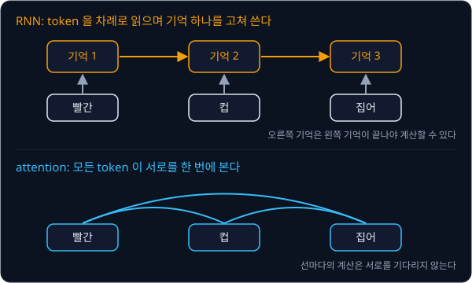
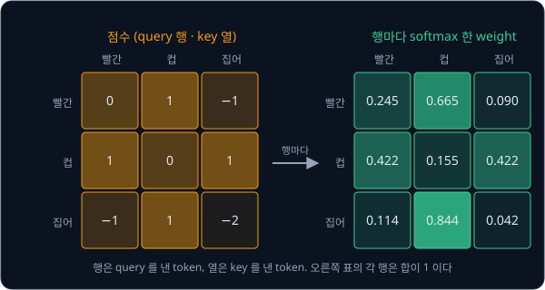
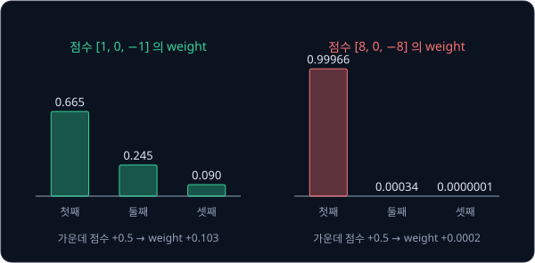
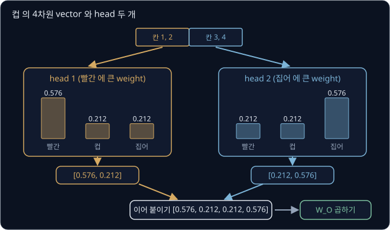
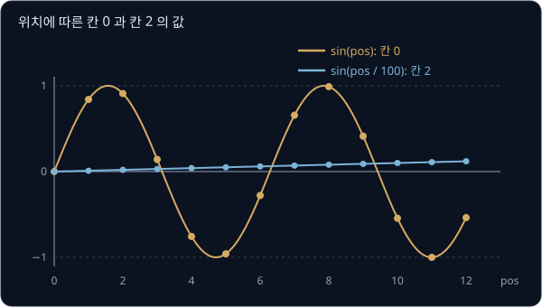
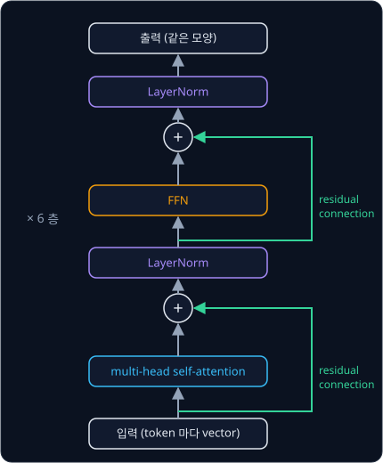
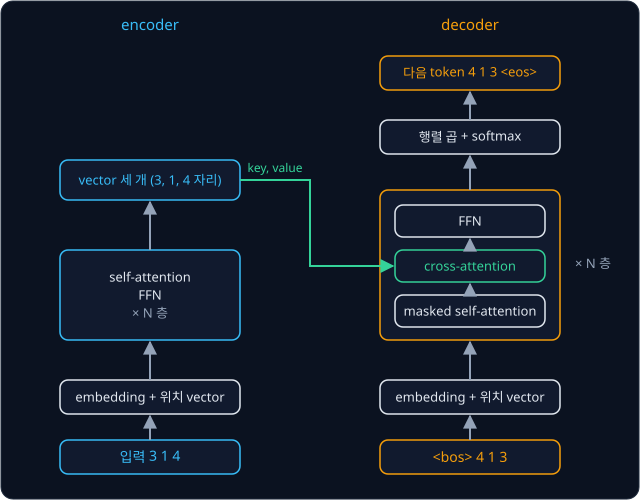
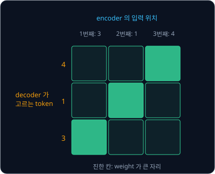
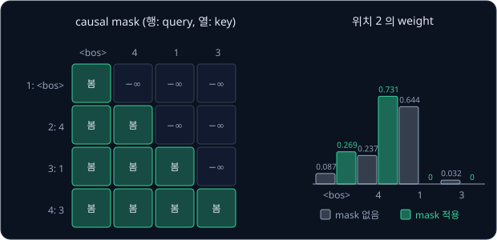
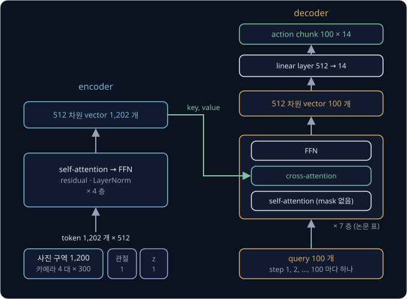

# Transformer

tokenizer 는 "배를 먹었다" 와 "배를 탔다" 의 "배" 에 같은 token id 를 붙인다. ALOHA 양팔 로봇의 policy 는 카메라 사진 한 장을
ResNet 으로 $15 \times 20 = 300$ 개 구역으로 나눠 구역마다 숫자 512 개로 요약한다. 어느 쪽이든 조각 하나만 봐서는 뜻이 정해지지 않아서,
"배" 가 과일인지는 "먹었다" 를 봐야 알고 큐브가 찍힌 구역이 집을 만한 자리인지는 집게가 찍힌 구역을 봐야 안다. 어느 조각이 어느 조각을
봐야 하는지 사람이 정해 주지 않는데, 모델은 수백 개 조각 가운데 필요한 조각의 정보를 어떻게 골라 모을까?

조각마다 다른 모든 조각과 관련도 점수를 매기고, 점수가 큰 조각의 정보를 많이 섞어 자기 vector 를 고치는 계산이 attention 이다.
attention 을 층으로 쌓은 구조가 2017 년 Vaswani 등이 발표한 Transformer 다. ALOHA 의 ACT policy 도 이 구조로 카메라 4 대의 구역
1,200 개와 관절 각도를 한꺼번에 읽고, 앞으로 100 step 의 관절 목표값을 한 번에 낸다. 저자들은 parameter 가 약 8,000 만 개인 이 모델을
RTX 2080 Ti 한 장으로 5 시간쯤 학습했다.

## 학습 목표

- embedding 과 query·key·value 로 attention 의 weight 와 출력을 작은 숫자로 계산하고, 점수를 $\sqrt{d_k}$ 로 나누는 이유를 설명할 수 있다
- multi-head attention, positional encoding, residual connection, LayerNorm 이 각각 어떤 문제를 막는지 설명할 수 있다
- encoder 와 decoder 의 차이와, causal mask 가 학습과 생성의 조건을 맞추는 방식을 설명할 수 있다
- ACT 가 Transformer encoder-decoder 로 카메라·관절 token 을 action chunk 로 바꾸는 구조를 token 수와 층 수로 설명할 수 있다

## 문맥과 attention

Transformer 이전에 문장을 다루던 RNN(recurrent neural network)은 token 을 앞에서부터 하나씩 읽으며, 크기가 정해진 숫자 묶음 하나를
기억으로 삼아 읽을 때마다 고쳐 썼다. 기억의 크기가 문장 길이와 상관없이 정해져 있어서 문장이 길수록 앞쪽 token 의 정보가 뒤에 덮인다.
또 셋째 token 은 둘째까지 읽은 기억이 있어야 계산할 수 있으므로, token 100 개를 읽으려면 100 번을 차례로 계산해야 한다.

2014 년 Bahdanau, Cho, Bengio 는 번역 모델이 단어를 하나 만들 때마다 입력 문장의 모든 위치를 다시 보고 필요한 위치에 큰 비중을 주어
정보를 모으게 했는데, 이것이 attention 의 시작이다. Vaswani 등은 차례로 읽는 부분을 아예 빼고 attention 만으로 모델을 만들었다(논문
제목 "Attention Is All You Need"). 위 그림의 아래쪽처럼 모든 token 이 다른 모든 token 을 한 번에 보므로 앞부분이 흐려지지 않고, token
마다 하는 계산을 GPU 에서 동시에 할 수 있다. 저자들은 기본 번역 모델을 P100 GPU 8 장으로 12 시간 만에 학습했다.

## embedding

token id 는 vocabulary 에 넣은 차례일 뿐이라 크기에 뜻이 없다. "먹었다" 가 2 번이고 "탔다" 가 3 번이라고 뜻이 가까운 것은 아닌데,
id 를 그대로 곱하고 더하면 이 의미 없는 크기 차이가 계산에 들어간다. 그래서 token 마다 숫자 몇 개짜리 vector 를 하나씩 적은 표를 두고,
token id 로 그 표의 행 하나를 꺼내 쓴다. 이 표를 embedding 표라고 하고, 행을 꺼내는 일과 꺼낸 vector 를 모두 **embedding** 이라고
부른다. 이름은 token 을 숫자 공간의 한 점으로 끼워 넣는다(embed)는 데서 왔다.

이 강의의 예시는 손으로 계산하기 쉽게 사람이 정한 2차원 embedding 을 쓴다. 첫째 칸은 먹는 것과 관련된 정도이고 둘째 칸은 타는 것과
관련된 정도인데, 값은 0 ~ 2 사이에서 골랐다. 그래서 "먹었다" 는 첫째 칸만 2 이고 "탔다" 는 둘째 칸만 2 다.

| token id | token | embedding |
| --- | --- | --- |
| 0 | 배 | $[1, 1]$ |
| 1 | 를 | $[0, 0]$ |
| 2 | 먹었다 | $[2, 0]$ |
| 3 | 탔다 | $[0, 2]$ |

두 뜻을 다 가진 "배" 는 두 칸 모두 1 이고, 어느 쪽과도 상관없는 조사 "를" 은 두 칸 모두 0 이다. "배" 는 어느 문장에서든 id 0 이라서
언제나 같은 행 $[1, 1]$ 을 꺼낸다. 과일인 배와 탈것인 배는 embedding 으로는 가를 수 없고, 다음 절의 attention 을 거쳐야 갈린다.

![token id 0, 1, 2 로 embedding 표의 행을 꺼내 배 를 먹었다 가 vector 세 개 [1, 1], [0, 0], [2, 0] 이 되는 모습](figures/embedding-table.svg)

실제 모델의 embedding 표는 무작위 값에서 시작해 loss 가 줄어드는 쪽으로 고쳐 나가는 parameter 다. "사과 를 먹었다" 와 "배 를 먹었다"
처럼 비슷한 자리에 나오는 token 은 loss 를 줄이는 방향도 비슷해서 행이 비슷하게 고쳐지고, 학습이 끝나면 두 vector 가 가까워진다.
GPT-2 의 가장 작은 모델은 token 50,257 개를 각각 768 차원 vector 로 나타내서 embedding 표에 숫자가 $50257 \times 768 = 38{,}597{,}376$
개 들어 있다. 한편 ACT 는 embedding 표 없이, ResNet 이 사진 구역마다 낸 숫자 512 개와 관절 각도 14 개를 linear layer 로 바꾼 숫자 512
개를 그대로 token 으로 쓴다. attention 계산에는 vector 의 출처가 들어가지 않으므로, 나머지 계산은 text token 이든 사진 token 이든 똑같다.

**확인 문제.** 위 표에서 "배 를 탔다" 의 embedding 세 개는? 그리고 vocabulary 가 token 10 개이고 embedding 이 4차원이면 embedding 표에는
숫자가 몇 개 들어 있을까?

답 보기

1. "배 를 탔다" 는 id 0, 1, 3 이라서 표의 행 0, 1, 3 을 꺼낸다. embedding 은 $[1, 1]$, $[0, 0]$, $[0, 2]$ 다
2. 표는 token 마다 한 행이라 행이 10 개이고 행마다 숫자가 4 개라서 $10 \times 4 = 40$ 개다. 모두 학습으로 고쳐지는 parameter 다

## attention 계산

attention 은 token 마다 아래 세 단계를 한다.

1. 점수: 지금 token 의 vector 와 문장의 모든 token 의 vector 사이의 dot product 를 구한다. dot product 는 두 vector 의 같은 자리 칸끼리
   곱해 모두 더한 값이라서, 두 vector 가 같은 칸에서 함께 크면 커진다
2. weight: 점수를 softmax 로 0 이상이고 합이 1 인 비율로 바꾼다. 이 비율을 attention weight 라고 한다
3. 출력: 그 weight 로 문장의 vector 들을 가중 평균한다

"배 를 먹었다" 의 "배" $[1, 1]$ 로 계산해 보자. token 은 자기 자신과도 점수를 매기므로 점수는 $[1, 1] \cdot [1, 1] = 2$,
$[1, 1] \cdot [0, 0] = 0$, $[1, 1] \cdot [2, 0] = 2$ 이고, softmax 한 weight 는 $[0.468, 0.063, 0.468]$ 이다. 출력은
$0.468 \times [1, 1] + 0.063 \times [0, 0] + 0.468 \times [2, 0] = [1.404, 0.468]$ 이다.

<b>심화: "배" 의 attention 표</b>

| 상대 token | embedding | 점수 | $e^{\text{점수}}$ | weight | weight × embedding |
| --- | --- | --- | --- | --- | --- |
| 배 | $[1, 1]$ | $1 \times 1 + 1 \times 1 = 2$ | 7.389 | 0.468 | $[0.468, 0.468]$ |
| 를 | $[0, 0]$ | $0 + 0 = 0$ | 1 | 0.063 | $[0, 0]$ |
| 먹었다 | $[2, 0]$ | $1 \times 2 + 1 \times 0 = 2$ | 7.389 | 0.468 | $[0.936, 0]$ |
| 합 | | | 15.778 | 1 | $[1.404, 0.468]$ |

weight 열은 $e^{\text{점수}}$ 를 합 15.778 로 나눈 값이다.

"배 를 탔다" 에서도 $[1, 1] \cdot [0, 2] = 2$ 라서 점수와 weight 는 같지만,
섞는 vector 가 $[2, 0]$ 대신 $[0, 2]$ 라서 출력은 $0.468 \times [1, 1] + 0.468 \times [0, 2] = [0.468, 1.404]$ 가 된다. 같은 embedding
$[1, 1]$ 에서 출발한 "배" 가 첫 문장에서는 먹는 칸이 커지고 둘째 문장에서는 타는 칸이 커졌다. 이렇게 attention 을 거친 새 vector 를
attention 출력이라고 하고, 다음 계산에서는 처음의 embedding 대신 이 출력을 쓴다.

![embedding 의 점들을 좌표평면에 찍은 그림. 배 [1, 1] 은 배 를 먹었다 에서 먹었다 쪽인 [1.404, 0.468] 로 옮겨 가고, 배 를 탔다 에서는 탔다 쪽인 [0.468, 1.404] 로 옮겨 간다](figures/context-shift.svg)

위 그림은 첫째 칸을 가로축으로 하고 둘째 칸을 세로축으로 한 좌표평면에 2차원 vector 를 점으로 찍은 것이다. 회색 점은 embedding 이고,
두 화살표의 끝은 각 문장에서 "배" 가 옮겨 간 자리다.

**흔한 오해.** 점수가 두 배면 weight 도 두 배라고 생각하기 쉽지만, softmax 는 점수끼리의 차이로 weight 를 정한다. 점수 $[2, 1]$ 의
weight 는 비 $2 : 1$ 인 $[0.667, 0.333]$ 이 아니라 $[0.731, 0.269]$ 다. 차이만 보므로 모든 점수에 같은 수를 더해도 weight 는 그대로다.

**확인 문제.** "배 를 먹었다" 에서 "먹었다" $[2, 0]$ 의 점수와 attention 출력은? softmax 한 weight 는 $[0.117, 0.016, 0.867]$ 이다.

답 보기

1. 점수는 $[2, 0] \cdot [1, 1] = 2$, $[2, 0] \cdot [0, 0] = 0$, $[2, 0] \cdot [2, 0] = 4$ 라서 $[2, 0, 4]$ 다
2. 출력은 $0.117 \times [1, 1] + 0.016 \times [0, 0] + 0.867 \times [2, 0]$ 이다
3. 첫째 칸은 $0.117 + 0 + 1.734 = 1.851$, 둘째 칸은 $0.117 + 0 + 0 = 0.117$ 이다

답: $[1.851, 0.117]$. 자기 자신과의 점수 4 가 가장 커서 weight 의 86.7% 를 자기 자신에게 주는데, 이 문제는 다음 절에서 다룬다.

## query·key·value

embedding 을 그대로 쓰면 token 이 자기 자신을 가장 많이 보기 쉽다. 사람이 정한 2차원 embedding 으로 로봇 지시 "빨간 컵 집어" 를
빨간 $[1, 0]$, 컵 $[0, 1]$, 집어 $[1, -1]$ 로 두면, "집어" 의 점수는 $[1, -1] \cdot [1, 0] = 1$, $[1, -1] \cdot [0, 1] = -1$,
$[1, -1] \cdot [1, -1] = 2$ 이고 weight 는 $[0.259, 0.035, 0.705]$ 다. "집어" 는 무엇을 집을지 알려면 "컵" 을 봐야 하는데 "컵" 에는
3.5% 만 주고 자기 자신에게 70.5% 를 준다. 자기 자신과의 dot product 는 칸마다 제곱을 더한 값이라 크게 나오기 쉽다. 게다가 vector
하나가 남을 찾는 기준, 남에게 보여 주는 표지, 뽑혔을 때 넘겨주는 내용이라는 세 역할을 한꺼번에 맡는다. Transformer 는 세 역할을
나누려고 token 의 vector $\mathbf{x}$ 에 서로 다른 행렬 세 개를 곱한다.

$$
\mathbf{q} = W_Q\,\mathbf{x}, \qquad \mathbf{k} = W_K\,\mathbf{x}, \qquad \mathbf{v} = W_V\,\mathbf{x}
$$

- $\mathbf{q}$ 는 **query** 로, 이 token 이 다른 token 에서 찾는 것을 나타낸다
- $\mathbf{k}$ 는 **key** 로, 이 token 이 다른 token 의 query 에게 보여 주는 표지다
- $\mathbf{v}$ 는 **value** 로, 이 token 이 뽑혔을 때 넘겨주는 내용이다
- $W_Q$, $W_K$, $W_V$ 는 각각을 만드는 행렬이고 숫자는 모두 학습으로 정해진다

점수는 token $i$ 의 query 와 token $j$ 의 key 를 dot product 한 $\mathbf{q}_i \cdot \mathbf{k}_j$ 이고, 가중 평균은 value 로 한다. 찾는
기준과 보여 주는 표지를 다른 행렬로 만드므로 자기 자신과의 점수가 저절로 커지지 않는다. 이름은 검색어(query)를 항목마다 붙은 key 와
맞춰 보고 맞는 항목의 value 를 돌려주는 데이터 검색에서 왔다. 다만 데이터 검색은 가장 잘 맞는 항목 하나만 꺼내지만, attention 은
맞는 정도만큼 모든 value 를 섞는다.

예시의 행렬도 손으로 계산하기 쉽게 사람이 정했다. $W_Q$ 는 두 칸을 맞바꾸고, $W_K$ 는 vector 를 그대로 두며, $W_V$ 는 첫째 칸에 둘째 칸을
더한다. 행렬을 vector 에 곱하면 행렬의 행마다 vector 와 dot product 를 구해 세로로 쌓은 vector 가 나온다.

| token | $\mathbf{x}$ | $\mathbf{q} = W_Q\mathbf{x}$ | $\mathbf{k} = W_K\mathbf{x}$ | $\mathbf{v} = W_V\mathbf{x}$ |
| --- | --- | --- | --- | --- |
| 빨간 | $[1, 0]$ | $[0, 1]$ | $[1, 0]$ | $[1, 0]$ |
| 컵 | $[0, 1]$ | $[1, 0]$ | $[0, 1]$ | $[1, 1]$ |
| 집어 | $[1, -1]$ | $[-1, 1]$ | $[1, -1]$ | $[0, -1]$ |

![집어 의 query [−1, 1] 과 세 key 의 점수 −1, 1, −2 → weight 0.114, 0.844, 0.042 → value 의 가중 평균 [0.958, 0.802]](figures/attention.svg)

위 그림은 "집어" 의 query $[-1, 1]$ 로 attention 출력을 계산한 과정이다. embedding 을 그대로 쓸 때 "컵" 에 3.5% 만 주던 "집어" 가 이제
84.4% 를 "컵" 에서 가져와서, 출력 $[0.958, 0.802]$ 는 대부분 "컵" 의 value $[1, 1]$ 로 채워진다.

세 token 이 모두 같은 계산을 하면 점수는 query 3 개 × key 3 개의 표가 된다.

위 그림의 행은 query 를 낸 token 이고 열은 key 를 낸 token 이다. "빨간" 은 "컵" 을 꾸미는 말이고 "컵" 은 "집어" 의 대상이라서, "빨간"
과 "집어" 는 둘 다 "컵" 을 가장 많이 본다. "컵" 은 색을 나타내는 "빨간" 과 동작을 나타내는 "집어" 를 반씩 보므로, 세 token 모두 자기
자신보다 다른 token 에 더 큰 weight 를 준다. query 를 한 행에 하나씩 쌓은 행렬을 $Q$ 라고 하고 key 와 value 도 같은 방식으로 쌓아
$K$, $V$ 라고 하면, 점수 표는 $QK^\top$ 이고 계산 전체는 $\mathrm{softmax}(QK^\top)V$ 다. 이처럼 query·key·value 를 모두 같은 token
묶음에서 만드는 attention 을 **self-attention** 이라고 한다.

<b>심화: 세 token 의 점수 표와 행렬 식</b>

"집어" 의 query $[-1, 1]$ 로 한 계산을 칸마다 적으면 아래와 같다.

| 상대 token | key | 점수 | $e^{\text{점수}}$ | weight | value | weight × value |
| --- | --- | --- | --- | --- | --- | --- |
| 빨간 | $[1, 0]$ | $-1 + 0 = -1$ | 0.368 | 0.114 | $[1, 0]$ | $[0.114, 0]$ |
| 컵 | $[0, 1]$ | $0 + 1 = 1$ | 2.718 | 0.844 | $[1, 1]$ | $[0.844, 0.844]$ |
| 집어 | $[1, -1]$ | $-1 - 1 = -2$ | 0.135 | 0.042 | $[0, -1]$ | $[0, -0.042]$ |
| 합 | | | 3.221 | 1 | | $[0.958, 0.802]$ |

세 token 이 모두 같은 계산을 한 결과는 아래와 같다.

| query \ key | 빨간 | 컵 | 집어 | weight (행마다 softmax) | 출력 |
| --- | --- | --- | --- | --- | --- |
| 빨간 $[0, 1]$ | 0 | 1 | $-1$ | $[0.245, 0.665, 0.090]$ | $[0.910, 0.575]$ |
| 컵 $[1, 0]$ | 1 | 0 | 1 | $[0.422, 0.155, 0.422]$ | $[0.578, -0.267]$ |
| 집어 $[-1, 1]$ | $-1$ | 1 | $-2$ | $[0.114, 0.844, 0.042]$ | $[0.958, 0.802]$ |

- $K^\top$ 은 "K transpose" 라고 읽고, $K$ 의 행과 열을 맞바꾼 행렬이다. key 가 행에서 열로 옮겨 간다
- $QK^\top$ 의 $i$ 행 $j$ 열은 $Q$ 의 $i$ 번째 행(query)과 $K^\top$ 의 $j$ 번째 열(key)의 dot product 라서, 위 표의 점수 칸과 같다
- softmax 는 이 표의 행마다 따로 하므로 행마다 weight 의 합이 1 이다
- weight 표에 $V$ 를 곱하면 $i$ 번째 행은 $i$ 번째 weight 줄로 value 들을 가중 평균한 값이 되어, 표의 출력 열이 나온다

**확인 문제.** query $[2, 1]$ 과 key $[1, 3]$ 의 점수는? token 이 5 개인 문장의 점수 표에는 칸이 몇 개 있을까?

답 보기

1. 점수는 $2 \times 1 + 1 \times 3 = 5$ 다
2. 점수 표는 query 5 개 × key 5 개라서 $5 \times 5 = 25$ 칸이다

## √d 로 나누는 scaling

dot product 는 칸 $d$ 개의 곱을 더한 값이라서 차원이 커지면 점수도 커지기 쉽다. query·key 의 차원을 $d_k$ 라고 하자. Transformer
논문에 따르면 query 와 key 의 칸이 서로 독립이고 평균 0, 분산 1 일 때 dot product 의 분산은 $d_k$ 다. 점수의 대표적인 크기는 분산의
제곱근인 표준편차라서, 점수는 $\sqrt{d_k}$ 정도로 자라고 $d_k = 64$ 면 8 정도가 된다.

점수가 커지면 softmax 의 weight 가 한 token 에 쏠린다. 점수 $[1, 0, -1]$ 의 weight 는 $[0.665, 0.245, 0.090]$ 인데, 8 배로 키운
$[8, 0, -8]$ 은 $[0.99966, 0.00034, 0.0000001]$ 이다. 두 경우에 가운데 점수를 똑같이 0.5 올려 보면 weight 가 움직이는 폭이 크게 다르다.

| 점수 | 가운데 weight | 0.5 올린 점수 | 올린 뒤 가운데 weight | 변화 |
| --- | --- | --- | --- | --- |
| $[1, 0, -1]$ | 0.245 | $[1, 0.5, -1]$ | 0.348 | $+0.103$ |
| $[8, 0, -8]$ | 0.00034 | $[8, 0.5, -8]$ | 0.00055 | $+0.0002$ |

점수가 큰 쪽의 weight 변화는 작은 쪽의 약 500 분의 1 이다. weight 가 거의 변하지 않으면 gradient 도 0 에 가까워서, 모델은 다른
token 을 보는 법을 배우지 못하고 처음 쏠린 곳에 머문다. Transformer 논문이 $\sqrt{d_k}$ 로 나누는 이유로 든 것도 이 현상이다.

그래서 Transformer 는 점수를 $\sqrt{d_k}$ 로 나눠 차원과 상관없이 대표적인 크기가 1 근처에 오게 한다.

$$
\mathrm{Attention}(Q, K, V) = \mathrm{softmax}\!\left(\frac{QK^\top}{\sqrt{d_k}}\right) V
$$

이 식을 scaled dot-product attention 이라고 한다. 점수 표 $QK^\top$ 의 모든 칸을 $\sqrt{d_k}$ 로 나눈 뒤 행마다 softmax 하고, 그
weight 로 value 를 가중 평균한다는 뜻이다.

**흔한 오해.** 점수를 나누면 가장 관련 있는 token 이 덜 중요해진다고 생각하기 쉽지만, 같은 수로 나누므로 점수의 순서는 그대로다.
"집어" 의 점수 $[-1, 1, -2]$ 를 $\sqrt{2}$ 로 나누면 "컵" 의 weight 는 0.844 에서 0.734 로 조금 낮아질 뿐 여전히 가장 크다.

<b>심화: "집어" 의 scaled 계산과 점수의 제곱의 평균</b>

"빨간 컵 집어" 는 $d_k = 2$ 라서 "집어" 의 점수 $[-1, 1, -2]$ 를 $\sqrt{2} \approx 1.414$ 로 나눈다.

| 상대 token | 점수 | $\div 1.414$ | $e^{\text{나눈 점수}}$ | weight | value |
| --- | --- | --- | --- | --- | --- |
| 빨간 | $-1$ | $-0.707$ | 0.493 | 0.178 | $[1, 0]$ |
| 컵 | 1 | 0.707 | 2.028 | 0.734 | $[1, 1]$ |
| 집어 | $-2$ | $-1.414$ | 0.243 | 0.088 | $[0, -1]$ |
| 합 | | | 2.764 | 1 | |

출력은 $0.178 \times [1, 0] + 0.734 \times [1, 1] + 0.088 \times [0, -1] = [0.912, 0.646]$ 이다.

점수가 $\sqrt{d}$ 정도로 자라는 이유는 작은 예로 직접 세어 볼 수 있다. query 와 key 의 칸이 $+1$ 아니면 $-1$ 로 아무렇게나 정해진다고
하면 칸끼리 곱한 값도 $+1$ 아니면 $-1$ 이다. 그 합은 양수와 음수로 갈려 평균이 0 이므로, 크기를 보려고 합의 제곱을 평균한다.

$d = 2$ 이면 두 곱의 조합은 네 가지이고, 합은 $2, 0, 0, -2$ 이고 제곱은 $4, 0, 0, 4$ 라서 평균이 $8 \div 4 = 2$ 다. $d = 4$ 이면 조합이
$2^4 = 16$ 가지다.

| 네 곱의 합 | 나오는 조합 수 | 합의 제곱 |
| --- | --- | --- |
| 4 | 1 | 16 |
| 2 | 4 | 4 |
| 0 | 6 | 0 |
| $-2$ | 4 | 4 |
| $-4$ | 1 | 16 |

제곱의 평균은 $(16 \times 1 + 4 \times 4 + 0 \times 6 + 4 \times 4 + 16 \times 1) \div 16 = 64 \div 16 = 4$ 다. 제곱의 평균이
$d = 2$ 에서는 2 이고 $d = 4$ 에서는 4 라서 $d$ 와 같고, 대표적인 크기는 그 제곱근인 $\sqrt{d}$ 다. 일반적으로 칸끼리의 곱 $q_i k_i$ 가
평균 0, 분산 1 이고 서로 독립이면, 독립인 값의 분산은 더해지므로 합의 분산이 $1 + 1 + \cdots + 1 = d$ 가 된다. 논문 3.2.1 절의 각주도
이렇게 설명한다.

**확인 문제.** $d_k = 16$ 일 때 dot product 가 12 인 점수는 나눈 뒤 얼마가 될까?

답 보기

$\sqrt{16} = 4$ 로 나누므로 $12 \div 4 = 3$ 이다.

## multi-head attention

앞의 점수 표에서 "컵" 의 weight 는 $[0.422, 0.155, 0.422]$ 였다. "컵" 은 "빨간" 과 "집어" 를 둘 다 봐야 하는데, attention 한 번은
token 마다 weight 한 줄만 만들어서 두 token 에 weight 를 반씩 나눠 줄 수밖에 없다. 출력도 두 value 를 섞은 vector 하나라서 어느 부분이
색에서 왔는지 갈라 볼 수 없다.

**multi-head attention** 은 vector 의 칸을 몇 묶음으로 나누고 묶음마다 따로 attention 을 하는데, 묶음 하나의 계산을 head 라고 한다.
head 마다 $W_Q$, $W_K$, $W_V$ 가 따로 있으므로 weight 도 다르게 나온다.

위 그림은 손으로 정한 숫자로 "컵" 의 4차원 vector 를 2차원 head 두 개로 나눈 예다. head 1 은 "빨간" 에 weight 0.576 을 주고, head 2 는
"집어" 에 0.576 을 준다. 두 출력을 이어 붙인 $[0.576, 0.212, 0.212, 0.576]$ 은 앞의 두 칸에 색 쪽 정보를 담고 뒤의 두 칸에 동작 쪽
정보를 담는다. 마지막에는 행렬 $W_O$ 를 한 번 더 곱해 두 head 의 정보를 섞은 4차원 vector 를 내는데, 아래첨자 O 는 output 의 첫 글자다.

head 하나의 차원은 token vector 의 차원 $d_\text{model}$ 을 head 수 $h$ 로 나눈 $d_\text{model} / h$ 라서, head 를 늘려도 전체 계산량은
head 하나로 $d_\text{model}$ 전체를 계산할 때와 비슷하다. Vaswani 등은 계산량을 같게 두고 head 수만 바꿔 가며 영어-독일어 번역 점수
BLEU 를 비교했다. BLEU 는 사람의 번역과 겹치는 정도로, 클수록 좋다.

| head 수 $h$ | head 하나의 차원 $d_k$ | BLEU |
| --- | --- | --- |
| 1 | 512 | 24.9 |
| 8 | 64 | 25.8 |
| 32 | 16 | 25.4 |

head 를 하나만 쓰면 8 개일 때보다 0.9 점 낮고, 32 개로 나눠 head 하나가 16 차원까지 작아져도 다시 떨어진다. GPT-2 의 가장 작은
모델은 768 차원을 head 12 개로 나누고 ACT 는 512 차원을 head 8 개로 나누므로, 두 모델 모두 head 하나가 64 차원이고 점수를
$\sqrt{64} = 8$ 로 나눈다.

<b>심화: head 두 개의 손계산과 multi-head 식</b>

숫자는 손으로 정한 값이고, 간단히 하려고 $\sqrt{d_k}$ 로 나누는 단계는 뺐다.

| head | "컵" 의 query | key (빨간, 컵, 집어) | 점수 | weight | value (빨간, 컵, 집어) | 출력 |
| --- | --- | --- | --- | --- | --- | --- |
| 1 | $[1, 0]$ | $[1, 0]$, $[0, 1]$, $[0, 1]$ | $[1, 0, 0]$ | $[0.576, 0.212, 0.212]$ | $[1, 0]$, $[0, 1]$, $[0, 0]$ | $[0.576, 0.212]$ |
| 2 | $[0, 1]$ | $[1, 0]$, $[1, 0]$, $[0, 1]$ | $[0, 0, 1]$ | $[0.212, 0.212, 0.576]$ | $[0, 0]$, $[1, 0]$, $[0, 1]$ | $[0.212, 0.576]$ |

weight 는 $e^{1} = 2.718$, $e^{0} = 1$, $e^{0} = 1$ 의 합 4.718 로 나눈 값이라 $2.718 \div 4.718 = 0.576$ 과
$1 \div 4.718 = 0.212$ 다. multi-head attention 을 기호로 쓰면 아래와 같다.

$$
\mathrm{head}_i = \mathrm{Attention}(Q W_i^Q, K W_i^K, V W_i^V), \qquad
\mathrm{MultiHead}(Q, K, V) = \mathrm{Concat}(\mathrm{head}_1, \dots, \mathrm{head}_h)\,W^O
$$

$W_i^Q, W_i^K, W_i^V$ 는 $i$ 번째 head 의 행렬이다. Concat 은 concatenate(이어 붙이다)의 줄임말로, head 출력들을 순서대로 이어
붙인다. 위 예에서 head 수 $h = 2$ 다. 이 식은 token vector 를 행으로 쌓은 행렬에 오른쪽에서 행렬을 곱하는 논문의 표기를 따랐다.

**확인 문제.** $d_\text{model} = 1024$ 를 head 16 개로 나누면 head 하나의 차원은? head 를 16 개에서 32 개로 늘리면 attention 의 전체
계산량은 어떻게 될까?

답 보기

1. $1024 \div 16 = 64$ 차원이다
2. head 32 개면 head 하나가 $1024 \div 32 = 32$ 차원으로 줄어서, head 수 × head 차원이 1024 로 그대로이고 전체 계산량도 비슷하다

## positional encoding

영어는 순서가 역할을 정해서 "dog bites man"(개가 사람을 문다) 과 "man bites dog"(사람이 개를 문다) 는 token 셋이 같고 순서만 다른데
뜻은 정반대다. 사람이 정한 embedding 을 dog $[1, 0]$, bites $[0, 1]$, man $[1, 1]$ 로 두고, query·key·value 를 embedding 그대로 쓰는
간단한 attention 으로 bites 의 출력을 구하면 아래와 같다.

| 문장 | bites 와 각 token 의 점수 | weight | bites 의 출력 |
| --- | --- | --- | --- |
| dog bites man | dog 0, bites 1, man 1 | dog 0.155, bites 0.422, man 0.422 | $[0.577, 0.844]$ |
| man bites dog | man 1, bites 1, dog 0 | man 0.422, bites 0.422, dog 0.155 | $[0.577, 0.844]$ |

점수는 vector 끼리의 dot product 라서 token 이 몇 번째에 있는지와 상관없고, 가중 평균은 더하는 순서를 바꿔도 같다. 그래서 두 문장의
bites 는 똑같은 출력을 얻는다. 사진 구역도 마찬가지라서, 위치 정보 없이 구역 300 개를 넣으면 ACT 는 큐브가 사진의 왼쪽에 있는지
오른쪽에 있는지 알 수 없다.

![dog bites man 과 man bites dog 에서 bites 의 attention 출력이 둘 다 [0.577, 0.844] 로 같은 모습. 위치 vector 를 더하면 dog 의 vector 가 위치마다 달라진다](figures/word-order.svg)

Transformer 는 위치마다 vector 를 하나씩 정해 두고 token 의 embedding 에 그 위치의 vector 를 더한다. 위치 번호 자체를 더하면 문장이
길수록 값이 한없이 커져서 1 근처인 embedding 을 덮어 버리므로, Vaswani 등은 $-1$ 과 1 사이를 오르내리는 sin 과 cos 으로 위치 vector
를 만들었다. 이렇게 만든 위치 vector 가 **positional encoding** 이다. 4차원이면 0 부터 세는 위치 $pos$ 의 vector 는
$[\sin(pos), \cos(pos), \sin(pos / 100), \cos(pos / 100)]$ 이다(sin·cos 에 넣는 수의 단위는 radian).

앞쪽 칸은 위치가 1 바뀔 때마다 크게 달라지고 뒤쪽 칸은 천천히 변해서, 둘을 함께 보면 위치마다 다른 숫자 조합이 나온다. 2차원 위치
vector $[\sin(pos), \cos(pos)]$ 를 더하면 dog $[1, 0]$ 는 위치 0 에서 $[1, 1]$ 이 되고 위치 2 에서 $[1.909, -0.416]$ 이 되어, 두 문장의
출력이 달라진다.

위치마다 한 행씩 두고 그 값을 학습하는 learned position embedding 도 있는데, Transformer 논문에서는 두 방식의 결과가 거의 같았다.
GPT-2 는 learned position embedding 을 써서 위치 1,024 개의 행만 있으므로, 그보다 긴 입력에는 더할 vector 가 없다. ACT 는 사진 구역의
줄 번호와 칸 번호로 만든 2D sin·cos 위치 vector 를 더한다.

<b>심화: positional encoding 의 일반 식</b>

$$
PE(pos, 2i) = \sin\!\left(\frac{pos}{10000^{2i / d_\text{model}}}\right), \qquad
PE(pos, 2i + 1) = \cos\!\left(\frac{pos}{10000^{2i / d_\text{model}}}\right)
$$

- $PE(pos, 2i)$ 는 위치 $pos$ 의 vector 에서 $2i$ 번째 칸의 값이다. 칸도 0 부터 센다
- $i$ 는 칸 두 개를 한 쌍으로 묶었을 때 쌍의 번호다. 쌍마다 짝수 번째 칸($2i$)에는 sin 을 쓰고, 홀수 번째 칸($2i + 1$)에는 cos 을 쓴다

$d_\text{model} = 4$ 면 쌍이 $i = 0$ (칸 0, 1) 과 $i = 1$ (칸 2, 3) 두 개다. $i = 0$ 이면 분모가 $10000^{0} = 1$ 이고, $i = 1$ 이면 분모가
$10000^{2/4} = 10000^{0.5} = \sqrt{10000} = 100$ 이라서 본문의 $[\sin(pos), \cos(pos), \sin(pos / 100), \cos(pos / 100)]$ 이 나온다.

| $pos$ | $\sin(pos)$ | $\cos(pos)$ | $\sin(pos / 100)$ | $\cos(pos / 100)$ |
| --- | --- | --- | --- | --- |
| 0 | 0.000 | 1.000 | 0.000 | 1.000 |
| 1 | 0.841 | 0.540 | 0.010 | 1.000 |
| 2 | 0.909 | $-0.416$ | 0.020 | 1.000 |
| 3 | 0.141 | $-0.990$ | 0.030 | 1.000 |

본문의 dog 는 2차원이라 쌍이 $i = 0$ 하나뿐이고, 위치 vector 가 $[\sin(pos), \cos(pos)]$ 다. 위치 0 에서는 $[1, 0] + [0, 1] = [1, 1]$
이고, 위치 2 에서는 $[1, 0] + [0.909, -0.416] = [1.909, -0.416]$ 이다.

$d_\text{model} = 512$ 면 마지막 쌍의 분모가 $10000^{510/512} \approx 9647$ 라서 값이 한 바퀴 도는 데 위치가 약 60,600 개 필요하다.
논문에 따르면 칸별 주기는 $2\pi$ 에서 $10000 \cdot 2\pi$ 까지 기하급수로 늘어난다. 저자들은 위치가 $k$ 만큼 떨어진 vector 를 원래
vector 의 선형 변환으로 쓸 수 있어서 모델이 상대 위치를 배우기 쉬울 것이라고 보고 이 식을 골랐다.

**확인 문제.** $d_\text{model} = 4$ 일 때 위치 0 의 positional encoding 은? 그리고 위치 번호를 그대로 더하지 않는 이유는?

답 보기

1. $[\sin 0, \cos 0, \sin 0, \cos 0] = [0, 1, 0, 1]$ 이다
2. 위치 번호는 문장이 길수록 한없이 커져서 1 근처인 embedding 의 숫자를 덮어 버리지만, sin 과 cos 은 언제나 $-1$ 과 1 사이에 있다

## residual connection 과 LayerNorm

attention 처럼 층 안에서 한 단계를 맡는 계산을 sub-layer 라고 한다. sub-layer 의 출력에 들어온 입력을 더해서 넘기는 연결이 **residual
connection** 이다.

$$
\text{출력} = \mathbf{x} + \mathrm{Sublayer}(\mathbf{x})
$$

$\mathbf{x} = [1, 2]$ 이고 attention 의 출력이 $[0.5, -0.5]$ 면 넘기는 값은 $[1.5, 1.5]$ 다. sub-layer 가 0 에 가까운 값을 내도 입력이
그대로 다음 층으로 가므로, 층을 많이 쌓아도 앞의 정보가 망가지지 않는다. backward 에서도 gradient 가 덧셈 경로를 따라 줄지 않고 앞
층까지 닿는다. 층마다 gradient 에 곱해지는 비율이 0.1 이라면 세 층을 지나 $0.1^3 = 0.001$ 이 되지만, 덧셈 경로의 1 이 더해지면 $1.1^3 = 1.331$ 이다.
이 연결은 [ResNet](../resnet/README.md) 에서 먼저 쓰였다.

더하기를 되풀이하면 vector 의 숫자가 층을 지날수록 커지거나 token 마다 크기가 제각각이 되어 학습이 불안정해진다. 2016 년 Ba, Kiros,
Hinton 이 제안한 **LayerNorm**(layer normalization)은 token vector 하나 안의 숫자들에서 평균을 빼고 표준편차로 나눠 평균 0, 표준편차 1 로
맞추는데, dataset 전체의 통계를 쓰는 입력 normalization 과 달리 token 하나의 칸만 보고 계산한다.

| 단계 | $\mathbf{x} = [1, 1, 5, 5]$ | $\mathbf{x} = [10, 10, 50, 50]$ |
| --- | --- | --- |
| 평균 $\mu$ | $(1 + 1 + 5 + 5) \div 4 = 3$ | 30 |
| 평균을 뺀 값 | $[-2, -2, 2, 2]$ | $[-20, -20, 20, 20]$ |
| 표준편차 $\sigma$ | $\sqrt{(4 + 4 + 4 + 4) \div 4} = 2$ | $\sqrt{400} = 20$ |
| $\sigma$ 로 나눈 값 | $[-1, -1, 1, 1]$ | $[-1, -1, 1, 1]$ |

![[1, 1, 5, 5] 와 [10, 10, 50, 50] 이 각각 평균을 빼고 표준편차로 나눠 똑같이 [−1, −1, 1, 1] 이 되는 모습](figures/layer-norm.svg)

맞춘 뒤에는 칸마다 학습되는 $\gamma$(gamma)를 곱하고 $\beta$(beta)를
더해 크기와 위치를 다시 조절한다. $\gamma = 2$, $\beta = 0.5$ 면 $[-1, -1, 1, 1]$ 이 $[-1.5, -1.5, 2.5, 2.5]$ 가 된다.

<b>심화: Post-LN 과 Pre-LN</b>

LayerNorm 은 더한 뒤에 놓을 수도 있고 sub-layer 앞에 놓을 수도 있다. 원래 논문처럼 더한 뒤에 정규화하는
$\mathrm{LayerNorm}(\mathbf{x} + \mathrm{Sublayer}(\mathbf{x}))$ 를 Post-LN 이라고 하고, sub-layer 에 넣기 전에 정규화하는
$\mathbf{x} + \mathrm{Sublayer}(\mathrm{LayerNorm}(\mathbf{x}))$ 를 Pre-LN 이라고 한다. Post-LN 은 learning rate 를 작게 시작해 점점
키우는 warm-up 을 해야 안정적으로 학습되는데, 원래 논문도 처음 4,000 step 동안 warm-up 을 했다. 2020 년 Xiong 등은 Post-LN 에서는
학습 초기에 출력 쪽 층의 gradient 가 커서 warm-up 이 필요하다는 것을 보였고, Pre-LN 은 warm-up 없이도 비슷한 성능에 이른다고 보고했다.
GPT-2 는 Pre-LN 을 쓰는 반면, LeRobot 의 ACT 는 기본값(`pre_norm: False`)대로면 Post-LN 이다.

**확인 문제.** $[2, 2, 6, 6]$ 에 LayerNorm 을 하면? ($\gamma = 1$, $\beta = 0$) 입력이 $[2, 0]$ 이고 sub-layer 출력이 $[-1, 3]$ 이면
residual connection 을 거친 값은?

답 보기

1. 평균은 $(2 + 2 + 6 + 6) \div 4 = 4$ 다
2. 평균을 뺀 값은 $[-2, -2, 2, 2]$ 이고, 표준편차는 $\sqrt{(4 + 4 + 4 + 4) \div 4} = 2$ 다
3. 표준편차로 나누면 LayerNorm 결과는 $[-1, -1, 1, 1]$ 이다
4. residual connection 은 입력과 sub-layer 출력을 칸마다 더해 $[2 + (-1), 0 + 3] = [1, 3]$ 이다

## Transformer block

attention 은 token 들 사이에서 정보를 옮기는 계산이라, 옮겨 온 정보를 token 안에서 가공하도록 attention 뒤에 **FFN**(feed-forward
network)을 둔다. FFN 은 token 마다 따로 계산하는데, vector 를 행렬 $W_1$ 로 늘리고 음수를 0 으로 바꾸는 ReLU 를 지난 뒤 행렬 $W_2$
로 원래 길이로 되돌린다. 행렬은 모든 token 이 같은 것을 쓴다. ReLU 가 없으면 행렬을 두 번 곱한 결과가 행렬 하나를 곱한 것과 같아져서
둘로 나눈 의미가 없다.

![FFN 이 x = [1, 2] 를 W_1 로 [1, 2, −1, 1] 로 늘리고, ReLU 로 [1, 2, 0, 1] 로 바꾸고, W_2 로 [1, 3] 으로 되돌리는 흐름](figures/ffn.svg)

위 그림에서 보듯 FFN 계산에는 다른 token 의 vector 가 들어오지 않는다. 늘리는 차원은 원래 논문이 512 의 4 배인 2,048 이고, ACT 는
3,200 이다.

encoder layer 는 Transformer 에서 입력을 읽는 쪽의 층 하나로, 지금까지 본 계산을 아래 순서로 잇는다. 이 묶음을 block 이라고도 한다.

1. multi-head self-attention → residual connection → LayerNorm
2. FFN → residual connection → LayerNorm

위 그림에서 옆으로 돌아가는 화살표가 residual connection 이고, ⊕ 표시가 더하는 자리다. block 의 입력과 출력은 token 수도 같고 vector
의 차원도 같아서 같은 block 을 여러 번 쌓을 수 있다. 원래 논문은 encoder 와 decoder 에 각각 6 층을 쌓았고, ACT 는 encoder 에 4 층을 쌓는다.

<b>심화: FFN 의 손계산과 block 하나의 parameter 수</b>

손으로 정한 행렬로 $\mathbf{x} = [1, 2]$ 를 4차원으로 늘렸다가 되돌리는 예다. 더하는 bias 는 0 으로 둔다.

$$
W_1 = \begin{bmatrix} 1 & 0 \\ 0 & 1 \\ 1 & -1 \\ -1 & 1 \end{bmatrix}, \qquad
W_2 = \begin{bmatrix} 1 & 0 & 1 & 0 \\ 0 & 1 & 0 & 1 \end{bmatrix}
$$

| 단계 | 계산 | 결과 |
| --- | --- | --- |
| $W_1\mathbf{x}$ | $1$, $2$, $1 - 2$, $-1 + 2$ | $[1, 2, -1, 1]$ |
| ReLU | 음수 $-1$ 만 0 으로 | $[1, 2, 0, 1]$ |
| $W_2$ 곱하기 | $1 + 0$, $2 + 1$ | $[1, 3]$ |

block 하나의 parameter 수는 행렬의 칸 수에 bias 개수를 더해 직접 셀 수 있다. $d_\text{model} = 512$ 일 때 $W_Q, W_K, W_V, W_O$ 는
각각 숫자가 $512 \times 512$ 개이고 bias 가 512 개다.

| 구성 요소 | 원래 논문 ($d_\text{ff} = 2048$) | ACT ($d_\text{ff} = 3200$) |
| --- | --- | --- |
| attention ($4 \times (512 \times 512 + 512)$) | 1,050,624 | 1,050,624 |
| FFN ($512 \times d_\text{ff} + d_\text{ff} + d_\text{ff} \times 512 + 512$) | 2,099,712 | 3,280,512 |
| LayerNorm 두 개 ($2 \times 2 \times 512$) | 2,048 | 2,048 |
| 합 | 3,152,384 | 4,333,184 |

block 하나의 parameter 가운데 FFN 이 원래 논문에서는 약 3 분의 2 를 차지하고, ACT 에서는 약 4 분의 3 을 차지한다. head 수는 이 표에
들어가지 않는데, head 를 몇 개로 나누든 $W_Q$ 전체의 크기는 $512 \times 512$ 로 같기 때문이다.

## encoder 와 decoder

원래 Transformer 는 영어 token 열(sequence)을 받아 독일어 sequence 를 내는 번역 모델이었다. 번역은 정답이 여러 가지라서, 여기서는
정답이 하나뿐인 숫자열 뒤집기로 설명한다. 입력 "3 1 4" 를 받으면 "4 1 3" 을 내야 하는 작업이다. token 은 숫자 0 ~ 9 와, 출력의
시작과 끝을 표시하는 special token `<bos>`(begin of sequence), `<eos>`(end of sequence)다.

**encoder** 는 입력 "3 1 4" 를 한꺼번에 읽는다. embedding 에 positional encoding 을 더하고 encoder layer 를 여러 번 지나면, 입력 token
마다 입력 전체의 정보가 섞인 vector 가 하나씩 나온다. 한편 **decoder** 는 출력을 한 token 씩 쓴다. 지금까지 쓴 token 을 입력으로
받아 다음 token 하나를 고르고, 고른 token 을 입력 끝에 붙여 다시 다음 token 을 고른다.

| 단계 | decoder 입력 | 고른 다음 token |
| --- | --- | --- |
| 1 | `<bos>` | 4 |
| 2 | `<bos>` 4 | 1 |
| 3 | `<bos>` 4 1 | 3 |
| 4 | `<bos>` 4 1 3 | `<eos>` → 멈춤 |

다음 token 은 decoder 마지막 위치의 출력 vector 에 행렬을 곱해 token 마다 점수를 만들고 softmax 한 확률로 고른다. 앞에서 만든 출력을
다시 입력으로 넣어 하나씩 만드는 이 방식을 autoregressive 라고 한다.

decoder layer 에는 아래 sub-layer 가 있고, sub-layer 마다 residual connection 과 LayerNorm 이 붙는 것은 encoder 와 같다.

1. 지금까지 쓴 출력 token 끼리 하는 masked self-attention. mask 는 다음 절에서 다룬다
2. decoder 쪽 vector 에서 query 를 만들고 encoder 의 출력에서 key 와 value 를 만드는 **cross-attention**. decoder 는 이 계산으로
   입력 문장의 정보를 가져오고, 계산 방법은 self-attention 과 똑같다
3. FFN

숫자열 뒤집기에서는 출력의 $t$ 번째 token 이 입력의 뒤에서 $t$ 번째 token 이라서, 학습이 잘 된 모델의 cross-attention weight 는 아래
그림처럼 반대쪽 대각선에 모인다. Bahdanau 등은 번역 모델에서 같은 weight 표를 그려 같은 뜻의 단어끼리 진하게 이어지는 것을 보였다.

**확인 문제.** 입력 "3 1 4 1" 을 뒤집을 때 decoder 는 몇 단계 만에 멈추고, 출력의 첫째 token 을 고르는 순간 cross-attention 은 입력의
몇 번째 token 을 가장 많이 봐야 할까?

답 보기

1. 정답은 "1 4 1 3" 이라서 1 ~ 4 단계에 1, 4, 1, 3 을 고르고 5 단계에 `<eos>` 를 고른 뒤 멈춘다. 모두 5 단계다
2. 출력의 첫째 token "1" 은 입력의 넷째(마지막) token 이므로 넷째 token 을 가장 많이 봐야 한다

## causal mask

학습할 때는 정답 "4 1 3" 을 이미 알고 있으므로 decoder 를 네 번 계산할 필요 없이, "`<bos>` 4 1 3" 을 한꺼번에 넣어 위치 1 ~ 4 에서
각각 4, 1, 3, `<eos>` 를 맞히게 한다. 정답을 decoder 입력으로 넣어 주는 이 학습 방식을 teacher forcing 이라고 한다.

그런데 self-attention 은 모든 token 이 모든 token 을 보므로, 위치 1 의 `<bos>` 가 위치 2 의 "4" 를 보고 답을 베껴 쓸 수 있다. 그러면
loss 는 쉽게 내려가지만, 생성할 때는 뒤쪽 token 이 아직 없으니 모델이 맞히지 못한다. 그래서 위치마다 자기보다 뒤에 있는 token 을 보지
못하게 막는다.

막을 칸의 점수는 softmax 전에 $-\infty$(음의 무한대)로 바꾼다. $e^{s}$ 는 $s$ 가 작아질수록 0 에 다가가서 $e^{-10}$ 만 해도 0.0000454
이고, $e^{-\infty}$ 는 0 으로 보므로 막은 칸의 weight 는 0 이 된다. 예를 들어 위치 2 의 "4" 가 네 token 과 얻은 점수가 $[1, 2, 3, 0]$
이라고 하자. 위치 2 는 위치 3, 4 를 보면 안 되므로 그 두 칸을 막는다.

| 상대 token | 점수 | mask 후 점수 | $e^{\text{점수}}$ | weight | mask 없을 때 weight |
| --- | --- | --- | --- | --- | --- |
| `<bos>` | 1 | 1 | 2.718 | 0.269 | 0.087 |
| 4 | 2 | 2 | 7.389 | 0.731 | 0.237 |
| 1 | 3 | $-\infty$ | 0 | 0 | 0.644 |
| 3 | 0 | $-\infty$ | 0 | 0 | 0.032 |
| 합 | | | 10.107 | 1 | 1 |

mask 가 없으면 생성할 때는 아직 없을 "1" 에서 64.4% 를 가져오지만, mask 를 하면 앞의 두 token 만 보고 weight 합도 1 이다. 순서도
중요해서, softmax 를 먼저 하고 뒤쪽 weight 를 0 으로 지우면 남은 weight 가 $0.087 + 0.237 = 0.324$ 라 합이 1 이 되지 않는다.

위치마다 볼 수 있는 칸을 표로 그리면 위 그림의 왼쪽처럼 대각선과 그 왼쪽만 열린 계단 모양이 되는데, 이 표가 **causal mask** 다.
causal 은 원인을 뜻하는 cause 에서 온 말로, 앞의 일만 뒤의 일에 영향을 주는 시간 순서를 지킨다는 뜻이다. causal mask 는 decoder 의
self-attention 에만 쓰고, 입력 전체가 처음부터 주어지는 encoder 와 cross-attention 은 막지 않는다. 길이를 맞추려고 짧은 문장 뒤에 채운 `<pad>` token 을 같은 방법으로 막는
것은 padding mask 라고 한다.

**확인 문제.** 위치 2 의 점수가 $[0, 1, 2]$ 이고 위치 3 을 막아야 한다. weight 는?

답 보기

1. 셋째 점수를 $-\infty$ 로 바꾸면 $e^{s}$ 는 $e^{0} = 1$, $e^{1} = 2.718$, $e^{-\infty} = 0$ 이다
2. 합은 $1 + 2.718 + 0 = 3.718$ 이다
3. weight 는 $1 \div 3.718 = 0.269$, $2.718 \div 3.718 = 0.731$, 0 이다

답: $[0.269, 0.731, 0]$

## block 을 쌓은 language model

encoder 와 decoder 를 어떻게 쓰느냐에 따라 세 가지 조합이 있다.

| 조합 | 하는 일 | 예 |
| --- | --- | --- |
| encoder-decoder | 입력 sequence 를 읽고 출력 sequence 를 쓴다 | 원래 Transformer(번역), [ACT](../act/README.md) |
| decoder 만 | causal mask 를 쓴 self-attention 으로 다음 token 을 이어 쓴다 | [GPT-2](../gpt/README.md) |
| encoder 만 | 입력 전체를 읽어 token 마다 vector 를 낸다 | [ViT](../vit/README.md) |

text 를 앞에서부터 읽으며 다음 token 을 맞히는 language model 은 decoder 만 쓴다. encoder 가 없으므로 cross-attention 도 없고, block
은 causal mask 를 쓴 self-attention 과 FFN 두 sub-layer 로 되어 있다. causal mask 덕분에 text 한 줄을 넣으면 모든 위치에서 다음 token
맞히기를 한꺼번에 학습할 수 있다. GPT-2 의 가장 작은 모델은 768 차원 block 12 층을 쌓고 token 을 최대 1,024 개까지 받는다. 더 큰
language model 도 같은 block 을 더 넓고 깊게 쌓아 만든다.

## ACT 의 Transformer

ACT 는 원래 Transformer 와 같은 encoder-decoder 조합으로 사진과 관절 각도를 받아, 앞으로 100 step 의 관절 목표값 묶음인 action
chunk 를 낸다. ACT 논문의 표 III 에 따르면 encoder 는 4 층이고 decoder 는 7 층이다. hidden dimension 512 를 head 8 개로 나누고, FFN
은 3,200 차원까지 늘린다.

| 부분 | 입력 | 하는 일 | 출력 |
| --- | --- | --- | --- |
| encoder (4 층) | 사진 구역 $4 \times 300 = 1{,}200$ 개 + 관절 1 개 + $z$ 1 개 = token 1,202 개 | self-attention 으로 카메라 시점, 관절 각도, style 변수의 정보를 합친다 | 512 차원 vector 1,202 개 |
| decoder (7 층) | step 마다 하나인 query vector 100 개 | cross-attention 으로 encoder 출력을 key·value 로 읽는다 | 512 차원 vector 100 개 |
| linear layer | vector 100 개 | 512 개 숫자를 관절 목표값 14 개로 바꾼다 | $100 \times 14$ action chunk |

style 변수 $z$ 는 시연마다 다른 움직임 방식을 담는 숫자로, 관절 각도처럼 linear layer 를 거쳐 512 차원 token 하나가 된다. decoder 의 입력 100 개는 입력 사진과 상관없이 언제나
같은 vector 이고, $i$ 번째 vector 는 $i$ 번째 step 의 action 을 찾는 query 다.

ACT 의 decoder 는 번역 decoder 와 달리 query 100 개를 한꺼번에 넣어 100 step 을 동시에 내므로, 앞의 출력을 다시 넣을 필요가 없다.
그래서 저자가 공개한 코드도 decoder 의 self-attention 에 causal mask 를 쓰지 않는다. 추론 한 번에 encoder 와 decoder 를 한 번씩만
계산하면 되고, 논문에 따르면 RTX 2080 Ti 한 장에서 추론이 약 0.01 초 걸린다.

논문 표에는 decoder 가 7 층으로 적혀 있지만, 공개 코드에서는 7 층을 모두 계산한 뒤 마지막 층이 아니라 첫째 층의 출력을 action 에
쓴다. 그래서 2 ~ 7 층의 결과는 action 에 쓰이지 않고, gradient 도 닿지 않아 학습으로 고쳐지지 않는다. LeRobot 은 이 동작에 맞춰
decoder 층 1 개를 기본값으로 둔다. 원인이 된 코드는 [ACT](../act/README.md) 에서 다룬다.

attention 은 모든 token 쌍의 점수를 매기므로 점수 표의 칸 수가 token 수의 제곱이다. 카메라가 1 대인 시뮬레이션에서는 token 이 302 개라
점수 표가 $302 \times 302 = 91{,}204$ 칸이고, 카메라가 4 대인 실제 ALOHA 에서는 $1202 \times 1202 = 1{,}444{,}804$ 칸이라 약 16 배다.
카메라를 늘리거나 해상도를 높이면 token 수가 늘어난 비율의 제곱만큼 attention 계산이 늘어난다.

**확인 문제.** 카메라 2 대에서 480 × 640 사진을 쓰는 ACT 의 encoder token 은 몇 개이고, 점수 표는 몇 칸일까? action chunk 를 50 step 으로
줄이면 decoder 의 query 는 몇 개가 될까?

답 보기

1. 카메라마다 구역이 $15 \times 20 = 300$ 개라서 사진 token 은 $2 \times 300 = 600$ 개이고, 관절 token 1 개와 $z$ token 1 개를 더해
   602 개다
2. 점수 표는 $602 \times 602 = 362{,}404$ 칸이다
3. query 는 step 마다 하나라서 50 개다

## 정리

- attention 은 query·key 의 dot product 를 $\sqrt{d_k}$ 로 나눈 점수를 softmax 한 weight 로 value 를 가중 평균한다. "집어" 는
  embedding 을 그대로 쓰면 자기 자신에게 70.5% 를 주지만, query·key·value 를 나누면 "컵" 에서 84.4% 를 가져온다
- multi-head 는 head 마다 다른 관계를 보게 하고, positional encoding 은 순서를 모르는 attention 에 위치 정보를 더한다. residual
  connection 과 LayerNorm 은 입출력 모양이 같은 block 을 깊게 쌓아도 학습이 안정되게 한다
- causal mask 는 softmax 전에 뒤쪽 점수를 $-\infty$ 로 바꿔 모든 위치를 한꺼번에 학습해도 앞의 token 만 보게 한다. ACT 는 token
  1,202 개를 encoder 4 층에 넣고, decoder 가 query 100 개로 100 step 을 한꺼번에 낸다

decoder 만 쌓은 Transformer 를 다음 token 맞히기로 학습시키고 글을 생성하는 방법은 [GPT-2](../gpt/README.md) 에서 다루고, 사진을
patch token 으로 잘라 encoder 에 넣는 방법은 [ViT](../vit/README.md) 에서 다룬다. 로봇 쪽에서는 action 을 256 구간으로 나눠 token 으로
바꾼 뒤 Transformer 로 고르는 [RT-1](../rt1/README.md) 과, action chunk 와 CVAE 를 Transformer encoder-decoder 에 결합한
[ACT](../act/README.md) 가 이 강의의 구조를 그대로 쓴다.

## 참고 자료

- Ashish Vaswani 등, [Attention Is All You Need](https://arxiv.org/abs/1706.03762) — Transformer 를 제안한 논문. 그림 1 의 전체 구조와
  3.2 절의 scaled dot-product attention·multi-head(√d_k 의 이유는 각주 4), 3.5 절의 positional encoding, 표 3 의 head 수 비교를 본다
- Tony Z. Zhao 등, [Learning Fine-Grained Bimanual Manipulation with Low-Cost Hardware](https://arxiv.org/abs/2304.13705) — ACT 논문.
  4 절의 encoder·decoder 설명과 표 III 의 층 수를 [ACT 의 Transformer](#act-의-transformer) 절과 맞춰 읽는다
- LeRobot, [ACT 설정 파일](https://github.com/huggingface/lerobot/blob/main/src/lerobot/policies/act/configuration_act.py) — 차원·head·층
  수·`pre_norm` 의 기본값과 decoder 층 수에 붙은 주석
- Dzmitry Bahdanau 등, [Neural Machine Translation by Jointly Learning to Align and Translate](https://arxiv.org/abs/1409.0473) — 번역
  모델에 attention 을 처음 넣은 논문. 3 절의 weight 계산과 그림 3 의 단어 대응을 본다
- Jimmy Lei Ba 등, [Layer Normalization](https://arxiv.org/abs/1607.06450) — LayerNorm 을 제안한 논문. 3 절의 식만 읽어도 된다
- Ruibin Xiong 등, [On Layer Normalization in the Transformer Architecture](https://arxiv.org/abs/2002.04745) — Post-LN 과 Pre-LN 을
  비교하고 Pre-LN 이 warm-up 없이 학습되는 이유를 다룬 논문
- Jay Alammar, [The Illustrated Transformer](https://jalammar.github.io/illustrated-transformer/) — query·key·value 와 multi-head 를
  그림으로 한 단계씩 따라가는 글
- Andrej Karpathy, [Let's build GPT: from scratch, in code, spelled out.](https://www.youtube.com/watch?v=kCc8FmEb1nY) — causal mask 를 쓴
  self-attention 과 multi-head 를 처음부터 만들어 보이는 영상
