# Rigid Transforms

로봇 팔 손목에 단 카메라로 컵을 찾았더니 사진 기준으로 정면 25 cm, 오른쪽 2 cm, 위쪽 1 cm 에 있다. 그런데 팔이 손을 뻗으려면 팔
몸통에서 잰 컵의 위치가 필요하고, 카메라는 팔이 움직일 때마다 자리와 방향이 바뀐다. 카메라가 잰 숫자를 팔 몸통 기준의 숫자로 바꾸려면 무엇을
알아야 하고 어떤 계산을 해야 할까?

카메라가 손목에 붙은 위치와 방향, 손목이 몸통에 대해 놓인 위치와 방향을 각각 4×4 행렬 하나로 적어 두면, 카메라 좌표를 몸통 좌표로 바꾸는
계산은 이 행렬들을 차례로 곱하는 일이 된다. 모양은 그대로 두고 돌리고 옮기기만 하는 이런 변환을 rigid transform 이라고 한다. ROS 2 의
tf2 는 frame 사이의 관계를 이동량 숫자 3 개와, 방향을 숫자 4 개로 적는 quaternion 으로 저장해 두고, 두 frame 사이의 변환을 물으면 frame tree 를 따라 이 변환들을
이어 계산한다.

## 학습 목표

- frame 과 pose 의 뜻과, rotation matrix 의 열이 자식 frame 의 축을 부모 frame 에서 잰 값이라는 것을 설명할 수 있다
- homogeneous transform 으로 여러 frame 을 거치는 변환을 합성하고, 곱하는 순서와 역변환의 translation 칸이 $-R^\top p$ 인 이유를 설명할 수 있다
- 같은 3D rotation 을 rotation matrix·roll-pitch-yaw·axis-angle·quaternion 으로 적을 때의 차이를 설명하고, roll-pitch-yaw 가 pitch 90° 에서
  각도 하나를 잃는 gimbal lock, quaternion $q$ 와 $-q$ 가 같은 rotation 인 이유, 두 자세 사이를 고르게 잇는 slerp 를 설명할 수 있다
- tf2, 손목 카메라, mobile robot 의 `odom` → `base_link` 에서 이 계산이 어떻게 쓰이는지 설명할 수 있다

## frame 과 pose

재기 시작하는 점(원점)과 서로 직각인 축의 묶음을 **frame**(좌표계)이라고 하는데, 위치를 적는 숫자는 frame 에 따라 달라진다. 바닥에
1 m 격자를 그린 교실에서 구석에 원점을 둔 frame $a$ 로 재면 컵은 $(5, 2)$ 에 있다. 구석에서 $(3, 1)$ 에 같은 방향을 보고 선 로봇의 frame
$b$ 로 재면 같은 컵이 $(5 - 3,\ 2 - 1) = (2, 1)$ 에 있다.

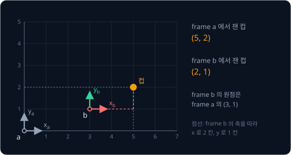

그래서 좌표에는 어느 frame 에서 잰 값인지 아래첨자로 적는다(Tedrake 의 Robotic Manipulation 교재 표기).

| 기호 | 뜻 | 컵의 예 |
| --- | --- | --- |
| $p_a$ | frame $a$ 에서 잰 점 $p$ 의 좌표 | $(5, 2)$ |
| $p_b$ | frame $b$ 에서 잰 같은 점의 좌표 | $(2, 1)$ |
| $p_{ab}$ | frame $a$ 에서 잰 frame $b$ 원점의 위치 | $(3, 1)$ |

두 frame 이 같은 방향을 보면 $p_a = p_{ab} + p_b$ 로 더하기만 하면 된다. 실제 로봇의 frame 은 대개 서로 돌아가 있어서, 원점의 위치와 함께
frame $b$ 의 축이 frame $a$ 에서 어느 쪽을 향하는지(orientation)도 알아야 한다. 위치와 방향을 묶어 **pose** 라고 하고, "gripper 의 pose" 는
손끝이 어디에 있고 어느 쪽을 향하는지를 함께 가리킨다.

ROS 는 축의 방향을 REP-103 규약으로 정해 두어서, 로봇 몸체 frame `base_link` 의 x·y·z 축은 각각 앞·왼쪽·위를 향한다.

## 2D rotation matrix

반지름이 1 인 원(단위원) 위에서 $(1, 0)$ 부터 시계 반대 방향으로 각도 $\theta$ 만큼 간 점의 가로 좌표가 $\cos\theta$ 이고 세로 좌표가
$\sin\theta$ 다. 30° 를 가면 $(0.866, 0.5)$ 이고, 90° 를 가면 꼭대기 $(0, 1)$ 이다.

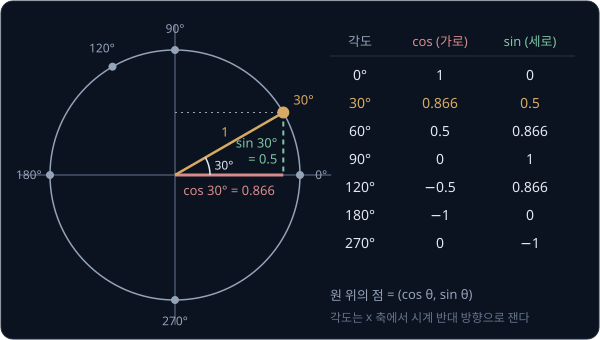

점 하나를 원점 중심으로 $\theta$ 돌리는 계산은 길이 1 짜리 두 축 화살표 $(1, 0)$ 과 $(0, 1)$ 이 어디로 가는지만 알면 정해진다. $(1, 0)$ 은
단위원의 $\theta$ 지점 $(\cos\theta, \sin\theta)$ 로 가고, $(0, 1)$ 은 그보다 90° 앞선 $(-\sin\theta, \cos\theta)$ 로 간다. 이 두 도착점을
열로 세운 행렬이 **rotation matrix** 다.

$$
R(\theta) = \begin{bmatrix} \cos\theta & -\sin\theta \\ \sin\theta & \cos\theta \end{bmatrix}, \qquad
R(30°) = \begin{bmatrix} 0.866 & -0.5 \\ 0.5 & 0.866 \end{bmatrix}
$$

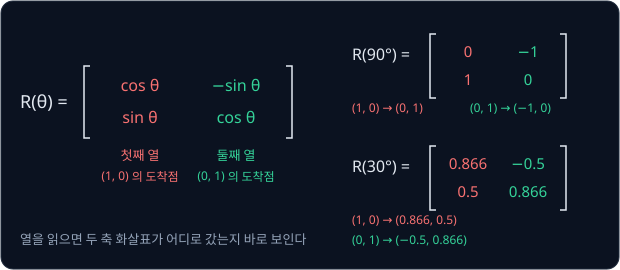

[Vectors & Matrices](../vectors-matrices/README.md) 의 LiDAR 예에서 30° 돌아간 LiDAR 가 잰 장애물 $(2, 1)$ 을 로봇 frame 의
$(1.232, 1.866)$ 으로 바꾼 행렬이 이 $R(30°)$ 다.

rotation matrix 의 두 열은 길이가 1 이고($0.866^2 + 0.5^2 = 1$) 서로 직각이라서($0.866 \times (-0.5) + 0.5 \times 0.866 = 0$), 곱해도
원점까지의 거리가 바뀌지 않는다. $(2, 1)$ 과 $(1.232, 1.866)$ 은 모두 원점에서 $\sqrt 5 \approx 2.236$ 떨어져 있다. 물체를 늘리거나
찌그러뜨리지 않고 돌리기(rotation)와 옮기기(translation)만 하는 이런 변환이 **rigid transform** 이다. 반대 방향으로 30° 돌리는
$R(-30°)$ 는 $R(30°)$ 의 행과 열을 맞바꾼 transpose 와 같아서, rotation matrix 의 역행렬은 계산할 필요 없이 $R^{-1} = R^\top$ 이다.

ROS 와 URDF 는 각도를 radian 으로 적는데, radian 은 단위원 둘레를 따라 간 거리로 잰 각도다. 한 바퀴 360° 가 원 둘레 $2\pi \approx 6.283$
rad 이라서 90° 는 $\pi/2 \approx 1.5708$ rad 이고, URDF 에 1.5708 이 보이면 90° 로 읽는다.

<b>심화: cos·sin 값, rotation 공식, radian</b>

30° 의 값은 세 변이 모두 1 인 정삼각형으로 구한다. 한 꼭짓점을 원점에 두고 $x$ 축이 그 꼭짓점의 60° 를 30° 둘로 나누도록 놓으면, 맞은편
세로 변(길이 1)이 $x$ 축에 반씩 나뉘어 30° 꼭짓점의 높이는 $1 \div 2 = 0.5$ 다. 가로 길이는 직각삼각형의 빗변 제곱이 나머지 두 변 제곱의 합이라는
피타고라스 정리로 구한다.

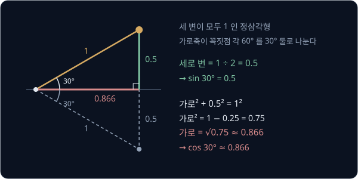

$$
\text{가로}^2 + 0.5^2 = 1^2, \qquad \text{가로}^2 = 0.75, \qquad \text{가로} = \sqrt{0.75} \approx 0.866
$$

같은 직각삼각형을 어느 각도에서 만들어도 빗변이 1 이라서 $\cos^2\theta + \sin^2\theta = 1$ 이다. 60° 는 같은 삼각형을 세운 모양이라
$(0.5, 0.866)$ 이고, 120° 는 60° 지점을 $y$ 축에 대고 뒤집은 $(-0.5, 0.866)$ 이다.

$R(\theta)$ 를 $(x, y)$ 에 곱한 결과를 칸별로 적으면 아래 두 줄이다. $x'$ 는 "엑스 프라임" 이라고 읽고 돌린 뒤의 가로 좌표다.

$$
x' = x\cos\theta - y\sin\theta, \qquad y' = x\sin\theta + y\cos\theta
$$

$\theta = 90°$ 이면 $\cos 90° = 0$, $\sin 90° = 1$ 이라 $(x, y) \to (-y, x)$ 가 되고, $(2, 1)$ 은 $(-1, 2)$ 로 간다.

도를 radian 으로 바꿀 때는 $\pi / 180$ 을 곱한다.

| 도 | 한 바퀴 중 비율 | radian | 소수 |
| --- | --- | --- | --- |
| 360° | 1 | $2\pi$ | 6.2832 |
| 180° | $\frac{1}{2}$ | $\pi$ | 3.1416 |
| 90° | $\frac{1}{4}$ | $\frac{\pi}{2}$ | 1.5708 |
| 30° | $\frac{1}{12}$ | $\frac{\pi}{6}$ | 0.5236 |

## frame 사이의 rotation 과 translation

같은 행렬을 돌아가 있는 frame 에서 잰 좌표를 바꾸는 계산으로 읽을 수도 있다. frame $b$ 가 frame $a$ 와 원점은 같고 90° 돌아 있으면 $x_b$ 축은
frame $a$ 에서 위쪽 $(0, 1)$ 을 가리키고 $y_b$ 축은 왼쪽 $(-1, 0)$ 을 가리킨다. 그래서 frame $b$ 의 $(2, 1)$ 은 frame $a$ 에서
$2 \times (0, 1) + 1 \times (-1, 0) = (-1, 2)$ 로, 점을 90° 돌린 결과와 같다.

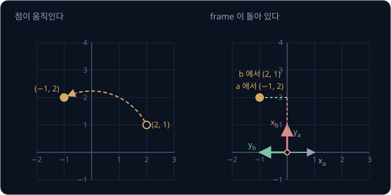

이렇게 읽을 때는 행렬에 frame 이름을 붙여 $R_{ab}$ 로 적고 $p_a = R_{ab}\,p_b$ 로 쓴다. $R_{ab}$ 의 첫째 열은 frame $b$ 의 $x$ 축을 frame
$a$ 에서 잰 값이고 둘째 열은 $y$ 축을 잰 값이다. 그래서 행렬만 보고도 frame $b$ 가 어느 쪽을 보는지 알 수 있고, frame $b$ 의 orientation 을
이 $R_{ab}$ 로 적는다.

frame $b$ 의 원점이 frame $a$ 의 $(3, 1)$ 에 있고 90° 돌아 있으면, frame $b$ 에서 잰 좌표를 먼저 frame $a$ 의 방향으로 돌린 뒤 원점의 위치를 더한다.

$$
p_a = R_{ab}\,p_b + p_{ab}
$$

| 단계 | 계산 | 결과 |
| --- | --- | --- |
| 방향 바꾸기 $R_{ab}\,p_b$ | $R(90°) \times (2, 1)$ | $(-1, 2)$ |
| 원점 위치 더하기 $+\,p_{ab}$ | $(-1, 2) + (3, 1)$ | $(2, 3)$ |

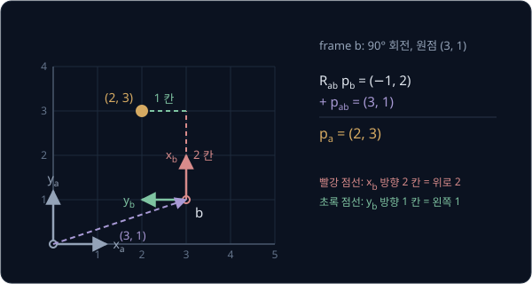

> **오해** 원점 위치를 먼저 더하고 돌려도 같다.
>
> **사실** $p_{ab}$ 는 이미 frame $a$ 에서 잰 값이라 돌리면 안 된다. 순서를 바꿔 $(2, 1) + (3, 1) = (5, 2)$ 를 돌리면 맞는 답 $(2, 3)$ 과 전혀 다른 $(-2, 5)$ 가 나온다.

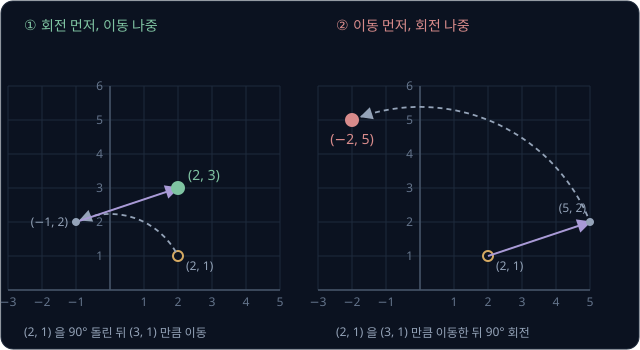

## homogeneous transform

$p_a = R_{ab}\,p_b + p_{ab}$ 에는 곱하기와 더하기가 섞여 있어서, frame 을 여러 개 거치면 "곱하고 더한 것에 다시 곱하고 더하는" 식이 겹겹이
쌓인다. 좌표 끝에 1 을 붙여 $(2, 1)$ 을 $(2, 1, 1)$ 로 적으면 두 단계를 행렬 곱 하나로 바꿀 수 있는데, 이렇게 1 을 붙인 좌표를
**homogeneous coordinates** 라고 한다. 행렬은 rotation matrix 오른쪽에 원점 위치를 열로 붙이고 맨 아래에 $(0, 0, 1)$ 행을 붙여 만든다.

$$
T_{ab} = \begin{bmatrix} R_{ab} & p_{ab} \\ 0 \ \ 0 & 1 \end{bmatrix}
= \begin{bmatrix} 0 & -1 & 3 \\ 1 & 0 & 1 \\ 0 & 0 & 1 \end{bmatrix}
$$

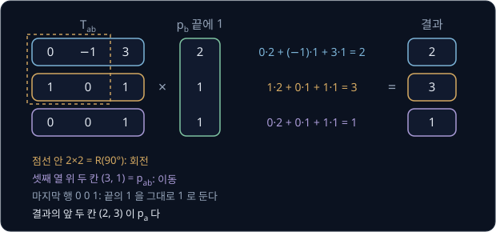

$(2, 1, 1)$ 에 곱하면 첫째 행과의 곱은 $0 \times 2 + (-1) \times 1 + 3 \times 1 = 2$ 인데, 앞의 $0 \times 2 + (-1) \times 1$ 이 rotation 이고 끝의
$3 \times 1$ 이 translation 이다. 둘째 행도 $1 \times 2 + 0 + 1 \times 1 = 3$ 이라 두 단계로 구한 $(2, 3)$ 이 한 번에 나온다. 끝에 붙인 1 이 $p_{ab}$ 를 한 번씩 더하게
하고, 마지막 행 $(0, 0, 1)$ 은 결과의 끝을 다시 1 로 만들어 다음 행렬을 이어 곱할 수 있게 한다. 이 행렬 $T_{ab}$ 를
**homogeneous transform** 이라고 하는데, frame $a$ 에서 본 frame $b$ 의 pose 이면서 frame $b$ 의 좌표를 frame $a$ 의 좌표로 바꾸는
행렬이다.

3D 에서는 3×3 rotation 칸, 세 칸짜리 translation 열, 마지막 행 $(0, 0, 0, 1)$ 로 이루어진 4×4 행렬이 된다. 이런 행렬의 모임을
SE(3)(special Euclidean group)라고 하고, 2D 의 3×3 행렬 모임은 SE(2) 라고 한다. ROS 2 의 `ros2 run tf2_ros tf2_echo base_link camera_link` 명령은
`base_link` 에서 본 `camera_link` 의 pose 를 translation, quaternion, roll-pitch-yaw, 이 4×4 행렬로 함께 출력한다.

<b>심화: 3D 의 예</b>

로봇 base frame $b$ 가 world frame $w$ 의 $(1, 2, 0)$ m 에 놓여 있고 $z$ 축을 중심으로 90° 돌아 있다($R_z$ 는 [3D rotation](#3d-rotation)
에서 다룬다). $R_z(90°)$ 는 $(x, y, z)$ 를 $(-y, x, z)$ 로 보낸다.

$$
T_{wb} = \begin{bmatrix} 0 & -1 & 0 & 1 \\ 1 & 0 & 0 & 2 \\ 0 & 0 & 1 & 0 \\ 0 & 0 & 0 & 1 \end{bmatrix}
$$

| 계산 | 결과 |
| --- | --- |
| base 의 $(0.3, 0, 0.1)$ 에 있는 cube: $R_z(90°) \times (0.3, 0, 0.1) + (1, 2, 0) = (0, 0.3, 0.1) + (1, 2, 0)$ | world 에서 $(1, 2.3, 0.1)$ |
| base 의 $(0.5, 0, 0.4)$ 에 단 camera: $R_z(90°) \times (0.5, 0, 0.4) + (1, 2, 0)$ | world 에서 $(1, 2.5, 0.4)$ |
| 거꾸로 world 의 cube: $R_z(90°)^\top (1, 2.3, 0.1) - R_z(90°)^\top (1, 2, 0) = (2.3, -1, 0.1) + (-2, 1, 0)$ | base 에서 $(0.3, 0, 0.1)$ |

마지막 줄은 [역변환](#역변환) 에서 다루는 식으로 계산했다.

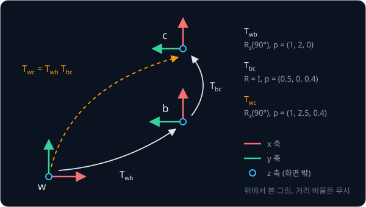

## 변환의 합성

world frame $w$ 에 로봇의 base frame $b$ 가 있고, base 에 camera frame $c$ 가 달려 있다. base 는 world 의 $(3, 1)$ 에서 90° 돌아 있고,
camera 는 base 의 $(2, 0)$ 에 base 와 같은 방향으로 달려 있다. camera 가 자기 frame 에서 $(1, 0)$ 에 있는 점을 봤다면 한 frame 씩 바꿔
world 좌표를 구할 수 있다.

| 단계 | 계산 | 결과 |
| --- | --- | --- |
| camera → base ($T_{bc}$) | $(1, 0) + (2, 0)$ | $p_b = (3, 0)$ |
| base → world ($T_{wb}$) | $R(90°) \times (3, 0) + (3, 1) = (0, 3) + (3, 1)$ | $p_w = (3, 4)$ |

$p_w = T_{wb}\,(T_{bc}\,p_c)$ 이므로 두 행렬을 먼저 곱해 둔 $T_{wc} = T_{wb}\,T_{bc}$ 하나로 같은 답을 얻는다. 이렇게 변환을 이어 붙여 하나로
만드는 것을 **composition**(합성)이라고 한다.

$$
T_{wc} = \begin{bmatrix} 0 & -1 & 3 \\ 1 & 0 & 3 \\ 0 & 0 & 1 \end{bmatrix}, \qquad
T_{wc} \begin{bmatrix} 1 \\ 0 \\ 1 \end{bmatrix} = \begin{bmatrix} 3 \\ 4 \\ 1 \end{bmatrix}
$$

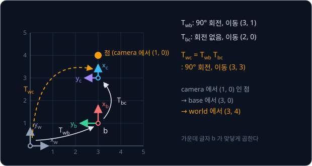

곱하는 순서는 아래첨자로 확인한다. $T_{wb}\,T_{bc}$ 처럼 앞 행렬의 뒤 글자와 뒤 행렬의 앞 글자가 같은 $b$ 로 맞닿아야 하고, 맞닿은 글자를 지우면 결과의 이름 $T_{wc}$ 가
남는다. 순서를 바꾼 $T_{bc}\,T_{wb}$ 는 이름부터 맞지 않고, $(1, 0, 1)$ 에 곱하면 엉뚱한 $(5, 2)$ 가 나온다.

같은 움직임도 오른쪽에 곱하느냐 왼쪽에 곱하느냐에 따라 뜻이 다르다. $x$ 방향으로 2 옮기는 움직임 $M$(rotation 은 $I$)을 로봇의 pose
$T_{wb}$ 에 곱해 보면 아래와 같다.

| 곱하는 자리 | 계산 | 새 원점 | 뜻 |
| --- | --- | --- | --- |
| 오른쪽 $T_{wb}\,M$ | $R(90°) \times (2, 0) + (3, 1)$ | $(3, 3)$ | 로봇 자신의 $x$ 축(위쪽)으로 2 |
| 왼쪽 $M\,T_{wb}$ | $(3, 1) + (2, 0)$ | $(5, 1)$ | world 의 $x$ 축(오른쪽)으로 2 |

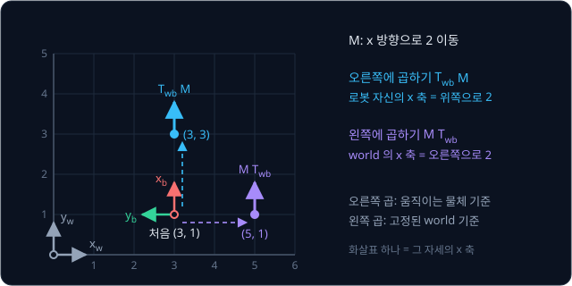

오른쪽에 곱한 움직임은 물체 자신의 frame 에서 잰 "앞으로 2 m" 이고, 왼쪽에 곱한 움직임은 바깥의 고정된 frame 에서 잰
"동쪽으로 2 m" 이다.

**확인 문제.** 위의 $T_{wb}$(90°, $(3, 1)$)에 "$y$ 방향으로 1" 움직임을 오른쪽에 곱하면 로봇의 새 원점은?

답 보기

오른쪽 곱이라 로봇 자신의 $y$ 축으로 1 이고, 로봇의 $y$ 축은 world 에서 $R(90°) \times (0, 1) = (-1, 0)$ 으로 왼쪽을 향한다.

$$
R(90°) \times (0, 1) + (3, 1) = (-1, 0) + (3, 1) = (2, 1)
$$

답: $(2, 1)$

## 역변환

frame $a$ 의 좌표를 frame $b$ 의 좌표로 바꾸는 반대 방향 변환 $T_{ba}$ 는 $T_{ab}$ 의 역행렬이다. $p_a = R_{ab}\,p_b + p_{ab}$ 를 거꾸로
풀면 원점 위치를 먼저 빼고 $R_{ab}^\top$ 로 돌리게 되므로, 역변환의 rotation 칸은 $R^\top$ 이고 translation 칸은 $-R^\top p$ 다.

$$
T_{ab}^{-1} = \begin{bmatrix} R_{ab}^\top & -R_{ab}^\top\,p_{ab} \\ 0 \ \ 0 & 1 \end{bmatrix}
$$

앞의 $T_{ab}$(90°, $(3, 1)$)로 확인하면 $p_a = (2, 3)$ 에서 $p_b = (2, 1)$ 이 나와야 한다.

| 단계 | 계산 | 결과 |
| --- | --- | --- |
| 원점 위치 빼기 | $(2, 3) - (3, 1)$ | $(-1, 2)$ |
| $R_{ab}^\top$ 곱하기 ($-90°$ 회전) | $(0 \times (-1) + 1 \times 2,\ -1 \times (-1) + 0 \times 2)$ | $(2, 1)$ |

translation 칸은 $-R_{ab}^\top (3, 1) = -(0 \times 3 + 1 \times 1,\ -1 \times 3 + 0 \times 1) = (-1, 3)$ 이다.

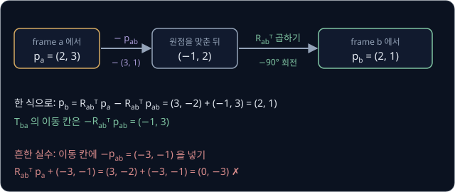

> **오해** 역변환의 translation 칸은 $-p_{ab}$ 다.
>
> **사실** $p_{ab}$ 는 frame $a$ 의 방향으로 적힌 값이라서 frame $b$ 의 좌표에서 빼려면 먼저 $R_{ab}^\top$ 로 frame $b$ 의 방향으로 바꿔야 한다. $-p_{ab} = (-3, -1)$ 을 그대로 넣으면
> $R_{ab}^\top\,p_a + (-3, -1) = (3, -2) + (-3, -1) = (0, -3)$ 이라는 틀린 답이 나온다. tf2 의 `BufferCore` 도 두 frame 사이의 변환을 구하다가 역변환이 필요하면 $-p$ 를
> rotation 의 역으로 돌려 translation 칸을 계산한다.

<b>심화: 역변환 식의 유도</b>

$p_a = R_{ab}\,p_b + p_{ab}$ 를 $p_b$ 에 대해 한 단계씩 푼다.

| 단계 | 식 |
| --- | --- |
| 양쪽에서 $p_{ab}$ 빼기 | $p_a - p_{ab} = R_{ab}\,p_b$ |
| 양쪽 왼쪽에 $R_{ab}^\top$ 곱하기($R^\top R = I$) | $R_{ab}^\top (p_a - p_{ab}) = p_b$ |
| 괄호 풀기 | $p_b = R_{ab}^\top\,p_a - R_{ab}^\top\,p_{ab}$ |

마지막 줄에서 $p_a$ 에 곱한 $R_{ab}^\top$ 가 rotation 칸이고, 뒤에 붙은 $-R_{ab}^\top\,p_{ab}$ 가 translation 칸이다. 숫자로 적으면

$$
T_{ba} = \begin{bmatrix} 0 & 1 & -1 \\ -1 & 0 & 3 \\ 0 & 0 & 1 \end{bmatrix}, \qquad
T_{ba} \begin{bmatrix} 2 \\ 3 \\ 1 \end{bmatrix} = \begin{bmatrix} 0 + 3 - 1 \\ -2 + 0 + 3 \\ 1 \end{bmatrix} = \begin{bmatrix} 2 \\ 1 \\ 1 \end{bmatrix}
$$

이다.

**확인 문제.** $T_{ab}$ 의 rotation 이 $I$ 이고 translation 이 $(3, 1)$ 이면 $T_{ba}$ 의 translation 칸은?

답 보기

$$
-I^\top (3, 1) = (-3, -1)
$$

답: $(-3, -1)$. rotation 이 없을 때만 $-p_{ab}$ 를 그대로 쓸 수 있고, [frame 과 pose](#frame-과-pose) 의 $p_b = p_a - p_{ab}$ 와 같은 계산이다.

## 3D rotation

3D frame 은 서로 직각인 축 세 개 $x$, $y$, $z$ 로 이루어진다. 셋째 축의 방향은 오른손으로 정하는데, 오른손 네 손가락을 $x$ 축 방향으로 펴고
$y$ 축 쪽으로 감아쥐었을 때 엄지가 가리키는 쪽이 $z$ 축이다. 이 약속을 right-hand rule 이라고 하고, + 회전 방향도 엄지를 축 방향에 두고
손가락을 감아쥔 쪽으로 정한다. 평면의 시계 반대 방향 회전은 화면 밖을 향한 $z$ 축 중심의 + 회전이다.

축 하나를 중심으로 도는 rotation $R_x$, $R_y$, $R_z$ 는 그 축의 성분을 그대로 두고 나머지 두 칸을 평면처럼 돌린다. 90° 를 넣으면 각 축이
가는 곳은 아래와 같다.

| rotation | 첫째 열 ($x$ 축이 가는 곳) | 둘째 열 ($y$ 축이 가는 곳) | 셋째 열 ($z$ 축이 가는 곳) |
| --- | --- | --- | --- |
| $R_x(90°)$ | $(1, 0, 0)$ 그대로 | $(0, 0, 1)$ | $(0, -1, 0)$ |
| $R_y(90°)$ | $(0, 0, -1)$ | $(0, 1, 0)$ 그대로 | $(1, 0, 0)$ |
| $R_z(90°)$ | $(0, 1, 0)$ | $(-1, 0, 0)$ | $(0, 0, 1)$ 그대로 |

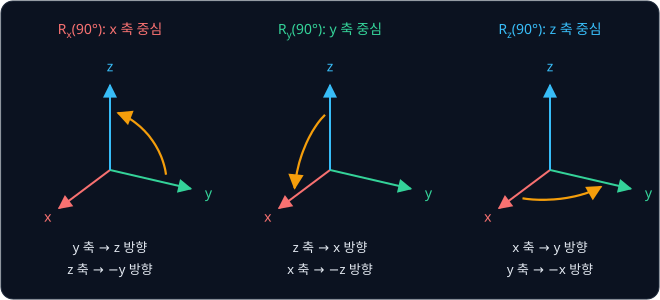

2D 와 마찬가지로 $R_{ab}$ 의 세 열은 frame $b$ 의 $x$·$y$·$z$ 축을 frame $a$ 에서 잰 값이고, 길이가 1 이고 서로 직각이며 오른손 순서를 지킨다.

카메라 하나에도 frame 이 둘 붙는다. 카메라 몸체의 `camera_link` 는 `base_link` 처럼 x 축이 앞을 향하지만, 사진을 다루는 optical frame 의
z·x·y 축은 REP-103 에 따라 각각 앞·오른쪽·아래를 향한다. `camera_link` 에서 재면 optical frame 의 $x$ 축(오른쪽)은 $(0, -1, 0)$ 이고, $y$ 축(아래)은
$(0, 0, -1)$ 이며, $z$ 축(앞)은 $(1, 0, 0)$ 이다. 이 셋을 순서대로 열로 세우면 rotation matrix 가 된다.

$$
R_{\text{link},\,\text{optical}} = \begin{bmatrix} 0 & 0 & 1 \\ -1 & 0 & 0 \\ 0 & -1 & 0 \end{bmatrix}
$$

사진에서 오른쪽 0.1 m, 아래 0.2 m, 정면 1.0 m 인 점 $(0.1, 0.2, 1.0)$ 에 이 행렬을 곱하면 `camera_link` 의 $(1.0, -0.1, -0.2)$ 가 나온다.
이 rotation 을 빼먹으면 정면 거리 1.0 m 를 위쪽 거리로 잘못 읽는다.

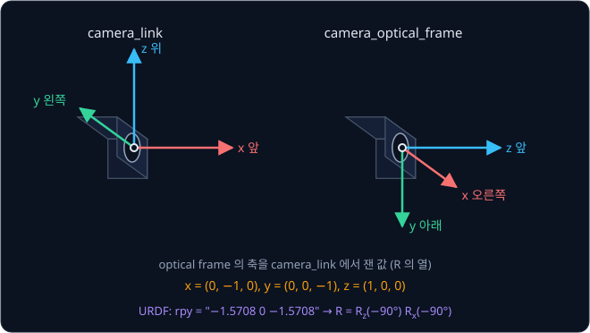

평면의 rotation 과 달리 3D rotation 은 순서를 바꾸면 결과가 달라진다. 오른쪽 행렬을 먼저 적용하므로 $R_z(90°)\,R_x(90°)$ 에서 $x$ 축은
$(0, 1, 0)$ 으로 가지만, $R_x(90°)\,R_z(90°)$ 에서는 $R_z$ 가 보낸 $(0, 1, 0)$ 을 $R_x$ 가 다시 $(0, 0, 1)$ 로 보낸다.

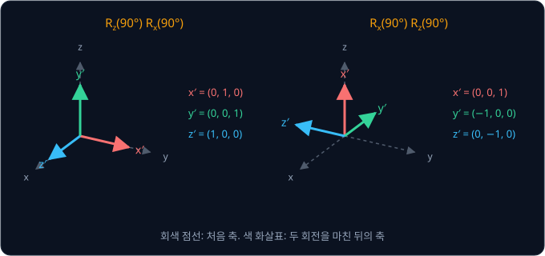

<b>심화: R_x·R_y·R_z 와 SO(3)</b>

$$
R_z(\theta) = \begin{bmatrix} \cos\theta & -\sin\theta & 0 \\ \sin\theta & \cos\theta & 0 \\ 0 & 0 & 1 \end{bmatrix}, \qquad
R_x(\theta) = \begin{bmatrix} 1 & 0 & 0 \\ 0 & \cos\theta & -\sin\theta \\ 0 & \sin\theta & \cos\theta \end{bmatrix}
$$

$$
R_y(\theta) = \begin{bmatrix} \cos\theta & 0 & \sin\theta \\ 0 & 1 & 0 \\ -\sin\theta & 0 & \cos\theta \end{bmatrix}
$$

$R_y$ 만 $\sin\theta$ 의 − 부호가 아래에 있는데, $y$ 축 중심 rotation 은 right-hand rule 순서대로 $z$ 에서 $x$ 쪽으로 돌기 때문이다.

$R^\top R$ 의 각 칸은 $R$ 의 열 두 개의 dot product 라서, 같은 열끼리면 길이의 제곱 1 이고 다른 열끼리면 직각이라 0 이다. 그래서 열이 길이 1
이고 서로 직각인 행렬(orthogonal matrix)은 $R^\top R = I$ 를 만족한다. 그러나 $\begin{bmatrix} 1 & 0 & 0 \\ 0 & 1 & 0 \\ 0 & 0 & -1 \end{bmatrix}$
처럼 $z$ 축 하나를 뒤집은 행렬도 이 식을 만족한다. 이 행렬은 오른손 frame 을 거울에 비친 왼손 frame 으로 바꾸는데, 이런 자세는 어떤 rotation
으로도 만들 수 없다. determinant 는 행렬이 부피를 몇 배로 바꾸는지와 뒤집는지를 함께 나타내는 값으로, rotation 이면 +1 이고 거울상이면 −1 이다. 앞의 optical
frame 행렬은 $x$ 열 $(0, -1, 0)$ 에서 $y$ 열 $(0, 0, -1)$ 쪽으로 오른손을 감아쥐면 엄지가 $(1, 0, 0)$ 을 가리켜 셋째 열과 같으므로 rotation 이다.

$R^\top R = I$, $\det R = 1$ 을 만족하는 3×3 행렬의 모임을 SO(3)(special orthogonal group)라고 한다. 두 rotation 을 이어서 하면 결과도 rotation
이고 모든 rotation 에는 되돌리는 rotation 이 있어서, 수학에서 group 이라고 부르는 구조를 이룬다.

## roll-pitch-yaw

rotation matrix 는 숫자 9 개를 쓰지만 열이 길이 1 이고 서로 직각이어야 해서 마음대로 정할 수 있는 숫자는 3 개뿐이다. 그래서 사람이 자세를 적을
때는 각도 세 개를 쓰는 경우가 많다. $x$·$y$·$z$ 축 중심 회전을 각각 roll·pitch·yaw 라고 부르는데, 비행기로 치면 roll 은 날개를 기울이고,
pitch 는 코를 들거나 숙이며, yaw 는 좌우로 방향을 튼다.

URDF 는 부품의 자세를 `rpy="roll pitch yaw"` 처럼 radian 세 개로 적는다. 부모 frame 의 고정된 $x$ 축으로 roll 만큼 돌리고, 이어서 고정된
$y$ 축으로 pitch 만큼 돌린 뒤, 마지막으로 고정된 $z$ 축으로 yaw 만큼 돌린다는 뜻이다. 고정된 frame 기준의 움직임은 왼쪽에 곱하므로 나중에 한
rotation 이 왼쪽에 온다.

$$
R = R_z(\text{yaw})\,R_y(\text{pitch})\,R_x(\text{roll})
$$

Intel RealSense D435 의 URDF 는 optical frame 을 `rpy="-1.5708 0 -1.5708"` 로 달아 둔다. $R_x(-90°)$ 를 먼저 적용하고 $R_z(-90°)$ 를 나중에
적용하면 앞 절에서 열로 세운 optical frame 행렬이 그대로 나온다.

| $R_x(-90°)$ 의 열 | $R_z(-90°)$ 를 곱한 결과 | 뜻 |
| --- | --- | --- |
| $(1, 0, 0)$ | $(0, -1, 0)$ | optical $x$ 는 `camera_link` 의 오른쪽 |
| $(0, 0, -1)$ | $(0, 0, -1)$ | optical $y$ 는 아래 |
| $(0, 1, 0)$ | $(1, 0, 0)$ | optical $z$ 는 앞 |

각도 세 개는 읽기 쉽지만, pitch 가 90° 이면 rpy 가 $(30°, 90°, 0°)$ 인 자세와 $(0°, 90°, -30°)$ 인 자세가 같은 행렬이 된다. roll 은 맨 처음
$x$ 축을 중심으로 도는데, pitch 90° 가 이 $x$ 축을 눕혀 $-z$ 방향으로 보낸다. 그래서 pitch 까지 끝난 뒤에 보면 roll 로 돈 양은 $z$ 축 둘레를 돈
것과 같고, yaw 도 $z$ 축 둘레를 돈다. 독립인 각도 셋 가운데 하나가 사라지는 이 현상을 **gimbal lock** 이라고 한다. 이름은 고리 여러 개를
직각으로 끼워 어느 방향으로든 돌 수 있게 만든 장치 gimbal 에서 왔는데, 이 장치도 고리 두 개의 축이 겹치면 한 방향으로는 돌 수 없게 된다.

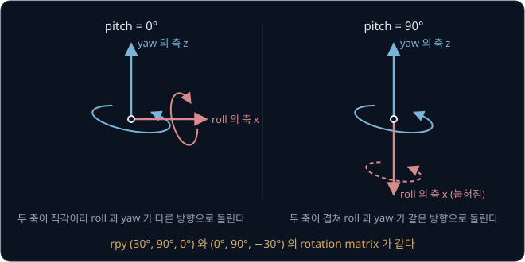

pitch 가 90° 근처이기만 해도 자세가 조금 바뀔 때 roll 과 yaw 의 숫자가 크게 바뀌어서, 로봇 소프트웨어는 roll-pitch-yaw 를 URDF 나
`tf2_echo` 출력처럼 사람이 읽고 쓰는 곳에만 쓰고 내부 계산에는 rotation matrix 나 quaternion 을 쓴다.

<b>심화: 두 rpy 가 같은 행렬이 되는 계산</b>

$R_y(90°)$ 의 열은 $(0, 0, -1)$, $(0, 1, 0)$, $(1, 0, 0)$ 이고, $R_x(30°)$ 의 열은 $(1, 0, 0)$, $(0, 0.866, 0.5)$, $(0, -0.5, 0.866)$ 이다.

| A = $R_y(90°)\,R_x(30°)$ 의 열 | B = $R_z(-30°)\,R_y(90°)$ 의 열 |
| --- | --- |
| $R_y(90°) \times (1, 0, 0) = (0, 0, -1)$ | $R_z(-30°) \times (0, 0, -1) = (0, 0, -1)$ |
| $R_y(90°) \times (0, 0.866, 0.5) = (0.5, 0.866, 0)$ | $R_z(-30°) \times (0, 1, 0) = (0.5, 0.866, 0)$ |
| $R_y(90°) \times (0, -0.5, 0.866) = (0.866, -0.5, 0)$ | $R_z(-30°) \times (1, 0, 0) = (0.866, -0.5, 0)$ |

세 열이 모두 같으므로 roll 30° 와 yaw −30° 가 같은 일을 한다. pitch 가 90° 이면 roll 과 yaw 의 차이만 결과를 정하고, 둘을 따로 정할 수 없다.

**확인 문제.** rpy $(10°, 90°, 0°)$ 와 같은 행렬이 되는 rpy 를 roll 이 0° 인 꼴로 하나 적어라.

답 보기

pitch 가 90° 일 때는 roll 로 돈 양과 yaw 로 반대로 돈 양이 같은 일을 하므로, roll 10° 는 yaw −10° 와 같다.

답: $(0°, 90°, -10°)$

## axis-angle

roll-pitch-yaw 는 rotation 을 축 세 개에 나눠 적기 때문에, pitch 가 90° 이면 roll 의 축이 yaw 의 축과 겹쳐 각도 하나를 잃는
[gimbal lock](#roll-pitch-yaw) 이 생긴다. 그런데 원점을 고정한 3D rotation 에는 언제나 움직이지 않는 방향이 하나 있어서, 어떤 rotation 이든
나누지 않고 "축 하나를 중심으로 각도 하나만큼 돈 것" 으로 한 번에 적을 수 있다. Euler 가 증명한 이 성질을 이용해 rotation 을 축과 각도로
적는 방법이 **axis-angle** 이다.

$R_z(90°)\,R_x(90°)$ 는 열이 $(0, 1, 0)$, $(0, 0, 1)$, $(1, 0, 0)$ 이라 축을 $x \to y$, $y \to z$, $z \to x$ 자리로 하나씩 옮긴다.
이 행렬에 $(1, 1, 1)$ 을 곱하면 행마다 $0 + 0 + 1 = 1$ 이라 $(1, 1, 1)$ 이 그대로 나오므로 이 방향이 회전축이다. 이 rotation 을 세 번 하면
세 축이 모두 제자리로 돌아오므로, 한 번에 $360° \div 3 = 120°$ 를 돈다.

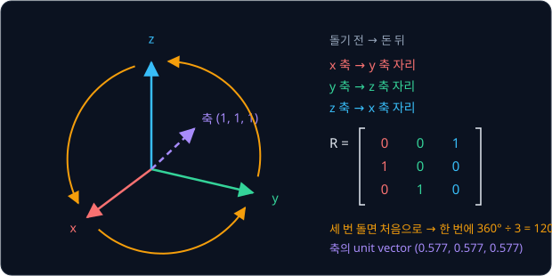

축은 방향만 중요하므로 길이 1 인 unit vector $\hat\omega$ 로 적는다. $(1, 1, 1)$ 은 길이가 $\sqrt 3 \approx 1.732$ 라서
$\hat\omega \approx (0.577, 0.577, 0.577)$ 이다. 축에 각도(radian)를 곱한 세 칸짜리 vector $\hat\omega\theta$ 를 rotation vector 라고 하는데,
방향이 축이고 길이가 각도다. 120° 는 $2\pi / 3 \approx 2.094$ rad 이라 이 rotation 의 rotation vector 는 $(1.209, 1.209, 1.209)$ 다.
OpenCV 의 `solvePnP` 는 카메라에서 본 물체의 자세를 이 rotation vector(`rvec`)로 돌려주고, `cv::Rodrigues` 가 이를 rotation matrix 로
바꾼다(Rodrigues 공식의 유도는 Modern Robotics 3장).

## quaternion

지금까지 본 세 표현은 저마다 불편한 점이 있다. rotation matrix 는 숫자 9 개를 쓰는 데다, 곱셈을 거듭해 반올림 오차가 쌓이면 열의 길이가 1 에서,
열 사이가 직각에서 조금씩 벗어나는데 이를 바로잡는 계산이 번거롭다. roll-pitch-yaw 는 pitch 90° 에서 roll 과 yaw 가 같은 축으로 돌게 되어
각도 하나를 잃는 gimbal lock 이 생긴다. axis-angle 은 숫자 3 개로 gimbal lock 없이 적지만, 두 rotation 을 이어 붙이는 간단한 식이 없어
rotation matrix 로 바꿔 곱한 뒤 축과 각도를 다시 뽑는 경우가 많다. 숫자 네 개로 이 세 가지를 함께 피하는 표현이 quaternion 이라서, tf2 와 MuJoCo 는 자세를 quaternion 으로 저장한다.

**quaternion** 은 axis-angle 의 축 $\hat\omega$ 와 각도 $\theta$ 를 그대로 쓰되, 각도의 절반의 cos 과 sin 으로 네 칸을 채운다.

$$
q = (w,\ x,\ y,\ z) = \left(\cos\tfrac{\theta}{2},\ \ \hat\omega \sin\tfrac{\theta}{2}\right)
$$

첫 칸 $w$ 를 scalar 부분이라고 하고 나머지 세 칸을 vector 부분이라고 하는데, 여기서 $x, y, z$ 는 점의 좌표가 아니라 칸의 이름이다.
각도를 절반만 적는 까닭은 quaternion 으로 점을 돌릴 때 $q$ 를 점의 앞과 뒤에 한 번씩 곱해서, 절반짜리 회전이 두 번 더해지기 때문이다
(계산은 이 절 끝의 심화 블록).
quaternion 은 1843 년 William Rowan Hamilton 이 만든 수 체계로, 이름은 넷으로 이루어진 묶음을 뜻하는 라틴어 quaternio 에서 왔다.

| rotation | 축 | $\frac{\theta}{2}$ | quaternion $(w, x, y, z)$ |
| --- | --- | --- | --- |
| 아무것도 안 함 | 아무 축 | 0° | $(1, 0, 0, 0)$ |
| $z$ 축 90° | $(0, 0, 1)$ | 45° | $(0.707, 0, 0, 0.707)$ |
| $(1, 1, 1)$ 축 120° | $(0.577, 0.577, 0.577)$ | 60° | $(0.5, 0.5, 0.5, 0.5)$ |

$\cos 45° = \sin 45° \approx 0.707$ 이고, 마지막 줄은 $0.577 \times \sin 60° = 0.577 \times 0.866 \approx 0.5$ 다. 네 칸을 제곱해 더하면
$\cos^2\frac{\theta}{2} + \sin^2\frac{\theta}{2} = 1$ 이라 rotation 을 나타내는 quaternion 은 늘 길이가 1 이고, 이를 unit quaternion 이라고
한다. unit quaternion 은 rotation matrix 보다 숫자가 적고 gimbal lock 이 없으며, 반올림 오차가 쌓여도 네 칸을 길이로 나누면 다시 rotation 이 된다. 두 rotation
의 합성은 rotation matrix 를 거치지 않고 quaternion 곱 $q_1 \otimes q_2$ 로 바로 하는데, 이 곱은 행렬 곱 $R_1 R_2$ 와 같은 rotation 이다.

quaternion 에는 각도의 절반이 들어가서, 같은 자세인 90° 와 $90° + 360°$ 가 $\frac{\theta}{2}$ 로는 45° 와 225° 로 갈려 모든 칸의 부호가
뒤집힌다. 그래서 $q$ 와 $-q$ 는 같은 rotation 이고, rotation 하나에 quaternion 이 두 개씩 있다.

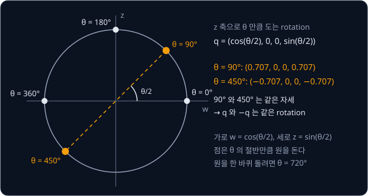

로봇 소프트웨어마다 네 칸을 늘어놓는 순서가 다르다.

| 소프트웨어 | 칸 순서 | $z$ 축 90° |
| --- | --- | --- |
| ROS 2 `geometry_msgs/Quaternion`, `tf2_echo` 출력 | $x, y, z, w$ | $(0, 0, 0.707, 0.707)$ |
| MuJoCo MJCF 의 `quat` | $w, x, y, z$ | $(0.707, 0, 0, 0.707)$ |
| Eigen `Quaternion` 생성자 | $w, x, y, z$ (내부 저장은 $x, y, z, w$) | $(0.707, 0, 0, 0.707)$ |
| SciPy `Rotation.from_quat` 기본값 | $x, y, z, w$ | $(0, 0, 0.707, 0.707)$ |

> **오해** quaternion 은 네 숫자만 맞으면 된다.
>
> **사실** ROS 의 $(0, 0, 0.707, 0.707)$ 을 $w, x, y, z$ 순서로 읽으면 $w = 0$ 이라 $\frac{\theta}{2} = 90°$ 이므로, 축이 $(0, 0.707, 0.707)$ 인 180° 회전이라는 전혀
> 다른 자세가 된다. 순서뿐 아니라 길이도 맞아야 해서, tf2 는 네 칸의 제곱합이 1 에서 0.01 이상 벗어난 quaternion 이 들어오면 `TF_DENORMALIZED_QUATERNION` 오류를 내고 그 변환을 버린다. 0.707 을
> 0.7 로 줄여 적으면 $0.7^2 + 0.7^2 = 0.98$ 이라 버려진다.

<b>심화: quaternion 곱과 점 돌리기</b>

두 3D vector 의 cross product $\mathbf a \times \mathbf b$ 는 둘 모두와 직각인 vector 이고, 칸마다 "자기를 뺀 나머지 두 칸끼리 엇갈려 곱한 값의
차" 로 계산한다.

$$
\mathbf a \times \mathbf b = (a_2 b_3 - a_3 b_2,\ \ a_3 b_1 - a_1 b_3,\ \ a_1 b_2 - a_2 b_1)
$$

$(1, 0, 0) \times (0, 1, 0) = (0, 0, 1)$ 이고 순서를 바꾸면 $(0, 0, -1)$ 이다. $q_1 = (w_1, \mathbf v_1)$, $q_2 = (w_2, \mathbf v_2)$ 의 곱은

$$
q_1 \otimes q_2 = \big(w_1 w_2 - \mathbf v_1 \cdot \mathbf v_2,\ \ w_1 \mathbf v_2 + w_2 \mathbf v_1 + \mathbf v_1 \times \mathbf v_2\big)
$$

이다. $z$ 축 90° 의 $q_z = (0.707, 0, 0, 0.707)$ 와 $x$ 축 90° 의 $q_x = (0.707, 0.707, 0, 0)$ 로 $q_z \otimes q_x$ 를 구한다
($0.707 \times 0.707 = 0.5$).

| 부분 | 계산 | 결과 |
| --- | --- | --- |
| scalar | $0.5 - (0, 0, 0.707) \cdot (0.707, 0, 0)$ | 0.5 |
| $w_1 \mathbf v_2$ | $0.707 \times (0.707, 0, 0)$ | $(0.5, 0, 0)$ |
| $w_2 \mathbf v_1$ | $0.707 \times (0, 0, 0.707)$ | $(0, 0, 0.5)$ |
| $\mathbf v_1 \times \mathbf v_2$ | $(0, 0, 0.707) \times (0.707, 0, 0)$ | $(0, 0.5, 0)$ |
| vector 합 | | $(0.5, 0.5, 0.5)$ |

결과 $(0.5, 0.5, 0.5, 0.5)$ 는 $(1, 1, 1)$ 축 120° 회전이라 행렬 $R_z(90°)\,R_x(90°)$ 와 같다. 순서를 바꾼 $q_x \otimes q_z$ 는 cross product 의
부호가 뒤집혀 $(0.5, 0.5, -0.5, 0.5)$ 가 된다.

vector $\mathbf v$ 를 돌릴 때는 앞에 0 을 붙인 $(0, \mathbf v)$ 의 양쪽에 $q$ 와 conjugate $q^* = (w, -x, -y, -z)$ 를 곱한다.

$$
(0, \mathbf v') = q \otimes (0, \mathbf v) \otimes q^*
$$

$q$ 가 양쪽에서 한 번씩 곱해지므로 quaternion 에는 처음부터 각도의 절반을 적어 둔다. $q_z$ 로 $(1, 0, 0)$ 을 돌리면 첫 곱에서 45° 방향의
$(0.707, 0.707, 0)$ 이 나오고, 둘째 곱에서 $(0, 1, 0)$ 이 나온다.

## slerp

로봇 손이 지금 자세에서 $z$ 축으로 90° 돈 자세까지 움직일 때는 그 사이의 자세를 일정한 간격으로 만들어 보내야 손이 고르게 도는데, 이렇게
두 값 사이의 중간값을 만드는 일을 interpolation 이라고 한다. 두 rotation matrix 를 칸마다 평균하면 rotation matrix 가 나오지 않는다. $I$ 와
$R_z(90°)$ 의 첫째 열을 평균하면 $(0.5, 0.5, 0)$ 인데 길이가 $\sqrt{0.25 + 0.25} \approx 0.707$ 이라, 이 행렬을 곱하면 물체가 쪼그라든다.
진행 비율 $t$(0 에서 출발해 1 에서 도착)만큼 섞는 평균 $(1 - t)\,I + t\,R_z(90°)$ 로 넓혀 보면, $t = 0.25$ 에서는 첫째 열이 $(0.75, 0.25, 0)$ 이라
$z$ 축으로 18.4° 만 돌고 길이가 $\sqrt{0.75^2 + 0.25^2} \approx 0.79$ 로 줄어서 각도 간격도 고르지 않다.

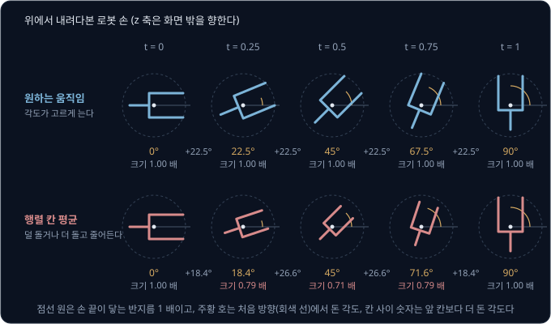

quaternion 으로는 두 자세를 네 칸 공간의 길이 1 인 점 두 개로 보고, 두 점을 잇는 원호를 일정한 속도로 따라간다. 이 방법을
**slerp**(spherical linear interpolation)라고 하고, 1985 년 Ken Shoemake 가 computer animation 에서 물체를 고르게 돌리려고 도입했다.

$q_0 = (1, 0, 0, 0)$ 에서 $q_1 = (0.707, 0, 0, 0.707)$($z$ 축 90°)까지 slerp 하면 진행 비율 $t$ 에 비례해 각도가 고르게 늘어난다.

| $t$ | 0 | 0.25 | 0.5 | 0.75 | 1 |
| --- | --- | --- | --- | --- | --- |
| slerp 결과 | $z$ 0° | $z$ 22.5° | $z$ 45° | $z$ 67.5° | $z$ 90° |

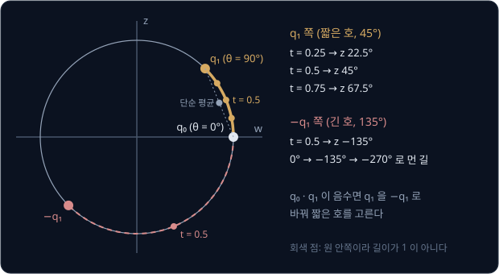

같은 자세를 $-q_1$ 로 적었다면 두 점을 잇는 원호가 짧은 쪽이 아니라 긴 쪽이 되어, slerp 는 270° 를 반대로 돌아 같은 자세에 도착한다. 그래서
slerp 전에 두 quaternion 의 네 칸끼리 곱해 더한 값 $q_0 \cdot q_1$ 이 음수이면 $q_1$ 의 부호를 바꿔 짧은 호를 고른다.

tf2 는 변환을 받은 시각과 함께 저장해 두는데, 저장된 두 시각 사이의 변환을 물으면 translation 은 직선으로 보간하고 rotation 은 slerp 로
보간해 그 시각의 변환을 만든다.

<b>심화: slerp 식</b>

$$
\mathrm{slerp}(q_0, q_1, t) = \frac{\sin\big((1 - t)\,\Omega\big)}{\sin\Omega}\,q_0 + \frac{\sin(t\,\Omega)}{\sin\Omega}\,q_1,
\qquad \cos\Omega = q_0 \cdot q_1
$$

$\Omega$ 는 두 quaternion 사이의 원호 각도로, 위 예에서는 $q_0 \cdot q_1 = 0.707$ 이라
$\Omega = 45°$ 다. $t = 0.5$ 에서 두 계수는 모두 $\sin 22.5° \div \sin 45° = 0.3827 \div 0.7071 \approx 0.5412$ 라서

$$
0.5412 \times \big((1, 0, 0, 0) + (0.707, 0, 0, 0.707)\big) = (0.924, 0, 0, 0.383)
$$

이고, $0.924 = \cos 22.5°$, $0.383 = \sin 22.5°$ 이므로 $z$ 축 45° 회전이다. $q_1$ 대신 $-q_1$ 을 쓰면 $\cos\Omega = -0.707$ 이고 $\Omega = 135°$ 라서
$t = 0.5$ 의 결과가 $z$ 축 $-135°$ 회전이 된다.

## gripper 에 단 카메라

서론의 손목 카메라가 잰 컵의 좌표 $p_c$ 를 base 의 좌표 $p_b$ 로 바꾸는 계산은 frame 세 개를 잇는 합성이다.

$$
p_b = T_{be}\,T_{ec}\,p_c
$$

$e$ 는 gripper(end-effector) 의 frame 이고 $c$ 는 카메라의 optical frame 이다. 관절 각도로 계산하는 gripper 의 pose $T_{be}$ 는 팔이 움직일 때마다
바뀌지만, 카메라를 gripper 에 고정해 둔 자리 $T_{ec}$ 는 바뀌지 않는다.

예를 들어 gripper 가 base 의 $(0.4, 0, 0.3)$ m 에서 $x$ 축 중심으로 180° 돌아 손끝($z$ 축)이 아래를 보고 있고, 카메라는 gripper 의 $(0, 0.06, 0)$
에 gripper 와 같은 방향으로 달려 있다고 하자. 카메라가 사진 기준 정면 0.25 m, 오른쪽 0.02 m, 위쪽 0.01 m 에서 컵을 찾았다면
$p_c = (0.02, -0.01, 0.25)$ 다(optical frame 은 $y$ 가 아래라서 위쪽은 −).

| 단계 | 계산 | 결과 |
| --- | --- | --- |
| $T_{ec}$: 원점 위치 더하기 | $(0.02, -0.01, 0.25) + (0, 0.06, 0)$ | $p_e = (0.02, 0.05, 0.25)$ |
| $T_{be}$: $R_x(180°)$ 로 돌리기 | $(x, y, z) \to (x, -y, -z)$ | $(0.02, -0.05, -0.25)$ |
| $T_{be}$: 원점 위치 더하기 | $(0.02, -0.05, -0.25) + (0.4, 0, 0.3)$ | $p_b = (0.42, -0.05, 0.05)$ |

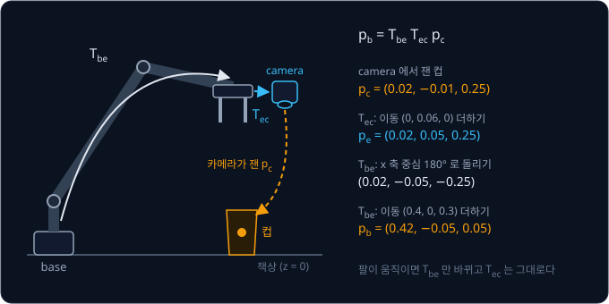

렌즈 중심이 카메라 몸체 안쪽에 있어서 $T_{ec}$ 는 자로 잴 수 없는데, 고정한 marker 를 여러 자세에서 찍어 $T_{ec}$ 를 계산하는 방법은
[Hand-Eye Calibration](../hand-eye-calibration/README.md) 에서 다룬다.

**확인 문제.** gripper 가 방향은 그대로 둔 채 base 의 $(0.5, 0.1, 0.3)$ 으로 옮겨 갔고 카메라로 잰 컵은 그대로 $p_c = (0.02, -0.01, 0.25)$ 였다. base 에서
컵은 어디일까?

답 보기

$T_{ec}$ 와 gripper 의 방향은 그대로라 원점 위치를 더하기 전까지는 위 표와 같다.

| 단계 | 계산 | 결과 |
| --- | --- | --- |
| $T_{ec}$ 와 $R_x(180°)$ 까지 | 위 표와 같음 | $(0.02, -0.05, -0.25)$ |
| 새 원점 위치 더하기 | $(0.02, -0.05, -0.25) + (0.5, 0.1, 0.3)$ | $(0.52, 0.05, 0.05)$ |

답: $(0.52, 0.05, 0.05)$

## mobile robot 의 odom 과 base_link

바닥을 달리는 로봇의 pose 는 $(x, y)$ 와 yaw 하나로 정해지는 SE(2) 의 transform 인데, ROS 는 이를 translation $(x, y, 0)$ 과 quaternion
$(0, 0, \sin\frac{\text{yaw}}{2}, \cos\frac{\text{yaw}}{2})$ 로 적어 3D 변환으로 내보낸다.

바퀴 odometry 는 바퀴가 돈 양으로 로봇이 자기 frame 에서 얼마나 움직였는지를 구해 `odom` → `base_link` 를 고친다. 로봇 자신의 frame 에서 잰
움직임이라 오른쪽에 곱한다. 그런데 앞으로 가면서 동시에 돌면 로봇이 지나간 경로는 직선이 아니다. 1 초 동안 앞으로 1 m/s 로 가면서 왼쪽으로
90°/s 로 돌면 로봇은 길이 1 m 인 사분원을 그린다. 사분원의 반지름 $r$ 은 $\frac{2\pi r}{4} = 1$ 에서 $2/\pi \approx 0.637$ m 라서, 로봇은
$(0.637, 0.637)$ 에서 $y$ 방향을 보고 멈춘다.

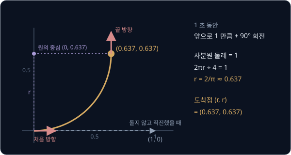

같은 1 초를 몇 조각으로 나누고 조각마다 시작할 때의 방향으로 곧게 간다고 계산하면 도착점이 원호에서 어긋난다. 1 초를 한 조각으로 계산하면
로봇은 $(1, 0)$ 에 도착해 원호의 도착점과 0.733 m 떨어진다. ros2_controllers 의 `diff_drive_controller` 는 한 조각에서 돈 각도가
$10^{-6}$ rad 이상이면 그 조각을 반지름이 이동 거리 ÷ 회전 각도인 원호로 계산해 이 오차를 없앤다.

`map` → `odom` 을 구할 때는 역변환을 쓴다. [ROS 2 Basics](../ros2-basics/README.md) 의 frame tree 예와 달리, 실제 로봇에서는 출발할 때
어느 방향을 보고 있었는지에 따라 `odom` 이 `map` 에 대해 돌아가 있다. odometry 로 계산한 로봇의 pose 가
`odom` 의 $(2, 0)$, yaw 0° 이고 지도와 맞춘 위치 추정 결과가 `map` 의 $(5, 3)$, yaw 90° 라면, 위치 추정 node 가 내보낼 `map` → `odom` 은
아래 식으로 구한다.

$$
T_{\text{map},\text{odom}} = T_{\text{map},\text{base}}\,(T_{\text{odom},\text{base}})^{-1}
$$

| 단계 | 계산 | 결과 |
| --- | --- | --- |
| $(T_{\text{odom},\text{base}})^{-1}$ | rotation 이 없어 translation 만 $-(2, 0)$ | $(-2, 0)$, yaw 0° |
| $T_{\text{map},\text{base}}$ 곱하기 | $R(90°) \times (-2, 0) + (5, 3) = (0, -2) + (5, 3)$ | $(5, 1)$, yaw 90° |

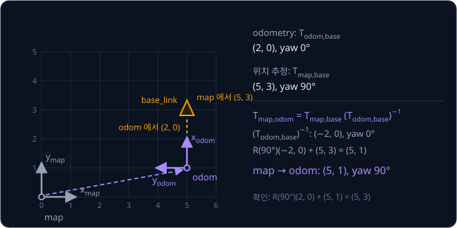

구한 `map` → `odom` 으로 odometry 의 $(2, 0)$ 을 바꾸면 $R(90°) \times (2, 0) + (5, 1) = (5, 3)$ 이라 위치 추정 결과와 맞는다.

<b>심화: twist 와 exponential map</b>

도는 속도와 나아가는 속도를 함께 적은 숫자 6 개 $\xi = (\omega, v)$ 를 twist 라고 한다($\xi$ 는 그리스 문자 xi 다). 앞 3 칸 $\omega$ 에는
rotation vector 처럼 축과 각속도를 적고, 뒤 3 칸 $v$ 에는 물체 자신의 frame 에서 잰 속도를 적는다. 위의 바퀴 로봇은
$\omega = (0, 0, 1.5708)$ 이고 $v = (1, 0, 0)$ 이다.

twist 를 1 만큼의 시간 동안 일정하게 유지했을 때 생기는 움직임을 homogeneous transform 으로 구하는 계산을 SE(3) 의 exponential map 이라고
한다. 바퀴 로봇에서는 rotation 이 $R_z(90°)$ 이고 translation 이 $(0.637, 0.637, 0)$ 인데, 로봇이 사분원을 그리며 가기 때문에 translation 이
$v$ 와 다르다. translation 이 $v$ 와 같은 것은 rotation 이 없을 때뿐이다. 3D 에서 $v$ 에 회전축 방향 성분까지 있으면 도는 동안 축을 따라서도
나아가서, 경로가 나사(screw)처럼 감긴 나선이 된다. 거꾸로 homogeneous transform 에서 twist 를 꺼내는 계산은 log 라고 부르는데, Modern
Robotics 3장과 Solà 등의 micro Lie theory 글이 두 계산을 같은 틀로 정리한다. `diff_drive_controller` 는 바닥 위 SE(2) 에서 이 exponential map
을 계산해 원호를 구한다.

조각마다 곧게 가는 계산의 오차는 조각을 잘게 나눌수록 줄지만 0 이 되지는 않는다. 위 사분원으로 계산하면 아래와 같다.

| 나눈 조각 수 | 계산한 도착점 | 원호의 도착점까지 거리 |
| --- | --- | --- |
| 1 | $(1, 0)$ | 0.733 m |
| 10 | $(0.685, 0.585)$ | 0.071 m |
| 50 | $(0.647, 0.627)$ | 0.014 m |

**확인 문제.** 위 예에서 로봇이 자기 frame 에서 앞으로 1 m 더 가서 odometry 가 `odom` 의 $(3, 0)$, yaw 0° 가 되었다. `map` → `odom` 이 그대로라면
로봇은 `map` 에서 어디일까?

답 보기

`map` → `odom` 은 90° 회전과 $(5, 1)$ 이동이다.

$$
R(90°) \times (3, 0) + (5, 1) = (0, 3) + (5, 1) = (5, 4)
$$

답: $(5, 4)$. `odom` 의 $x$ 축이 `map` 의 위쪽을 향하므로 앞으로 1 m 는 `map` 에서 위로 1 m 다.

## 정리

- frame 의 좌표는 $p_a = R_{ab}\,p_b + p_{ab}$ 로 바꾸고, $R_{ab}$ 의 열은 frame $b$ 의 축을 frame $a$ 에서 잰 값이다. 좌표 끝에 1 을 붙이면
  rotation 과 translation 을 homogeneous transform 하나로 묶을 수 있다. 합성은 $T_{wc} = T_{wb}\,T_{bc}$ 처럼 아래첨자가 맞닿게 곱하고, 역변환의
  translation 칸은 $-p$ 가 아니라 $-R^\top p$ 다
- 같은 3D rotation 을 rotation matrix(9 개), roll-pitch-yaw(3 개), axis-angle(3 개), quaternion(4 개)으로 적을 수 있다. roll-pitch-yaw 는
  pitch 90° 에서 gimbal lock 이 생기고, quaternion 은 $q$ 와 $-q$ 가 같은 rotation 이라 slerp 전에 짧은 호를 골라야 한다. quaternion 의 칸
  순서는 ROS 에서 $x, y, z, w$ 이고 MuJoCo·Eigen 에서는 $w, x, y, z$ 다
- 손목 카메라로 찾은 컵의 base 좌표는 $p_b = T_{be}\,T_{ec}\,p_c$ 로 구한다. mobile robot 은 odometry 를 오른쪽 곱으로 쌓고, `map` → `odom` 은
  $T_{\text{map},\text{base}}\,(T_{\text{odom},\text{base}})^{-1}$ 로 구한다

이 강의는 frame 하나하나의 pose 가 주어졌다고 보고 좌표를 바꿨다. 관절 여러 개가 이어진 로봇 팔에서 관절 각도가 gripper 의 pose $T_{be}$ 를
어떻게 정하는지는 [Forward Kinematics](../forward-kinematics/README.md) 에서 다루고, optical frame 의 3D 점이 사진의 어느 pixel 에 찍히는지는
[Camera Geometry](../camera-geometry/README.md) 에서 다룬다.

## 참고 자료

- Lynch & Park, [Modern Robotics](https://hades.mech.northwestern.edu/index.php/Modern_Robotics) 3장 Rigid-Body Motions — 무료
  [PDF](https://hades.mech.northwestern.edu/images/7/7f/MR.pdf) 와 절마다 짧은 강의 영상이 있다. SO(3)·SE(3), Rodrigues 공식,
  exponential map, twist 를 유도한다
- Russ Tedrake, [Robotic Manipulation — Ch. 3 Basic Pick and Place](https://manipulation.csail.mit.edu/pick.html) 의 "Monogram
  Notation"·"Spatial Algebra" 절 — frame 이름을 아래첨자로 붙여 합성 순서 실수를 막는 표기법을 자세히 설명한다
- [REP 103](https://www.ros.org/reps/rep-0103.html) 과 [REP 105](https://www.ros.org/reps/rep-0105.html) — ROS 의 축 방향(`base_link` 의
  x·y·z 축은 앞·왼쪽·위를 향하고, optical frame 의 z·x·y 축은 앞·오른쪽·아래를 향한다)과 `map`·`odom`·`base_link` 의 뜻
- ROS 2 geometry2, [`tf2_echo.cpp`](https://github.com/ros2/geometry2/blob/rolling/tf2_ros/src/tf2_echo.cpp) 와
  [`buffer_core.cpp`](https://github.com/ros2/geometry2/blob/rolling/tf2/src/buffer_core.cpp) — 같은 pose 를 translation·quaternion·RPY·4×4
  행렬로 출력하는 코드, quaternion 길이 검사(`TF_DENORMALIZED_QUATERNION`)와 tree 를 거슬러 갈 때의 역변환 계산
- ros/urdfdom_headers, [`pose.hpp`](https://github.com/ros/urdfdom_headers/blob/rolling/include/urdf_model/pose.hpp) 의 `setFromRPY` 와
  [SDFormat 의 pose 설명](https://sdformat.org/tutorials/specification/specify_pose/) — URDF 의 rpy 가 고정축 $x \to y \to z$ 순서의
  rotation 이라는 것을 코드와 식으로 확인할 수 있다
- 3Blue1Brown, [Quaternions and 3d rotation, explained interactively](https://www.youtube.com/watch?v=zjMuIxRvygQ) 와
  [interactive 페이지](https://eater.net/quaternions) — $q \otimes (0, \mathbf v) \otimes q^*$ 가 rotation 이 되는 이유를 그림으로 보여 준다
- Joan Solà, [Quaternion kinematics for the error-state Kalman filter](https://arxiv.org/abs/1711.02508) 1 ~ 3장 — quaternion 의 곱,
  rotation matrix 와의 변환, slerp, 순서·부호 규약을 식으로 정리한 참고서
- Solà 외, [A micro Lie theory for state estimation in robotics](https://arxiv.org/abs/1812.01537) — SO(3)·SE(3) 의 exponential map 과
  log 를 한 틀로 정리한 짧은 글. Modern Robotics 3장을 읽은 뒤에 본다
- Ken Shoemake, [Animating rotation with quaternion curves](https://doi.org/10.1145/325165.325242) (1985) — slerp 를 처음 제안한 글로,
  rotation matrix 나 각도를 보간하면 왜 움직임이 고르지 않은지를 설명한다
- ros2_controllers, [`diff_drive_controller/src/odometry.cpp`](https://github.com/ros-controls/ros2_controllers/blob/master/diff_drive_controller/src/odometry.cpp)
  — 회전이 있는 한 step 을 원호로 적분하는 `integrateExact`
