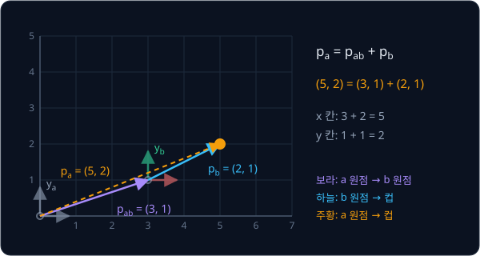
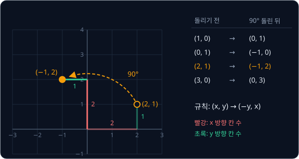
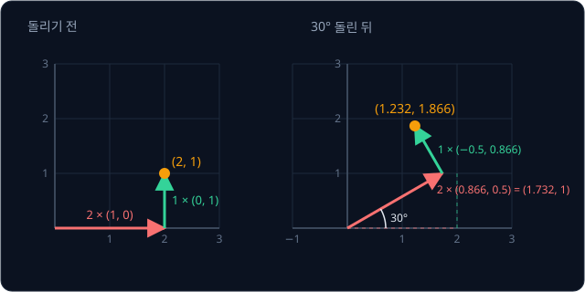
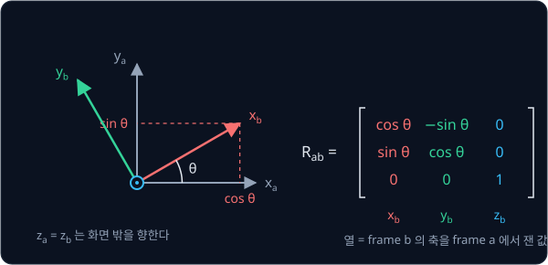

# Rigid Transforms

## 학습 목표

- 같은 물건의 위치가 어디를 기준으로 재느냐에 따라 다른 숫자로 적히는 이유를 설명하고, 한 기준에서 잰 좌표를 다른 기준의 좌표로 바꿀 수 있다
- 원 위의 점으로 각도를 숫자로 바꾸는 cos·sin 을 이용해, 점 하나를 90°·30° 돌린 좌표를 손으로 계산할 수 있다
- 돌리기와 옮기기를 행렬 하나로 묶어 계산하고, 기준을 여러 번 거칠 때 곱하는 순서와 거꾸로 되돌리는 계산을 설명할 수 있다
- 평면의 회전을 공간으로 넓혀, 축 하나를 중심으로 도는 회전과 세 각도로 적은 자세를 행렬로 바꿔 읽을 수 있다
- 숫자 네 개로 회전을 적는 방법(quaternion)으로 두 회전을 합치고, 두 자세 사이를 일정한 속도로 잇는 계산을 따라갈 수 있다

## 좌표와 frame

### 같은 컵, 다른 좌표

로봇 팔 옆 책상 위에 컵이 하나 있다고 하자. 천장에 달린 카메라가 컵을 찾아 "컵은 카메라 아래 왼쪽 30 cm 에 있다" 라고 알려
줘도, 팔은 그 숫자를 그대로 쓸 수 없다. 팔이 손을 뻗으려면 "팔의 몸통에서 앞으로 몇 cm, 옆으로 몇 cm" 처럼 팔 자신을 기준으로
잰 숫자가 있어야 하기 때문이다.

위치를 적는 숫자는 어디에서 재기 시작했고 어느 쪽을 앞으로 정했는지에 따라 달라진다. 교실 바닥에 한 칸이 1 m 인 격자를 그려
놓았다고 하자. 교실 왼쪽 아래 구석에서 재면 컵은 "오른쪽으로 5 칸, 위로 2 칸" 에 있다. 그런데 로봇이 구석에서 오른쪽으로 3 칸,
위로 1 칸 간 자리에 서 있다면, 로봇이 자기 자리에서 잰 컵의 위치는 "오른쪽으로 2 칸, 위로 1 칸" 이다. 컵은 한 자리에 그대로
있는데 숫자만 다르다.

로봇 하나에도 이런 기준이 여러 개 있다. 카메라, 팔의 몸통, 손끝(gripper)이 저마다 자기 기준으로 숫자를 내고, 로봇은 그 숫자들을
쉬지 않고 서로 바꿔 가며 쓴다. 이 강의는 그 바꾸는 계산을 다룬다.

**확인 문제.** 교실 구석에서 재면 의자가 "오른쪽 6 칸, 위로 4 칸" 에 있다. 구석에서 오른쪽 3 칸, 위로 1 칸 간 자리에 선 로봇이
자기 자리에서 재면 의자는 어디에 있을까?

답 보기

로봇은 이미 오른쪽으로 3 칸, 위로 1 칸 와 있으므로 남은 거리는 오른쪽 $6 - 3 = 3$ 칸, 위로 $4 - 1 = 3$ 칸이다.

### frame

위치를 재는 기준은 두 가지로 이루어진다. 하나는 재기 시작하는 점인 원점(origin)이고, 다른 하나는 원점에서 뻗어 나가는 방향
화살표인 축(axis)이다. 평면에서는 축이 두 개 있는데, 하나를 $x$ 축, 그것과 직각인 다른 하나를 $y$ 축이라고 부른다. 축에는 1 칸,
2 칸 하는 눈금이 있다. 원점과 축을 묶은 이 기준을 frame(좌표계)이라고 한다. 선수 강의
[Linear Regression](../linear-regression/README.md) 에서 점을 찍은 좌표평면도 원점과 $x$·$y$ 축으로 이루어진 frame 하나였다.

frame 이 정해지면 점의 자리를 숫자 두 개로 적을 수 있다. "원점에서 $x$ 축 방향으로 몇 칸, $y$ 축 방향으로 몇 칸 가는가" 를
차례로 적은 숫자 쌍이 그 점의 좌표다. 교실 구석에 원점을 둔 frame 을 $a$, 로봇이 선 자리에 원점을 둔 frame 을 $b$ 라고 하면,
컵의 좌표는 frame $a$ 에서 $(5, 2)$ 이고 frame $b$ 에서 $(2, 1)$ 이다.

위 그림의 회색 화살표가 frame $a$ 의 두 축, 빨강·초록 화살표가 frame $b$ 의 두 축이다. 점선은 frame $b$ 의 원점에서 $x$ 축을 따라
2 칸, $y$ 축을 따라 1 칸 가는 길을 보여 준다.

**확인 문제.** frame $a$ 에서 좌표가 $(0, 0)$ 인 점은 어디인가?

답 보기

어느 축으로도 가지 않은 자리, 곧 frame $a$ 의 원점이다.

### 좌표에 붙이는 frame 이름

같은 점의 좌표가 frame 마다 다르니, 좌표를 적을 때는 어느 frame 에서 잰 값인지를 꼭 함께 적어야 한다. 이 강의에서는 frame 이름을
아래첨자로 붙인다.

- $p_a$ 는 "frame $a$ 에서 잰 점 $p$ 의 좌표" 다. 컵이면 $p_a = (5, 2)$ 이다
- $p_b$ 는 "frame $b$ 에서 잰 같은 점의 좌표" 다. 컵이면 $p_b = (2, 1)$ 이다
- $p_{ab}$ 는 "frame $a$ 에서 잰 frame $b$ 원점의 좌표" 다. 로봇이 서 있는 자리이므로 $p_{ab} = (3, 1)$ 이다

$p$ 는 위치(position)의 첫 글자다. $p_{ab}$ 처럼 글자가 둘이면 앞 글자는 기준이 되는 frame 이고 뒤 글자는 위치를 잰 대상이며,
"p a b" 라고 읽는다.

**확인 문제.** frame $b$ 의 원점을 frame $b$ 자신에서 재면, 곧 $p_{bb}$ 는 얼마일까?

답 보기

자기 원점은 자기 frame 에서 어느 축으로도 가지 않은 자리이므로 $(0, 0)$ 이다.

**요약**

- frame 은 원점과 서로 직각인 축으로 이루어진 기준이고, 좌표는 원점에서 각 축 방향으로 몇 칸 가는지를 적은 숫자다
- 같은 점도 frame 마다 좌표가 달라서, $p_a$, $p_b$ 처럼 어느 frame 에서 잰 값인지 아래첨자로 붙인다
- $p_{ab}$ 는 frame $a$ 에서 잰 frame $b$ 원점의 위치다

## translation

frame 사이의 차이 가운데 가장 단순한 것은 원점의 자리만 다른 경우다. 이렇게 방향은 그대로 두고 자리만 옮기는 움직임을
translation(평행 이동)이라고 한다.

### vector 덧셈

순서를 정해 늘어놓은 숫자 묶음을 vector 라고 한다. 좌표 $(3, 1)$ 도
vector 이고, "오른쪽으로 3, 위로 1 가는 화살표" 로 그릴 수 있다. 화살표로 그린 vector 는 어디에서 출발하든 같은 vector 다.
출발점과 상관없이 "오른쪽 3, 위 1" 만큼 가는 움직임 하나를 나타내기 때문이다.

길이가 같은 vector 끼리 더할 때는 같은 자리의 칸끼리 더한다.

$$
(3, 1) + (2, 1) = (3 + 2,\ 1 + 1) = (5, 2)
$$

그림으로 보면 첫 화살표의 끝에 둘째 화살표의 시작을 붙여 이어 간 것이다. 오른쪽 3, 위 1 간 뒤 다시 오른쪽 2, 위 1 가면 처음
자리에서 오른쪽 5, 위 2 인 곳에 도착한다.

**확인 문제.** $(1, 4) + (2, -1)$ 은?

답 보기

$(1 + 2,\ 4 + (-1)) = (3, 3)$ 이다.

### 옮겨진 frame 의 좌표 바꾸기

frame $b$ 가 frame $a$ 와 같은 방향을 보고 원점만 다른 자리에 있으면, 좌표를 바꾸는 계산은 vector 덧셈 하나다. frame $a$ 의
원점에서 frame $b$ 의 원점까지 간 다음, 거기서 frame $b$ 에서 잰 만큼 더 가면 점에 도착한다.

$$
p_a = p_{ab} + p_b
$$

이 식은 "frame $a$ 에서 잰 점의 좌표는, frame $b$ 원점의 위치에 frame $b$ 에서 잰 점의 좌표를 더한 것이다" 로 읽는다. 컵이면
$p_{ab} = (3, 1)$, $p_b = (2, 1)$ 이고, 더하면 $p_a = (5, 2)$ 다.

위 그림의 보라색 화살표가 $p_{ab}$, 하늘색 화살표가 $p_b$ 이고, 둘을 이어 붙인 주황 점선이 $p_a$ 다.

frame $b$ 는 frame $a$ 를 $(3, 1)$ 만큼 translation 한 frame 이다. 숫자만 바꿔 몇 번 더 계산해 본다.

| frame $b$ 원점 $p_{ab}$ | frame $b$ 에서 잰 점 $p_b$ | 칸끼리 더하기 | frame $a$ 에서 잰 점 $p_a$ |
| --- | --- | --- | --- |
| $(3, 1)$ | $(2, 1)$ | $(3 + 2,\ 1 + 1)$ | $(5, 2)$ |
| $(3, 1)$ | $(-1, 2)$ | $(3 - 1,\ 1 + 2)$ | $(2, 3)$ |
| $(1, 4)$ | $(2, -1)$ | $(1 + 2,\ 4 - 1)$ | $(3, 3)$ |

**확인 문제.** frame $b$ 의 원점이 frame $a$ 의 $(2, 2)$ 에 있고 방향은 같다. frame $b$ 에서 $(4, 0)$ 인 점의 $p_a$ 는?

답 보기

$p_a = (2, 2) + (4, 0) = (6, 2)$ 다.

### 거꾸로 바꾸기

frame $a$ 의 좌표를 알고 frame $b$ 의 좌표를 구할 때는 반대로 뺀다. $p_a = p_{ab} + p_b$ 의 양쪽에서 $p_{ab}$ 를 빼면

$$
p_b = p_a - p_{ab}
$$

가 된다. 컵이면 $(5, 2) - (3, 1) = (2, 1)$ 이다. 맨 앞의 확인 문제에서 의자 좌표를 구한 계산이 바로 이것이었다.

방향을 헷갈리면 빼야 할 때 더하게 된다. $p_a = (5, 2)$ 에 $p_{ab}$ 를 더하면 $(8, 3)$ 이 나오는데, 이 값은 로봇에서 컵까지가 아니라
로봇이 서 있는 자리를 한 번 더 지나친 엉뚱한 곳이다. 아래첨자를 보고 "$a$ 에서 $b$ 로 가려면 $b$ 원점까지의 거리를 뺀다" 고
확인하면 실수를 줄일 수 있다.

**확인 문제.** frame $b$ 원점이 $p_{ab} = (2, 2)$ 이다. $p_a = (5, 7)$ 인 점의 $p_b$ 는?

답 보기

$p_b = (5, 7) - (2, 2) = (3, 5)$ 다.

**요약**

- 같은 방향을 보는 두 frame 사이의 좌표 바꾸기는 $p_a = p_{ab} + p_b$, 거꾸로는 $p_b = p_a - p_{ab}$ 다
- 돌리지 않고 자리만 옮기는 움직임을 translation 이라고 한다

## 각도와 cos·sin

로봇이 교실 구석과 같은 방향을 보고 서 있을 리는 없다. 대개 몸이 비스듬히 돌아가 있어서, 로봇의 "앞" 은 교실의 "오른쪽" 과 다른
방향이다. 돌아간 frame 사이에서 좌표를 바꾸려면 "얼마나 돌았는가" 를 숫자로 계산하는 도구가 먼저 있어야 한다.

### 각도와 방향

각도는 얼마나 돌았는지를 나타내는 숫자다. 한 바퀴를 360 으로 나눈 한 조각을 1 도(°)라고 하므로 한 바퀴는 360°, 반 바퀴는
180° 이고, 4 분의 1 바퀴인 90° 는 직각이다.

평면에서 각도를 잴 때는 $x$ 축의 양의 방향(오른쪽)에서 출발해 시계 반대 방향으로 돌아가는 쪽을 + 로 정한다. 그래서 $y$ 축의 양의
방향(위쪽)은 90°, 왼쪽은 180°, 아래쪽은 270° 다. 시계 방향으로 돌면 각도에 − 를 붙여서, $-90°$ 는 아래쪽이다. $-90°$ 와 270° 는
같은 방향을 가리키고, 30° 와 $30° + 360° = 390°$ 도 같은 방향이다. 한 바퀴를 더 돌면 제자리로 오기 때문이다.

**확인 문제.** 오른쪽에서 시작해 시계 반대 방향으로 450° 돌면 어느 쪽을 보게 될까?

답 보기

$450° = 360° + 90°$ 라서 한 바퀴 돈 뒤 90° 를 더 돈 것이다. 위쪽을 본다.

### 단위원과 cos·sin

원점을 중심으로 반지름이 1 인 원을 그린다. 반지름은 원의 중심에서 원 위의 점까지의 거리이고, 반지름이 1 인 이 원을 단위원(unit
circle)이라고 한다. 단위원 위의 $(1, 0)$ 에서 출발해 원을 따라 시계 반대 방향으로 각도 $\theta$ 만큼 가면 원 위의 한 점에 닿는다.
$\theta$ 는 그리스 문자 theta(세타)로, 각도를 나타낼 때 흔히 쓴다. machine learning 에서는
parameter 묶음을 $\boldsymbol\theta$ 로 적었지만 이 강의의 $\theta$ 는 늘 각도다.

그 점의 가로 좌표를 $\cos\theta$, 세로 좌표를 $\sin\theta$ 라고 부른다. 각각 "코사인 세타", "사인 세타" 라고 읽는다. 각도를 넣으면
숫자 하나가 정해져 나오는 규칙이라서, 둘을 trigonometric function(삼각함수)이라고 한다. 이름에 "삼각" 이 들어간 것은 다음 절에서
보듯 직각삼각형으로 값을 구하기 때문이다.

그림에서 바로 읽히는 각도부터 적어 본다. 0° 에서는 출발점 $(1, 0)$ 그대로이고, 90° 를 가면 꼭대기 $(0, 1)$, 180° 를 가면 왼쪽 끝
$(-1, 0)$, 270° 를 가면 바닥 $(0, -1)$ 이다.

| 각도 $\theta$ | 원 위의 점 | $\cos\theta$ (가로) | $\sin\theta$ (세로) |
| --- | --- | --- | --- |
| 0° | $(1, 0)$ | 1 | 0 |
| 90° | $(0, 1)$ | 0 | 1 |
| 180° | $(-1, 0)$ | $-1$ | 0 |
| 270° | $(0, -1)$ | 0 | $-1$ |

위 그림의 주황 점이 30° 를 간 자리다. 빨간 선의 길이가 $\cos 30°$, 초록 점선의 길이가 $\sin 30°$ 이고, 두 값이 각각 0.866 과
0.5 인 이유는 바로 아래에서 계산한다.

**확인 문제.** $\cos 180°$ 와 $\sin 90°$ 는?

답 보기

180° 는 왼쪽 끝 $(-1, 0)$ 이라 $\cos 180° = -1$ 이고, 90° 는 꼭대기 $(0, 1)$ 이라 $\sin 90° = 1$ 이다.

### 피타고라스 정리와 √

한 각이 직각인 삼각형을 직각삼각형이라고 하고, 직각을 마주 보는 가장 긴 변을 빗변이라고 한다. 직각을 낀 두 변의 길이가 3 과 4 인
직각삼각형의 빗변은 정확히 5 인데, 이 세 숫자 사이에는 다음 관계가 있다.

$$
3^2 + 4^2 = 9 + 16 = 25 = 5^2
$$

모든 직각삼각형에서 "짧은 두 변을 각각 제곱해 더하면 빗변의 제곱이 된다" 는 이 관계를 피타고라스 정리라고 한다. 두 변이 $a$, $b$
이고 빗변이 $c$ 이면 $a^2 + b^2 = c^2$ 이다.

빗변을 구하려면 "제곱해서 25 가 되는 수" 를 찾아야 한다. 이런 수를 제곱근이라 하고 $\sqrt{25} = 5$ 처럼 $\sqrt{\ }$ 기호로 적는다.
$\sqrt{4} = 2$ 이고, $\sqrt{0.75}$ 는 딱 떨어지지 않아서 약 0.866 이다. 실제로 $0.866^2 = 0.749956$ 으로 0.75 에 아주 가깝다.

단위원 위의 점 $(\cos\theta, \sin\theta)$ 는 원점에서 거리가 1 이다. 원점, 그 점, 그 점에서 $x$ 축에 내린 발을 이으면 가로가
$\cos\theta$, 세로가 $\sin\theta$, 빗변이 1 인 직각삼각형이 생긴다. 그래서 어떤 각도에서든

$$
\cos^2\theta + \sin^2\theta = 1
$$

이다. $\cos^2\theta$ 는 $(\cos\theta)^2$ 을 줄여 쓴 것이다. 90° 이면 $0^2 + 1^2 = 1$ 로 맞는다.

**확인 문제.** 직각을 낀 두 변이 6 과 8 인 직각삼각형의 빗변은?

답 보기

$6^2 + 8^2 = 36 + 64 = 100$ 이고 $\sqrt{100} = 10$ 이다.

### 30° 의 cos·sin

30° 의 값은 세 변의 길이가 모두 1 인 정삼각형으로 구한다. 정삼각형은 세 각이 모두 60° 인데, 한 꼭짓점을 원점에 두고 $x$ 축이
그 꼭짓점의 60° 를 30° 둘로 나누도록 놓으면 아래 그림처럼 된다.

위 그림에서 원점에서 주황 꼭짓점까지의 거리는 1 이므로, 주황 꼭짓점은 단위원 위의 30° 지점이다. $x$ 축은 맞은편 세로 변(길이 1)을
위아래 똑같이 나누므로, 주황 꼭짓점의 높이는 $1 \div 2 = 0.5$ 다. 그래서 $\sin 30° = 0.5$ 다.

가로 길이는 피타고라스 정리로 구한다. 빗변이 1, 세로가 0.5 인 직각삼각형이므로 한 줄씩 풀면 아래와 같다.

$$
\text{가로}^2 + 0.5^2 = 1^2
$$

$$
\text{가로}^2 = 1 - 0.25 = 0.75
$$

$$
\text{가로} = \sqrt{0.75} \approx 0.866
$$

기호 $\approx$ 는 "약" 이라고 읽고, 딱 떨어지지 않아 반올림했다는 표시다. 그래서 $\cos 30° \approx 0.866$ 이다. 60° 는 같은 삼각형을 세워 놓은 모양이라 가로와 세로가 맞바뀌어 $\cos 60° = 0.5$,
$\sin 60° \approx 0.866$ 이다. 120° 지점은 60° 지점을 $y$ 축에 대고 왼쪽으로 뒤집은 자리라서 높이는 그대로이고 가로만 음수가 되어
$(-0.5, 0.866)$ 이다. 이 값들이 앞 그림의 표에 정리되어 있다.

**확인 문제.** $\cos^2 30° + \sin^2 30°$ 를 계산해 1 이 되는지 확인하라.

답 보기

$0.75 + 0.25 = 1$ 이다. $\cos 30°$ 를 제곱하면 $\sqrt{0.75}$ 의 제곱이라 0.75 다.

### 반지름이 r 인 원 위의 점

원점에서 거리가 1 이 아니라 2 인 점도 같은 방법으로 적는다. 반지름이 2 인 원은 단위원을 두 배로 키운 것이라서, 각도 $\theta$ 인
점은 단위원 위의 점의 좌표를 두 배 한 $(2\cos\theta,\ 2\sin\theta)$ 다. 일반적으로 원점에서 거리가 $r$ 이고 각도가 $\theta$ 인 점은

$$
(r\cos\theta,\ r\sin\theta)
$$

다. $r$ 은 반지름(radius)의 첫 글자다. $r = 2$, $\theta = 30°$ 이면 $(2 \times 0.866,\ 2 \times 0.5) = (1.732, 1)$ 이고,
$r = 2$, $\theta = 60°$ 이면 $(2 \times 0.5,\ 2 \times 0.866) = (1, 1.732)$ 이다.

**확인 문제.** 원점에서 거리가 4 이고 각도가 90° 인 점의 좌표는?

답 보기

$(4\cos 90°,\ 4\sin 90°) = (4 \times 0,\ 4 \times 1) = (0, 4)$ 다.

### radian

각도는 도 말고 길이로 잴 수도 있다. 단위원 위를 $(1, 0)$ 에서 출발해 원을 따라 걸은 거리를 각도로 쓰는 방법이고, 이 단위를
radian(라디안, 줄여서 rad)이라고 한다.

원의 둘레는 반지름에 $2\pi$ 를 곱한 길이다. $\pi$ 는 그리스 문자 pi(파이)로, 약 3.1416 인 고정된 수다. 단위원은 반지름이 1 이라
둘레가 $2\pi \approx 6.283$ 이고, 한 바퀴(360°)를 걸으면 6.283 을 걷는다. 그래서 360° 가 $2\pi$ rad 이고, 나머지는 비율로 정해진다.

| 도 | 한 바퀴 중 비율 | radian | 소수 |
| --- | --- | --- | --- |
| 360° | 1 | $2\pi$ | 6.2832 |
| 180° | $\frac{1}{2}$ | $\pi$ | 3.1416 |
| 90° | $\frac{1}{4}$ | $\frac{\pi}{2}$ | 1.5708 |
| 30° | $\frac{1}{12}$ | $\frac{\pi}{6}$ | 0.5236 |

도를 radian 으로 바꾸려면 $\frac{\pi}{180}$ 을 곱한다. 로봇 소프트웨어와 로봇 설계 파일은 대부분 radian 을 쓰기 때문에, 1.5708 이
보이면 90° 라고 바로 읽을 수 있어야 한다.

**확인 문제.** 60° 는 몇 radian 인가?

답 보기

$60 \times \frac{\pi}{180} = \frac{\pi}{3} \approx 1.0472$ rad 이다. 한 바퀴의 $\frac{1}{6}$ 이므로 $6.2832 \div 6$ 으로도 구할 수 있다.

**요약**

- 단위원에서 각도 $\theta$ 만큼 간 점이 $(\cos\theta, \sin\theta)$ 이고, 거리가 $r$ 이면 $(r\cos\theta, r\sin\theta)$ 다
- 30° 의 값 $(0.866, 0.5)$ 는 정삼각형과 피타고라스 정리로 구하고, 어느 각도에서나 $\cos^2\theta + \sin^2\theta = 1$ 이다
- radian 은 단위원 위를 걸은 거리로 잰 각도라서 360° 가 $2\pi$, 90° 가 $\frac{\pi}{2} \approx 1.5708$ 이다

## 2D rotation

돌아가 있는 frame 을 다루기 전에, 점 하나를 원점을 중심으로 돌리는 계산부터 익힌다. 한 점을 중심으로 빙 도는 움직임을
rotation(회전)이라고 한다.

### 90° 회전

점 $(2, 1)$ 을 원점을 중심으로 시계 반대 방향으로 90° 돌려 보자. 원점에서 $(2, 1)$ 까지 가는 길을 "오른쪽으로 2 칸, 그다음 위로
1 칸" 으로 나누면 계산이 쉬워진다. 길 전체를 90° 돌리면 오른쪽을 향하던 부분은 위를 향하고, 위를 향하던 부분은 왼쪽을 향한다.
그래서 돌린 뒤의 길은 "위로 2 칸, 그다음 왼쪽으로 1 칸" 이 되고, 도착점은 $(-1, 2)$ 다.

위 그림의 흐린 선이 돌리기 전의 길, 진한 선이 돌린 뒤의 길이다. 빨간 선(오른쪽 2 칸)은 위로 2 칸이 되었고 초록 선(위로 1 칸)은
왼쪽 1 칸이 되었다. 그림 오른쪽의 표처럼 여러 점을 돌려 보면 규칙이 보인다. 가로 좌표 자리에는 원래 세로 좌표에 − 를 붙인 값이 오고,
세로 좌표 자리에는 원래 가로 좌표가 온다.

$$
(x,\ y) \ \to\ (-y,\ x)
$$

**확인 문제.** 점 $(3, 2)$ 를 원점 중심으로 90° 돌리면? 그 결과를 다시 90° 돌리면?

답 보기

규칙대로 $(3, 2) \to (-2, 3)$ 이다. 한 번 더 돌리면 $(-2, 3) \to (-3, -2)$ 로, 처음 점에서 180° 돈 자리다.

### 축 화살표로 나눠 돌리기

30° 처럼 직각이 아닌 각도에서는 칸이 정확히 다른 축으로 옮겨 가지 않아서 90° 의 규칙을 쓸 수 없다. 대신 같은 생각을 화살표로
적는다. 점 $(2, 1)$ 은 $x$ 축 방향의 길이 1 짜리 화살표 $(1, 0)$ 을 2 번, $y$ 축 방향의 길이 1 짜리 화살표 $(0, 1)$ 을 1 번
이어 간 자리다.

$$
(2, 1) = 2 \times (1, 0) + 1 \times (0, 1)
$$

그림 전체를 30° 돌리면 두 화살표도 30° 씩 돌고, "첫째 화살표 방향으로 2 번, 둘째 화살표 방향으로 1 번" 이라는 길의 모양은
그대로 남는다. 그래서 두 화살표가 각각 어디로 가는지만 알면 된다.

- $(1, 0)$ 은 단위원의 0° 지점이다. 30° 돌리면 30° 지점 $(\cos 30°, \sin 30°) = (0.866, 0.5)$ 로 간다
- $(0, 1)$ 은 단위원의 90° 지점이다. 30° 돌리면 120° 지점 $(-0.5, 0.866)$ 으로 간다

돌아간 두 화살표를 처음과 같은 횟수만큼 이어 가면 도착점이 나온다.

| 단계 | 계산 | 결과 |
| --- | --- | --- |
| 돌아간 $(1, 0)$ 을 2 번 | $2 \times (0.866, 0.5)$ | $(1.732, 1)$ |
| 돌아간 $(0, 1)$ 을 1 번 | $1 \times (-0.5, 0.866)$ | $(-0.5, 0.866)$ |
| 둘을 더하기 | $(1.732 - 0.5,\ 1 + 0.866)$ | $(1.232, 1.866)$ |

90° 에 같은 방법을 쓰면 $(1, 0)$ 은 $(0, 1)$ 로, $(0, 1)$ 은 180° 지점 $(-1, 0)$ 으로 가서
$2 \times (0, 1) + 1 \times (-1, 0) = (-1, 2)$ 이다. 앞 절의 답과 같다.

**확인 문제.** 점 $(2, 0)$ 을 60° 돌리면?

답 보기

$(2, 0) = 2 \times (1, 0)$ 이고 $(1, 0)$ 은 60° 지점 $(0.5, 0.866)$ 으로 가므로 $2 \times (0.5, 0.866) = (1, 1.732)$ 다.
반지름 2, 각도 60° 인 점 $(2\cos 60°, 2\sin 60°)$ 와 같다.

### rotation 공식

앞의 계산을 아무 점 $(x, y)$ 와 아무 각도 $\theta$ 로 적어 본다. $(1, 0)$ 은 $\theta$ 지점 $(\cos\theta, \sin\theta)$ 로 간다.
$(0, 1)$ 은 $(1, 0)$ 보다 90° 앞서 있으므로, 돌아간 $(1, 0)$ 을 다시 90° 돌린 자리로 간다. 90° 규칙 $(x, y) \to (-y, x)$ 를
$(\cos\theta, \sin\theta)$ 에 쓰면 $(-\sin\theta, \cos\theta)$ 다. 그러면 돌린 점 $(x', y')$ 는

$$
(x', y') = x \times (\cos\theta,\ \sin\theta) + y \times (-\sin\theta,\ \cos\theta)
$$

이고, 칸별로 나눠 적으면 아래와 같다.

$$
x' = x\cos\theta - y\sin\theta
$$

$$
y' = x\sin\theta + y\cos\theta
$$

$x'$ 는 "엑스 프라임" 이라고 읽고, 돌린 뒤의 가로 좌표다. 첫 식은 "원래 가로 좌표에 $\cos\theta$ 를 곱한 값에서 원래 세로 좌표에
$\sin\theta$ 를 곱한 값을 뺀다" 로 읽는다. 앞의 표와 맞추면 $x = 2$, $y = 1$, $\theta = 30°$ 이고, 식의 각 항이 표의 숫자와 같다.

| 칸 | 식 | 숫자 대입 | 값 |
| --- | --- | --- | --- |
| $x'$ | $x\cos\theta - y\sin\theta$ | $2 \times 0.866 - 1 \times 0.5$ | 1.232 |
| $y'$ | $x\sin\theta + y\cos\theta$ | $2 \times 0.5 + 1 \times 0.866$ | 1.866 |

$\theta = 90°$ 를 넣으면 $\cos 90° = 0$, $\sin 90° = 1$ 이라 $x' = -y$, $y' = x$ 가 되어 90° 규칙이 그대로 나온다.

**확인 문제.** 점 $(1, 2)$ 를 30° 돌리면? (소수 셋째 자리까지)

답 보기

$x' = 1 \times 0.866 - 2 \times 0.5 = -0.134$, $y' = 1 \times 0.5 + 2 \times 0.866 = 2.232$ 라서 $(-0.134, 2.232)$ 다.

### rotation matrix

행렬은 숫자를 가로줄(행)과 세로줄(열)로 늘어놓은 묶음이고, 행렬과
vector 의 곱은 행렬의 각 행과 vector 의 내적(같은 자리끼리 곱해 더한 값)을 차례로 세로로 쌓은 것이다. rotation 공식의 두 줄은
이 곱 하나로 적을 수 있다.

$$
\begin{bmatrix} x' \\ y' \end{bmatrix} =
\underbrace{\begin{bmatrix} \cos\theta & -\sin\theta \\ \sin\theta & \cos\theta \end{bmatrix}}_{R(\theta)}
\begin{bmatrix} x \\ y \end{bmatrix}
$$

첫째 행 $(\cos\theta, -\sin\theta)$ 와 $(x, y)$ 의 내적이 $x\cos\theta - y\sin\theta$ 로 $x'$ 이고, 둘째 행과의 내적이 $y'$ 이다.
가운데 행렬 $R(\theta)$ 를 rotation matrix(회전 행렬)라고 한다. 점의 좌표처럼 vector 를 세로로 세워 적는 것은 행렬 곱의 모양을
맞추기 위해서이고, 뜻은 $(x, y)$ 와 같다.

$R(\theta)$ 의 열을 보면 rotation 이 무슨 일을 하는지 바로 읽힌다. 첫째 열 $(\cos\theta, \sin\theta)$ 는 $(1, 0)$ 이 도착하는
곳이고, 둘째 열 $(-\sin\theta, \cos\theta)$ 는 $(0, 1)$ 이 도착하는 곳이다. 앞 절에서 두 축 화살표를 돌린 결과를 그대로 열로
세운 것이다.

$$
R(90°) = \begin{bmatrix} 0 & -1 \\ 1 & 0 \end{bmatrix}, \qquad
R(30°) = \begin{bmatrix} 0.866 & -0.5 \\ 0.5 & 0.866 \end{bmatrix}
$$

$R(30°)$ 에 $(2, 1)$ 을 곱하면 행마다 아래처럼 계산되어 앞과 같은 $(1.232, 1.866)$ 이 나온다.

| 행 | 행과 $(2, 1)$ 의 내적 | 결과 |
| --- | --- | --- |
| 첫째 $(0.866, -0.5)$ | $0.866 \times 2 + (-0.5) \times 1$ | 1.232 |
| 둘째 $(0.5, 0.866)$ | $0.5 \times 2 + 0.866 \times 1$ | 1.866 |

**확인 문제.** $R(90°)$ 에 $(4, 1)$ 을 곱하면?

답 보기

첫째 행 $0 \times 4 + (-1) \times 1 = -1$, 둘째 행 $1 \times 4 + 0 \times 1 = 4$ 라서 $(-1, 4)$ 다. 90° 규칙
$(x, y) \to (-y, x)$ 와 같다.

### 길이가 변하지 않는 회전

원점에서 점 $(x, y)$ 까지의 거리는 가로 $x$, 세로 $y$ 인 직각삼각형의 빗변이라서 피타고라스 정리로 $\sqrt{x^2 + y^2}$ 이다. 이
거리를 vector 의 길이라고 한다. rotation 전후의 길이를 재 보면 같다.

| 점 | $x^2 + y^2$ | 길이 |
| --- | --- | --- |
| 돌리기 전 $(2, 1)$ | $4 + 1 = 5$ | $\sqrt 5 \approx 2.236$ |
| 90° 돌린 뒤 $(-1, 2)$ | $1 + 4 = 5$ | $\sqrt 5 \approx 2.236$ |
| 30° 돌린 뒤 $(1.232, 1.866)$ | $1.518 + 3.482 = 5.000$ | $\sqrt 5 \approx 2.236$ |

rotation 은 점을 원점 중심의 원을 따라 옮길 뿐이라서 원점까지의 거리가 그대로다. 점 두 개를 같이 돌리면 두 점 사이의 거리도
그대로라서, 물체 전체를 돌려도 늘어나거나 찌그러지지 않는다. 로봇의 팔 마디나 컵처럼 모양이 변하지 않는 물체를 rigid body(강체)라고
하고, 모양을 바꾸지 않고 돌리기(rotation)와 옮기기(translation)만으로 이루어진 움직임을 rigid transform 이라고 한다. 이 강의의
제목이 바로 이 rigid transform 이다.

행렬이라고 모두 rotation 은 아니다. $\begin{bmatrix} 2 & 0 \\ 0 & 2 \end{bmatrix}$ 를 $(2, 1)$ 에 곱하면 $(4, 2)$ 가 되어 길이가
두 배로 늘어난다. rotation matrix 의 두 열은 각각 길이가 1 인 화살표이고 서로 직각이어야 한다. $R(30°)$ 의 첫째 열은
$0.866^2 + 0.5^2 = 1$ 로 길이 1 이고, 두 열의 내적은 $0.866 \times (-0.5) + 0.5 \times 0.866 = 0$ 이다. 두 화살표의 내적이 0 이면
두 화살표는 직각이다.

**확인 문제.** 점 $(3, 4)$ 의 길이는? 이 점을 어떤 각도로 돌려도 길이는 그대로일까?

답 보기

$\sqrt{9 + 16} = \sqrt{25} = 5$ 다. rotation 은 원점까지의 거리를 바꾸지 않으므로 몇 도를 돌려도 5 다.

### 회전 되돌리기와 transpose

30° 돌린 점을 제자리로 되돌리려면 반대로 30°, 곧 $-30°$ 돌리면 된다. 단위원에서 $-30°$ 지점은 30° 지점을 $x$ 축에 대고 아래로
뒤집은 $(0.866, -0.5)$ 라서 $\cos(-30°) = 0.866$, $\sin(-30°) = -0.5$ 다. 이 값을 $R(\theta)$ 에 넣는다.

$$
R(-30°) = \begin{bmatrix} 0.866 & 0.5 \\ -0.5 & 0.866 \end{bmatrix}
$$

$R(30°)$ 와 비교하면 첫째 행이 첫째 열로, 둘째 행이 둘째 열로 자리를 바꾼 모양이다.
이렇게 행과 열을 맞바꾼 행렬을 transpose(전치)라 하고 $R^\top$ 으로
적는다. 그래서

$$
R(-\theta) = R(\theta)^\top
$$

이다. "$-\theta$ 만큼 도는 rotation matrix 는 $\theta$ 만큼 도는 rotation matrix 의 transpose 다" 로 읽는다. 실제로 되돌려 보면

| 행 | 행과 $(1.232, 1.866)$ 의 내적 | 결과 |
| --- | --- | --- |
| 첫째 $(0.866, 0.5)$ | $0.866 \times 1.232 + 0.5 \times 1.866 = 1.067 + 0.933$ | 2.000 |
| 둘째 $(-0.5, 0.866)$ | $-0.5 \times 1.232 + 0.866 \times 1.866 = -0.616 + 1.616$ | 1.000 |

로 처음 점 $(2, 1)$ 이 나온다. 어떤 행렬이 한 일을 되돌리는 행렬을 그 행렬의 역행렬(inverse)이라 하고 $R^{-1}$ 로 적는다. 아무것도
바꾸지 않는 행렬 $I = \begin{bmatrix} 1 & 0 \\ 0 & 1 \end{bmatrix}$ 을 identity matrix(단위행렬)라고 하는데, 행렬에 그 역행렬을 곱하면
$I$ 가 된다. 일반 행렬의 역행렬은 계산이 복잡하지만 rotation matrix 의 역행렬은 행과 열을 바꾸기만 하면 된다.

$$
R^{-1} = R^\top, \qquad R^\top R = I
$$

**확인 문제.** $R(90°)^\top$ 을 적고, $(-1, 2)$ 에 곱해 $(2, 1)$ 로 돌아오는지 확인하라.

답 보기

$R(90°)^\top = \begin{bmatrix} 0 & 1 \\ -1 & 0 \end{bmatrix}$ 이다. 첫째 행 $0 \times (-1) + 1 \times 2 = 2$, 둘째 행
$-1 \times (-1) + 0 \times 2 = 1$ 이라 $(2, 1)$ 이 된다. $-90°$ 회전, 곧 시계 방향 90° 회전이다.

### 회전 두 번과 행렬 곱

60° 돌린 뒤 이어서 30° 돌리면 모두 90° 를 돈 것과 같다. 이 사실을 행렬로 확인하려면 행렬과 행렬을 곱해야 한다. 행렬 곱 $AB$ 는
뒤 행렬 $B$ 의 열 하나하나에 앞 행렬 $A$ 를 곱해 그 결과를 같은 자리의 열로 세운 것이다.

$R(30°)\,R(60°)$ 를 계산해 본다. $R(60°)$ 의 첫째 열은 $(0.5, 0.866)$, 둘째 열은 $(-0.866, 0.5)$ 다.

| $R(60°)$ 의 열 | $R(30°)$ 를 곱한 계산 | 결과 열 |
| --- | --- | --- |
| 첫째 $(0.5, 0.866)$ | $(0.866 \times 0.5 - 0.5 \times 0.866,\ 0.5 \times 0.5 + 0.866 \times 0.866)$ | $(0, 1)$ |
| 둘째 $(-0.866, 0.5)$ | $(0.866 \times (-0.866) - 0.5 \times 0.5,\ 0.5 \times (-0.866) + 0.866 \times 0.5)$ | $(-1, 0)$ |

결과 행렬의 열이 $(0, 1)$ 과 $(-1, 0)$ 이므로 $R(90°)$ 와 같다. 둘째 칸의 $0.25 + 0.75 = 1$ 은 $0.866$ 을 $\sqrt{0.75}$ 로 보면 딱 맞아떨어진다.

$R(30°)\,R(60°)\,p$ 는 오른쪽부터 읽는다. 점 $p$ 에 가장 가까운 $R(60°)$ 가 먼저 적용되고, 그 결과에 $R(30°)$ 가 적용된다. 평면의
rotation 은 각도가 그냥 더해져서 순서를 바꿔 $R(60°)\,R(30°)$ 로 해도 90° 로 같다. 하지만 뒤에서 볼 3D rotation 과 translation 이
섞인 계산에서는 순서를 바꾸면 결과가 달라지므로, 곱하는 순서를 늘 오른쪽부터 읽는 습관을 들여 둔다.

**확인 문제.** $R(90°)\,R(90°)$ 를 계산하면 몇 도 rotation 인가? 행렬로도 적어라.

답 보기

$R(90°)$ 의 첫째 열 $(0, 1)$ 에 $R(90°)$ 를 곱하면 $(-1, 0)$, 둘째 열 $(-1, 0)$ 에 곱하면 $(0, -1)$ 이다. 결과
$\begin{bmatrix} -1 & 0 \\ 0 & -1 \end{bmatrix}$ 은 $\cos 180° = -1$, $\sin 180° = 0$ 을 넣은 $R(180°)$ 다.

**요약**

- 점을 $\theta$ 돌리면 $(1, 0)$ 은 $(\cos\theta, \sin\theta)$ 로, $(0, 1)$ 은 $(-\sin\theta, \cos\theta)$ 로 가고, 이 둘을 열로 세운 것이 rotation matrix $R(\theta)$ 다
- rotation 은 길이를 바꾸지 않고, 되돌리는 행렬은 transpose 라서 $R^{-1} = R^\top$ 이다
- rotation 두 번은 행렬 곱이고, $R_1 R_2\,p$ 는 오른쪽의 $R_2$ 가 먼저 적용된다

## 회전과 이동을 함께 쓰는 frame 변환

### 돌아간 frame 에서 읽은 좌표

rotation matrix 는 점을 돌리는 계산이었지만, 같은 계산을 "돌아가 있는 frame 에서 잰 좌표를 바꾸는 계산" 으로 읽을 수도 있다.
frame $b$ 가 frame $a$ 와 원점은 같고 90° 돌아 있다고 하자. frame $b$ 의 $x$ 축은 frame $a$ 에서 보면 위쪽 $(0, 1)$ 을 가리키고,
$y$ 축은 왼쪽 $(-1, 0)$ 을 가리킨다.

frame $b$ 에서 $p_b = (2, 1)$ 인 점은 원점에서 $x_b$ 축 방향으로 2 칸, $y_b$ 축 방향으로 1 칸 간 자리다. $x_b$ 는 "frame $b$ 의
$x$ 축" 을 뜻한다. 이 두 방향을 frame $a$ 의 숫자로 바꿔 넣으면

$$
p_a = 2 \times (0, 1) + 1 \times (-1, 0) = (-1, 2)
$$

이다. 점을 90° 돌린 계산과 숫자가 똑같다.

위 그림의 왼쪽은 점이 움직이는 해석이고, 오른쪽은 점은 가만히 있고 frame $b$ 가 돌아 있는 해석이다. 두 해석 모두 같은 행렬
$R(90°)$ 를 곱한다. frame 변환으로 쓸 때는 어느 frame 에서 어느 frame 으로 바꾸는지를 아래첨자로 붙여 $R_{ab}$ 로 적는다.

$$
p_a = R_{ab}\,p_b
$$

$R_{ab}$ 의 첫째 열은 frame $b$ 의 $x$ 축을 frame $a$ 에서 잰 값이고, 둘째 열은 frame $b$ 의 $y$ 축을 frame $a$ 에서 잰 값이다.
앞에서 "열은 $(1, 0)$ 과 $(0, 1)$ 이 도착하는 곳" 이라고 한 것과 같은 말이다. frame $b$ 에서 $(1, 0)$ 은 바로 $x_b$ 축 화살표이기
때문이다. 이렇게 frame $a$ 에서 본 frame $b$ 의 방향을 frame $b$ 의 orientation(방향)이라고 한다.

**확인 문제.** frame $b$ 가 frame $a$ 와 원점이 같고 90° 돌아 있다. $p_b = (0, 3)$ 인 점의 $p_a$ 는?

답 보기

$y_b$ 축 방향으로 3 칸이고 $y_b$ 는 frame $a$ 에서 $(-1, 0)$ 이므로 $p_a = 3 \times (-1, 0) = (-3, 0)$ 이다.
$R(90°)$ 에 $(0, 3)$ 을 곱해도 $(-3, 0)$ 이다.

### 원점도 옮겨진 frame

실제 로봇 frame 은 돌아 있으면서 원점도 다른 자리에 있다. frame $b$ 의 원점이 frame $a$ 의 $(3, 1)$ 에 있고 90° 돌아 있다고 하자.
$p_b = (2, 1)$ 인 점은 frame $b$ 의 원점에서 $x_b$ 방향(위)으로 2 칸, $y_b$ 방향(왼쪽)으로 1 칸 간 자리다.

계산은 두 단계다. 먼저 frame $b$ 의 칸 수를 frame $a$ 의 방향으로 바꾸고(rotation), 그 다음 frame $b$ 의 원점 위치를 더한다
(translation).

$$
p_a = R_{ab}\,p_b + p_{ab}
$$

| 단계 | 계산 | 결과 |
| --- | --- | --- |
| 방향 바꾸기 $R_{ab}\,p_b$ | $R(90°) \times (2, 1)$ | $(-1, 2)$ |
| 원점 위치 더하기 $+\,p_{ab}$ | $(-1, 2) + (3, 1)$ | $(2, 3)$ |

식의 기호를 표와 맞추면 $R_{ab}$ 는 $R(90°)$, $p_b$ 는 $(2, 1)$, $p_{ab}$ 는 $(3, 1)$, $p_a$ 는 $(2, 3)$ 이다. 그림에서 frame $b$
원점 $(3, 1)$ 에서 위로 2 칸 가면 $(3, 3)$, 왼쪽으로 1 칸 가면 $(2, 3)$ 이라 계산과 맞는다.

frame $a$ 에서 본 frame $b$ 의 원점 위치 $p_{ab}$ 와 방향 $R_{ab}$ 를 묶어 frame $b$ 의 pose(위치와 방향)라고 부른다. 로봇에서 "gripper 의
pose" 라고 하면 손끝이 어디에 있고 어느 쪽을 향하는지를 함께 말하는 것이다. 그리고 $p_b$ 를 $p_a$ 로 바꾸는 이 계산이 앞에서 말한
rigid transform 이다.

**확인 문제.** frame $b$ 의 원점이 frame $a$ 의 $(1, 1)$ 에 있고 90° 돌아 있다. $p_b = (3, 0)$ 인 점의 $p_a$ 는?

답 보기

$R(90°) \times (3, 0) = (0, 3)$ 이고, $(0, 3) + (1, 1) = (1, 4)$ 다.

### 회전과 이동의 순서

$p_a = R_{ab}\,p_b + p_{ab}$ 에서는 rotation 을 먼저 하고 translation 을 나중에 한다. $p_{ab}$ 는 이미 frame $a$ 에서 잰 값이라서
더 돌릴 필요가 없고, 돌려야 하는 것은 frame $b$ 의 방향으로 적힌 $p_b$ 뿐이기 때문이다. 순서를 바꿔 먼저 더하고 나중에 돌리면
$p_{ab}$ 까지 돌아가 버린다.

| 순서 | 첫 단계 | 둘째 단계 | 결과 |
| --- | --- | --- | --- |
| 돌린 뒤 더하기 (맞음) | $R(90°) \times (2, 1) = (-1, 2)$ | $(-1, 2) + (3, 1)$ | $(2, 3)$ |
| 더한 뒤 돌리기 (틀림) | $(2, 1) + (3, 1) = (5, 2)$ | $R(90°) \times (5, 2)$ | $(-2, 5)$ |

위 그림의 두 결과는 전혀 다른 자리다. 더하기와 곱하기가 섞인 계산에서 순서가 바뀌면 답이 달라진다는 것을 기억해 둔다.

**확인 문제.** $p_b = (1, 0)$, $p_{ab} = (0, 2)$, 90° 일 때, 맞는 순서와 틀린 순서의 결과를 각각 구하라.

답 보기

맞는 순서는 $R(90°) \times (1, 0) = (0, 1)$ 에 $(0, 2)$ 를 더한 $(0, 3)$ 이다. 틀린 순서는 $(1, 0) + (0, 2) = (1, 2)$ 를 돌린
$(-2, 1)$ 이다.

### 숫자를 바꾼 두 번째 예

같은 계산을 다른 숫자로 한 번 더 한다. frame $b$ 의 원점이 frame $a$ 의 $(1, 2)$ 에 있고 30° 돌아 있으며, $p_b = (2, 0)$ 이다.

| 단계 | 계산 | 결과 |
| --- | --- | --- |
| 방향 바꾸기 | $R(30°) \times (2, 0) = (0.866 \times 2 - 0.5 \times 0,\ 0.5 \times 2 + 0.866 \times 0)$ | $(1.732, 1)$ |
| 원점 위치 더하기 | $(1.732, 1) + (1, 2)$ | $(2.732, 3)$ |

$p_b = (2, 0)$ 은 $x_b$ 축을 따라 2 칸이고, $x_b$ 축은 30° 방향이라 원점에서 30° 방향으로 2 만큼 간 $(1.732, 1)$ 이 먼저 나온다.
여기에 frame $b$ 의 원점 위치를 더해 $(2.732, 3)$ 이다.

**확인 문제.** 같은 frame $b$ 에서 $p_b = (0, 2)$ 이면 $p_a$ 는?

답 보기

$R(30°) \times (0, 2) = (-0.5 \times 2,\ 0.866 \times 2) = (-1, 1.732)$ 이고, $(1, 2)$ 를 더하면 $(0, 3.732)$ 다.

**요약**

- $R_{ab}$ 의 열은 frame $b$ 의 축을 frame $a$ 에서 잰 값이고, $p_a = R_{ab}\,p_b$ 로 돌아간 frame 의 좌표를 바꾼다
- 원점도 다르면 $p_a = R_{ab}\,p_b + p_{ab}$ 이고, 반드시 rotation 을 먼저 하고 translation 을 나중에 한다
- 원점 위치 $p_{ab}$ 와 방향 $R_{ab}$ 를 묶어 pose 라고 하고, 이 변환을 rigid transform 이라고 한다

## homogeneous transform

### 끝에 1 을 붙인 좌표

$p_a = R_{ab}\,p_b + p_{ab}$ 에는 곱하기와 더하기가 섞여 있다. frame 을 하나 거칠 때는 괜찮지만, 카메라 → 손목 → 팔꿈치 → 몸통처럼
여러 frame 을 거치면 "곱하고 더한 것에 다시 곱하고 더하고" 가 겹겹이 쌓여 식이 금방 복잡해진다. rotation 처럼 행렬 곱 한 번으로
translation 까지 할 수 있으면, 여러 frame 을 거치는 계산도 행렬을 차례로 곱하기만 하면 된다.

이를 위해 좌표 끝에 1 을 하나 붙인다. $(2, 1)$ 은 $(2, 1, 1)$ 이 된다. 앞의 두 칸은 원래 좌표 그대로이고 마지막 1 은 계산을 위한
자리다. 이렇게 1 을 붙인 좌표를 homogeneous coordinates(동차 좌표)라고 한다.

**확인 문제.** 점 $(4, -2)$ 의 homogeneous coordinates 는?

답 보기

끝에 1 을 붙인 $(4, -2, 1)$ 이다.

### 3×3 행렬 하나로 쓰는 변환

rotation matrix $R_{ab}$ 오른쪽에 $p_{ab}$ 를 열로 붙이고, 맨 아래에 $(0, 0, 1)$ 행을 붙여 3×3 행렬을 만든다.

$$
T_{ab} = \begin{bmatrix} R_{ab} & p_{ab} \\ 0 \ \ 0 & 1 \end{bmatrix}
= \begin{bmatrix} 0 & -1 & 3 \\ 1 & 0 & 1 \\ 0 & 0 & 1 \end{bmatrix}
$$

왼쪽 위 2×2 칸이 $R(90°)$, 오른쪽 열 위 두 칸이 $p_{ab} = (3, 1)$ 이다. 이 행렬에 $(2, 1, 1)$ 을 곱해 본다.

| 행 | 행과 $(2, 1, 1)$ 의 내적 | 결과 |
| --- | --- | --- |
| 첫째 $(0, -1, 3)$ | $0 \times 2 + (-1) \times 1 + 3 \times 1$ | 2 |
| 둘째 $(1, 0, 1)$ | $1 \times 2 + 0 \times 1 + 1 \times 1$ | 3 |
| 셋째 $(0, 0, 1)$ | $0 \times 2 + 0 \times 1 + 1 \times 1$ | 1 |

결과 $(2, 3, 1)$ 의 앞 두 칸 $(2, 3)$ 이 앞 절에서 두 단계로 구한 $p_a$ 와 같다. 첫째 행을 보면 $0 \times 2 + (-1) \times 1$ 은
rotation 한 값 $-1$ 이고, 끝의 $3 \times 1$ 이 translation 으로 더한 3 이다. 끝에 붙여 둔 1 덕분에 $p_{ab}$ 가 한 번씩
더해진다. 마지막 행 $(0, 0, 1)$ 은 결과의 마지막 칸을 다시 1 로 만들어서, 다음 행렬을 이어 곱할 수 있게 한다.

이 행렬 $T_{ab}$ 를 homogeneous transform 이라고 한다. $T_{ab}$ 하나에 frame $b$ 의 pose(방향과 원점 위치)가 모두 들어 있어서,
$T_{ab}$ 는 "frame $a$ 에서 본 frame $b$ 의 pose" 이면서 "frame $b$ 의 좌표를 frame $a$ 의 좌표로 바꾸는 행렬" 이다.

$$
\begin{bmatrix} p_a \\ 1 \end{bmatrix} = T_{ab} \begin{bmatrix} p_b \\ 1 \end{bmatrix}
$$

**확인 문제.** rotation 이 없고($R = I$) $p_{ab} = (3, 1)$ 인 $T_{ab}$ 를 적고, $(2, 1, 1)$ 에 곱하라.

답 보기

$T_{ab} = \begin{bmatrix} 1 & 0 & 3 \\ 0 & 1 & 1 \\ 0 & 0 & 1 \end{bmatrix}$ 이고, 곱하면 $(2 + 3,\ 1 + 1,\ 1) = (5, 2, 1)$ 이다.
translation 절에서 구한 컵의 좌표 $(5, 2)$ 와 같다.

### 여러 frame 을 거치는 합성

world frame $w$ 에 로봇의 base(몸통) frame $b$ 가 있고, base 에 camera frame $c$ 가 달려 있다고 하자. world frame 은 방 전체의
고정된 기준이다.

- base 는 world 의 $(3, 1)$ 에 90° 돌아 있다: $T_{wb}$ 의 rotation 은 $R(90°)$, translation 은 $(3, 1)$
- camera 는 base 의 $(2, 0)$ 에 base 와 같은 방향으로 달려 있다: $T_{bc}$ 의 rotation 은 $I$, translation 은 $(2, 0)$

camera 가 자기 frame 에서 $(1, 0)$ 에 있는 점을 봤을 때, 그 점의 world 좌표를 구해 보자. 한 frame 씩 차례로 바꾸면 아래와 같다.

| 단계 | 계산 | 결과 |
| --- | --- | --- |
| camera → base | $T_{bc}$: $(1, 0) + (2, 0)$ | $p_b = (3, 0)$ |
| base → world | $T_{wb}$: $R(90°) \times (3, 0) + (3, 1) = (0, 3) + (3, 1)$ | $p_w = (3, 4)$ |

두 단계는 행렬 곱 하나로 묶을 수 있다. $p_w = T_{wb}\,(T_{bc}\,p_c)$ 이므로 $T_{wc} = T_{wb}\,T_{bc}$ 다. 행렬 곱은 $T_{bc}$ 의 열
하나하나에 $T_{wb}$ 를 곱해 계산한다.

| $T_{bc}$ 의 열 | $T_{wb}$ 를 곱한 계산 | 결과 열 |
| --- | --- | --- |
| 첫째 $(1, 0, 0)$ | $(0 \times 1 - 1 \times 0 + 3 \times 0,\ 1 \times 1 + 0 + 0,\ 0)$ | $(0, 1, 0)$ |
| 둘째 $(0, 1, 0)$ | $(0 - 1 \times 1 + 0,\ 0 + 0 + 0,\ 0)$ | $(-1, 0, 0)$ |
| 셋째 $(2, 0, 1)$ | $(0 \times 2 - 1 \times 0 + 3 \times 1,\ 1 \times 2 + 0 + 1 \times 1,\ 1)$ | $(3, 3, 1)$ |

$$
T_{wc} = \begin{bmatrix} 0 & -1 & 3 \\ 1 & 0 & 3 \\ 0 & 0 & 1 \end{bmatrix}
$$

$T_{wc}$ 는 "world 에서 본 camera 의 pose" 로, camera 는 world 의 $(3, 3)$ 에서 90° 돌아 있다. 여기에 $(1, 0, 1)$ 을 곱하면
$(0 + 0 + 3,\ 1 + 0 + 3,\ 1) = (3, 4, 1)$ 이라 한 단계씩 구한 $(3, 4)$ 와 같다.

이렇게 변환을 이어 붙여 하나로 만드는 것을 합성(composition)이라고 한다. 아래첨자를 보면 곱하는 순서를 틀리지 않는다.
$T_{wb}\,T_{bc}$ 처럼 앞 행렬의 뒤 글자와 뒤 행렬의 앞 글자가 같은 $b$ 로 맞닿아야 하고, 맞닿은 글자를 지우면 결과의 이름
$T_{wc}$ 가 남는다.

**확인 문제.** 위 예에서 camera 가 $(0, 1)$ 에 있는 점을 봤다. world 좌표는?

답 보기

$T_{wc}$ 에 $(0, 1, 1)$ 을 곱하면 $(0 - 1 + 3,\ 0 + 0 + 3,\ 1) = (2, 3, 1)$ 이라 $(2, 3)$ 이다. 한 단계씩 하면 base 에서 $(2, 1)$
이고, 이 점은 앞에서 world 의 $(2, 3)$ 으로 계산한 바로 그 점이다.

### 곱하는 순서

순서를 바꿔 $T_{bc}\,T_{wb}$ 를 계산하면 다른 행렬이 나온다. 아래첨자가 $bc$ 와 $wb$ 로 맞닿지 않으니 이름부터 맞지 않는다.

$$
T_{bc}\,T_{wb} = \begin{bmatrix} 0 & -1 & 5 \\ 1 & 0 & 1 \\ 0 & 0 & 1 \end{bmatrix}
$$

이 행렬에 $(1, 0, 1)$ 을 곱하면 $(5, 2)$ 로, 맞는 답 $(3, 4)$ 와 다르다.

순서에 따라 결과가 왜 달라지는지는 "같은 움직임을 오른쪽에 곱할 때와 왼쪽에 곱할 때" 로 보면 이해된다. 로봇 base 의 pose 가 $T_{wb}$
이고, $x$ 방향으로 2 만큼 옮기는 움직임 $M$ 이 있다고 하자. $M$ 은 rotation 이 $I$, translation 이 $(2, 0)$ 인 homogeneous
transform 으로, 숫자는 $T_{bc}$ 와 같다.

| 곱하는 자리 | 계산 | 새 원점 | 뜻 |
| --- | --- | --- | --- |
| 오른쪽 $T_{wb}\,M$ | $R(90°) \times (2, 0) + (3, 1)$ | $(3, 3)$ | 로봇 자신의 $x$ 축(위쪽)으로 2 |
| 왼쪽 $M\,T_{wb}$ | $(3, 1) + (2, 0)$ | $(5, 1)$ | world 의 $x$ 축(오른쪽)으로 2 |

오른쪽에 곱한 $M$ 은 로봇 자신의 frame 에서 잰 움직임이라 로봇이 바라보는 방향(위)으로 간다. "앞으로 2 m 가라" 는 명령이 이렇다.
왼쪽에 곱한 $M$ 은 world 에서 잰 움직임이라 로봇이 어디를 보든 world 의 오른쪽으로 간다. "동쪽으로 2 m 가라" 는 명령이 이렇다.
곧 오른쪽에 곱하는 변환은 움직이는 물체 자신의 frame 을 기준으로 하고, 왼쪽에 곱하는 변환은 바깥의 고정된 frame 을
기준으로 한다.

**확인 문제.** pose 가 $T_{wb}$ (90°, $(3, 1)$) 인 로봇에 "$y$ 방향으로 1" 움직임 $M$ 을 오른쪽에 곱하면 새 원점은?

답 보기

로봇 자신의 $y$ 축은 world 에서 왼쪽 $(-1, 0)$ 이다. $R(90°) \times (0, 1) + (3, 1) = (-1, 0) + (3, 1) = (2, 1)$ 이다.

### 역변환

frame $a$ 의 좌표를 frame $b$ 의 좌표로 바꾸는 반대 방향 변환 $T_{ba}$ 는 $T_{ab}$ 의 역행렬 $T_{ab}^{-1}$ 이다. 식
$p_a = R_{ab}\,p_b + p_{ab}$ 를 $p_b$ 에 대해 한 줄에 한 단계씩 풀어 구한다.

$$
p_a = R_{ab}\,p_b + p_{ab}
$$

양쪽에서 $p_{ab}$ 를 뺀다.

$$
p_a - p_{ab} = R_{ab}\,p_b
$$

양쪽 왼쪽에 $R_{ab}^\top$ 를 곱한다. $R_{ab}^\top R_{ab} = I$ 라서 오른쪽에는 $p_b$ 만 남는다.

$$
R_{ab}^\top (p_a - p_{ab}) = p_b
$$

괄호를 풀어 곱하기 부분과 더하기 부분으로 나눈다.

$$
p_b = R_{ab}^\top\,p_a - R_{ab}^\top\,p_{ab}
$$

그래서 $T_{ba}$ 의 rotation 칸에는 $R_{ab}^\top$, translation 칸에는 $-R_{ab}^\top\,p_{ab}$ 가 들어간다.

$$
T_{ba} = T_{ab}^{-1} = \begin{bmatrix} R_{ab}^\top & -R_{ab}^\top\,p_{ab} \\ 0 \ \ 0 & 1 \end{bmatrix}
$$

숫자로 확인한다. $R_{ab} = R(90°)$, $p_{ab} = (3, 1)$ 이고 $p_a = (2, 3)$ 에서 $p_b = (2, 1)$ 이 나와야 한다.

| 단계 | 계산 | 결과 |
| --- | --- | --- |
| 원점 위치 빼기 | $(2, 3) - (3, 1)$ | $(-1, 2)$ |
| $R_{ab}^\top$ 곱하기 ($-90°$ 회전) | $(0 \times (-1) + 1 \times 2,\ -1 \times (-1) + 0 \times 2)$ | $(2, 1)$ |

translation 칸의 값은 $-R_{ab}^\top\,p_{ab} = -(0 \times 3 + 1 \times 1,\ -1 \times 3 + 0 \times 1) = -(1, -3) = (-1, 3)$ 이다.

$$
T_{ba} = \begin{bmatrix} 0 & 1 & -1 \\ -1 & 0 & 3 \\ 0 & 0 & 1 \end{bmatrix}
$$

여기에 $(2, 3, 1)$ 을 곱하면 $(0 + 3 - 1,\ -2 + 0 + 3,\ 1) = (2, 1, 1)$ 이다.

흔한 실수는 역변환의 translation 칸에 $-p_{ab} = (-3, -1)$ 을 그대로 넣는 것이다. 그러면
$R_{ab}^\top\,p_a + (-3, -1) = (3, -2) + (-3, -1) = (0, -3)$ 이라는 틀린 답이 나온다. $p_{ab}$ 는 frame $a$ 의 방향으로 적힌 값이라서, frame $b$ 의 좌표에서
빼려면 먼저 $R_{ab}^\top$ 로 frame $b$ 의 방향으로 바꿔야 한다.

**확인 문제.** $T_{ab}$ 의 rotation 이 $I$ 이고 translation 이 $(3, 1)$ 이면 $T_{ba}$ 의 translation 칸은?

답 보기

$-I^\top (3, 1) = (-3, -1)$ 이다. rotation 이 없을 때만 $-p_{ab}$ 를 그대로 쓸 수 있고, translation 절의 $p_b = p_a - p_{ab}$ 와 같다.

**요약**

- 좌표 끝에 1 을 붙이면 rotation 과 translation 이 행렬 곱 하나 $T_{ab}$ 가 되고, 이 행렬을 homogeneous transform 이라고 한다
- 여러 frame 을 거치는 변환은 $T_{wc} = T_{wb}\,T_{bc}$ 처럼 아래첨자가 맞닿게 곱하고, 오른쪽에 곱한 움직임은 물체 자신의 frame, 왼쪽에 곱한 움직임은 고정된 frame 기준이다
- 역변환은 $T_{ab}^{-1} = \begin{bmatrix} R^\top & -R^\top p \\ 0 & 1 \end{bmatrix}$ 이고, translation 칸이 $-p$ 가 아니라 $-R^\top p$ 다

## 3D rotation

로봇 팔은 평면이 아니라 공간에서 움직이므로 지금까지의 계산을 축이 세 개인 3D 로 넓힌다. 새로 생기는 것은 세 번째 축과 "어느
축을 중심으로 도는가" 하나뿐이고, 계산 방법은 2D 와 같다.

### 세 번째 축과 오른손 법칙

3D frame 은 원점과 서로 직각인 축 세 개 $x$, $y$, $z$ 로 이루어지고, 좌표도 $(x, y, z)$ 세 숫자다. 세 번째 축이 어느 쪽을 향할지는
오른손으로 정한다. 오른손 네 손가락을 $x$ 축 방향으로 펴고 $y$ 축 쪽으로 감아쥐면 엄지가 가리키는 쪽이 $z$ 축이다. 이 약속을 오른손
법칙(right-hand rule)이라고 한다. 지금까지 그린 평면 그림에서 $x$ 는 오른쪽, $y$ 는 위쪽이었으니, 오른손 법칙에 따르면 $z$ 축은
화면에서 보는 사람 쪽으로 튀어나온다.

도는 방향도 오른손으로 정한다. 엄지를 축 방향으로 두고 손가락을 감아쥔 방향이 + 회전이다. 엄지를 화면 밖으로 향하게 하고
감아쥐면 손가락은 시계 반대 방향으로 돈다. 평면에서 시계 반대 방향을 + 로 정한 것이 바로 "$z$ 축을 중심으로 한 + 회전" 이었다.

**확인 문제.** 오른손 법칙에서 $y$ 축을 $z$ 축 쪽으로 감아쥐면 엄지는 어느 축을 가리킬까?

답 보기

$x$ 축이다. 오른손 법칙은 $x \to y$ 이면 $z$, $y \to z$ 이면 $x$, $z \to x$ 이면 $y$ 로 세 축이 돌아가며 이어진다.

### 축 하나를 도는 회전

$z$ 축을 중심으로 $\theta$ 만큼 도는 rotation 은 평면의 rotation 에 $z$ 칸을 그대로 두는 줄을 붙인 것이다. $z$ 축을 중심으로 돌면
$x$·$y$ 는 평면에서처럼 돌고, 높이 $z$ 는 변하지 않기 때문이다. 같은 방식으로 $x$ 축 중심 rotation 은 $y$ 를 $z$ 쪽으로 돌리고,
$y$ 축 중심 rotation 은 $z$ 를 $x$ 쪽으로 돌린다. 세 행렬은 아래와 같다.

$$
R_x(\theta) = \begin{bmatrix} 1 & 0 & 0 \\ 0 & \cos\theta & -\sin\theta \\ 0 & \sin\theta & \cos\theta \end{bmatrix}
$$

$$
R_y(\theta) = \begin{bmatrix} \cos\theta & 0 & \sin\theta \\ 0 & 1 & 0 \\ -\sin\theta & 0 & \cos\theta \end{bmatrix}
$$

$$
R_z(\theta) = \begin{bmatrix} \cos\theta & -\sin\theta & 0 \\ \sin\theta & \cos\theta & 0 \\ 0 & 0 & 1 \end{bmatrix}
$$

$R_x(\theta)$ 는 "$x$ 축 중심으로 $\theta$ 만큼 도는 rotation matrix" 로 읽는다. 각 행렬에서 중심 축의 행과 열은 1 과 0 으로 채워져
그 축 방향 성분을 그대로 둔다. $R_y$ 만 $\sin\theta$ 의 − 부호가 아래에 있어 다른 둘과 달라 보이는데, $y$ 축 중심 rotation 은
오른손 법칙 순서대로 "$z$ 에서 $x$ 쪽으로" 돌기 때문이다. $z$ 를 첫째, $x$ 를 둘째 자리로 놓고 보면 $R_z$ 와 같은 모양이다.

90° 를 넣으면 각 축이 어디로 가는지 손으로 확인할 수 있다. $\cos 90° = 0$, $\sin 90° = 1$ 이다.

| rotation | 첫째 열 ($x$ 축이 가는 곳) | 둘째 열 ($y$ 축이 가는 곳) | 셋째 열 ($z$ 축이 가는 곳) |
| --- | --- | --- | --- |
| $R_x(90°)$ | $(1, 0, 0)$ 그대로 | $(0, 0, 1)$: $z$ 방향 | $(0, -1, 0)$: $-y$ 방향 |
| $R_y(90°)$ | $(0, 0, -1)$: $-z$ 방향 | $(0, 1, 0)$ 그대로 | $(1, 0, 0)$: $x$ 방향 |
| $R_z(90°)$ | $(0, 1, 0)$: $y$ 방향 | $(-1, 0, 0)$: $-x$ 방향 | $(0, 0, 1)$ 그대로 |

**확인 문제.** $R_x(90°)$ 에 $(0, 2, 0)$ 을 곱하면?

답 보기

행마다 내적을 하면 첫째 행 $(1, 0, 0)$ 은 0, 둘째 행 $(0, 0, -1)$ 은 0, 셋째 행 $(0, 1, 0)$ 은 2 라서 $(0, 0, 2)$ 다. $y$ 방향
화살표가 $z$ 방향으로 돌았다.

### rotation matrix 의 성질

2D 처럼 3D rotation matrix $R_{ab}$ 의 세 열은 frame $b$ 의 $x$·$y$·$z$ 축을 frame $a$ 에서 잰 값이다. 아래 그림은 $z$ 축을 중심으로
$\theta$ 만큼 돈 frame $b$ 와 그 축을 열로 모은 $R_{ab}$ 를 보여 준다.

세 열은 각각 길이가 1 이고, 서로 직각이며, 오른손 법칙 순서를 지킨다. 3D vector 의 길이는 피타고라스 정리를 두 번 쓴
$\sqrt{x^2 + y^2 + z^2}$ 이다. $R_z(30°)$ 의 첫째 열 $(0.866, 0.5, 0)$ 은 길이가 $\sqrt{0.75 + 0.25 + 0} = 1$ 이고, 첫째 열과 둘째 열
$(-0.5, 0.866, 0)$ 의 내적은 $0.866 \times (-0.5) + 0.5 \times 0.866 + 0 \times 0 = 0$ 이라 직각이다.

이 조건은 $R^\top R = I$ 한 식에 담긴다. $R^\top R$ 의 각 칸은 $R$ 의 열 두 개를 골라 내적한 값이라서, 같은 열끼리면 길이의 제곱인
1 이 되고 다른 열끼리면 직각이라 0 이 되기 때문이다. 길이 1 이고 서로 직각인 열로 이루어진 행렬을 orthogonal matrix(직교 행렬)라고
한다.

orthogonal 이어도 rotation 이 아닌 행렬이 있다. $\begin{bmatrix} 1 & 0 & 0 \\ 0 & 1 & 0 \\ 0 & 0 & -1 \end{bmatrix}$ 은 열이 모두 길이
1 이고 직각이지만 $z$ 축만 뒤집어서, 오른손 frame 을 거울에 비친 왼손 frame 으로 만든다. 물체를 아무리 돌려도 거울상이 되지는 않으니
이런 행렬은 rotation 이 아니다. 행렬로 계산하는 숫자 가운데 determinant(행렬식)는 그 행렬이 부피를 몇 배로 바꾸는지와 거울처럼 뒤집는지를
함께 나타내는데, rotation 이면 +1, 거울상이면 −1 이다. 그래서 rotation matrix 의 조건을 보통 아래처럼 적는다. $\det$ 는
determinant 를 줄인 기호다.

$$
R^\top R = I, \qquad \det R = 1
$$

이 두 조건을 만족하는 3×3 행렬 전체의 모임을 SO(3)(special orthogonal group)라고 부른다. orthogonal 은 위의 직교 조건,
special 은 determinant 가 +1 이라는 조건, 3 은 3D 라는 뜻이다. group 은 "모임 안의 두 원소를 곱해도 모임 안에 있고, 모든 원소에
되돌리는 원소가 있는 모임" 이라는 수학 용어다. 두 rotation 을 이어 하면 다시 rotation 이고, 모든 rotation 은 반대로 돌려 되돌릴 수
있으니 rotation 은 group 을 이룬다. 2D rotation matrix 의 모임은 SO(2) 다.

**확인 문제.** 열이 $(0, 1, 0)$, $(1, 0, 0)$, $(0, 0, 1)$ 인 행렬은 rotation matrix 인가?

답 보기

아니다. 세 열은 길이 1 이고 서로 직각이지만, 새 $x$ 축 $(0, 1, 0)$ 을 새 $y$ 축 $(1, 0, 0)$ 쪽으로 감아쥐면 엄지가 $(0, 0, -1)$ 쪽을
가리켜 새 $z$ 축 $(0, 0, 1)$ 과 반대다. $x$ 와 $y$ 를 맞바꾼 거울상이라 determinant 가 −1 이다.

### 3D 회전의 순서

평면의 rotation 은 순서를 바꿔도 결과가 같았지만 3D rotation 은 다르다. $R_z(90°)\,R_x(90°)$ 와 $R_x(90°)\,R_z(90°)$ 를 비교해
본다. 두 경우 모두 오른쪽 행렬이 먼저 적용된다.

| 순서 | 먼저 적용 | 결과의 열 (새 $x$, 새 $y$, 새 $z$) |
| --- | --- | --- |
| $R_z(90°)\,R_x(90°)$ | $x$ 축 중심 90° 뒤 $z$ 축 중심 90° | $(0, 1, 0)$, $(0, 0, 1)$, $(1, 0, 0)$ |
| $R_x(90°)\,R_z(90°)$ | $z$ 축 중심 90° 뒤 $x$ 축 중심 90° | $(0, 0, 1)$, $(-1, 0, 0)$, $(0, -1, 0)$ |

첫째 줄의 첫째 열을 한 단계씩 따라가 본다. $(1, 0, 0)$ 에 $R_x(90°)$ 를 먼저 곱하면 $x$ 축 중심이라 그대로 $(1, 0, 0)$ 이고, 여기에
$R_z(90°)$ 를 곱하면 $(0, 1, 0)$ 이다. 둘째 줄에서는 $(1, 0, 0)$ 에 $R_z(90°)$ 를 먼저 곱해 $(0, 1, 0)$ 이 되고, 여기에 $R_x(90°)$ 를
곱하면 $y$ 방향이 $z$ 방향으로 가서 $(0, 0, 1)$ 이다. 같은 두 rotation 인데 $x$ 축이 도착한 곳이 다르다.

책이나 휴대전화를 손에 들고 직접 해 보면 쉽게 확인된다. 책을 앞으로 90° 넘어뜨린 뒤 제자리에서 90° 돌린 모습과, 먼저 돌리고
넘어뜨린 모습은 다르다.

**확인 문제.** $(0, 0, 1)$ 에 $R_x(90°)$ 를 먼저, $R_z(90°)$ 를 나중에 곱하면?

답 보기

$R_x(90°)$ 는 $z$ 방향을 $-y$ 방향으로 보내므로 $(0, -1, 0)$ 이 된다. 여기에 $R_z(90°)$ 를 곱하면 $-y$ 방향이 $x$ 방향으로 가서
$(1, 0, 0)$ 이다. 위 표 첫째 줄의 셋째 열과 같다.

**요약**

- 3D frame 의 셋째 축과 + 회전 방향은 오른손 법칙으로 정하고, 축 하나를 도는 rotation 은 $R_x$, $R_y$, $R_z$ 다
- rotation matrix 의 열은 길이 1, 서로 직각, 오른손 순서를 지키며, 이를 $R^\top R = I$, $\det R = 1$ 로 적고 이런 행렬의 모임이 SO(3) 다
- 3D rotation 은 순서를 바꾸면 결과가 다르다

## 3D homogeneous transform

### 4×4 행렬

3D 에서도 $p_a = R_{ab}\,p_b + p_{ab}$ 는 그대로이고, 좌표 끝에 1 을 붙이면 4×4 행렬 하나가 된다.

$$
\begin{bmatrix} p_a \\ 1 \end{bmatrix} =
\underbrace{\begin{bmatrix} R_{ab} & p_{ab} \\ 0 \ \ 0 \ \ 0 & 1 \end{bmatrix}}_{T_{ab}}
\begin{bmatrix} p_b \\ 1 \end{bmatrix}
$$

왼쪽 위 3×3 칸이 rotation matrix, 오른쪽 열 위 세 칸이 원점 위치, 마지막 행이 $(0, 0, 0, 1)$ 이다. 이런 4×4 행렬 전체의 모임, 곧 3D
의 모든 rigid transform 을 SE(3)(special Euclidean group)라고 부른다. Euclidean 은 자와 각도기로 재는 보통의 평면과 공간을 가리키는
말이고, 2D 에서 쓴 3×3 행렬의 모임은 SE(2) 다. 합성은 $T_{wc} = T_{wb}\,T_{bc}$, 역변환은
$T_{ab}^{-1} = \begin{bmatrix} R^\top & -R^\top p \\ 0 & 1 \end{bmatrix}$ 로 2D 와 똑같다.

**확인 문제.** 4×4 homogeneous transform 에서 pose 에 따라 숫자가 달라지는 칸은 몇 개인가?

답 보기

rotation 9 칸과 translation 3 칸으로 12 개다. 마지막 행 4 칸은 늘 $(0, 0, 0, 1)$ 이다.

### base 와 camera 의 예

로봇 base frame $b$ 가 world frame $w$ 의 $(1, 2, 0)$ 에 놓여 있고 $z$ 축을 중심으로 90° 돌아 있다고 하자. 길이의 단위는 m(미터)다.

$$
T_{wb} = \begin{bmatrix} 0 & -1 & 0 & 1 \\ 1 & 0 & 0 & 2 \\ 0 & 0 & 1 & 0 \\ 0 & 0 & 0 & 1 \end{bmatrix}
$$

base 에서 $(0.3, 0, 0.1)$ 에 cube(정육면체 물체)가 있다. base 원점에서 base 의 $x$ 축으로 0.3 m, 위로 0.1 m 간 자리이고, base 의 $x$ 축은 world
에서 $+y$ 방향이다.

| 단계 | 계산 | 결과 |
| --- | --- | --- |
| 방향 바꾸기 | $R_z(90°) \times (0.3, 0, 0.1) = (0 - 0 + 0,\ 0.3 + 0 + 0,\ 0.1)$ | $(0, 0.3, 0.1)$ |
| 원점 위치 더하기 | $(0, 0.3, 0.1) + (1, 2, 0)$ | $(1, 2.3, 0.1)$ |

base 에서 $(0.5, 0, 0.4)$ 인 자리에 rotation 없이 camera frame $c$ 를 달면, world 에서 본 camera 의 pose $T_{wc} = T_{wb}\,T_{bc}$ 의
rotation 은 $R_z(90°)\,I = R_z(90°)$ 이고 위치는 $R_z(90°) \times (0.5, 0, 0.4) + (1, 2, 0) = (0, 0.5, 0.4) + (1, 2, 0) = (1, 2.5, 0.4)$
다.

**확인 문제.** 같은 base 에서 $(0, 0.2, 0)$ 인 점의 world 좌표는?

답 보기

$R_z(90°) \times (0, 0.2, 0) = (-0.2, 0, 0)$ 이고 $(1, 2, 0)$ 을 더하면 $(0.8, 2, 0)$ 이다. base 의 $y$ 축은 world 의 $-x$ 방향이다.

### 3D 역변환

world 에서 cube 를 $(1, 2.3, 0.1)$ 로 찾았을 때 base 에서 본 위치를 구해 본다. $T_{bw} = T_{wb}^{-1}$ 의 rotation 칸은
$R_z(90°)^\top = R_z(-90°)$ 이고, translation 칸은

$$
-R_z(90°)^\top (1, 2, 0) = -(0 \times 1 + 1 \times 2 + 0,\ -1 \times 1 + 0 + 0,\ 0) = -(2, -1, 0) = (-2, 1, 0)
$$

이다. $R_z(90°)^\top$ 는 행이 $(0, 1, 0)$, $(-1, 0, 0)$, $(0, 0, 1)$ 인 행렬이다.

| 단계 | 계산 | 결과 |
| --- | --- | --- |
| $R_z(90°)^\top$ 곱하기 | $(0 + 2.3 + 0,\ -1 + 0 + 0,\ 0.1)$ | $(2.3, -1, 0.1)$ |
| translation 칸 더하기 | $(2.3, -1, 0.1) + (-2, 1, 0)$ | $(0.3, 0, 0.1)$ |

처음 base 에서 잰 $(0.3, 0, 0.1)$ 이 그대로 나온다.

**확인 문제.** 위 $T_{bw}$ 로 world 의 $(1, 2, 0)$ 을 바꾸면 base 에서 어디인가? 계산하기 전에 답을 먼저 예상해 보라.

답 보기

world 의 $(1, 2, 0)$ 은 base 원점이므로 $(0, 0, 0)$ 이어야 한다. 계산하면 $R_z(90°)^\top (1, 2, 0) = (2, -1, 0)$ 이고, $(-2, 1, 0)$ 을
더해 $(0, 0, 0)$ 이다.

**요약**

- 3D rigid transform 은 4×4 homogeneous transform 이고, 이런 행렬의 모임을 SE(3) 라고 한다
- 합성과 역변환은 2D 와 같은 식이며, 행렬 곱의 결과는 한 단계씩 바꾼 결과와 같다

## roll-pitch-yaw

### 세 각도로 적는 자세

rotation matrix 는 숫자 9 개를 쓰지만, 열이 길이 1 이고 서로 직각이어야 한다는 조건 때문에 마음대로 정할 수 있는 숫자는 3 개뿐이다.
그래서 사람이 자세를 적을 때는 각도 세 개를 쓰는 경우가 많다.

- roll: $x$ 축 중심 회전. 비행기가 날개 한쪽을 기울이는 움직임
- pitch: $y$ 축 중심 회전. 비행기가 코를 들거나 숙이는 움직임
- yaw: $z$ 축 중심 회전. 비행기가 왼쪽이나 오른쪽으로 방향을 트는 움직임

로봇의 부품과 관절을 적는 텍스트 파일인 URDF(Unified Robot Description Format)는 각 부품의 자세를 `rpy="roll pitch yaw"` 처럼 radian
세 개로 적는다. 여기서 부모 frame 은 그 부품이 붙어 있는 바로 앞 부품의 frame 이다. URDF 에서 이 세 숫자의 뜻은 "부모 frame 의 고정된 $x$ 축으로 roll 만큼 돌리고, 이어서 고정된 $y$ 축으로 pitch 만큼,
마지막으로 고정된 $z$ 축으로 yaw 만큼 돌린다" 이다. 앞에서 고정된 frame 기준의 움직임은 왼쪽에 곱한다고 했으므로, 나중에 한
rotation 이 왼쪽에 온다.

$$
R = R_z(\text{yaw})\,R_y(\text{pitch})\,R_x(\text{roll})
$$

오른쪽부터 읽으면 roll, pitch, yaw 순서로 적용된다.

**확인 문제.** URDF 에 `rpy="0 0 1.5708"` 이 적혀 있다. 어떤 rotation 인가?

답 보기

roll 과 pitch 는 0 이고 yaw 가 1.5708 rad, 곧 90° 다. $R = R_z(90°)$ 로, $z$ 축 중심 90° 회전이다.

### rpy 계산 예

rpy 가 $(90°, 0°, 90°)$, URDF 로는 `rpy="1.5708 0 1.5708"` 인 자세를 행렬로 바꿔 본다. pitch 가 0 이라 $R_y(0°) = I$ 이므로
$R = R_z(90°)\,R_x(90°)$ 다. $R_x(90°)$ 의 열 하나하나에 $R_z(90°)$ 를 곱한다.

| $R_x(90°)$ 의 열 | $R_z(90°)$ 를 곱한 결과 | 뜻 |
| --- | --- | --- |
| $(1, 0, 0)$ | $(0, 1, 0)$ | 새 $x$ 축은 부모의 $+y$ 방향 |
| $(0, 0, 1)$ | $(0, 0, 1)$ | 새 $y$ 축은 부모의 $+z$ 방향 |
| $(0, -1, 0)$ | $(1, 0, 0)$ | 새 $z$ 축은 부모의 $+x$ 방향 |

$$
R_z(90°)\,R_x(90°) = \begin{bmatrix} 0 & 0 & 1 \\ 1 & 0 & 0 \\ 0 & 1 & 0 \end{bmatrix}
$$

3D rotation 의 순서를 비교한 표의 첫째 줄과 같은 행렬이다. 열을 읽으면 새 frame 의 세 축이 부모의 어느 방향을 향하는지 바로 알 수
있다.

**확인 문제.** rpy 가 $(0°, 0°, 30°)$ 이면 rotation matrix 의 첫째 열은?

답 보기

$R = R_z(30°)$ 이고 첫째 열은 $(\cos 30°, \sin 30°, 0) = (0.866, 0.5, 0)$ 이다.

### 각도 세 개의 한계

roll-pitch-yaw 는 사람이 읽기 쉽지만, pitch 가 90° 이면 문제가 생긴다. 두 자세 A = $(30°, 90°, 0°)$ 와 B = $(0°, 90°, -30°)$ 를
행렬로 바꿔 본다. $R_y(90°)$ 의 열은 $(0, 0, -1)$, $(0, 1, 0)$, $(1, 0, 0)$ 이다.

A 는 $R_z(0°)\,R_y(90°)\,R_x(30°) = R_y(90°)\,R_x(30°)$ 이다. $R_x(30°)$ 의 열은 $(1, 0, 0)$, $(0, 0.866, 0.5)$, $(0, -0.5, 0.866)$ 이다.

| $R_x(30°)$ 의 열 | $R_y(90°)$ 를 곱한 결과 |
| --- | --- |
| $(1, 0, 0)$ | $(0, 0, -1)$ |
| $(0, 0.866, 0.5)$ | $(0.5, 0.866, 0)$ |
| $(0, -0.5, 0.866)$ | $(0.866, -0.5, 0)$ |

B 는 $R_z(-30°)\,R_y(90°)$ 이다. $R_z(-30°)$ 는 행이 $(0.866, 0.5, 0)$, $(-0.5, 0.866, 0)$, $(0, 0, 1)$ 인 행렬이다.

| $R_y(90°)$ 의 열 | $R_z(-30°)$ 를 곱한 결과 |
| --- | --- |
| $(0, 0, -1)$ | $(0, 0, -1)$ |
| $(0, 1, 0)$ | $(0.5, 0.866, 0)$ |
| $(1, 0, 0)$ | $(0.866, -0.5, 0)$ |

roll 과 yaw 가 서로 다른데도 두 행렬이 똑같다. roll 은 맨 처음에 $x$ 축을 중심으로 돌리는데, pitch 90° 가 그 $x$ 축을 통째로
눕혀 $-z$ 방향으로 보낸다. 그래서 pitch 가 끝난 뒤에 보면 roll 로 돌린 양은 $z$ 축 둘레를 돈 것과 같아지고, yaw 도 $z$ 축 둘레를
도니 두 각도가 같은 일을 한다. 자유롭게 돌릴 수 있는 방향 하나가 사라지는 이 현상을 gimbal lock(짐벌 락)이라고 한다. gimbal 은 고리 여러 개를
축이 서로 직각이 되도록 끼워 어느 방향으로든 돌 수 있게 만든 장치인데, 고리 두 개의 축이 겹치면 한 방향으로는 돌 수 없게 되는 데서
이름이 왔다. pitch 가 90° 근처이기만 해도 자세가 조금 바뀔 때 roll 과 yaw 숫자가 크게 튀어서 계산이 불안정해진다.

각도 세 개는 두 자세를 합칠 때도 불편하다. 두 rotation 을 합치려면 결국 행렬로 바꿔 곱해야 하고, 결과를 다시 각도로 바꿔야 한다.
그래서 로봇 소프트웨어는 사람이 읽고 쓰는 입출력에만 roll-pitch-yaw 를 쓰고, 내부 계산에는 rotation matrix 나, 숫자 네 개로
rotation 을 적는 quaternion 을 쓴다.

**확인 문제.** rpy $(10°, 90°, 0°)$ 와 같은 행렬이 되는 rpy 를 roll 이 0° 인 꼴로 하나 적어라.

답 보기

위 예에서 roll $30°$ 가 yaw $-30°$ 와 같았으므로 $(0°, 90°, -10°)$ 다.

**요약**

- roll·pitch·yaw 는 $x$·$y$·$z$ 고정축 회전이고, URDF 의 rpy 는 $R = R_z(\text{yaw})\,R_y(\text{pitch})\,R_x(\text{roll})$ 이다
- pitch 가 90° 이면 roll 과 yaw 가 같은 축을 돌게 되는 gimbal lock 이 생긴다
- 그래서 내부 계산에는 rotation matrix 나 quaternion 을 쓴다

## axis-angle

### 축 하나와 각도 하나

3D rotation 은 아무리 복잡해 보여도 "어떤 축 하나를 중심으로 어떤 각도만큼 돈 것" 으로 적을 수 있다. 수학자 Euler 는 원점을
고정한 3D rotation 에는 늘 움직이지 않는 방향이 있다는 것을 보였고, 그 방향이 회전축이다. 이렇게 축과 각도로 rotation
을 적는 방법을 axis-angle 이라고 한다.

앞의 행렬 $\begin{bmatrix} 0 & 0 & 1 \\ 1 & 0 & 0 \\ 0 & 1 & 0 \end{bmatrix}$ 은 $x$ 축을 $y$ 자리로, $y$ 축을 $z$ 자리로, $z$ 축을 $x$
자리로 보낸다. 이 행렬에 $(1, 1, 1)$ 을 곱하면 행마다 $0 + 0 + 1 = 1$ 이라 $(1, 1, 1)$ 그대로 나온다. 움직이지 않는 이 방향이 회전축이다.
세 축이 차례로 자리를 바꾸며 세 번 돌면 처음으로 돌아오므로, 한 번에 $360° \div 3 = 120°$ 를 돈다.

roll-pitch-yaw 로는 $(90°, 0°, 90°)$ 라는 두 번의 회전이었는데, axis-angle 로 보면 $(1, 1, 1)$ 축 중심의 120° 회전 한 번이다.

**확인 문제.** $R_z(90°)$ 를 axis-angle 로 적으면 축과 각도는?

답 보기

$z$ 방향 $(0, 0, 1)$ 이 움직이지 않으므로 축은 $(0, 0, 1)$, 각도는 90° 다.

### unit vector

축은 방향만 중요하므로 길이를 1 로 맞춰 적는다. 길이가 1 인 vector 를 unit vector(단위 vector)라고 하고, vector 의 각 칸을 그
길이로 나누면 방향은 그대로이면서 길이가 1 이 된다. $(1, 1, 1)$ 의 길이는 $\sqrt{1 + 1 + 1} = \sqrt 3 \approx 1.732$ 이므로

$$
\hat\omega = \frac{(1, 1, 1)}{1.732} \approx (0.577, 0.577, 0.577)
$$

이다. 길이를 확인하면 $0.577^2 \times 3 = 0.333 \times 3 \approx 1$ 이다. $\omega$ 는 그리스 문자 omega(오메가)이고, 위의 모자
$\hat{\ }$ 는 길이가 1 인 vector 라는 표시다. 예측값을 $\hat y$ 로 적을 때도
같은 모자를 쓰니, 모자의 뜻은 문맥마다 다르다.

**확인 문제.** $(0, 3, 4)$ 를 unit vector 로 만들어라.

답 보기

길이가 $\sqrt{0 + 9 + 16} = 5$ 이므로 각 칸을 5 로 나눈 $(0, 0.6, 0.8)$ 이다. $0.36 + 0.64 = 1$ 로 길이가 1 이다.

### rotation vector

축 $\hat\omega$ 에 각도 $\theta$ (radian)를 곱한 3 칸짜리 vector $\hat\omega\theta$ 를 rotation vector 라고 한다. 숫자 3 개로 rotation
하나를 적을 수 있고, vector 의 방향이 축, 길이가 각도다.

| rotation | 축 $\hat\omega$ | 각도 $\theta$ | rotation vector $\hat\omega\theta$ |
| --- | --- | --- | --- |
| $R_z(90°)$ | $(0, 0, 1)$ | $\frac{\pi}{2} \approx 1.5708$ | $(0, 0, 1.5708)$ |
| 위 120° 회전 | $(0.577, 0.577, 0.577)$ | $\frac{2\pi}{3} \approx 2.094$ | $(1.209, 1.209, 1.209)$ |

각도가 0 이면 rotation vector 는 $(0, 0, 0)$ 이고, 이때는 어떤 축을 골라도 0° 회전이라 축이 하나로 정해지지 않는다. axis-angle 을
rotation matrix 로 바꾸는 계산은 Rodrigues 공식이라는 이름으로 알려져 있고, $z$ 축과 $\theta$ 를 넣으면 $R_z(\theta)$ 가 나온다. 이
바꾸기를 exponential map, 거꾸로 rotation matrix 에서 rotation vector 를 꺼내는 계산을 log 라고도 부른다. 이름과 공식의 유도는
참고 자료의 Modern Robotics 3 장에 있다.

**확인 문제.** $x$ 축 중심 180° 회전의 rotation vector 는?

답 보기

축 $(1, 0, 0)$ 에 $\pi \approx 3.1416$ 을 곱한 $(3.1416, 0, 0)$ 이다.

**요약**

- 모든 3D rotation 은 축 하나와 각도 하나로 적을 수 있고, 축은 rotation 해도 움직이지 않는 방향이다
- 축은 길이 1 인 unit vector $\hat\omega$ 로 적고, $\hat\omega\theta$ 가 숫자 3 개짜리 rotation vector 다

## quaternion

### 숫자 네 개로 적는 rotation

axis-angle 의 축과 각도를 조금 바꿔 숫자 네 개로 적은 것이 quaternion(쿼터니언)이다. 1843년 William Rowan Hamilton 이 만든 수
체계이고, 이름은 "넷으로 이루어진 묶음" 이라는 뜻의 라틴어에서 왔다. 축 $\hat\omega$ 를 중심으로 $\theta$ 만큼 도는 rotation 의
quaternion 은 아래와 같다.

$$
q = (w,\ x,\ y,\ z) = \left(\cos\tfrac{\theta}{2},\ \ \hat\omega \sin\tfrac{\theta}{2}\right)
$$

첫 칸 $w$ 는 각도의 절반의 cos 이고, 나머지 세 칸 $(x, y, z)$ 는 축 $\hat\omega$ 에 각도의 절반의 sin 을 곱한 값이다. 첫 칸을 scalar
부분(숫자 하나), 나머지 세 칸을 vector 부분이라고 부른다. 여기서 $x, y, z$ 는 점의 좌표가 아니라 quaternion 의 칸 이름이다.

| rotation | 축 | $\frac{\theta}{2}$ | $(\cos\frac{\theta}{2},\ \hat\omega\sin\frac{\theta}{2})$ | quaternion |
| --- | --- | --- | --- | --- |
| 아무것도 안 함 (0°) | 아무 축 | 0° | $(1,\ 0)$ | $(1, 0, 0, 0)$ |
| $z$ 축 90° | $(0, 0, 1)$ | 45° | $(0.707,\ (0, 0, 1) \times 0.707)$ | $(0.707, 0, 0, 0.707)$ |
| $x$ 축 180° | $(1, 0, 0)$ | 90° | $(0,\ (1, 0, 0) \times 1)$ | $(0, 1, 0, 0)$ |
| $(1, 1, 1)$ 축 120° | $(0.577, 0.577, 0.577)$ | 60° | $(0.5,\ (0.577, 0.577, 0.577) \times 0.866)$ | $(0.5, 0.5, 0.5, 0.5)$ |

단위원의 45° 지점은 가로와 세로가 같은 대각선 위에 있어서 가로를 $c$ 라고 하면 $c^2 + c^2 = 1$ 이고, 곧 $c = \sqrt{0.5} \approx 0.707$ 이다. 그래서 $\cos 45° = \sin 45° \approx 0.707$ 이다. 마지막 줄은 $0.577 \times 0.866 \approx 0.5$ 라서 네 칸이 모두 0.5 다. 네 칸을 제곱해 더하면
$\cos^2\frac{\theta}{2} + \sin^2\frac{\theta}{2} = 1$ 이라 늘 길이가 1 이고, 그래서 rotation 을 나타내는 quaternion 을 unit
quaternion 이라고 한다. $0.5^2 \times 4 = 1$, $0.707^2 \times 2 = 1$ 로 확인된다.

quaternion 은 rotation matrix(숫자 9 개)보다 짧고, roll-pitch-yaw 와 달리 gimbal lock 이 없다. 계산하다 생긴 작은 반올림 오차도 네
칸을 길이로 나누기만 하면 다시 rotation 이 되고, 두 자세 사이를 부드럽게 잇기도 쉽다. 그래서 로봇·게임·드론 소프트웨어는 내부에서
rotation 을 quaternion 으로 저장하는 경우가 많다.

**확인 문제.** $z$ 축 중심 60° rotation 의 quaternion 은?

답 보기

$\frac{\theta}{2} = 30°$ 라서 $(\cos 30°, 0, 0, \sin 30°) = (0.866, 0, 0, 0.5)$ 다.

### q 와 −q

같은 축으로 $\theta$ 와 $\theta + 360°$ 만큼 도는 rotation 은 같은 자세다. 그런데 quaternion 에는 각도의 절반이 들어가서
$\frac{\theta}{2}$ 가 180° 커지고, 단위원에서 180° 더 간 점은 정반대 쪽이라 cos 과 sin 의 부호가 모두 뒤집힌다.

| $z$ 축 rotation | $\frac{\theta}{2}$ | quaternion |
| --- | --- | --- |
| 90° | 45° | $(0.707, 0, 0, 0.707)$ |
| $90° + 360° = 450°$ | 225° | $(-0.707, 0, 0, -0.707)$ |

위 그림은 $z$ 축 rotation 의 quaternion 에서 0 이 아닌 두 칸 $w$ 와 $z$ 만 평면에 찍은 것이다. rotation 각도 $\theta$ 가 커지면
점은 그 절반만큼 원 위를 돌고, rotation 이 한 바퀴(360°) 돌면 점은 반 바퀴만 돌아 정반대 점에 간다. 그래서 $q$ 와 $-q$ 는 같은
rotation 이고, rotation 하나에 quaternion 이 두 개씩 있다. 이 점은 뒤에서 두 자세 사이를 잇는 계산을 할 때 중요해진다.

**확인 문제.** $x$ 축 180° rotation 의 quaternion 은 $(0, 1, 0, 0)$ 이다. 같은 rotation 을 나타내는 다른 quaternion 은?

답 보기

모든 칸의 부호를 바꾼 $(0, -1, 0, 0)$ 이다. $x$ 축으로 $-180°$ 돈 것으로 읽어도 되고, 실제로 180° 와 $-180°$ 는 같은 자세다.

### cross product

두 quaternion 을 곱하는 공식에는 두 3D vector 의 cross product(외적)가 들어간다. cross product $\mathbf a \times \mathbf b$ 는 두 vector
모두와 직각인 vector 를 만드는 계산이다. 굵은 글자 $\mathbf a$ 는
vector 다.

$$
\mathbf a \times \mathbf b = (a_2 b_3 - a_3 b_2,\ \ a_3 b_1 - a_1 b_3,\ \ a_1 b_2 - a_2 b_1)
$$

$a_1, a_2, a_3$ 는 $\mathbf a$ 의 첫째·둘째·셋째 칸이다. 각 칸은 "자기를 뺀 나머지 두 칸끼리 엇갈려 곱한 값의 차" 다. $x$ 축과
$y$ 축의 cross product 를 칸별로 계산하면 아래와 같다.

| 칸 | 식 | $(1, 0, 0) \times (0, 1, 0)$ |
| --- | --- | --- |
| 첫째 | $a_2 b_3 - a_3 b_2$ | $0 \times 0 - 0 \times 1 = 0$ |
| 둘째 | $a_3 b_1 - a_1 b_3$ | $0 \times 0 - 1 \times 0 = 0$ |
| 셋째 | $a_1 b_2 - a_2 b_1$ | $1 \times 1 - 0 \times 0 = 1$ |

결과 $(0, 0, 1)$ 은 $z$ 축이다. 오른손 법칙에서 $x$ 를 $y$ 쪽으로 감아쥐면 엄지가 $z$ 를 가리키던 것과 같다. 순서를 바꾸면
$(0, 1, 0) \times (1, 0, 0) = (0, 0, -1)$ 로 부호가 바뀐다. cross product 는 곱하는 순서가 중요한 계산이다.

**확인 문제.** $(0, 0, 1) \times (1, 0, 0)$ 은?

답 보기

첫째 칸 $0 \times 0 - 1 \times 0 = 0$, 둘째 칸 $1 \times 1 - 0 \times 0 = 1$, 셋째 칸 $0 \times 0 - 0 \times 1 = 0$ 이라 $(0, 1, 0)$ 이다.
오른손 법칙의 $z \to x$ 이면 $y$ 와 맞는다.

### quaternion 곱과 합성

두 rotation 을 이어 하는 합성은 quaternion 끼리의 곱 $q_1 \otimes q_2$ 로 계산한다. $\otimes$ 는 "quaternion 곱" 을 뜻하는 기호다.
$q_1 = (w_1, \mathbf v_1)$, $q_2 = (w_2, \mathbf v_2)$ 처럼 scalar 부분과 vector 부분으로 나누면

$$
q_1 \otimes q_2 = \big(w_1 w_2 - \mathbf v_1 \cdot \mathbf v_2,\ \ w_1 \mathbf v_2 + w_2 \mathbf v_1 + \mathbf v_1 \times \mathbf v_2\big)
$$

이다. 결과의 scalar 부분은 "두 scalar 의 곱에서 두 vector 부분의 내적을 뺀 값" 이고, vector 부분은 "각 vector 부분에 상대의 scalar 를
곱해 더하고 cross product 를 더한 값" 이다. $q_1 \otimes q_2$ 는 rotation matrix 의 곱 $R_1 R_2$ 와 같은 rotation 이라서, 오른쪽의
$q_2$ 가 먼저 적용된다.

$z$ 축 90° 의 $q_z = (0.707, 0, 0, 0.707)$ 과 $x$ 축 90° 의 $q_x = (0.707, 0.707, 0, 0)$ 을 곱해 $q_z \otimes q_x$ 를 구해 본다.
$0.707 \times 0.707 = 0.5$ 로 계산한다.

| 부분 | 식 | 계산 | 결과 |
| --- | --- | --- | --- |
| scalar | $w_1 w_2 - \mathbf v_1 \cdot \mathbf v_2$ | $0.5 - (0, 0, 0.707) \cdot (0.707, 0, 0)$ | 0.5 |
| vector ① | $w_1 \mathbf v_2$ | $0.707 \times (0.707, 0, 0)$ | $(0.5, 0, 0)$ |
| vector ② | $w_2 \mathbf v_1$ | $0.707 \times (0, 0, 0.707)$ | $(0, 0, 0.5)$ |
| vector ③ | $\mathbf v_1 \times \mathbf v_2$ | $(0, 0, 0.707) \times (0.707, 0, 0)$ | $(0, 0.5, 0)$ |
| vector 합 | ① + ② + ③ | | $(0.5, 0.5, 0.5)$ |

결과 $(0.5, 0.5, 0.5, 0.5)$ 는 $(1, 1, 1)$ 축 120° 의 quaternion 이다. 앞에서 $R_z(90°)\,R_x(90°)$ 가 이 120° 회전이었으니 행렬로 구한
답과 같다. ③ 의 cross product 는 앞 확인 문제의 $(0, 0, 1) \times (1, 0, 0) = (0, 1, 0)$ 에 $0.707 \times 0.707 = 0.5$ 를 곱한 것이다.

순서를 바꾼 $q_x \otimes q_z$ 는 ③ 의 cross product 부호가 뒤집혀 $(0.5, 0.5, -0.5, 0.5)$ 가 된다. 3D rotation 의 순서를 바꾸면 결과가
달라지는 것이 quaternion 에서는 cross product 의 부호로 나타난다.

**확인 문제.** $q_z \otimes q_z$ 를 계산하라. 몇 도 rotation 인가?

답 보기

scalar 는 $0.5 - (0, 0, 0.707) \cdot (0, 0, 0.707) = 0.5 - 0.5 = 0$ 이다. vector 는 $0.707 \times (0, 0, 0.707)$ 을 두 번 더한
$(0, 0, 1)$ 이고, 같은 vector 끼리의 cross product 는 $(0, 0, 0)$ 이다. 결과 $(0, 0, 0, 1)$ 은 $\frac{\theta}{2} = 90°$ 인 $z$ 축
180° rotation 으로, 90° 를 두 번 한 것과 맞는다.

### quaternion 으로 점 돌리기

quaternion 으로 vector $\mathbf v$ 를 돌릴 때는 $\mathbf v$ 앞에 0 을 붙여 quaternion $(0, \mathbf v)$ 로 만든 뒤, 양쪽에서 $q$ 를
곱한다.

$$
(0, \mathbf v') = q \otimes (0, \mathbf v) \otimes q^*
$$

$q^*$ 는 $q$ 의 vector 부분 부호만 바꾼 $(w, -x, -y, -z)$ 로, conjugate(켤레)라고 부른다. 식은 "$q$ 를 왼쪽에, $q^*$ 를 오른쪽에 곱한
결과의 vector 부분이 돌린 vector 다" 로 읽는다. $q$ 가 양쪽에서 한 번씩, 모두 두 번 곱해지기 때문에 quaternion 에는 처음부터 각도의
절반을 적어 둔다.

$q_z = (0.707, 0, 0, 0.707)$ 로 $\mathbf v = (1, 0, 0)$ 을 돌려 본다. $R_z(90°)$ 이면 $(0, 1, 0)$ 이 나와야 한다.

| 단계 | 계산 | 결과 |
| --- | --- | --- |
| 1. $q_z \otimes (0, 1, 0, 0)$ 의 scalar | $0.707 \times 0 - (0, 0, 0.707) \cdot (1, 0, 0)$ | 0 |
| 1. 같은 곱의 vector | $0.707 \times (1, 0, 0) + 0 + (0, 0, 0.707) \times (1, 0, 0)$ | $(0.707, 0.707, 0)$ |
| 2. 위 결과 $\otimes\ q_z^* = (0.707, 0, 0, -0.707)$ 의 scalar | $0 - (0.707, 0.707, 0) \cdot (0, 0, -0.707)$ | 0 |
| 2. 같은 곱의 vector | $0 + 0.707 \times (0.707, 0.707, 0) + (0.707, 0.707, 0) \times (0, 0, -0.707)$ | $(0.5, 0.5, 0) + (-0.5, 0.5, 0) = (0, 1, 0)$ |

결과 $(0, 0, 1, 0)$ 의 vector 부분 $(0, 1, 0)$ 이 $R_z(90°)$ 로 돌린 것과 같다. 첫 단계 뒤에 나온 $(0.707, 0.707, 0)$ 은 $(1, 0, 0)$ 을
45° 돌린 방향이라, 양쪽에서 45° 씩 두 번 돌아 90° 가 된 것으로 볼 수 있다.

**확인 문제.** 위 2 단계의 cross product $(0.707, 0.707, 0) \times (0, 0, -0.707)$ 을 칸별로 계산하라.

답 보기

첫째 칸 $0.707 \times (-0.707) - 0 \times 0 = -0.5$, 둘째 칸 $0 \times 0 - 0.707 \times (-0.707) = 0.5$, 셋째 칸
$0.707 \times 0 - 0.707 \times 0 = 0$ 이라 $(-0.5, 0.5, 0)$ 이다.

### slerp

로봇 손이 지금 자세에서 $z$ 축으로 90° 돈 자세까지 움직인다고 하자. 그 사이의 자세를 일정한 간격으로 만들어 차례로 보내야
손이 부드럽게 돈다. 두 값 사이의 중간값을 만드는 것을 interpolation(보간)이라고 한다.

가장 먼저 떠오르는 방법은 두 rotation matrix 를 그냥 평균하는 것인데, 이 방법은 실패한다. $I$ 와 $R_z(90°)$ 를 평균하면 첫째 열이
$\frac{(1, 0, 0) + (0, 1, 0)}{2} = (0.5, 0.5, 0)$ 이 되고, 길이는 $\sqrt{0.25 + 0.25} \approx 0.707$ 이다. 열의 길이가 1 이 아니니
rotation matrix 가 아니고, 이 행렬을 곱하면 물체가 쪼그라든다.

quaternion 으로는 두 자세를 4 칸 공간의 길이 1 인 점 두 개로 보고, 두 점을 잇는 원호를 따라 일정한 속도로 움직인다. 이 방법을
slerp(spherical linear interpolation)라고 하고, 1985년 Ken Shoemake 가 컴퓨터 animation 에서 물체를 부드럽게 돌리려고 도입했다.

$$
\mathrm{slerp}(q_0, q_1, t) = \frac{\sin\big((1 - t)\,\Omega\big)}{\sin\Omega}\,q_0 + \frac{\sin(t\,\Omega)}{\sin\Omega}\,q_1,
\qquad \cos\Omega = q_0 \cdot q_1
$$

$t$ 는 0 에서 1 까지 움직이는 진행 비율로, $t = 0$ 이면 $q_0$, $t = 1$ 이면 $q_1$ 이다. $\Omega$ 는 그리스 대문자 omega(오메가)로,
두 quaternion 사이의 원호 각도다. $q_0 \cdot q_1$ 은 네 칸짜리 내적이다.

$q_0 = (1, 0, 0, 0)$ 과 $q_1 = (0.707, 0, 0, 0.707)$ 이면 $q_0 \cdot q_1 = 0.707$ 이고 $\cos\Omega = 0.707$ 인 각도는 $\Omega = 45°$ 다.
$t = 0.5$ 에서는 두 계수가 모두 $\frac{\sin 22.5°}{\sin 45°} = \frac{0.3827}{0.7071} \approx 0.5412$ 다. $\sin 22.5° \approx 0.3827$ 은
단위원에서 22.5° 지점의 높이다.

$$
0.5412 \times \big((1, 0, 0, 0) + (0.707, 0, 0, 0.707)\big) = 0.5412 \times (1.707, 0, 0, 0.707) = (0.924, 0, 0, 0.383)
$$

$0.924 = \cos 22.5°$, $0.383 = \sin 22.5°$ 이므로 이 quaternion 은 $z$ 축 45° 회전이다. 90° 의 정확히 절반이다. 다른 $t$ 에서도
계산하면 각도가 $t$ 에 비례해 일정하게 늘어난다.

| $t$ | 0 | 0.25 | 0.5 | 0.75 | 1 |
| --- | --- | --- | --- | --- | --- |
| slerp 결과 rotation | $z$ 0° | $z$ 22.5° | $z$ 45° | $z$ 67.5° | $z$ 90° |

같은 자세를 $-q_1 = (-0.707, 0, 0, -0.707)$ 로 적었다면 문제가 생긴다. $q_0 \cdot (-q_1) = -0.707$ 이라 $\Omega = 135°$ 가 되고,
slerp 는 그림의 빨간 긴 호를 따라간다. $t = 0.5$ 의 결과는 $z$ 축 $-135°$ 회전으로, 손이 90° 를 왼쪽으로 도는 대신 270° 를 오른쪽으로
돌아 같은 자세에 도착한다. 그래서 slerp 를 하기 전에 $q_0 \cdot q_1$ 이 음수이면 $q_1$ 을 $-q_1$ 로 바꿔 짧은 호를 고른다. 같은
rotation 이니 결과 자세는 같고, 가는 길만 짧아진다.

**확인 문제.** $q_0 = (1, 0, 0, 0)$, $q_1 = (0, 0, 0, 1)$ ($z$ 축 180°) 이면 $\Omega$ 는? slerp 의 $t = 0.5$ 결과는 몇 도 rotation 인가?

답 보기

$q_0 \cdot q_1 = 0$ 이라 $\cos\Omega = 0$ 이고 $\Omega = 90°$ 다. $t = 0.5$ 이면 원호의 가운데라 $\frac{\theta}{2} = 45°$ 인
$(0.707, 0, 0, 0.707)$, 곧 $z$ 축 90° 회전이다. 180° 의 절반이다.

**요약**

- quaternion $(\cos\frac{\theta}{2}, \hat\omega\sin\frac{\theta}{2})$ 는 숫자 네 개로 rotation 을 적고, 길이가 늘 1 이며, $q$ 와 $-q$ 는 같은 rotation 이다
- 합성은 $q_1 \otimes q_2$ 로 하고, vector 는 $q \otimes (0, \mathbf v) \otimes q^*$ 로 돌린다
- slerp 는 두 자세를 일정한 속도로 잇고, $q_0 \cdot q_1 < 0$ 이면 $q_1$ 의 부호를 바꿔 짧은 길을 고른다

## 회전과 이동을 동시에 하는 움직임

### 돌면서 나아가는 바퀴 로봇

바퀴 로봇이 원점에서 $x$ 방향을 보고 서 있다. 1 초 동안 앞으로 초속 1 m 로 가면서 동시에 왼쪽으로 초속 90° 로 돈다면 1 초 뒤에
어디에 있을까? 돌지 않았다면 $(1, 0)$ 이겠지만, 가는 내내 방향이 조금씩 바뀌므로 로봇은 곧은 길이 아니라 원의 일부를 그린다.

1 초 동안 90° 를 돌았으니 로봇이 그린 길은 원의 4 분의 1, 곧 사분원이다. 그리고 그 길의 길이는 1 m 다. 반지름이 $r$ 인 원의 둘레는
$2\pi r$ 이므로 한 줄씩 풀면 아래와 같다.

$$
\frac{2\pi r}{4} = 1
$$

$$
\frac{\pi r}{2} = 1
$$

$$
r = \frac{2}{\pi} \approx 0.637
$$

로봇이 왼쪽으로 돌므로 원의 중심은 출발점의 왼쪽인 $(0, 0.637)$ 이고, 사분원을 다 돌면 중심에서 오른쪽으로 $r$ 만큼 간
$(0.637, 0.637)$ 에서 $y$ 방향을 보고 멈춘다.

**확인 문제.** 같은 로봇이 1 초 동안 앞으로 초속 $\pi$ m (약 3.14 m) 로 가면서 90° 돈다면 원의 반지름은?

답 보기

$\frac{2\pi r}{4} = \pi$ 에서 $\frac{\pi r}{2} = \pi$, 곧 $r = 2$ 다. 도착점은 $(2, 2)$ 다.

### twist 와 exponential map

"얼마나 빨리 돌고 얼마나 빨리 나아가는가" 를 함께 적은 숫자 6 개 $\xi = (\omega, v)$ 를 twist 라고 한다. $\xi$ 는 그리스 문자 xi(크사이)다.
앞 3 칸 $\omega$ 는 rotation vector 처럼 축과 도는 양을, 뒤 3 칸 $v$ 는 물체 자신의 frame 에서 잰 나아가는 양을 적는다. 바퀴 로봇이면
$\omega = (0, 0, 1.5708)$, $v = (1, 0, 0)$ 이다.

twist 를 "1 만큼의 시간 동안 일정하게 실행한 결과" 인 homogeneous transform 으로 바꾸는 계산을 SE(3) 의 exponential map 이라고 한다.
바퀴 로봇의 결과는 rotation 이 $R_z(90°)$, translation 이 $(0.637, 0.637, 0)$ 이다. translation 이 $v = (1, 0, 0)$ 그대로가 아닌
이유가 위의 사분원이다. axis-angle 에서 본 SO(3) 의 exponential map 이 rotation 만 다룬다면, SE(3) 의 exponential map 은 rotation 과
translation 을 동시에 진행한다. 3D 에서 $v$ 에 축 방향 성분까지 있으면 도는 동안 축을 따라 앞으로도 나아가서, 길이 나사(screw)처럼
감긴 나선이 된다. 거꾸로 homogeneous transform 에서 twist 를 꺼내는 계산은 log 라고 부른다.

**확인 문제.** $\omega = (0, 0, 0)$, $v = (2, 0, 0)$ 인 twist 를 1 만큼 실행하면 어디에 도착하는가?

답 보기

돌지 않으니 곧게 나아가 $(2, 0, 0)$ 에 도착하고, rotation 은 $I$ 다. rotation 이 없을 때만 translation 이 $v$ 그대로다.

**요약**

- 돌면서 나아가는 움직임은 곧은 길이 아니라 원호나 나선을 그린다
- twist $(\omega, v)$ 는 숫자 6 개로 rotation 과 translation 의 빠르기를 함께 적고, exponential map 이 이를 homogeneous transform 으로 바꾼다

## 정리

- frame 은 원점과 축으로 이루어진 기준이고, 같은 점도 frame 마다 좌표가 달라서 $p_a$, $p_b$ 처럼 frame 이름을 붙인다
- 단위원에서 각도 $\theta$ 인 점이 $(\cos\theta, \sin\theta)$ 이고, 30° 는 $(0.866, 0.5)$ 다. 점 $(2, 1)$ 을 90° 돌리면 $(-1, 2)$, 30° 돌리면 $(1.232, 1.866)$ 이다
- rotation matrix 의 열은 축 화살표가 도착하는 곳이고, 길이를 바꾸지 않으며, 역행렬은 transpose 다
- frame 변환은 $p_a = R_{ab}\,p_b + p_{ab}$ 로 rotation 을 먼저 하고, 좌표 끝에 1 을 붙이면 homogeneous transform $T_{ab}$ 하나가 된다
- 합성은 $T_{wc} = T_{wb}\,T_{bc}$ 처럼 아래첨자가 맞닿게 곱한다. 오른쪽에 곱한 움직임은 물체 자신의 frame, 왼쪽에 곱한 움직임은 고정된 frame 기준이다
- 역변환의 translation 칸은 $-p$ 가 아니라 $-R^\top p$ 다
- 3D rotation 은 순서를 바꾸면 결과가 다르다. 같은 rotation 을 rotation matrix(9 개), roll-pitch-yaw(3 개), axis-angle(3 개), quaternion(4 개)으로 적을 수 있고, roll-pitch-yaw 는 pitch 90° 에서 gimbal lock 이 생긴다
- quaternion 은 각도의 절반을 쓰므로 $q$ 와 $-q$ 가 같은 rotation 이고, slerp 전에 짧은 호를 골라야 한다

이 강의의 계산은 frame 하나하나의 pose 가 주어졌을 때 좌표를 바꾸는 데까지다. 관절 여러 개가 이어진 로봇 팔에서 관절 각도가
손끝의 pose 를 어떻게 정하는지는 [Forward Kinematics](../forward-kinematics/README.md) 에서 다루고, 카메라 사진의 pixel 이 3D 점과
어떻게 이어지는지는 [Camera Geometry](../camera-geometry/README.md) 에서 다룬다. pixel 은 사진을 이루는 작은 점 하나다.

## 참고 자료

- Lynch & Park, [Modern Robotics](https://hades.mech.northwestern.edu/index.php/Modern_Robotics) 3 장 rigid-body motions — 무료
  [PDF](https://hades.mech.northwestern.edu/images/7/7f/MR.pdf) 와 절마다 짧은 강의 영상이 있다. SO(3)·SE(3), Rodrigues 공식,
  exponential map, twist 를 이 강의와 같은 기호로 유도한다
- Russ Tedrake, [Robotic Manipulation — Ch. 3 Basic Pick and Place](https://manipulation.csail.mit.edu/pick.html) 의 "Monogram
  Notation"·"Spatial Algebra" 절 — frame 이름을 아래첨자로 붙여 합성 순서 실수를 막는 표기법을 더 자세히 설명한다
- 3Blue1Brown, [Quaternions and 3d rotation, explained interactively](https://www.youtube.com/watch?v=zjMuIxRvygQ) 와
  [interactive 페이지](https://eater.net/quaternions) — $q \otimes (0, \mathbf v) \otimes q^*$ 가 rotation 이 되는 이유를 그림으로
  보여 준다. 배경이 더 필요하면 [Visualizing the 4d numbers Quaternions](https://www.youtube.com/watch?v=d4EgbgTm0Bg) 을 먼저 본다
- Joan Solà, [Quaternion kinematics for the error-state Kalman filter](https://arxiv.org/abs/1711.02508) 1–3 장 — quaternion 의 곱,
  rotation matrix 와의 변환, slerp, 순서·부호 규약을 식으로 정리한 참고서. 이 강의와 같은 곱셈 규칙과 $(w, x, y, z)$ 순서를 쓴다
- Solà 외, [A micro Lie theory for state estimation in robotics](https://arxiv.org/abs/1812.01537) — SO(3)·SE(3) 의 exponential map 과
  log 를 한 틀로 정리한 짧은 글. Modern Robotics 3 장을 읽은 뒤에 본다
- Ken Shoemake, [Animating rotation with quaternion curves](https://doi.org/10.1145/325165.325242) (1985) — slerp 를 처음 제안한 글로,
  rotation matrix 나 각도를 보간하면 왜 움직임이 고르지 않은지를 설명한다
