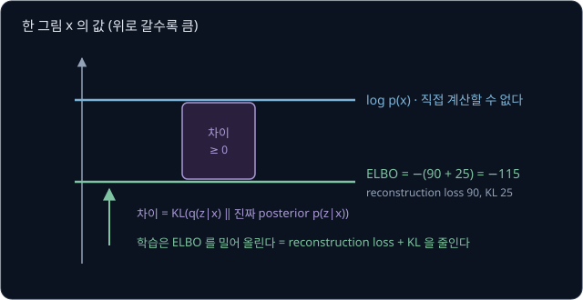

# VAE

사람이 로봇 팔을 조종해 같은 큐브 옮기기를 여러 번 시연하면 시연마다 움직임이 조금씩 다르다. 큐브 위에서 잠깐 멈췄다 내려가는 시연도
있고 바로 내려가는 시연도 있는데, 이 데이터로 정답 하나를 맞히는 모델을 학습하면 여러 시연의 평균에 가까운 동작이 나온다. 여러 시연이
퍼진 모양을 그대로 배워 그 안에서 동작 하나를 뽑으려면 모델은 무엇을 학습해야 할까?

VAE(variational autoencoder)는 데이터를 숫자 몇 개로 줄였다가 되살리도록 학습하면서, 줄인 숫자들이 평균이 0 이고 표준편차가 1 인
정규분포를 따르도록 함께 맞춘다. 학습이 끝나면 그 정규분포에서 뽑은 숫자를 되살리는 쪽(decoder)에 넣기만 해도 데이터를 닮은 새 sample
이 나온다. 양팔 로봇 ALOHA 의 policy 인 ACT 는 VAE 에 조건을 붙인 CVAE 로 사람의 시연을 학습하는데, 저자들이 CVAE 를 빼고 학습하자
사람 시연으로 학습한 simulator 과제의 성공률이 35.3% 에서 2% 로 떨어졌다.

## 학습 목표

- 갈라진 시연을 MSE 로 학습한 모델이 평균을 내는 이유와, autoencoder 의 latent space 에 빈 곳이 생기는 이유를 설명할 수 있다
- VAE 의 encoder 가 평균과 분산을 내는 이유를 설명하고, reparameterization trick 으로 gradient 가 encoder 까지 전해지는 과정을 숫자로 따라갈 수 있다
- reconstruction 항과 KL 항으로 된 loss 가 ELBO 와 어떻게 이어지는지, β 가 커지거나 작아지면 무슨 일이 생기는지 설명할 수 있다
- ACT 가 CVAE encoder 를 학습 때만 쓰고 실행할 때 $z = 0$ 으로 두는 이유와 그 한계를 설명할 수 있다

## 정답 하나를 내는 모델의 평균

로봇이 앞으로 가다가 정면의 상자를 비켜 가는 시연을 10 번 모았더니, 5 번은 왼쪽으로 1 m 비켜 갔고 나머지 5 번은 오른쪽으로 1 m 비켜
갔다고 하자. 왼쪽은 $+1$ 로 적고 오른쪽은 $-1$ 로 적는다. 예측 $a$ 하나를 내는 모델을 MSE(오차를 제곱해 평균한 값)로 학습하면 정답
$+1$ 과 $-1$ 이 반반이라서, loss 는 두 오차 제곱의 평균이 된다.

| 예측 $a$ | 정답 $+1$ 과의 오차 제곱 | 정답 $-1$ 과의 오차 제곱 | MSE |
| --- | --- | --- | --- |
| $1$ | $(1 - 1)^2 = 0$ | $(1 + 1)^2 = 4$ | $(0 + 4) \div 2 = 2$ |
| $0.5$ | $(0.5 - 1)^2 = 0.25$ | $(0.5 + 1)^2 = 2.25$ | $(0.25 + 2.25) \div 2 = 1.25$ |
| $0$ | $(0 - 1)^2 = 1$ | $(0 + 1)^2 = 1$ | $(1 + 1) \div 2 = 1$ |
| $-0.5$ | $(-0.5 - 1)^2 = 2.25$ | $(-0.5 + 1)^2 = 0.25$ | $1.25$ |

MSE 는 $a = 0$ 에서 1 로 가장 작아서 학습을 마친 모델은 0 을 낸다. 0 은 어느 쪽으로도 비키지 않는다는 뜻이라 로봇은 상자에 정면으로
부딪힌다. MSE 를 가장 작게 하는 예측은 정답들의 평균인데, 정답이 두 무리로 갈라져 있으면 그 평균은 어느 무리에도 속하지 않는다.

위 그림의 초록 길이 시연이고, 빨간 점선이 MSE 로 학습한 모델이 내는 평균 0 의 길이다. 이처럼 같은 상황에서 정답이 여러 무리로 갈라지는
데이터를 **multimodal** 이라고 한다. mode 는 값이 몰린 봉우리를 뜻하고, multimodal 은 그 봉우리가 여럿이라는 뜻이다.

VLA 처럼 카메라 이미지와 글 지시를 함께 받는 모델도 multimodal 모델이라고 부르는데, 이때는 입력의 종류가 여럿이라는 뜻이다. 이 강의와
behavior cloning·ACT 강의에서 쓰는 multimodal 은 앞의 뜻이다.

평균을 피하려면 왼쪽과 오른쪽에 정답이 반씩 몰린 분포 자체를 배우고, 실행할 때마다 그 분포에서 하나를 뽑아야 한다. 학습 데이터의 분포를
배워 그 분포를 닮은 새 데이터를 만드는 모델을 **생성 모델**(generative model)이라고 한다. 분류 모델이 손글씨 그림을 받아 "7" 을
고른다면, 생성 모델은 무작위로 고른 숫자 몇 개를 받아 학습한 그림들을 닮은 새 손글씨 그림을 낸다.

손글씨 dataset MNIST 의 그림 한 장은 $28 \times 28 = 784$ 개 pixel 의 밝기를 늘어놓은 784 차원 vector 라서 그 분포를 표로 적을 수
없다. 그래서 VAE 는 분포를 직접 적지 않고, 정규분포에서 뽑은 숫자 몇 개를 그림으로 바꾸는 decoder 를 학습한다.

**확인 문제.** 시연의 정답이 $+2$, $+2$, $-2$, $-2$ 일 때 MSE 를 가장 작게 하는 예측은 얼마이고, 그 예측은 시연 중 몇 개와 같을까?

답 보기

MSE 를 가장 작게 하는 예측은 정답들의 평균이므로 $(2 + 2 - 2 - 2) \div 4 = 0$ 이다. 시연 네 개 중 0 인 것은 하나도 없다.

## 정규분포

VAE 는 latent 를 뽑을 분포로 정규분포를 쓴다. 평균·표준편차와 정규분포의 기초는 [Probability & Gaussians](../probability/README.md) 에서
다루고, 여기서는 VAE 에 필요한 표기만 정리한다.

정규분포(normal distribution)는 평균 $\mu$ (mu, 뮤)를 가운데 둔 종 모양 분포로, Gaussian 분포라고도 부른다. $\mu$ 와 표준편차
$\sigma$ (sigma, 시그마) 두 숫자로 모양이 정해져서 $\mathcal N(\mu, \sigma^2)$ 으로 적는다. $\mathcal N$ 은 normal 의 첫 글자이고,
괄호의 둘째 자리에는 관례대로 표준편차가 아니라 분산 $\sigma^2$ 을 쓴다. 평균에서 표준편차의 몇 배만큼 떨어진 구간인지만 알면, 값이 그
구간에 들어갈 확률은 $\mu$ 와 $\sigma$ 에 상관없이 정해져 있다.

| 구간 | $\mathcal N(8, 1^2)$ 에서의 구간 | 그 안에 들어갈 확률 |
| --- | --- | --- |
| $\mu - \sigma$ ~ $\mu + \sigma$ | 7 ~ 9 | 약 68% |
| $\mu - 2\sigma$ ~ $\mu + 2\sigma$ | 6 ~ 10 | 약 95% |
| $\mu - 3\sigma$ ~ $\mu + 3\sigma$ | 5 ~ 11 | 약 99.7% |

평균이 0, 표준편차가 1 인 $\mathcal N(0, 1)$ 을 **표준 정규분포**(standard normal distribution)라고 한다. 값의 99.7% 가 $-3$ ~ $3$ 안에
들어가서, 이 분포에서 뽑은 값이 3 보다 크거나 $-3$ 보다 작은 일은 1000 번에 3 번 정도다.

이 강의에서는 표준 정규분포에서 뽑은 값을 $\epsilon$ (epsilon, 엡실론)으로 적고, 뽑는 일을 $\epsilon \sim \mathcal N(0, 1)$ 로 쓴다.
물결표 $\sim$ 는 " ~ 에서 뽑았다" 로 읽는다. 숫자를 여러 개 뽑을 때는 차원마다 따로 $\mathcal N(0, 1)$ 에서 뽑는데, 이렇게 만든 vector 의
분포를 $\mathcal N(0, I)$ 로 적는다. 0 은 모든 차원의 평균이 0 이라는 뜻이고, $I$ (identity matrix, 단위행렬)는 모든 차원의 분산이 1 이고
차원끼리 서로 영향을 주지 않는다(독립)는 뜻이다.

위 그림의 점 300 개 가운데 295 개가 반지름 3 인 원 안에 들어간다.

**확인 문제.** $\mathcal N(8, 2^2)$ 에서 뽑은 값의 약 95% 는 어느 구간에 들어갈까?

답 보기

$\mathcal N(8, 2^2)$ 의 첫째 자리는 평균이라 $\mu = 8$ 이고, 둘째 자리 $2^2$ 은 분산이라 표준편차는 $\sigma = 2$ 다. 위 표에서
약 95% 가 들어가는 구간은 $\mu - 2\sigma$ ~ $\mu + 2\sigma$ 이므로 $8 - 2 \times 2 = 4$ 부터 $8 + 2 \times 2 = 12$ 까지다.

## autoencoder

손글씨 그림의 pixel 784 개는 서로 따로 정해지지 않아서, 어떤 숫자인지, 얼마나 굵게 썼는지, 얼마나 기울었는지 같은 몇 가지만 정해지면
거의 다 정해진다. 그래서 그림을 숫자 몇 개로 줄였다가 그 숫자에서 그림을 다시 만드는 방법을 쓸 수 있다.

가장 작은 예로 pixel 이 세 개뿐이고 세 pixel 의 밝기가 늘 같은 회색 그림 $(0.3, 0.3, 0.3)$, $(0.8, 0.8, 0.8)$ 을 생각하자. 숫자는 세
개지만 담긴 정보는 얼마나 밝은지 하나뿐이라서, 세 pixel 의 평균을 내서 숫자 하나로 줄이고 그 숫자를 세 pixel 에 똑같이 적어 되살릴 수 있다.

| 그림 $x$ | 줄인 숫자 $z$ | 되살린 그림 $\hat x$ |
| --- | --- | --- |
| $(0.3, 0.3, 0.3)$ | 0.3 | $(0.3, 0.3, 0.3)$ |
| $(0.8, 0.8, 0.8)$ | 0.8 | $(0.8, 0.8, 0.8)$ |
| $(0.4, 0.6, 0.5)$ | 0.5 | $(0.5, 0.5, 0.5)$ |

줄이는 쪽을 **encoder** 라고 하고 되살리는 쪽을 **decoder** 라고 하며, 둘을 이은 모델을 **autoencoder** 라고 한다. auto 는 "자기 자신" 이라는
뜻으로, 정답을 따로 주지 않고 입력 자신을 정답으로 삼아 되살리는 법을 배워서 이런 이름이 붙었다. 되살린 그림에는 $\hat x$ 처럼 모자(hat)를
씌워 원래 그림 $x$ 와 구별한다.

되살린 그림이 원래 그림과 얼마나 다른지는 pixel 마다 차이를 제곱해 더한 **reconstruction loss** 로 잰다. 위 그림의 $(0.4, 0.6, 0.5)$ 는
되살리면 $(0.5, 0.5, 0.5)$ 라서 차이가 $0.1, -0.1, 0$ 이고 제곱의 합은 $0.01 + 0.01 + 0 = 0.02$ 다. 왼쪽에서 오른쪽으로 밝아지는
$(0.2, 0.5, 0.8)$ 도 $z = 0.5$ 로 줄어 같은 $(0.5, 0.5, 0.5)$ 로 되살아나서 loss 가 $0.09 + 0 + 0.09 = 0.18$ 로 커진다. 숫자 하나로는
어느 쪽으로 밝아지는지까지 담을 수 없기 때문이다. 기호로 쓰면 아래와 같고, $D$ 는 pixel 의 개수다.

$$
L_{\text{rec}} = \sum_{i=1}^{D} (\hat x_i - x_i)^2
$$

손글씨 그림처럼 어떤 숫자로 줄여야 할지 사람이 정할 수 없는 데이터는 encoder 와 decoder 를 모두 MLP 로 만들고, reconstruction loss 가
작아지도록 gradient descent 로 weight 를 학습시킨다. PyTorch 공식 예제의 MNIST VAE 에서는 encoder 가 784 개의 숫자를 400 개로 줄인 뒤
다시 20 개로 줄이고, decoder 는 20 개를 400 개로 늘린 뒤 다시 784 개로 늘린다.

가운데에서 그림을 대신하는 숫자들 $z$ 를 **latent** 라고 부른다. 라틴어 latere(숨다)에서 온 말로, 데이터에 직접 적혀 있지 않고 학습으로
정해지는 값이라 이런 이름이 붙었다. latent 의 개수를 z_dim 이라고 하고, latent 가 놓일 수 있는 모든 자리를 **latent space** 라고
한다. 위 그림은 평면에 그릴 수 있게 z_dim 을 2 로 두었고, 그러면 그림 한 장이 평면 위의 점 하나가 된다.

## latent space 의 빈 곳

autoencoder 의 decoder 는 latent 를 받아 그림을 내므로, 아무 $z$ 나 골라 decoder 에 넣으면 새 그림이 나올 것처럼 보인다. 그런데
autoencoder 의 loss 는 학습 그림들을 잘 되살리기만 하면 작아지고, 그림들의 $z$ 가 latent space 의 어디에 놓여야 하는지는 loss 식
어디에도 들어 있지 않다.

z_dim 이 1 인 autoencoder 를 학습시켰더니 숫자 0 그림들은 $z = -3$ 근처에 모이고 숫자 1 그림들은 $z = 4$ 근처에 모였다고 하자. decoder
는 학습하는 동안 $-3$ 근처와 4 근처의 $z$ 만 받아 보았으므로, 그 사이의 $z = 0.5$ 를 받으면 무엇을 낼지 학습한 적이 없어서 숫자가 아닌
얼룩이 나올 수 있다.

$z$ 가 퍼질 바깥쪽 끝도 정해져 있지 않아서, 새 그림을 만들려고 $z$ 를 무작위로 고르려 해도 어느 범위에서 골라야 할지 모른다. 그래서
생성 모델로 쓰려면 두 조건이 필요하다.

- 그림들의 $z$ 가 빈 곳 없이 이어져 latent space 의 한 영역을 채운다
- 그 영역의 모양이 $\mathcal N(0, I)$ 처럼 미리 정해 두어 뽑기 쉬운 분포와 같다

두 조건이 갖춰지면 $\mathcal N(0, I)$ 에서 $z$ 를 하나 뽑아 decoder 에 넣기만 해도 그럴듯한 새 그림이 나온다.

**확인 문제.** 위 autoencoder 로 새 그림을 만들려고 $\mathcal N(0, 1)$ 에서 $z$ 를 뽑으면 어떤 값이 가장 자주 나오고, 그 값에서는 어떤
그림을 기대할 수 있을까?

답 보기

$\mathcal N(0, 1)$ 은 평균 0 근처가 가장 촘촘하므로 0 근처가 가장 자주 나온다. 그런데 0 근처는 0 그림($-3$)과 1 그림(4) 사이의 빈 곳이라
decoder 가 학습 중 받아 본 적이 없는 자리라서, 숫자 모양이 나온다고 기대할 근거가 없다.

## Gaussian encoder

VAE 의 encoder 는 그림 한 장을 latent 의 점 하나가 아니라 범위 하나로 바꾼다. encoder 가 그림마다 평균 $\mu$ 와 표준편차 $\sigma$ 를
내면, 그 그림의 $z$ 는 $\mu$ 를 가운데 두고 $\sigma$ 정도 퍼진 정규분포 $\mathcal N(\mu, \sigma^2)$ 에서 뽑는다. variational 이라는
이름은 이렇게 분포를 학습으로 조금씩 고쳐 맞추는 기법(variational inference)에서 왔다.

학습할 때는 이 분포에서 $z$ 를 하나 뽑아 decoder 에 넣는다. encoder 가 숫자 0 그림 하나에 $\mu = -1$, $\sigma = 0.5$ 를 냈다면, 이 그림을
네 번 볼 때 뽑히는 $z$ 는 예를 들어 아래와 같다.

| 이 그림을 본 차례 | 1 | 2 | 3 | 4 |
| --- | --- | --- | --- | --- |
| 뽑힌 $z$ | $-0.8$ | $-1.7$ | $-0.6$ | $-1.2$ |

decoder 는 $-0.8$ 을 받아도 $-1.7$ 을 받아도 같은 0 그림을 되살려야 loss 가 작아지므로, 점 하나가 아니라 $\mu$ 근처의 범위 전체를 0 그림으로
되살리는 법을 배운다. $\mathcal N(-1, 0.5^2)$ 에서 뽑은 값의 95% 는 $-1 - 2 \times 0.5 = -2$ 부터 $-1 + 2 \times 0.5 = 0$ 사이라서 이
범위가 0 그림의 몫이 된다. encoder 가 숫자 1 그림에 $\mu = 1$, $\sigma = 0.5$ 를 냈다면 그 95% 범위는 0 부터 2 까지라서 두 범위가 0 에서
맞닿고, 그 사이에 빈 곳이 없다.

VAE 논문은 encoder 가 낸 분포를 $q_\phi(z \mid x)$ 로 적는다. 세로 막대 $\mid$ 는 " ~ 가 주어졌을 때" 로 읽어서 그림 $x$ 를 보고 낸
$z$ 의 분포라는 뜻이고, 아래첨자 $\phi$ (phi, 파이)는 encoder 의 weight 전체를 가리킨다. decoder 는 같은 방식으로 $p_\theta(x \mid z)$ 로
적고 $\theta$ (theta, 세타)가 decoder 의 weight 다. $z$ 가 여러 차원이면 encoder 는 차원마다 $\mu_j$ 와 $\sigma_j$ 를 하나씩 내는데,
$\sigma$ 는 0 보다 커야 해서 실제로는 분산에 log 를 씌운 logvar $= \log \sigma^2$ 을 낸다. PyTorch 공식 예제에서도 encoder 가 $\mu$ 와
logvar 를 따로 낸다. LeRobot 의 ACT 구현에서는 같은 값을 `log_sigma_x2` 라는 이름으로 받는다.

<b>심화: σ 대신 logvar 를 내는 이유</b>

encoder 의 마지막 층은 weight 를 곱하고 더하는 Linear layer 라서 $-3$ 이든 $2.5$ 든 어떤 숫자든 낼 수 있다. $\mu$ 는 음수여도 괜찮지만
$\sigma$ 는 퍼진 정도라서 encoder 가 $\sigma = -0.5$ 를 내면 뜻이 없는 값이 된다. $\log b$ 는 $b$ 가 되려면 $e$ 를 몇 제곱해야 하는지를
나타내는 수이고, 거꾸로 $e^{a}$ 는 $a$ 가 어떤 수이든 0 보다 크다. 그래서 logvar 가 어떤 수이든 아래 식으로 언제나 양수인 분산과
표준편차를 구할 수 있다.

$$
\sigma^2 = e^{\text{logvar}}, \qquad \sigma = e^{\text{logvar} / 2}
$$

둘째 식은 $e^{a/2} \times e^{a/2} = e^{a}$ 라서, 지수를 반으로 나누면 제곱근이 된다.

| encoder 가 낸 logvar | $\sigma^2 = e^{\text{logvar}}$ | $\sigma = e^{\text{logvar}/2}$ |
| --- | --- | --- |
| $-4.605$ | 0.01 | 0.1 |
| $-1.386$ | 0.25 | 0.5 |
| 0 | 1 | 1 |
| 1.386 | 4 | 2 |

logvar 가 0 이면 $\sigma = 1$ 이고, 음수일수록 $\sigma$ 가 작아지며, 양수일수록 커진다.

학습 전에 $z$ 가 따라야 할 분포로 정해 두는 $p(z) = \mathcal N(0, I)$ 를 **prior** 라고 하고, encoder 가 그림을 본 뒤에 낸 분포
$q_\phi(z \mid x)$ 를 **posterior** 라고 한다. 두 이름은 라틴어로 "앞의" 와 "뒤의" 라는 뜻이다. 그림마다 낸 posterior 가 모두 prior 근처에 모여 서로 겹치면, 새 그림을
만들 때 encoder 없이 prior 에서 뽑은 $z$ 도 어느 그림의 범위 안에 떨어질 가능성이 높다. posterior 를 prior 쪽으로 끌어당기는 일은 loss
의 KL 항이 맡는다.

> **오해** encoder 가 내는 $\sigma$ 는 작을수록 좋다.
>
> **사실** $\sigma$ 가 0 에 가까우면 $z$ 가 늘 $\mu$ 로 뽑혀 보통의 autoencoder 와 같아지고, 범위가 사라진 자리에 빈 곳도 다시 생긴다.

**확인 문제.** encoder 가 어떤 그림에 $\mu = 2$, $\sigma = 0.5$ 를 냈다. 학습 중 이 그림에서 뽑히는 $z$ 의 약 95% 는 어느 범위에 있을까?

답 보기

encoder 가 낸 분포는 $\mathcal N(2, 0.5^2)$ 이다. [정규분포](#정규분포) 의 표에서 약 95% 가 들어가는 구간은 $\mu - 2\sigma$ ~
$\mu + 2\sigma$ 이므로 $2 - 2 \times 0.5 = 1$ 부터 $2 + 2 \times 0.5 = 3$ 까지다.

## reparameterization trick

VAE 의 계산은 그림 $x$ → encoder → $\mu$, $\sigma$ → $z$ 뽑기 → decoder → loss 순서로 흐르므로, chain rule 로 encoder 의 gradient 를
구하려면 $\mu$ 를 조금 바꿀 때 $z$ 가 얼마나 변하는지를 알아야 한다.

그런데 $z$ 를 $\mathcal N(\mu, \sigma^2)$ 에서 바로 뽑으면 이 비율을 정할 수 없다. $\mu = 0.5$, $\sigma = 2$ 에서 뽑았더니 1.1 이 나왔고,
$\mu$ 를 0.51 로 아주 조금 바꿔 다시 뽑았더니 $-2.3$ 이 나왔다고 하자. $z$ 가 $-3.4$ 만큼 변했지만 이것은 $\mu$ 를 바꾼 효과가 아니라
새로 뽑을 때의 운이라서, 다시 할 때마다 다른 답이 나온다. chain rule 로 곱해 갈 비율이 뽑기 단계에서 정해지지 않으므로, decoder 의
weight 는 학습되지만 encoder 의 weight 에는 gradient 가 전해지지 않는다.

표준 정규분포에서 뽑은 $\epsilon$ 에 $\sigma$ 를 곱하고 $\mu$ 를 더하면, 그 결과는 $\mathcal N(\mu, \sigma^2)$ 에서 바로 뽑은 값과
같은 분포를 따른다. $\mu = 0.5$, $\sigma = 2$ 로 해 보면 아래와 같다.

| 뽑은 $\epsilon$ | $\sigma \times \epsilon$ | $z = \mu + \sigma \times \epsilon$ |
| --- | --- | --- |
| $-1$ | $-2$ | $-1.5$ |
| 0 | 0 | 0.5 |
| 0.3 | 0.6 | 1.1 |
| 1 | 2 | 2.5 |

$\sigma$ 를 곱하면 퍼진 정도가 $\sigma$ 배가 되고, $\mu$ 를 더하면 가운데가 $\mu$ 로 옮겨 간다. 표에서 평균 0 에서 1 씩 떨어져 있던
$\epsilon = -1$ 과 1 은 가운데 0.5 에서 2 씩 떨어진 $-1.5$ 와 2.5 가 되었다.

$z = \mu + \sigma \epsilon$ 으로 바꾸면 무작위성은 모두 $\epsilon$ 한 곳에 모인다. $\epsilon$ 은 encoder 와 상관없이 먼저 뽑아 두는 입력이고,
일단 뽑고 나면 $z$ 는 곱하고 더하기만 하면 나오는 값이라 비율이 정해진다. 다른 값은 고정하고 $\mu$ 만 조금 바꿨을 때 $z$ 가 변하는 비율을
partial derivative 라고 하고 $\frac{\partial z}{\partial \mu}$ 로 적는다. $\mu$ 가 1 늘면 $z$ 도 1 늘어서
$\frac{\partial z}{\partial \mu} = 1$ 이고, $\sigma$ 가 1 늘면 $z$ 는 $\epsilon$ 만큼 늘어서 $\frac{\partial z}{\partial \sigma} = \epsilon$
이다.

decoder 와 loss 를 아주 단순하게 줄여 loss 가 $L = (z - 2)^2$ 이라고 하자. $\epsilon = 0.3$ 이 뽑히면 $z = 0.5 + 2 \times 0.3 = 1.1$ 이고,
$z$ 를 바꿀 때 loss 가 변하는 비율은 $2 \times (1.1 - 2) = -1.8$ 이다. chain rule 에 따라 여기에 $\frac{\partial z}{\partial \mu} = 1$ 을
곱하면 $\partial L / \partial \mu = -1.8$ 이 되고, $\frac{\partial z}{\partial \sigma} = 0.3$ 을 곱하면 $\partial L / \partial \sigma = -0.54$
가 된다.
$\partial L / \partial \mu$ 가 음수라서 $\mu$ 를 키우면 loss 가 줄어들고, 이 비율이 encoder 의 층들로 전해져 encoder 의 weight 가 학습된다.

이렇게 $z$ 를 "$\mathcal N(\mu, \sigma^2)$ 에서 뽑은 값" 에서 "$\mu + \sigma \epsilon$" 으로 다시 적는 방법을 **reparameterization trick**
이라고 한다. 이름은 같은 분포를 학습할 값 $\mu$, $\sigma$ 와 무작위 값 $\epsilon$ 으로 나눠 parameter 로 다시 나타냈다는 뜻이다. $z$ 가
여러 차원이면 차원마다 따로 $\epsilon_j$ 를 뽑아 아래처럼 적는다. $\odot$ 은 같은 자리의 숫자끼리 곱하는 기호(원소별 곱)다.

$$
z = \mu + \sigma \odot \epsilon, \qquad \epsilon \sim \mathcal N(0, I)
$$

PyTorch 공식 예제에서는 $\epsilon$ 을 뽑는 `torch.randn_like` 한 줄과 곱하고 더하는 한 줄로 이 식을 계산한다. ACT 논문에서도 CVAE encoder
가 낸 평균과 분산으로 이 방법을 써서 $z$ 를 뽑고, encoder 와 policy 를 함께 학습한다.

> **오해** reparameterization trick 을 쓰면 $z$ 의 무작위성이 사라진다.
>
> **사실** $\epsilon$ 은 여전히 매번 새로 뽑으므로 $z$ 는 매번 다르다. 무작위성이 계산의 가운데에서 바깥 입력 자리로 옮겨 갔을 뿐이고, 그 덕분에 $\mu$ 와 $\sigma$ 를 지나는 계산이 끊기지 않는다.

<b>심화: gradient 계산표와 숫자로 잰 비율</b>

본문의 $L = (z - 2)^2$, $\mu = 0.5$, $\sigma = 2$, $\epsilon = 0.3$ 으로 gradient 를 한 줄씩 따라가면 아래와 같다.

| 값 | 계산 | 결과 |
| --- | --- | --- |
| $z$ | $0.5 + 2 \times 0.3$ | 1.1 |
| $L$ | $(1.1 - 2)^2 = (-0.9)^2$ | 0.81 |
| $\partial L / \partial z$ | $2 \times (1.1 - 2)$ | $-1.8$ |
| $\partial L / \partial \mu$ | $-1.8 \times 1$ | $-1.8$ |
| $\partial L / \partial \sigma$ | $-1.8 \times 0.3$ | $-0.54$ |

$\partial L / \partial z$ 는 $w^2$ 의 derivative 가 $2w$ 라는 공식을 $z - 2$ 에 쓴 것이고, 아래 두 줄은 chain rule 로 비율을 곱한 것이다.
공식으로 구한 $\partial L / \partial \mu = -1.8$ 을 숫자로 검산하려고 $\epsilon = 0.3$ 은 그대로 두고 $\mu$ 만 0.51 로 바꾸면 아래와 같다.

| | $\mu = 0.5$ | $\mu = 0.51$ | 변화량 |
| --- | --- | --- | --- |
| $z = \mu + 2 \times 0.3$ | 1.1 | 1.11 | 0.01 |
| $L = (z - 2)^2$ | $(-0.9)^2 = 0.81$ | $(-0.89)^2 = 0.7921$ | $-0.0179$ |

비율은 $-0.0179 \div 0.01 = -1.79$ 라서 공식의 $-1.8$ 과 거의 같다. $\epsilon$ 을 고정했기 때문에 같은 계산을 몇 번 다시 해도 같은 답이
나온다.

encoder 는 $\sigma$ 대신 logvar 를 내므로 실제 gradient 는 logvar 까지 한 단계 더 거슬러 간다. $\sigma = e^{\text{logvar}/2}$ 에서 logvar 가 조금

늘면 $\sigma$ 는 그 양의 $\sigma / 2$ 배만큼 늘어서 $\frac{\partial \sigma}{\partial\, \text{logvar}} = \frac{\sigma}{2}$ 다. 위 예는
$\sigma = 2$ 라서 이 비율이 1 이고, $\partial L / \partial\, \text{logvar} = -0.54 \times 1 = -0.54$ 다.

**확인 문제.** $\mu = 1$, $\sigma = 0.5$ 이고 뽑은 $\epsilon = 2$ 일 때 $z$ 와 $\frac{\partial z}{\partial \sigma}$ 는?

답 보기

1. $z = \mu + \sigma \times \epsilon = 1 + 0.5 \times 2 = 2$
2. $\frac{\partial z}{\partial \sigma}$ 는 $\epsilon$ 과 같으므로 2

## KL 항과 ELBO

VAE 의 loss 는 autoencoder 와 같은 reconstruction 항에, encoder 가 낸 posterior 가 prior 에서 얼마나 먼지를 재는 KL 항을 더한 것이다.

회색 그림 $x = (0.6, 0.6, 0.6)$ 에 encoder 가 $\mu = 0.6$, $\sigma = 0.1$ 을 냈고 decoder 는 $z$ 를 세 pixel 에 똑같이 적는다고 하자.
$\epsilon = 0$ 이 뽑히면 $z = 0.6$ 이라 loss 가 0 이다. $\epsilon = -2$ 가 뽑히면 $z = 0.6 + 0.1 \times (-2) = 0.4$ 라서 loss 가
$3 \times 0.2^2 = 0.12$ 로 커진다. $\sigma$ 가 클수록 $z$ 가 $\mu$ 에서 멀리 뽑히는 일이 잦으므로, reconstruction 항만 있으면 학습은
$\sigma$ 를 0 쪽으로 줄인다. Kingma 와 Welling 은 그림 한 장마다 $\epsilon$ 을 한 번만 뽑고 그림 100 장을 한 mini-batch 로 묶어
학습했다. 한 번 뽑은 값은 운에 따라 크거나 작을 수 있지만, 그림이 100 장이면 그 운이 고르게 섞인다. pixel 이 0 과 1 에 몰린 MNIST
에서는 PyTorch 공식 예제처럼 제곱 오차 자리에 BCE 를 쓰기도 한다. ACT 는 reconstruction 항으로 action 오차의 절댓값으로 잰 L1 을 쓴다.

<b>심화: 0 과 1 사이 pixel 의 BCE</b>

MNIST 용 VAE 의 decoder 는 pixel 의 밝기를 바로 내지 않고, 마지막 출력에 sigmoid 를 씌워 pixel 마다 그 pixel 이 1(흰색)일 확률 $p_i$ 를
0 과 1 사이의 값으로 낸다. decoder 가 실제로 나온 값에 준 확률에 log 를 씌우고 부호를 바꾼 값이 loss 다.

| 실제 pixel $x_i$ | decoder 의 확률 $p_i$ | 실제 값에 준 확률 | loss |
| --- | --- | --- | --- |
| 1 | 0.9 | 0.9 | $-\log 0.9 = 0.105$ |
| 1 | 0.1 | 0.1 | $-\log 0.1 = 2.303$ |
| 0 | 0.9 | $1 - 0.9 = 0.1$ | $-\log 0.1 = 2.303$ |
| 1 | 0.5 | 0.5 | $-\log 0.5 = 0.693$ |

$x_i$ 가 1 인 경우와 0 인 경우를 식 하나로 쓴 것이 binary cross entropy(BCE)다.

$$
\mathrm{BCE}(p_i, x_i) = -\big[x_i \log p_i + (1 - x_i)\log(1 - p_i)\big]
$$

$x_i = 1$ 이면 둘째 항의 $(1 - x_i)$ 가 0 이 되어 $-\log p_i$ 만 남고, $x_i = 0$ 이면 첫째 항이 사라져 $-\log(1 - p_i)$ 만 남는다.
reconstruction loss 는 784 pixel 의 BCE 를 모두 더한 값이라, 학습 전 decoder 가 모든 pixel 에 $p_i = 0.5$ 를 낸다면
$784 \times 0.693 \approx 543$ 에서 시작한다. PyTorch 공식 예제도 BCE 를 모든 pixel 과 batch 의 모든 그림에 걸쳐 더한다.

**KL divergence** 는 두 분포가 얼마나 다른지를 재는 값이다. 두 분포가 같으면 0 이고 다를수록 커지는데, 두 분포의 자리를 바꾸면 값이
달라진다. 이름의 KL 은 1951 년 이 값을 정리한 Kullback 과 Leibler 의 첫 글자다. VAE 는 encoder 의 분포 $q$ 를 앞에 두고 prior $p$ 를
뒤에 둔 $D_{\mathrm{KL}}(q \Vert p)$ 를 쓴다. $q = \mathcal N(\mu, \sigma^2)$ 이고 $p = \mathcal N(0, 1)$ 이면 KL 은 아래 식으로 바로 구할
수 있고, 유도는 VAE 논문의 부록 B 에 있다.

$$
D_{\mathrm{KL}}\big(\mathcal N(\mu, \sigma^2) \,\Vert\, \mathcal N(0, 1)\big) = \frac{1}{2}\big(\mu^2 + \sigma^2 - \log \sigma^2 - 1\big)
$$

평균의 제곱과 분산을 더하고, 분산의 log 와 1 을 뺀 뒤 반으로 나눈다. $\mu = 1$, $\sigma = 1$ 이면 $\frac12(1 + 1 - 0 - 1) = 0.5$ 다.
$\mu = 0$, $\sigma = 0.5$ 라면 $\sigma^2 = 0.25$ 이고 $\log 0.25 = -1.386$ 이라서 $\frac12(0 + 0.25 + 1.386 - 1) = 0.318$ 이다.

위 그림의 왼쪽처럼 $\mu$ 가 0 에서 멀어지면 $\mu^2$ 때문에 KL 이 커지므로, KL 은 그림마다 낸 $\mu$ 를 원점 쪽으로 끌어당긴다. 오른쪽처럼
$\sigma^2 - \log \sigma^2$ 은 $\sigma = 1$ 에서 가장 작아서, $\sigma$ 가 1 보다 작아지면 $-\log \sigma^2$ 이 KL 을 키우고 1 보다 커지면
$\sigma^2$ 이 KL 을 키운다.

$z$ 가 여러 차원이면 차원마다 KL 을 구해 더한다. PyTorch 공식 예제와 LeRobot 의 ACT 구현은 $\sigma^2$ 자리에는 $e^{\text{logvar}}$ 을
넣고 $\log \sigma^2$ 자리에는 logvar 를 넣어 이 식을 그대로 계산한다.

<b>심화: 동전 두 개의 KL divergence</b>

결과가 두 가지뿐인 분포로 KL 의 정의를 직접 계산해 본다. 앞면과 뒷면이 반반인 동전 $p$ 와, 앞면이 0.8 의 확률로 나오는 휜 동전 $q$ 가 있다.

| 결과 | $q$ 의 확률 | $p$ 의 확률 | $q \div p$ | $\log(q \div p)$ | $q \times \log(q \div p)$ |
| --- | --- | --- | --- | --- | --- |
| 앞면 | 0.8 | 0.5 | 1.6 | 0.470 | 0.376 |
| 뒷면 | 0.2 | 0.5 | 0.4 | $-0.916$ | $-0.183$ |
| 합 | | | | | 0.193 |

결과마다 $q$ 의 확률 × log($q$ 의 확률 ÷ $p$ 의 확률)을 구해 모두 더한 0.193 이 $q$ 와 $p$ 의 KL divergence 다.

$$
D_{\mathrm{KL}}(q \,\Vert\, p) = \sum_{z} q(z) \log \frac{q(z)}{p(z)}
$$

$D_{\mathrm{KL}}(q \Vert p)$ 는 "$q$ 에서 $p$ 까지의 KL divergence" 로 읽고, 두 줄 막대 $\Vert$ 는 두 분포를 구분하는 표시다. $q$ 의 앞면
확률을 0.5, 0.6, 0.8, 0.9 로 바꾸면 KL 은 0, 0.020, 0.193, 0.368 로 커진다. 뒷면 줄처럼 음수가 되는 항이 있어도 모두 더하면 언제나 0
이상이다. 자리를 바꾼 $D_{\mathrm{KL}}(p \Vert q) = 0.5 \log(0.5 \div 0.8) + 0.5 \log(0.5 \div 0.2) = 0.5 \times (-0.470) + 0.5 \times 0.916 = 0.223$
은 0.193 과 다르다.

$z$ 처럼 연속된 값에서는 결과마다 더하지 않고 곡선 아래 넓이를 구하는 적분으로 같은 계산을 한다. 두 분포가 정규분포이면 그 적분의 결과가
본문의 식 $\frac12(\mu^2 + \sigma^2 - \log\sigma^2 - 1)$ 이다.

Kingma 와 Welling 은 이 loss 를 **ELBO**(evidence lower bound)로 설명한다. evidence 는 모델이 실제 그림 $x$ 를 만들어 낼 확률의 log 인
$\log p_\theta(x)$ 다. 이 값을 구하려면 가능한 모든 $z$ 마다 그 $z$ 가 나올 확률과 그 $z$ 에서 $x$ 가 나올 확률을 곱해 모두 더해야 해서
직접 계산할 수 없다. 그래서 VAE 는 언제나 $\log p_\theta(x)$ 이하인 아래쪽 경계(lower bound)를 계산해 키운다.

$$
\log p_\theta(x) \ \ge\ \mathbb E_{q_\phi(z \mid x)}\big[\log p_\theta(x \mid z)\big] - D_{\mathrm{KL}}\big(q_\phi(z \mid x) \,\Vert\, \mathcal N(0, I)\big)
$$

$\mathbb E_{q}[\cdot]$ 는 $q$ 에서 $z$ 를 뽑았을 때의 기댓값이다. $\log p_\theta(x \mid z)$ 는 decoder 가 원래 그림에 준 확률의 log 라서,
BCE 같은 reconstruction loss 에 마이너스를 붙인 값이다. 그래서 ELBO 를 키우는 것과 reconstruction loss 와 KL 의 합을 줄이는 것은 같은
일이다. 예를 들어 reconstruction loss 가 90 이고 KL 이 25 인 그림이라면 ELBO 는 $-(90 + 25) = -115$ 이고, 그 그림의 $\log p_\theta(x)$ 는
$-115$ 보다 작지 않다.

<b>심화: ELBO 의 유도</b>

$\log p_\theta(x)$ 는 $z$ 와 상관없는 값이라 $q_\phi(z \mid x)$ 에서 $z$ 를 뽑아 기댓값을 취해도 그대로다. 확률의 곱셈 규칙
$p_\theta(x) = p_\theta(x, z) \div p_\theta(z \mid x)$ 를 넣고 분자와 분모에 똑같이 $q_\phi(z \mid x)$ 를 곱하면, 아래처럼 두 항으로 나뉜다.

$$
\log p_\theta(x) = \mathbb E_{q}\Big[\log \frac{p_\theta(x, z)}{q_\phi(z \mid x)}\Big] + \mathbb E_{q}\Big[\log \frac{q_\phi(z \mid x)}{p_\theta(z \mid x)}\Big]
$$

진짜 posterior $p_\theta(z \mid x)$ 는 decoder 와 prior 로 정해지는, $x$ 를 본 뒤 $z$ 의 실제 분포다. 둘째 항은 encoder 의 분포와 이
진짜 posterior 사이의 KL divergence 라서 언제나 0 이상이다. 그래서 첫째 항이
$\log p_\theta(x)$ 의 아래쪽 경계이고, 이것이 ELBO 다. 첫째 항에 $p_\theta(x, z) = p_\theta(x \mid z)\, p(z)$ 를 넣으면 본문의 식이 나온다.

$$
\mathbb E_{q}\big[\log p_\theta(x \mid z)\big] + \mathbb E_{q}\Big[\log \frac{p(z)}{q_\phi(z \mid x)}\Big] = \mathbb E_{q}\big[\log p_\theta(x \mid z)\big] - D_{\mathrm{KL}}\big(q_\phi(z \mid x) \,\Vert\, p(z)\big)
$$

ELBO 와 $\log p_\theta(x)$ 의 차이가 진짜 posterior 와의 KL 이므로, encoder 의 분포가 진짜 posterior 와 똑같아지면 경계가
$\log p_\theta(x)$ 와 같아진다. 유도는 Kingma 와 Welling 의 입문서 2.2 절에 있다.

**확인 문제.** 한 차원에서 encoder 가 $\mu = 2$, $\sigma = 1$ 을 냈을 때의 KL 과, $\mu = 0$, logvar $= 0$ 을 냈을 때의 KL 을 구해 보자.

답 보기

1. 첫째: $\sigma^2 = 1$, $\log 1 = 0$ 이라 $\frac12(2^2 + 1 - 0 - 1) = \frac12 \times 4 = 2$
2. 둘째: logvar $= 0$ 이면 $\sigma^2 = e^0 = 1$ 이라 $\frac12(0 + 1 - 0 - 1) = 0$

둘째는 $\mu = 0$, $\sigma = 1$ 이라 prior 와 같은 분포라서 KL 이 0 이다.

## β 와 posterior collapse

그림 한 장의 VAE loss 를 $\beta$ 와 함께 적으면 아래와 같다. $\beta$ (beta, 베타)는 KL 항을 얼마나 무겁게 볼지 정하는 숫자다. VAE 논문의
loss 는 $\beta = 1$ 에 해당하고, ACT 는 $\beta = 10$ 을 쓴다.

$$
L = L_{\text{rec}} + \beta \cdot D_{\mathrm{KL}}\big(q_\phi(z \mid x) \,\Vert\, \mathcal N(0, I)\big)
$$

두 항은 encoder 를 서로 반대쪽으로 당긴다. reconstruction 항은 $\sigma$ 를 0 으로 줄이고 그림마다 낸 $\mu$ 를 서로 멀리 떨어뜨려서 decoder 가 그림을 쉽게 구별하게 한다. 반대로 KL 항은 $\mu$ 를 0 쪽으로 끌어당기고 $\sigma$ 를 1 쪽으로 끌어당긴다.
$\beta = 1$ 일 때 encoder 두 개를 비교하면 아래와 같은데, reconstruction loss 는 decoder 가 그만큼 틀렸다고 가정해 넣은 예시 값이다.

| encoder | $\mu$ | $\sigma$ | reconstruction loss | KL | loss |
| --- | --- | --- | --- | --- | --- |
| A | 3 | 0.1 | 0.01 | $\frac12(9 + 0.01 + 4.605 - 1) = 6.308$ | 6.318 |
| B | 1 | 0.5 | 0.2 | $\frac12(1 + 0.25 + 1.386 - 1) = 0.818$ | 1.018 |

A 는 복원 오차가 거의 없지만 $\mu$ 가 원점에서 멀고 $\sigma$ 가 너무 작아서 KL 이 크다. B 는 조금 덜 정확하지만 KL 이 작아서 전체
loss 가 A 보다 훨씬 작다. 학습은 두 항의 합이 가장 작은 지점을 찾는데, $\beta$ 를 극단으로 바꾸면 다음 두 가지 방식으로 실패한다.

- $\beta = 0$ 이면 KL 항이 사라져서 encoder 는 $\sigma$ 를 0 에 가깝게 줄이고 $\mu$ 를 마음대로 흩어 놓는다. 모델은 보통의
  autoencoder 와 같아져서 latent space 에 빈 곳이 다시 생긴다
- $\beta$ 가 아주 크면 KL 을 0 으로 만드는 것이 가장 중요해져서, encoder 는 어떤 그림을 받든 $\mu = 0$, $\sigma = 1$ 을 낸다. 모든 그림의
  posterior 가 prior 와 같아지면 $z$ 에 그림의 정보가 담기지 않는다. decoder 는 $z$ 로 그림을 구별할 수 없어서 모든 그림의 평균에
  가까운 흐릿한 그림 하나만 낸다

모든 posterior 가 prior 하나로 겹쳐 KL 이 0 이 되고 decoder 가 $z$ 를 무시하는 이 현상을 **posterior collapse** 라고 한다. $\beta = 1$
이어도 decoder 가 $z$ 없이 데이터를 잘 맞힐 만큼 강하면 같은 일이 생긴다. Bowman 등(2016)은 앞 단어를 보고 다음 단어를 맞히는 LSTM 을
decoder 로 써서 문장을 만드는 VAE 를 학습했는데, 단순하게 구현하면 대부분의 학습에서 KL 이 0 으로 떨어졌다. 이들은 KL 항의 weight 를
0 에서 시작해 1 까지 천천히 올리는 KL annealing 으로 이 문제를 줄였다.

pixel 784 개의 reconstruction 항을 더하지 않고 평균하면 그 항만 784 분의 1 로 작아져서, KL 을 784 배 무겁게 본 것과 같다. PyTorch 공식
예제는 reconstruction 항을 모든 pixel 에 걸쳐 더하고 KL 도 latent 차원마다 더한 뒤 둘을 합해서, 두 항의 비율을 바꾸지 않는다. LeRobot
의 ACT 구현은 반대로 L1 을 chunk 100 step × 관절 목표 14 개 $= 1400$ 개 숫자의 평균으로 계산하고, KL 은 32 차원을 모두 더한 뒤 10 을
곱한다. L1 을 1400 개에 걸쳐 더한 loss 를 기준으로 계산하면 이 구현에서 KL 의 무게는 $1400 \times 10 = 14{,}000$ 배가 된다. 이렇게 KL
이 무거우면 $z$ 에 담기는 정보가 적어지는데, ACT 논문도 $\beta$ 가 클수록 $z$ 로 전해지는 정보가 적어진다고 설명한다.

**확인 문제.** 어떤 그림의 reconstruction loss 가 100, KL 이 20 이다. $\beta = 1$ 일 때와 $\beta = 4$ 일 때 loss 는 각각 얼마이고, $\beta = 4$
이면 학습이 어느 항을 더 줄이려 할까?

답 보기

| $\beta$ | 계산 | loss |
| --- | --- | --- |
| 1 | $100 + 1 \times 20$ | 120 |
| 4 | $100 + 4 \times 20$ | 180 |

$\beta = 4$ 이면 KL 이 1 줄 때 loss 가 4 줄어서, 학습은 reconstruction 항보다 KL 을 줄이는 쪽에 더 무게를 두고 posterior 를 prior 에
가깝게 만든다.

## sampling 과 latent space 의 사용

학습을 마친 VAE 로 새 그림을 만들 때는 prior $\mathcal N(0, I)$ 에서 $z$ 를 뽑아 decoder 에 넣는다. z_dim 이 2 면 $\mathcal N(0, 1)$ 에서
숫자 두 개를 따로 뽑아 $z = (0.4, -1.4)$ 같은 값을 얻고, 다시 뽑으면 다른 그림이 나온다. encoder 는 학습할 때와 이미 있는 그림의 $z$ 를
알고 싶을 때만 쓴다.

z_dim 을 2 로 학습하면 latent space 를 평면에 그려 볼 수 있다. test 그림마다 encoder 가 낸 $\mu$ 를 숫자마다 다른 색으로 찍으면, 같은
숫자끼리 무리 지어 원점 근처에 빈 곳 없이 붙는다. prior 의 99.7% 가 들어가는 $-3$ ~ $3$ 범위에 바둑판처럼 점을 놓고 각 점을 decoder
에 넣으면, 이웃한 점끼리 그림이 조금씩만 다르다.

두 그림의 중간 모습도 latent space 에서 만든다. 숫자 1 그림의 $\mu$ 를 $z_a$ 라고 하고 숫자 7 그림의 $\mu$ 를 $z_b$ 라고 하자. 두 점을
잇는 직선 위의 점들을 decoder 에 차례로 넣으면 1 이 7 로 조금씩 바뀌는 그림들이 나온다. 이렇게 두 값 사이의 중간 값을 채우는 것을
**interpolation**(보간)이라고 한다. 직선 위의 점은 $z_a$ 에서 $z_b$ 쪽으로 간 비율 $t$ (0 ~ 1)로 정한다.

$$
z(t) = (1 - t)\, z_a + t\, z_b
$$

예를 들어 $z_a = (-2, 1)$, $z_b = (2, -1)$ 이고 $t = 0.25$ 라면 $0.75 \times (-2, 1) + 0.25 \times (2, -1) = (-1, 0.5)$ 다. $t$ 를 0, 0.25,
0.5, 0.75, 1 로 바꾸면 아래 그림의 다섯 점이 된다.

보통의 autoencoder 에서는 직선의 중간이 빈 곳을 지날 수 있어서 중간 그림이 얼룩이 되기 쉽다. VAE 는 latent space 를 빈 곳 없이 채우므로
중간 단계에서도 숫자 모양이 유지된다. 다만 VAE 가 만든 그림은 실제 그림보다 흐릿하다. 범위끼리 겹친 자리의 $z$ 는 여러 그림으로 되살려야
했던 자리라서, decoder 는 거기서 그 그림들의 평균에 가까운 그림을 내고 획의 가장자리가 번진다.

**확인 문제.** $z_a = (0, 2)$, $z_b = (4, 0)$ 일 때 $t = 0.25$ 와 $t = 0.5$ 의 점은?

답 보기

| $t$ | $(1 - t)\, z_a$ | $t\, z_b$ | $z(t)$ |
| --- | --- | --- | --- |
| 0.25 | $0.75 \times (0, 2) = (0, 1.5)$ | $0.25 \times (4, 0) = (1, 0)$ | $(1, 1.5)$ |
| 0.5 | $0.5 \times (0, 2) = (0, 1)$ | $0.5 \times (4, 0) = (2, 0)$ | $(2, 1)$ |

## CVAE 와 ACT

VAE 로는 $z$ 를 뽑을 때 어떤 숫자 그림이 나올지 고를 수 없다. **CVAE**(conditional VAE)는 encoder 와 decoder 양쪽에 조건 $c$ 를 함께 넣어
원하는 조건의 sample 을 만든다. MNIST 에서 조건은 그림이 어떤 숫자인지이고, 숫자 10 개 중 그 숫자의 자리만 1 이고 나머지는 0 인
one-hot vector 로 넣는다. 7 은 0 부터 세어 여덟째 값만 1 인 $(0, 0, 0, 0, 0, 0, 0, 1, 0, 0)$ 이다. encoder $q_\phi(z \mid x, c)$ 는
그림과 숫자를 함께 보고 $\mu$, $\sigma$ 를 내고, decoder $p_\theta(x \mid z, c)$ 는 $z$ 와 숫자를 함께 받아 그림을 낸다.

어떤 숫자인지는 이미 $c$ 에 들어 있으므로, $z$ 에는 글씨의 굵기나 기울기처럼 $c$ 로 정해지지 않는 성질이 담기기를 기대한다. 그래서 같은
$z$ 를 두고 $c$ 만 바꿔 넣으면 같은 굵기와 기울기로 쓴 다른 숫자가 나온다.

로봇이 지금 상황에서 어떤 행동을 할지 정하는 규칙을 policy 라고 한다. ACT(Action Chunking with Transformers)는 앞으로 여러 step 동안의
관절 목표를 한 덩어리(action chunk)로 예측하는 로봇 팔 policy 로, CVAE 구조로 사람의 시연을 학습하고 CVAE 의 decoder 를 policy 로 쓴다.
ACT 논문과 LeRobot 기본 설정의 값을 MNIST 의 CVAE 와 나란히 놓으면 아래와 같다.

| 항목 | MNIST CVAE | ACT |
| --- | --- | --- |
| 되살릴 데이터 $x$ | 손글씨 그림 | 시연의 action chunk (100 step × 관절 목표 14 개) |
| encoder 의 입력 | 그림과 숫자 label | 시연의 action chunk 와 관절 위치 |
| decoder 의 입력 | $z$ 와 숫자 label | $z$, 카메라 이미지, 관절 위치 |
| latent $z$ | 2 차원 (위 그림의 예) | 32 차원 |
| reconstruction loss | BCE 의 합 | L1 (오차의 절댓값) |
| KL 의 weight $\beta$ | 1 | 10 |

학습할 때는 encoder 가 시연의 action chunk 와 관절 위치를 보고 $\mu$, $\sigma$ 를 내고, reparameterization trick 으로 그 분포에서 뽑은
$z$ 를 policy 에 넣는다. encoder 는 같은 장면에서도 시연마다 달라지는 움직임(예를 들어 큐브 위에서 멈췄는지)을 $z$ 에 담아 policy 에
넘긴다. 그래서 같은 관측에 정답 chunk 가 여럿이어도 시연마다 policy 의 입력이 달라지므로, policy 는 정답들의 평균을 낼 필요가 없다.
저자들이 CVAE 를 빼고 L1 만으로 학습하자 사람 시연으로 학습한 simulator 과제 두 개의 성공률이 35.3% 에서 2% 로 떨어졌다. 반면
프로그램으로 만든 시연은 매번 똑같아서 CVAE 가 있든 없든 성공률이 거의 같았다.

로봇을 실제로 움직일 때는 encoder 에 넣을 시연 action chunk 가 없어서, 저자들은 CVAE encoder 를 policy 학습에만 쓰고 실행할 때는
버린다. 실행할 때는 $z$ 를 prior 의 평균인 0 으로 두고, policy 는 카메라 이미지와 관절 위치만으로 action chunk 를 낸다.

시연이 왼쪽으로 잡기와 오른쪽으로 잡기처럼 정반대인 두 무리로 반반 갈리는 경우를 생각해 보자. policy 는 실행할 때 $z = 0$ 하나만 받고
$\beta = 10$ 이라 $z$ 에 담긴 정보도 적어서, $z = 0$ 에서 나온 chunk 가 두 무리 중 하나를 고른다는 보장이 없다. ACT 가 chunk 를 겹쳐
평균하는 temporal ensembling 은 [ACT](../act/README.md) 에서 다루고, 무작위 출발점에서 시작해 두 무리 중 하나에 도착하게 만드는 방법은
[Diffusion Policy](../diffusion-policy/README.md) 에서 다룬다.

> **오해** ACT 는 CVAE 를 쓰니 실행할 때마다 $z$ 를 뽑아 여러 움직임 중 하나를 고른다.
>
> **사실** CVAE 의 encoder 는 학습할 때 시연마다 다른 움직임을 $z$ 에 담아 policy 에 넘기는 데만 쓰인다. 실행할 때는 $z$ 를 0 하나로 고정하므로 같은 관측에는 늘 같은 chunk 가 나온다.

**확인 문제.** ACT 의 CVAE encoder 가 한 차원에서 $\mu = 0.5$, $\sigma = 1$ 을 냈다. 이 차원의 KL 은 얼마이고, $\beta = 10$ 을 곱하면 loss 에
얼마가 더해질까?

답 보기

1. KL: $\sigma^2 = 1$, $\log 1 = 0$ 이라 $\frac12(0.5^2 + 1 - 0 - 1) = \frac12 \times 0.25 = 0.125$
2. $\beta$ 를 곱한 값: $10 \times 0.125 = 1.25$

## 정리

- MSE 로 정답 하나를 배운 모델은 갈라진 시연의 평균을 낸다. autoencoder 는 loss 에 $z$ 의 위치 제약이 없어서, 0 그림은 $-3$ 근처에 놓고
  1 그림은 4 근처에 놓으면 그 사이의 0.5 처럼 decoder 가 받아 본 적 없는 빈 곳이 남는다. VAE 의 encoder 는 그림마다 $\mu$ 와 logvar 를
  내서 그림을 범위로 만들고, 범위끼리 겹치게 해 빈 곳을 채운다
- reparameterization trick $z = \mu + \sigma \odot \epsilon$ 은 무작위성을 $\epsilon$ 으로 옮긴다. 그러면 $\partial z / \partial \mu = 1$ 과
  $\partial z / \partial \sigma = \epsilon$ 이 정해져서 encoder 까지 gradient 가 전해진다
- loss 는 reconstruction 항과 $\beta \cdot$ KL 의 합이고, $\beta = 1$ 이면 이 loss 를 줄이는 것이 ELBO 를 키우는 것과 같다. $\beta$ 가
  0 이면 빈 곳이 다시 생기고, $\beta$ 가 너무 크거나 decoder 가 너무 강하면 posterior collapse 가 일어난다. ACT 는 $\beta = 10$ 인 CVAE
  로 학습하고, 실행할 때는 encoder 를 버리고 $z = 0$ 으로 둔다

VAE 는 decoder 한 번으로 sample 을 내서 빠르지만, decoder 가 겹친 범위에서 평균에 가까운 그림을 내기 때문에 sample 이 흐릿하다. 생성을
수백 번의 작은 noise 제거 단계로 나눠 더 선명한 sample 을 만드는 방법은 [DDPM](../ddpm/README.md) 에서 다룬다. CVAE 로 시연의 움직임을
latent 에 담아 양팔 로봇을 움직이는 policy 는 [ACT](../act/README.md) 에서 다루고, 카메라 장면을 latent 로 줄인 뒤 그 latent 안에서 다음
장면을 예측하는 모델은 [World Model](../world-model/README.md) 에서 다룬다.

## 참고 자료

- Diederik P. Kingma, Max Welling, [An Introduction to Variational Autoencoders](https://arxiv.org/abs/1906.02691) (2019) — VAE 를 만든
  두 저자의 입문서. 2 장에서 ELBO 와 reparameterization trick 을 원 논문보다 천천히 유도한다
- Diederik P. Kingma, Max Welling, [Auto-Encoding Variational Bayes](https://arxiv.org/abs/1312.6114) (2013) — VAE 의 원 논문. 부록 B 에
  정규분포와 $\mathcal N(0, I)$ 사이 KL 식의 유도가 있다
- Carl Doersch, [Tutorial on Variational Autoencoders](https://arxiv.org/abs/1606.05908) — 수식보다 그림과 직관으로 VAE 를 설명하는 tutorial
- Kihyuk Sohn, Honglak Lee, Xinchen Yan, [Learning Structured Output Representation using Deep Conditional Generative Models](https://proceedings.neurips.cc/paper/2015/hash/8d55a249e6baa5c06772297520da2051-Abstract.html)
  (2015) — CVAE 를 제안한 논문
- Tony Z. Zhao 외, [Learning Fine-Grained Bimanual Manipulation with Low-Cost Hardware](https://arxiv.org/abs/2304.13705) (2023) — ACT
  논문. CVAE 학습과 $z = 0$ 추론(IV-B 절), CVAE 를 뺀 실험(VI-B 절), $\beta = 10$ 을 적은 hyperparameter 표(부록 D)를 본다
- Samuel R. Bowman 외, [Generating Sentences from a Continuous Space](https://arxiv.org/abs/1511.06349) (2016) — 강한 decoder 때문에 KL 이
  0 으로 떨어지는 문제와 KL annealing
- PyTorch, [examples/vae](https://github.com/pytorch/examples/tree/main/vae) — 784 → 400 → 20 MNIST VAE 공식 예제. reparameterization 과
  BCE·KL 의 합을 몇 줄의 코드로 확인할 수 있다
- LeRobot, [`modeling_act.py`](https://github.com/huggingface/lerobot/blob/main/src/lerobot/policies/act/modeling_act.py) 와
  [`configuration_act.py`](https://github.com/huggingface/lerobot/blob/main/src/lerobot/policies/act/configuration_act.py) — 학습 때 $z$ 를
  뽑고 추론 때 0 으로 두는 ACT 구현과 `latent_dim = 32`·`kl_weight = 10` 기본값
- Lilian Weng, [From Autoencoder to Beta-VAE](https://lilianweng.github.io/posts/2018-08-12-vae/) — autoencoder 에서 VAE 를 거쳐
  $\beta$ 를 조절하는 β-VAE 로 이어지는 흐름을 정리한 블로그

