# VAE

## 학습 목표

- 정답 하나를 고르는 모델과, 학습한 데이터를 닮은 새 데이터를 만들어 내는 모델이 어떻게 다른지 설명할 수 있다
- 같은 상황에 정답이 여럿일 때 정답들의 평균을 내는 모델이 왜 실패하는지 숫자로 보일 수 있다
- 숫자들이 퍼진 모양을 평균과 분산으로 계산하고, 가운데가 볼록한 종 모양 분포(정규분포)에서 값을 뽑는 과정을 설명할 수 있다
- 그림을 숫자 몇 개로 줄였다가 다시 되살리는 모델을 작은 숫자로 따라가고, 줄인 숫자들 사이에 빈 곳이 생기는 이유를 설명할 수 있다
- 줄이는 쪽 network 가 점 하나 대신 평균과 퍼진 정도를 내는 이유와, 무작위로 뽑는 단계를 거쳐도 학습이 되게 하는 방법을 계산으로
  따라갈 수 있다
- 복원이 얼마나 틀렸는지와 두 분포가 얼마나 다른지를 숫자로 계산해 loss 를 구하고, 학습한 모델로 새 그림을 뽑거나 두 그림 사이의
  중간 그림을 만드는 방법, 그리고 이 구조가 로봇 팔의 동작을 배우는 모델에 쓰이는 방식을 설명할 수 있다

## 새 데이터를 만드는 문제

### 정답을 고르는 모델과 새 데이터를 만드는 모델

[PyTorch Training Loop](../pytorch-mlp/README.md) 에서는 MNIST 라는 손글씨 숫자 그림 6만 장으로 MLP 를 학습시켰다. MNIST 는 사람이
0 부터 9 까지의 숫자를 손으로 쓴 그림 모음이고, MLP(multi-layer perceptron)는 weight 를 곱하고 더하는 층을 여러 겹 쌓은 neural
network 다. 그 MLP 는 그림 한 장을 받아 "이 그림은 7 이다" 처럼 정답 하나를 골랐다.

이 강의에서 다루는 모델은 방향이 반대다. 그림을 받아 답하는 대신, 학습한 6만 장을 닮았지만 그 안 어디에도 없던 새 손글씨 그림을
만들어 낸다. 버튼을 누를 때마다 사람이 쓴 것 같은 새 7 이 하나씩 나오는 식이다. 이렇게 학습한 데이터를 닮은 새 데이터를 만들어
내는 모델을 생성 모델(generative model)이라고 한다. generative 는 "만들어 내는" 이라는 뜻이다.

로봇에서도 같은 일이 필요하다. 사람이 로봇 팔을 손으로 잡고 컵을 집는 동작을 50 번 보여 주었다고 하자. 이렇게 사람이 직접 보여 준
동작을 시연(demonstration)이라고 하는데, 50 번의 시연은 모두 조금씩 다르다. 어떤 시연은 컵 위에서 잠깐 멈췄다가 내려가고, 어떤
시연은 멈추지 않고 바로 내려간다. 로봇이 할 일은 시연 50 개 중 하나를 그대로 되풀이하는 것이 아니라, 지금 놓인 컵에 맞는 새 동작을
시연들처럼 만들어 내는 것이다.

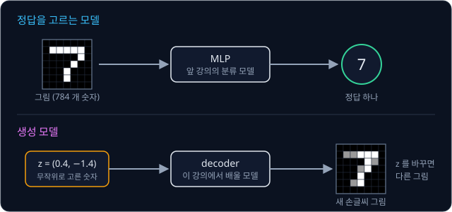

위 그림의 위쪽은 앞 강의의 MLP 처럼 그림을 받아 숫자 하나를 고르는 모델이다. 아래쪽 생성 모델은 무작위로 고른 숫자 두 개를 받아
그림 한 장을 낸다. 받는 숫자를 바꾸면 다른 그림이 나오는데, 이 숫자들이 무엇이고 어떻게 고르는지가 이 강의의 주제다.

**확인 문제.** 다음 둘 중 생성 모델은 어느 것일까? (가) 사진을 보고 고양이인지 개인지 맞히는 모델 (나) 실행할 때마다 처음 보는
고양이 사진을 새로 그려 내는 모델

답 보기

(나)다. (가)는 사진을 받아 정답 하나를 고르고, (나)는 학습한 사진들을 닮은 새 사진을 만들어 낸다.

### 그림을 숫자로 나타내기

컴퓨터는 그림을 숫자로 다룬다. 그림을 바둑판처럼 작은 칸으로 나누고, 칸마다 밝기를 숫자 하나로 적는다. 이 한 칸을 pixel(픽셀)이라고
하고, MNIST 에서는 pixel 의 밝기를 0(검정)부터 1(흰색) 사이의 숫자로 적는다. 0.5 는 중간 밝기의 회색이다.

가로 2 칸, 세로 2 칸짜리 아주 작은 그림을 보자. 왼쪽 위부터 오른쪽으로, 다시 다음 줄로 읽으면 밝기가 0, 1, 0, 1 인 그림은 오른쪽
세로줄만 하얀 그림이다. 이 그림은 숫자 네 개 $(0, 1, 0, 1)$ 로 적을 수 있다.

이렇게 숫자 여러 개를 순서대로 묶은 것을 vector(벡터)라고 하고, 묶인 숫자의 개수를 그 vector 의 차원(dimension)이라고 한다.
$(0, 1, 0, 1)$ 은 4 차원 vector 다. MNIST 그림은 가로 28 칸, 세로 28 칸이라 $28 \times 28 = 784$ 개의 pixel 로 되어 있으므로, 그림
한 장이 784 차원 vector 하나다. 숫자 두 개짜리 vector $(3, 2)$ 는 좌표평면의 점 하나로 그릴 수 있어서, 2 차원 vector 는 평면 위의
점과 같다.

**확인 문제.** 가로 5 칸, 세로 5 칸짜리 흑백 그림은 몇 차원 vector 일까?

답 보기

pixel 이 $5 \times 5 = 25$ 개이고 pixel 마다 숫자 하나씩이므로 25 차원 vector 다.

### 정답이 여럿일 때 평균의 문제

새 데이터를 만들려면 왜 지금까지와 다른 모델이 필요한지는 로봇 장면 하나로 볼 수 있다. 로봇이 앞으로 가다가 정면에 놓인 상자를
비켜 가는 시연을 10 번 모았더니, 5 번은 왼쪽으로 1 m, 5 번은 오른쪽으로 1 m 비켜 갔다. 왼쪽을 $+1$, 오른쪽을 $-1$ 로 적으면
시연의 정답은 $+1$ 다섯 개와 $-1$ 다섯 개다.

[Linear Regression](../linear-regression/README.md) 에서처럼 예측 하나를 내고 MSE(오차를 제곱해 평균한 값)를 loss 로 줄이는
모델을 이 데이터로 학습시키면 어떻게 될까. 예측을 $a$ 라고 하면, 정답 $+1$ 과 $-1$ 이 반반이므로 loss 는 두 오차 제곱의 평균이다.

| 예측 $a$ | 정답 $+1$ 과의 오차 제곱 | 정답 $-1$ 과의 오차 제곱 | MSE |
| --- | --- | --- | --- |
| $1$ | $(1 - 1)^2 = 0$ | $(1 + 1)^2 = 4$ | $(0 + 4) \div 2 = 2$ |
| $0.5$ | $(0.5 - 1)^2 = 0.25$ | $(0.5 + 1)^2 = 2.25$ | $(0.25 + 2.25) \div 2 = 1.25$ |
| $0$ | $(0 - 1)^2 = 1$ | $(0 + 1)^2 = 1$ | $(1 + 1) \div 2 = 1$ |
| $-0.5$ | $(-0.5 - 1)^2 = 2.25$ | $(-0.5 + 1)^2 = 0.25$ | $1.25$ |

MSE 는 $a = 0$ 에서 1 로 가장 작으므로, 학습을 마친 모델은 0 을 낸다. 0 은 "왼쪽으로도 오른쪽으로도 비키지 않는다" 는 뜻이라서
로봇은 상자에 정면으로 부딪힌다. MSE 를 가장 작게 하는 예측은 정답들의 평균이고, 정답이 두 무리로 갈라져 있으면 그 평균은 어느
무리에도 속하지 않는 엉뚱한 값이 된다.

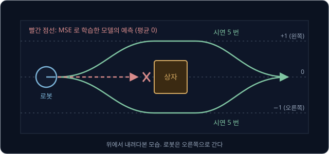

위 그림에서 초록 길이 시연이고, 빨간 점선이 MSE 로 학습한 모델이 내는 평균 0 의 길이다. 이 문제를 피하려면 정답 하나가 아니라
"왼쪽이 절반, 오른쪽이 절반" 이라는 정답들의 퍼진 모양을 배운 뒤, 실행할 때마다 그 모양을 따라 왼쪽이나 오른쪽 하나를 골라야 한다.
그러면 어떤 때는 왼쪽, 어떤 때는 오른쪽으로 비켜 가고 가운데로는 가지 않는다.

이처럼 같은 상황에서 정답이 여러 무리로 갈라지는 것을 multimodal 이라고 한다. mode 는 값이 가장 많이 몰린 자리를 뜻하고, multi 는
"여럿" 이라서, 값이 몰린 봉우리가 여럿이라는 뜻이다. 같은 단어가 VLA(카메라 이미지와 말로 된 지시를 받아 로봇의 행동을 내는
모델)나 CLIP(이미지와 글을 함께 다루는 모델)을 다룰 때는 "이미지·글·로봇 상태처럼 여러 종류의 입력을 함께 받는다" 는 전혀 다른 뜻으로
쓰인다. 이 강의와, 시연을 그대로 따라 하도록 배우는 behavior cloning·ACT 강의에서 multimodal 은 봉우리가 여럿이라는 앞의 뜻이다.

**흔한 오해.** loss 가 가장 작은 예측이 가장 좋은 행동이라고 생각하기 쉽다. 위 표에서 MSE 가 가장 작은 $a = 0$ 은 시연 10 번 중
어느 것과도 같지 않고, 실제로 하면 상자에 부딪히는 행동이다.

**확인 문제.** 시연의 정답이 $+2$, $+2$, $-2$, $-2$ 일 때 MSE 를 가장 작게 하는 예측은 얼마이고, 그 예측은 시연 중 몇 개와
같을까?

답 보기

MSE 를 가장 작게 하는 예측은 평균이므로 $(2 + 2 - 2 - 2) \div 4 = 0$ 이다. 시연 네 개 중 0 인 것은 하나도 없다.

**요약**

- 생성 모델은 정답 하나를 고르는 대신, 학습한 데이터를 닮은 새 데이터를 만들어 낸다
- 그림은 pixel 밝기를 순서대로 묶은 vector 이고, MNIST 그림 한 장은 784 차원 vector 다
- 정답이 여러 무리로 갈라지면(multimodal) MSE 로 학습한 모델은 그 평균을 내서 어느 정답과도 다른 값을 낸다. 정답들이 퍼진 모양을
  배워서 그 모양을 따라 하나씩 골라야 한다

## 확률분포

### 확률분포와 sampling

정답들의 퍼진 모양은 확률로 적는다. 확률은 어떤 결과가 얼마나 자주 나오는지를 0 과 1 사이 숫자로 나타낸 값이다
([Bandits & MDPs](../bandit-mdp/README.md) 에서 주사위로 다뤘다). 주사위에서 3 이 나올 확률은 $\frac{1}{6}$ 이고, 일어날 수 있는
모든 결과의 확률을 더하면 1 이다.

결과마다 그 확률을 모두 적어 둔 것을 확률분포(probability distribution), 줄여서 분포라고 한다. 앞의 상자 비켜 가기 시연이라면
분포는 아래 표 한 장이다.

| 결과 | $+1$ (왼쪽) | $-1$ (오른쪽) |
| --- | --- | --- |
| 확률 | 0.5 | 0.5 |

분포를 알면 그 분포를 따라 결과 하나를 무작위로 고를 수 있다. 이 분포라면 동전을 던져 앞면이면 $+1$, 뒷면이면 $-1$ 을 고르면
된다. 이렇게 분포를 따라 결과 하나를 무작위로 고르는 일을 sampling(뽑기)이라고 하고, 뽑혀 나온 결과 하나를 sample 이라고 한다.
열 번 뽑으면 $+1, -1, -1, +1, \ldots$ 처럼 매번 다른 sample 이 나오지만, 많이 뽑을수록 $+1$ 과 $-1$ 이 반반에 가까워진다.

생성 모델이 하는 일을 이 말로 다시 쓰면, 데이터가 어떤 분포를 따르는지 배운 뒤 그 분포에서 새 sample 을 뽑는 것이다. 손글씨
그림이라면 "어떤 784 차원 vector 가 얼마나 자주 나오는가" 가 분포이고, 거기서 뽑은 sample 이 새 손글씨 그림이다. 이 분포는 결과가
너무 많아 표로 적을 수 없으므로, 이 강의의 나머지는 그런 분포를 어떻게 다루는지에 관한 이야기다.

**확인 문제.** 어떤 로봇이 장애물을 만나면 0.7 의 확률로 왼쪽, 나머지 확률로 오른쪽으로 비켜 간다. 오른쪽으로 비켜 갈 확률은?
100 번 뽑으면 왼쪽은 대략 몇 번 나올까?

답 보기

모든 확률을 더하면 1 이므로 오른쪽은 $1 - 0.7 = 0.3$ 이다. 100 번 뽑으면 왼쪽은 대략 $100 \times 0.7 = 70$ 번 나온다.

### 평균

분포의 모양을 숫자 몇 개로 요약할 수 있으면 다루기 쉽다. 가장 먼저 쓰는 숫자는 가운데가 어디인지를 알려 주는 평균이다.

[Linear Regression](../linear-regression/README.md) 의 로봇 청소기에 2 V 를 넣고 1초에 몇 cm 가는지 네 번씩 쟀다고 하자. 바닥 두
곳에서 잰 값은 아래와 같다.

| 바닥 | 1 번째 | 2 번째 | 3 번째 | 4 번째 |
| --- | --- | --- | --- | --- |
| 매끈한 바닥 | 7 | 9 | 7 | 9 |
| 카펫 | 6 | 10 | 6 | 10 |

평균은 모두 더해 개수로 나눈 값이다. 매끈한 바닥은 $(7 + 9 + 7 + 9) \div 4 = 32 \div 4 = 8$ 이고, 카펫은
$(6 + 10 + 6 + 10) \div 4 = 32 \div 4 = 8$ 이다. 두 바닥 모두 평균은 8 cm 로 같다.

분포의 평균은 보통 그리스 문자 $\mu$ 로 적는다. $\mu$ 는 "뮤(mu)" 라고 읽고, mean(평균)의 첫 글자 m 에 해당한다. 아주 많이
뽑았을 때 sample 들의 평균이 다가가는 값이라서, [Bandits & MDPs](../bandit-mdp/README.md) 의 기댓값과 같은 것이다.

**확인 문제.** 측정값이 5, 8, 11 일 때 평균 $\mu$ 는?

답 보기

$(5 + 8 + 11) \div 3 = 24 \div 3 = 8$ 이다.

### 분산과 표준편차

두 바닥의 평균은 같지만 값이 퍼진 정도는 다르다. 매끈한 바닥에서는 평균 8 에서 1 씩만 벗어났는데, 카펫에서는 2 씩 벗어났다. 이
퍼진 정도를 숫자 하나로 나타낸 것이 분산이다.

분산은 각 값이 평균에서 벗어난 양을 제곱해 평균한 값이다. 벗어난 양을 그냥 평균하면 위로 벗어난 것과 아래로 벗어난 것이 서로
지워져 0 이 되므로, [Linear Regression](../linear-regression/README.md) 의 MSE 에서처럼 제곱한 뒤 평균한다.

| 바닥 | 값 | 평균에서 벗어난 양 | 벗어난 양의 제곱 | 분산 (제곱의 평균) |
| --- | --- | --- | --- | --- |
| 매끈한 바닥 | 7, 9, 7, 9 | $-1, +1, -1, +1$ | $1, 1, 1, 1$ | $4 \div 4 = 1$ |
| 카펫 | 6, 10, 6, 10 | $-2, +2, -2, +2$ | $4, 4, 4, 4$ | $16 \div 4 = 4$ |

분산을 기호로 쓰면 아래와 같다. $x_i$ 는 $i$ 번째 값, $N$ 은 값의 개수이고 $\sum$ 은 "1 번째부터 $N$ 번째까지 모두 더하라" 는
기호다.

$$
\sigma^2 = \frac{1}{N}\sum_{i=1}^{N}(x_i - \mu)^2
$$

이 식은 "값마다 평균 $\mu$ 를 빼서 제곱하고, 모두 더한 뒤 개수로 나눈다" 로 읽는다. 카펫이라면 $x_i - \mu$ 는 $-2, +2, -2, +2$,
$\sum$ 의 결과는 16, $N$ 은 4, $\sigma^2$ 은 4 다.

분산은 제곱한 값이라서 단위도 cm 가 아니라 cm 의 제곱이 된다. 원래 단위로 돌려놓으려면 제곱근을 씌우는데, 제곱근 $\sqrt{\phantom{x}}$
은 제곱해서 그 수가 되는 양수다($\sqrt 4 = 2$). 분산의 제곱근을 표준편차(standard deviation)라고 하고 $\sigma$ 로 적는다. $\sigma$ 는
그리스 문자 소문자 "시그마(sigma)" 로, "모두 더하라" 는 대문자 $\Sigma$ 와 다른 기호다. [Backpropagation](../autograd/README.md)
에서는 같은 $\sigma$ 를 sigmoid 함수의 이름으로 썼는데, 이 강의에서 $\sigma$ 는 언제나 표준편차다. 분산을 $\sigma^2$ 으로 적는 것도
"표준편차의 제곱" 이기 때문이다.

매끈한 바닥은 $\sigma = \sqrt 1 = 1$ cm, 카펫은 $\sigma = \sqrt 4 = 2$ cm 다. 표준편차는 "값들이 평균에서 대략 이만큼 벗어나
있다" 는 거리로 읽으면 된다.

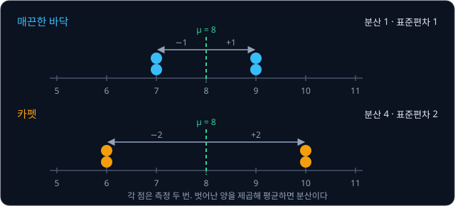

**확인 문제.** 측정값이 4, 12, 4, 12 일 때 평균, 분산, 표준편차는?

답 보기

평균은 $32 \div 4 = 8$ 이다. 벗어난 양은 $-4, +4, -4, +4$, 제곱은 16 씩이라 분산은 $64 \div 4 = 16$ 이고, 표준편차는
$\sqrt{16} = 4$ 다.

### 연속된 값의 분포

주사위의 결과는 1 부터 6 까지 여섯 개뿐이지만, 청소기가 간 거리는 7.93 cm, 8.017 cm 처럼 어떤 소수든 나올 수 있다. 이렇게 값이
끊기지 않고 이어지는 경우에는 결과마다 확률을 적는 표를 만들 수 없다. 결과가 끝없이 많아서, 정확히 8.000... cm 가 나올 확률은
0 에 가깝기 때문이다.

그래서 연속된 값은 "어느 구간에 들어갈 확률" 로 다룬다. 청소기를 1000 번 달리게 해 거리를 재고, 0.5 cm 너비의 칸마다 몇 번
들어갔는지 막대로 세운 그림을 histogram(히스토그램)이라고 한다.

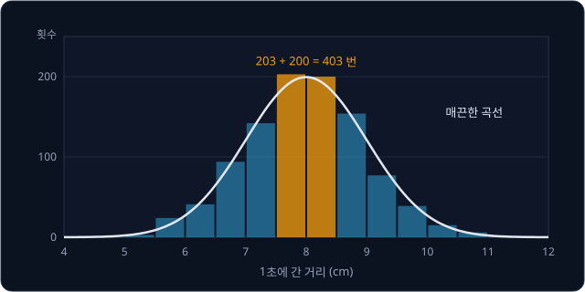

위 그림에서 7.5 cm 이상 8.5 cm 미만인 두 칸에는 203 번과 200 번, 합해 403 번이 들어갔으므로 이 구간에 들어갈 확률은 약
$403 \div 1000 \approx 0.40$ 이다. 칸을 더 잘게 나누고 더 많이 재면 막대 꼭대기가 그림의 매끈한 곡선에 가까워진다. 이 곡선은 높이가
높은 곳일수록 그 근처에 값이 촘촘히 몰려 있다는 뜻이고, 두 값 사이의 곡선 아래 넓이가 그 구간에 들어갈 확률이다. 곡선 아래 전체
넓이는 모든 확률을 더한 것이라 1 이다.

**확인 문제.** 위 histogram 에서 7 cm 이상 7.5 cm 미만 칸에 142 번이 들어갔다. 이 구간에 들어갈 확률은 대략 얼마일까?

답 보기

1000 번 중 142 번이므로 $142 \div 1000 = 0.142$, 약 0.14 다.

### 정규분포

위 histogram 의 곡선처럼 가운데가 볼록하고 양쪽으로 똑같이 낮아지는 종 모양 분포를 정규분포(normal distribution)라고 한다. 이
모양으로 측정 오차를 설명한 수학자 Gauss 의 이름을 따서 Gaussian(가우시안) 분포라고도 부른다. 측정 오차, 사람의 키처럼 작은 무작위
효과가 많이 더해져 생기는 값은 대개 이 모양을 따르기 때문에 머신러닝에서 가장 많이 쓰는 분포다.

정규분포는 평균 $\mu$ 와 표준편차 $\sigma$ 두 숫자만 정하면 모양이 하나로 정해진다. $\mu$ 는 봉우리의 위치, $\sigma$ 는 봉우리가
얼마나 넓게 퍼지는지를 정한다. 그래서 정규분포를 $\mathcal N(\mu, \sigma^2)$ 으로 적는다. $\mathcal N$ 은 normal 의 첫 글자이고,
괄호 안의 둘째 자리에는 표준편차가 아니라 분산 $\sigma^2$ 을 쓰는 것이 관례다. 위 histogram 은 $\mathcal N(8, 1^2)$, 곧 평균 8,
표준편차 1 인 정규분포에서 뽑은 1000 개였다.

정규분포에서는 $\mu$ 에서 표준편차 몇 개만큼 떨어졌는지만 알면, 그 안에 값이 들어갈 확률이 늘 같다.

| 구간 | $\mathcal N(8, 1^2)$ 에서의 구간 | 그 안에 들어갈 확률 |
| --- | --- | --- |
| $\mu - \sigma$ ~ $\mu + \sigma$ | 7 ~ 9 | 약 68% |
| $\mu - 2\sigma$ ~ $\mu + 2\sigma$ | 6 ~ 10 | 약 95% |
| $\mu - 3\sigma$ ~ $\mu + 3\sigma$ | 5 ~ 11 | 약 99.7% |

실제로 1000 번 중 7 ~ 9 cm 에 들어간 것은 699 번(약 70%), 6 ~ 10 cm 에 들어간 것은 950 번(95%)으로 표와 거의 같다.

평균이 0, 표준편차가 1 인 $\mathcal N(0, 1)$ 을 표준 정규분포(standard normal distribution)라고 한다. 값의 68% 가 $-1$ ~ $1$,
95% 가 $-2$ ~ $2$, 99.7% 가 $-3$ ~ $3$ 안에 들어가서, 이 분포에서 뽑은 값이 3 보다 크거나 $-3$ 보다 작은 일은 1000 번에 3 번
정도로 드물다.

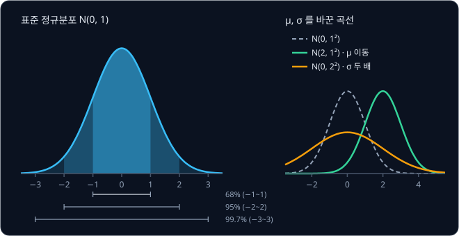

위 그림의 왼쪽은 $\mathcal N(0, 1)$ 의 곡선에 세 구간을 색으로 칠한 것이다. 오른쪽은 $\mu$ 와 $\sigma$ 를 바꾼 곡선으로, $\mu$ 를
0 에서 2 로 바꾸면 모양은 그대로 오른쪽으로 2 만큼 옮겨 가고, $\sigma$ 를 1 에서 2 로 키우면 봉우리가 낮아지면서 양옆으로 두 배
넓게 퍼진다. 곡선 아래 넓이는 언제나 1 이라서 넓게 퍼지면 그만큼 낮아진다.

**확인 문제.** $\mathcal N(8, 2^2)$ 에서 뽑은 값의 약 95% 는 어느 구간에 들어갈까?

답 보기

$\mathcal N(8, 2^2)$ 의 첫째 자리는 평균이라 $\mu = 8$ 이고, 둘째 자리 $2^2$ 은 분산이라 표준편차는 $\sigma = 2$ 다. 위 표에서
약 95% 가 들어가는 구간은 $\mu - 2\sigma$ ~ $\mu + 2\sigma$ 이므로 $8 - 2 \times 2 = 4$ 부터 $8 + 2 \times 2 = 12$ 까지다.

### 표준 정규분포에서의 sampling

컴퓨터에는 표준 정규분포 $\mathcal N(0, 1)$ 에서 숫자를 하나씩 뽑아 주는 기능이 들어 있다. 실제로 여덟 번 뽑으면 아래처럼 나온다.

| 뽑은 순서 | 1 | 2 | 3 | 4 | 5 | 6 | 7 | 8 |
| --- | --- | --- | --- | --- | --- | --- | --- | --- |
| 뽑힌 값 | 2.3 | $-0.7$ | 0.4 | 0.1 | 0.8 | $-1.4$ | $-0.4$ | $-0.8$ |

뽑힌 값은 양수도 음수도 있고, 대부분 $-2$ 와 2 사이에 있다. 2.3 처럼 2 를 넘는 값도 가끔 나오는데, 95% 구간 밖이니 20 번에 1 번
꼴로 나오는 값이다. 여덟 값의 평균은 $0.3 \div 8 \approx 0.04$ 로 0 에 가깝고, 더 많이 뽑을수록 평균은 0, 표준편차는 1 에 다가간다.

이 강의에서는 표준 정규분포에서 뽑은 값을 그리스 문자 $\epsilon$ 으로 적는다. $\epsilon$ 은 "엡실론(epsilon)" 이라고 읽는다. 뽑는
일을 기호로는 $\epsilon \sim \mathcal N(0, 1)$ 이라고 쓰고, 물결표 $\sim$ 는 "~에서 뽑았다" 또는 "~를 따른다" 로 읽는다.

**확인 문제.** $\mathcal N(0, 1)$ 에서 1000 번 뽑으면 $-1$ 과 1 사이의 값은 대략 몇 개일까?

답 보기

$\mathcal N(0, 1)$ 은 $\mu = 0$, $\sigma = 1$ 이라 $-1$ ~ 1 은 $\mu - \sigma$ ~ $\mu + \sigma$ 이고, 이 구간에는 약 68% 가
들어가므로 $1000 \times 0.68 = 680$ 개쯤이다.

### 여러 차원의 정규분포

생성 모델에 넣는 무작위 숫자는 하나가 아니라 여러 개인 경우가 많다. 앞의 생성 모델 그림처럼 숫자 두 개를 넣는다면, 첫째 숫자와
둘째 숫자를 각각 $\mathcal N(0, 1)$ 에서 따로 뽑아 2 차원 vector $(z_1, z_2)$ 를 만든다. 첫째를 뽑을 때 둘째가 무엇이 나올지
신경 쓰지 않고 각자 뽑는다는 뜻으로, 이렇게 서로 영향을 주지 않고 뽑는 것을 독립(independent)이라고 한다.

이 vector 를 평면 위의 점으로 찍으면 원점 $(0, 0)$ 근처에 둥글게 몰린 구름이 된다. 각 좌표의 99.7% 가 $-3$ ~ $3$ 안에 있으므로,
점들은 거의 모두 가로세로 $-3$ ~ $3$ 의 정사각형 안에 들어간다.

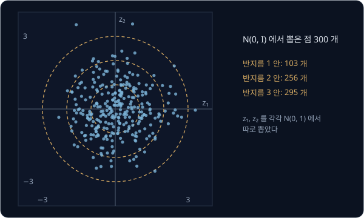

차원마다 따로 $\mathcal N(0, 1)$ 에서 뽑은 vector 의 분포를 $\mathcal N(0, I)$ 로 적는다. 0 은 모든 차원의 평균이 0 이라는 뜻이고,
$I$ 는 수학에서 identity matrix(단위행렬)라고 부르는 기호인데, 여기서는 "모든 차원의 분산이 1 이고 차원끼리 독립이다" 라는 뜻으로만
읽으면 된다. 20 차원이면 숫자 20 개를 각각 $\mathcal N(0, 1)$ 에서 뽑으면 된다.

**확인 문제.** $\mathcal N(0, I)$ 에서 2 차원 vector 를 뽑았더니 첫째 숫자가 2.5 였다. 둘째 숫자를 뽑기 전에 둘째 숫자가 얼마일지에
대해 달라지는 것이 있을까?

답 보기

없다. 두 숫자는 독립이라 둘째는 첫째가 무엇이었든 상관없이 $\mathcal N(0, 1)$ 에서 새로 뽑는다.

**요약**

- 분포는 결과마다 얼마나 자주 나오는지를 적은 것이고, 분포를 따라 무작위로 하나 고르는 것이 sampling, 고른 결과가 sample 이다
- 평균 $\mu$ 는 분포의 가운데, 분산 $\sigma^2$ 은 평균에서 벗어난 양을 제곱해 평균한 값, 표준편차 $\sigma$ 는 그 제곱근이다
- 정규분포 $\mathcal N(\mu, \sigma^2)$ 은 $\mu$ 를 가운데로 둔 종 모양이고, 값의 68%·95%·99.7% 가 $\mu$ 에서 $\sigma$ 의 1·2·3 배
  안에 들어간다. $\mathcal N(0, I)$ 는 차원마다 $\mathcal N(0, 1)$ 에서 따로 뽑은 vector 의 분포다

## autoencoder

### 줄였다가 되살리는 모델

784 개의 숫자로 된 손글씨 그림의 분포를 바로 배우기는 어렵다. 그런데 784 개의 pixel 이 제멋대로 정해지는 것은 아니다. 손글씨
그림이라면 어떤 숫자인지, 얼마나 굵게 썼는지, 얼마나 기울었는지 같은 몇 가지만 정해지면 pixel 들이 거의 다 정해진다. 그래서 그림을
그 몇 가지 숫자로 줄여 보고, 줄인 숫자에서 그림을 다시 만들어 보는 방법을 쓴다.

가장 작은 예로 pixel 이 세 개뿐인 회색 그림을 생각하자. 이 그림들은 세 pixel 의 밝기가 늘 같아서 $(0.3, 0.3, 0.3)$,
$(0.8, 0.8, 0.8)$ 처럼 생겼다. 숫자는 세 개지만 실제로 담긴 정보는 "얼마나 밝은가" 하나뿐이다. 그래서 아래 두 단계로 그림을 숫자
하나로 줄였다가 되살릴 수 있다.

- **줄이기** — 세 pixel 의 평균을 낸다. $(0.3, 0.3, 0.3)$ 은 $(0.3 + 0.3 + 0.3) \div 3 = 0.3$ 이 된다
- **되살리기** — 그 숫자를 세 칸에 똑같이 적는다. 0.3 은 $(0.3, 0.3, 0.3)$ 이 된다

| 그림 $x$ | 줄인 숫자 $z$ | 되살린 그림 $\hat x$ |
| --- | --- | --- |
| $(0.3, 0.3, 0.3)$ | 0.3 | $(0.3, 0.3, 0.3)$ |
| $(0.8, 0.8, 0.8)$ | 0.8 | $(0.8, 0.8, 0.8)$ |
| $(0.4, 0.6, 0.5)$ | 0.5 | $(0.5, 0.5, 0.5)$ |

줄이는 쪽을 encoder, 되살리는 쪽을 decoder 라고 부르고, 둘을 이은 모델을 autoencoder 라고 한다. encode 는 "부호로 바꾸다",
decode 는 "부호를 풀다" 라는 뜻이고, auto 는 "자기 자신" 이라는 뜻이다. 정답을 따로 주지 않고 입력 그림 자신을 정답으로 삼아
되살리는 법을 배우기 때문에 이런 이름이 붙었다. 되살린 그림에는 $\hat x$ 처럼 모자(hat)를 씌워 원래 그림 $x$ 와 구별한다.

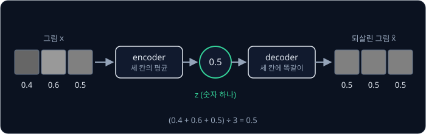

위 그림은 표의 셋째 줄을 따라간 것이다. $(0.4, 0.6, 0.5)$ 는 세 pixel 이 조금씩 달라서, 숫자 하나로 줄였다가 되살리면 그 차이가
사라지고 $(0.5, 0.5, 0.5)$ 가 된다.

**확인 문제.** 그림 $(0.9, 0.6, 0.6)$ 을 이 encoder 와 decoder 에 넣으면 $z$ 와 $\hat x$ 는?

답 보기

$z = (0.9 + 0.6 + 0.6) \div 3 = 2.1 \div 3 = 0.7$ 이고, $\hat x = (0.7, 0.7, 0.7)$ 이다.

### reconstruction loss

되살린 그림이 원래 그림과 얼마나 다른지는 pixel 마다 차이를 제곱해 더한 값으로 잰다. reconstruction 은 "다시 만들기, 복원" 이라는
뜻이고, 이 값을 reconstruction loss 라고 한다.

$(0.4, 0.6, 0.5)$ 를 되살린 $(0.5, 0.5, 0.5)$ 로 계산하면 아래와 같다.

| pixel | 원래 $x_i$ | 되살린 $\hat x_i$ | 차이 $\hat x_i - x_i$ | 차이의 제곱 |
| --- | --- | --- | --- | --- |
| 1 | 0.4 | 0.5 | $0.1$ | 0.01 |
| 2 | 0.6 | 0.5 | $-0.1$ | 0.01 |
| 3 | 0.5 | 0.5 | $0$ | 0 |
| 합 | | | | 0.02 |

숫자만 바꿔 $(0.2, 0.5, 0.8)$ 을 넣으면 $z = 1.5 \div 3 = 0.5$ 이고 $\hat x = (0.5, 0.5, 0.5)$ 다. 차이는 $0.3, 0, -0.3$ 이고
제곱은 0.09, 0, 0.09 라서 reconstruction loss 는 0.18 이다. 이 그림은 왼쪽에서 오른쪽으로 점점 밝아지는데, 숫자 하나에는 "얼마나
밝은가" 만 담기고 "어느 쪽으로 밝아지는가" 는 담을 자리가 없어서 크게 틀렸다. 줄인 숫자가 적을수록 담을 수 있는 정보도 적다.

기호로 쓰면 아래와 같다.

$$
L_{\text{rec}} = \sum_{i=1}^{D} (\hat x_i - x_i)^2
$$

$L_{\text{rec}}$ 은 reconstruction loss, $D$ 는 pixel 의 개수(그림의 차원)다. 이 식은 "pixel 마다 되살린 값에서 원래 값을 빼
제곱하고, $D$ 개를 모두 더한다" 로 읽는다. 첫 예라면 $D$ 는 3, 차이의 제곱은 0.01, 0.01, 0 이고 $L_{\text{rec}}$ 은 0.02 다. MSE
와 달리 개수로 나누지 않고 더하기만 하는데, 그 이유는 뒤의 "두 항의 비중" 에서 다룬다.

**확인 문제.** 그림 $(0.3, 0.3, 0.6)$ 의 reconstruction loss 는?

답 보기

$z = 1.2 \div 3 = 0.4$ 이고 $\hat x = (0.4, 0.4, 0.4)$ 다. 차이는 $0.1, 0.1, -0.2$ 이고 제곱은 0.01, 0.01, 0.04 라서 합은 0.06 이다.

### neural network 로 만든 autoencoder 와 latent

회색 그림은 "평균 내기" 와 "똑같이 적기" 가 정답임을 사람이 알았지만, 손글씨 그림은 어떤 숫자로 줄여야 할지 사람이 정해 줄 수
없다. 그래서 encoder 와 decoder 를 모두 MLP 로 만들고, reconstruction loss 가 작아지도록 [PyTorch Training Loop](../pytorch-mlp/README.md)
에서처럼 gradient descent 로 weight 를 학습시킨다. gradient descent 는 loss 를 줄이는 방향으로 weight 를 조금씩 고치기를 되풀이하는
학습 방법이다([Linear Regression](../linear-regression/README.md)).

MNIST 라면 encoder 는 784 개의 숫자를 받아 400 개로, 다시 2 개로 줄이고, decoder 는 2 개를 받아 400 개로, 다시 784 개로 늘린다.
가운데의 숫자 두 개가 그림 한 장을 대신한다.

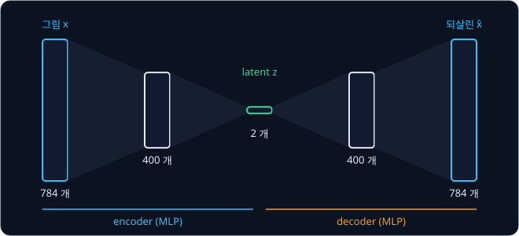

가운데에서 그림을 대신하는 숫자들 $z$ 를 latent(잠재 변수)라고 부른다. latent 는 라틴어 latere(숨다)에서 온 말로 "숨어 있는" 이라는
뜻이다. 데이터에는 직접 적혀 있지 않고 모델이 학습하면서 스스로 정하는 값이라서 이런 이름이 붙었다. latent 의 개수를 z_dim(latent 의
차원)이라고 하고, 위 그림은 z_dim 이 2 다. latent 가 놓일 수 있는 모든 자리를 latent 공간(latent space)이라고 하는데, z_dim 이 2 면
latent 공간은 평면이고, 그림 한 장은 이 평면 위의 점 하나가 된다.

latent 의 각 숫자가 무슨 뜻인지는 사람이 정하지 않는다. 학습이 끝나 보니 첫째 숫자가 커질수록 글씨가 굵어지는 식으로 뜻이 보일 때도
있지만, 대개 여러 성질이 섞여 있다.

**확인 문제.** z_dim 이 20 이면 그림 한 장의 숫자 784 개를 몇 개로 줄이는 것이고, 대략 몇 분의 1 로 줄어든 것일까?

답 보기

20 개로 줄인다. $784 \div 20 = 39.2$ 라서 약 39 분의 1 이다.

### latent 공간의 빈 곳

autoencoder 의 decoder 는 latent 를 받아 그림을 내므로, 새 그림을 만드는 데 그대로 쓸 수 있을 것처럼 보인다. 아무 $z$ 나 골라
decoder 에 넣으면 되기 때문이다. 그런데 여기에는 문제가 있다.

autoencoder 는 학습에 쓴 그림들을 잘 되살리기만 하면 loss 가 작아지므로, 그림들의 $z$ 가 latent 공간의 어디에 놓일지는 아무 제약이
없다. z_dim 이 1 인 autoencoder 를 학습시켰더니 숫자 0 그림들은 $z = -3$ 근처에, 숫자 1 그림들은 $z = 4$ 근처에 모였다고 하자.
decoder 는 학습하는 동안 $-3$ 근처와 4 근처의 $z$ 만 받아 보았다. $z = 0.5$ 처럼 그 사이에 있는 값은 한 번도 받아 본 적이 없으므로,
거기서 무엇이 나올지는 아무도 정해 주지 않았고 숫자가 아닌 얼룩이 나올 수 있다.

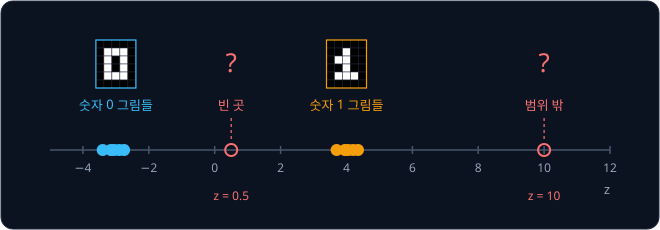

위 그림처럼 학습한 그림들의 $z$ 사이에는 빈 곳이 생기고, 바깥쪽 끝이 어디인지도 정해져 있지 않다. 새 그림을 만들려고 $z$ 를 무작위로
고르려 해도 어느 범위에서 골라야 할지 모르고, 고른 자리가 빈 곳이면 엉뚱한 그림이 나온다. 그래서 생성 모델로 쓰려면 두 가지가
필요하다.

- 그림들의 $z$ 가 빈 곳 없이 이어져 latent 공간의 한 영역을 채운다
- 그 영역이 $\mathcal N(0, I)$ 처럼 미리 정해 둔, 뽑기 쉬운 분포의 모양과 같다

두 가지가 갖춰지면 $\mathcal N(0, I)$ 에서 $z$ 를 하나 뽑아 decoder 에 넣는 것만으로 그럴듯한 새 그림이 나온다. 이것을 해내는 모델이
VAE 다.

**확인 문제.** 위 autoencoder 로 새 그림을 만들려고 $\mathcal N(0, 1)$ 에서 $z$ 를 뽑으면 어떤 값이 가장 자주 나오고, 그 값에서는
어떤 그림이 나올 것이라고 기대할 수 있을까?

답 보기

0 근처가 가장 자주 나온다. 그런데 0 근처는 0 그림($-3$)과 1 그림(4) 사이의 빈 곳이라 decoder 가 본 적이 없는 자리이고, 숫자 모양이
나온다고 기대할 근거가 없다.

**요약**

- autoencoder 는 encoder 로 그림을 숫자 몇 개(latent $z$)로 줄이고 decoder 로 되살리며, 되살린 그림과 원래 그림의 차이의 제곱합인
  reconstruction loss 를 줄이도록 학습한다
- latent 의 개수(z_dim)가 적을수록 담을 수 있는 정보가 적어서 복원이 거칠어진다
- autoencoder 의 loss 는 그림들의 $z$ 가 latent 공간의 어디에 모일지 정하지 않는다. 그래서 0 그림은 $-3$ 근처, 1 그림은 4 근처처럼
  모인 곳 사이와 바깥에 decoder 가 학습 중 한 번도 받아 보지 못한 빈 곳이 남고, 무작위로 뽑은 $z$ 가 그곳에 떨어지면 숫자가 아닌
  얼룩이 나올 수 있다

## VAE 의 encoder

### 점 대신 범위

VAE(variational autoencoder)는 encoder 가 그림 한 장을 latent 의 점 하나가 아니라 범위 하나로 바꾼다. encoder 는 그림마다 "이
그림의 $z$ 는 $\mu$ 근처에 있고 $\sigma$ 정도 퍼져 있다" 는 뜻으로 숫자 두 개, 평균 $\mu$ 와 표준편차 $\sigma$ 를 낸다. 곧 그림
하나가 정규분포 $\mathcal N(\mu, \sigma^2)$ 하나가 된다. variational 이라는 이름은 이 분포를 학습으로 조금씩 고쳐 맞추는 수학
기법(variational inference)에서 왔다.

학습할 때는 이 분포에서 $z$ 를 하나 뽑아 decoder 에 넣는다. 같은 그림이라도 볼 때마다 다른 $z$ 가 뽑힌다. encoder 가 숫자 0 그림
하나에 $\mu = -1$, $\sigma = 0.5$ 를 냈다면, 이 그림을 네 번 볼 때 뽑히는 $z$ 는 예를 들어 아래와 같다.

| 이 그림을 본 횟수 | 1 | 2 | 3 | 4 |
| --- | --- | --- | --- | --- |
| 뽑힌 $z$ | $-0.8$ | $-1.7$ | $-0.6$ | $-1.2$ |

decoder 는 $-0.8$ 을 받아도, $-1.7$ 을 받아도 같은 0 그림을 되살려야 loss 가 작아진다. 그래서 decoder 는 점 하나가 아니라 $\mu$
근처의 범위 전체를 0 그림으로 되살리는 법을 배운다. $\mathcal N(-1, 0.5^2)$ 에서 뽑은 값의 95% 는 $-1 - 2 \times 0.5 = -2$ 부터
$-1 + 2 \times 0.5 = 0$ 사이에 있으므로, 이 범위가 0 그림의 몫이 된다.

숫자 1 그림에 encoder 가 $\mu = 1$, $\sigma = 0.5$ 를 냈다면 그 95% 범위는 0 부터 2 까지다. 두 범위가 0 에서 맞닿으므로 그 사이에
빈 곳이 없다. 0 근처의 $z$ 는 학습하는 동안 0 그림으로도, 1 그림으로도 되살려야 했던 자리라서, decoder 는 두 그림의 중간쯤 되는
그림을 낸다.

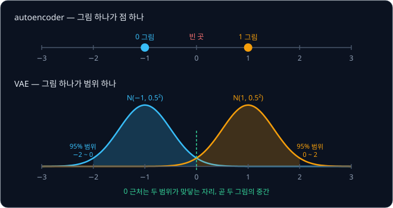

**흔한 오해.** encoder 가 내는 $\sigma$ 는 작을수록 좋다고 생각하기 쉽다. $\sigma$ 가 0 에 가까우면 $z$ 는 늘 $\mu$ 하나로 뽑혀서
보통의 autoencoder 와 같아지고, 범위가 사라지니 빈 곳도 다시 생긴다. 범위가 서로 겹칠 만큼 $\sigma$ 가 커야 빈 곳이 채워진다.

**확인 문제.** encoder 가 어떤 그림에 $\mu = 2$, $\sigma = 0.5$ 를 냈다. 학습 중 이 그림에서 뽑히는 $z$ 의 약 95% 는 어느 범위에
있을까?

답 보기

$2 - 2 \times 0.5 = 1$ 부터 $2 + 2 \times 0.5 = 3$ 까지다.

### encoder 와 decoder 의 기호

VAE 의 논문과 강의에서는 encoder 와 decoder 를 아래 기호로 적는다.

$$
q_\phi(z \mid x) = \mathcal N(\mu, \sigma^2), \qquad p_\theta(x \mid z)
$$

기호를 하나씩 읽으면 아래와 같다.

- 세로 막대 $\mid$ 는 "~가 주어졌을 때" 로 읽는다. $q(z \mid x)$ 는 "그림 $x$ 가 주어졌을 때 $z$ 의 분포" 이고, encoder 가 그림
  $x$ 를 보고 낸 $\mathcal N(\mu, \sigma^2)$ 이 바로 이것이다
- $p_\theta(x \mid z)$ 는 "latent $z$ 가 주어졌을 때 그림 $x$ 의 분포" 이고, decoder 가 이 일을 한다
- $\phi$ 는 "파이(phi)" 라고 읽고 encoder 의 weight 전체를, $\theta$ 는 "세타(theta)" 라고 읽고 decoder 의 weight 전체를 가리킨다.
  아래첨자로 붙여 이 분포가 그 weight 로 계산된다는 것을 나타낸다

$z$ 가 여러 차원이면 encoder 는 차원마다 $\mu_j$ 와 $\sigma_j$ 를 하나씩 낸다. $j$ 는 몇 번째 차원인지를 나타내는 번호다. z_dim 이
2 면 encoder 의 출력은 $\mu_1, \mu_2, \sigma_1, \sigma_2$ 네 숫자다.

**확인 문제.** z_dim 이 20 인 VAE 의 encoder 는 그림 한 장마다 숫자를 몇 개 낼까?

답 보기

차원마다 $\mu$ 와 $\sigma$ 를 하나씩 내므로 $20 \times 2 = 40$ 개다.

### σ 대신 log σ² 을 내는 이유

encoder 의 마지막 층은 weight 를 곱하고 더하는 Linear layer 라서 $-3$ 이든 $2.5$ 든 어떤 숫자든 낼 수 있다. $\mu$ 는 음수여도
괜찮지만 $\sigma$ 는 퍼진 정도라서 반드시 0 보다 커야 하는데, encoder 가 $\sigma = -0.5$ 를 내면 뜻이 없는 값이 된다.

그래서 encoder 는 $\sigma$ 대신 [PyTorch Training Loop](../pytorch-mlp/README.md) 의 log 를 씌운 $\log \sigma^2$ 을 낸다. $\log b$ 는
"$e$ 를 몇 제곱해야 $b$ 가 되는가" 의 답이라서 $b$ 가 1 보다 크면 양수($\log 2 = 0.693$, $\log 4 = 1.386$), 1 보다 작으면
음수다. 거꾸로 $e^{a}$ 는 $e$ 를 몇 번 곱하거나 나눠도 0 이나 음수가 되지 않으므로 $a$ 가 어떤 수이든 0 보다 크다. 이 값
$\log \sigma^2$ 을 logvar(log variance, 분산의 log)라고 부른다. logvar 가 어떤 숫자이든 $\sigma^2 = e^{\text{logvar}}$ 은 언제나 0 보다 크므로, $\sigma$
도 언제나 양수로 되돌릴 수 있다.

$$
\sigma^2 = e^{\text{logvar}}, \qquad \sigma = e^{\text{logvar} / 2}
$$

둘째 식은 $\sigma^2$ 의 제곱근이다. 지수를 반으로 나누면 제곱근이 되는데, $e^{a/2} \times e^{a/2} = e^{a}$ 이기 때문이다.

| encoder 가 낸 logvar | $\sigma^2 = e^{\text{logvar}}$ | $\sigma = e^{\text{logvar}/2}$ |
| --- | --- | --- |
| $-4.605$ | 0.01 | 0.1 |
| $-1.386$ | 0.25 | 0.5 |
| 0 | 1 | 1 |
| 1.386 | 4 | 2 |

logvar 가 0 이면 $\sigma = 1$ 이고, 음수일수록 $\sigma$ 가 작아지며, 양수일수록 커진다. 음수 logvar 도 문제없이 작은 양수 $\sigma$ 가
된다.

**확인 문제.** encoder 가 logvar $= 0.693$ 을 냈다. $\sigma^2$ 과 $\sigma$ 는 얼마일까? ($e^{0.693} = 2$)

답 보기

$\sigma^2 = e^{0.693} = 2$ 이고, $\sigma = \sqrt 2 \approx 1.414$ 다.

### prior

빈 곳 없이 채운 영역이 $\mathcal N(0, I)$ 와 같은 모양이 되도록, VAE 는 처음부터 "$z$ 는 $\mathcal N(0, I)$ 를 따라야 한다" 고 정해
둔다. 이렇게 데이터를 보기 전에 미리 정해 둔 $z$ 의 분포를 prior 라고 하고, $p(z) = \mathcal N(0, I)$ 로 적는다. 한편 encoder 가
그림 $x$ 를 본 뒤에 낸 분포 $q_\phi(z \mid x)$ 는 posterior 라고 부른다. prior 와 posterior 는 라틴어로 "앞의" 와 "뒤의" 라는
뜻으로, 데이터를 보기 앞의 분포와 본 뒤의 분포를 가리킨다.

그림마다 다른 posterior 들이 모두 prior 근처에 모이고 서로 겹치면, 그것들을 모두 합친 모양이 prior 와 비슷해진다. 그러면 새 그림을
만들 때 encoder 없이 prior $\mathcal N(0, I)$ 에서 $z$ 를 뽑아 decoder 에 넣으면 된다. 뽑힌 $z$ 는 어느 그림의 posterior 범위 안에
떨어질 가능성이 높고, decoder 는 그 범위를 그림으로 되살리는 법을 배웠기 때문이다.

posterior 를 prior 쪽으로 끌어당기는 일은 loss 의 한 항이 맡는데, 두 분포가 얼마나 다른지를 재는 KL divergence 라는 값이다. 계산은
"VAE 의 loss" 에서 숫자로 한다.

**확인 문제.** 학습을 마친 VAE 로 새 손글씨 그림을 만들 때 encoder 가 필요할까?

답 보기

필요 없다. $z$ 는 prior $\mathcal N(0, I)$ 에서 뽑고, decoder 만 써서 그림을 만든다. encoder 는 학습할 때와, 이미 있는 그림의 $z$ 를
알고 싶을 때만 쓴다.

**요약**

- VAE 의 encoder 는 그림마다 정규분포 $q_\phi(z \mid x) = \mathcal N(\mu, \sigma^2)$ 를 내고, 학습할 때는 거기서 뽑은 $z$ 를
  decoder 에 넣는다. 그래서 decoder 는 점이 아니라 범위를 되살리는 법을 배우고, 범위끼리 겹쳐 빈 곳이 채워진다
- encoder 는 $\sigma$ 대신 logvar $= \log \sigma^2$ 을 내고, $\sigma = e^{\text{logvar}/2}$ 로 되돌려 언제나 양수인 $\sigma$ 를
  얻는다
- 미리 정해 둔 $z$ 의 분포 $\mathcal N(0, I)$ 가 prior 이고, 생성할 때는 prior 에서 뽑은 $z$ 를 decoder 에 넣는다

## reparameterization trick

### sampling 에서 끊기는 gradient

encoder 의 weight 도 gradient descent 로 학습해야 한다. gradient 는 weight 를 아주 조금 바꿨을 때 loss 가 변하는 비율이고,
[Backpropagation](../autograd/README.md) 에서는 계산을 한 칸씩 거슬러 올라가며 칸마다의 비율(local derivative)을 곱하는 chain rule 로
구했다. VAE 의 계산은 그림 $x$ → encoder → $\mu$, $\sigma$ → $z$ 뽑기 → decoder → loss 순서로 흐르므로, encoder 의 gradient 를
구하려면 "$\mu$ 를 조금 바꾸면 $z$ 가 얼마나 변하는가" 를 알아야 한다.

그런데 $z$ 를 $\mathcal N(\mu, \sigma^2)$ 에서 바로 뽑으면 이 비율을 정할 수 없다. $\mu = 0.5$, $\sigma = 2$ 에서 $z$ 를 뽑았더니
1.1 이 나왔고, $\mu$ 를 0.51 로 아주 조금 바꿔 다시 뽑았더니 $-2.3$ 이 나왔다고 하자. $z$ 가 $-3.4$ 만큼 변했지만 이것은 $\mu$ 를
바꾼 효과가 아니라 새로 뽑은 운이다. 몇 번을 다시 해도 매번 다른 답이 나오므로, "$\mu$ 를 0.01 늘렸을 때 $z$ 가 변하는 비율" 이라는
값 자체가 없다. chain rule 의 사슬이 뽑기 칸에서 끊기기 때문에 decoder 의 weight 는 학습되지만 encoder 의 weight 에는 gradient 가
전해지지 않는다.

**확인 문제.** encoder 에 gradient 가 전해지지 않으면 encoder 의 weight 는 학습하는 동안 어떻게 될까?

답 보기

gradient descent 는 gradient 를 보고 weight 를 고치므로, gradient 가 없으면 encoder 의 weight 는 처음 값에서 바뀌지 않는다. encoder 가
그림에 맞는 $\mu$, $\sigma$ 를 내는 법을 배우지 못한다.

### z = μ + σ·ε

정규분포에는 쓸모 있는 성질이 있다. 표준 정규분포 $\mathcal N(0, 1)$ 에서 뽑은 $\epsilon$ 에 $\sigma$ 를 곱하고 $\mu$ 를 더하면,
그 결과는 $\mathcal N(\mu, \sigma^2)$ 에서 뽑은 것과 똑같은 분포를 따른다. $\mu = 0.5$, $\sigma = 2$ 로 해 보면 아래와 같다.

| 뽑은 $\epsilon$ | $\sigma \times \epsilon$ | $z = \mu + \sigma \times \epsilon$ |
| --- | --- | --- |
| $-1$ | $-2$ | $-1.5$ |
| 0 | 0 | 0.5 |
| 0.3 | 0.6 | 1.1 |
| 1 | 2 | 2.5 |

$\epsilon$ 은 0 을 가운데로 대부분 $-2$ ~ $2$ 사이에 퍼져 있다. 여기에 $\sigma = 2$ 를 곱하면 퍼진 정도가 두 배가 되어 대부분
$-4$ ~ $4$ 사이에 퍼지고, $\mu = 0.5$ 를 더하면 전체가 0.5 만큼 옮겨 가 가운데가 0.5 가 된다. 가운데가 $\mu$, 표준편차가 $\sigma$
인 정규분포가 된 것이다. 표의 $\epsilon = -1$ 과 $1$ 만 보아도, 평균에서 1 씩 떨어진 두 값이 $z$ 에서는 가운데 0.5 에서 2 씩
떨어진 $-1.5$ 와 2.5 가 되었다.

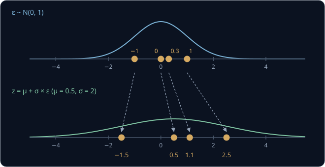

**확인 문제.** $\mu = -1$, $\sigma = 0.5$ 이고 뽑은 $\epsilon = -2$ 이면 $z$ 는?

답 보기

$z = -1 + 0.5 \times (-2) = -1 - 1 = -2$ 다.

### gradient 가 지나가는 길

$z = \mu + \sigma \epsilon$ 으로 바꾸면 무작위성은 모두 $\epsilon$ 한 곳에 모인다. $\epsilon$ 은 encoder 와 상관없이 $\mathcal N(0, 1)$
에서 먼저 뽑아 두는 입력이고, 일단 뽑고 나면 $z$ 는 $\mu$, $\sigma$, $\epsilon$ 을 곱하고 더한 평범한 계산이다. 그래서 비율을 정할
수 있다.

- **$\mu$ → $z$** — $\mu$ 가 1 늘면 $z$ 도 1 는다. 비율 $\frac{\partial z}{\partial \mu} = 1$ 이다
- **$\sigma$ → $z$** — $\sigma$ 가 1 늘면 $z$ 는 $\epsilon$ 만큼 는다. 비율 $\frac{\partial z}{\partial \sigma} = \epsilon$ 이다

$\frac{\partial z}{\partial \mu}$ 는 [Linear Regression](../linear-regression/README.md) 의 partial derivative 로, "다른 값은 고정하고
$\mu$ 만 조금 바꿨을 때 $z$ 가 변하는 비율" 이다.

숫자로 따라가 본다. decoder 와 loss 를 아주 단순하게 줄여서, loss 가 $L = (z - 2)^2$ 이라고 하자. $z$ 가 2 이면 loss 가 0 이고
2 에서 멀수록 커진다.

| 값 | 계산 | 결과 |
| --- | --- | --- |
| $z$ | $0.5 + 2 \times 0.3$ | 1.1 |
| $L$ | $(1.1 - 2)^2 = (-0.9)^2$ | 0.81 |
| $\partial L / \partial z$ | $2 \times (1.1 - 2)$ | $-1.8$ |
| $\partial L / \partial \mu$ | $-1.8 \times 1$ | $-1.8$ |
| $\partial L / \partial \sigma$ | $-1.8 \times 0.3$ | $-0.54$ |

$\partial L / \partial z$ 는 [Linear Regression](../linear-regression/README.md) 에서 본 "$w^2$ 의 derivative 는 $2w$" 라는 공식을 $z - 2$ 에 쓴 것이고, 아래 두 줄은 chain rule 로 칸마다의 비율을
곱한 것이다. 숫자로 검산하면 $\epsilon = 0.3$ 은 그대로 두고 $\mu$ 만 0.51 로 바꿨을 때 $z = 1.11$, $L = (-0.89)^2 = 0.7921$ 이라서
loss 변화를 0.01 로 나눈 비율은 $(0.7921 - 0.81) \div 0.01 = -1.79$ 다. 공식의 $-1.8$ 과 거의 같다.

$\partial L / \partial \mu = -1.8$ 은 음수이므로 $\mu$ 를 키우면 loss 가 줄어든다. 이 비율이 encoder 의 마지막 층으로, 다시 그 앞
층들로 전해져 encoder 의 weight 가 학습된다.

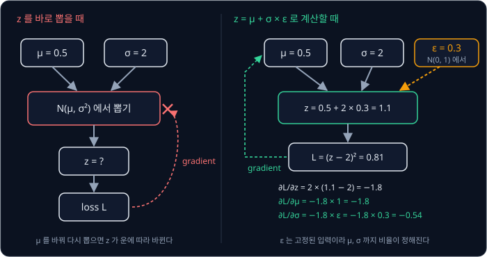

이렇게 $z$ 를 "$\mathcal N(\mu, \sigma^2)$ 에서 뽑은 값" 에서 "$\mu + \sigma \epsilon$" 으로 다시 적는 방법을 reparameterization
trick 이라고 한다. re-parameterization 은 "parameter 로 다시 나타내기" 라는 뜻으로, 같은 분포를 학습할 값 $\mu$, $\sigma$ 와 무작위
값 $\epsilon$ 으로 나눠 다시 적었다는 뜻이다.

$z$ 가 여러 차원이면 차원마다 따로 $\epsilon_j$ 를 뽑아 같은 계산을 한다. 이것을 vector 로 한 번에 적으면 아래와 같다.

$$
z = \mu + \sigma \odot \epsilon, \qquad \epsilon \sim \mathcal N(0, I)
$$

$\odot$ 은 같은 자리의 숫자끼리 곱하라는 기호(원소별 곱)다. $\mu = (0.5, -1)$, $\sigma = (2, 0.5)$, $\epsilon = (0.3, -2)$ 이면
$\sigma \odot \epsilon = (2 \times 0.3,\ 0.5 \times (-2)) = (0.6, -1)$ 이고, $z = (0.5 + 0.6,\ -1 - 1) = (1.1, -2)$ 다.

**흔한 오해.** reparameterization trick 을 쓰면 $z$ 의 무작위성이 사라진다고 생각하기 쉽다. $\epsilon$ 은 여전히 매번 새로 뽑으므로
$z$ 는 매번 다르다. 무작위성이 계산의 가운데에서 바깥 입력 자리로 옮겨 갔을 뿐이고, 그 덕분에 $\mu$ 와 $\sigma$ 를 지나는 계산이
끊기지 않는다.

**확인 문제.** $\mu = 1$, $\sigma = 0.5$, $\epsilon = 2$ 일 때 $z$ 와 $\frac{\partial z}{\partial \sigma}$ 는?

답 보기

$z = 1 + 0.5 \times 2 = 2$ 이고, $\frac{\partial z}{\partial \sigma} = \epsilon = 2$ 다.

**요약**

- $z$ 를 $\mathcal N(\mu, \sigma^2)$ 에서 바로 뽑으면 $\mu$, $\sigma$ 를 조금 바꿨을 때 $z$ 가 변하는 비율을 정할 수 없어서 encoder
  로 gradient 가 전해지지 않는다
- $\epsilon \sim \mathcal N(0, 1)$ 을 먼저 뽑아 $z = \mu + \sigma \epsilon$ 으로 계산하면 같은 분포를 따르면서
  $\partial z / \partial \mu = 1$, $\partial z / \partial \sigma = \epsilon$ 이 정해진다
- 무작위성은 $\epsilon$ 으로 옮겨 갔을 뿐 사라지지 않는다

## VAE 의 loss

### reconstruction 항

VAE 의 loss 는 두 항을 더한 것이다. 첫째는 autoencoder 와 같은 reconstruction loss 로, 뽑은 $z$ 를 decoder 에 넣어 되살린 그림이
원래 그림과 얼마나 다른지를 잰다. 둘째는 encoder 가 낸 분포가 prior 에서 얼마나 먼지를 재는 KL divergence 다.

회색 그림 예로 따라가 본다. 그림 $x = (0.6, 0.6, 0.6)$ 에 encoder 가 $\mu = 0.6$, $\sigma = 0.1$ 을 냈고, decoder 는 $z$ 를 세 칸에
똑같이 적는다고 하자.

| 뽑은 $\epsilon$ | $z = 0.6 + 0.1 \times \epsilon$ | 되살린 $\hat x$ | pixel 마다 차이 | reconstruction loss |
| --- | --- | --- | --- | --- |
| 1 | 0.7 | $(0.7, 0.7, 0.7)$ | 0.1 | $3 \times 0.01 = 0.03$ |
| $-2$ | 0.4 | $(0.4, 0.4, 0.4)$ | $-0.2$ | $3 \times 0.04 = 0.12$ |
| 0 | 0.6 | $(0.6, 0.6, 0.6)$ | 0 | 0 |

$\epsilon$ 에 따라 $z$ 가 $\mu$ 에서 벗어난 만큼 reconstruction loss 가 생긴다. $\sigma$ 가 클수록 $z$ 가 $\mu$ 에서 멀리 뽑히는 일이
잦아서 reconstruction loss 가 평균적으로 커지므로, 이 항만 보면 encoder 는 $\sigma$ 를 0 으로 줄이고 싶어 한다.

학습할 때는 그림 한 장마다 $\epsilon$ 을 한 번만 뽑아 reconstruction loss 를 계산한다. 한 번 뽑은 값은 운에 따라 크거나 작지만, 그림이
많고 학습을 오래 하면 그 운이 고르게 섞인다.

**확인 문제.** 같은 그림 $(0.6, 0.6, 0.6)$ 에서 $\epsilon = 3$ 이 뽑히면 reconstruction loss 는?

답 보기

$z = 0.6 + 0.1 \times 3 = 0.9$ 이고 $\hat x = (0.9, 0.9, 0.9)$ 다. pixel 마다 차이가 0.3, 제곱이 0.09 라서 합은
$3 \times 0.09 = 0.27$ 이다.

### 0 과 1 사이 pixel 의 BCE

MNIST 의 pixel 은 대부분 0(검정 바탕) 아니면 1 에 가까운 흰 획이다. 그래서 MNIST 용 VAE 의 decoder 는 pixel 의 밝기를 바로 내지 않고,
pixel 마다 "이 pixel 이 1(흰색)일 확률" $p_i$ 를 낸다. decoder 의 마지막 출력에 [Backpropagation](../autograd/README.md) 의 sigmoid 를
씌우면 언제나 0 과 1 사이의 값이 되어 확률로 쓸 수 있다.

decoder 가 낸 확률이 실제 pixel 과 얼마나 맞는지는 "실제로 나온 값의 확률" 에 log 를 씌우고 부호를 바꿔서 잰다.

- 실제 pixel 이 1 이면 decoder 가 그 값에 준 확률은 $p_i$ 라서 loss 는 $-\log p_i$ 다
- 실제 pixel 이 0 이면 그 값에 준 확률은 $1 - p_i$ 라서 loss 는 $-\log(1 - p_i)$ 다

확률이 1 에 가까우면 log 가 0 에 가까워 loss 가 작고, 확률이 0 에 가까우면 log 가 큰 음수라서 loss 가 크다.

| 실제 pixel $x_i$ | decoder 의 확률 $p_i$ | 실제 값에 준 확률 | loss |
| --- | --- | --- | --- |
| 1 | 0.9 | 0.9 | $-\log 0.9 = 0.105$ |
| 1 | 0.1 | 0.1 | $-\log 0.1 = 2.303$ |
| 0 | 0.9 | $1 - 0.9 = 0.1$ | $-\log 0.1 = 2.303$ |
| 1 | 0.5 | 0.5 | $-\log 0.5 = 0.693$ |

두 경우를 식 하나로 쓰면 아래와 같고, 이것을 binary cross entropy, 줄여서 BCE 라고 한다. binary 는 결과가 0 과 1 두 가지라는
뜻이다.

$$
\mathrm{BCE}(p_i, x_i) = -\big[x_i \log p_i + (1 - x_i)\log(1 - p_i)\big]
$$

$x_i = 1$ 을 넣으면 둘째 항의 $(1 - x_i)$ 가 0 이 되어 $-\log p_i$ 만 남고, $x_i = 0$ 을 넣으면 첫째 항이 사라져 $-\log(1 - p_i)$ 만
남는다. MNIST 처럼 0.3 같은 회색 pixel 이 조금 섞여 있어도 이 식에 그대로 넣어 쓴다. VAE 의 reconstruction loss 는 784 pixel 의 BCE
를 모두 더한 값이다. 학습을 시작하기 전의 decoder 가 모든 pixel 에 $p_i = 0.5$ 를 낸다면 pixel 마다 0.693 이라서,
reconstruction loss 는 $784 \times 0.693 \approx 543$ 에서 시작한다.

**확인 문제.** 실제 pixel 이 0 이고 decoder 가 $p_i = 0.1$ 을 냈다. BCE 는? ($\log 0.9 = -0.105$)

답 보기

실제 값 0 에 준 확률은 $1 - 0.1 = 0.9$ 라서 BCE 는 $-\log 0.9 = 0.105$ 다. 0 이어야 할 pixel 을 0 일 확률 0.9 로 맞혔으니 loss 가
작다.

### KL divergence

둘째 항은 encoder 가 낸 posterior $q_\phi(z \mid x)$ 가 prior $\mathcal N(0, I)$ 에서 얼마나 먼지를 잰다. 두 분포가 얼마나 다른지를
재는 값으로 KL divergence 를 쓰는데, 1951 년 Kullback 과 Leibler 가 정리해 두 사람 이름의 첫 글자를 땄다. divergence 는 "벌어진
정도" 라는 뜻이다.

결과가 두 가지뿐인 분포로 먼저 계산해 본다. 앞면과 뒷면이 반반인 동전 $p$ 와, 앞면이 0.8 의 확률로 나오는 휜 동전 $q$ 가 있다.

| 결과 | $q$ 의 확률 | $p$ 의 확률 | $q \div p$ | $\log(q \div p)$ | $q \times \log(q \div p)$ |
| --- | --- | --- | --- | --- | --- |
| 앞면 | 0.8 | 0.5 | 1.6 | 0.470 | 0.376 |
| 뒷면 | 0.2 | 0.5 | 0.4 | $-0.916$ | $-0.183$ |
| 합 | | | | | 0.193 |

결과마다 "$q$ 의 확률 × log($q$ 의 확률 ÷ $p$ 의 확률)" 을 구해 모두 더한 0.193 이 $q$ 와 $p$ 의 KL divergence 다. 기호로는 아래처럼
쓴다.

$$
D_{\mathrm{KL}}(q \,\Vert\, p) = \sum_{\text{결과 } z} q(z) \log \frac{q(z)}{p(z)}
$$

$D_{\mathrm{KL}}(q \Vert p)$ 는 "$q$ 에서 $p$ 까지의 KL divergence" 로 읽고, 두 줄 막대 $\Vert$ 는 두 분포를 구분하는 표시다. 식은
"결과 $z$ 마다 $q(z)$ 와 $\log \frac{q(z)}{p(z)}$ 를 곱하고, 모두 더한다" 는 뜻이다. 동전이라면 결과 $z$ 는 앞면과 뒷면, $q(z)$ 는
0.8 과 0.2, $p(z)$ 는 0.5 와 0.5 다. 결과마다 값 × 확률을 더하는 꼴이라서, [Bandits & MDPs](../bandit-mdp/README.md) 의 기댓값으로
보면 "$q$ 에서 뽑았을 때 $\log \frac{q(z)}{p(z)}$ 의 기댓값" 이다.

$q$ 의 앞면 확률을 바꿔 가며 계산하면 아래와 같다.

| $q$ 의 앞면 확률 | 0.5 | 0.6 | 0.8 | 0.9 |
| --- | --- | --- | --- | --- |
| $D_{\mathrm{KL}}(q \Vert p)$ | 0 | 0.020 | 0.193 | 0.368 |

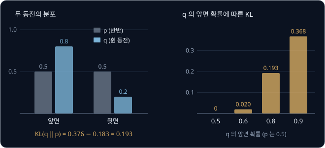

KL divergence 에는 아래 성질이 있다.

- 두 분포가 같으면 0 이다. 앞면 확률 0.5 인 $q$ 는 $p$ 와 같아서 $\log(0.5 \div 0.5) = \log 1 = 0$ 이다
- 두 분포가 다르면 0 보다 크고, 많이 다를수록 커진다. 뒷면 줄처럼 음수가 되는 항이 있어도 모두 더하면 언제나 0 이상이다
- $q$ 와 $p$ 의 자리를 바꾸면 값이 달라진다. 거꾸로 $D_{\mathrm{KL}}(p \Vert q) = 0.5 \log(0.5 \div 0.8) + 0.5 \log(0.5 \div 0.2) = 0.5 \times (-0.470) + 0.5 \times 0.916 = 0.223$
  으로 0.193 과 다르다

**흔한 오해.** KL divergence 를 두 분포 사이의 거리라고 부르기도 하지만, 자로 잰 거리와 달리 어느 쪽에서 재느냐에 따라 값이 달라진다.
VAE 는 언제나 encoder 의 분포 $q$ 를 앞에, prior $p$ 를 뒤에 둔 $D_{\mathrm{KL}}(q \Vert p)$ 를 쓴다.

**확인 문제.** 앞면 확률이 0.75 인 동전 $q$ 와 반반인 동전 $p$ 의 $D_{\mathrm{KL}}(q \Vert p)$ 를 구해 보자. ($\log 1.5 = 0.405$,
$\log 0.5 = -0.693$)

답 보기

앞면은 $0.75 \times \log(0.75 \div 0.5) = 0.75 \times \log 1.5 = 0.75 \times 0.405 = 0.304$ 이고, 뒷면은
$0.25 \times \log(0.25 \div 0.5) = 0.25 \times (-0.693) = -0.173$ 이다. 합은 $0.304 - 0.173 = 0.131$ 이다.

### 정규분포와 N(0, 1) 사이의 KL

$z$ 는 연속된 값이라 결과마다 더하는 대신 곡선 아래 넓이를 구하는 적분이라는 계산을 해야 한다. 다행히 $q = \mathcal N(\mu, \sigma^2)$
이고 $p = \mathcal N(0, 1)$ 이면 그 계산을 미리 끝낸 결과가 식 하나로 나와 있다. 유도는 VAE 논문의 부록 B 에 있다.

$$
D_{\mathrm{KL}}\big(\mathcal N(\mu, \sigma^2) \,\Vert\, \mathcal N(0, 1)\big) = \frac{1}{2}\big(\mu^2 + \sigma^2 - \log \sigma^2 - 1\big)
$$

이 식은 "평균의 제곱, 분산, 분산의 log 를 뺀 값, $-1$ 을 모두 더하고 반으로 나눈다" 로 읽는다. $\mu = 1$, $\sigma = 1$ 로 한 줄씩
계산하면 아래와 같다.

| 단계 | 계산 | 값 |
| --- | --- | --- |
| $\mu^2$ | $1^2$ | 1 |
| $\sigma^2$ | $1^2$ | 1 |
| $\log \sigma^2$ | $\log 1$ | 0 |
| 괄호 안 | $1 + 1 - 0 - 1$ | 1 |
| 반으로 나눔 | $1 \div 2$ | 0.5 |

숫자만 바꿔 $\mu = 0$, $\sigma = 0.5$ 로 하면 $\sigma^2 = 0.25$, $\log 0.25 = -1.386$ 이라서 괄호 안은
$0 + 0.25 - (-1.386) - 1 = 0.636$ 이고, 반으로 나누면 0.318 이다. 여러 경우를 모으면 아래와 같다.

| $\mu$ | $\sigma$ | $\mu^2$ | $\sigma^2$ | $\log \sigma^2$ | KL |
| --- | --- | --- | --- | --- | --- |
| 0 | 1 | 0 | 1 | 0 | 0 |
| 1 | 1 | 1 | 1 | 0 | 0.5 |
| 2 | 1 | 4 | 1 | 0 | 2 |
| 0 | 0.5 | 0 | 0.25 | $-1.386$ | 0.318 |
| 0 | 2 | 0 | 4 | 1.386 | 0.807 |
| 1.5 | 0.5 | 2.25 | 0.25 | $-1.386$ | 1.443 |

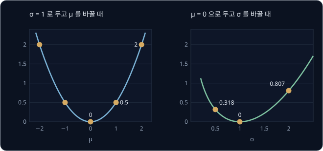

위 그림과 표에서 KL 이 encoder 에게 무엇을 요구하는지 보인다.

- **$\mu$ 쪽** — $\mu$ 가 0 에서 멀어지면 $\mu^2$ 때문에 KL 이 커진다. 그래서 KL 은 그림마다의 $\mu$ 를 원점 쪽으로 끌어당긴다
- **$\sigma$ 쪽** — $\sigma^2 - \log \sigma^2$ 은 $\sigma = 1$ 에서 가장 작다. $\sigma$ 가 1 보다 작아지면 $-\log \sigma^2$ 이 커지고,
  1 보다 커지면 $\sigma^2$ 이 커진다. 그래서 KL 은 $\sigma$ 가 0 으로 줄어드는 것을 막고 1 근처에 머물게 한다

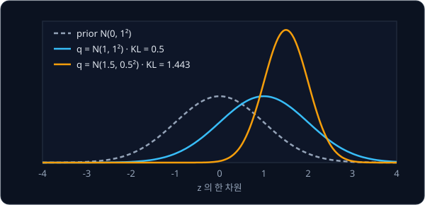

위 그림은 표의 두 줄을 곡선으로 그린 것이다. 봉우리가 prior 에서 더 멀고 폭이 더 다른 주황 곡선의 KL 이 더 크다.

$z$ 가 여러 차원이면 차원마다 KL 을 구해 더한다. $\mu = (1, 0)$, $\sigma = (1, 0.5)$ 라면 $0.5 + 0.318 = 0.818$ 이다. encoder 가
logvar 를 내므로 실제로는 $\sigma^2$ 자리에 $e^{\text{logvar}}$ 을, $\log \sigma^2$ 자리에 logvar 를 그대로 넣는다.

$$
D_{\mathrm{KL}} = \frac{1}{2}\sum_{j=1}^{\text{z\_dim}}\big(\mu_j^2 + e^{\text{logvar}_j} - \text{logvar}_j - 1\big)
$$

**확인 문제.** $\mu = 2$, $\sigma = 1$ 인 한 차원의 KL 과, $\mu = 0$, logvar $= 0$ 인 한 차원의 KL 을 구해 보자.

답 보기

첫째는 $\frac12(4 + 1 - 0 - 1) = \frac12 \times 4 = 2$ 다. 둘째는 $e^0 = 1$ 이라서 $\frac12(0 + 1 - 0 - 1) = 0$ 이다. logvar 가 0
이면 $\sigma = 1$ 이라서 prior 와 같은 분포다.

### 두 항의 비중

VAE 의 loss 는 그림 한 장마다 아래와 같다.

$$
L = L_{\text{rec}} + \beta \cdot D_{\mathrm{KL}}\big(q_\phi(z \mid x) \,\Vert\, \mathcal N(0, I)\big)
$$

$\beta$ 는 "베타(beta)" 라고 읽고, KL 항을 얼마나 무겁게 볼지 정하는 숫자다. VAE 논문은 $\beta = 1$ 을 쓴다.

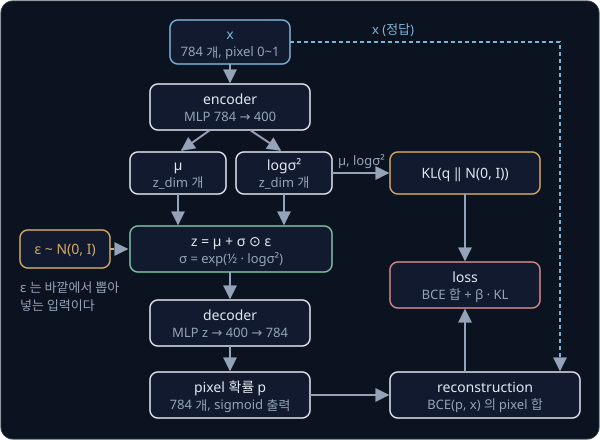

위 그림은 MNIST 그림 한 장으로 이 loss 를 구하는 순서를 모은 것이다. encoder 가 $\mu$ 와 logvar($\log\sigma^2$)를 내면, 바깥에서 뽑은
$\epsilon$ 으로 $z = \mu + \sigma \odot \epsilon$ 을 만들어 decoder 에 넣는다. 오른쪽 아래의 reconstruction 은 decoder 가 낸 pixel 확률과
원래 그림 $x$ 로 BCE 를 계산하고, 오른쪽 위의 KL 은 $\mu$ 와 logvar 만으로 계산한다. 그림의 MLP 숫자 400 은 encoder 와 decoder 의
가운데 층에 있는 숫자의 개수다.

두 항은 encoder 를 서로 반대쪽으로 당긴다. reconstruction 항은 $\sigma$ 를 0 으로 줄여 $z$ 가 늘 $\mu$ 에 뽑히게 하고, 그림마다의 $\mu$ 를 멀리 떨어뜨려
decoder 가 헷갈리지 않게 하고 싶어 한다. KL 항은 $\mu$ 를 0 으로, $\sigma$ 를 1 로 끌어당긴다.

$\beta = 1$ 에서 encoder 두 개를 비교해 본다. reconstruction loss 는 decoder 가 그만큼 틀렸다고 가정한 값이다.

| encoder | $\mu$ | $\sigma$ | reconstruction loss | KL | loss |
| --- | --- | --- | --- | --- | --- |
| A | 3 | 0.1 | 0.01 | 6.308 | 6.318 |
| B | 1 | 0.5 | 0.2 | 0.818 | 1.018 |

A 는 $\sigma$ 가 작아 거의 정확히 되살리지만, $\mu$ 가 원점에서 멀고 $\sigma$ 가 너무 작아 KL 이
$\frac12(9 + 0.01 - (-4.605) - 1) = 6.308$ 이다. B 는 조금 덜 정확한 대신 KL 이 $\frac12(1 + 0.25 - (-1.386) - 1) = 0.818$ 로 작아서
전체 loss 는 B 가 훨씬 작다. 학습은 이렇게 두 항의 합이 가장 작은 지점을 찾는다.

$\beta$ 를 극단으로 바꾸면 두 가지 실패가 나온다.

- **$\beta = 0$** — KL 항이 사라지면 encoder 는 $\sigma$ 를 0 에 가깝게 줄이고 $\mu$ 를 마음대로 흩어 놓는다. 보통의 autoencoder 로
  돌아가서 latent 공간에 빈 곳이 다시 생긴다
- **$\beta$ 가 아주 큼** — KL 을 0 으로 만드는 것이 가장 중요해져서, encoder 는 어떤 그림을 받든 $\mu = 0$, $\sigma = 1$ 을 낸다.
  그러면 모든 그림의 posterior 가 prior 와 같아져 $z$ 에 그림의 정보가 하나도 담기지 않는다. decoder 는 $z$ 로 그림을 구별할 수
  없으니 모든 그림의 평균에 가까운 흐릿한 그림 하나만 낸다. 모든 posterior 가 prior 하나로 합쳐져 버리는 이 현상을 posterior
  collapse 라고 부르는데, collapse 는 "무너져 내림" 이라는 뜻이다

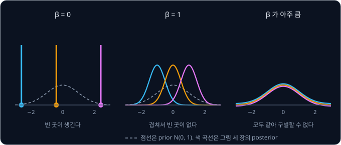

reconstruction 항을 pixel 784 개에 대해 더하지 않고 평균하면 같은 실패가 생긴다. 평균하면 reconstruction 항이 784 분의 1 로
작아지는데, KL 항은 그대로라서 KL 을 784 배 무겁게 본 것과 같다. 그래서 reconstruction 항은 pixel 을 모두 더하고, KL 은 latent 의
차원을 모두 더한 뒤 둘을 합한다. 여러 그림을 한 번에 학습할 때는 이렇게 구한 그림마다의 loss 를 그림 수로 평균한다.

**확인 문제.** 어떤 그림의 reconstruction loss 가 100, KL 이 20 이다. $\beta = 1$ 일 때와 $\beta = 4$ 일 때 loss 는 각각 얼마이고,
$\beta = 4$ 이면 학습이 어느 항을 더 줄이려 할까?

답 보기

$\beta = 1$ 이면 $100 + 20 = 120$, $\beta = 4$ 이면 $100 + 4 \times 20 = 180$ 이다. $\beta = 4$ 이면 KL 이 1 줄 때 loss 가 4 줄므로,
학습은 KL 을 줄이는 쪽(posterior 를 prior 에 가깝게)을 더 밀어붙인다.

### ELBO

VAE 논문은 이 loss 를 ELBO(evidence lower bound)라는 이름으로 설명한다. evidence 는 $\log p_\theta(x)$, 곧 모델이 데이터 그림 $x$ 를
만들어 낼 확률의 log 다. 생성 모델이라면 실제 그림들이 나올 확률이 높을수록 좋으므로 이 값을 키우고 싶다. 그런데 $p_\theta(x)$ 를
구하려면 가능한 모든 $z$ 에 대해 "그 $z$ 가 나올 확률 × 그 $z$ 에서 $x$ 가 나올 확률" 을 계산해 더해야 해서 직접 계산할 수 없다.

대신 VAE 는 언제나 $\log p_\theta(x)$ 이하인 값, 곧 아래쪽 경계(lower bound)를 계산해 키운다.

$$
\log p_\theta(x) \ \ge\ \mathbb E_{q_\phi(z \mid x)}\big[\log p_\theta(x \mid z)\big] - D_{\mathrm{KL}}\big(q_\phi(z \mid x) \,\Vert\, \mathcal N(0, I)\big)
$$

오른쪽 첫 항의 $\mathbb E_{q}[\cdot]$ 는 "$q$ 에서 $z$ 를 뽑았을 때의 기댓값" 이고, $\log p_\theta(x \mid z)$ 는 decoder 가 원래 그림에
준 확률의 log 라서 reconstruction loss 의 부호를 바꾼 것이다. BCE 가 바로 "실제 값에 준 확률의 log 에 부호를 바꾼 값" 이었다. 그래서
오른쪽 전체는 $-(L_{\text{rec}} + D_{\mathrm{KL}})$ 이고, ELBO 를 키우는 것은 $\beta = 1$ 인 VAE 의 loss 를 줄이는 것과 같다. 아래쪽
경계를 밀어 올리면 "$\log p_\theta(x)$ 는 적어도 이 값 이상" 이라는 보장도 함께 올라간다.

**확인 문제.** 어떤 그림에서 reconstruction loss 가 90, KL 이 25 다. ELBO 는 얼마이고, 이 그림의 $\log p_\theta(x)$ 에 대해 무엇을
말할 수 있을까?

답 보기

ELBO $= -(90 + 25) = -115$ 다. $\log p_\theta(x)$ 는 ELBO 이상이므로 $-115$ 보다 작지 않다.

**요약**

- VAE 의 loss 는 reconstruction loss(pixel 마다의 오차나 BCE 를 모두 더한 값)와, posterior 와 prior 의 KL divergence 를 더한 것이다
- KL divergence 는 결과마다 $q \log(q \div p)$ 를 더한 값으로, 두 분포가 같을 때만 0 이고 자리를 바꾸면 값이 달라진다.
  $\mathcal N(\mu, \sigma^2)$ 와 $\mathcal N(0, 1)$ 사이에서는 $\frac12(\mu^2 + \sigma^2 - \log\sigma^2 - 1)$ 이다
- reconstruction 항은 $\sigma$ 를 줄이고, KL 항은 $\mu$ 를 0 으로 $\sigma$ 를 1 로 당긴다. $\beta = 0$ 이면 빈 곳이 생기고, $\beta$
  가 너무 크면 posterior collapse 가 일어난다

## 학습한 latent 공간의 사용

### 새 sample 뽑기

학습을 마친 VAE 로 새 손글씨 그림을 만드는 순서는 아래와 같다.

1. prior $\mathcal N(0, I)$ 에서 $z$ 를 뽑는다. z_dim 이 2 면 $\mathcal N(0, 1)$ 에서 숫자 두 개를 따로 뽑아 예를 들어
   $z = (0.4, -1.4)$ 를 얻는다
2. $z$ 를 decoder 에 넣는다. decoder 는 pixel 784 개마다 흰색일 확률을 낸다
3. 그 확률을 pixel 의 밝기로 써서 그림으로 보여 준다

$z$ 를 다시 뽑으면 다른 그림이 나온다. encoder 는 쓰지 않는다.

**확인 문제.** 학습을 마친 VAE 로 새 그림을 만들 때 $z$ 를 $\mathcal N(0, I)$ 대신 각 차원을 $-10$ ~ $10$ 에서 아무렇게나 골라
넣으면 어떤 문제가 생길까?

답 보기

학습하는 동안 KL 항이 posterior 들을 $\mathcal N(0, I)$ 근처, 대부분 $-3$ ~ $3$ 안에 모아 두었다. 8 이나 $-9$ 같은 자리는 어느
그림의 범위에도 들지 않아 decoder 가 본 적이 없으므로, 숫자 모양이 나온다는 보장이 없다.

### 2 차원 latent 지도

z_dim 을 2 로 학습하면 latent 공간이 평면이라서 눈으로 볼 수 있다. 볼 수 있는 그림은 두 가지다.

- **그림들의 자리** — test 그림, 곧 학습에 쓰지 않은 그림마다 encoder 가 낸 $\mu$ 를 평면 위의 점으로 찍고, 점을 그 그림이 어떤
  숫자인지에 따라 다른 색으로 칠한다. 같은 숫자끼리 무리 지어 모이고, 무리들이 원점 근처에 빈 곳 없이 붙어 있다. $z$ 를 뽑지 않고
  $\mu$ 를 쓰는 것은 $\mu$ 가 그 그림의 범위의 가운데이기 때문이다
- **자리마다의 그림** — 평면 위 $-3$ ~ $3$ 사이에 바둑판처럼 고르게 점을 놓고, 점마다 그 $z$ 를 decoder 에 넣어 나온 그림을 그 자리에
  늘어놓는다. prior 에서 뽑은 값의 99.7% 가 $-3$ ~ $3$ 에 있으므로 이 범위면 생성에 쓰일 자리를 거의 다 본다

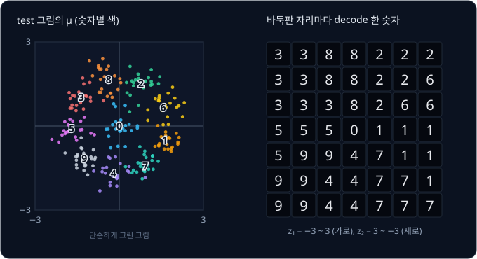

바둑판 그림에서는 이웃한 칸끼리 그림이 조금씩만 다르고, 한 숫자의 무리에서 다른 숫자의 무리로 넘어가는 경계에서는 두 숫자의 중간
같은 모양이 나온다. 빈 곳 없이 채운 latent 공간이라서 생기는 모습이다.

z_dim 을 2 보다 크게 잡으면 latent 에 더 많은 정보를 담을 수 있어 그림을 더 정확하게 되살리고 loss 도 더 낮아지지만, 평면에 바로
그릴 수는 없다.

**확인 문제.** latent 지도에서 점을 찍을 때 encoder 가 낸 분포에서 뽑은 $z$ 가 아니라 $\mu$ 를 쓰는 이유는?

답 보기

뽑은 $z$ 는 같은 그림이라도 뽑을 때마다 다른 자리에 찍히지만, $\mu$ 는 그 그림의 범위의 가운데라서 한 자리로 정해진다. 그림의
대표 자리를 보려면 $\mu$ 가 알맞다.

### 보간

두 그림 사이를 이어 보는 것도 latent 공간에서 할 수 있다. 숫자 1 그림의 $\mu$ 를 $z_a$, 숫자 7 그림의 $\mu$ 를 $z_b$ 라고 하자. 두
점을 잇는 직선 위에 점을 고르게 몇 개 놓고, 점마다 decoder 에 넣어 나온 그림을 차례로 늘어놓으면 1 이 7 로 조금씩 바뀌는 그림들이
나온다. 이렇게 두 값 사이의 중간 값을 채우는 것을 보간(interpolation)이라고 한다.

직선 위의 점은 아래 식으로 구한다. $t$ 는 0 부터 1 사이의 숫자로, $z_a$ 에서 $z_b$ 까지 얼마나 갔는지를 나타낸다.

$$
z(t) = (1 - t)\, z_a + t\, z_b
$$

이 식은 "$z_a$ 에 $1 - t$ 를, $z_b$ 에 $t$ 를 곱해 더한다" 로 읽는다. $t = 0$ 이면 $z_a$ 그대로, $t = 1$ 이면 $z_b$ 그대로이고,
$t = 0.5$ 면 두 점의 한가운데다. $z_a = (-2, 1)$, $z_b = (2, -1)$ 로 다섯 점을 구하면 아래와 같다.

| $t$ | $(1 - t)\, z_a$ | $t\, z_b$ | $z(t)$ |
| --- | --- | --- | --- |
| 0 | $(-2, 1)$ | $(0, 0)$ | $(-2, 1)$ |
| 0.25 | $(-1.5, 0.75)$ | $(0.5, -0.25)$ | $(-1, 0.5)$ |
| 0.5 | $(-1, 0.5)$ | $(1, -0.5)$ | $(0, 0)$ |
| 0.75 | $(-0.5, 0.25)$ | $(1.5, -0.75)$ | $(1, -0.5)$ |
| 1 | $(0, 0)$ | $(2, -1)$ | $(2, -1)$ |

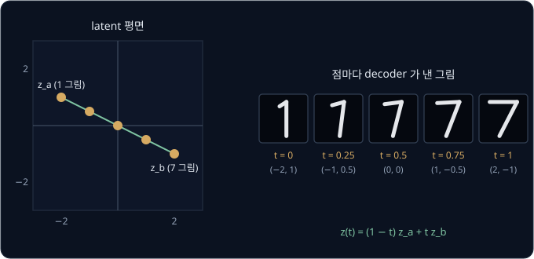

보통의 autoencoder 라면 직선의 중간이 빈 곳을 지날 수 있어서 중간 그림이 얼룩이 되기 쉽다. VAE 는 latent 공간을 빈 곳 없이
채웠으므로 중간 단계도 흐릿하나마 숫자 모양을 유지한다. 실제로는 z_dim 을 20 정도로 학습한 모델에서 양 끝을 포함해 10 단계쯤으로
보간한다.

**확인 문제.** $z_a = (0, 2)$, $z_b = (4, 0)$ 일 때 $t = 0.25$ 와 $t = 0.5$ 의 점은?

답 보기

$t = 0.25$ 이면 $0.75 \times (0, 2) + 0.25 \times (4, 0) = (0, 1.5) + (1, 0) = (1, 1.5)$ 다. $t = 0.5$ 이면
$0.5 \times (0, 2) + 0.5 \times (4, 0) = (0, 1) + (2, 0) = (2, 1)$ 이다.

### 흐릿한 sample

VAE 가 만든 그림은 실제 MNIST 그림보다 흐릿하다. 학습하는 동안 그림마다의 범위가 서로 겹쳤으므로, 겹친 자리의 $z$ 는 여러 그림으로
되살려야 했던 자리다. decoder 는 그 자리에서 어느 한 그림을 고를 수 없어서, reconstruction loss 를 가장 작게 하는 그 그림들의
평균에 가까운 그림을 낸다. 이 강의 처음에 정답이 $+1$ 과 $-1$ 로 갈라지면 MSE 가 평균 0 을 내던 것과 같은 일이 pixel 마다 조금씩
일어나고, 획의 위치가 조금씩 다른 그림들을 평균하면 획의 가장자리가 번진다.

latent 하나에 그림 전체의 모양을 담고 decoder 한 번으로 그림을 만드는 한 이 흐릿함은 크게 줄지 않는다. 생성을 수백 번의 작은
단계로 나눠 이 문제를 줄이는 방법은 뒤의 [DDPM](../ddpm/README.md) 에서 다룬다.

**확인 문제.** 겹친 자리의 $z$ 를 학습하는 동안 decoder 가 pixel 하나에 대해 정답 1 을 절반, 정답 0 을 절반 보았다. MSE 를 가장
작게 하는 출력은 얼마이고, 그 pixel 은 어떻게 보일까?

답 보기

정답들의 평균 $(1 + 0) \div 2 = 0.5$ 를 낸다. 흰색도 검정도 아닌 회색으로 보여서 그림이 흐릿해진다.

**요약**

- 새 sample 은 prior $\mathcal N(0, I)$ 에서 $z$ 를 뽑아 decoder 에 넣어 만들고, encoder 는 쓰지 않는다
- z_dim 이 2 면 test 그림의 $\mu$ 를 찍은 지도와 $-3$ ~ $3$ 의 바둑판을 decode 한 그림으로 latent 공간을 볼 수 있고, 두 그림의
  $\mu$ 를 $z(t) = (1 - t) z_a + t z_b$ 로 이으면 보간 그림이 나온다
- 겹친 범위의 $z$ 에서 decoder 가 여러 그림의 평균을 내므로 VAE 의 sample 은 흐릿하다

## CVAE

### 조건을 붙인 VAE

VAE 에서 $z$ 를 뽑으면 무슨 숫자가 나올지 고를 수 없다. 7 을 만들고 싶다면 원하는 숫자를 모델에 알려 줄 방법이 필요하다. CVAE
(conditional VAE)는 encoder 와 decoder 양쪽에 조건 $c$ 를 함께 넣는다. conditional 은 "조건이 붙은" 이라는 뜻이다.

MNIST 에서 조건은 그림이 어떤 숫자인지(label)다. 숫자를 그대로 7 로 넣지 않고 one-hot vector 로 넣는데, one-hot vector 는 칸 10 개
중 정답 자리만 1 이고 나머지는 0 인 vector 다. 7 은 0 부터 세어 여덟째 칸만 1 인 $(0, 0, 0, 0, 0, 0, 0, 1, 0, 0)$ 이다. 이 10 개의
숫자를 encoder 에는 그림의 784 개 숫자 뒤에, decoder 에는 $z$ 뒤에 이어 붙여 넣는다.

- **encoder** — $q_\phi(z \mid x, c)$. 그림 $x$ 와 숫자 $c$ 를 함께 보고 $\mu$, $\sigma$ 를 낸다
- **decoder** — $p_\theta(x \mid z, c)$. $z$ 와 숫자 $c$ 를 함께 받아 그림을 낸다

loss 는 VAE 와 같은 reconstruction loss 와 KL 의 합이다. 어떤 숫자인지는 $c$ 가 이미 알려 주므로, $z$ 에는 $c$ 로 정해지지 않는 나머지
정보, 예를 들어 글씨의 굵기나 기울기 같은 쓰는 방식이 담기기를 기대한다. 그래서 학습한 CVAE 에 같은 $z$ 를 두고 $c$ 만 0 부터 9 까지
바꿔 넣으면, 같은 사람이 같은 굵기와 기울기로 쓴 0 부터 9 까지가 나온다.

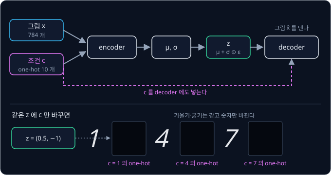

**확인 문제.** 숫자 3 의 one-hot vector 를 적어 보자. 이 vector 와 $z = (0.5, -1)$ 을 이어 붙이면 decoder 가 받는 숫자는 몇 개일까?

답 보기

0 부터 세어 넷째 칸만 1 이므로 $(0, 0, 0, 1, 0, 0, 0, 0, 0, 0)$ 이다. $z$ 의 2 개와 one-hot 의 10 개를 이어 붙이면 12 개다.

### ACT 의 CVAE

뒤의 [ACT](../act/README.md) 강의는 로봇 팔이 사람의 시연을 따라 움직이도록 학습하는 모델로, 이 CVAE 구조를 그대로 쓴다. ACT 는
Action Chunking with Transformers 의 줄임말이다. action 은 관절을 얼마나 움직일지 같은 로봇의 동작
명령이고, action chunk 는 앞으로 차례로 할 action 여러 개를 한 덩어리로 묶은 것이다. 이 덩어리를 한 번에 예측해서(chunking) 이런
이름이 붙었다. Transformer 는 ACT 가 쓰는 neural network 구조의 이름이다.

이 강의의 처음에 본 것처럼 같은 장면에서도 시연마다 움직이는 방식이 다르다. 컵 위에서 잠깐 멈췄다 내려가는 시연과 바로 내려가는
시연이 섞여 있을 때 둘의 평균을 따라 하면 어정쩡하게 느려진 동작이 나온다. ACT 는 이 "움직이는 방식" 을 CVAE 의 $z$ 에 담는다.
MNIST 의 CVAE 와 ACT 를 나란히 놓으면 아래와 같다.

| 자리 | MNIST CVAE | ACT |
| --- | --- | --- |
| 되살릴 데이터 $x$ | 손글씨 그림 | 시연의 action chunk |
| 조건 $c$ | 숫자 label | 관절 위치(encoder 와 policy), 카메라 이미지(policy 만) |
| latent $z$ 에 담기는 것 | 굵기·기울기 같은 쓰는 방식 | 멈칫하는지 바로 가는지 같은 움직이는 방식 |
| reconstruction loss | BCE 의 합 | 예측한 action 과 시연 action 의 차이를 부호를 떼고(절댓값) 더한 L1 |
| KL 의 무게 $\beta$ | 1 | 10 |

여기서 decoder 는 로봇이 무엇을 할지 정하는 policy 다. policy 는 [Bandits & MDPs](../bandit-mdp/README.md) 에서 본 것처럼 "지금
상황에서 어떤 행동을 할지 정하는 규칙" 이고, ACT 에서는 카메라 이미지·관절 위치·$z$ 를 받아 action chunk 를 내는 network 다. ACT 의
latent 는 32 차원이다.

학습할 때와 실제로 로봇을 움직일 때는 $z$ 를 정하는 방법이 다르다.

- **학습할 때** — encoder 가 시연의 action chunk 와 관절 위치를 보고 $\mu$, $\sigma$ 를 내고, reparameterization trick 으로
  $z = \mu + \sigma \odot \epsilon$ 을 뽑아 policy 에 넣는다. loss 는 L1 과 $\beta = 10$ 을 곱한 KL 의 합이다
- **로봇을 움직일 때** — 따라 할 시연이 없으므로 encoder 를 쓰지 않는다. $z$ 를 prior 의 평균인 $0$ 으로 두고, 카메라 이미지와 관절
  위치만으로 action chunk 를 낸다. KL 항이 학습 내내 $z$ 를 $\mathcal N(0, I)$ 근처에 모아 두었으므로, 가운데인 0 은 policy 가 가장
  익숙한 자리다

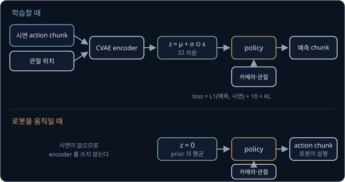

**확인 문제.** ACT 의 한 차원에서 encoder 가 $\mu = 0.5$, $\sigma = 1$ 을 냈다. 이 차원의 KL 은 얼마이고, $\beta = 10$ 을 곱하면 loss 에
얼마가 더해질까?

답 보기

KL 은 $\frac12(0.25 + 1 - 0 - 1) = \frac12 \times 0.25 = 0.125$ 이고, $\beta = 10$ 을 곱하면 1.25 가 더해진다.

**요약**

- CVAE 는 encoder 와 decoder 양쪽에 조건 $c$ 를 넣어, 원하는 조건의 sample 을 만들고 $z$ 에는 조건으로 정해지지 않는 나머지가
  담기게 한다
- ACT 는 시연의 action chunk 를 CVAE 로 학습해 움직이는 방식을 $z$ 에 담고, 학습할 때는 reparameterization 으로 $z$ 를 뽑으며
  로봇을 움직일 때는 $z = 0$ 으로 둔다

## 정리

- 생성 모델은 학습한 데이터를 닮은 새 sample 을 만든다. 정답이 여러 무리로 갈라질 때(multimodal) 정답 하나를 MSE 로 배우면 평균을
  내서 실패하므로, 데이터의 분포를 배워 거기서 뽑아야 한다
- 분포는 평균 $\mu$ 와 분산 $\sigma^2$ 으로 요약한다. 정규분포 $\mathcal N(\mu, \sigma^2)$ 은 값의 68%·95%·99.7% 가 $\mu$ 에서 $\sigma$
  의 1·2·3 배 안에 들어가는 종 모양이고, $\mathcal N(0, I)$ 는 차원마다 $\mathcal N(0, 1)$ 에서 따로 뽑은 vector 의 분포다
- autoencoder 는 그림을 latent $z$ 로 줄였다 되살리지만, 그림들의 $z$ 가 어디에 모일지 정하지 않아서 그 사이에 decoder 가 받아
  보지 못한 빈 곳이 남는다. VAE 의 encoder 는 그림마다 $\mu$ 와 logvar $= \log\sigma^2$ 을 내서 그림 하나를 범위 하나로 만들고,
  범위들이 겹치며 빈 곳을 채운다
- reparameterization trick $z = \mu + \sigma \odot \epsilon$, $\epsilon \sim \mathcal N(0, I)$ 은 무작위성을 $\epsilon$ 으로 옮겨
  $\partial z / \partial \mu = 1$, $\partial z / \partial \sigma = \epsilon$ 을 정하고, 그 덕분에 encoder 까지 gradient 가 전해진다.
  $\mu = 0.5$, $\sigma = 2$, $\epsilon = 0.3$ 이면 $z = 1.1$ 이다
- loss 는 reconstruction loss 와 $\beta \cdot D_{\mathrm{KL}}$ 의 합이고, 한 차원의 KL 은 $\frac12(\mu^2 + \sigma^2 - \log\sigma^2 - 1)$
  이다. $\mu = 1$, $\sigma = 1$ 이면 0.5, $\mu = 0$, $\sigma = 0.5$ 면 0.318 이다. $\beta = 1$ 인 loss 를 줄이는 것은 ELBO 를 키우는
  것과 같다
- 생성은 prior 에서 뽑은 $z$ 를 decoder 에 넣어 하고, 두 그림의 $\mu$ 를 $(1 - t) z_a + t z_b$ 로 이으면 보간 그림이 나온다.
  CVAE 는 조건 $c$ 를 양쪽에 넣고, ACT 는 이 구조로 시연의 움직이는 방식을 latent $z$ 에 담아 로봇을 움직일 때 $z = 0$ 을 쓴다

VAE 는 decoder 한 번으로 sample 을 내서 빠르지만, latent 하나에 그림 전체를 담고 겹친 범위에서 평균을 내기 때문에 sample 이 흐릿하다.
생성을 수백 번의 작은 잡음 제거 단계로 나눠 더 선명한 sample 을 만드는 방법은 [DDPM](../ddpm/README.md) 에서 다룬다. CVAE 로 시연의
action chunk 를 latent 에 담아 로봇 팔을 움직이는 policy 는 [ACT](../act/README.md), 장면을 latent 로 줄인 뒤 그 latent 공간 안에서
다음 장면을 예측하는 모델은 [World Model](../world-model/README.md) 에서 다룬다.

## 참고 자료

- Diederik P. Kingma, Max Welling, [An Introduction to Variational Autoencoders](https://arxiv.org/abs/1906.02691) (2019) — VAE 를 만든
  두 저자가 쓴 입문서. 2장이 ELBO 와 reparameterization trick 을 원 논문보다 천천히 유도한다
- Diederik P. Kingma, Max Welling, [Auto-Encoding Variational Bayes](https://arxiv.org/abs/1312.6114) (2013) — VAE 의 원 논문. 부록 B 에
  정규분포와 $\mathcal N(0, I)$ 사이 KL 식의 유도가 있다
- Carl Doersch, [Tutorial on Variational Autoencoders](https://arxiv.org/abs/1606.05908) — 수식보다 그림과 직관으로 VAE 를 설명하는
  tutorial. 이 강의를 마친 뒤 처음 읽기에 알맞다
- Kihyuk Sohn, Honglak Lee, Xinchen Yan, [Learning Structured Output Representation using Deep Conditional Generative Models](https://proceedings.neurips.cc/paper/2015/hash/8d55a249e6baa5c06772297520da2051-Abstract.html)
  (2015) — CVAE 를 제안한 논문. 조건을 encoder 와 decoder 양쪽에 넣는 구조를 다룬다
- Lilian Weng, [From Autoencoder to Beta-VAE](https://lilianweng.github.io/posts/2018-08-12-vae/) — autoencoder 에서 VAE, $\beta$ 를
  조절하는 β-VAE 로 이어지는 흐름을 한 글에 정리한 블로그
- Jeremy Jordan, [Variational autoencoders](https://www.jeremyjordan.me/variational-autoencoders/) — latent 공간의 빈 곳과
  reparameterization 을 그림으로 보여 주는 글
- MIT 6.S184, [Flow Matching and Diffusion Models](https://diffusion.csail.mit.edu/) — 4강 Latent Spaces and Neural Network
  Architectures 가 VAE 와 latent 공간을 다룬다. DDPM 강의로 넘어가기 전에 보면 좋다
- [Wikipedia — Kullback–Leibler divergence](https://en.wikipedia.org/wiki/Kullback%E2%80%93Leibler_divergence) — KL divergence 의 정의와
  성질, 정규분포 사이의 KL 식
- LeRobot, [`modeling_act.py`](https://github.com/huggingface/lerobot/blob/main/src/lerobot/policies/act/modeling_act.py) — ACT 가 CVAE
  latent 를 학습 때는 encoder 로 뽑고 로봇을 움직일 때는 0 으로 두는 실제 구현
