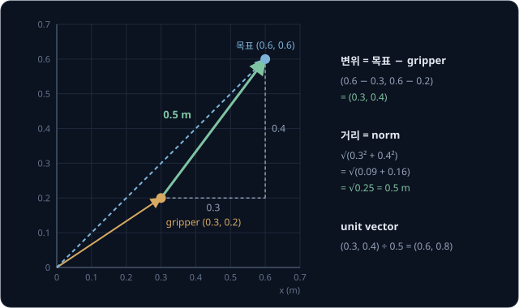
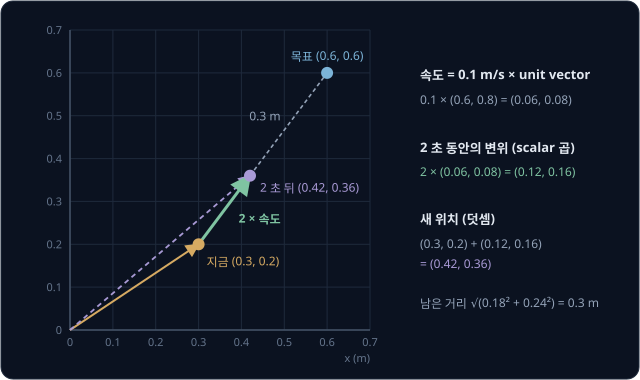
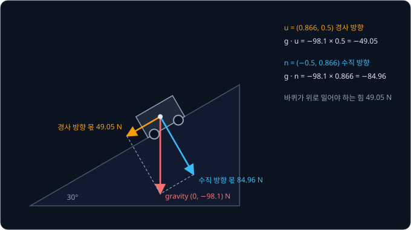
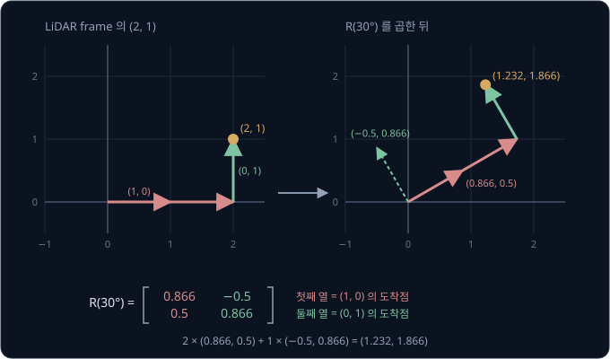
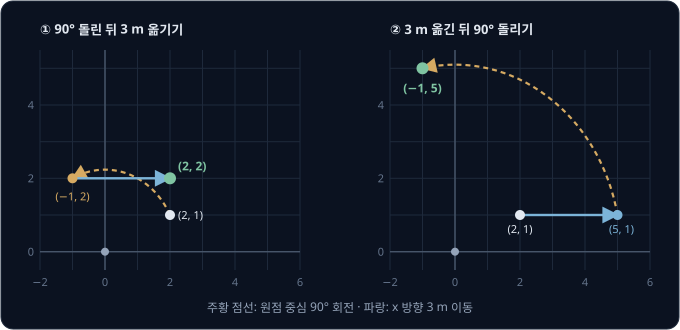
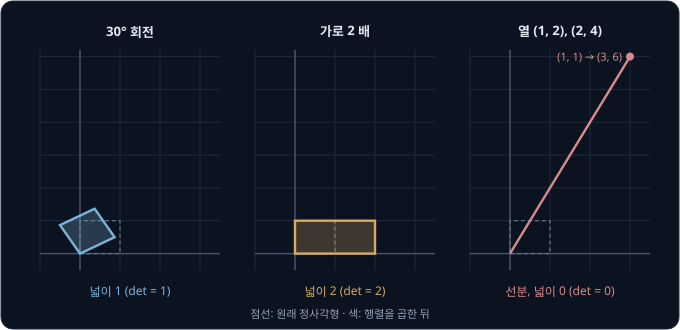
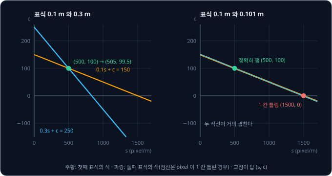

# Vectors & Matrices

모바일 로봇의 LiDAR 가 장애물이 자기 앞쪽으로 2 m, 왼쪽으로 1 m 떨어져 있다고 알려 준다. 그런데 이 LiDAR 는 로봇 몸체의 정면에서
시계 반대 방향으로 30° 돌아간 채 달려 있어서, LiDAR 의 "앞" 은 로봇의 앞이 아니다. LiDAR 가 알려 준 2 와 1 로 로봇 기준의
앞쪽 거리와 왼쪽 거리를 구하려면 무엇을 계산해야 할까?

행렬과 vector 를 한 번 곱하면 된다. 숫자를 순서대로 묶은 vector 에 숫자 표인 행렬을 곱하면 다른 vector 가 나오는데, ROS 2 에서 여러
좌표계 사이로 위치를 바꿔 주는 tf2 library 도 소스 코드를 보면 점 하나를 옮길 때 3×3 행렬과 점의 좌표를 이렇게 곱한다. 학습을 마친
policy 의 neural network도 층마다 같은 곱셈을 한다.

## 학습 목표

- vector 가 로봇의 위치·변위·속도·센서 값을 적은 숫자 묶음이고, 덧셈·scalar 곱·norm 이 각각 옮기기·늘이기·거리라는 것을 설명할 수 있다
- dot product 가 한 vector 가운데 다른 방향으로 향하는 몫을 잰다는 것을 경사로에 작용하는 gravity 의 예로 설명할 수 있다
- 행렬과 vector 의 곱을 행마다 dot product 로 계산하고, 행렬의 열이 축 화살표가 도착하는 곳이라는 것을 회전·단위 변환의 예로 설명할 수 있다
- 행렬 곱의 순서와 모양 규칙, inverse 로 $A\mathbf{x} = \mathbf{b}$ 를 푸는 방법, inverse 가 없는 행렬이 로봇에서 생기는 경우를 설명할 수 있다

## vector

로봇이 다루는 값은 대부분 숫자 하나가 아니라 여러 개가 한 묶음이다. 책상 위 gripper 끝의 위치는 가로 0.3 m, 세로 0.2 m 처럼 숫자
두 개로 적고, 관절이 세 개인 팔의 자세는 관절 각도 세 개로 적는다. 이렇게 순서를 정해 늘어놓은 숫자 묶음을 **vector** 라고 하고,
$\mathbf{p} = (0.3, 0.2)$ 처럼 굵은 글씨로 적는다. 묶음 안의 숫자 하나하나를 component(성분)라고 하고, component 의 개수를
dimension(차원)이라고 한다.

| 로봇의 값 | vector | dimension | component 의 뜻 |
| --- | --- | --- | --- |
| gripper 끝의 위치 | $(0.3, 0.2)$ | 2 | 책상 모서리에서 가로 0.3 m, 세로 0.2 m |
| 관절 세 개인 팔의 자세 | $(30°, -45°, 60°)$ | 3 | 관절마다 돌아간 각도 |
| 카메라 사진의 pixel 하나 | $(255, 128, 0)$ | 3 | 빨강·초록·파랑의 밝기(0 ~ 255). 이 pixel 은 주황색이다 |
| LiDAR 가 잰 점 하나 | $(2, 1, 2)$ | 3 | LiDAR 에서 앞으로 2 m, 왼쪽으로 1 m, 위로 2 m |

vector 는 위치(position)를 적기도 하고, 어디서 어디로 움직였는지 적은 변위(displacement)나 1초에 움직이는 양인 속도(velocity)를
적기도 한다. 뜻은 달라도 다음 절부터 볼 계산 규칙은 같다. 다만 숫자만으로는 뜻이 정해지지 않아서, 어디를 원점으로 잡았는지, 첫째
component 가 어느 방향인지, 단위가 m 인지 mm 인지를 함께 정해야 한다. 이렇게 원점과 축 방향을 정해 둔 기준을 frame(좌표계)이라고 한다.
서론의 문제를 frame 으로 다시 적으면 LiDAR frame 의 숫자를 로봇 frame 의 숫자로 바꾸는 일이고, frame 은
[Rigid Transforms](../transforms/README.md) 에서 자세히 다룬다.

## vector 덧셈과 scalar 곱

dimension 이 같은 vector 끼리는 같은 자리의 component 끼리 더하거나 뺀다. gripper 가 $(0.3, 0.2)$ 에 있고 목표가 $(0.6, 0.6)$ 에 있으면
목표 위치에서 gripper 위치를 뺀 $(0.6 - 0.3,\ 0.6 - 0.2) = (0.3, 0.4)$ 가 gripper 에서 목표까지의 변위다. 거꾸로 위치에 변위를 더하면
옮겨 간 위치가 나온다.

vector 가 아닌 보통 숫자 하나를 scalar 라고 한다. scalar 를 vector 에 곱하면 모든 component 에 그 숫자를 곱해서, 방향은 그대로이고
길이만 그 배수가 된다(음수면 방향이 반대가 된다). 속도 $(0.06, 0.08)$ m/s 로 2 초 움직인 변위는
$2 \times (0.06, 0.08) = (0.12, 0.16)$ m 다.

로봇이 다음 위치를 계산할 때는 덧셈과 scalar 곱을 한 번씩 쓴다.

$$
\text{새 위치} = \text{지금 위치} + \Delta t \times \text{속도}
$$

$\Delta t$ 는 시간 간격이고, $\Delta$(delta)는 변한 양을 나타낼 때 쓰는 그리스 문자다. 관절 자세에도 같은 계산을 쓰는데, 지금 자세
$(30°, -45°, 60°)$ 에서 목표 자세 $(40°, -45°, 50°)$ 까지의 차이는 $(10°, 0°, -10°)$ 다. 이 차이의 0.1 배인 $(1°, 0°, -1°)$ 를 10 번
더하면 세 관절이 동시에 출발해 동시에 목표에 닿는다.

## 길이와 unit vector

vector 의 길이는 원점에서 그 점까지의 직선 거리인데, 가로 $v_1$, 세로 $v_2$ 인 직각삼각형의 빗변이라서 피타고라스 정리로 구한다. 이
길이를 **norm** 이라고 하고 $\|\mathbf{v}\|$ 로 적는다.

$$
\|\mathbf{v}\| = \sqrt{v_1^2 + v_2^2}
$$

$\sqrt{\ }$ 는 제곱하면 안의 수가 되는 양수로, $\sqrt{25} = 5$ 다. gripper 와 목표 사이의 거리는 두 위치의 차이 vector 의 norm 이다.

$$
\|(0.3, 0.4)\| = \sqrt{0.3^2 + 0.4^2} = \sqrt{0.09 + 0.16} = \sqrt{0.25} = 0.5 \text{ m}
$$

로봇이 목표에 도착했는지는 이 거리가 미리 정한 값(예를 들어 0.01 m)보다 작은지로 판정한다. component 가 셋이면 제곱을 하나 더
더해서, LiDAR 점 $(2, 1, 2)$ 까지의 거리는 $\sqrt{4 + 1 + 4} = 3$ m 다.

vector 를 자기 norm 으로 나누면 방향은 그대로이고 길이가 1 인 vector 가 남는데, 방향만 담은 이 vector 를 **unit vector** 라고 한다.
목표 쪽 unit vector 는 $(0.3, 0.4) \div 0.5 = (0.6, 0.8)$ 이고, 길이를 재 보면 $\sqrt{0.36 + 0.64} = 1$ 이다. 목표 쪽으로 0.1 m/s 로 가라는
속도 명령은 이 unit vector 에 속력을 곱한 $0.1 \times (0.6, 0.8) = (0.06, 0.08)$ m/s 다.

이 속도로 2 초 움직이면 앞 절의 식대로 $(0.3, 0.2) + 2 \times (0.06, 0.08) = (0.42, 0.36)$ 에 있고, 목표까지 남은 변위
$(0.18, 0.24)$ 의 길이는 $\sqrt{0.0324 + 0.0576} = 0.3$ m 다.

**확인 문제.** gripper 가 $(0.1, 0.1)$ 에, 목표가 $(0.6, 1.3)$ 에 있다. 목표까지의 거리와 목표 쪽 unit vector 는?

답 보기

변위는 목표에서 gripper 를 뺀 $(0.6 - 0.1,\ 1.3 - 0.1) = (0.5, 1.2)$ 다. 거리는 $\sqrt{0.5^2 + 1.2^2} = \sqrt{0.25 + 1.44} = \sqrt{1.69} = 1.3$ m
이고, unit vector 는 변위를 거리로 나눈 $(0.5 \div 1.3,\ 1.2 \div 1.3) \approx (0.385, 0.923)$ 이다.

## dot product

두 vector 의 같은 자리 component 끼리 곱해 모두 더한 값을 **dot product**(내적)라고 하고 $\mathbf{a} \cdot \mathbf{b}$ 로 적는다.
$(3, 4) \cdot (2, 1) = 3 \times 2 + 4 \times 1 = 10$ 처럼 계산은 단순한데, 이 값으로 한 vector 가 다른 vector 의 방향으로 얼마나
향하는지를 잴 수 있다.

질량 10 kg 인 바퀴 로봇이 30° 경사로에 서 있으면, 로봇에 작용하는 gravity 는 아래로 $10 \times 9.81 = 98.1$ N 이고 vector 로는
$\mathbf{g} = (0, -98.1)$ N 이다. 경사로를 따라 올라가는 방향의 unit vector 는 $\mathbf{u} = (0.866, 0.5)$ 인데, 0.866 과 0.5 는 30° 의 cos·sin 값이고 길이는
$\sqrt{0.75 + 0.25} = 1$ 이다.

$$
\mathbf{g} \cdot \mathbf{u} = 0 \times 0.866 + (-98.1) \times 0.5 = -49.05 \text{ N}
$$

gravity 98.1 N 가운데 경사로를 따라 작용하는 몫이 49.05 N 이고, 음수라서 내려가는 쪽이다. 경사로에 수직인 unit vector
$\mathbf{n} = (-0.5, 0.866)$ 과의 dot product 는 $(-98.1) \times 0.866 = -84.96$ N 으로, 로봇을 경사면에 누르는 몫이다. 이렇게 unit vector
와의 dot product 는 vector 를 그 방향의 직선 위로 수직으로 떨어뜨린 그림자의 길이인데, 이 길이를 projection(사영)이라고 한다.

로봇이 경사로에서 미끄러져 내려가지 않으려면 바퀴가 경사를 따라 위로 49.05 N 을 밀어야 한다. 바퀴 반지름이 0.05 m 면 바퀴 전체가 내야
하는 torque(돌리는 힘, 힘 × 반지름)는 $0.05 \times 49.05 \approx 2.45$ N·m 이고, motor 를 고를 때 이 값을 기준으로 삼는다.

dot product 는 두 vector 의 길이와 사이 각도 $\theta$ 로도 적을 수 있다.

$$
\mathbf{a} \cdot \mathbf{b} = \|\mathbf{a}\| \, \|\mathbf{b}\| \cos\theta
$$

$\cos\theta$ 는 각도가 0° 면 1, 90° 면 0, 180° 면 −1 인 값이라서, dot product 의 부호만 봐도 두 방향의 관계를 알 수 있다.

| dot product | 사이 각도 | 뜻 | 로봇의 예 |
| --- | --- | --- | --- |
| 양수 | 90° 보다 작다 | 대체로 같은 쪽 | $(0.866, 0.5) \cdot (1, 0) = 0.866 = \cos 30°$ |
| 0 | 90° | 직각 | 경사 방향과 수직 방향: $0.866 \times (-0.5) + 0.5 \times 0.866 = 0$ |
| 음수 | 90° 보다 크다 | 대체로 반대쪽 | $(1, 0)$ 을 보는 로봇에게 목표 방향이 $(-0.6, 0.8)$ 이면 $-0.6$, 목표가 등 뒤에 있다 |

두 vector 를 각각 길이 1 로 맞춘 뒤 dot product 를 구하면 $\cos\theta$ 만 남는데, 이 값을 cosine similarity 라고 한다. [CLIP](../clip/README.md)
은 사진과 글을 각각 vector 로 바꾼 뒤 cosine similarity 가 큰 쪽을 짝으로 고른다.

**확인 문제.** gripper 가 물체를 힘 $(3, 4)$ N 으로 당기는데, 물체는 30° 방향 $(0.866, 0.5)$ 으로 놓인 레일 위에서만 움직인다. 레일을 따라
작용하는 힘은?

답 보기

힘과 레일 방향 unit vector 의 dot product 를 구한다. $3 \times 0.866 + 4 \times 0.5 = 2.598 + 2 = 4.598$ N 이라서, 힘의 크기
$\sqrt{9 + 16} = 5$ N 가운데 레일을 따라 물체를 미는 몫은 4.598 N 이다.

## 행렬과 vector 의 곱

**행렬**(matrix)은 숫자를 가로줄(행, row)과 세로줄(열, column)로 늘어놓은 표다. 행렬 $A$ 와 vector $\mathbf{x}$ 의 곱 $A\mathbf{x}$ 는
$A$ 의 행마다 $\mathbf{x}$ 와 dot product 를 구해 위에서부터 쌓은 vector 다. 행렬 곱에서는 vector 를 세로로 세워 적는데, 모양을 맞추려고
그렇게 적을 뿐 뜻은 $(x, y)$ 와 같다.

서론의 LiDAR 문제도 이 곱으로 푼다. LiDAR 가 로봇 몸체의 원점에 달려 있다고 하면, 30° 돌아간 LiDAR 의 숫자를 로봇 frame 의 숫자로
바꾸는 행렬은 30° 회전 행렬 $R(30°)$ 다. 아래 행렬 안의 0.866 과 0.5 는 30° 의 cos·sin 값이고, 회전 행렬이 이런 모양인 이유는 Rigid
Transforms 에서 다룬다.

$$
\begin{bmatrix} 0.866 & -0.5 \\ 0.5 & 0.866 \end{bmatrix}
\begin{bmatrix} 2 \\ 1 \end{bmatrix}
$$

| 행 | 행과 $(2, 1)$ 의 dot product | 결과 |
| --- | --- | --- |
| 첫째 $(0.866, -0.5)$ | $0.866 \times 2 + (-0.5) \times 1$ | 1.232 |
| 둘째 $(0.5, 0.866)$ | $0.5 \times 2 + 0.866 \times 1$ | 1.866 |

로봇 기준으로 장애물은 앞으로 1.232 m, 왼쪽으로 1.866 m 에 있다. LiDAR 가 왼쪽으로 30° 돌아가 있어서 같은 장애물이 로봇 기준으로는
더 왼쪽에 놓인다. 회전은 방향만 바꾸고 길이는 바꾸지 않으므로, 원점이 같은 두 frame 에서 잰 장애물까지의 거리 $\sqrt{2^2 + 1^2}$ 과
$\sqrt{1.232^2 + 1.866^2}$ 은 모두 2.236 m 로 같다.

같은 곱을 열로 읽을 수도 있다. $(2, 1)$ 은 $x$ 축 방향으로 길이 1 인 화살표 $(1, 0)$ 을 두 번 잇고, 그 끝에 $y$ 축 방향 화살표 $(0, 1)$ 을
한 번 이은 점이다. 행렬 곱은 덧셈과 scalar 곱을 그대로 지키므로 $A(2, 1) = 2 \times A(1, 0) + 1 \times A(0, 1)$ 인데, $A(1, 0)$ 을
계산하면 $A$ 의 첫째 열이 나오고 $A(0, 1)$ 을 계산하면 둘째 열이 나온다.

$$
2 \times \begin{bmatrix} 0.866 \\ 0.5 \end{bmatrix} + 1 \times \begin{bmatrix} -0.5 \\ 0.866 \end{bmatrix} = \begin{bmatrix} 1.232 \\ 1.866 \end{bmatrix}
$$

행렬의 열은 축 화살표가 도착하는 곳이라, 두 도착점만 알면 모든 vector 가 어디로 가는지 정해진다. 90° 회전에서는 $(1, 0)$ 은 $(0, 1)$
로 가고 $(0, 1)$ 은 $(-1, 0)$ 으로 가므로 행렬은 $\begin{bmatrix} 0 & -1 \\ 1 & 0 \end{bmatrix}$ 이다.

ROS 2 의 tf2 도 이 계산으로 점을 옮긴다. 소스 코드에서 점 하나를 다른 frame 으로 옮기는 `Transform` 의 함수는 3×3 회전 행렬의 세 행과
점의 dot product 를 각각 구한 뒤 원점의 위치를 더한다. 원점을 더하는 일까지 행렬 하나로 묶는 homogeneous transform 은 Rigid
Transforms 에서 다룬다.

회전이 아닌 행렬도 같은 방식으로 읽는데, 책상을 내려다보는 카메라 사진에서 pixel 한 칸이 책상 위 2 mm(0.002 m)인 경우를 보자. 사진의
세로 좌표는 아래로 갈수록 커지고, ROS 좌표 규약 REP-103 에서도 카메라 optical frame 의 y 축은 아래를 향한다. 책상 frame 이 사진의
위쪽을 $+y$ 로 쓴다면 pixel 좌표를 m 로 바꾸는 행렬은 다음과 같다.

$$
S = \begin{bmatrix} 0.002 & 0 \\ 0 & -0.002 \end{bmatrix}, \qquad
S \begin{bmatrix} 150 \\ 100 \end{bmatrix} = \begin{bmatrix} 0.3 \\ -0.2 \end{bmatrix}
$$

사진 가운데에서 오른쪽 150 pixel, 아래 100 pixel 인 물체는 책상 위 $(0.3, -0.2)$ m 에 있다. 대각선 밖이 0 인 행렬은 축마다 따로
늘이거나 줄이고 음수는 그 축을 뒤집어서, 둘째 행의 − 를 빠뜨리면 로봇은 위아래가 뒤집힌 자리로 손을 뻗는다. 실제 카메라에서는 물체까지의
거리에 따라 pixel 한 칸의 크기가 달라지는데, 이 계산은 [Camera Geometry](../camera-geometry/README.md) 에서 다룬다.

neural network의 층 하나도 행렬과 vector 의 곱이라서, 숫자 세 개 $\mathbf{x} = (1, 2, 3)$ 을 받아 숫자 두 개를 내는 층은 행이 2 개, 열이 3 개인
행렬 $W$ 를 곱한다.

$$
W = \begin{bmatrix} 0.5 & -1 & 2 \\ 1 & 0 & -0.5 \end{bmatrix}, \qquad
W\mathbf{x} = \begin{bmatrix} 0.5 - 2 + 6 \\ 1 + 0 - 1.5 \end{bmatrix} = \begin{bmatrix} 4.5 \\ -0.5 \end{bmatrix}
$$

2×3 행렬은 3 dimension vector 를 2 dimension vector 로 바꾼다. 회전 행렬과 달리 $W$ 의 숫자는 사람이 정하지 않고 데이터로 학습하는데,
이 숫자를 weight 라고 한다. weight 를 학습하는 방법은 [Perceptron](../perceptron/README.md) 부터 다룬다.

**확인 문제.** LiDAR 가 로봇 정면에서 시계 반대 방향으로 90° 돌아간 채 달려 있고, LiDAR 기준 장애물 위치가 $(3, 1)$ 이다. 로봇 기준 위치는?

답 보기

90° 회전 행렬 $\begin{bmatrix} 0 & -1 \\ 1 & 0 \end{bmatrix}$ 을 곱한다. 첫째 행은 $0 \times 3 + (-1) \times 1 = -1$ 이고 둘째 행은
$1 \times 3 + 0 \times 1 = 3$ 이라서 로봇 기준 위치는 $(-1, 3)$ 이다. LiDAR 의 앞쪽이 로봇의 왼쪽이라서, LiDAR 앞 3 m 는 로봇 왼쪽 3 m 가 된다.

## 행렬과 행렬의 곱

변환 두 개를 차례로 해도 행렬 하나로 적을 수 있다. $\mathbf{x}$ 를 먼저 $R$ 로 바꾸고 그 결과를 $D$ 로 바꾸면 $D(R\mathbf{x})$ 인데,
두 행렬을 먼저 곱한 $DR$ 을 $\mathbf{x}$ 에 한 번 곱해도 결과가 같다. 행렬 곱 $DR$ 은 $R$ 의 열마다 $D$ 를 곱해 같은 자리의 열로 세운
행렬이다. $R$ 의 열은 축 화살표가 $R$ 로 옮겨 간 곳이라서, 그 도착점을 다시 $D$ 로 옮기면 두 변환을 이은 결과가 된다.

$R$ 을 90° 회전 $\begin{bmatrix} 0 & -1 \\ 1 & 0 \end{bmatrix}$ 로, $D$ 를 가로만 2 배로 늘이는 $\begin{bmatrix} 2 & 0 \\ 0 & 1 \end{bmatrix}$
로 두고 두 순서를 비교하면 다음과 같다.

| 곱 | 열 계산 | 결과 행렬 | $(2, 1)$ 에 곱한 값 |
| --- | --- | --- | --- |
| $DR$ (회전 먼저) | $D(0, 1) = (0, 1)$, $D(-1, 0) = (-2, 0)$ | $\begin{bmatrix} 0 & -2 \\ 1 & 0 \end{bmatrix}$ | $(-2, 2)$ |
| $RD$ (늘이기 먼저) | $R(2, 0) = (0, 2)$, $R(0, 1) = (-1, 0)$ | $\begin{bmatrix} 0 & -1 \\ 2 & 0 \end{bmatrix}$ | $(-1, 4)$ |

같은 두 변환인데 순서를 바꾸자 결과가 달라졌다. 숫자의 곱셈은 $2 \times 3 = 3 \times 2$ 지만 행렬의 곱셈은 일반적으로 $DR \neq RD$ 다.
$DR\mathbf{x}$ 는 $\mathbf{x}$ 에 가까운 오른쪽 행렬 $R$ 부터 적용한다고 읽는다.

회전과 이동을 섞어도 순서가 결과를 바꾼다. 원점을 중심으로 도는 턴테이블과 부품을 $x$ 방향으로 3 m 옮기는 컨베이어가 있고, 부품이
$(2, 1)$ 에 놓여 있다.

돌린 뒤 옮기면 $(2, 1) \to (-1, 2) \to (2, 2)$ 이고, 옮긴 뒤 돌리면 $(2, 1) \to (5, 1) \to (-1, 5)$ 다. 먼저 옮기면 부품이 원점에서
멀어진 채로 돌아 더 큰 원을 그리므로, 두 도착점은 $\sqrt{3^2 + 3^2} \approx 4.24$ m 떨어진다. 로봇 팔도 관절마다 돌고 마디 길이만큼 옮겨 가므로, 곱하는 순서를 하나만 틀려도 손끝 위치가 엉뚱하게 나온다.

2×2 행렬에 $(0, 0)$ 을 곱하면 언제나 $(0, 0)$ 이 나오는데 이동은 $(0, 0)$ 을 $(3, 0)$ 으로 보내야 하므로, 이동은 2×2 행렬로 적을 수 없다.
vector 끝에 1 을 하나 붙여 회전과 이동을 3×3 행렬 하나로 함께 적는 방법을 homogeneous transform 이라고 하며 Rigid Transforms 에서
다룬다. 관절마다 이 행렬을 곱해 손끝 위치를 구하는 계산은 [Forward Kinematics](../forward-kinematics/README.md) 에서 다룬다.

<b>심화: 첨자와 Σ 로 쓰는 행렬 곱</b>

행렬 $A$ 의 $i$ 번째 행, $j$ 번째 열에 있는 숫자는 $a_{ij}$ 로 적고, $\Sigma$ (sigma)는 아래 적힌 첨자를 1 부터 끝까지 바꿔 가며
더하라는 기호다. 행렬과 vector 의 곱에서 결과의 $i$ 번째 component 는 $A$ 의 $i$ 번째 행과 $\mathbf{x}$ 의 dot product 다.

$$
(A\mathbf{x})_i = \sum_{j} a_{ij} \, x_j
$$

행렬과 행렬의 곱 $C = AB$ 의 $i$ 행 $k$ 열은 $A$ 의 $i$ 번째 행과 $B$ 의 $k$ 번째 열의 dot product 다.

$$
c_{ik} = \sum_{j} a_{ij} \, b_{jk}
$$

$DR$ 의 1 행 2 열을 확인하면 $D$ 의 첫째 행 $(2, 0)$ 과 $R$ 의 둘째 열 $(-1, 0)$ 의 dot product 인 $2 \times (-1) + 0 \times 0 = -2$ 로, 표의
결과 행렬과 같다. 행렬 곱은 순서는 바꿀 수 없지만 묶는 방법은 바꿀 수 있어서 $(AB)C = A(BC)$ 다. 그래서 관절 여섯 개의 행렬을 미리 곱해
행렬 하나로 만들어 두고 점마다 한 번만 곱해도 결과가 같다.

## 행렬의 모양과 transpose

행이 $m$ 개, 열이 $n$ 개인 행렬을 $m \times n$ 행렬이라고 하고, $m \times n$ 을 행렬의 모양(shape)이라고 한다. dimension 이 $n$ 인 vector 는 열이
하나인 $n \times 1$ 행렬로 본다. 행렬 곱은 앞 행렬의 행과 뒤 행렬의 열로 dot product 를 하므로 앞 행렬의 열 수와 뒤 행렬의 행 수가 같아야
하고, 결과는 앞 행렬의 행 수 × 뒤 행렬의 열 수 모양이다.

$$
(m \times n) \times (n \times p) = (m \times p)
$$

| 계산 | 모양 | 결과 |
| --- | --- | --- |
| 회전 행렬 × 점 | $(2 \times 2) \times (2 \times 1)$ | $2 \times 1$, 돌린 점 |
| neural network 층 × 입력 | $(2 \times 3) \times (3 \times 1)$ | $2 \times 1$, 출력 두 개 |
| neural network 층 × 입력 64 개를 열로 붙인 행렬 | $(2 \times 3) \times (3 \times 64)$ | $2 \times 64$, 입력마다 출력 두 개씩 |
| neural network 층 × 2 dimension 입력 | $(2 \times 3) \times (2 \times 1)$ | 가운데 3 과 2 가 달라 계산할 수 없다 |

입력 64 개를 열로 붙인 경우처럼 입력 여러 개를 한 번에 곱하면 입력마다 따로 곱한 결과가 같은 자리의 열에 나오는데, neural network을 학습할 때
sample 수십 개를 한 번에 계산하는 batch 가 이 방식이다. neural network 코드에서 2 dimension 입력을 넣은 경우 같은 shape 오류가 나면 먼저 양쪽의
모양을 이렇게 적어 본다.

행렬의 행과 열을 맞바꾼 것을 **transpose**(전치)라고 하고 $A^\top$ 으로 적는다. 2×3 인 $W$ 의 transpose 는 첫째 행 $(0.5, -1, 2)$ 가
첫째 열이 된 3×2 행렬이다. 세로 vector $\mathbf{a}$ 를 transpose 하면 가로 vector 가 되어서, dot product 를 행렬 곱 $\mathbf{a}^\top\mathbf{b}$
로 적을 수 있다. $(1 \times 2) \times (2 \times 1)$ 의 결과는 $1 \times 1$ 행렬인 숫자 하나다.

**확인 문제.** 4×3 행렬 $W$ 에 dimension 3 인 vector 를 곱하면 결과의 모양은? 같은 $W$ 에 2×5 행렬을 곱할 수 있는가?

답 보기

$(4 \times 3) \times (3 \times 1) = 4 \times 1$ 이라 dimension 4 인 vector 다. 2×5 행렬은 $W$ 의 열 수 3 과 행 수 2 가 달라서 곱할 수 없다.

## 연립방정식과 inverse

지금까지는 $\mathbf{x}$ 를 알고 $A\mathbf{x}$ 를 구했지만, 로봇에서는 반대로 결과 $\mathbf{b}$ 를 알고 $\mathbf{x}$ 를 구해야 할 때가 많다.
로봇 frame 의 장애물 위치를 LiDAR frame 의 숫자로 되돌리는 일, 원하는 손끝 속도를 내는 관절 속도를 구하는 일이 모두 $A\mathbf{x} = \mathbf{b}$
꼴이다.

행렬 $A$ 가 한 일을 되돌리는 행렬을 $A$ 의 **inverse**(역행렬)라 하고 $A^{-1}$ 로 적는다. $A$ 를 곱한 뒤 $A^{-1}$ 을 곱하면 처음 vector
가 그대로 돌아오므로, 두 행렬을 곱한 $A^{-1}A$ 는 아무것도 바꾸지 않는 행렬 $\begin{bmatrix} 1 & 0 \\ 0 & 1 \end{bmatrix}$ 이다. 이 행렬을
identity matrix 라 하고 $I$ 로 적는다. $A\mathbf{x} = \mathbf{b}$ 의 양쪽에 $A^{-1}$ 을 곱하면 $A^{-1}A = I$ 라서 $\mathbf{x} = A^{-1}\mathbf{b}$ 가 남는다.

30° 회전의 inverse 는 반대로 30° 돌리는 행렬이고, $R(30°)$ 의 transpose 와 같다.

| 행 | $R(30°)^\top$ 의 행과 $(1.232, 1.866)$ 의 dot product | 결과 |
| --- | --- | --- |
| 첫째 $(0.866, 0.5)$ | $0.866 \times 1.232 + 0.5 \times 1.866 = 1.067 + 0.933$ | 2 |
| 둘째 $(-0.5, 0.866)$ | $-0.5 \times 1.232 + 0.866 \times 1.866 = -0.616 + 1.616$ | 1 |

로봇 frame 의 $(1.232, 1.866)$ 이 LiDAR frame 의 $(2, 1)$ 로 돌아왔다. transpose 가 그대로 inverse 가 되는 것은 회전 행렬의 성질이고,
일반 행렬의 inverse 는 따로 계산해야 한다.

카메라 calibration 도 $A\mathbf{x} = \mathbf{b}$ 꼴로 푼다. 책상을 내려다보는 카메라에서 물체의 책상 위 위치 $X$(m)가 사진의 가로 pixel
좌표 $u$ 로 $u = sX + c$ 처럼 찍힌다고 하자. $s$ 는 1 m 가 몇 pixel 인지를 나타내고 $c$ 는 $X = 0$ 인 곳의 pixel 좌표다. 둘 다 모르는
값이라서 위치를 아는 표식 두 개를 찍어 구한다.

| 표식 | 책상 위 위치 $X$ | 사진의 pixel $u$ | 식 |
| --- | --- | --- | --- |
| 첫째 | 0.1 m | 150 | $0.1s + c = 150$ |
| 둘째 | 0.3 m | 250 | $0.3s + c = 250$ |

둘째 식에서 첫째 식을 빼면 $c$ 가 없어져 $0.2s = 100$ 이 남으므로 $s = 500$ pixel/m 이고, 이 값을 첫째 식에 넣으면 $c = 150 - 50 = 100$
pixel 이다. 1 m 가 500 pixel 이면 pixel 한 칸은 $1 \div 500 = 0.002$ m 이고, 앞 절에서 $S$ 에 쓴 2 mm 가 이렇게 잰 값이다. 같은 두 식을
행렬로 적으면 모르는 값 $(s, c)$ 가 vector $\mathbf{x}$ 가 된다.

$$
\underbrace{\begin{bmatrix} 0.1 & 1 \\ 0.3 & 1 \end{bmatrix}}_{A}
\begin{bmatrix} s \\ c \end{bmatrix} =
\begin{bmatrix} 150 \\ 250 \end{bmatrix}, \qquad
A^{-1} = \begin{bmatrix} -5 & 5 \\ 1.5 & -0.5 \end{bmatrix}
$$

$A^{-1}$ 을 구하는 공식은 다음 절의 심화에 있다. $A^{-1}\mathbf{b}$ 를 계산하면 $(-5 \times 150 + 5 \times 250,\ 1.5 \times 150 - 0.5 \times 250)
= (500, 100)$ 으로, 빼기로 푼 답과 같다. 표식이 셋 이상이면 식이 모르는 값보다 많아져서 모든 식을 정확히 맞추는 답이 없을 수 있다. 그때
오차 제곱의 합이 가장 작은 답을 행렬 곱으로 구하는 방법은 [Linear Regression](../linear-regression/README.md) 에서 다룬다.

**확인 문제.** 표식을 $X = 0.2$ m 와 $X = 0.4$ m 에 두었더니 pixel 좌표가 각각 200 과 300 이었다. $s$ 와 $c$ 는?

답 보기

식은 $0.2s + c = 200$, $0.4s + c = 300$ 이다. 둘째에서 첫째를 빼면 $0.2s = 100$ 이라 $s = 500$ pixel/m 이고, 첫째 식에 넣으면
$c = 200 - 0.2 \times 500 = 100$ pixel 이다.

## inverse 가 없는 행렬

$M = \begin{bmatrix} 1 & 2 \\ 2 & 4 \end{bmatrix}$ 의 두 열 $(1, 2)$ 와 $(2, 4)$ 는 같은 방향이라서, 축 화살표가 둘 다 같은 직선 위로 간다.
그래서 어떤 vector 를 곱해도 결과가 그 직선 위에 놓이고, 평면 전체가 직선 하나로 눌린다. 서로 다른 입력 $(2, 0)$ 과 $(0, 1)$ 이 둘 다
$(2, 4)$ 가 되니, 결과 $(2, 4)$ 만 보고는 입력이 무엇이었는지 알 수 없다. 이렇게 inverse 가 없는 행렬을 **singular matrix** 라고 한다.

2×2 행렬 $\begin{bmatrix} a & b \\ c & d \end{bmatrix}$ 에서 $ad - bc$ 를 **determinant** 라고 하고, 이 값은 한 변이 1 인 정사각형을 그
행렬로 바꾼 뒤의 넓이다. 평면을 직선으로 누르면 넓이가 0 이 되므로 singular matrix 의 determinant 는 0 이고, $M$ 도 $1 \times 4 - 2 \times 2 = 0$ 이다.

<b>심화: 2×2 inverse 공식과 determinant</b>

$A = \begin{bmatrix} a & b \\ c & d \end{bmatrix}$ 의 inverse 는 아래와 같다.

$$
A^{-1} = \frac{1}{ad - bc} \begin{bmatrix} d & -b \\ -c & a \end{bmatrix}
$$

분모 $ad - bc$ 가 determinant 이고 $\det A$ 로 적는다. calibration 의 $A$ 는 determinant 가 $0.1 \times 1 - 1 \times 0.3 = -0.2$ 라서
$A^{-1} = \frac{1}{-0.2}\begin{bmatrix} 1 & -1 \\ -0.3 & 0.1 \end{bmatrix} = \begin{bmatrix} -5 & 5 \\ 1.5 & -0.5 \end{bmatrix}$ 이다.

한 변이 1 인 정사각형(꼭짓점 $(0,0), (1,0), (1,1), (0,1)$)을 $A$ 로 바꾸면 두 열을 변으로 하는 평행사변형이 되고, 그 넓이가 $|\det A|$ 다.
determinant 의 부호가 음수면 모양이 거울에 비친 것처럼 뒤집혔다는 뜻이다.

| 행렬 | determinant | 정사각형이 바뀐 모양 |
| --- | --- | --- |
| 30° 회전 | $0.866^2 + 0.5^2 = 1$ | 돌아간 정사각형, 넓이 그대로 |
| 가로 2 배 $D$ | $2 \times 1 - 0 = 2$ | 가로로 긴 직사각형, 넓이 2 |
| $\begin{bmatrix} 1 & 2 \\ 2 & 4 \end{bmatrix}$ | $1 \times 4 - 2 \times 2 = 0$ | 선분 하나로 눌림, 넓이 0 |

넓이가 0 이면 공식의 분모가 0 이라 inverse 를 구할 수 없다.

calibration 에서 표식 두 개를 같은 자리 $X = 0.1$ m 에 두면 $A = \begin{bmatrix} 0.1 & 1 \\ 0.1 & 1 \end{bmatrix}$ 의 두 행이 같아 singular 가
된다. 같은 정보를 두 번 얻었을 뿐이라 $s$ 와 $c$ 를 따로 구할 수 없다. 표식 두 개가 거의 같은 자리에 있으면 계산은 되지만, pixel 측정의
작은 오차가 답을 크게 바꿔서 오히려 더 위험하다.

| 표식 위치 | determinant | pixel 정확히 잼 | 둘째 pixel 이 1 칸 틀림 |
| --- | --- | --- | --- |
| 0.1 m, 0.3 m | $-0.2$ | $s = 500$, $c = 100$ | $s = 505$, $c = 99.5$ |
| 0.1 m, 0.101 m | $-0.001$ | $s = 500$, $c = 100$ | $s = 1500$, $c = 0$ |

표식을 0.1 m 와 0.101 m 에 둔 경우 둘째 표식의 pixel 은 $0.101 \times 500 + 100 = 150.5$ 인데, 이 값을 151.5 로 1 칸 잘못 재면 $s$ 가
세 배가 된다. 식 하나를 $(s, c)$ 평면의 직선 하나로 그리면 해는 두 직선이 만나는 점이다. 표식이 가까우면 두 직선이 거의 겹쳐서, 직선이
조금만 움직여도 교점이 멀리 옮겨 간다.

로봇 팔에도 같은 문제가 있다. 마디 길이가 1 m 인 관절 두 개짜리 팔에서 관절 속도 $(a, b)$ rad/s 를 손끝 속도로 바꾸는 행렬은 자세마다 다른데,
[Inverse Kinematics](../inverse-kinematics/README.md) 에서 Jacobian 이라는 이름으로 구하는 이 행렬을 두 자세에서 비교하면 아래와 같다.

| 자세 | 행렬 | 손끝 속도 | determinant |
| --- | --- | --- | --- |
| 팔꿈치를 90° 굽힘 $(0°, 90°)$ | $\begin{bmatrix} -1 & -1 \\ 1 & 0 \end{bmatrix}$ | $(-a - b,\ a)$ | 1 |
| 팔을 쭉 폄 $(0°, 0°)$ | $\begin{bmatrix} 0 & 0 \\ 2 & 1 \end{bmatrix}$ | $(0,\ 2a + b)$ | 0 |

굽힌 팔은 $a = 0$, $b = -0.1$ 로 손끝을 가로로 0.1 m/s 움직일 수 있지만, 쭉 편 팔은 어떤 관절 속도를 넣어도 손끝 속도의 가로 component
가 0 이다. 팔이 가로로 펴져 있으면 두 관절 모두 손끝을 위아래로만 움직이기 때문이다. 이런 자세를 singularity 라고 하는데, singularity
근처에서는 calibration 의 표식이 가까울 때처럼 손끝을 조금 움직이는 데도 관절을 아주 크게 돌리라는 답이 나온다.

**흔한 오해.** "숫자가 0 이 아니면 나눌 수 있듯, 0 이 아닌 숫자가 들어 있는 행렬은 inverse 가 있다." $\begin{bmatrix} 1 & 2 \\ 2 & 4 \end{bmatrix}$
처럼 0 이 하나도 없어도 열들이 한 직선 위에 있으면 inverse 가 없다. inverse 가 있는지는 determinant 가 0 인지로 판단한다.

**확인 문제.** $\begin{bmatrix} 2 & 1 \\ 4 & 2 \end{bmatrix}$ 는 inverse 가 있는가?

답 보기

없다. 두 열 $(2, 4)$ 와 $(1, 2)$ 는 첫째 열이 둘째 열의 2 배라 같은 방향이고, determinant 도 $2 \times 2 - 1 \times 4 = 0$ 이다.

<b>심화: 계산량과 수치 계산</b>

$n \times n$ 행렬과 vector 를 곱하면 행마다 곱셈이 $n$ 번이라 모두 $n^2$ 번이고, $n \times n$ 행렬끼리 곱하면 결과 $n^2$ 칸마다 곱셈이
$n$ 번이라 $n^3$ 번이다.

| 계산 | 곱셈 수 |
| --- | --- |
| 3×3 회전 행렬 × LiDAR 점 100,000 개 | $9 \times 100{,}000 = 900{,}000$ |
| 4096 × 4096 neural network 층 × 입력 하나 | $4096^2 \approx 1{,}680$ 만 |

$A\mathbf{x} = \mathbf{b}$ 를 풀 때는 inverse 를 따로 구해 곱하지 않고, 앞의 calibration 처럼 식을 빼서 모르는 값을 하나씩 없애는
elimination 으로 바로 푼다. 이렇게 풀면 곱셈이 약 $n^3 / 3$ 번이라 inverse 를 구하는 것보다 적고 반올림 오차도 덜 쌓인다. NumPy 의
`numpy.linalg.solve` 는 LAPACK 의 `gesv` 로 이 방식을 써서 $\mathbf{x}$ 를 구하고, 행렬이 singular 면 `LinAlgError` 를 낸다. 행렬이 거의
singular 면 오류 없이 답이 나오지만, 앞의 calibration 표처럼 입력의 작은 오차가 답에서 크게 커진다.

## 정리

- vector 는 위치·변위·속도·센서 값을 순서 있는 숫자 묶음으로 적은 것이고, 덧셈은 옮기기, scalar 곱은 늘이기, norm 은 거리다. gripper
  $(0.3, 0.2)$ 에서 목표 $(0.6, 0.6)$ 까지의 변위는 $(0.3, 0.4)$, 거리는 0.5 m 다
- dot product 는 같은 자리끼리 곱해 더한 값이고, unit vector 와의 dot product 는 그 방향의 몫이다. 30° 경사로의 10 kg 로봇에서는 gravity
  98.1 N 가운데 49.05 N 이 경사를 따라 작용한다
- 행렬은 vector 를 다른 vector 로 바꾸는 표로, 행마다 dot product 로 계산하고 열은 축 화살표가 도착하는 곳이다. 행렬 곱은 변환을 차례로
  이은 것이라 순서를 바꾸면 결과가 달라지고, 앞 행렬의 열 수와 뒤 행렬의 행 수가 같아야 곱할 수 있다
- inverse 는 변환을 되돌려 $A\mathbf{x} = \mathbf{b}$ 를 풀게 해 준다. 평면을 직선으로 누르는 행렬은 determinant 가 0 이라 inverse 가 없고,
  쭉 편 팔의 Jacobian 이나 같은 자리에서 잰 calibration 표식이 이런 행렬을 만든다

이 강의는 고정된 행렬 하나가 vector 를 어떻게 바꾸는지만 다뤘다. 관절을 조금 돌릴 때 손끝이 얼마나 움직이는지처럼 값이 변하는 비율을
구하려면 미분이 필요한데, 미분은 [Derivatives & Gradients](../derivatives/README.md) 에서 다룬다. 회전과 이동을 행렬 하나로 묶는
homogeneous transform 은 [Rigid Transforms](../transforms/README.md) 에서 다루고, 식이 모르는 값보다 많을 때 오차가 가장 작은 답을 행렬
곱으로 구하는 방법은 [Linear Regression](../linear-regression/README.md) 에서 다룬다.

## 참고 자료

- 3Blue1Brown, [Essence of linear algebra](https://www.youtube.com/playlist?list=PLZHQObOWTQDPD3MizzM2xVFitgF8hE_ab) — 행렬을 축 화살표가
  도착하는 곳으로 보는 영상 연재. 1 ~ 4편(vector 에서 행렬 곱까지), 6 ~ 7편(determinant, inverse), 9편(dot product)
- Gilbert Strang, [MIT 18.06 Linear Algebra (Spring 2010)](https://ocw.mit.edu/courses/18-06-linear-algebra-spring-2010/) — 1강에서 연립방정식을
  직선의 교점(행 그림)과 열의 조합(열 그림)으로 보고, 2 ~ 3강에서 elimination, 행렬 곱, inverse 를 다룬다
- Lynch & Park, [Modern Robotics](https://hades.mech.northwestern.edu/index.php/Modern_Robotics) — 무료 preprint 가 있는 로봇공학 교과서.
  3장 Rigid-Body Motions 에서 회전 행렬과 homogeneous transform 을 다룬다
- ROS 2 geometry2, [tf2 `Transform.hpp`](https://github.com/ros2/geometry2/blob/rolling/tf2/include/tf2/LinearMath/Transform.hpp) — 점을 옮기는
  함수가 3×3 행렬의 행마다 dot product 를 구하고 원점을 더하는 소스 코드
- [REP 103: Standard Units of Measure and Coordinate Conventions](https://github.com/ros-infrastructure/rep/blob/master/rep-0103.rst) — ROS 의
  단위와 축 방향 규약. 로봇 몸체는 x 앞·y 왼쪽·z 위, 카메라 optical frame 은 z 앞·x 오른쪽·y 아래다
- NumPy, [`numpy.linalg.solve`](https://numpy.org/doc/stable/reference/generated/numpy.linalg.solve.html) — $A\mathbf{x} = \mathbf{b}$ 를
  LAPACK `gesv` 로 풀고 singular 행렬에서 오류를 내는 함수의 문서
