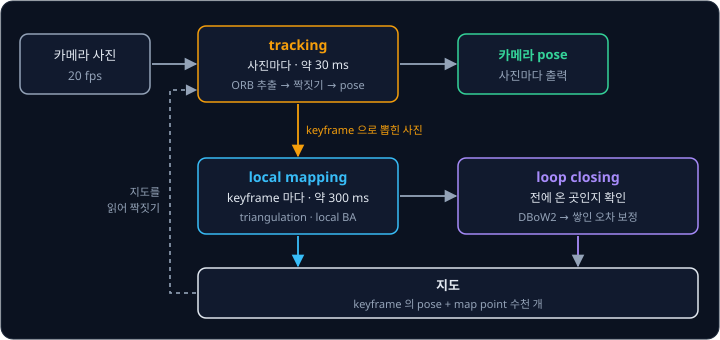
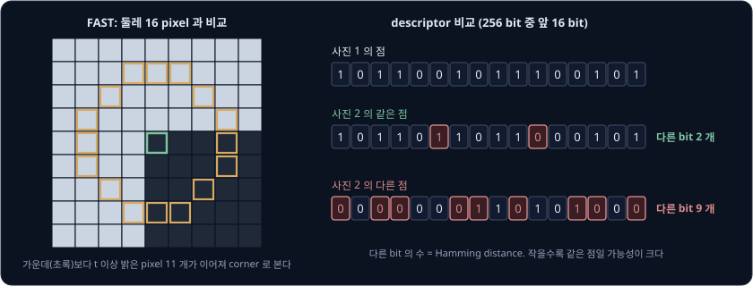
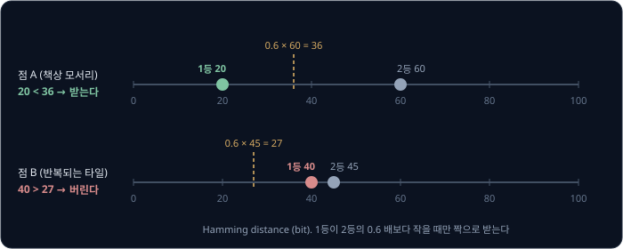
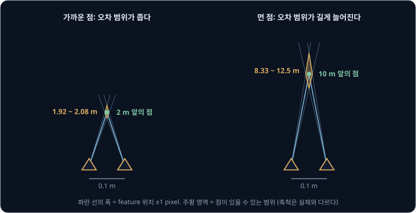
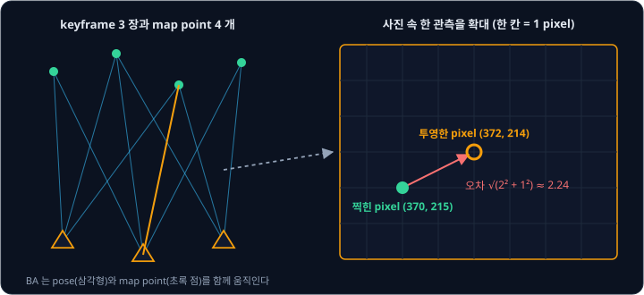
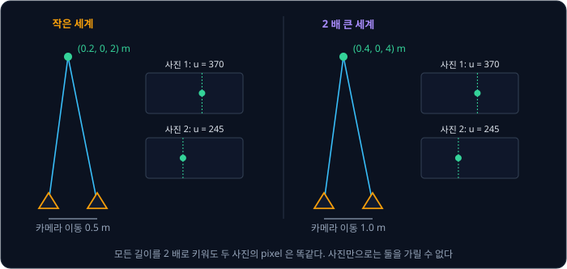
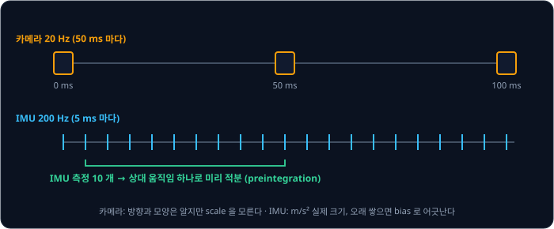
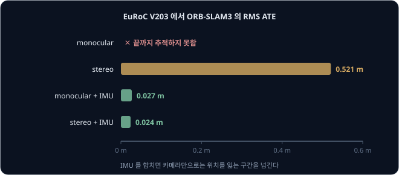

# Visual SLAM & VIO

휴대폰 AR 앱으로 바닥을 몇 초 비추면 가상 의자를 바닥에 올려 둘 수 있고, 휴대폰을 들고 방을 한 바퀴 돌아도 의자는 처음 놓은 자리에
그대로 있다. [Camera Geometry](../camera-geometry/README.md) 에서 본 것처럼 사진 한 장에는 방향만 있고 거리가 없는데, 휴대폰은 자기가
몇 m 움직였고 바닥이 어디 있는지를 어떻게 알아낼까?

휴대폰은 여러 장의 사진에서 같은 점을 찾고, 서로 다른 자리에서 본 그 점의 방향을 겹쳐 거리를 계산한다. 이렇게 카메라로 자기 위치와
주변 지도를 함께 만드는 방법이 Visual SLAM 이고, 카메라에 IMU 를 더해 움직인 거리의 실제 크기까지 맞추는 방법이 VIO(visual-inertial
odometry)다. Apple 의 ARKit 문서는 이 위치 추적을 VIO 로 한다고 설명한다. 공개 라이브러리 ORB-SLAM3 는 논문 Table II 에서 stereo camera
와 IMU 로 드론 dataset EuRoC 의 위치를 평균 3.5 cm 오차(RMS ATE 0.035 m)로 추정했다.

## 학습 목표

- 사진에서 feature point 를 찾고 ORB descriptor 로 두 사진의 같은 점을 짝짓는 과정을 설명할 수 있다
- 두 자리에서 본 방향으로 점의 3D 위치를 구하는 triangulation 과, keyframe 과 bundle adjustment 로 지도를 다듬는 과정을 설명할 수 있다
- 카메라 한 대로는 지도의 scale 을 알 수 없는 이유와, IMU 를 합친 VIO 가 scale 과 빠른 움직임 문제를 푸는 방식을 설명할 수 있다
- ORB-SLAM3·VINS-Mono 의 구성과, 흰 벽·motion blur·어두운 곳에서 Visual SLAM 이 실패하는 이유를 숫자로 설명할 수 있다

## Visual SLAM 의 구성

Visual SLAM 은 [LiDAR SLAM](../lidar-slam/README.md) 이 LiDAR scan 으로 하던 일을 카메라 사진으로 하는데, 사진에는 거리가 없어서 지도를
3D 점으로 만든다. 다시 찾기 쉬운 점(feature point)을 여러 사진에서 짝짓고, 두 자리 이상에서 본 방향으로 3D 위치를 계산한 점을
**map point** 라고 한다. 지도는 map point 수천 개와 그 점들을 본 사진 가운데 골라 둔 몇 장(keyframe)의 pose 로 이루어진다.

ORB-SLAM 은 이 일을 thread(한 프로그램 안에서 동시에 실행되는 작업 단위) 세 개로 나눈다. tracking 은 사진마다 feature 를 map point
와 짝지어 카메라 pose 를 구하고, local mapping 은 keyframe 마다 새 map point 를 만들어 주변 keyframe 과 함께 다듬는다.
loop closing 은 전에 왔던 곳을 찾아 쌓인 오차를 고친다. 이렇게 나누는 이유는 ORB-SLAM 논문이 NewCollege dataset(512 × 382 사진,
20 fps)에서 잰 계산 시간에서 드러난다.

| 계산 | 실행 시점 | 걸린 시간(중앙값) |
| --- | --- | --- |
| tracking 전체 | 사진마다 | 30.57 ms |
| local bundle adjustment | keyframe 마다 | 296.08 ms |
| loop 보정 | loop 를 찾았을 때 | 0.51 ~ 4.69 s |

20 fps 카메라에서는 50 ms 마다 사진이 들어오므로 tracking 은 그 안에 끝나지만, local bundle adjustment 는 사진이 여섯 장쯤 지나가는 동안
계산해야 한다($296 \div 50 \approx 5.9$). 그래서 무거운 계산은 keyframe 에만 하고, 그동안 tracking 은 지난번에 다듬어 둔 지도로 pose 를
낸다.

## feature point 와 ORB

흰 벽의 pixel 은 옆 pixel 과 똑같이 생겨서 다음 사진에서 어느 것이 같은 pixel 인지 가릴 수 없고, 책상 모서리 같은 직선 위의 점도 직선을
따라 옮기면 똑같아 보인다. 두 방향으로 밝기가 바뀌는 모서리 꼭짓점(corner)만 주변과 구별되므로, Visual SLAM 은 corner 를 feature point 로
쓴다.

ORB(Oriented FAST and Rotated BRIEF)는 corner 를 찾는 FAST 와, 찾은 점 주변을 숫자로 요약하는 BRIEF 를 고쳐 묶은 방법이다. FAST 는 후보
pixel 둘레의 원 위에 있는 16 개 pixel 을 보고, 그중 연속한 여러 개가 모두 가운데보다 문턱 $t$ 이상 밝거나 모두 어두우면 corner 로 본다.
ORB-SLAM3 의 EuRoC 설정은 밝기 0 ~ 255 에서 $t = 20$ 으로 먼저 찾고, corner 가 모자란 칸에서만 $t = 7$ 로 낮춰 다시 찾는다.

다른 사진에서 같은 점을 찾으려면 corner 마다 주변 모습을 **descriptor** 라는 숫자 묶음으로 요약해 둔다. BRIEF 는 corner 주변에서 정해 둔
pixel 짝마다 앞 pixel 이 더 밝으면 1, 아니면 0 을 적는데, ORB-SLAM3 코드는 이 비교를 256 번 해서 descriptor 하나를 256 bit(32 byte)로
만든다. ORB 는 여기에 회전과 크기 변화에 대한 대비를 더했다.

- 회전: corner 주변 밝기의 무게중심 쪽을 그 점의 방향으로 정하고 pixel 짝의 배치를 그 방향만큼 돌려 비교하므로, 카메라가 기울어도 같은
  점에서 같은 bit 가 나온다
- 크기: 사진을 여러 크기로 줄인 pyramid 의 각 장에서 corner 를 찾는다. ORB-SLAM 은 1.2 배씩 줄인 8 장을 쓰는데, 가장 큰 장과 가장 작은
  장의 크기 차이가 $1.2^7 \approx 3.6$ 배라서 가까이서 본 점을 3 배 넘게 멀어진 뒤에도 찾을 수 있다

ORB 논문 초록은 ORB 가 SIFT 보다 100 배쯤(two orders of magnitude) 빠르면서 많은 상황에서 성능이 비슷하다고 보고했다. ORB-SLAM
은 512 × 384 ~ 752 × 480 사진에서 한 장에 corner 를 1000 개 뽑는데, 사진을 칸으로 나눠 칸마다 5 개 이상 찾게 해서 feature 가 사진
한쪽에 몰리지 않는다.

## feature matching

두 descriptor 가 얼마나 다른지는 값이 다른 bit 의 개수로 재고, 이 개수를 **Hamming distance** 라고 한다. 두 bit 열에 XOR(같으면 0,
다르면 1)을 하고 1 의 개수를 세면 되므로 CPU 명령 몇 개로 끝난다. ORB-SLAM3 코드는 256 bit 가운데 50 bit 이하(일부 검색에서는 100 bit 이하)로 다를 때만 짝 후보로 받는다.

거리가 가장 가까운 후보만 고르면 바닥 타일이나 창문처럼 똑같은 무늬가 반복되는 곳에서 엉뚱한 짝이 생긴다. 그래서 가장 가까운 후보의
거리가 두 번째 후보 거리의 일정 비율보다 작을 때만 짝으로 받는다. 이 검사가 ratio test 이고, ORB-SLAM3 코드의 기본 비율은 0.6 이다.

ratio test 를 지나도 남는 틀린 짝(outlier)은 RANSAC 으로 거른다. 짝 몇 개를 무작위로 뽑아 두 사진 사이의 움직임을
계산하고 그 움직임과 맞는 짝이 가장 많은 경우를 고르는 방법으로, VINS-Mono 도 이렇게 한다. tracking 중의 ORB-SLAM 은 사진
전체를 뒤지지 않고, 카메라가 직전 속도로 움직였다고 가정해 map point 가 찍힐 자리를 먼저 계산한 뒤 그 근처의 feature 만 비교한다.

**확인 문제.** 어떤 점의 가장 가까운 후보가 30 bit, 두 번째 후보가 40 bit 다. ratio 0.6 이면 이 짝을 받을까?

답 보기

문턱은 $0.6 \times 40 = 24$ bit 다. 가장 가까운 후보 30 bit 가 24 보다 커서 받지 않는다. 두 후보가 10 bit 밖에 차이 나지 않아 어느 쪽이 진짜
짝인지 확신할 수 없다.

## triangulation

짝지은 점 하나를 두 keyframe 에서 보면 카메라 중심마다 그 점 쪽으로 뻗은 직선이 하나씩 생기고, 두 직선이 만나는 곳이 점의 3D 위치다.
이렇게 방향 두 개로 위치를 구하는 계산을 **triangulation** 이라고 한다. 카메라 한 대로 하는 Visual SLAM 에서는
[Camera Geometry](../camera-geometry/README.md) 에서 본 stereo camera 의 baseline 자리를 카메라가 움직인 거리가 대신한다.

옆으로 나란히 움직인 경우에는 Camera Geometry 에서 본 식 $Z = f \times b \div d$ 를 쓴다. 여기서 $f$ 는 pixel 단위 focal length
이고 $b$ 는 두 keyframe 사이에서 카메라가 움직인 거리이며, $d$ 는 같은 점이 두 사진에서 밀려 찍힌 pixel 수(disparity)다. Camera Geometry
의 예와 같은 $f = 500$, $b = 0.1$ m 에서 feature 위치가 1 pixel 틀리면 depth 는 아래만큼 틀린다.

| 실제 depth | disparity $d$ | $d \pm 1$ pixel 일 때 depth | depth 오차 범위 |
| --- | --- | --- | --- |
| 2 m | $500 \times 0.1 \div 2 = 25$ | $50 \div 26 = 1.92$ ~ $50 \div 24 = 2.08$ m | 약 ±4 % |
| 10 m | $500 \times 0.1 \div 10 = 5$ | $50 \div 6 = 8.33$ ~ $50 \div 4 = 12.5$ m | −17 ~ +25 % |

같은 1 pixel 오차라도 10 m 앞의 점은 depth 가 수 m 씩 흔들린다. 먼 점일수록 두 직선이 이루는 각도(parallax)가 작아서 두 직선이 거의
나란하게 만나기 때문이다. 카메라가 제자리에서 돌기만 하면 $b = 0$ 이라 parallax 가 없어서 triangulation 을 할 수 없다.

실제 시스템은 parallax 가 충분할 때만 점을 만든다. VINS-Mono 는 시작할 때 30 개 넘는 feature 가 이어서 추적되고 회전을 뺀 parallax 가
20 pixel 을 넘는 두 사진이 나올 때까지 기다린다. ORB-SLAM 은 새 map point 를 받기 전에 두 카메라 앞에 있는지(depth 가 양수인지),
parallax 가 충분한지, 다시 투영한 오차가 작은지 확인한다. ORB-SLAM3 는 TUM-VI 의 야외 sequence 에서 카메라로부터 20 m 넘게 떨어진 점을
버리는데, 흐린 하늘에서 나온 먼 점은 사진에서 거의 움직이지 않아 pose 에 drift 를 만들기 때문이다.

**확인 문제.** $f = 500$ 인 카메라가 옆으로 0.2 m 움직이며 5 m 앞의 점을 봤다. disparity 는 몇 pixel 이고, 1 pixel 틀리면 depth 는 어디부터
어디까지 흔들릴까?

답 보기

본문의 식 $Z = f \times b \div d$ 를 $d$ 에 대해 쓰면 $d = 500 \times 0.2 \div 5 = 20$ pixel 이다. $f \times b = 100$ 이므로 $d = 21$ 이면
$100 \div 21 = 4.76$ m, $d = 19$ 이면 $100 \div 19 = 5.26$ m 라서 4.76 ~ 5.26 m 사이에서 흔들린다.

## tracking 과 keyframe

지도에 map point 가 생기면 새 사진의 카메라 pose 는 map point 의 3D 좌표와 이번 사진에서 짝지은 pixel 여러 쌍으로 구한다. 3D 점들을
투영한 자리가 짝지은 pixel 에 가장 가까워지는 pose 를 찾는 이 문제를 PnP(Perspective-n-Point)라고 한다.

투영한 자리와 실제로 찍힌 자리 사이의 거리가 **reprojection error** 로, Camera Geometry 에서 calibration 할 때 줄이던 오차와 같다. Camera
Geometry 의 카메라($f = 500$, principal point $(320, 240)$)에서 점 $(0.1, -0.05, 1.0)$ 은 pixel $(370, 215)$ 에 찍혔다. 지도에 이 점이
$(0.104, -0.052, 1.0)$ 으로 조금 틀리게 들어 있으면, 투영한 자리는 $(500 \times 0.104 + 320,\ 500 \times (-0.052) + 240) = (372, 214)$ 이고
reprojection error 는 $\sqrt{2^2 + 1^2} \approx 2.24$ pixel 이다.

ORB-SLAM3 는 오차가 작은 짝(inlier)이 30 개보다 적으면 tracking 이 실패했다고 보고, 사진을 지도 속
keyframe 과 비교해 위치를 다시 찾는다([loop closure 와 place recognition](#loop-closure-와-place-recognition)).

20 fps 카메라를 단 로봇이 0.5 m/s 로 움직이면 사진 사이에 $0.5 \div 20 = 0.025$ m 밖에 움직이지 않아서 이웃한 사진은 거의 같은 장면이고
parallax 도 작다. 그래서 장면이 충분히 바뀐 사진만 keyframe 으로 지도에 남긴다. ORB-SLAM 은 지금 사진이 map
point 를 50 개 이상 추적하면서도 기준 keyframe 이 본 점의 90 % 보다 적게 볼 때 keyframe 을 추가한다. 다만 위치를 다시 찾은 직후 20 장
동안은 넣지 않고, local mapping 이 앞 keyframe 을 아직 처리하는 중이면 마지막 keyframe 뒤로 20 장이 지날 때까지 기다린다.

keyframe 을 늘리면 빠른 회전에서 tracking 이 덜 끊기지만 bundle adjustment 의 계산량이 늘어난다. 그래서 ORB-SLAM 은 keyframe 을 일단 자주
넣고, map point 의 90 % 를 다른 keyframe 세 장 이상이 이미 보는 keyframe 은 나중에 지운다.

## bundle adjustment

triangulation 으로 만든 map point 와 PnP 로 구한 pose 에는 각각 오차가 있고, 하나를 고정한 채 다른 하나를 구하면 그 오차가
그대로 다음 계산에 넘어간다. **bundle adjustment**(BA)는 여러 keyframe 의 pose 와 그 keyframe 들이 본 map point 의 위치를 한꺼번에 움직여,
모든 관측의 reprojection error 를 더한 값이 가장 작아지도록 다듬는다. Triggs 등의 정리 논문에 따르면 이름은 3D 점마다 나와 카메라
중심들로 모이는 빛줄기 다발(bundle)을 점과 카메라 위치에 맞춰 함께 조정(adjust)한다는 뜻에서 왔다.

모든 keyframe 과 map point 를 매번 다듬으면 지도가 커질수록 계산량이 계속 늘어난다. ORB-SLAM 의 local BA 는 새 keyframe 과, 그것과
map point 를 함께 보는 keyframe 들(covisible keyframe), 그 keyframe 들이 본 map point 만 움직인다. 그 점들을 보지만 새 keyframe 과 연결되지
않은 keyframe 은 식에 넣되 고정한다. 그래도 keyframe 하나에 300 ms 쯤 걸리는 이 계산을 ORB-SLAM 은
Levenberg-Marquardt 방법으로 풀고, 오차가 지나치게 큰 관측은 중간에 outlier 로 빼낸다.

지도 전체를 옮기거나 돌려도 reprojection error 는 변하지 않으므로 BA 는 처음 keyframe 을 원점으로 고정한다. 그런데 카메라 한 대로 만든
지도는 전체를 같은 비율로 키워도 오차가 그대로라서, 원점을 고정해도 지도의 크기는 정해지지 않는다.

<b>심화: bundle adjustment 의 식과 계산량</b>

keyframe $i$ 의 pose 를 $T_i$, map point $j$ 의 위치를 $X_j$, keyframe $i$ 에서 점 $j$ 가 찍힌 pixel 을 $u_{ij}$ 라고 하면 BA 는 아래 값을
가장 작게 만드는 $T_i$ 와 $X_j$ 를 찾는다.

$$
C = \sum_{(i,j)} \rho\left( \left\| u_{ij} - \pi(T_i, X_j) \right\|^2 \right)
$$

- $\pi(T_i, X_j)$ 는 점 $X_j$ 를 pose $T_i$ 의 카메라로 투영한 pixel 이다
- $\rho$ 는 오차가 큰 관측의 영향을 줄이는 robust cost 다. ORB-SLAM 이 쓰는 Huber 함수는 오차가 작을 때는 제곱으로, 클 때는 1차로만
  늘어나서 틀린 짝 하나의 큰 오차가 결과 전체를 흔들지 못한다
- ORB-SLAM 은 각 관측의 오차를 그 feature 를 찾은 pyramid 층의 크기로 나눠서, 작은 사진에서 찾은 덜 정확한 feature 를 덜 믿는다

keyframe 10 장과 map point 1000 개를 다듬는다고 하자. pose 하나는 위치 3 개와 회전 3 개로 숫자 6 개이고 점 하나는 숫자 3 개라서, 모르는
값은 $10 \times 6 + 1000 \times 3 = 6060$ 개다. 점마다 keyframe 4 장에 찍혔다면 관측은 4000 개이고, 관측 하나가 pixel 오차 $u, v$ 두 개를
주므로 식은 8000 개다. 모르는 값 6060 개를 식 8000 개로 푸는 non-linear least squares 문제다.

이 문제를 Gauss-Newton 이나 Levenberg-Marquardt 로 풀면 반복마다 6060 × 6060 크기의 연립방정식이 나오지만, 관측 하나는 pose 하나(6 개)와
점 하나(3 개)에만 걸려 있어서 행렬 대부분이 0 이다. 그래서 점 1000 개의 값 3000 개를 먼저 소거(Schur complement)하면 keyframe 10 장의 값
60 개만 남은 60 × 60 연립방정식을 풀면 되고, 점은 그 결과로 하나씩 따로 계산한다. 덕분에 map point 가 keyframe 보다 훨씬 많은 Visual SLAM 에서도
BA 를 실시간으로 할 수 있다.

지도 전체를 옮기고(3), 돌리고(3), 같은 비율로 키워도(1) $C$ 는 바뀌지 않는데, Triggs 등은 이 $3 + 3 + 1 = 7$ 개의 자유도를 gauge freedom
이라고 부른다.

## monocular scale ambiguity

카메라 한 대(monocular)로 만든 지도에서는 카메라가 움직인 거리와 점까지의 거리가 서로의 비율로만 정해진다. Camera Geometry 의
카메라($f = 500$, $c_x = 320$)로 찍은 아래 두 경우가 그 예다.

| 경우 | 카메라 이동 | 점의 위치 | 첫 사진의 $u$ | 두 번째 사진의 $u$ |
| --- | --- | --- | --- | --- |
| 작은 세계 | 옆으로 0.5 m | $(0.2, 0, 2)$ | $500 \times 0.2 \div 2 + 320 = 370$ | $500 \times (0.2 - 0.5) \div 2 + 320 = 245$ |
| 2 배 큰 세계 | 옆으로 1.0 m | $(0.4, 0, 4)$ | $500 \times 0.4 \div 4 + 320 = 370$ | $500 \times (0.4 - 1.0) \div 4 + 320 = 245$ |

두 경우의 사진이 pixel 하나까지 똑같아서 사진만 보는 SLAM 은 둘을 가릴 수 없다. 그래서 monocular SLAM 은 길이 하나를 임의로 1 로 정하고 지도를 그 단위로
만든다. ORB-SLAM3 코드는 카메라만 쓸 때 처음 지도의 depth 중앙값을 1 로 두고, VINS-Mono 도 시작할 때 scale 을 임의로 정한다.

새 map point 는 이전 점들로 구한 pose 에서 triangulation 하므로, 오래 움직이면 지도의 단위가 조금씩 바뀌는 scale drift 도 생긴다. 그래서 ORB-SLAM 은 monocular 지도가 위치 3 개, 회전 3 개, scale 1 개를 합한 7 자유도로 어긋날 수
있다고 보고, loop 를 닫을 때 scale 까지 고치는 similarity transform(Sim(3))을 계산한다. ORB-SLAM3 는 EuRoC 평가에서도 monocular 결과를
정답 궤적에 scale 까지 맞춘 뒤 오차를 잰다.

scale 을 알려면 실제 길이 정보가 하나 더 있어야 하는데, 두 카메라의 간격을 아는 stereo camera, pixel 마다 거리를 재는 RGB-D
camera, 다음 절의 IMU 가 그 정보를 준다.

## VIO

IMU(inertial measurement unit)는 가속도(m/s²)를 재는 accelerometer 와 각속도(rad/s)를 재는 gyroscope 를 묶은 센서다. 가속도는 처음부터
m 와 s 라는 실제 단위로 나오므로 카메라가 모르는 scale 을 IMU 로 정할 수 있다. 카메라 사진과 IMU 측정을 하나의 추정으로 합쳐 pose 를
구하는 방법이 **VIO** 다.

멈춰 있던 카메라가 1 초 동안 1 m/s² 로 가속하면 $\frac12 \times 1 \times 1^2 = 0.5$ m 움직인다. 같은 1 초 동안 monocular SLAM 이 구한
이동 거리가 2.0 단위라면 지도의 1 단위는 $0.5 \div 2.0 = 0.25$ m 다. 실제 VIO 는 이 비교를 IMU 측정 수백 개와 pose 여러 개로 한꺼번에
하는데, ORB-SLAM3 논문은 2 초 만에 scale 오차 5 %, 15 초 뒤 1 % 를 보고했다.

반대로 가속이 없으면 scale 을 정할 수 없다. 일정한 속도로만 움직이면 accelerometer 는 중력 외에 아무것도 재지 않고, 지도를 2 배로 키우고
속도도 2 배로 잡으면 카메라와 IMU 측정이 모두 그대로 맞는다. VINS-Mono 논문도 같은 이유로 멈춘 상태로는 시작할 수 없다고 적었다.
그래서 VIO 는 카메라를 움직여 가속을 주며 시작한다.

IMU 는 빠르게 움직일 때 끊기는 tracking 도 이어 준다. EuRoC dataset 의 드론은 카메라가 20 Hz, IMU 가 200 Hz 라서 사진 두 장 사이에 IMU 측정이
10 개 들어온다. 카메라가 빨리 돌아 사진이 번지거나 feature 가 화면 밖으로 나가도 gyroscope 로 그사이 얼마나 돌았는지 알 수 있으므로, map
point 가 다음 사진의 어디쯤 찍힐지 예측해 그 근처에서 다시 짝을 찾는다. ORB-SLAM3 의 visual-inertial 모드는 추적한 map point 가 15 개보다
적어지면 사진으로는 위치를 잃은 상태로 보고, 그 뒤 5 초 동안 IMU 로 pose 를 이어 가며 다시 짝을 찾는다.

[Kalman Filter](../kalman-filter/README.md) 의 표처럼 0.01 m/s² 의 가속도 bias 는 60 초면
18 m 의 위치 오차를 만들지만, 5 초라면 $\frac12 \times 0.01 \times 5^2 = 0.125$ m 라서 사진으로 위치를 다시 찾을 때까지 이어 붙이기에는
충분하다. 카메라는 오차가 천천히 쌓이고 IMU 는 짧은 시간에 정확하므로, VIO 는 IMU 의 bias 도 함께 추정하며 둘을 합친다.

VIO 계산에는 아래 요소가 들어간다.

- preintegration: BA 가 pose 를 고칠 때마다 사진 사이의 IMU 측정을 처음부터 다시 적분하면 계산이 너무 많다. 그래서 두 keyframe 사이의 IMU
  측정을 앞 keyframe 기준의 상대 움직임 하나로 미리 묶어 두고(preintegration), BA 에서는 이 묶음을 식 하나로 쓴다
- tightly coupled: VINS-Mono 와 ORB-SLAM3 는 둘 다 preintegration 을 쓰고, feature 관측과 IMU 측정을 한 최적화에 함께 넣는다. 따로 계산한 visual
  odometry 결과를 IMU 와 Kalman filter 로 섞는 loosely coupled 방식보다 계산은 많지만, feature 가 몇 개 안 남은 순간에도 남은 관측을 그대로
  쓸 수 있다
- 관측 가능한 자유도: accelerometer 는 늘 중력을 재므로 roll 과 pitch 는 drift 없이 정해지고, x, y, z 위치와 중력축 둘레의 회전(yaw)
  4 개만 천천히 어긋난다. 그래서 VINS-Mono 는 loop 를 닫을 때 이 4 개만 고치는 4-DoF pose graph 를 쓴다
- 설정값: camera 와 IMU 사이의 상대 pose(extrinsics)와 시간 동기가 틀리면 오류 메시지 없이 틀린 추정이 나온다. IMU noise 크기는 Isaac ROS
  Visual SLAM 의 `gyro_noise_density`, `accel_noise_density` 같은 parameter 로 넣는데, Kalman filter 의 $Q$·$R$ 처럼 데이터시트 값에서 출발한다

**흔한 오해.** "IMU 를 붙이면 위치 drift 가 사라진다." IMU 는 scale 과 roll·pitch 를 정해 주고 사진이 잠깐 끊긴 구간을 이어 주지만, x·y·z
위치와 yaw 의 오차는 VIO 에서도 천천히 쌓이고, 이 drift 는 전에 온 곳을 다시 알아보는 loop closure 로 고친다.

**확인 문제.** 멈춰 있던 카메라가 2 초 동안 0.5 m/s² 로 일정하게 가속했고, 같은 시간 동안 monocular SLAM 이 구한 이동 거리는 4 단위다.
지도의 1 단위는 몇 m 인가?

답 보기

IMU 로 구한 이동 거리는 $\frac12 \times 0.5 \times 2^2 = 1$ m 다. 같은 이동이 SLAM 지도에서는 4 단위이므로 1 단위는 $1 \div 4 = 0.25$ m 다.

## loop closure 와 place recognition

Visual SLAM 도 [LiDAR SLAM](../lidar-slam/README.md) 처럼 전에 왔던 곳을 다시 알아보면 loop closure 로 쌓인 오차를 고친다. 전에 본
장소인지 사진으로 판단하는 이 일(place recognition)에 ORB-SLAM, VINS-Mono, ORB-SLAM3 는 모두 bag of words 라이브러리 DBoW2 를 쓴다. DBoW2 는 많은 사진에서 모은 binary descriptor(ORB-SLAM 계열은 ORB, VINS-Mono 는 BRIEF)를 비슷한 것끼리 묶어 "단어" 로 정해 두고,
사진 한 장을 단어마다 나온 횟수를 센 목록으로 바꿔 지도 속 keyframe 들과 빠르게 비교한다. 목록이 비슷한 후보가 나오면 실제 feature 를
짝지어 기하학적으로 맞는지 확인한 뒤에 loop 로 받는다. 위치를 잃었을 때 다시 찾는 relocalization 도 같은 방식이다. ORB-SLAM3 는 여기에
여러 지도를 함께 관리하는 Atlas 를 더해, 위치를 다시 찾지 못하면 새 지도를 시작했다가 예전 장소를 다시 보면 두 지도를 합친다.

## ORB-SLAM3 와 VINS-Mono

아래 표의 정확도는 ORB-SLAM3 논문 Table II 의 EuRoC RMS ATE(absolute trajectory error)로, 추정한 궤적을 정답 궤적에 겹쳐 놓고 시각마다 위치 차이를 제곱해 평균 낸 뒤 제곱근을 씌운 값이다.

| 항목 | ORB-SLAM3 (2021) | VINS-Mono (2018) |
| --- | --- | --- |
| 센서 | monocular·stereo·RGB-D camera, IMU 있이·없이, pinhole·fisheye 렌즈 | monocular camera + IMU |
| feature 짝짓기 | ORB descriptor 를 비교해 짝짓는다 | Shi-Tomasi corner 를 KLT optical flow 로 다음 사진까지 따라간다. 사진마다 100 ~ 300 개를 유지한다 |
| 최적화 | keyframe 과 covisible keyframe 의 local BA, 필요하면 IMU 항을 함께 넣는다 | 최근 keyframe 몇 장의 sliding window 안에서 feature 와 IMU 를 함께 최적화한다 |
| loop closure | DBoW2 기반 place recognition, Atlas 의 여러 지도 병합 | DBoW2 + 4-DoF pose graph |
| EuRoC monocular + IMU 평균 RMS ATE | 0.043 m | 0.110 m |

KLT optical flow 는 feature 주변의 작은 밝기 무늬를 조금씩 밀어 보며 다음 사진에서 어디로 옮겨 갔는지 찾는 방법이라, descriptor 를 비교할
필요가 없어 계산이 가볍다. VINS-Mono 의 값은 ORB-SLAM3 저자들이 그 코드를 기본 설정으로 돌려 얻었다. 논문은 그 차이(약 $0.110
\div 0.043 \approx 2.6$ 배)의 이유로 ORB-SLAM3 가 오래전에 본 keyframe 의 map point 도 BA 에 다시 쓴다는 점을 든다. sliding window 안의 최근
keyframe 만 최적화하면 loop 로 알아보기 전에는 같은 곳을 다시 지나도 그 전 관측을 쓰지 못한다.

ROS 2 로봇에서는 NVIDIA 의 Isaac ROS Visual SLAM package 가 stereo camera 로 이 계산을 GPU 에서 하고, `tracking_mode` 를 1 로 두면 IMU 를
합친 VIO 로 동작한다. 기본 설정에서
`odom` → `base_link` tf 를 직접 내므로, `robot_localization` 으로 바퀴 odometry 와 합칠 때는 `publish_odom_to_base_tf` 를 꺼서 이 tf 를 한
node 만 내게 한다.

## 실패 상황

Visual SLAM 은 corner 를 찾아 짝지어야 동작하므로 corner 가 사라지면 실패한다. ARKit 문서도 카메라가 빈 벽을
비출 때, 장면이 너무 어두울 때, 너무 빠르게 움직이거나 흔들릴 때 추적 품질이 떨어진다고 적었다.

| 상황 | 일어나는 일 | 숫자 |
| --- | --- | --- |
| 흰 벽, 무늬 없는 바닥 | FAST 가 corner 를 거의 찾지 못해 짝 수가 줄어든다 | ORB-SLAM3 는 카메라만 쓸 때 inlier 가 30 개 미만이면 tracking 실패로 본다 |
| 빠른 회전 | 셔터가 열린 동안 상이 옆으로 번져 corner 가 뭉개진다 | 노출 시간을 10 ms 로 가정하면 90°/s 에서 약 7 pixel 번진다(아래 계산) |
| 어두운 곳 | 밝기 차가 FAST 문턱 아래로 떨어진다 | 계산 예: 밝기 차 40 인 corner 가 30 % 로 어두워지면 $40 \times 0.3 = 12$ 라서 문턱 20 에서는 빠지고 7 에서만 잡힌다 |
| 먼 점만 보이는 야외 | 가까운 feature 가 모자라 scale 과 가속도 bias 가 어긋난다 | ORB-SLAM3 는 TUM-VI 의 긴 야외 sequence 에서 10 ~ 70 m 오차를 냈다 |

motion blur 의 길이는 셔터가 열린 시간(노출 시간) $t_e$ 동안 카메라가 돈 각도로 정해진다. 각속도 $\omega$ 로 돌면 사진 가운데의 점은
$f \times \omega \times t_e$ pixel 만큼 번진다. EuRoC 카메라의 focal length 는 ORB-SLAM3 설정 파일에 $f_x = 458.654$ pixel 로 적혀 있다.
노출 시간은 조명에 따라 달라서 아래 표는 10 ms(0.01 s)로 가정했다.

| 회전 속도 | 계산 | 번진 길이 |
| --- | --- | --- |
| 30°/s (0.52 rad/s) | $458.654 \times 0.52 \times 0.01$ | 약 2.4 pixel |
| 90°/s (1.57 rad/s) | $458.654 \times 1.57 \times 0.01$ | 약 7.2 pixel |
| 180°/s (3.14 rad/s) | $458.654 \times 3.14 \times 0.01$ | 약 14.4 pixel |

FAST 가 보는 16 pixel 원은 지름이 7 pixel 정도라서, 상이 그만큼 번지면 원 위의 밝기 차가 고르게 뭉개져 corner 로 잡히기 어렵고,
빠르게 도는 로봇에서 tracking 이 끊기는 것도 이 때문이다.

IMU 를 합치면 이런 순간을 넘긴다. ORB-SLAM3 논문이 가장 어렵다고 꼽은 EuRoC V203 에서(Table II) monocular 는 끝까지
추적하지 못했고 stereo 는 0.521 m 의 오차를 냈지만, IMU 를 합친 두 구성은 2 ~ 3 cm 로 끝냈다. TUM-VI dataset 에서 어두운 원통형
미끄럼틀을 내려가는 구간처럼 feature 가 거의 없는 곳도 visual-inertial 모드는 끝까지 처리했다. 로봇에 붙일 때는 카메라가 흰
벽이나 바닥만 보지 않게 방향을 정하고, 빠르게 도는 로봇이면 노출 시간을 짧게 잡고 IMU 를 함께 쓴다.

**확인 문제.** $f = 500$ pixel 인 카메라를 단 로봇이 60°/s 로 돌고, 노출 시간은 20 ms 다. 사진 가운데의 점은 몇 pixel 번질까?

답 보기

60° 는 $60 \times \pi \div 180 \approx 1.05$ rad 이므로 각속도는 1.05 rad/s 다. 본문의 식 $f \times \omega \times t_e$ 에 넣으면
$500 \times 1.05 \times 0.02 \approx 10.5$ pixel 이다. FAST 가 보는 원의 지름(약 7 pixel)보다 길어서 corner 를 찾기 어렵다.

## 정리

- Visual SLAM 은 사진마다 ORB feature 를 찾아 Hamming distance 와 ratio test 로 짝짓고, 두 keyframe 에서 본 방향으로 map point 를
  triangulation 한다. 1 pixel 오차가 2 m 앞에서는 ±4 % 지만 10 m 앞에서는 −17 ~ +25 % 라서, 가까운 점일수록 정확하다
- tracking 은 사진마다 map point 를 투영해 reprojection error 가 작은 pose 를 구하고(ORB-SLAM 에서 약 30 ms), 장면이 바뀐 사진만 keyframe
  으로 남겨 bundle adjustment 로 pose 와 map point 를 함께 다듬는다(약 300 ms)
- 카메라 한 대로는 0.5 m 움직이며 2 m 앞을 본 경우와 1 m 움직이며 4 m 앞을 본 경우가 똑같이 찍혀 scale 을 알 수 없다. IMU 의 m/s²
  측정이 scale 을 정하고(ORB-SLAM3 는 2 초에 5 %), 사진이 번지거나 feature 가 사라진 몇 초 동안 pose 를 이어 간다

**면접에서 "Visual SLAM 과 VIO 가 어떻게 동작하는지 설명해 보세요" 라고 물으면.** "Visual SLAM 은 ORB 같은 feature 를 매칭하고, 두 keyframe
의 시선으로 map point 를 triangulation 해 지도를 만듭니다. 새 프레임은 2D-3D 대응으로 PnP 를 풀어 pose 를 구하고, keyframe 에서는 local
bundle adjustment 로 pose 와 map point 를 함께 최적화합니다. drift 는 DBoW2 같은 place recognition 으로 loop
를 찾아 고칩니다. monocular 는 scale 이 관측되지 않는데, IMU 를 tightly coupled 로 합친 VIO 는 가속도로 metric scale 과 roll·pitch 를
관측하고 빠른 움직임에서도 추적을 이어 갑니다."

Visual SLAM 은 로봇이 지도 위 어디 있는지 알려 주지만 어느 길로 갈지는 정하지 않고, 듬성듬성한 map point 는 그대로 장애물 지도가
되지도 않는다. 다음 강의 [Path Planning](../path-planning/README.md) 에서는 지도를 장애물
비용 지도(costmap)로 바꾸고 그 위에서 경로를 찾는 방법을 다룬다.

## 참고 자료

- Campos 외, [ORB-SLAM3](https://arxiv.org/abs/2007.11898) (2021) — thread 구성(III 절), IMU 초기화와 tracking 을 잃었을 때의 처리(V 절),
  EuRoC 센서 구성별 결과(Table II)
- Mur-Artal 외, [ORB-SLAM](https://arxiv.org/abs/1502.00956) (2015) — ORB 추출 설정(1000 개, 8 층, 1.2 배), keyframe 조건, local BA, Table I 의
  thread 별 계산 시간
- Qin 외, [VINS-Mono](https://arxiv.org/abs/1708.03852) (2018) — KLT 기반 front-end, IMU preintegration, scale 을 알려면 가속이 필요한 이유,
  4-DoF pose graph
- Rublee 외, [ORB: An efficient alternative to SIFT or SURF](https://doi.org/10.1109/ICCV.2011.6126544) (2011) — ORB 의 원 논문(초록에 SIFT 대비
  속도). 방향 계산과 pyramid 는 OpenCV [ORB tutorial](https://github.com/opencv/opencv/blob/4.x/doc/py_tutorials/py_feature2d/py_orb/py_orb.markdown), 16 pixel 원 검사는
  [FAST tutorial](https://github.com/opencv/opencv/blob/4.x/doc/py_tutorials/py_feature2d/py_fast/py_fast.markdown) 이 정리한다
- Triggs 외, [Bundle Adjustment — A Modern Synthesis](https://inria.hal.science/inria-00590128) (2000) — cost function, sparse 한 연립방정식
  풀이, gauge freedom, 1 절의 이름 유래
- [ORB-SLAM3 source code](https://github.com/UZ-SLAMLab/ORB_SLAM3) — `src/Tracking.cc` 의 inlier 문턱(30·50·15)과 처음 지도의 depth 정규화,
  `src/ORBextractor.cc` 의 256 bit descriptor, `src/ORBmatcher.cc` 의 Hamming 문턱(50·100)과 ratio, `Examples/Monocular/EuRoC.yaml` 의 ORB·카메라
  설정
- Apple, [Understanding World Tracking](https://developer.apple.com/documentation/arkit/understanding-world-tracking) — ARKit 의 VIO 위치 추적과,
  빈 벽·어둠·빠른 움직임에서 추적이 나빠진다는 주의 사항
- NVIDIA, [Isaac ROS Visual SLAM](https://github.com/NVIDIA-ISAAC-ROS/isaac_ros_visual_slam) — ROS 2 의 stereo VIO package. README 와
  `isaac_ros_cuvslam/src/visual_slam_node.cpp` 의 parameter 기본값
