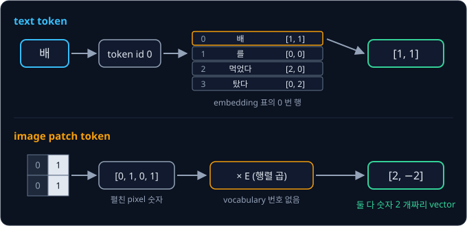
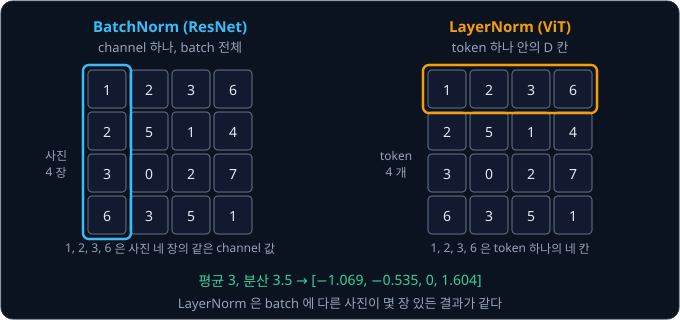

# ViT

## 학습 목표

- 사진을 같은 크기의 작은 조각(patch)으로 자르고, 조각마다 숫자 목록 하나를 만드는 계산을 4×4 사진으로 손으로 따라 할 수 있다
- 사진 크기와 조각 크기로 조각 수를 셀 수 있고(224×224 사진을 16×16 조각으로 자르면 196 개), 조각을 작게 자를수록 계산이 얼마나
  늘어나는지 숫자로 설명할 수 있다
- 조각 목록 맨 앞에 붙이는 사진 전체의 요약 자리와, 자리마다 더하는 위치 숫자가 왜 필요한지 작은 숫자 예시로 설명할 수 있다
- 조각을 숫자 목록으로 바꾼 뒤의 계산이 [Transformer](../transformer/README.md) 에서 배운, 입력을 읽는 쪽(encoder)과 똑같다는 것을
  층의 부품으로 설명할 수 있다
- CNN(작은 filter 를 사진 위로 옮겨 가며 계산하는 모델)이 구조 안에 미리 넣어 둔 가정을 들고, 그 가정이 적은 ViT 가 사진을 훨씬 많이 봐야 CNN 을 앞서는 이유를 설명할 수 있다
- 사진과 지시문을 함께 받아 로봇을 움직이는 모델의 사진 입구가 ViT 계열이라는 것을 예를 들어 설명할 수 있다

## 사진을 Transformer 에 넣는 문제

### CNN 이 사진을 읽는 방식

[CNN](../cnn/README.md) 에서 본 것처럼 사진은 pixel 이라는 작은 칸을 가로세로로 늘어놓은 숫자 격자다. 흑백 사진은 pixel 마다 밝기
숫자가 하나이고, 컬러 사진은 빨강·초록·파랑(RGB) 세기 세 개라서 channel(같은 색의 숫자만 모은 판)이 3 장이다. 사진 모델에 흔히
넣는 224×224 컬러 사진 한 장은 숫자가 $3 \times 224 \times 224 = 150{,}528$ 개다.

CNN 은 3×3 처럼 작은 filter(숫자 판)를 사진 위에서 한 칸씩 옮기며, 겹친 칸끼리 곱해 더한 값을 출력 칸에 적는다. 이 계산이
convolution 이다. 출력 한 칸은 입력의 3×3, 곧 가까운 9 칸만 보기 때문에, 사진 왼쪽 위의 컵 손잡이와 오른쪽 아래의 사람 손처럼
멀리 떨어진 두 곳의 관계는 층을 여러 번 쌓은 뒤에야 한 칸 안에 함께 들어온다. 출력 한 칸이 반영하는 입력 영역을 receptive field
라고 했고, 3×3 conv 를 $L$ 층 쌓으면 receptive field 는 $1 + 2L$ 칸이었다. pooling(몇 칸을 하나로 줄이는 계산) 없이 3×3 conv
만으로 224 칸을 다 덮으려면 $1 + 2L \ge 224$ 에서 $L = 112$ 층이 필요하다. [ResNet](../resnet/README.md) 의 정리에서도 convolution 은
가까운 칸끼리만 계산하므로 멀리 떨어진 두 구역의 관계는 층을 아주 많이 쌓아야 반영된다는 한계를 남겼다.

위 그림의 왼쪽은 CNN 의 첫 층이다. 주황 칸 하나를 계산할 때 쓰는 입력은 파란 3×3 영역뿐이다. 오른쪽은 이 강의에서 다룰 ViT 의 첫
층으로, 사진을 큰 조각 16 개로 나눈 뒤 주황 조각 하나가 나머지 15 개 조각과 모두 선으로 이어져 있다. 이렇게 첫 층부터 사진 전체를
한 번에 보게 하는 계산이 다음 절의 attention 이다.

**확인 문제.** pooling 없이 3×3 conv 만 쌓을 때, 32×32 사진의 32 칸을 다 덮으려면 몇 층이 필요할까?

답 보기

$1 + 2L \ge 32$ 이어야 하므로 $2L \ge 31$, $L \ge 15.5$ 이다. 층 수는 정수라 16 층이다. 16 층이면 $1 + 32 = 33$ 칸을 덮는다.

### Transformer 의 입력

[Transformer](../transformer/README.md) 는 vector(숫자를 순서대로 묶은 목록) 여러 개를 받는다. 받은 vector 하나하나가 다른 모든
vector 와 dot product(같은 자리 칸끼리 곱해 모두 더한 값)로 점수를 매기고, softmax 로 점수를 합이 1 인 비율(weight)로 바꾼 뒤, 그
비율로 vector 들을 가중 평균해 자기 vector 를 고친다. 이 계산이 attention 이다. "배 를 먹었다" 에서 "배" 는 자기 자신과 "먹었다"
에서 46.8% 씩 정보를 가져와 과일 쪽 뜻이 강해졌다.

Transformer 가 받는 vector 하나를 token 이라고 부른다. Transformer 강의에서 token 은 글을 자른 조각(단어)이었고, 그 조각의 번호로
embedding 표에서 꺼낸 vector 가 모델에 들어갔다. 이 강의의 token 은 글이 아니라 사진을 자른 조각 하나를 나타내는 vector 다.
[BPE Tokenizer](../tokenizer/README.md) 의 "문맥에 따른 token 의 뜻" 절에서 이 둘을 text token 과 image patch token 으로 구분했고,
둘이 어떻게 다른지는 뒤의 patch embedding 섹션에서 숫자로 비교한다.

attention 은 vector 목록만 있으면 계산할 수 있고, 그 vector 가 글에서 왔는지 사진에서 왔는지는 따지지 않는다. 그래서 사진을 vector
목록으로 바꾸기만 하면 Transformer 를 그대로 쓸 수 있다. 남은 문제는 사진을 어떤 단위로 잘라 token 으로 만드느냐다.

**확인 문제.** token 4 개가 들어가면 attention 의 점수 표(token 쌍마다 점수 하나)에는 칸이 몇 개 있을까?

답 보기

token 마다 자기 자신을 포함한 4 개와 점수를 매기므로 $4 \times 4 = 16$ 칸이다.

### pixel 하나를 token 으로 쓸 때의 문제

가장 먼저 떠오르는 방법은 pixel 하나를 token 하나로 쓰는 것이다. 이 방법에는 두 가지 문제가 있다.

- **점수 표가 너무 크다** — 224×224 사진은 pixel 이 $224 \times 224 = 50{,}176$ 개다. attention 은 token 쌍마다 점수를 매기므로
  점수 표의 칸 수는 token 수의 제곱이라서, $50{,}176 \times 50{,}176 = 2{,}517{,}630{,}976$ 칸, 약 25억 칸이 된다. 층 하나, 사진 한
  장마다 이만큼을 계산해야 한다
- **pixel 하나에는 뜻이 거의 없다** — pixel 하나는 색 하나뿐이다. "빨간 점" 하나만 보고는 그것이 컵인지 사과인지 알 수 없어서,
  pixel 끼리 점수를 매기는 것은 글자 하나씩 떼어 놓고 뜻을 비교하는 것과 비슷하다

pixel 을 여러 개 묶은 조각을 token 으로 쓰면 두 문제가 함께 줄어든다. 224×224 사진을 가로세로 16 pixel 짜리 조각으로 자르면 한
변에 $224 \div 16 = 14$ 개, 모두 $14 \times 14 = 196$ 개의 조각이 나오고, 점수 표는 $196 \times 196 = 38{,}416$ 칸으로, 25억 칸의
65,536 분의 1 이다.

위 그림의 왼쪽은 pixel 하나를 token 하나로 쓴 경우로, 선이 너무 촘촘해 칸이 구분되지 않을 만큼 token 이 많다. 오른쪽은 16×16 조각을
token 으로 쓴 경우이고, 주황 칸 하나가 조각 하나다.

**확인 문제.** 32×32 사진에서 pixel 하나를 token 으로 쓰면 점수 표는 몇 칸일까? 4×4 조각으로 자르면 어떨까?

답 보기

pixel 은 $32 \times 32 = 1{,}024$ 개라 점수 표는 $1{,}024 \times 1{,}024 = 1{,}048{,}576$ 칸이다. 4×4 조각으로 자르면 한 변에
$32 \div 4 = 8$ 개, 모두 $8 \times 8 = 64$ 개라 점수 표는 $64 \times 64 = 4{,}096$ 칸이다.

**요약**

- CNN 은 가까운 칸만 보는 filter 를 쌓기 때문에 멀리 떨어진 곳의 관계를 보려면 층이 많이 필요하다
- Transformer 는 vector 목록이면 무엇이든 받으므로, 사진을 vector 목록으로 바꾸면 첫 층부터 사진 전체를 서로 비교할 수 있다
- pixel 하나를 token 으로 쓰면 224×224 사진의 점수 표가 약 25억 칸이라, pixel 을 묶은 조각을 token 으로 쓴다

## patch

### 사진을 patch 로 자르기

사진을 같은 크기로 자른 조각 하나를 patch 라고 한다. patch 는 영어로 "천 조각" 이라는 뜻이고, 조각 천을 이어 붙인 이불을 patchwork
라고 부르는 것처럼 사진을 바둑판 모양으로 나눈 한 칸을 가리킨다.

손으로 계산할 수 있게 [CNN](../cnn/README.md) 처럼 흰 칸 1, 검은 칸 0 인 4×4 흑백 사진을 쓴다.

$$
\begin{bmatrix}
0 & 1 & 1 & 0 \\
0 & 1 & 1 & 0 \\
0 & 0 & 1 & 1 \\
0 & 0 & 1 & 1
\end{bmatrix}
$$

위쪽 가운데에 세로 막대가 있고, 오른쪽 아래에 흰 사각형이 있는 사진이다. 이 사진을 가로세로 2 칸짜리 patch 로 자르면 patch 4 개가
나오고, 글을 읽는 순서대로 왼쪽 위에 1, 오른쪽 위에 2, 왼쪽 아래에 3, 오른쪽 아래에 4 의 번호를 붙인다.

patch 하나의 2×2 = 4 칸도 읽는 순서대로 왼쪽 위, 오른쪽 위, 왼쪽 아래, 오른쪽 아래의 차례로 한 줄로 늘어놓는다. 격자를 한 줄로
늘어놓는 일을 "펼친다" 라고 하고, 펼친 patch 는 숫자 4 개짜리 vector 가 된다.

| patch | 사진 속 자리 | 2×2 모양 | 펼친 vector |
| --- | --- | --- | --- |
| 1 | 왼쪽 위 | $\begin{bmatrix} 0 & 1 \\ 0 & 1 \end{bmatrix}$ | $[0, 1, 0, 1]$ |
| 2 | 오른쪽 위 | $\begin{bmatrix} 1 & 0 \\ 1 & 0 \end{bmatrix}$ | $[1, 0, 1, 0]$ |
| 3 | 왼쪽 아래 | $\begin{bmatrix} 0 & 0 \\ 0 & 0 \end{bmatrix}$ | $[0, 0, 0, 0]$ |
| 4 | 오른쪽 아래 | $\begin{bmatrix} 1 & 1 \\ 1 & 1 \end{bmatrix}$ | $[1, 1, 1, 1]$ |

위 그림의 왼쪽은 주황 선으로 나눈 사진이고, 가운데는 떼어 낸 patch 4 개, 오른쪽은 patch 마다 펼친 숫자다. patch 1 은 세로 막대의
왼쪽 절반, patch 2 는 오른쪽 절반이라 두 patch 의 숫자가 거울처럼 뒤집혀 있다.

**확인 문제.** 아래 4×4 사진을 같은 방법으로 자르면 patch 1 과 patch 4 를 펼친 vector 는 각각 무엇일까?

$$
\begin{bmatrix}
1 & 1 & 0 & 0 \\
0 & 0 & 0 & 0 \\
0 & 0 & 1 & 0 \\
0 & 0 & 0 & 1
\end{bmatrix}
$$

답 보기

patch 1 은 왼쪽 위 2×2 인 $\begin{bmatrix} 1 & 1 \\ 0 & 0 \end{bmatrix}$ 이라 $[1, 1, 0, 0]$ 이다. patch 4 는 오른쪽 아래 2×2 인
$\begin{bmatrix} 1 & 0 \\ 0 & 1 \end{bmatrix}$ 이라 $[1, 0, 0, 1]$ 이다.

### patch 의 개수

사진 크기와 patch 크기만 알면 patch 수를 셀 수 있다. 4×4 사진을 2×2 로 자르면 가로로 $4 \div 2 = 2$ 개, 세로로 2 개라서
$2 \times 2 = 4$ 개다. 224×224 사진을 16×16 으로 자르면 가로세로 $224 \div 16 = 14$ 개씩이라 $14 \times 14 = 196$ 개다. 숫자만 바꿔
32×32 사진을 4×4 로 자르면 $8 \times 8 = 64$ 개다.

$$
N = \frac{H}{P} \times \frac{W}{P} = \frac{HW}{P^2}
$$

- $N$ 은 patch 의 개수이고, 곧 Transformer 에 들어가는 patch token 의 개수다
- $H$ 와 $W$ 는 사진의 세로와 가로 pixel 수다. height(높이)와 width(너비)의 첫 글자이고, Transformer 강의의 행렬 $W_Q$ 와는 다른
  기호다
- $P$ 는 patch 한 변의 pixel 수이고, $P^2$ 은 $P \times P$ 다

224×224 사진, $P = 16$ 이면 $H = W = 224$ 라서 $N = 224 \times 224 \div 256 = 50{,}176 \div 256 = 196$ 이다. 이 식은 사진의 가로세로가
$P$ 로 나누어떨어진다고 가정한다. 224 는 16 으로 나누어떨어지지만 225 는 그렇지 않아서, 실제 모델은 사진 크기를 미리 224 처럼
나누어떨어지는 크기로 맞춘다.

ViT 논문의 제목 "An Image is Worth 16x16 Words" 는 "사진 한 장은 16×16 개의 단어만 한 값어치가 있다" 로 옮길 수 있다. "그림 한 장이
천 마디 말만 하다(A picture is worth a thousand words)" 라는 영어 속담을 떠올리게 하는 제목으로, 사진을 patch 로 잘라 patch 하나를
문장의 단어 하나처럼 읽는다는 내용을 담았다.

**확인 문제.** 96×96 사진을 16×16 patch 로 자르면 patch 는 몇 개일까?

답 보기

한 변에 $96 \div 16 = 6$ 개라 $6 \times 6 = 36$ 개다. 식으로는 $96 \times 96 \div 256 = 9{,}216 \div 256 = 36$ 이다.

### patch 하나에 든 숫자

흑백 사진의 2×2 patch 는 숫자 4 개였다. 컬러 사진은 pixel 마다 숫자가 3 개라서, 같은 2×2 patch 라도 $3 \times 2 \times 2 = 12$ 개다.
펼칠 때는 channel 3 장의 2×2 를 차례로 이어 붙여 숫자 12 개짜리 vector 를 만든다. 224×224 컬러 사진의 16×16 patch 는
$3 \times 16 \times 16 = 768$ 개다.

$$
\text{patch 하나의 숫자 수} = C \times P \times P
$$

$C$ 는 channel 수로, 흑백이면 1, 컬러면 3 이다. 우리 4×4 예는 $C = 1$, $P = 2$ 라서 $1 \times 2 \times 2 = 4$ 다.

[BPE Tokenizer](../tokenizer/README.md) 강의에서 image patch token 은 "patch 안 pixel 의 숫자 768 개를 한 줄로 묶은 것" 이라고 했다. 이
768 개가 바로 위의 $3 \times 16 \times 16$ 이다.

**확인 문제.** 컬러 사진을 14×14 patch 로 자르면 patch 하나에 숫자가 몇 개 들어 있을까?

답 보기

$3 \times 14 \times 14 = 3 \times 196 = 588$ 개다.

**요약**

- patch 는 사진을 같은 크기로 자른 조각이고, 읽는 순서대로 번호를 붙인 뒤 patch 마다 칸을 한 줄로 펼쳐 vector 를 만든다
- patch 수는 $N = HW / P^2$ 이다. 224×224 사진을 16×16 으로 자르면 196 개다
- patch 하나의 숫자 수는 $C \times P \times P$ 이고, 컬러 16×16 patch 는 768 개다

## patch embedding

### 펼친 patch 에 곱하는 행렬

펼친 patch 를 그대로 token 으로 써도 계산은 된다. 하지만 숫자 768 개는 색의 세기를 칸마다 적은 것일 뿐이라, 모델이 쓰기 좋은
형태로 바꿔 주는 단계가 하나 더 있다. 펼친 patch 에 행렬 하나를 곱해 정해진 길이 $D$ 의 vector 로 바꾸고, 이 계산을 patch
embedding 이라고 한다. embedding 은 [Transformer](../transformer/README.md) 에서 본 대로 "끼워 넣다" 라는 뜻으로, 대상을 숫자 공간의
한 점으로 옮긴다는 데서 나온 이름이다.

행렬은 숫자를 가로줄(행)과 세로줄(열)로 늘어놓은 묶음이고, 행렬과 vector 의 곱은 행렬의 각 행과 vector 의 dot product 를 차례로
구해 세로로 쌓은 것이었다. 우리 예에서는 $D = 2$ 로 두고, 행이 2 개, 열이 4 개인 행렬 $E$ 를 쓴다.

$$
E = \begin{bmatrix} 1 & 1 & 1 & 1 \\ 1 & -1 & 1 & -1 \end{bmatrix}
$$

patch 1 을 펼친 $\mathbf{x}_1 = [0, 1, 0, 1]$ 에 $E$ 를 곱한다.

| $E$ 의 행 | 계산 | 결과 |
| --- | --- | --- |
| 첫째 행 $[1, 1, 1, 1]$ | $1 \times 0 + 1 \times 1 + 1 \times 0 + 1 \times 1$ | 2 |
| 둘째 행 $[1, -1, 1, -1]$ | $1 \times 0 - 1 \times 1 + 1 \times 0 - 1 \times 1$ | $-2$ |

그래서 patch 1 의 patch embedding 은 $\mathbf{e}_1 = [2, -2]$ 다. 이 $E$ 의 첫째 행은 네 칸을 모두 더하므로 patch 의 흰 칸 수를
세고, 둘째 행은 왼쪽 열(1 번째, 3 번째 칸)을 더하고 오른쪽 열(2 번째, 4 번째 칸)을 빼므로 밝은 부분이 왼쪽에 몰렸으면 양수,
오른쪽에 몰렸으면 음수가 된다. patch 1 은 흰 칸 2 개가 모두 오른쪽 열에 있어서 $[2, -2]$ 다.

같은 $E$ 를 네 patch 에 모두 곱한다.

| patch | 펼친 vector $\mathbf{x}_i$ | 첫째 칸 (흰 칸 수) | 둘째 칸 (왼쪽 − 오른쪽) | $\mathbf{e}_i = E\mathbf{x}_i$ |
| --- | --- | --- | --- | --- |
| 1 | $[0, 1, 0, 1]$ | $0 + 1 + 0 + 1 = 2$ | $0 - 1 + 0 - 1 = -2$ | $[2, -2]$ |
| 2 | $[1, 0, 1, 0]$ | $1 + 0 + 1 + 0 = 2$ | $1 - 0 + 1 - 0 = 2$ | $[2, 2]$ |
| 3 | $[0, 0, 0, 0]$ | 0 | 0 | $[0, 0]$ |
| 4 | $[1, 1, 1, 1]$ | $1 + 1 + 1 + 1 = 4$ | $1 - 1 + 1 - 1 = 0$ | $[4, 0]$ |

![patch 1 을 펼친 [0, 1, 0, 1] 에 행렬 E 를 곱하면 첫째 행과의 dot product 2, 둘째 행과의 dot product −2 가 나와 [2, −2] 가 된다. 네 patch 에 같은 E 를 곱하면 [2, −2], [2, 2], [0, 0], [4, 0] 이다](figures/patch-embed.svg)

위 그림의 위쪽은 patch 1 의 계산이다. 주황 행과 파란 vector 의 dot product 가 2, 보라 행과의 dot product 가 $-2$ 다. 아래쪽은 네
patch 에 같은 $E$ 를 곱한 결과다.

숫자만 바꿔 한 번 더 계산한다. 위쪽 두 칸만 흰 patch $[1, 1, 0, 0]$ 은 첫째 칸 $1 + 1 + 0 + 0 = 2$, 둘째 칸 $1 - 1 + 0 - 0 = 0$ 이라
$[2, 0]$ 이다. 왼쪽 위 한 칸만 흰 patch $[1, 0, 0, 0]$ 은 첫째 칸 1, 둘째 칸 1 이라 $[1, 1]$ 이다.

식으로 쓰면 아래와 같다.

$$
\mathbf{e}_i = E\,\mathbf{x}_i
$$

- $\mathbf{x}_i$ 는 $i$ 번째 patch 를 펼친 vector 로, 숫자가 $C \times P \times P$ 개다. 우리 예에서 $\mathbf{x}_1 = [0, 1, 0, 1]$
  이다
- $E$ 는 행이 $D$ 개, 열이 $C \times P \times P$ 개인 행렬이다. 우리 예는 $2 \times 4$ 이고, 이름은 embedding 의 첫 글자다
- $\mathbf{e}_i$ 는 $i$ 번째 patch 의 patch embedding 으로, 숫자가 $D$ 개다. 우리 예에서 $\mathbf{e}_1 = [2, -2]$ 다

이 식은 "patch 를 펼친 vector 에 행렬 $E$ 를 곱해 숫자 $D$ 개짜리 vector 를 만든다" 로 읽는다. 실제 $E$ 의 숫자는 위처럼 사람이
뜻을 정해 넣지 않는다. 처음에는 무작위 값으로 채우고, 학습하면서 loss(모델이 틀린 정도를 나타낸 숫자)가 줄어드는 쪽으로 조금씩
고치는 parameter(데이터를 보고 채우는 숫자)다. ViT 논문은 $\mathbf{x}_i E$ 처럼 vector 를 행렬 앞에 적는데, 행렬의 행과 열을 바꿔
적었을 뿐 계산은 같다. 실제 모델은 곱한 결과에 숫자 $D$ 개짜리 bias(곱한 뒤 더해 주는 숫자)도 더하는데, 이 강의의 예에서는 bias 를 0 으로 둔다.

**흔한 오해.** patch embedding 이 patch 의 숫자를 줄이기만 하는 단계라고 생각하기 쉽다. 우리 예에서는 숫자 4 개를 2 개로 줄였더니
위쪽이 흰 patch $[1, 1, 0, 0]$ 과 아래쪽이 흰 patch $[0, 0, 1, 1]$ 이 둘 다 $[2, 0]$ 이 되어 구별되지 않았다. 숫자 2 개에는 네 칸의
모양을 모두 담을 수 없기 때문이다. 그래서 실제 ViT-B/16 은 숫자 768 개짜리 patch 를 같은 768 개짜리 vector 로 옮긴다($D = 768$).
patch embedding 은 숫자를 줄이는 단계가 아니라, 칸마다 적힌 밝기를 모델이 학습으로 고른 기준들로 다시 적는 단계다.

**확인 문제.** 같은 $E$ 로 $[0, 0, 1, 1]$ 과 $[1, 0, 1, 1]$ 의 patch embedding 을 구하면?

답 보기

$[0, 0, 1, 1]$ 은 첫째 칸 $0 + 0 + 1 + 1 = 2$, 둘째 칸 $0 - 0 + 1 - 1 = 0$ 이라 $[2, 0]$ 이다. $[1, 0, 1, 1]$ 은 첫째 칸 3, 둘째 칸
$1 - 0 + 1 - 1 = 1$ 이라 $[3, 1]$ 이다.

### 모든 patch 에 같은 행렬

네 patch 는 모두 같은 행렬 $E$ 를 곱했다. patch 마다 행렬을 따로 두지 않으므로 patch 가 4 개든 196 개든 $E$ 의 숫자 개수는
$D \times (C \times P \times P)$ 그대로다. 우리 예는 $2 \times 4 = 8$ 개이고, ViT-B/16 은 $768 \times 768 = 589{,}824$ 개에 bias 768
개를 더한 590,592 개다.

모든 자리에 같은 숫자 한 벌을 돌려 쓰는 것은 [CNN](../cnn/README.md) 의 weight sharing 과 같다. 실제로 patch embedding 은
convolution 으로 똑같이 계산할 수 있다. $E$ 의 행 하나를 2×2 로 접으면 2×2 filter 가 되는데, 첫째 행 $[1, 1, 1, 1]$ 은
$\begin{bmatrix} 1 & 1 \\ 1 & 1 \end{bmatrix}$, 둘째 행 $[1, -1, 1, -1]$ 은 $\begin{bmatrix} 1 & -1 \\ 1 & -1 \end{bmatrix}$ 이다. 이
filter 를 2 칸씩 건너뛰며(stride 2) 사진 위로 옮기면, filter 가 겹치지 않고 patch 하나씩을 정확히 덮는다.

| filter | 왼쪽 위 | 오른쪽 위 | 왼쪽 아래 | 오른쪽 아래 |
| --- | --- | --- | --- | --- |
| 첫째 $\begin{bmatrix} 1 & 1 \\ 1 & 1 \end{bmatrix}$ | 2 | 2 | 0 | 4 |
| 둘째 $\begin{bmatrix} 1 & -1 \\ 1 & -1 \end{bmatrix}$ | $-2$ | 2 | 0 | 0 |

filter 두 개가 2×2 feature map(filter 하나가 만든 출력 판) 두 장을 만들고, 두 장에서 같은 자리의 값을 모으면 왼쪽 위가
$[2, -2]$, 오른쪽 위가 $[2, 2]$, 왼쪽 아래가 $[0, 0]$, 오른쪽 아래가 $[4, 0]$ 이다. patch 를 펼쳐 $E$ 를 곱한 결과와 똑같다.

위 그림의 왼쪽 점선 네모 4 개가 filter 가 놓이는 자리다. 가운데의 feature map 두 장에서 같은 색 칸끼리 모은 것이 오른쪽의 patch
embedding 이다. filter 크기와 stride 가 모두 patch 크기 $P$ 인 convolution 이라서, 실제 구현에서도 patch embedding 을 convolution
층 하나로 계산하는 경우가 많다. ViT-B/16 이라면 16×16 filter 768 개를 stride 16 으로 옮긴다.

**확인 문제.** 둘째 filter $\begin{bmatrix} 1 & -1 \\ 1 & -1 \end{bmatrix}$ 를 patch $\begin{bmatrix} 1 & 0 \\ 0 & 1 \end{bmatrix}$ 위에
대면 값은 얼마일까?

답 보기

같은 자리끼리 곱해 더하면 $1 \times 1 + (-1) \times 0 + 1 \times 0 + (-1) \times 1 = 1 - 1 = 0$ 이다. 펼친 $[1, 0, 0, 1]$ 에 둘째 행
$[1, -1, 1, -1]$ 을 dot product 한 값과 같다.

### patch embedding 과 text embedding

[Transformer](../transformer/README.md) 강의의 embedding 과 이 강의의 patch embedding 은 결과가 똑같이 숫자 $D$ 개짜리 vector 지만,
만드는 방법이 다르다.

| | text token | image patch token |
| --- | --- | --- |
| 입력 | 글을 자른 조각 ("배") | 사진을 자른 patch |
| 번호 | vocabulary(쓸 수 있는 token 의 목록)의 번호가 있다 ("배" 는 0 번) | 번호가 없다 |
| vector 를 만드는 법 | embedding 표에서 번호의 행을 꺼낸다 | 펼친 pixel 숫자에 행렬 $E$ 를 곱한다 |
| 같은 입력이면 | 언제나 같은 행 $[1, 1]$ 을 꺼낸다 | pixel 숫자가 같을 때만 같은 vector 가 나온다 |

text 는 쓸 수 있는 조각의 종류가 vocabulary 로 정해져 있어서 조각마다 표의 한 행을 미리 마련해 둘 수 있다. 사진의 patch 는 pixel
값의 조합이 끝없이 많아 표를 만들 수 없으므로, 표를 찾는 대신 계산으로 vector 를 만든다.

위 그림의 위쪽은 Transformer 강의의 "배" 가 token id 0 을 거쳐 표의 0 번 행 $[1, 1]$ 이 되는 길이고, 아래쪽은 patch 1 이 펼쳐진 뒤
$E$ 를 곱해 $[2, -2]$ 가 되는 길이다. 두 길 모두 끝에서 숫자 2 개짜리 vector 가 나오고, Transformer 는 그 vector 가 어느 길로
왔는지 알지 못한다. 그래서 ViT 에서는 patch embedding 을 거친 vector 하나하나를 그대로 token 이라고 부른다.

**확인 문제.** vocabulary 가 token 10 개인 embedding 표에서 3 번 token 의 vector 를 얻는 일과, 2×2 흑백 patch 의 vector 를 얻는
일은 각각 표 찾기와 행렬 곱 중 어느 쪽일까?

답 보기

3 번 token 은 표의 3 번 행을 꺼내는 표 찾기다. 2×2 흑백 patch 는 번호가 없으므로 펼친 숫자 4 개에 행렬 $E$ 를 곱하는 행렬 곱이다.

**요약**

- patch embedding 은 펼친 patch $\mathbf{x}_i$ 에 행렬 $E$ 를 곱해 숫자 $D$ 개짜리 vector $\mathbf{e}_i = E\mathbf{x}_i$ 를 만드는 계산이다.
  우리 예의 네 patch 는 $[2, -2]$, $[2, 2]$, $[0, 0]$, $[4, 0]$ 이 되었다
- 모든 patch 가 같은 $E$ 를 쓰므로, patch embedding 은 filter 크기와 stride 가 모두 $P$ 인 convolution 과 같다
- text token 은 표에서 행을 꺼내고, image patch token 은 행렬을 곱해 만든다. 결과는 둘 다 같은 길이의 vector 라 Transformer 에
  그대로 들어간다

## [CLS] token

### 사진 전체를 대표하는 vector

patch token 4 개를 Transformer 에 넣으면 attention 층을 지난 뒤에도 vector 4 개가 나온다. Transformer 의 층은 들어온 token 수와
나가는 token 수가 같기 때문이다. 그런데 사진에 무엇이 찍혔는지 하나의 답을 내려면 사진 전체를 대표하는 vector 하나가 필요하다.

가장 쉬운 방법은 나온 vector 들을 칸마다 평균하는 것이다. [ResNet](../resnet/README.md) 의 global average pooling 이 마지막 feature
map 을 평균해 숫자 512 개 하나로 만든 것과 같은 생각이다. ViT 는 다른 방법을 썼는데, patch token 들의 맨 앞에 어느 patch 에도 해당하지
않는 token 하나를 더 붙여 함께 넣고, 마지막 층에서 이 자리의 출력을 사진 전체의 요약으로 쓴다. 이 token 을 [CLS] token 이라고 한다.

[CLS] 는 classification(분류)의 앞 글자다. 대괄호는 [Transformer](../transformer/README.md) 의 `<bos>` 처럼 글이나 사진의 내용이
아니라 모델이 쓰려고 넣은 특수한 token 이라는 표시다. 이 방법은 2018년 Google 이 발표한 문장 이해 모델 BERT 가 문장 전체를 요약하는
자리로 먼저 썼고, ViT 가 사진에 가져왔다.

[CLS] token 의 처음 vector $\mathbf{x}_{\text{cls}}$ 는 사진에서 계산하지 않는다. $E$ 처럼 학습으로 정하는 parameter 이고, 어떤 사진이
들어오든 같은 값에서 출발한다. 사진마다 달라지는 것은 attention 을 거치며 patch token 들에서 모아 온 정보다.

**확인 문제.** patch 196 개짜리 사진에 [CLS] token 을 붙이면 Transformer 에 들어가는 token 은 몇 개일까?

답 보기

$196 + 1 = 197$ 개다.

### [CLS] 의 attention 계산

[CLS] 가 patch 들의 정보를 어떻게 모으는지 우리 예로 계산한다. 계산을 간단히 하려고 Transformer 강의의 positional encoding 절처럼
query·key·value 를 따로 만들지 않고 token 의 vector 를 그대로 쓰는 attention 을 쓴다. 이 attention 에서 점수는 두 token vector 의 dot
product 이고, 출력은 weight 로 token vector 들을 가중 평균한 값이다.

먼저 $\mathbf{x}_{\text{cls}} = [0, 0]$ 이라고 하자. [CLS] 와 다섯 token(자기 자신 포함)의 점수는 모두 $[0, 0]$ 과의 dot product 라서 0
이다.

| 상대 token | vector | 점수 | $e^{\text{점수}}$ | weight | weight × vector |
| --- | --- | --- | --- | --- | --- |
| [CLS] | $[0, 0]$ | 0 | 1 | 0.2 | $[0, 0]$ |
| patch 1 | $[2, -2]$ | 0 | 1 | 0.2 | $[0.4, -0.4]$ |
| patch 2 | $[2, 2]$ | 0 | 1 | 0.2 | $[0.4, 0.4]$ |
| patch 3 | $[0, 0]$ | 0 | 1 | 0.2 | $[0, 0]$ |
| patch 4 | $[4, 0]$ | 0 | 1 | 0.2 | $[0.8, 0]$ |
| 합 | | | 5 | 1 | $[1.6, 0]$ |

$e$ 는 약 2.718 인 정해진 수이고, softmax 는 점수마다 $e^{\text{점수}}$ 를 구해 그 합으로 나눈다. 점수가 모두 0 이면 $e^0 = 1$ 이 다섯
개라 weight 는 $1 \div 5 = 0.2$ 씩이고, [CLS] 의 출력은 다섯 vector 의 평균 $[1.6, 0]$ 이 된다.

숫자만 바꿔 $\mathbf{x}_{\text{cls}} = [1, 0]$ 이면 점수가 달라진다.

| 상대 token | vector | 점수 $[1, 0] \cdot$ vector | $e^{\text{점수}}$ | weight | weight × vector |
| --- | --- | --- | --- | --- | --- |
| [CLS] | $[1, 0]$ | 1 | 2.718 | 0.037 | $[0.037, 0]$ |
| patch 1 | $[2, -2]$ | 2 | 7.389 | 0.101 | $[0.202, -0.202]$ |
| patch 2 | $[2, 2]$ | 2 | 7.389 | 0.101 | $[0.202, 0.202]$ |
| patch 3 | $[0, 0]$ | 0 | 1 | 0.014 | $[0, 0]$ |
| patch 4 | $[4, 0]$ | 4 | 54.598 | 0.747 | $[2.988, 0]$ |
| 합 | | | 73.095 | 1 | $[3.429, 0]$ |

weight 열은 $e^{\text{점수}}$ 를 합 73.095 로 나눈 값이다. 이번에는 [CLS] 가 흰 칸이 가장 많은 patch 4 에서 74.7% 를 가져와 출력이
$[3.429, 0]$ 이 되었다.

![맨 앞의 [CLS] token 이 [0, 0] 이면 다섯 token 과의 점수가 모두 0 이라 weight 가 0.2 씩이고 출력은 평균 [1.6, 0] 이다. [CLS] 가 [1, 0] 이면 흰 사각형 patch 4 에 0.747 을 주어 출력이 [3.429, 0] 이 된다](figures/cls-token.svg)

위 그림의 초록 막대가 weight 다. 위쪽은 막대 다섯 개의 높이가 같고, 아래쪽은 patch 4 의 막대만 높다. $\mathbf{x}_{\text{cls}}$ 의 값에
따라 [CLS] 가 어느 patch 에서 정보를 모을지가 달라진다는 뜻이다. 그래서 $\mathbf{x}_{\text{cls}}$ 를 학습하면 [CLS] 는 단순한 평균이
아니라, 분류에 쓸모 있는 patch 를 더 많이 보는 쪽으로 정보를 모으게 된다. 실제 ViT 에서는 query·key·value 행렬과 여러 층이 함께
학습되므로 이 선택이 층마다 다시 일어난다.

**흔한 오해.** [CLS] 가 있어야만 사진 전체를 요약할 수 있다고 생각하기 쉽다. ViT 논문의 부록은 [CLS] 없이 patch 출력들을 평균해
분류해도 learning rate(한 번에 parameter 를 고치는 크기)를 알맞게 바꾸면 비슷한 성능이 나온다고 보고했다. [CLS] 는 원래 Transformer
의 방식에 최대한 가깝게 두려고 고른 방법이고, 요약하는 방법이 이것 하나뿐인 것은 아니다.

**확인 문제.** token 이 [CLS] $[0, 0]$, patch $[2, 0]$, patch $[0, 2]$ 셋뿐일 때, 위와 같은 간단한 attention 으로 구한 [CLS] 의 출력은?

답 보기

[CLS] 와 세 token 의 점수가 모두 0 이라 weight 는 $1 \div 3 \approx 0.333$ 씩이다. 출력은 세 vector 의 평균
$([0, 0] + [2, 0] + [0, 2]) \div 3 = [2, 2] \div 3 \approx [0.667, 0.667]$ 이다.

### 분류 head

마지막 층의 [CLS] 출력은 LayerNorm(뒤의 encoder 섹션에서 다시 다룬다)을 한 번 거친 뒤, Linear layer(vector 에 행렬을 곱하는 층)
하나에 들어가 class(분류할 종류)마다 점수 하나씩을 낸다. 이 마지막 층을 head 라고 부른다. 우리 예에서 class 가 "막대 사진" 과
"사각형 사진" 두 개이고 head 의 행렬이 $\begin{bmatrix} 1 & 0 \\ 0 & 1 \end{bmatrix}$ 이라면, [CLS] 출력 $[1.6, 0]$ 은 그대로 점수
$[1.6, 0]$ 이 된다. softmax 하면 $e^{1.6} \approx 4.953$, $e^{0} = 1$, 합 5.953 이라 첫째 class 의 확률(0 ~ 1 사이의 가능성)이
$4.953 \div 5.953 \approx 0.832$ 다.

ViT-B/16 의 head 는 [CLS] 출력 768 개를 ImageNet(사진을 1000 종류로 나눈 데이터)의 1000 개 점수로 바꾸므로, parameter 가
$768 \times 1{,}000 + 1{,}000 = 769{,}000$ 개다. ResNet 강의에서 fc 를 떼고 새 head 를 붙였던 것처럼, ViT 도 다른 일에 쓸 때는 head 만
바꿔 붙인다.

**확인 문제.** [CLS] 출력이 768 개 숫자이고 분류할 class 가 10 개라면 head 의 parameter 는 몇 개일까? (행렬과 bias 를 모두 센다)

답 보기

행렬 $768 \times 10 = 7{,}680$ 개와 bias 10 개를 더해 7,690 개다.

**요약**

- [CLS] token 은 patch token 앞에 붙이는 학습된 vector 로, 어느 patch 에도 해당하지 않고 마지막 층에서 사진 전체의 요약 자리가 된다
- [CLS] 는 attention 으로 patch 들의 정보를 모은다. $[0, 0]$ 이면 다섯 vector 의 평균 $[1.6, 0]$, $[1, 0]$ 이면 patch 4 에 74.7% 를
  주어 $[3.429, 0]$ 이 되었다
- [CLS] 출력에 head(Linear layer)를 붙여 class 점수를 낸다. ViT-B/16 의 head 는 769,000 개 parameter 다

## position embedding

### patch 순서를 모르는 attention

이제 patch 1 과 patch 4 의 자리를 맞바꾼 사진 B 를 보자. 원래 사진을 사진 A 라고 부른다.

$$
\text{사진 A} = \begin{bmatrix}
0 & 1 & 1 & 0 \\
0 & 1 & 1 & 0 \\
0 & 0 & 1 & 1 \\
0 & 0 & 1 & 1
\end{bmatrix}, \qquad
\text{사진 B} = \begin{bmatrix}
1 & 1 & 1 & 0 \\
1 & 1 & 1 & 0 \\
0 & 0 & 0 & 1 \\
0 & 0 & 0 & 1
\end{bmatrix}
$$

사진 B 는 왼쪽 위에 흰 사각형이 있고 오른쪽 아래에 세로 막대가 있어서, 사람 눈에는 A 와 전혀 다른 사진이다. 그런데 patch embedding
을 하면 B 의 token 은 patch 1 부터 $[4, 0]$, $[2, 2]$, $[0, 0]$, $[2, -2]$ 로, A 의 token 네 개와 순서만 다를 뿐 같은 vector 들이다.

attention 은 이 차이를 알아보지 못한다. $\mathbf{x}_{\text{cls}} = [0, 0]$ 이면 두 사진 모두 점수가 전부 0 이라 [CLS] 출력은 똑같이
평균 $[1.6, 0]$ 이다. $\mathbf{x}_{\text{cls}} = [1, 0]$ 이어도 사진 B 의 점수는 $[1, 4, 2, 0, 2]$ 로 A 의 $[1, 2, 2, 0, 4]$ 와 순서만
다르고, 가중 평균은 더하는 순서를 바꿔도 결과가 같으므로 출력은 똑같이 $[3.429, 0]$ 이다. [Transformer](../transformer/README.md)
에서 "dog bites man" 과 "man bites dog" 의 bites 가 같은 출력을 얻었던 것과 같은 이유다. 점수는 vector 끼리의 dot product 라서 token
이 몇 번째 자리에 있는지와 상관이 없다.

![patch 1 과 patch 4 를 맞바꾼 사진 B 는 사진 A 와 다른 그림이지만, 위치 정보가 없으면 token 의 모음이 같아서 [CLS] 출력이 둘 다 [1.6, 0] 으로 같다](figures/patch-shuffle.svg)

위 그림의 두 사진은 흰 칸의 배치가 다르지만, 오른쪽에 적은 token 의 모음이 똑같아서 [CLS] 의 출력도 같다. 위치 정보가 없는
ViT 에게 사진은 patch 를 자루에 쏟아 넣은 것과 같아서, 어느 patch 가 어디에 있었는지가 사라진다.

**확인 문제.** 위치 정보가 없는 ViT 에 사진 A 의 patch 2 와 patch 3 을 맞바꾼 사진을 넣으면 [CLS] 출력은 A 와 같을까?

답 보기

같다. 맞바꾼 사진의 token 은 $[2, -2]$, $[0, 0]$, $[2, 2]$, $[4, 0]$ 으로 A 와 순서만 다르고, 점수와 가중 평균은 token 의 자리를
보지 않기 때문이다.

### 자리마다 학습하는 vector

순서를 알려 주려고 ViT 는 자리마다 vector 하나씩을 정해 두고, 그 자리의 token 에 더한다. 이 vector 를 position embedding 이라고
한다. 우리 예는 [CLS] 자리(자리 0)와 patch 자리 4 개(자리 1~4)를 합쳐 다섯 자리라서, position embedding 도 다섯 개다.

| 자리 | 0 ([CLS]) | 1 | 2 | 3 | 4 |
| --- | --- | --- | --- | --- | --- |
| position embedding | $[1, 0]$ | $[0, 1]$ | $[0, -1]$ | $[-1, 0]$ | $[0, 0]$ |
| 사진 A 의 token | $[0, 0]$ | $[2, -2]$ | $[2, 2]$ | $[0, 0]$ | $[4, 0]$ |
| 사진 A 의 합 | $[1, 0]$ | $[2, -1]$ | $[2, 1]$ | $[-1, 0]$ | $[4, 0]$ |
| 사진 B 의 token | $[0, 0]$ | $[4, 0]$ | $[2, 2]$ | $[0, 0]$ | $[2, -2]$ |
| 사진 B 의 합 | $[1, 0]$ | $[4, 1]$ | $[2, 1]$ | $[-1, 0]$ | $[2, -2]$ |

같은 흰 사각형 token $[4, 0]$ 이라도 사진 A 에서는 자리 4 의 $[0, 0]$ 이 더해져 $[4, 0]$ 이 되고, 사진 B 에서는 자리 1 의 $[0, 1]$ 이
더해져 $[4, 1]$ 이 된다. 이제 두 사진의 token 은 서로 다른 vector 들이다.

같은 간단한 attention 으로 [CLS] 의 출력을 다시 구한다. [CLS] 자리의 vector 는 두 사진 모두 $[1, 0]$ 이다.

| 자리 | 사진 A 의 점수 | 사진 A 의 weight | 사진 B 의 점수 | 사진 B 의 weight |
| --- | --- | --- | --- | --- |
| 0 | $[1, 0] \cdot [1, 0] = 1$ | 0.038 | $[1, 0] \cdot [1, 0] = 1$ | 0.038 |
| 1 | $[1, 0] \cdot [2, -1] = 2$ | 0.102 | $[1, 0] \cdot [4, 1] = 4$ | 0.753 |
| 2 | $[1, 0] \cdot [2, 1] = 2$ | 0.102 | $[1, 0] \cdot [2, 1] = 2$ | 0.102 |
| 3 | $[1, 0] \cdot [-1, 0] = -1$ | 0.005 | $[1, 0] \cdot [-1, 0] = -1$ | 0.005 |
| 4 | $[1, 0] \cdot [4, 0] = 4$ | 0.753 | $[1, 0] \cdot [2, -2] = 2$ | 0.102 |

weight 는 $e^{\text{점수}}$ 를 합 $2.718 + 7.389 + 7.389 + 0.368 + 54.598 = 72.462$ 로 나눈 값이다. 사진 A 의 출력은
$0.038 \times [1, 0] + 0.102 \times [2, -1] + 0.102 \times [2, 1] + 0.005 \times [-1, 0] + 0.753 \times [4, 0]$ 이다. 첫째 칸은
$0.038 + 0.204 + 0.204 - 0.005 + 3.012 \approx 3.454$, 둘째 칸은 $-0.102 + 0.102 = 0$ 이라 $[3.454, 0]$ 이다. 사진 B 의 출력은
첫째 칸이 같은 3.454 이고, 둘째 칸이 $0.753 \times 1 + 0.102 \times 1 + 0.102 \times (-2) = 0.651$ 이라 $[3.454, 0.651]$ 이다. 위치 정보가
없을 때는 같았던 두 출력이 이제 달라졌다.

![자리 0 부터 4 까지 position embedding [1, 0], [0, 1], [0, −1], [−1, 0], [0, 0] 을 더하면 사진 A 와 B 의 z₀ 가 달라지고, [CLS] 출력도 [3.454, 0] 과 [3.454, 0.651] 로 달라진다](figures/position-embedding.svg)

위 그림의 위 두 줄은 position embedding 을 더하기 전의 token 이고, 보라 줄이 position embedding, 아래 두 초록 줄이 더한 결과다.
같은 $[4, 0]$ 이 사진 A 에서는 자리 4 에, 사진 B 에서는 자리 1 에 있어서 더해지는 값이 다르다.

Transformer 강의의 positional encoding 은 sin·cos 식으로 위치 vector 를 계산했다. ViT 는 그 대신 [Transformer](../transformer/README.md)
의 끝에서 소개한 learned position embedding 을 쓴다. embedding 표처럼 자리마다 한 행씩 두고, 처음에는 무작위 값으로 채운 뒤 학습으로
정한다. ViT-B/16 은 자리가 [CLS] 1 개와 patch 196 개를 합쳐 197 개라서 position embedding 이 $197 \times 768 = 151{,}296$ 개의
숫자로 된 표다.

자리 번호는 patch 를 읽는 순서대로 한 줄로 붙인 번호뿐이라서, 처음에는 자리 1 과 자리 2 가 사진에서 이웃해 있다는 사실을 모델이
모른다. 그런데 학습을 마친 position embedding 을 서로 비교해 보면 사진에서 가까운 patch 의 vector 끼리, 같은 행이나 같은 열에 있는
patch 의 vector 끼리 비슷해져 있어서, 모델이 데이터를 보며 사진의 가로세로 구조를 스스로 배웠음을 알 수 있다. 논문은 가로 위치와 세로 위치를 따로
알려 주는 2차원 position embedding 도 시험했지만 더 나아지지 않았다고 보고했다. 반대로 position embedding 을 아예 빼면 성능이
떨어졌는데, ImageNet 의 class 마다 학습 사진을 5 장씩만 주고 맞힌 비율로 비교한 실험에서 position embedding 이 있을 때 64.2%, 없을
때 61.4% 였다.

**확인 문제.** 자리 1 의 position embedding 이 $[0, 1]$ 일 때, 자리 1 에 들어온 token $[2, 2]$ 와 $[2, -2]$ 는 각각 어떤 vector 가
될까?

답 보기

$[2, 2] + [0, 1] = [2, 3]$ 과 $[2, -2] + [0, 1] = [2, -1]$ 이다. 같은 자리라서 같은 vector 가 더해진다.

### encoder 의 입력 식

patch embedding, [CLS] token, position embedding 을 한 줄로 쓰면 Transformer encoder 에 들어가는 입력 $\mathbf{z}_0$ 가 된다.

$$
\mathbf{z}_0 = [\,\mathbf{x}_{\text{cls}};\ E\mathbf{x}_1;\ E\mathbf{x}_2;\ \dots;\ E\mathbf{x}_N\,] + E_{\text{pos}}
$$

- $[\,a;\ b;\ \dots\,]$ 는 vector 들을 순서대로 세로로 쌓는다는 뜻이다. 맨 위가 [CLS] 이고 그 아래로 patch 1 부터 patch $N$ 까지다
- $\mathbf{x}_{\text{cls}}$ 는 학습되는 [CLS] token 이다. 우리 예에서 $[0, 0]$ 이다
- $E\mathbf{x}_i$ 는 $i$ 번째 patch 의 patch embedding 이다. 우리 예에서 $E\mathbf{x}_1 = [2, -2]$ 다
- $E_{\text{pos}}$ 는 자리마다 한 행씩 쌓은 position embedding 표다. 아래첨자 pos 는 position 의 줄임말이다
- $\mathbf{z}_0$ 의 아래첨자 0 은 아직 encoder 층을 하나도 지나지 않았다는 뜻이다

이 식은 "[CLS] token 과 patch embedding 들을 차례로 쌓고, 자리마다 그 자리의 position embedding 을 더한다" 로 읽는다.

| 기호 | 뜻 | 우리 예의 크기 | ViT-B/16 의 크기 |
| --- | --- | --- | --- |
| $\mathbf{x}_i$ | 펼친 patch 하나 | 숫자 4 개 | 숫자 768 개 |
| $E$ | patch embedding 행렬 | $2 \times 4$ | $768 \times 768$ |
| $\mathbf{x}_{\text{cls}}$ | [CLS] token | 숫자 2 개 | 숫자 768 개 |
| $E_{\text{pos}}$ | position embedding 표 | $5 \times 2$ | $197 \times 768$ |
| $\mathbf{z}_0$ | encoder 의 입력 | $5 \times 2$ | $197 \times 768$ |

크기는 "행 수 × 열 수" 로 적었다. $\mathbf{z}_0$ 의 행 하나가 token 하나이고, 열 수가 token 하나의 숫자 개수 $D$ 다.

![ViT 의 입력. 224×224 사진을 16×16 patch 196 개로 잘라 펼치고, 같은 행렬 E 로 숫자 768 개짜리 token 을 만든 뒤 맨 앞에 [CLS] token 을 붙이고 position embedding 을 더해 197 × 768 의 입력을 만든다](figures/patch-embedding.svg)

위 그림은 같은 과정을 ViT-B/16 의 크기로 그린 것이다. 왼쪽의 사진이 펼친 patch 196 개가 되고, $E$ 를 곱한 뒤 맨 위에 주황 [CLS]
token 이 붙어 197 개가 되고, 초록 position embedding 이 더해진다.

### 사진 크기를 바꿀 때의 position embedding

position embedding 표는 학습할 때의 자리 수만큼만 행이 있다. 224×224 로 학습한 ViT-B/16 에 384×384 사진을 넣으면 patch 크기 16 은
그대로라서 한 변에 $384 \div 16 = 24$ 개, 모두 $24 \times 24 = 576$ 개의 patch 가 나온다. 표에는 patch 자리가 196 개뿐이라 나머지
380 자리에 더할 vector 가 없다.

논문은 원래 표의 vector 들을 사진 속 위치에 맞춰 늘려 쓴다. 새 patch 하나가 원래 14×14 격자에서 어디쯤에 놓이는지 계산하고, 그
주변에 있던 원래 vector 들을 거리에 따라 섞어 새 vector 를 만든다. 이 계산을 interpolation(보간)이라고 한다. 한 줄로만 보면,
원래 patch 2 개가 있던 줄의 어떤 칸 값이 0 과 4 였는데 같은 줄을 patch 3 개로 나누면, 양 끝은 0 과 4 를 그대로 쓰고 가운데 patch 는
두 값의 한가운데인 2 를 쓴다.

| | 왼쪽 끝 | 가운데 | 오른쪽 끝 |
| --- | --- | --- | --- |
| 원래 (patch 2 개) | 0 | | 4 |
| 늘린 뒤 (patch 3 개) | 0 | $(0 + 4) \div 2 = 2$ | 4 |

ViT 의 position embedding 은 가로와 세로 두 방향으로 이 계산을 한다. 논문은 이 interpolation 과 처음에 사진을 patch 로 자르는
단계가, 사진이 2차원 격자라는 사실을 사람이 직접 넣어 준 단 두 곳이라고 적었다. 이 말의 뜻은 뒤의 inductive bias 섹션에서 다시
본다.

**확인 문제.** 224×224 로 학습한 ViT-B/16 에 448×448 사진을 넣으면 patch 는 몇 개이고, 원래 position embedding 표의 patch 자리
196 개보다 몇 배 많을까?

답 보기

한 변에 $448 \div 16 = 28$ 개라 $28 \times 28 = 784$ 개다. $784 \div 196 = 4$ 배다. 사진의 한 변이 2 배가 되면 patch 수는
$2 \times 2 = 4$ 배가 된다.

**요약**

- attention 은 token 의 자리를 보지 않아서, patch 의 배치만 다른 두 사진에 같은 [CLS] 출력 $[1.6, 0]$ 을 낸다
- position embedding 은 자리마다 학습한 vector 를 token 에 더해 순서를 알려 준다. 더한 뒤에는 사진 A 와 B 의 [CLS] 출력이
  $[3.454, 0]$ 과 $[3.454, 0.651]$ 로 달라졌다
- encoder 의 입력은 $\mathbf{z}_0 = [\mathbf{x}_{\text{cls}}; E\mathbf{x}_1; \dots; E\mathbf{x}_N] + E_{\text{pos}}$ 이고, ViT-B/16 은
  $197 \times 768$ 이다. 사진 크기를 바꾸면 position embedding 을 interpolation 으로 늘려 쓴다

## Transformer encoder 와 같은 나머지

### encoder layer

$\mathbf{z}_0$ 를 만든 뒤의 계산은 [Transformer](../transformer/README.md) 의 encoder 와 같다. encoder 는 입력 전체를 한꺼번에 읽어
token 마다 vector 하나를 내는 쪽이었고, 그 층 하나(encoder layer)는 아래 두 부분으로 되어 있었다.

1. multi-head self-attention(MSA) — token 들이 서로를 참고해 vector 를 고친다. query·key·value 를 행렬로 따로 만들고, 점수를
   $\sqrt{d_k}$ 로 나누고, 여러 head 로 나눠 계산한 뒤 이어 붙인다
2. MLP — token 마다 따로 vector 를 늘렸다가 되돌리는 작은 network 다. Transformer 강의에서 feed-forward network(FFN)라고 부른 것과
   같다. MLP 는 multi-layer perceptron(여러 층의 perceptron)의 줄임말이다

두 부분 모두 입력을 출력에 더하는 residual connection 이 있다. LayerNorm(token 하나 안의 숫자들을 평균 0, 대표적인 크기 1 로 맞추는
계산)은 두 부분에 들어가기 전에 거는데, Transformer 강의에서 이 배치를 Pre-LN 이라고 불렀다. ViT 는 Pre-LN 을 쓴다.

$$
\mathbf{z}'_\ell = \mathrm{MSA}(\mathrm{LN}(\mathbf{z}_{\ell-1})) + \mathbf{z}_{\ell-1}, \qquad
\mathbf{z}_\ell = \mathrm{MLP}(\mathrm{LN}(\mathbf{z}'_\ell)) + \mathbf{z}'_\ell
$$

- $\ell$ 은 "엘" 이라고 읽고, 몇 번째 층인지를 나타낸다. $\mathbf{z}_{\ell-1}$ 은 앞 층의 출력, $\mathbf{z}_\ell$ 은 이 층의 출력이다
- $\mathbf{z}'_\ell$ 는 "제트 프라임" 이라고 읽고, attention 부분까지 지난 중간 결과다
- LN 은 LayerNorm 이다

첫 식은 "앞 층의 출력을 LayerNorm 하고, multi-head self-attention 을 거친 결과에 앞 층의 출력을 더한다" 로, 둘째 식은 "그 결과를 다시
LayerNorm 하고 MLP 를 거친 결과에 그 결과를 더한다" 로 읽는다. 층을 $L$ 번 쌓은 뒤 마지막 층 출력의 0 번 자리, 곧 [CLS] 자리를
꺼내 LayerNorm 한 값 $\mathbf{y} = \mathrm{LN}(\mathbf{z}_L^0)$ 이 앞 섹션의 head 로 들어간다. $\mathbf{z}_L^0$ 의 위첨자 0 은 자리
0 을 뜻한다.

![pre-norm encoder block. LayerNorm 뒤 multi-head self-attention 결과를 입력에 더하고, 다시 LayerNorm 뒤 MLP 결과를 더한다. 이 block 을 L 번 쌓은 뒤 [CLS] 위치의 출력으로 분류한다](figures/encoder-block.svg)

위 그림의 왼쪽이 encoder layer 하나다. 점선으로 옆을 돌아가는 길이 residual connection 이고, ⊕ 가 더하는 자리다. 들어온 $197 \times 768$
이 나갈 때도 $197 \times 768$ 이라 같은 층을 여러 번 쌓을 수 있다. 오른쪽은 마지막 층 뒤에 [CLS] 자리만 꺼내 class 점수를 내는
부분이다.

Transformer 강의의 세 가지 조합 가운데 ViT 는 encoder 만 쓰는 조합이다. 사진의 patch 는 처음부터 모두 주어지므로 한 token 씩 이어
쓰는 decoder 도, 뒤쪽 token 을 가리는 causal mask 도 필요 없어서, 모든 patch 가 모든 patch 를 본다.

**확인 문제.** 우리 예처럼 token 5 개, $D = 2$ 인 입력 $\mathbf{z}_0$ 가 encoder layer 를 세 번 지나면 출력 $\mathbf{z}_3$ 의 크기는?

답 보기

encoder layer 는 token 수와 vector 길이를 바꾸지 않으므로 $5 \times 2$ 그대로다.

### LayerNorm 과 BatchNorm

[ResNet](../resnet/README.md) 은 BatchNorm 을 썼고 ViT 는 LayerNorm 을 쓴다. 둘 다 숫자들의 평균을 빼고 표준편차(평균에서 떨어진
정도를 제곱해 평균한 뒤 제곱근을 씌운 값)로 나눠 크기를 맞추는 계산인데, 어떤 숫자들을 모아 평균을 내느냐가 다르다.

- **BatchNorm** — channel 하나의 값을 batch(한 번에 함께 계산하는 사진 묶음) 전체에서 모은다. 아래 표의 세로 한 줄이다
- **LayerNorm** — token 하나의 숫자 $D$ 개를 그 token 안에서 모은다. 아래 표의 가로 한 줄이다

ResNet 강의에서 BatchNorm 으로 정규화했던 1, 2, 3, 6 을 이번에는 token 하나의 네 칸이라고 하자.

| 단계 | 계산 | 결과 |
| --- | --- | --- |
| 평균 | $(1 + 2 + 3 + 6) \div 4$ | 3 |
| 평균에서 떨어진 정도 | $1 - 3, 2 - 3, 3 - 3, 6 - 3$ | $[-2, -1, 0, 3]$ |
| 그 제곱의 평균(분산) | $(4 + 1 + 0 + 9) \div 4$ | 3.5 |
| 표준편차 | $\sqrt{3.5}$ | 1.871 |
| 나누기 | $[-2, -1, 0, 3] \div 1.871$ | $[-1.069, -0.535, 0, 1.604]$ |

계산도 결과도 ResNet 강의와 같지만 1, 2, 3, 6 이 어디서 왔는지가 다른데, BatchNorm 에서는 사진 네 장의 같은 channel 값이었고
여기서는 token 하나의 네 칸이다. 정규화한 뒤에 학습되는 $\gamma$ (gamma, 감마)를 곱하고 $\beta$ (beta, 베타)를 더하는 것도
같다.

위 그림의 왼쪽은 파란 세로 줄을, 오른쪽은 주황 가로 줄을 모아 정규화한다. LayerNorm 은 다른 사진의 값을 쓰지 않으므로, batch 에
사진이 1 장이든 100 장이든 같은 token 은 같은 결과를 얻는다. ResNet 강의에서 본 "작은 batch 에서 통계가 흔들리는 문제" 와 "학습 때와
평가 때 쓰는 숫자가 다른 문제" 가 LayerNorm 에는 없다.

**확인 문제.** token $[2, 2, 6, 6]$ 에 LayerNorm 을 하면? ($\gamma = 1$, $\beta = 0$)

답 보기

평균 4, 떨어진 정도 $[-2, -2, 2, 2]$, 제곱의 평균 4, 표준편차 $\sqrt{4} = 2$ 라서 $[-1, -1, 1, 1]$ 이다.

### MLP 와 GELU

MLP 는 token 마다 따로 행렬을 곱해 vector 를 4 배 길이로 늘리고, 꺾임을 넣는 함수를 거친 뒤, 다시 행렬을 곱해 원래 길이로
되돌린다. ViT-B/16 은 $768 \to 3{,}072 \to 768$ 이다. Transformer 강의의 FFN 은 가운데에 ReLU(음수를 0 으로 바꾸고 0 이상은 그대로
두는 함수)를 썼는데, ViT 는 GELU 를 쓴다.

GELU 는 Gaussian Error Linear Unit 의 줄임말이다. 양수에서는 ReLU 처럼 넣은 값과 거의 같은 값을 내고, 음수에서는 0 에 가까운 값을
내지만, 0 에서 뾰족하게 꺾이지 않고 부드럽게 휜다. 식 안에 확률에서 쓰는 함수가 들어 있어서 손으로 계산하기는 어려우므로, 값 몇
개로 모양을 본다.

| 넣는 값 | $-3$ | $-2$ | $-1$ | $-0.5$ | $0$ | $0.5$ | $1$ | $2$ | $3$ |
| --- | --- | --- | --- | --- | --- | --- | --- | --- | --- |
| ReLU | 0 | 0 | 0 | 0 | 0 | 0.5 | 1 | 2 | 3 |
| GELU | $-0.004$ | $-0.046$ | $-0.159$ | $-0.154$ | 0 | 0.346 | 0.841 | 1.954 | 2.996 |

위 그림에서 파란 점선이 ReLU, 주황 실선이 GELU 다. 넣는 값이 2 보다 크면 두 선이 거의 겹치고, $-1$ 근처에서는 GELU 가 0 보다 조금
아래로 내려간다. 두 함수 모두 곱하고 더하기만으로는 만들 수 없는 꺾임을 넣는데, 꺾임이 없으면 행렬을 두 번 곱한 것이 행렬 하나를
곱한 것과 같아져 층을 나눈 의미가 없어지기 때문이다. BERT 와 GPT 계열의 언어 모델도 GELU 를 쓴다.

**확인 문제.** 위 표에서 넣는 값이 1 일 때 ReLU 와 GELU 의 차이는? 넣는 값이 3 일 때는?

답 보기

1 일 때 $1 - 0.841 = 0.159$, 3 일 때 $3 - 2.996 = 0.004$ 다. 값이 클수록 GELU 가 ReLU 에 가까워진다.

### ViT-B/16 의 크기

ViT-B/16 은 Base 크기의 ViT 에 patch 16 을 쓴 모델로, 이름의 /16 이 patch 크기다.

| 항목 | 값 |
| --- | --- |
| 입력 사진 | 224×224 컬러 |
| patch 크기 $P$ | 16 |
| token 수 | patch 196 + [CLS] 1 = 197 |
| token 하나의 숫자 수 $D$ | 768 |
| encoder layer 수 $L$ | 12 |
| attention head 수 | 12 (head 하나는 $768 \div 12 = 64$ 칸) |
| MLP 가운데 길이 | 3,072 |

parameter 를 부분마다 세면 아래와 같다.

| 부분 | 계산 | parameter |
| --- | --- | --- |
| patch embedding | $768 \times 768 + 768$ | 590,592 |
| [CLS] token | $768$ | 768 |
| position embedding | $197 \times 768$ | 151,296 |
| encoder layer 하나 | attention $3 \times 768 \times 768 + 3 \times 768 + 768 \times 768 + 768$, MLP $768 \times 3{,}072 + 3{,}072 + 3{,}072 \times 768 + 768$, LayerNorm 두 개 $2 \times 2 \times 768$ | 7,087,872 |
| encoder layer 12 개 | $7{,}087{,}872 \times 12$ | 85,054,464 |
| 마지막 LayerNorm | $2 \times 768$ | 1,536 |
| head | $768 \times 1{,}000 + 1{,}000$ | 769,000 |
| 합 | | 86,567,656 |

모두 약 8,660만 개이고, 그중 98% 가 encoder layer 12 개에 있다. [ResNet](../resnet/README.md) 의 ResNet-18 이 11,689,512 개였으니
약 7.4 배다. 논문은 같은 구조를 크기만 키운 모델도 함께 냈다.

| 모델 | encoder layer 수 | $D$ | MLP 가운데 길이 | head 수 | parameter |
| --- | --- | --- | --- | --- | --- |
| ViT-Base | 12 | 768 | 3,072 | 12 | 8,660만 |
| ViT-Large | 24 | 1,024 | 4,096 | 16 | 3억 700만 |
| ViT-Huge | 32 | 1,280 | 5,120 | 16 | 6억 3,200만 |

ViT-L/16 은 Large 크기에 patch 16, ViT-H/14 는 Huge 크기에 patch 14 를 쓴 모델이다.

**확인 문제.** ViT-L/16 에 224×224 사진을 넣으면 token 은 몇 개이고, attention head 하나는 몇 칸을 맡을까?

답 보기

patch 크기가 16 이라 patch 는 196 개이고 [CLS] 를 더해 197 개다. head 하나는 $1{,}024 \div 16 = 64$ 칸이다.

**요약**

- $\mathbf{z}_0$ 뒤의 계산은 Transformer encoder 와 같다. Pre-LN 배치로 LayerNorm → multi-head self-attention → residual, LayerNorm →
  MLP → residual 을 $L$ 번 쌓고, 마지막 [CLS] 자리를 head 에 넣는다
- LayerNorm 은 token 하나 안에서, BatchNorm 은 batch 전체의 channel 하나에서 평균을 낸다. 1, 2, 3, 6 은 어느 쪽이든
  $[-1.069, -0.535, 0, 1.604]$ 가 된다
- MLP 는 $768 \to 3{,}072 \to 768$ 이고 꺾임은 GELU 가 넣는다. ViT-B/16 의 parameter 는 86,567,656 개다

## patch 크기와 계산량

### token 수와 점수 표

patch 를 작게 자르면 patch 하나가 담는 영역이 작아져 사진을 더 자세히 볼 수 있지만, 그만큼 token 이 늘어난다. 224×224 사진을
여러 크기로 잘라 보면 아래와 같다.

| patch 크기 | 한 변의 patch 수 | patch token 수 | 점수 표의 칸 수 | patch 하나의 숫자 수 |
| --- | --- | --- | --- | --- |
| 32 | $224 \div 32 = 7$ | 49 | 2,401 | 3,072 |
| 16 | $224 \div 16 = 14$ | 196 | 38,416 | 768 |
| 14 | $224 \div 14 = 16$ | 256 | 65,536 | 588 |
| 8 | $224 \div 8 = 28$ | 784 | 614,656 | 192 |

표에서 patch 한 변을 32 에서 16 으로 절반 줄이면 한 변의 patch 수가 7 에서 14 로 2 배, token 수는 $2 \times 2 = 4$ 배가 된다. 점수 표의
칸 수는 token 수의 제곱이라 $4 \times 4 = 16$ 배가 된다. 실제로 $38{,}416 \div 2{,}401 = 16$ 이고, 16 에서 8 로 줄일 때도
$614{,}656 \div 38{,}416 = 16$ 이다. 점수 표의 칸 수에는 [CLS] 를 빼고 patch token 만 셌다. [CLS] 를 넣으면 patch 16 은
$197 \times 197 = 38{,}809$ 칸이다.

위 그림은 같은 224×224 사진을 세 가지 크기로 자른 것이다. 주황 칸 하나가 patch 하나이고, 오른쪽으로 갈수록 칸이 작아지며 개수가
4 배씩 는다.

**흔한 오해.** patch 를 작게 자를수록 무조건 좋은 모델이라고 생각하기 쉽다. patch 를 작게 자르면 사진을 더 자세히 볼 수 있어
성능이 오르는 경우가 많지만, 계산은 patch 한 변을 절반으로 줄일 때마다 attention 부분에서 16 배씩 늘어난다. ViT 논문도 patch 가
작은 모델일수록 계산이 비싸다고 적었다. 반대로 ViT-B/32 는 ViT-B/16 과 같은 Base 크기에 patch 만 32 로 키운 모델이라 token 이
49 개뿐이어서 계산이 훨씬 가볍다.

### 사진 크기와 token 수

patch 크기를 그대로 두고 사진을 키워도 token 이 늘어난다. 앞의 position embedding 섹션에서 본 것처럼 patch 16 으로 384×384 사진을
자르면 patch 가 576 개라, 224×224 의 196 개보다 약 2.9 배 많고 점수 표는 $576 \times 576 = 331{,}776$ 칸으로 약 8.6 배다. 사진을
크게 넣으면 작은 물체도 잘 보이지만 계산이 그만큼 늘어나는 것은 patch 를 작게 자를 때와 같다.

**확인 문제.** 224×224 사진을 patch 28 로 자르면 patch token 은 몇 개이고, patch 14 로 자를 때와 비교해 점수 표의 칸 수는 몇 분의
1 일까?

답 보기

한 변에 $224 \div 28 = 8$ 개라 $8 \times 8 = 64$ 개다. patch 14 는 256 개라 token 수가 4 분의 1 이고, 점수 표의 칸 수는
$64 \times 64 = 4{,}096$ 과 $256 \times 256 = 65{,}536$ 이라 16 분의 1 이다.

**요약**

- patch 한 변을 절반으로 줄이면 token 은 4 배, attention 의 점수 표는 16 배가 된다
- 사진을 키워도 같은 방식으로 token 이 늘어난다. 384×384 를 patch 16 으로 자르면 576 개다
- patch 크기는 사진을 자세히 보는 정도와 계산량 사이에서 고른다

## inductive bias 와 데이터 양

### CNN 이 구조에 담은 가정

[CNN](../cnn/README.md) 강의에서 convolution 이 두 가지를 가정한다고 했다.

- **locality(가까운 곳끼리)** — 사진에서 의미 있는 모양은 가까운 pixel 끼리 만든다. 그래서 filter 는 3×3 처럼 좁은 영역만 본다
- **translation equivariance(옮기면 함께 옮겨 감)** — 세로선은 사진 어디에 있어도 세로선이다. 그래서 같은 filter 를 모든 자리에
  쓰고, 입력을 옮기면 출력도 같은 만큼 옮겨 간다. CNN 강의의 세로선 filter 출력 5, 5, 4 가 사진을 한 칸 옮기자 그대로 한 칸 옮겨
  갔다

두 가정은 데이터를 보고 배운 것이 아니라 모델의 구조에 처음부터 들어 있다. 학습을 시작하기도 전에 모델이 "가까운 pixel 끼리 먼저
본다" 는 쪽으로 정해져 있다는 뜻이다. 이렇게 학습 전에 모델 구조로 미리 정해 둔 가정을 inductive bias 라고 한다.

inductive 는 "귀납적인" 이라는 뜻이다. 귀납은 몇 개의 예에서 일반 규칙을 끌어내는 추론이고, 학습이 바로 데이터라는 예에서 규칙을
찾는 일이다. bias 는 "한쪽으로 기운 것" 이라는 뜻이라, inductive bias 는 규칙을 찾을 때 어떤 규칙 쪽으로 미리 기울어 있는 정도를
가리킨다. [Linear Regression](../linear-regression/README.md) 의 $\hat y = wx + b$ 에 더하는 $b$ 도 bias 라고 불렀지만, 그것은 직선의
높이를 정하는 숫자라서 여기의 bias 와는 다른 말이다.

**확인 문제.** 3×3 convolution 의 출력 한 칸이 사진 맨 아래 줄의 pixel 값과 상관이 없다면, 이것은 두 가정 중 어느 쪽에서 온
성질일까?

답 보기

locality 다. 출력 한 칸은 가까운 3×3 만 보므로, 그 밖에 있는 맨 아래 줄은 계산에 들어가지 않는다.

### ViT 에 남은 가정

ViT 에는 이 가정이 거의 없고, 논문은 사진에 대한 가정이 남은 곳과 없는 곳을 아래처럼 정리했다.

- patch 를 자르는 첫 단계와 같은 $E$ 를 모든 patch 에 쓰는 것, 그리고 MLP 가 token 마다 따로 계산하는 것은 가까운 곳끼리 보고 모든
  자리에 같은 계산을 쓰는 가정이다
- attention 은 첫 층부터 사진 전체를 보고, 가까운 patch 를 먼저 보라는 제약이 없다
- position embedding 은 무작위 값에서 출발하므로, 처음에는 어느 patch 가 어느 patch 와 이웃인지 전혀 모른다. patch 사이의 공간
  관계는 모두 데이터에서 배워야 한다

앞에서 학습을 마친 position embedding 이 가까운 patch 끼리 비슷해져 있었다고 했다. CNN 이 구조로 처음부터 알던 "가까운 것은 가깝다"
를 ViT 는 데이터를 보며 스스로 배웠다. 스스로 배울 수 있다는 것은 장점이지만, 배우려면 그만큼 많은 사진을 봐야 한다.

### 가정과 데이터 양

가정이 데이터 양과 어떻게 얽히는지 [Linear Regression](../linear-regression/README.md) 의 모터 데이터로 본다. 전압 1 V 에서 5 cm,
2 V 에서 8 cm 를 움직였다는 점 2 개만 있다고 하자.

- **직선 모델** $\hat y = wx + b$ — "전압과 거리는 직선 관계다" 라는 가정이 들어 있다. 두 점을 지나는 직선은 $y = 3x + 2$ 하나뿐이라
  점 2 개로 규칙이 정해지고, 3 V 에서 $3 \times 3 + 2 = 11$ cm 를 예측한다
- **곡선 모델** $\hat y = ax^2 + wx + b$ — 휘어진 관계도 나타낼 수 있어 가정이 더 적다. 그런데 두 점을 지나는 곡선이 여럿이다.
  $a = 2$ 이면 $y = 2x^2 - 3x + 6$, $a = -2$ 이면 $y = -2x^2 + 9x - 2$ 가 두 점을 모두 지난다

곡선 두 개가 정말 두 점을 지나는지 확인한다.

| 곡선 | $x = 1$ | $x = 2$ | $x = 3$ 의 예측 |
| --- | --- | --- | --- |
| $2x^2 - 3x + 6$ | $2 - 3 + 6 = 5$ | $8 - 6 + 6 = 8$ | $18 - 9 + 6 = 15$ |
| $-2x^2 + 9x - 2$ | $-2 + 9 - 2 = 5$ | $-8 + 18 - 2 = 8$ | $-18 + 27 - 2 = 7$ |
| $3x + 2$ (직선) | 5 | 8 | 11 |

세 식 모두 두 점에서는 정답과 똑같아서 loss 가 0 이지만, 3 V 에서는 7, 11, 15 로 예측이 갈린다. 점 2 개만으로는 곡선 모델이 어느
곡선을 골라야 할지 정할 수 없다. 반대로 점이 많아지면 곡선 모델도 그 점들을 모두 지나야 하므로 $a$ 가 0 근처로 정해지고, 직선 모델과
같은 답을 낸다.

위 그림의 왼쪽은 점 2 개에 직선 하나와 곡선 두 개를 그린 것이다. 세 선 모두 흰 점 두 개를 지나지만 $x = 3$ 의 세로 점선에서는
7, 11, 15 로 벌어진다. 오른쪽은 점이 많을 때로, 점들이 선의 모양을 정해 버려 두 모델이 같은 선에 모인다.

이 예에서 직선 가정은 마침 정답과 맞았다. 가정이 맞으면 적은 데이터로도 빨리 배우지만, 실제 관계가 조금 휘어 있다면 직선 모델은
점이 아무리 많아도 그 휨을 나타낼 수 없다. 가정이 적은 곡선 모델은 데이터가 적을 때는 엉뚱한 곡선을 고를 위험이 있지만, 데이터가
충분하면 휨까지 맞출 수 있다. CNN 의 convolution 가정이 직선 모델의 가정에, 가정이 적은 ViT 가 곡선 모델에 해당한다.

**확인 문제.** 곡선 모델 $\hat y = ax^2 + wx + b$ 에서 $a = 1$ 일 때 두 점 (1, 5), (2, 8) 을 지나는 곡선은 $y = x^2 + 0x + 4$ 다. 이
곡선이 두 점을 지나는지 확인하고, $x = 3$ 의 예측을 구하라.

답 보기

$x = 1$ 이면 $1 + 0 + 4 = 5$, $x = 2$ 면 $4 + 0 + 4 = 8$ 이라 두 점을 지난다. $x = 3$ 이면 $9 + 0 + 4 = 13$ 이다. 직선의 11 과 다른
예측이라, 점 2 개만으로는 어느 쪽이 맞는지 정할 수 없다.

### 논문의 실험

ViT 논문은 미리 학습하는 데이터의 크기를 바꿔 가며 이 차이를 확인했다. 데이터는 세 가지다.

| 데이터 | 사진 수 | class 수 |
| --- | --- | --- |
| ImageNet | 약 130만 장 | 1,000 |
| ImageNet-21k | 약 1,400만 장 | 21,000 |
| JFT-300M | 약 3억 장 | 18,000 |

ImageNet-21k 는 ImageNet 을 포함하는 더 큰 데이터이고, JFT-300M 은 Google 내부 데이터다. 각 데이터로 미리 학습한 뒤 ImageNet 으로
fine-tuning(미리 학습한 weight 에서 출발해 새 데이터로 조금씩 더 학습하는 것)하고 정확도를 쟀다. 아래는 논문 부록 표 5 의 ImageNet
정확도다.

| 미리 학습한 데이터 | ViT-B/16 (8,660만) | ViT-L/16 (3억 700만) |
| --- | --- | --- |
| ImageNet | 77.91% | 76.53% |
| ImageNet-21k | 83.97% | 85.15% |
| JFT-300M | 84.15% | 87.12% |

위 그림에서 파란 막대가 ViT-B/16, 주황 막대가 ViT-L/16 이다. 세로축은 70% 부터 그렸다. 130만 장에서는 parameter 가 3.6 배 많은
ViT-L/16 이 오히려 1.38%p 낮고(%p 는 두 백분율의 차이), 3억 장에서는 2.97%p 높다. 데이터가 적을 때는 큰 모델이 학습 사진에만 맞는
엉뚱한 규칙을 고르기 쉽고, 데이터가 많아져야 큰 모델의 능력이 살아난다.

같은 실험에서 CNN 과의 비교도 같은 방향이었다. 논문은 큰 ResNet 들(BiT)을 같은 방식으로 학습해 비교했는데, ImageNet 으로만 미리
학습하면 BiT 가 ViT 보다 높았고, 데이터가 커지자 ViT 가 앞섰다. JFT-300M 의 일부만 떼어 900만 장, 3,000만 장, 9,000만 장으로 줄여
학습한 실험에서는 계산량이 비슷한 ViT-B/32 와 ResNet50 을 비교했다. 900만 장에서는 ViT-B/32 가 훨씬 낮았고, 9,000만 장 이상에서는
ViT-B/32 가 더 높았다. 논문은 convolution 의 inductive bias 가 작은 데이터에서는 쓸모 있지만, 큰 데이터에서는 필요한 패턴을 데이터에서
바로 배우는 것으로 충분하고 오히려 더 낫다고 정리했다. 가장 큰 ViT-H/14 를 JFT-300M 으로 미리 학습한 모델은 ImageNet 에서
88.55% 를 기록했다.

**흔한 오해.** ViT 가 CNN 보다 언제나 좋다고 생각하기 쉽다. 위 표에서 ImageNet 130만 장만으로 학습하면 큰 ViT 가 작은 ViT 보다도
낮았고, 같은 조건에서 ResNet 계열이 ViT 를 앞섰다. ViT 가 앞서는 것은 수천만 장 이상의 사진으로 미리 학습할 수 있을 때다.

**확인 문제.** 위 표에서 미리 학습한 데이터를 ImageNet 에서 JFT-300M 으로 바꿀 때 ViT-B/16 과 ViT-L/16 의 정확도는 각각 몇 %p
올랐나?

답 보기

ViT-B/16 은 $84.15 - 77.91 = 6.24$%p, ViT-L/16 은 $87.12 - 76.53 = 10.59$%p 올랐다. 가정이 적고 parameter 가 많은 쪽일수록 데이터가
늘 때 더 많이 좋아진다.

**요약**

- inductive bias 는 학습 전에 모델 구조로 정해 둔 가정이다. CNN 은 locality 와 translation equivariance 를 구조에 담고 있다
- ViT 는 patch 를 자르는 첫 단계 말고는 사진에 대한 가정이 거의 없어서, patch 사이의 공간 관계까지 데이터에서 배워야 한다
- 그래서 데이터가 적으면 CNN 이 앞서고, 수천만~수억 장으로 미리 학습하면 ViT 가 앞선다. ViT-L/16 은 130만 장에서 76.53%, 3억 장에서
  87.12% 였다

## 로봇 policy 의 이미지 encoder

### CNN 을 쓰는 policy

policy 는 지금 보이는 것(observation)을 받아 다음 행동(action)을 내는 모델이다. [ResNet](../resnet/README.md) 강의에서 본
[ACT](../act/README.md) 는 카메라 사진을 ImageNet 으로 미리 학습한 ResNet-18 에 넣고, 마지막 feature map $512 \times 15 \times 20$
의 칸 300 개를 token 300 개로 Transformer 에 넣었다. 사진을 policy 가 쓸 숫자로 바꾸는 이 부분을 image encoder 라고 했다.
[Diffusion Policy](../diffusion-policy/README.md) 도 ResNet-18 구조를 image encoder 로 쓴다. 두 policy 는 한 가지 작업의 시연 수십에서
수백 개로 학습하는 경우가 많고, 데이터가 적을 때 유리한 CNN 이 이런 조건에 맞는다.

### VLA 와 SigLIP

VLA(Vision-Language-Action model)는 사진과 "빨간 컵 집어" 같은 지시문을 함께 받아 로봇 행동을 내는 모델이다. VLA 는 대개 VLM
(Vision-Language Model) 위에 만든다. VLM 은 사진과 글을 함께 받아 글을 내는 모델로, 인터넷에서 모은 사진·글 쌍 수억~수십억 개로
미리 학습한다. 데이터가 이만큼 많으면 앞 섹션의 실험처럼 ViT 가 CNN 보다 유리해서, VLM 의 image encoder 는 대부분 ViT 구조다.

로봇 강의에서 자주 만나는 image encoder 가 SigLIP 이다. SigLIP 은 2023년 Google 의 Zhai 등이 발표했고, ViT 구조의 image encoder 를
사진과 그 사진을 설명하는 글의 짝을 맞히는 방식으로 학습한다. 이 학습 방법은 [CLIP](../clip/README.md) 에서 다룬다. 구조만 보면 이
강의에서 본 ViT 와 같아서, 사진을 patch 로 잘라 patch embedding 을 하고 position embedding 을 더한 뒤 encoder layer 를 쌓는다.

- **PaliGemma** — 2024년 Google 이 공개한 VLM 으로, SigLIP 의 So400m 모델(약 4억 개 parameter 의 ViT)과 언어 모델 Gemma-2B 로
  되어 있다. 224×224 사진을 image token 256 개로 바꾼다. $256 = 16 \times 16$ 이라 한 변에 patch 가 16 개이고, patch 한 변은
  $224 \div 16 = 14$ pixel 이다
- **π0** — [π0](../pi0/README.md)(2024)는 PaliGemma 의 weight 에서 출발해 로봇 데이터로 더 학습한 VLA 다. 행동은 따로 붙인 action
  expert 라는 작은 weight 묶음이 낸다
- **OpenVLA** — [RT-2 → OpenVLA](../vla-tokens/README.md) 에서 다루는 OpenVLA(2024)는 SigLIP 과 DINOv2 두 image encoder 의 출력을
  합쳐 언어 모델 Llama 2 에 넣는다. DINOv2 도 ViT 구조의 image encoder 다

### [CLS] 하나가 아니라 patch token 전부

분류에서는 [CLS] 자리의 출력 하나만 head 에 넣었지만 VLA 는 다르다. PaliGemma 는 SigLIP 이 낸 출력 vector 256 개를 모두 행렬 하나에
통과시켜 언어 모델의 token 과 같은 길이로 맞춘 뒤, 지시문 token 앞에 image token 으로 놓는다. OpenVLA 논문은 이렇게 미리 학습한
ViT 의 patch 출력을 그대로 token 으로 쓰는 방식을 "patch-as-token" 이라고 부르며, 공개된 VLM 들이 이 방식으로 모였다고 적었다.

patch token 을 모두 넘기는 이유는 ACT 가 ResNet 의 global average pooling 을 하지 않고 feature map 300 칸을 넘긴 이유와 같다. 컵을
집으려면 컵이 사진의 어디에 있는지가 중요한데, [CLS] 하나로 요약하면 "무엇이 있는가" 는 남아도 "어디에 있는가" 가 흐려진다. patch
token 256 개는 각자 사진의 한 구역을 맡고 있어서, 언어 모델이 "빨간 컵" 이라는 지시문 token 과 컵이 있는 구역의 patch token 사이에
attention 점수를 매길 수 있다.

위 그림의 왼쪽에서 오른쪽으로 사진이 patch 256 개, SigLIP 의 출력 vector 256 개, 언어 모델의 image token 256 개가 된다. 오른쪽 아래의
지시문은 [BPE Tokenizer](../tokenizer/README.md) 로 text token 이 되어 같은 sequence(token 이 줄줄이 이어진 열)에 들어간다.
언어 모델 안에서는 image patch token 과 text token 이 같은 길이의 vector 라서 구별 없이 attention 을 계산한다.

### 사진 크기와 image token 수

patch 크기와 token 수의 관계는 VLA 에서도 그대로 계산량을 정한다. PaliGemma 는 224, 448, 896 세 가지 크기의 모델을 냈는데, image token
은 각각 256, 1,024, 4,096 개로, 사진 한 변이 2 배가 될 때마다 token 이 4 배가 된다. OpenVLA 는 224×224 와 384×384 를 비교했는데,
로봇 작업 성공률은 차이가 없고 384×384 쪽이 학습 시간이 3 배 걸려서 224×224 를 골랐다. 로봇은 사진을 1 초에도 여러 번 처리해야
하므로 token 수가 곧 반응 속도와 연결된다.

**확인 문제.** patch 14 를 쓰는 SigLIP 에 448×448 사진을 넣으면 image token 은 몇 개일까? 224×224 일 때와 비교해 attention 점수 표는
몇 배일까?

답 보기

한 변에 $448 \div 14 = 32$ 개라 $32 \times 32 = 1{,}024$ 개다. 224×224 의 256 개보다 4 배이고, 점수 표는 token 수의 제곱이라
$4 \times 4 = 16$ 배다.

**요약**

- ACT 와 Diffusion Policy 는 시연 데이터가 적어 CNN(ResNet-18)을 image encoder 로 쓴다
- VLA 의 바탕인 VLM 은 사진·글 쌍 수억 개 이상으로 학습하므로 ViT 구조를 쓴다. PaliGemma·π0 의 SigLIP, OpenVLA 의 SigLIP·DINOv2 가
  모두 ViT 계열이다
- VLA 는 [CLS] 하나가 아니라 patch token 전부(224×224, patch 14 면 256 개)를 언어 모델에 넘겨 "어디에" 정보를 지킨다

## 정리

- CNN 은 가까운 칸만 보는 filter 를 쌓기 때문에 멀리 떨어진 곳의 관계를 보려면 층이 많이 필요하고, Transformer 는 vector 목록이면
  무엇이든 받아 첫 층부터 모든 token 을 비교한다. pixel 하나를 token 으로 쓰면 224×224 사진의 점수 표가 약 25억 칸이라 ViT 는
  pixel 을 묶은 patch 를 token 으로 쓴다
- patch 수는 $N = HW / P^2$ 이고, 224×224 를 patch 16 으로 자르면 196 개, patch 하나는 숫자 $3 \times 16 \times 16 = 768$ 개다. 이
  강의의 token 은 글 조각이 아니라 사진 조각을 나타내는 vector 다
- patch embedding 은 펼친 patch 에 모든 patch 가 함께 쓰는 행렬 $E$ 를 곱하는 계산이고, filter 크기와 stride 가 $P$ 인 convolution 과
  같다. 4×4 사진의 patch 네 개는 $[2, -2]$, $[2, 2]$, $[0, 0]$, $[4, 0]$ 이 되었다. text token 이 표에서 행을 꺼내는 것과 달리 계산으로
  vector 를 만든다
- [CLS] token 은 맨 앞에 붙이는 학습된 vector 로, attention 으로 patch 들의 정보를 모아 사진 전체의 요약이 되고 그 출력에 head 를 붙여
  분류한다
- attention 은 token 의 자리를 보지 않아 patch 배치만 다른 두 사진에 같은 출력을 낸다. position embedding 은 자리마다 학습한 vector
  를 더해 이를 막고, 사진 크기를 바꾸면 interpolation 으로 늘려 쓴다
- $\mathbf{z}_0 = [\mathbf{x}_{\text{cls}}; E\mathbf{x}_1; \dots; E\mathbf{x}_N] + E_{\text{pos}}$ 뒤의 계산은 Transformer encoder 와 같다.
  Pre-LN 으로 LayerNorm, multi-head self-attention, MLP(GELU), residual connection 을 쌓고, ViT-B/16 은 12 층, $D = 768$, parameter
  86,567,656 개다
- patch 한 변을 절반으로 줄이면 token 은 4 배, attention 의 점수 표는 16 배가 된다
- CNN 은 locality 와 translation equivariance 라는 inductive bias 를 구조에 담고 있어 데이터가 적을 때 유리하다. ViT 는 이 가정이
  거의 없어서 데이터가 많아야 하고, 수천만~수억 장으로 미리 학습하면 CNN 을 앞선다
- VLA 의 image encoder(PaliGemma·π0 의 SigLIP, OpenVLA 의 SigLIP·DINOv2)는 ViT 계열이고, [CLS] 하나 대신 patch token 전부를 언어
  모델에 넘긴다

ViT 는 ImageNet 의 1000 class 처럼 미리 정한 종류 안에서만 분류하도록 학습되어서, "빨간 컵" 같은 새 개념을 알아보게 하려면 그 개념에
label(정답 이름)을 단 사진이 다시 필요하다. 또 attention 의 계산량이 token 수의 제곱으로 늘어나서 사진을 크게 넣거나 patch 를 작게
자르기가 부담스럽다. image encoder 를 text encoder(글을 vector 로 바꾸는 encoder)와 함께 학습해 문장으로 개념을 지정할 수 있게 만든 모델은
[CLIP](../clip/README.md) 에서, 이런 image encoder 를 언어 모델에 붙여 로봇 action 을 token 으로 내는 VLA 는
[RT-2 → OpenVLA](../vla-tokens/README.md) 에서, PaliGemma 위에 action expert 를 붙인 VLA 는 [π0](../pi0/README.md) 에서 다룬다.

## 참고 자료

- Alexey Dosovitskiy et al., [An Image is Worth 16x16 Words](https://arxiv.org/abs/2010.11929) (2020) — ViT 를 제안한 논문. 3.1절의
  식 (1)–(4) 가 이 강의의 입력 식과 encoder layer 이고, 같은 절의 "Inductive bias" 문단, 4.3절의 데이터 양 실험, 부록 표 5 를 이 강의의
  해당 섹션과 맞춰 읽는다
- Yannic Kilcher, [An Image is Worth 16x16 Words (Paper Explained)](https://www.youtube.com/watch?v=TrdevFK_am4) — 논문을 그림과 함께
  읽어 주는 영상
- Dive into Deep Learning, [Transformers for Vision](https://d2l.ai/chapter_attention-mechanisms-and-transformers/vision-transformer.html)
  — patch embedding 과 ViT encoder 를 그림과 함께 설명하는 교재의 절
- Jay Alammar, [The Illustrated Transformer](https://jalammar.github.io/illustrated-transformer/) — self-attention 과 multi-head 를 그림으로
  다시 볼 때 읽는 글
- Jimmy Lei Ba et al., [Layer Normalization](https://arxiv.org/abs/1607.06450) (2016) — BatchNorm 과 달리 vector 하나 안에서 평균을 내는
  정규화를 제안한 논문. 3절의 식을 본다
- Xiaohua Zhai et al., [Sigmoid Loss for Language Image Pre-Training](https://arxiv.org/abs/2303.15343) (2023) — SigLIP 논문. 학습 방법은
  CLIP 강의를 읽은 뒤 보면 좋다
- Lucas Beyer et al., [PaliGemma: A versatile 3B VLM for transfer](https://arxiv.org/abs/2407.07726) (2024) — SigLIP-So400m 과 Gemma-2B 로
  만든 VLM. 3.1절의 구조와 사진 크기별 image token 수(256, 1,024, 4,096)를 본다
- Moo Jin Kim et al., [OpenVLA: An Open-Source Vision-Language-Action Model](https://arxiv.org/abs/2406.09246) (2024) — SigLIP 과 DINOv2
  를 합친 image encoder 를 쓰는 VLA. 2절의 "patch-as-token" 설명, 3.1절의 VLM 구조, 3.4절의 사진 크기 비교를 본다
- Google Research, [vision_transformer](https://github.com/google-research/vision_transformer) — 논문의 공식 구현과 학습된 weight
- torchvision, [`vit_b_16` weight 문서](https://docs.pytorch.org/vision/stable/models/generated/torchvision.models.vit_b_16.html) —
  ViT-B/16 의 parameter 수와 weight 별 ImageNet 정확도
