# ViT

로봇 카메라가 찍은 224×224 컬러 사진 한 장은 pixel 마다 빨강·초록·파랑의 세기를 하나씩 적어서 숫자가 $3 \times 224 \times 224 = 150{,}528$ 개다.
그런데 사진과 지시문을 받아 로봇 행동을 내는 OpenVLA·π0 같은 VLA 는 이 사진을 글 token 을 읽도록 만든 Transformer 에 넣는다. 단어도 글자도 아닌 숫자 격자를
Transformer 는 어떤 단위로 잘라 읽을까?

2020 년 Google 이 발표한 ViT(Vision Transformer)는 224×224 사진을 16×16 pixel 조각 196 개로 잘라 조각 하나를 token 하나로 읽는다. π0 의 image
encoder 인 SigLIP 도 같은 구조라서, 224×224 카메라 사진 한 장을 14×14 pixel 조각 256 개로 잘라 token 256 개로 만든다.

## 학습 목표

- 사진을 patch 로 자르고 patch embedding 으로 token 을 만드는 과정을 설명하고, 사진 크기와 patch 크기로 token 수와 attention 계산량을 셀 수 있다
- [CLS] token 과 position embedding 이 왜 필요한지 작은 숫자 예로 설명할 수 있다
- CNN 의 inductive bias 와, 그 가정이 적은 ViT 가 데이터를 훨씬 많이 봐야 CNN 을 앞서는 이유를 설명할 수 있다
- OpenVLA·π0·GR00T 의 image encoder 가 ViT 계열이고 [CLS] 하나 대신 patch token 전부를 넘기는 이유를 설명할 수 있다

## pixel 과 patch

[Transformer](../transformer/README.md) 는 같은 길이의 vector 여러 개를 받고, 그 vector 하나하나를 token 이라고 부른다. attention 은 token
쌍마다 점수를 하나씩 매기므로, token 이 $N$ 개면 점수 표는 $N \times N$ 칸이다. 이 계산은 vector 가 글에서 왔는지 사진에서 왔는지
따지지 않아서, 사진을 vector 목록으로 바꾸기만 하면 Transformer 를 그대로 쓸 수 있다. 남은 문제는 사진을 어떤 단위로 자르느냐다.

pixel 하나를 token 하나로 쓰면 224×224 사진은 token 이 $224 \times 224 = 50{,}176$ 개이고, 점수 표는 $50{,}176 \times 50{,}176$, 약 25억 칸이
된다. 층마다, 사진마다 이만큼을 계산해야 한다. 게다가 pixel 하나에는 색 하나만 담겨 있어서 빨간 점 하나만 보고는 컵인지 사과인지 알 수
없다.

pixel 을 가로세로 16 개씩 묶은 조각을 token 으로 쓰면 조각 하나가 색 하나가 아니라 작은 모양을 담고, token 수도 크게 준다. 한 변에
$224 \div 16 = 14$ 개씩 모두 $14 \times 14 = 196$ 개의 조각이 나오고, 점수 표는 $196 \times 196 = 38{,}416$ 칸으로 pixel 을 쓸 때의 65,536 분의 1 이다.

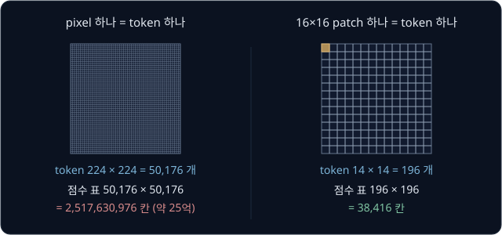

**확인 문제.** 32×32 사진에서 pixel 하나를 token 으로 쓰면 점수 표는 몇 칸일까? 4×4 조각으로 자르면 어떨까?

답 보기

| 단위 | token 수 | 점수 표 |
| --- | --- | --- |
| pixel | $32 \times 32 = 1{,}024$ | $1{,}024 \times 1{,}024 = 1{,}048{,}576$ 칸 |
| 4×4 조각 | 한 변에 $32 \div 4 = 8$ 개라 $8 \times 8 = 64$ | $64 \times 64 = 4{,}096$ 칸 |

## patch

사진을 같은 크기로 자른 조각 하나를 **patch** 라고 한다. 영어로 천 조각이라는 뜻으로, 조각 천을 이어 붙인 이불을 patchwork 라고 부를
때의 그 patch 다. 손으로 계산할 수 있게 흰 칸이 1 이고 검은 칸이 0 인 4×4 흑백 사진을 2×2 patch 로 잘라 본다.

$$
\begin{bmatrix}
0 & 1 & 1 & 0 \\
0 & 1 & 1 & 0 \\
0 & 0 & 1 & 1 \\
0 & 0 & 1 & 1
\end{bmatrix}
$$

위쪽 가운데에 세로 막대가 있고 오른쪽 아래에 흰 사각형이 있는 사진이다. patch 에는 글을 읽는 순서대로 왼쪽 위부터 1, 2, 3, 4 의 번호를
붙여서 위 줄이 1·2 번, 아래 줄이 3·4 번이 되고, patch 안의 네 칸도 같은 순서로 한 줄로 늘어놓는다. 격자를 한 줄로 늘어놓는 일을 펼친다고
하는데, 펼친 patch 는 숫자 4 개짜리 vector 가 된다.

| patch | 사진 속 자리 | 2×2 모양 | 펼친 vector |
| --- | --- | --- | --- |
| 1 | 왼쪽 위 | $\begin{bmatrix} 0 & 1 \\ 0 & 1 \end{bmatrix}$ | $[0, 1, 0, 1]$ |
| 2 | 오른쪽 위 | $\begin{bmatrix} 1 & 0 \\ 1 & 0 \end{bmatrix}$ | $[1, 0, 1, 0]$ |
| 3 | 왼쪽 아래 | $\begin{bmatrix} 0 & 0 \\ 0 & 0 \end{bmatrix}$ | $[0, 0, 0, 0]$ |
| 4 | 오른쪽 아래 | $\begin{bmatrix} 1 & 1 \\ 1 & 1 \end{bmatrix}$ | $[1, 1, 1, 1]$ |

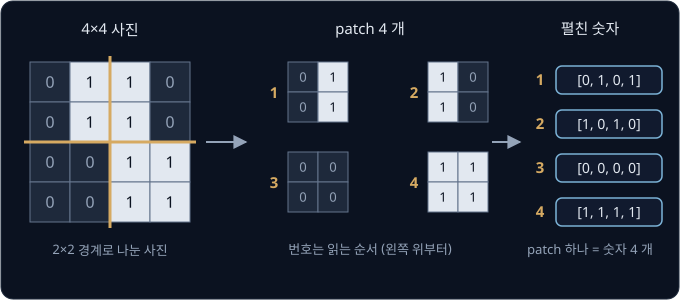

patch 수는 사진 크기와 patch 크기로 정해진다. 사진의 세로는 $H$ pixel 이고 가로는 $W$ pixel 이며 patch 한 변은 $P$ pixel 이라고 하면,
patch 수 $N$ 은 아래 식으로 구한다.

$$
N = \frac{H}{P} \times \frac{W}{P}
$$

4×4 사진을 2×2 로 자르면 $2 \times 2 = 4$ 개이고, 224×224 사진을 16×16 으로 자르면 $14 \times 14 = 196$ 개다. 이 식은 가로세로가 $P$ 로
나누어떨어질 때만 맞아서, 실제 모델은 사진을 미리 224×224 처럼 나누어떨어지는 크기로 줄여 넣는다. 컬러 사진은 pixel 마다 숫자가 3 개라서
16×16 patch 하나를 펼치면 숫자가 $3 \times 16 \times 16 = 768$ 개다.

논문 제목 "An Image is Worth 16x16 Words" 는 그림 한 장이 천 마디 말만큼 많은 것을 전한다는 영어 속담 "A picture is worth a thousand
words" 를 바꾼 것으로, 사진을 16×16 patch 로 잘라 patch 하나를 문장의 단어 하나처럼 읽는다는 뜻을 담았다.

**확인 문제.** 96×96 컬러 사진을 16×16 patch 로 자르면 patch 는 몇 개이고, patch 하나를 펼치면 숫자가 몇 개일까?

답 보기

1. patch 수: 한 변에 $96 \div 16 = 6$ 개라 $6 \times 6 = 36$ 개다
2. patch 하나의 숫자: channel 3 장에 16×16 칸씩이라 $3 \times 16 \times 16 = 768$ 개다. 사진 크기와는 관계없다

## patch embedding

펼친 patch 의 숫자는 칸마다 밝기를 적은 것일 뿐이라서, ViT 는 여기에 행렬 하나를 곱해 정해진 길이 $D$ 의 vector 로 바꾼다. 이 계산이
**patch embedding** 이다. 예에서는 $D = 2$ 로 두고, 사람이 뜻을 정해 숫자를 넣은 2×4 행렬 $E$ 를 쓴다.

$$
E = \begin{bmatrix} 1 & 1 & 1 & 1 \\ 1 & -1 & 1 & -1 \end{bmatrix}
$$

첫째 행은 네 칸을 모두 더하므로 흰 칸 수를 센다. 둘째 행은 왼쪽 열(1·3 번째 칸)을 더하고 오른쪽 열(2·4 번째 칸)을 빼므로, 밝은 부분이
왼쪽에 몰리면 양수가 되고 오른쪽에 몰리면 음수가 된다. 행렬과 vector 의 곱은 행마다 vector 와 같은 자리끼리 곱해 더한 값을 세로로 쌓은 것이다.

| patch | 펼친 vector $\mathbf{x}_i$ | 첫째 칸 (흰 칸 수) | 둘째 칸 (왼쪽 − 오른쪽) | $\mathbf{e}_i = E\mathbf{x}_i$ |
| --- | --- | --- | --- | --- |
| 1 | $[0, 1, 0, 1]$ | $0 + 1 + 0 + 1 = 2$ | $0 - 1 + 0 - 1 = -2$ | $[2, -2]$ |
| 2 | $[1, 0, 1, 0]$ | $1 + 0 + 1 + 0 = 2$ | $1 - 0 + 1 - 0 = 2$ | $[2, 2]$ |
| 3 | $[0, 0, 0, 0]$ | 0 | 0 | $[0, 0]$ |
| 4 | $[1, 1, 1, 1]$ | $1 + 1 + 1 + 1 = 4$ | $1 - 1 + 1 - 1 = 0$ | $[4, 0]$ |

![patch 1 을 펼친 [0, 1, 0, 1] 에 행렬 E 를 곱하면 첫째 행으로 계산한 값 2 와 둘째 행으로 계산한 값 −2 가 나와 [2, −2] 가 된다. 네 patch 에 같은 E 를 곱하면 [2, −2], [2, 2], [0, 0], [4, 0] 이다](figures/patch-embed.svg)

실제 $E$ 는 사람이 정하지 않고, 무작위 값으로 채워 둔 뒤 학습하면서 loss 가 줄어드는 쪽으로 고쳐 가는 parameter 다. ViT-B/16 의
$E$ 는 숫자 768 개짜리 patch 를 숫자 768 개짜리 token 으로 바꾸는 768×768 행렬이고, bias 768 개를 더해 parameter 가 590,592 개다.

네 patch 가 모두 같은 $E$ 를 썼으므로 patch 가 4 개든 196 개든 $E$ 의 크기는 그대로다. 같은 숫자 한 벌을 모든 자리에 쓰는 이 방식은
[CNN](../cnn/README.md) 에서 본 weight sharing 과 같다. 실제로 patch embedding 은 filter 크기와 stride 가 모두 $P$ 인 convolution 과 똑같은
계산이라서, 구현에서는 16×16 filter 768 개를 stride 16 으로 옮기는 convolution 층 하나로 쓰는 경우가 많다.

글의 token 은 종류가 vocabulary 로 정해져 있어서 token 번호로 embedding 표의 한 행을 꺼낸다. 반면 patch 는 pixel 값의 조합이 끝없이 많아
표를 만들 수 없으므로 행렬 곱으로 vector 를 계산한다. 이렇게 나온 vector 도 글 token 과 길이가 같아서 Transformer 는 둘을 똑같이 받는다.

**흔한 오해.** "patch embedding 은 patch 의 숫자를 줄이는 압축이다." 앞의 예처럼 숫자 4 개를 2 개로 줄이면 위쪽이 흰 $[1, 1, 0, 0]$ 과
아래쪽이 흰 $[0, 0, 1, 1]$ 이 둘 다 $[2, 0]$ 이 되어 구별되지 않는다. ViT-B/16 은 숫자 768 개를 768 개로 옮겨 수를 줄이지 않는다. patch
embedding 은 칸마다 적힌 밝기를 학습으로 고른 기준들로 다시 적는 단계다.

<b>심화: convolution 으로 계산하는 patch embedding</b>

$E$ 의 행 하나를 2×2 로 접으면 2×2 filter 가 된다. 첫째 행 $[1, 1, 1, 1]$ 은 $\begin{bmatrix} 1 & 1 \\ 1 & 1 \end{bmatrix}$ 이 되고, 둘째 행
$[1, -1, 1, -1]$ 은 $\begin{bmatrix} 1 & -1 \\ 1 & -1 \end{bmatrix}$ 이 된다. 이 filter 를 2 칸씩 건너뛰며(stride 2) 사진 위로 옮기면 filter 가
겹치지 않고 patch 하나씩을 정확히 덮는다.

| filter | 왼쪽 위 | 오른쪽 위 | 왼쪽 아래 | 오른쪽 아래 |
| --- | --- | --- | --- | --- |
| 첫째 $\begin{bmatrix} 1 & 1 \\ 1 & 1 \end{bmatrix}$ | 2 | 2 | 0 | 4 |
| 둘째 $\begin{bmatrix} 1 & -1 \\ 1 & -1 \end{bmatrix}$ | $-2$ | 2 | 0 | 0 |

filter 두 개가 2×2 feature map 두 장을 만든다. 두 장에서 같은 자리의 값을 모으면 왼쪽 위부터 차례로 $[2, -2]$, $[2, 2]$, $[0, 0]$, $[4, 0]$
이 되어, patch 를 펼쳐 $E$ 를 곱한 결과와 같다.

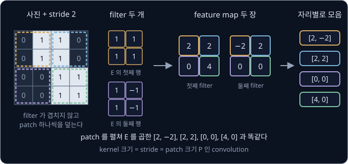

식으로는 $\mathbf{e}_i = E\,\mathbf{x}_i$ 이고, $E$ 는 행이 $D$ 개이고 열이 $C \times P \times P$ 개인 행렬이다. $C$ 는 channel 수로, 흑백이면 1 이고
컬러면 3 이다.
ViT 논문은 $\mathbf{x}_i E$ 처럼 vector 를 행렬 앞에 적는데, 행렬의 행과 열을 바꿔 적었을 뿐 계산은 같다. 같은 $E$ 로 $[0, 0, 1, 1]$ 을
계산하면 첫째 칸은 $0 + 0 + 1 + 1 = 2$ 이고 둘째 칸은 $0 - 0 + 1 - 1 = 0$ 이라 $[2, 0]$ 이다. $[1, 0, 1, 1]$ 은 첫째 칸이 3 이고 둘째 칸이
$1 - 0 + 1 - 1 = 1$ 이라 $[3, 1]$ 이다.

## [CLS] token

Transformer 의 층은 들어온 token 수만큼 token 을 내보내므로, patch token 4 개를 넣으면 층을 지난 뒤에도 vector 4 개가 나온다. 그런데 사진에
무엇이 찍혔는지 답 하나를 내려면 사진 전체를 대표하는 vector 하나가 필요하다.

ViT 는 patch token 들의 맨 앞에 어느 patch 에도 해당하지 않는 token 하나를 더 붙여 함께 넣고, 마지막 층에서 이 자리의 출력을 사진 전체의
요약으로 쓴다. 이 token 이 **[CLS] token** 이다. CLS 는 classification(분류)의 앞 세 글자이고, 대괄호는 사진의 내용이 아니라 모델이 쓰려고
넣은 특수 token 이라는 표시다. 2018 년 Google 의 문장 이해 모델 BERT 가 문장 전체를 요약하는 자리로 먼저 썼고, ViT 가 이를 사진에 가져다 썼다.

[CLS] 의 처음 vector 는 사진에서 계산하지 않고 $E$ 처럼 학습으로 정하는 parameter 다. 그래서 어떤 사진이 들어오든 같은 값에서 출발하고,
attention 을 거치며 patch token 들에서 정보를 모아 사진마다 다른 vector 가 된다. patch 196 개짜리 사진이면 [CLS] 를 더해 token 이 197 개다.

![예의 patch 4 개 앞에 붙인 [CLS] token 이 [0, 0] 이면 다섯 token 과의 점수가 모두 0 이라 weight 가 0.2 씩이고 출력은 평균 [1.6, 0] 이다. [CLS] 가 [1, 0] 이면 흰 사각형 patch 4 의 weight 가 0.747 이 되어 출력이 [3.429, 0] 이 된다](figures/cls-token.svg)

위 그림은 예의 patch 4 개 앞에 [CLS] 를 붙이고, query·key·value 없이 token vector 를 그대로 쓰는 간단한 attention 을
한 번 계산한 결과다. [CLS] 가 $[0, 0]$ 이면 다섯 token 에서 정보를 똑같이 20% 씩
가져와 평균을 내지만, $[1, 0]$ 이면 흰 칸이 가장 많은 patch 4 에서 74.7% 를 가져온다. [CLS] 의 값에 따라 어느 patch 에서 정보를 모을지가
달라지므로, [CLS] 의 값을 학습하면 모델은 분류에 쓸모 있는 patch 에서 정보를 더 많이 모으게 된다.

마지막 층의 [CLS] 출력은 LayerNorm 을 거친 뒤 Linear layer 하나에 들어가 class 마다 점수 하나씩을 내는데, 이 마지막 층을 head 라고 한다.
ImageNet(사진을 1,000 종류로 나눈 데이터)으로 학습한 ViT-B/16 의 head 는 768 개를 1,000 개로 바꾸므로 parameter 가
$768 \times 1{,}000 + 1{,}000 = 769{,}000$ 개다. 다른 일에 쓸 때는 head 만 떼어 내고 새 head 를 붙인다.

**흔한 오해.** "[CLS] 가 있어야 사진 전체를 요약할 수 있다." ViT 논문의 부록 D.3 에 따르면 [CLS] 없이 patch 출력들을 평균해 분류해도
learning rate 를 알맞게 바꾸면 비슷하게 잘 된다. 저자들은 글의 Transformer 와 최대한 같은 구조를 두려고 [CLS] 를 썼다.

<b>심화: [CLS] 의 attention 손계산</b>

계산을 간단히 하려고 query·key·value 를 따로 만들지 않고 token vector 를 그대로 쓰는 attention 을 쓴다. 점수는 두 token vector 의 같은
자리끼리 곱해 더한 값(dot product)이고, 출력은 softmax 로 구한 weight 로 token vector 들을 가중 평균한 값이다.

[CLS] 가 $[0, 0]$ 이면 다섯 token(자기 자신 포함)과의 점수가 모두 0 이라 $e^0 = 1$ 이 다섯 개이고 weight 는 $1 \div 5 = 0.2$ 씩이다. 출력은
다섯 vector 의 평균인 $([0, 0] + [2, -2] + [2, 2] + [0, 0] + [4, 0]) \div 5 = [1.6, 0]$ 이다. [CLS] 가 $[1, 0]$ 이면 아래와 같다.

| 상대 token | vector | 점수 $[1, 0] \cdot$ vector | $e^{\text{점수}}$ | weight | weight × vector |
| --- | --- | --- | --- | --- | --- |
| [CLS] | $[1, 0]$ | 1 | 2.718 | 0.037 | $[0.037, 0]$ |
| patch 1 | $[2, -2]$ | 2 | 7.389 | 0.101 | $[0.202, -0.202]$ |
| patch 2 | $[2, 2]$ | 2 | 7.389 | 0.101 | $[0.202, 0.202]$ |
| patch 3 | $[0, 0]$ | 0 | 1 | 0.014 | $[0, 0]$ |
| patch 4 | $[4, 0]$ | 4 | 54.598 | 0.747 | $[2.988, 0]$ |
| 합 | | | 73.095 | 1 | $[3.429, 0]$ |

weight 열은 $e^{\text{점수}}$ 를 합 73.095 로 나눈 값이다. head 의 행렬이 $\begin{bmatrix} 1 & 0 \\ 0 & 1 \end{bmatrix}$ 이고 class 가 "막대
사진" 과 "사각형 사진" 두 개라면, [CLS] 출력 $[1.6, 0]$ 이 그대로 두 class 의 점수가 된다. 여기에 softmax 를 하면 $e^{1.6} \approx 4.953$ 과
$e^0 = 1$ 의 합이 5.953 이라서 첫째 class 의 확률은 $4.953 \div 5.953 \approx 0.832$ 다.

**확인 문제.** [CLS] 출력이 숫자 768 개이고 분류할 class 가 10 개라면 head 의 parameter 는 몇 개일까? (행렬과 bias 를 모두 센다)

답 보기

1. 행렬: 입력 768 개에서 출력 10 개로 가므로 $768 \times 10 = 7{,}680$ 개
2. bias: 출력마다 하나라 10 개
3. 합: $7{,}680 + 10 = 7{,}690$ 개

## position embedding

예의 사진을 사진 A 라고 하고, patch 1 과 patch 4 의 자리를 맞바꾼 사진 B 를 생각해 보자. B 에서는 흰 사각형이 왼쪽 위로 가고 세로 막대가
오른쪽 아래로 가서 사람 눈에는 다른 사진이다. 하지만 patch embedding 을 하면 B 의 token 은 $[4, 0]$, $[2, 2]$, $[0, 0]$, $[2, -2]$ 로, A 와
순서만 다를 뿐 같은 vector 들이다.

attention 의 점수는 vector 끼리 곱해 더한 값이라 token 이 몇 번째 자리에 있는지와 상관이 없다. 가중 평균도 더하는 순서를 바꿔도 같으므로
[CLS] 의 출력은 두 사진 모두 $[1.6, 0]$ 이다. [Transformer](../transformer/README.md) 에서 "dog bites man" 과
"man bites dog" 의 bites 가 같은 출력을 얻은 것과 같은 이유다.

![patch 1 과 patch 4 를 맞바꾼 사진 B 는 사진 A 와 다른 그림이지만, 위치 정보가 없으면 token 의 모음이 같아서 [CLS] 출력이 둘 다 [1.6, 0] 으로 같다](figures/patch-shuffle.svg)

그래서 ViT 는 자리마다 vector 하나씩을 정해 두고 그 자리의 token 에 더하는데, 이 vector 를 **position embedding** 이라고 한다. 같은 흰 사각형
token $[4, 0]$ 이라도 자리 4 에 있을 때와 자리 1 에 있을 때 더해지는 vector 가 달라서 서로 다른 vector 가 되고, [CLS] 출력도 달라진다.
[Transformer](../transformer/README.md) 에서 본 positional encoding 은 sin·cos 식으로 위치 vector 를 계산했지만, ViT 는 자리마다
한 행씩 둔 표를 무작위 값에서 출발해 학습으로 정한다. ViT-B/16 은 자리가 [CLS] 1 개와 patch 196 개를 합쳐 197 개라서 position embedding
표에 숫자가 $197 \times 768 = 151{,}296$ 개 들어 있다.

자리 번호는 patch 를 읽는 순서대로 한 줄로 붙인 번호뿐이라, 학습 전의 모델은 자리 1 과 자리 2 가 사진에서 이웃하는지 모른다. 그런데
학습을 마친 position embedding 을 서로 비교하면 가까운 patch 끼리, 같은 행이나 같은 열의 patch 끼리 vector 가 비슷해져 있어서(논문 그림 7),
모델이 사진의 가로세로 구조를 데이터에서 배웠음을 알 수 있다. 논문 부록 D.4 에서는 ViT-B/16 에 위치 정보를 넣는 방법을 바꿔 가며
비교했다. 지표는 ImageNet 의 class 마다 사진 5 장만으로 분류기를 학습해 맞힌 비율이다.

| 위치 정보 | 정확도 |
| --- | --- |
| 없음 | 61.38% |
| 자리 번호마다 학습한 vector (기본값) | 64.21% |
| 가로 위치와 세로 위치를 따로 학습한 vector | 64.00% |
| patch 사이 거리로 계산한 relative 방식 | 64.03% |

위치 정보가 없으면 3%p 가까이 떨어지지만 방법끼리는 거의 차이가 없다. 저자들은 patch 격자가 14×14 로 작아서 어느 방법으로도 공간 관계를
쉽게 배울 수 있기 때문이라고 추측했다.

학습할 때보다 큰 사진을 넣으면 position embedding 표의 자리가 모자란다. 224×224 로 학습한 ViT-B/16 에 384×384 사진을 넣으면 patch 가
$24 \times 24 = 576$ 개인데 표에는 patch 자리가 196 개뿐이다. ViT 논문에서는 원래 14×14 격자의 vector 들을 새 24×24 격자에 고르게 펼쳐
놓고, 그 사이 자리는 주변 vector 를 거리에 따라 섞어 채운다. 이 계산을 interpolation 이라고 한다. 한 줄로 예를 들면, 값이 0 과 4 인 두
자리를 세 자리로 늘릴 때 양 끝은 0 과 4 를 그대로 두고 가운데에 $(0 + 4) \div 2 = 2$ 를 쓴다. ViT 는 이 계산을 가로와 세로 두 방향으로
한다.

<b>심화: position embedding 을 더한 attention 손계산</b>

position embedding 은 실제로는 학습으로 정하는 값이지만, 예에서는 자리 0 부터 4 까지의 값을 사람이 골라 아래처럼 둔다.

| 자리 | 0 ([CLS]) | 1 | 2 | 3 | 4 |
| --- | --- | --- | --- | --- | --- |
| position embedding | $[1, 0]$ | $[0, 1]$ | $[0, -1]$ | $[-1, 0]$ | $[0, 0]$ |
| 사진 A 의 token | $[0, 0]$ | $[2, -2]$ | $[2, 2]$ | $[0, 0]$ | $[4, 0]$ |
| 사진 A 의 합 | $[1, 0]$ | $[2, -1]$ | $[2, 1]$ | $[-1, 0]$ | $[4, 0]$ |
| 사진 B 의 token | $[0, 0]$ | $[4, 0]$ | $[2, 2]$ | $[0, 0]$ | $[2, -2]$ |
| 사진 B 의 합 | $[1, 0]$ | $[4, 1]$ | $[2, 1]$ | $[-1, 0]$ | $[2, -2]$ |

[CLS] 자리의 합은 두 사진 모두 $[1, 0]$ 이므로, 점수는 이 vector 와 각 자리 합의 dot product 다.

| 자리 | 사진 A 의 점수 | 사진 A 의 weight | 사진 B 의 점수 | 사진 B 의 weight |
| --- | --- | --- | --- | --- |
| 0 | 1 | 0.038 | 1 | 0.038 |
| 1 | 2 | 0.102 | 4 | 0.753 |
| 2 | 2 | 0.102 | 2 | 0.102 |
| 3 | $-1$ | 0.005 | $-1$ | 0.005 |
| 4 | 4 | 0.753 | 2 | 0.102 |

두 사진 모두 $e^{\text{점수}}$ 의 합은 $2.718 + 7.389 + 7.389 + 0.368 + 54.598 = 72.462$ 다. 사진 A 의 출력은 첫째 칸이
$0.038 + 0.204 + 0.204 - 0.005 + 3.012 \approx 3.454$ 이고 둘째 칸이 $-0.102 + 0.102 = 0$ 이라 $[3.454, 0]$ 이다. 사진 B 는 첫째 칸이 같은
3.454 이고, 둘째 칸이 $0.753 \times 1 + 0.102 \times 1 + 0.102 \times (-2) = 0.651$ 이라 $[3.454, 0.651]$ 이다. 위치 정보가 없을 때 같았던
두 출력이 달라졌다.

![예로 고른 자리 0 부터 4 까지의 position embedding [1, 0], [0, 1], [0, −1], [−1, 0], [0, 0] 을 더하면 사진 A 와 B 의 z₀ 가 달라지고, [CLS] 출력도 [3.454, 0] 과 [3.454, 0.651] 로 달라진다](figures/position-embedding.svg)

**확인 문제.** 224×224 로 학습한 ViT-B/16 에 448×448 사진을 넣으면 patch 는 몇 개이고, 원래 position embedding 표의 patch 자리 196 개의
몇 배일까?

답 보기

1. 한 변의 patch 수: $448 \div 16 = 28$ 개
2. patch 수: $28 \times 28 = 784$ 개
3. 비율: $784 \div 196 = 4$ 배. 사진 한 변이 2 배가 되면 patch 수는 $2 \times 2 = 4$ 배다

## encoder 와 ViT-B/16

patch embedding 과 [CLS] token, position embedding 을 모아 식으로 쓰면 encoder 의 입력 $\mathbf{z}_0$ 는 아래와 같다.

$$
\mathbf{z}_0 = [\,\mathbf{x}_{\text{cls}};\ E\mathbf{x}_1;\ E\mathbf{x}_2;\ \dots;\ E\mathbf{x}_N\,] + E_{\text{pos}}
$$

$[\,a;\ b;\ \dots\,]$ 는 vector 들을 순서대로 세로로 쌓는다는 뜻이다. $\mathbf{x}_{\text{cls}}$ 는 [CLS] token 이고, $E\mathbf{x}_i$ 는 $i$ 번째
patch 의 patch embedding 이며, $E_{\text{pos}}$ 는 position embedding 표다. 아래첨자 0 은 아직 층을 하나도 지나지 않았다는 뜻이다. ViT-B/16 에서
$\mathbf{z}_0$ 는 행 하나가 token 하나인 $197 \times 768$ 표가 된다.

![ViT 의 입력. 224×224 사진을 16×16 patch 196 개로 잘라 펼치고, 같은 행렬 E 로 숫자 768 개짜리 token 을 만든 뒤 맨 앞에 [CLS] token 을 붙이고 position embedding 을 더해 197 × 768 의 입력을 만든다](figures/patch-embedding.svg)

$\mathbf{z}_0$ 를 만든 뒤의 계산은 [Transformer](../transformer/README.md) 에서 본 encoder 와 같다. 층 하나는 multi-head self-attention 과
MLP 두 부분으로 되어 있다. 두 부분 모두 들어가기 전에 LayerNorm 을 거치고(Pre-LN), 나온 결과에는 입력을 그대로 더한다(residual connection).
LayerNorm 은
[ResNet](../resnet/README.md) 에서 본 BatchNorm 과 달리 token 하나 안의 숫자 768 개로 평균과 표준편차를 구하므로, batch 에 사진이 몇 장이든 같은
token 은 같은 결과를 얻는다. MLP 는 token
마다 따로 vector 길이를 768 에서 3,072 로 늘렸다가 768 로 되돌리는데, 두 층 사이의 activation 으로 ReLU 대신 GELU 를 쓴다. 사진의 patch 는 처음부터 모두
주어지므로 한 token 씩 이어 쓰는 decoder 도, 뒤쪽 token 을 가리는 causal mask 도 없이 모든 patch 가 모든 patch 를 본다.

![pre-norm encoder block. LayerNorm 뒤 multi-head self-attention 결과를 입력에 더하고, 다시 LayerNorm 뒤 MLP 결과를 더한다. 이 block 을 L 번 쌓은 뒤 [CLS] 위치의 출력으로 분류한다](figures/encoder-block.svg)

층을 지나도 크기가 $197 \times 768$ 그대로라서 같은 구조의 층을 여러 번 쌓을 수 있다. ViT-B/16 이라는 이름에서 B 는 Base 크기를 뜻하고
/16 은 patch 크기를 뜻한다.

| 모델 | encoder 층 수 | token 길이 $D$ | MLP 가운데 길이 | head 수 | parameter |
| --- | --- | --- | --- | --- | --- |
| ViT-Base | 12 | 768 | 3,072 | 12 | 86M |
| ViT-Large | 24 | 1,024 | 4,096 | 16 | 307M |
| ViT-Huge | 32 | 1,280 | 5,120 | 16 | 632M |

위 표는 ViT 논문의 표 1 이다. ViT-L/16 은 Large 크기에 patch 16 을 쓴 모델이고, ViT-H/14 는 Huge 크기에 patch 14 를 쓴 모델이다.
torchvision 의 ViT-B/16 은 parameter 가 86,567,656 개이고 ImageNet 정확도가 81.07% 인데, parameter 수는 [ResNet](../resnet/README.md) 에서 본
ResNet-18(11,689,512 개)의 약 7.4 배다.

<b>심화: ViT-B/16 의 parameter 세기</b>

| 부분 | 계산 | parameter |
| --- | --- | --- |
| patch embedding | $768 \times 768 + 768$ | 590,592 |
| [CLS] token | $768$ | 768 |
| position embedding | $197 \times 768$ | 151,296 |
| encoder 층 하나 | attention $3 \times 768 \times 768 + 3 \times 768 + 768 \times 768 + 768$, MLP $768 \times 3{,}072 + 3{,}072 + 3{,}072 \times 768 + 768$, LayerNorm 두 개 $2 \times 2 \times 768$ | 7,087,872 |
| encoder 층 12 개 | $7{,}087{,}872 \times 12$ | 85,054,464 |
| 마지막 LayerNorm | $2 \times 768$ | 1,536 |
| head | $768 \times 1{,}000 + 1{,}000$ | 769,000 |
| 합 | | 86,567,656 |

attention 계산식의 앞 두 항은 query·key·value 를 만드는 행렬 세 개와 그 bias 이고, 뒤 두 항은 head 들의 출력을 이어 붙인 뒤 곱하는 출력
행렬과 그 bias 다. 합의 98% 가 encoder 층 12 개에 있다. 층 하나의 식은 아래와 같다. $\ell$ 은 몇 번째 층인지를 나타내고, $\mathbf{z}'_\ell$ 은
attention 부분까지 지난 중간 결과다.

$$
\mathbf{z}'_\ell = \mathrm{MSA}(\mathrm{LN}(\mathbf{z}_{\ell-1})) + \mathbf{z}_{\ell-1}, \qquad
\mathbf{z}_\ell = \mathrm{MLP}(\mathrm{LN}(\mathbf{z}'_\ell)) + \mathbf{z}'_\ell
$$

12 층을 지난 뒤 [CLS] 가 있는 0 번 자리의 출력을 꺼내 LayerNorm 을 거친 값 $\mathrm{LN}(\mathbf{z}_{12}^0)$ 이 head 로 들어간다.

<b>심화: GELU</b>

GELU(Gaussian Error Linear Unit)는 양수에서는 넣은 값과 거의 같은 값을 내고 음수에서는 0 에 가까운 값을 내지만, ReLU 처럼 0 에서 뾰족하게
꺾이지 않고 부드럽게 휜다. 식은 $x$ 에 표준 Gaussian 의 누적 확률 $\Phi(x)$ 를 곱한 $x\,\Phi(x)$ 다.

| 넣는 값 | $-3$ | $-2$ | $-1$ | $-0.5$ | $0$ | $0.5$ | $1$ | $2$ | $3$ |
| --- | --- | --- | --- | --- | --- | --- | --- | --- | --- |
| ReLU | 0 | 0 | 0 | 0 | 0 | 0.5 | 1 | 2 | 3 |
| GELU | $-0.004$ | $-0.046$ | $-0.159$ | $-0.154$ | 0 | 0.346 | 0.841 | 1.954 | 2.996 |

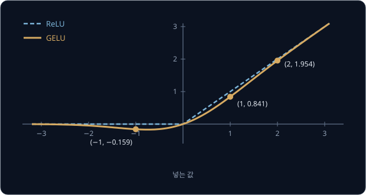

넣는 값이 1 일 때 둘의 차이는 $1 - 0.841 = 0.159$ 이고 3 일 때는 $3 - 2.996 = 0.004$ 라서, 값이 클수록 GELU 가 ReLU 에 가까워진다.

**확인 문제.** ViT-L/16 에 224×224 사진을 넣으면 token 은 몇 개이고, attention head 하나는 숫자 몇 개를 맡을까?

답 보기

1. patch 수: patch 크기가 16 이라 $14 \times 14 = 196$ 개
2. token 수: [CLS] 를 더해 $196 + 1 = 197$ 개. 모델 크기와는 관계없다
3. head 하나: $D = 1{,}024$ 를 head 16 개로 나눠 $1{,}024 \div 16 = 64$ 개

## patch 크기와 계산량

patch 를 작게 자르면 patch 하나가 담는 영역이 작아 사진을 자세히 볼 수 있지만, token 이 늘어난다. 224×224 사진을 여러 patch 크기로 자르면
아래와 같다. 점수 표의 칸 수는 [CLS] 를 빼고 patch token 만으로 셌다.

| patch 크기 | 한 변의 patch 수 | patch token 수 | 점수 표의 칸 수 |
| --- | --- | --- | --- |
| 32 | $224 \div 32 = 7$ | 49 | 2,401 |
| 16 | $224 \div 16 = 14$ | 196 | 38,416 |
| 14 | $224 \div 14 = 16$ | 256 | 65,536 |
| 8 | $224 \div 8 = 28$ | 784 | 614,656 |

patch 한 변을 32 에서 16 으로 절반 줄이면 한 변의 patch 수가 2 배라 token 은 $2 \times 2 = 4$ 배가 되고, 점수 표는 token 수의 제곱이라
$4 \times 4 = 16$ 배가 된다. 실제로 $38{,}416 \div 2{,}401 = 16$ 이다. patch 크기를 그대로 두고 사진을 키워도 마찬가지라서, 사진 한 변을 2 배로
키우면 token 이 4 배가 되고 점수 표가 16 배가 된다.

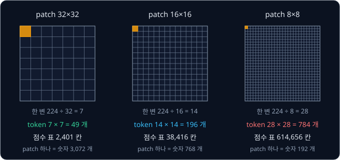

로봇에서는 token 수가 반응 시간을 좌우한다. π0 논문 부록의 표 I 에는 카메라 사진 3 장(사진마다 token 256 개)을 받는 π0 가 RTX 4090 GPU
에서 행동 한 덩어리를 내는 데 걸린 시간이 단계별로 나와 있다.

| 단계 | 시간 |
| --- | --- |
| image encoder (사진 3 장) | 14 ms |
| 사진·지시문 token 의 언어 모델 계산 | 32 ms |
| 행동 계산 10 번 | 27 ms |
| 합 (로봇에 붙은 컴퓨터에서 실행) | 73 ms |

1초에 명령을 50 번 받는 로봇에서 π0 는 행동 25 개를 실행한 뒤 다음 계산을 하므로, 0.5 초에 한 번 이 계산을 한다. 73 ms 중 46 ms 가
사진 token 을 다루는 앞의 두 단계에 들고, 사진을 크게 넣거나 카메라를 늘리면 이 두 단계가 길어진다. PaliGemma 는 사진 크기를 224, 448,
896 으로 바꾼 모델을 함께 냈다. 세 모델의 image token 은 각각 256, 1,024, 4,096 개라서 사진 한 변이 2 배가 될 때마다 4 배가 된다. OpenVLA
저자들은 입력 사진을 224×224 와 384×384 로 비교했다. 로봇 작업 성공률은 차이가 없었지만 384×384 쪽은 학습 시간이 3 배 걸려서 224×224 를
골랐다.

**흔한 오해.** "patch 를 작게 자를수록 좋은 모델이다." patch 를 작게 자르면 성능이 오르는 경우가 많지만, patch 한 변을 절반으로 줄일
때마다 attention 계산이 16 배씩 는다. 그래서 1초에 여러 번 사진을 처리해야 하는 로봇에서는 patch 크기와 사진 크기를 계산 시간과 함께 따져
정한다.

**확인 문제.** patch 14 를 쓰는 SigLIP 에 448×448 사진을 넣으면 image token 은 몇 개일까? 224×224 일 때와 비교해 attention 점수 표는 몇 배일까?

답 보기

| 사진 | 한 변의 patch 수 | token 수 | 점수 표 |
| --- | --- | --- | --- |
| 224×224 | $224 \div 14 = 16$ | $16 \times 16 = 256$ | $256^2 = 65{,}536$ |
| 448×448 | $448 \div 14 = 32$ | $32 \times 32 = 1{,}024$ | $1{,}024^2 = 1{,}048{,}576$ |

token 은 $1{,}024 \div 256 = 4$ 배이고, 점수 표는 $4 \times 4 = 16$ 배다.

## inductive bias 와 데이터 양

[CNN](../cnn/README.md) 에서 본 convolution 은 사진을 두고 세운 가정 두 가지를 구조에 담고 있다. 하나는 locality 로, 의미 있는 모양은 가까운 pixel
끼리 만든다고 보고 filter 가 3×3 처럼 좁은 영역만 본다. 다른 하나는 translation equivariance 로, 세로선은 사진 어디에 있어도 세로선이라고
보고 같은 filter 를 모든 자리에 쓴다. 그래서 입력을 옮기면 출력도 같은 만큼 옮겨 간다. 이처럼 데이터를 보기 전에 모델 구조로 미리 정해 둔 가정을
**inductive bias** 라고 한다. inductive 는 몇 개의 예에서 일반 규칙을 끌어내는 귀납(induction)에서 온 말이고, bias 는 어느 규칙 쪽으로
미리 기울어 있다는 뜻이다.

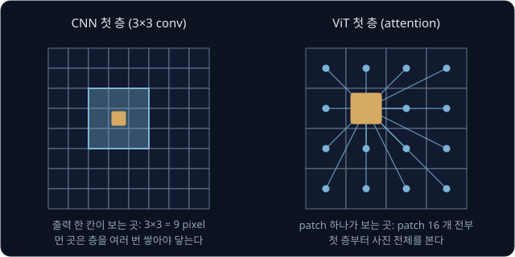

ViT 에는 이런 가정이 거의 없다. ViT 논문 3.1 절에 따르면 ViT 에서 가까운 곳끼리 보고 모든 자리에 같은 계산을 쓰는 부분은 token 마다 따로 계산하는
MLP 뿐이고, self-attention 은 첫 층부터 사진 전체를 본다. 사진이 2차원 격자라는 사실은 처음에 patch 로 자르는 단계와, 사진 크기를 바꿀 때
position embedding 을 interpolation 하는 단계에만 들어 있다. position embedding 은 무작위 값에서 출발하므로 patch 사이의 공간 관계는 모두
데이터에서 배워야 한다.

구조에 담은 가정이 실제와 맞으면 모델은 적은 데이터로도 빨리 배운다. 반면 가정이 적은 모델은 같은 데이터에 맞는 규칙이 여럿이라, 그중
하나를 고르려면 데이터가 더 많이 필요하다. 대신 데이터가 충분하면 가정에 맞지 않는 규칙까지 데이터에서 그대로 배운다. ViT 논문에서는 미리
학습하는 데이터의 크기를 바꿔 가며 이 차이를 확인했다.

| 미리 학습한 데이터 | 사진 수 | ViT-B/16 (86M) | ViT-L/16 (307M) |
| --- | --- | --- | --- |
| ImageNet | 130만 장 | 77.91% | 76.53% |
| ImageNet-21k | 1,400만 장 | 83.97% | 85.15% |
| JFT-300M | 3억 300만 장 | 84.15% | 87.12% |

정확도는 각 데이터로 미리 학습한 뒤 ImageNet 으로 fine-tuning 해 잰 값이다(논문 부록 표 5). fine-tuning 은 미리 학습한 weight 에서 출발해
새 데이터로 조금 더 학습하는 일이다. JFT-300M 은 Google 내부 데이터다.

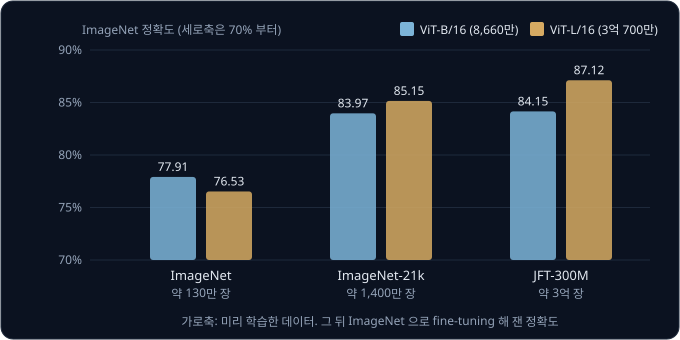

130만 장에서는 parameter 가 3.6 배 많은 ViT-L/16 이 오히려 1.38%p 낮고, 3억 장에서는 2.97%p 높다. CNN 과의 비교도 같은 방향이라서, 큰
ResNet 인 BiT 는 ImageNet 으로만 미리 학습하면 ViT 보다 높았고 데이터가 커지자 ViT 가 앞섰다. JFT-300M 에서 떼어 낸 부분으로 학습한
실험에서도 계산량이 비슷한 ViT-B/32 가 ResNet50 보다 900만 장에서는 훨씬 낮았고 9,000만 장 이상에서는 더 높았다. 저자들은 convolution 의
inductive bias 가 작은 데이터에서는 쓸모 있지만 큰 데이터에서는 패턴을 데이터에서 바로 배우는 편이 낫다고 정리했다.

로봇 policy 들의 image encoder 선택도 이 결과와 들어맞는다. [ACT](../act/README.md) 는 과제마다 시연 50 개 정도로 학습하고, image encoder 로는 ImageNet
으로 미리 학습한 ResNet-18 을 쓴다. 반면 VLA 는 인터넷의 사진과 글 수억 쌍 이상으로 미리 학습한 VLM 위에 만들기 때문에, image encoder 가 ViT
구조다.

**흔한 오해.** "ViT 는 CNN 보다 언제나 좋다." ImageNet 130만 장만으로 미리 학습하면 CNN 인 BiT 가 ViT 를 앞선다. ViT 는 수천만 장 이상의
사진으로 미리 학습할 수 있을 때 CNN 을 앞선다.

<b>심화: 가정과 데이터 양의 숫자 예</b>

motor 에 전압 1 V 를 주었더니 5 cm 를 움직였고 2 V 를 주었더니 8 cm 를 움직였다는 측정점 2 개만 있다고 하자.

- 직선 모델 $\hat y = wx + b$ 에는 "전압과 거리는 직선 관계다" 라는 가정이 들어 있다. 두 점을 지나는 직선은 $y = 3x + 2$ 하나뿐이라 점 2 개로
  규칙이 정해지고, 3 V 에서 $3 \times 3 + 2 = 11$ cm 를 예측한다
- 곡선 모델 $\hat y = ax^2 + wx + b$ 는 휘어진 관계도 나타낼 수 있어 가정이 더 적다. 그런데 두 점을 지나는 곡선은 아래처럼 여럿이다

| 곡선 | $x = 1$ | $x = 2$ | $x = 3$ 의 예측 |
| --- | --- | --- | --- |
| $2x^2 - 3x + 6$ | $2 - 3 + 6 = 5$ | $8 - 6 + 6 = 8$ | $18 - 9 + 6 = 15$ |
| $x^2 + 4$ | $1 + 4 = 5$ | $4 + 4 = 8$ | $9 + 4 = 13$ |
| $-2x^2 + 9x - 2$ | $-2 + 9 - 2 = 5$ | $-8 + 18 - 2 = 8$ | $-18 + 27 - 2 = 7$ |
| $3x + 2$ (직선) | 5 | 8 | 11 |

네 식 모두 두 점에서는 정답과 같아 loss 가 0 이지만, 3 V 에서는 7 ~ 15 로 예측이 갈린다. 점이 많아지면 곡선 모델도 그 점들을 모두 지나야
하므로 $a$ 가 정해지고, 실제 관계가 직선이면 직선 모델과 같은 답을 낸다. 실제 관계가 조금 휘어 있다면 직선 모델은 점이 아무리 많아도 그
휨을 나타낼 수 없지만 곡선 모델은 맞출 수 있다. CNN 의 convolution 가정은 직선 모델의 가정에 해당하고, 가정이 적은 ViT 는 곡선 모델에 해당한다.

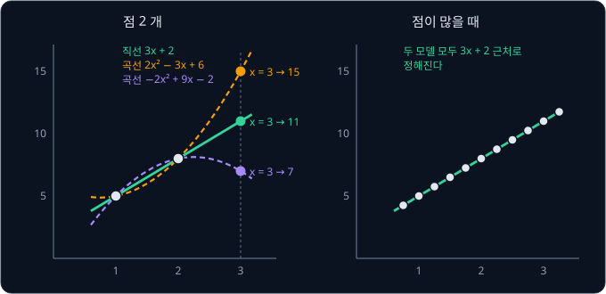

**확인 문제.** 표에서 미리 학습한 데이터를 ImageNet 에서 JFT-300M 으로 바꿀 때 ViT-B/16 과 ViT-L/16 의 정확도는 각각 몇 %p 올랐나?

답 보기

| 모델 | ImageNet | JFT-300M | 오른 폭 |
| --- | --- | --- | --- |
| ViT-B/16 | 77.91% | 84.15% | $84.15 - 77.91 = 6.24$%p |
| ViT-L/16 | 76.53% | 87.12% | $87.12 - 76.53 = 10.59$%p |

parameter 가 많은 ViT-L/16 이 데이터가 늘 때 더 많이 좋아진다.

## 로봇 policy 의 ViT encoder

VLA(Vision-Language-Action model)는 사진과 "빨간 컵 집어" 같은 지시문을 함께 받아 로봇 행동을 내는 모델이고, 대개 사진과 글을 함께 읽는
VLM(Vision-Language Model) 위에 만든다. VLM 의 image encoder 로는 인터넷의 사진과 설명 글의 짝을 맞히며 학습한 SigLIP 을 많이 쓴다.
SigLIP 의 구조는 이 강의의 ViT 그대로이고, 학습 방법은 [CLIP](../clip/README.md) 에서 다룬다.

분류에서는 [CLS] 자리의 출력 하나만 head 에 넣었지만 VLA 는 patch 출력 전부를 넘긴다. 컵을 집으려면 컵이 사진의 어디에 있는지가 중요한데,
[CLS] 하나로 요약하면 무엇이 있는지는 남아도 어디에 있는지가 흐려진다. patch token 은 저마다 사진의 한 구역에서 나왔기 때문에, 언어 모델이 "빨간
컵" 이라는 지시문 token 과 컵이 있는 구역의 patch token 사이에 attention 점수를 매길 수 있다. OpenVLA 논문에서는 미리 학습한 ViT 의 patch
출력을 token 으로 언어 모델에 넣는 이 방식을 patch-as-token 이라고 부르고, 새로 공개된 VLM 들이 대부분 이 방식을 쓰게 되었다고 설명한다.

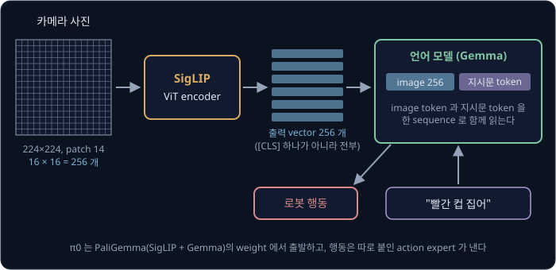

세 VLA 가 사진을 받아 token 으로 만드는 방식을 비교하면 아래와 같다.

| VLA | image encoder | 사진 크기 | 사진 한 장의 image token |
| --- | --- | --- | --- |
| OpenVLA | SigLIP So400m/14 와 DINOv2 ViT-L/14 | 224×224 | 256 |
| [π0](../pi0/README.md) | PaliGemma 의 SigLIP So400m/14 | 224×224 | 256 |
| [GR00T N1](../groot/README.md) | Eagle-2 VLM 의 SigLIP-2 | 224×224 | 64 |

So400m 은 층 수와 폭을 다듬은 parameter 약 4억 개의 ViT 이고, /14 는 patch 크기다. OpenVLA 와 π0 는 patch 출력 256 개를 그대로 넘기고,
GR00T N1 은 이웃한 token 을 합치는 pixel shuffle 로 64 개까지 줄여 언어 모델의 계산을 덜어 준다.

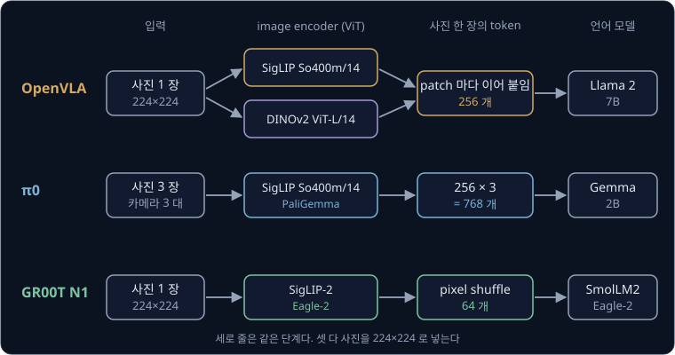

OpenVLA 가 함께 쓰는 DINOv2 는 2023 년 Meta 가 발표한 ViT image encoder 로, 설명 글 없이 사진 1억 4,200만 장만으로 학습했다. 학습
방법은 사람이 단 정답 없이 사진에서 정답을 만들어 배우는 self-supervised learning 이다. DINOv2 는 같은 사진을 여러 방식으로 자르고 변형해도
같은 사진으로 알아보도록 배우고, 가린 patch 의 출력도 맞히도록 배운다. OpenVLA 의 바탕인 Prismatic VLM 은 두 encoder 에서 모두 끝에서
둘째 층의 출력을 꺼내, patch 마다 SigLIP 출력(숫자 1,152 개)과 DINOv2 출력(숫자 1,024 개)을 이어 붙인 숫자 2,176 개짜리 vector 를 만든다.
Prismatic 논문의 저자들은 글과의 짝을 맞히며 배운 SigLIP 이 사진에 무엇이 있는지를 잘 담는 반면, DINOv2 의 patch 출력은 위치와 모양 같은
낮은 수준의 공간 정보를 더 많이 담는다고 해석했다.

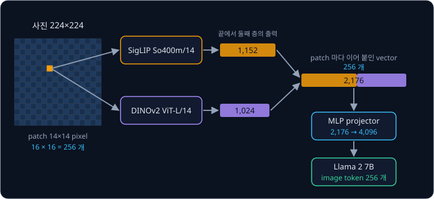

OpenVLA 논문 부록의 실험을 보면 DINOv2 의 효과는 있지만 크지 않다. BridgeData V2 로만 학습한 모델에서 DINOv2 를 빼고 SigLIP 만 쓰자
WidowX 로봇 과제 8 개의 평균 성공률이 45.6% 에서 40.6% 로 5%p 떨어졌다. 같은 표에서 여러 로봇의 데이터(Open X-Embodiment)를 학습에서
뺐을 때 76.3% 에서 45.6% 로 30%p 넘게 떨어진 것에 비하면 작은 차이다. 더 큰 차이는 image encoder 를 학습 중에 고치느냐에서 나왔다. 두
방법을 모두 시험한 과제들에서 image encoder 를 고정하면 평균 성공률이 46.7% 였고, 함께 fine-tuning 하면 80.0% 였다. 저자들은 인터넷 사진으로 미리 학습한 encoder 가 로봇을 정밀하게 움직이는 데 필요한
장면의 세밀한 위치 정보를 충분히 담지 못하기 때문이라고 추측했다.

**흔한 오해.** "미리 학습한 image encoder 는 고정해 두는 편이 낫다." Prismatic 논문에 따르면 VLM 을 만들 때는 encoder 를 고정하는 쪽이
대개 더 좋았다. 하지만 로봇 행동을 배우는 OpenVLA 는 encoder 까지 fine-tuning 해야 성능이 났다.

**확인 문제.** π0 가 카메라 2 대의 사진과 text token 16 개짜리 지시문을 받는다. 언어 모델에 들어가는 사진·지시문 token 은 모두 몇 개일까?

답 보기

1. 사진 한 장: 224×224 를 patch 14 로 자르면 $16 \times 16 = 256$ 개
2. 사진 두 장: $2 \times 256 = 512$ 개
3. 지시문을 더하면 $512 + 16 = 528$ 개

## 정리

- ViT 는 사진을 $P \times P$ patch 로 잘라 펼친 뒤 모든 patch 가 같이 쓰는 행렬 $E$ 를 곱해 token 을 만든다. 맨 앞에 [CLS] token 을 붙이고
  자리마다 학습한 position embedding 을 더한 뒤 Transformer encoder 에 넣는다. 224×224 사진을 patch 16 으로 자르면 token 이 $196 + 1 = 197$
  개이고, patch 한 변을 절반으로 줄이면 attention 점수 표가 16 배가 된다
- CNN 은 locality 와 translation equivariance 를 구조에 담아 데이터가 적을 때 유리하다. 이 가정이 적은 ViT 는 데이터가 많아야 한다. ViT-L/16 은
  ImageNet 130만 장으로 미리 학습하면 76.53% 에 그치지만 3억 장으로 미리 학습하면 87.12% 로 오르고, 이 정도 데이터에서는 ViT 가 CNN 을 앞선다
- OpenVLA·π0·GR00T N1 의 image encoder 는 모두 ViT 계열(SigLIP, DINOv2, SigLIP-2)이고, 위치 정보를 지키려고 [CLS] 하나 대신 patch token
  전부(224×224, patch 14 면 256 개)를 언어 모델에 넘긴다. OpenVLA 에서는 encoder 를 고정할 때 46.7% 이던 평균 성공률이 함께 fine-tuning 하자 80.0% 로 올랐다

분류용으로 학습한 ViT 는 ImageNet 의 1,000 class 처럼 미리 정한 종류 안에서만 고를 수 있어서, "빨간 컵" 같은 새 개념을 알아보게 하려면
그 이름표를 단 사진이 다시 필요하다. image encoder 를 글을 vector 로 바꾸는 text encoder 와 함께 학습해 문장으로 개념을 지정하게 만드는 방법은
[CLIP](../clip/README.md) 에서 다룬다. 이런 image encoder 를 언어 모델에 붙여 로봇 action 을 token 으로 내는 VLA 는
[RT-2 → OpenVLA](../vla-tokens/README.md) 에서 다루고, PaliGemma 위에 action expert 를 붙인 VLA 는 [π0](../pi0/README.md) 에서 다룬다.

## 참고 자료

- Alexey Dosovitskiy et al., [An Image is Worth 16x16 Words](https://arxiv.org/abs/2010.11929) (2020) — ViT 논문. 3.1 절의 식 (1) ~ (4) 와
  "Inductive bias" 문단, 4.3 절의 데이터 양 실험, 부록 표 5(데이터별 정확도)·D.3([CLS] 와 평균)·D.4(position embedding 비교)를 본다
- Maxime Oquab et al., [DINOv2: Learning Robust Visual Features without Supervision](https://arxiv.org/abs/2304.07193) (2023) — 설명 글 없이
  사진 1억 4,200만 장으로 학습한 ViT image encoder. 3 절의 데이터 구성과 4 절의 학습 방법을 본다
- Lucas Beyer et al., [PaliGemma: A versatile 3B VLM for transfer](https://arxiv.org/abs/2407.07726) (2024) — SigLIP-So400m 과 Gemma-2B 로
  만든 VLM. 3.1 절의 구조와 사진 크기별 image token 수(256, 1,024, 4,096)를 본다
- Moo Jin Kim et al., [OpenVLA: An Open-Source Vision-Language-Action Model](https://arxiv.org/abs/2406.09246) (2024) — SigLIP 과 DINOv2 를
  합친 image encoder 를 쓰는 VLA. 2 절의 patch-as-token, 3.4 절의 사진 크기와 encoder fine-tuning, 부록 D.2·D.3 의 실험을 본다
- Kevin Black et al., [π0: A Vision-Language-Action Flow Model for General Robot Control](https://arxiv.org/abs/2410.24164) (2024) — 부록 A-D 의
  표 I 에 카메라 3 대 입력의 단계별 계산 시간이 있다
- NVIDIA, [GR00T N1: An Open Foundation Model for Generalist Humanoid Robots](https://arxiv.org/abs/2503.14734) (2025) — 2.1 절에 224×224 사진을
  pixel shuffle 로 token 64 개로 줄이는 Eagle-2 VLM 의 설명이 있다
- torchvision, [`vit_b_16` weight 문서](https://docs.pytorch.org/vision/stable/models/generated/torchvision.models.vit_b_16.html) — ViT-B/16 의
  parameter 수 86,567,656 과 ImageNet 정확도
- Google Research, [vision_transformer](https://github.com/google-research/vision_transformer) — 논문의 공식 구현과 학습된 weight
