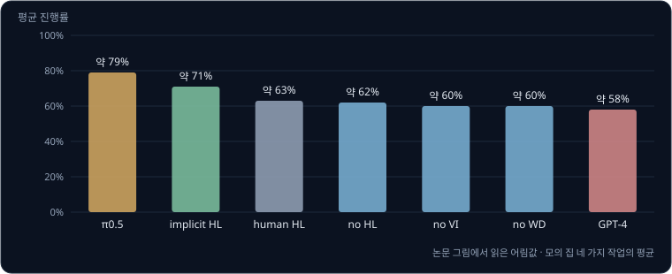
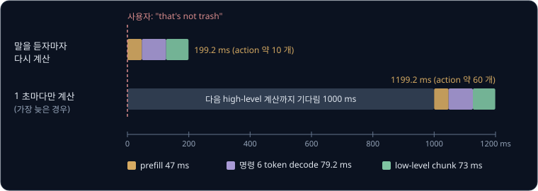
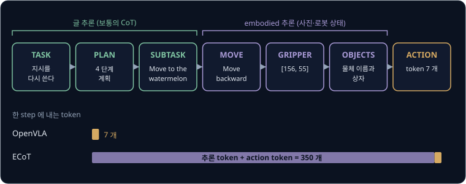
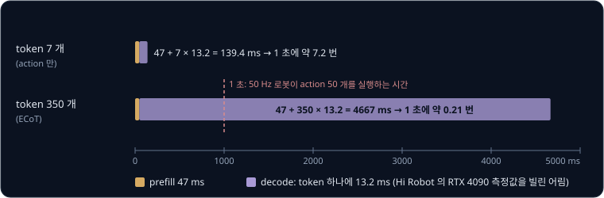

# Reasoning VLA

[π0](../pi0/README.md) 는 사진과 "pick up the plate" 같은 짧은 지시문을 받아 action chunk 를 만들고, 50 Hz 로봇에서는 0.5 초마다 다시
추론한다. 그런데 사람은 "부엌을 치워" 처럼 몇 분이 걸리는 일을 한 줄로 시키고, 일하는 도중에 "그건 쓰레기가 아니야" 라고 고쳐 말하기도
한다. 이 지시문이 끝날 때까지 그대로 들어가면 VLA 는 사진만 보고 지금이 몇 번째 단계인지 알아내야 한다. 다음에 할 일을 먼저 글로 정한 뒤
그 글을 보고 움직이게 하면서도, 1 초에 50 개씩 필요한 관절 목표를 제때 낼 수는 없을까?

이 문제를 푸는 방법은 VLA 가 action 앞에 짧은 글이나 물체 위치 같은 중간 결과를 먼저 내게 하는 것이다. Physical Intelligence 가 2025 년에
발표한 π0.5 는 "clean the bedroom" 을 받으면 "pick up the pillow" 같은 다음 작은 작업(subtask)을 글로 먼저 내고, 그 글을 조건으로 action
chunk 를 만든다. 저자들은 이 방식으로 학습 데이터에 없던 집에서 부엌과 침실을 치우는 10 ~ 15 분짜리 작업을 해냈다. 이렇게 action 앞에
추론 단계를 두는 VLA 를 이 강의에서는 reasoning VLA 라고 부른다.

## 학습 목표

- 긴 지시를 짧은 subtask 글로 바꾸는 high-level policy 와 그 글을 action chunk 로 바꾸는 low-level policy 의 구조와, π0.5 와 Hi Robot 이 이
  구조를 만든 방식의 차이를 설명할 수 있다
- action 앞에 계획과 물체 위치를 글로 쓰는 ECoT 가 장면에 묶인 추론을 넣는 이유와, 추론 token 수가 제어 주기를 얼마나 늦추는지 계산할 수 있다
- 느린 추론과 빠른 action 생성을 서로 다른 주기로 나누는 방법과, action 을 만드는 network 의 gradient 를 VLM 으로 보내지 않는 knowledge
  insulation 이 VLM 의 지식을 지키는 원리를 설명할 수 있다
- Google DeepMind 의 로봇용 VLM 인 Gemini Robotics-ER 가 내는 점·경로·상자 좌표를 pixel 로 바꿔 쓰는 법과, 전체 계획을 맡는 orchestrator
  와 action 앞에 생각을 글로 쓰는 thinking VLA 가 나눠 맡는 일을 설명할 수 있다

## 한 줄 지시로 배운 VLA 의 한계

사진과 지시문을 받아 중간 출력 없이 action 을 바로 내는 VLA 를 **flat VLA** 라고 한다. Hi Robot 논문이 계층이 없는 비교 모델을 이렇게
불렀다. flat VLA 에 긴 작업을 맡기면 같은 지시문을 아주 여러 번 받는다. 0.5 초마다 다시 추론하는 모델이 10 분짜리 부엌 정리를 하면 추론은
$600 \div 0.5 = 1200$ 번이고, 1200 번 모두 지시문은 "clean the kitchen" 그대로다. 접시를 집을 차례인지 서랍을 닫을 차례인지는 지시문에
없으므로 사진만 보고 골라야 한다.

그림 아래 줄처럼 긴 지시를 "pick up the plate", "put the plate in the sink" 같은 subtask 로 바꿔 넣으면 VLA 가 받는 글이 단계마다
달라진다. Hi Robot 논문은 시연을 이런 짧은 동작 단위로 잘랐는데, 한 단위는 대개 1 ~ 3 초였다. 예로 든 2 초짜리 subtask 라면 0.5 초마다
추론하는 VLA 는 같은 글을 $2 \div 0.5 = 4$ 번 받고 다음 글로 넘어간다.

지시를 읽지 않고 사진만 보는 습관은 [RT-2 → OpenVLA](../vla-tokens/README.md#인터넷-지식으로-일반화되는-지시) 에서 계산한 것처럼
데이터가 치우치면 생긴다. π0.5 논문은 이 습관을 재려고 물체 5 개 가운데 하나를 옮기라고 지시하면서, 지시한 물체를 가장 멀리 두어 가까운
물체부터 집는 습관으로는 맞힐 수 없게 했다. 저자들은 지시를 해석하지 못하는 policy 의 language following rate(지시한 물체를 고른 비율)가
약 20% 에 그친다고 적었는데, 5 개 가운데 하나를 아무렇게나 고를 때의 $1 \div 5 = 0.2$ 와 같다.

**확인 문제.** 물체 4 개 가운데 지시한 하나를 집는 시험에서, 지시를 읽지 못하는 policy 가 4 개 가운데 하나를 아무렇게나 고르면 language
following rate 는 얼마쯤일까? 8 분짜리 작업을 0.5 초마다 추론하는 flat VLA 는 같은 지시문으로 몇 번 추론할까?

답 보기

① 4 개 가운데 하나를 고를 확률이라 $1 \div 4 = 0.25$, 약 25% 다.

② 8 분은 $8 \times 60 = 480$ 초이므로 $480 \div 0.5 = 960$ 번이다.

## high-level policy 와 low-level policy

긴 지시를 subtask 로 바꾸는 모델을 **high-level policy** 라고 하고, subtask 를 받아 action chunk 를 내는 모델을 **low-level policy** 라고
한다. high-level policy 는 몇 초짜리 단계를 고르고, low-level policy 는 1 초 안팎의 움직임을 만든다.

| | high-level policy | low-level policy |
| --- | --- | --- |
| 입력 | 카메라 사진, 전체 지시문, 사용자가 중간에 한 말 | 카메라 사진, 관절 각도, high-level 이 낸 subtask 글 |
| 출력 | subtask 글 (Hi Robot 은 로봇이 소리로 낼 대답도) | action chunk |
| 다시 계산하는 때 | Hi Robot 은 1 초마다, 또는 사용자가 말할 때 | π0 기준 0.5 초마다 |
| 배우는 데이터 | subtask 라벨, 웹의 사진·글, 사람이 말로 지휘한 기록 | 로봇 시연 |

π0.5 논문은 low-level 이 만드는 action 이 전체 지시문에는 기대지 않고 subtask 글에만 기댄다고 적었다. "clean the kitchen" 은 high-level 만
읽고, low-level 은 "pick up the plate" 만 읽는다. 그래서 low-level 은 부엌 정리를 본 적 없는 고정 팔의 "pick up the cup" 시연에서도 배울
수 있고, high-level 은 action 이 없는 웹 데이터와 사람이 고른 subtask 예시에서 배울 수 있다. high-level 자리에 GPT-4 같은 큰 언어 모델을
그대로 쓰면 오히려 약했는데, Hi Robot 의 저자들은 GPT-4o 가 물건을 만지기 시작하면 맥락을 잃고 "pick up bermuda triangle" 같은 엉뚱한
명령을 냈다며 실제 장면에 묶여 있지 않은 점을 이유로 들었다.

두 policy 를 만드는 방법은 둘이다. Hi Robot 은 PaliGemma-3B 에서 출발한 VLM 두 개를 따로 학습해, 하나는 명령 글을 내게 하고 다른 하나는
π0 로 만든다. π0.5 는 weight 한 벌이 두 일을 모두 한다. 같은 모델이 먼저 subtask 글을 내고 그 글을 보고 action 을 내므로, 저자들은 이
과정을 언어 모델의 chain-of-thought(답 앞에 풀이를 글로 쓰게 하는 방법)에 견주었다.

<b>심화: subtask 를 거치는 확률의 곱</b>

예를 들어 사진과 "clean the kitchen" 을 본 high-level 이 "pick up the plate" 에 0.8, "close the drawer" 에 0.2 의 확률을 준다고 하자.
"pick up the plate" 를 받은 low-level 은 왼쪽 접시로 가는 chunk 에 0.9, 오른쪽 접시로 가는 chunk 에 0.1 의 확률을 준다. 그러면
"pick up the plate 를 고르고 왼쪽 접시로 간다" 는 짝의 확률은 $0.8 \times 0.9 = 0.72$ 다.

| 이 예의 값 | 기호로 쓴 값 |
| --- | --- |
| 사진과 관절 각도 | $o_t$ |
| "clean the kitchen" | $\ell$ |
| "pick up the plate" | $\hat\ell$ |
| 왼쪽 접시로 가는 chunk | $a_{t:t+H}$ |
| 0.8 | $\pi_\theta(\hat\ell \mid o_t, \ell)$ |
| 0.9 | $\pi_\theta(a_{t:t+H} \mid o_t, \hat\ell)$ |
| $0.72 = 0.9 \times 0.8$ | $\pi_\theta(a_{t:t+H}, \hat\ell \mid o_t, \ell) = \pi_\theta(a_{t:t+H} \mid o_t, \hat\ell)\ \pi_\theta(\hat\ell \mid o_t, \ell)$ |

마지막 줄이 π0.5 논문의 식이다. 세로 막대 $\mid$ 오른쪽은 조건이고, 둘째 인자 $\pi_\theta(a_{t:t+H} \mid o_t, \hat\ell)$ 의 조건에는 $\ell$
이 없다. low-level 이 전체 지시문을 보지 않는다는 뜻이다. 두 인자의 $\theta$ 가 같은 것은 weight 한 벌이 두 확률을 모두 낸다는 뜻이고,
Hi Robot 은 같은 꼴을 $p_{hi}(\hat\ell_t \mid I_t, \ell_t)$ 와 $p_{lo}(A_t \mid I_t, \hat\ell_t, q_t)$ 처럼 서로 다른 두 모델로 적는다.
$I_t$ 는 사진, $q_t$ 는 관절 각도다.

학습할 때 π0.5 는 글 token 의 cross-entropy 와 action expert 의 flow matching loss 를 더해 줄인다. 둘째 항에 곱하는 가중치 $\alpha$ 는
post-training 에서 10 이다. 실행할 때는 글 token 을 하나씩 만들어 $\hat\ell$ 을 얻고, 그 글을 조건으로 flow matching 10 step 을 밟아
action chunk 를 만든다.

**확인 문제.** Hi Robot 에서 아래 네 가지는 각각 어디에 들어갈까? (가) 사용자의 "I'm allergic to pickles" (나) 손목 카메라 사진 (다)
지금 관절 각도 (라) "pick up one slice of bread"

답 보기

| 항목 | 들어가는 곳 |
| --- | --- |
| (가) 사용자의 말 | high-level 의 입력 |
| (나) 손목 카메라 사진 | high-level 과 low-level 둘 다의 입력 |
| (다) 관절 각도 | low-level 의 입력 |
| (라) subtask 글 | high-level 의 출력이자 low-level 의 입력 |

## π0.5 의 high-level 추론

π0.5 의 추론 한 번은 두 부분이다. 먼저 VLM 이 사진과 지시문을 읽고 subtask 글을 token 하나씩 만들고, 그다음 action expert 가 그 글까지 본
상태에서 flow matching 10 step 으로 action chunk 를 만든다. 저자들은 high-level 추론을 low-level 보다 드물게 계산한다고 적었지만 정확한
주기는 밝히지 않았다.

subtask 를 내는 법은 사람이 붙인 라벨로 배운다. 여러 단계로 된 작업의 로봇 데이터에 사람이 "adjust the blanket", "pick up pillow" 같은
subtask 설명을 손으로 붙였고, π0.5 는 장면과 전체 지시를 보고 이 라벨을 글로 맞히는 동시에 그 라벨을 조건으로 action 을 맞히도록 학습했다.
저자들은 장면에 보이는 관련 물체의 bounding box(물체를 둘러싼 네모)도 붙여 subtask 보다 먼저 맞히게 했다.

bounding box 는 PaliGemma 의 위치 token 으로 적는다. PaliGemma 는 사진의 가로와 세로를 각각 0 ~ 1 로 정규화한 좌표를 1024 칸으로 나눈
token `<loc0000>` ~ `<loc1023>` 을 쓰고, 상자 하나를 위쪽 끝 y, 왼쪽 끝 x, 아래쪽 끝 y, 오른쪽 끝 x 순서의 token 넷으로 적는다. π0.5
논문 그림 4 의 예 `<loc0571><loc0376><loc0815><loc0484> mitten` 을 사진이 224×224 라고 두고 pixel 로 바꾸면 아래와 같다.

| token | 뜻 | 계산 | pixel |
| --- | --- | --- | --- |
| `<loc0571>` | 위쪽 끝 y | $571 \div 1024 \times 224$ | 약 125 |
| `<loc0376>` | 왼쪽 끝 x | $376 \div 1024 \times 224$ | 약 82 |
| `<loc0815>` | 아래쪽 끝 y | $815 \div 1024 \times 224$ | 약 178 |
| `<loc0484>` | 오른쪽 끝 x | $484 \div 1024 \times 224$ | 약 106 |

장갑(mitten)은 가로 약 $106 - 82 = 24$ pixel, 세로 약 $178 - 125 = 53$ pixel 의 상자 안에 있다. 이 숫자를 글로 먼저 내야 하므로 모델은
subtask 를 고르기 전에 사진에서 그 물체를 실제로 찾아야 한다.

post-training 에서는 사람이 말로 지휘한 기록(verbal instruction)을 더했다. 숙련된 사람이 이미 학습된 low-level 에게 실시간으로 subtask
명령을 골라 주며 로봇을 움직인 기록으로, 이동 로봇의 high-level 예시 가운데 약 11% 뿐이었다.

저자들은 low-level 은 그대로 두고 high-level 만 바꿔 가며, 모의 집에서 네 가지 작업(그릇을 싱크대에 넣기, 물건을 서랍에 넣기, 빨래를
바구니에 넣기, 침대 정리)의 평균 진행률을 쟀다. 진행률은 작업 단계 가운데 해낸 비율로, 그릇 4 개 가운데 2 개를 싱크대에 넣으면 약 50% 다. 논문 그림 13
의 막대에 숫자가 적혀 있지 않아서 아래 그림의 값은 그림에서 읽은 어림값이다.

subtask 를 글로 내는 π0.5 가 약 79% 로 가장 높았고, GPT-4 가 subtask 를 고르면 약 58% 로 가장 낮았다. 실행 때는 subtask 를 내지 않지만
학습에는 subtask 예시를 넣은 implicit HL 은 약 71% 로, 학습에도 실행에도 subtask 가 없는 no HL 의 약 62% 보다 높았다. 저자들은 subtask 를
글로 내는 이득의 상당 부분이 subtask 를 맞히는 예시를 학습에 넣는 것만으로 이미 생긴다고 해석했다. 말로 지휘한 기록(no VI)이나 웹 데이터(no WD)를 빼면 약 60% 로 떨어졌다.
사람이 subtask 를 골라 준 human HL 은 약 63% 로 π0.5 보다 낮았는데, 논문은 그 이유를 따로 밝히지 않았다.

저자들은 high-level 추론이 쉽게 흐트러진다는 한계도 적었다. 물건을 치우는 동안 서랍을 여러 번 열었다 닫는 것이 그 예이고, 모델이 쓰는
맥락이 짧아 기억이 필요한 작업이 어렵다는 점도 함께 꼽았다. 공개 구현 openpi 의 README 에 따르면 이 저장소는 π0.5 의 학습과 추론에서
flow matching head 만 지원하고, subtask 글을 먼저 내는 추론은 공개 기능으로 적혀 있지 않다.

**확인 문제.** 224×224 사진에서 PaliGemma 가 `<loc0512><loc0256><loc0768><loc0512> cup` 을 냈다. 컵 상자의 네 끝과 가운데는 몇 pixel
일까?

답 보기

① token 순서는 위쪽 y, 왼쪽 x, 아래쪽 y, 오른쪽 x 이고, pixel 은 token 번호 ÷ 1024 × 224 다.

| token | 계산 | pixel |
| --- | --- | --- |
| `<loc0512>` 위쪽 y | $512 \div 1024 \times 224$ | 112 |
| `<loc0256>` 왼쪽 x | $256 \div 1024 \times 224$ | 56 |
| `<loc0768>` 아래쪽 y | $768 \div 1024 \times 224$ | 168 |
| `<loc0512>` 오른쪽 x | $512 \div 1024 \times 224$ | 112 |

② 가운데는 x 가 $(56 + 112) \div 2 = 84$, y 가 $(112 + 168) \div 2 = 140$ 이다.

## Hi Robot 의 지시와 수정 해석

Physical Intelligence 가 2025 년에 발표한 Hi Robot 은 식탁 치우기, 샌드위치 만들기, 장보기에서 "can you clean up only the trash, but not
dishes?" 같은 지시와 "that's not trash" 같은 도중의 수정을 다루는 계층 VLA 다. "that's not trash" 는 로봇이 방금 집은 물건을 가리키므로
지금 사진과 함께 읽어야 뜻이 정해진다. high-level VLM 은 low-level 이 알아들을 짧은 명령과, 필요하면 로봇이 소리로 낼 대답을 낸다. 사람의
말은 음성 인식 모델 Whisper large-v2 로 글로 바꾸고, high-level 은 1 초가 지나거나 사용자가 새로 말할 때 다시 계산한다.

이 규칙이 얼마나 빨리 반응하게 하는지는 논문 부록에 있는 RTX 4090 의 측정값으로 따져 볼 수 있다. high-level 은 사진과 지시를 한꺼번에 읽는
prefill 에 47 ms 가 걸리고, token 하나를 내는 decode 한 step 에 13.2 ms 가 걸린다. prefill 은 입력 token 을 한 번에 계산해
[π0](../pi0/README.md#kv-cache-와-추론-시간) 에서 본 KV cache 를 채우는 단계이고, decode 는 그 cache 를 보며 새 token 을 하나씩 만드는
단계다. low-level 은 π0 와 같은 73 ms 다. 예를 들어 사용자가 "that's not trash" 라고 말했고 새 명령 "put the bowl back" 이 token 6 개라고
하자.

| 단계 | 말을 듣자마자 다시 계산할 때 | 1 초마다만 계산할 때 (가장 늦은 경우) |
| --- | --- | --- |
| 다음 high-level 계산까지 기다림 | 0 ms | 1000 ms |
| prefill | 47 ms | 47 ms |
| 명령 6 token 의 decode | $6 \times 13.2 = 79.2$ ms | 79.2 ms |
| low-level 의 chunk 계산 | 73 ms | 73 ms |
| 새 chunk 가 나오기까지 | 199.2 ms | 1199.2 ms |
| 그동안 50 Hz 로봇이 실행하는 action | $199.2 \div 20 \approx 10$ 개 | $1199.2 \div 20 \approx 60$ 개 |

high-level 을 가르칠 데이터는 따로 만들었다. 저자들은 원격 조종 시연을 1 ~ 3 초짜리 skill 로 자르고 "pick up one piece of lettuce" 같은
라벨을 붙인 뒤, 큰 VLM 에게 사진과 라벨을 보여 주고 그 skill 직전에 사용자가 했을 법한 말과 로봇의 대답을 지어내게 했다. "Can you add some
lettuce for me?" 같은 합성 데이터가 이렇게 나왔다.

저자들은 방법마다 작업당 20 번 시도하고 두 가지를 쟀다. instruction accuracy 는 high-level 이 낸 명령 가운데 사용자의 뜻과 지금 장면에
맞는다고 평가자가 판정한 비율이고, task progress 는 제자리에 놓인 물건의 비율이다. 아래 %p(퍼센트 포인트)는 두 백분율의 차이다.

| 비교 | 세 작업 평균에서 Hi Robot 이 높았던 만큼 |
| --- | --- |
| GPT-4o 가 high-level 을 맡은 경우 | instruction accuracy 40%p 넘게 |
| 합성 데이터를 뺀 Hi Robot | instruction accuracy 46%p, task progress 39%p |
| 같은 합성 데이터로 학습한 flat VLA | instruction accuracy 19%p, task progress 34%p |

합성 데이터가 없으면 "this is not trash" 같은 수정을 무시했고, flat VLA 는 노란 것만 치우라는 지시를 다루지 못하고 모두 치우는 쪽으로
돌아가곤 했다. 사람이 high-level 을 맡으면 low-level 이 거의 완벽하게 실행해서, 실패는 손동작보다 판단에서 더 많이 왔다. 다만 두 policy 는
따로 학습해서 서로의 능력을 모르고, low-level 이 지시를 잠깐 무시하기도 한다. 유당을 못 먹는다는 말을 듣고도 손 가까이 있는 치즈를 집은
실패가 기록돼 있다.

**확인 문제.** high-level 을 2 초마다만 다시 계산하고, 사용자의 수정에 맞는 새 명령이 token 10 개라고 하자. prefill 47 ms, decode 한
step 13.2 ms 일 때, 말한 뒤 새 명령이 나오기까지 가장 늦으면 몇 ms 일까?

답 보기

① 가장 늦은 경우 다음 계산까지 2000 ms 를 기다린다.

② prefill 47 ms 와 decode $10 \times 13.2 = 132$ ms 를 더한다.

③ $2000 + 47 + 132 = 2179$ ms 다. 말을 듣자마자 계산하면 $47 + 132 = 179$ ms 다.

## embodied chain-of-thought

큰 언어 모델에게 답 앞에 풀이를 단계별로 쓰게 하면 어려운 문제의 정답률이 오르는데, 이것을 **chain-of-thought**(CoT)라고 한다. Zawalski
등이 2024 년에 발표한 **ECoT**(Embodied Chain-of-Thought)는 VLA 에게 action 앞에 이런 풀이를 쓰게 하되, 풀이를 장면과 로봇 상태에
묶었다. 저자들은 OpenVLA(Llama 2 7B 위에 만든 VLA 로, action 을 token 7 개로 낸다)를 그대로 쓰고, 학습 데이터의 action 앞에 아래 순서의
글을 붙였다.

| 단계 | 내용 | 논문 그림 3 의 예 |
| --- | --- | --- |
| TASK | 지시를 다시 쓴다 | Place the watermelon on the towel |
| PLAN | 전체 계획 | Move to watermelon, grasp it, move to towel, place it |
| SUBTASK | 지금 할 단계와 그 이유 | 아직 수박에서 멀어서 Move to the watermelon |
| MOVE | 다음 움직임의 방향과 그 이유 | 수박이 로봇 뒤쪽에 있어서 Move backward |
| GRIPPER | 사진 속 gripper 끝의 pixel 좌표 | [156, 55] |
| OBJECTS | 보이는 물체의 이름과 bounding box | Watermelon, Towel, Spoon 과 각각의 상자 |
| ACTION | action token 7 개 | |

TASK·PLAN·SUBTASK 는 언어 모델의 보통 CoT 와 같은 글 추론이고, MOVE·GRIPPER·OBJECTS 는 사진과 로봇 상태를 봐야 쓸 수 있는 embodied
추론이다. 저자들은 VLA 가 생각만 잘해서는 안 되고 잘 보기도 해야 한다며 뒤의 세 단계를 넣었다.

사람이 수백만 step 에 이 글을 붙일 수는 없어서, 저자들은 이미 학습된 detector 와 언어 모델로 글을 자동으로 만들었다. MOVE 는 지금 위치와
4 step 뒤 위치의 차이로 정한다. 축마다 차이가 0.03 을 넘으면 그 방향의 말을 붙이고, 넘지 않으면 뺀다. 예를 들어 4 step 동안 앞으로 0.05,
오른쪽으로 0.01, 아래로 0.04 움직였다면 오른쪽은 문턱을 넘지 못해 빠지고 라벨은 "move forward down" 이다. transition(관측 하나와 action
하나의 짝) 250 만 개가 넘는 BridgeData V2 전체에 글을 만드는 데 7 일이 걸렸다.

저자들은 WidowX 팔로 처음 보는 물체, 공간 관계, 처음 보는 지시가 섞인 작업을 방법마다 314 번 시도했다. 카메라 위치가 학습 때와 같은
경우와 다른 경우의 평균 성공률은 아래와 같다.

| 방법 | 학습 때와 같은 카메라 | 다른 카메라 |
| --- | --- | --- |
| Octo | 21% | 16% |
| OpenVLA (같은 Bridge 데이터) | 44% | 30% |
| RT-2-X (55B, 더 많은 로봇 데이터) | 47% | 48% |
| 계획·subtask 만 쓰는 Naive CoT | 48% | 48% |
| ECoT | 66% | 64% |

ECoT 와 OpenVLA 는 같은 VLM 과 같은 로봇 데이터로 학습해서, 차이는 추론 글에서만 나온다. 성공률이 $66 - 44 = 22$%p 와 $64 - 30 = 34$%p
올랐고, 두 값의 평균 $(22 + 34) \div 2 = 28$%p 는 논문 초록에 적힌 28% 와 같다. 계획과 subtask 만 쓰는 Naive CoT 가 48% 에 그쳤으므로, 장면에 묶인 세 단계가 이득의 큰 몫을
냈다.

추론이 글로 보이면 사람이 고칠 수도 있다. 가장 어려운 작업에서 사람이 한 번 "no, the screwdriver is in the back right corner" 같은 말을
하고 ChatGPT 가 그 말로 추론 글을 고치게 하자, ECoT 의 성공률은 32% 에서 80% 로 올랐다. 같은 방식으로 지시문을 고친 OpenVLA 는 16% 에서
44% 로 올랐다. 다만 모델이 계획을 쓰고도 action 은 다르게 낼 수 있어서, 저자들은 추론 글이 완벽한 진단 도구는 아니라고 덧붙였다.

<b>심화: MOVE 라벨의 개수와 자동 라벨 만들기</b>

MOVE 라벨은 "move [forward/backward] [left/right] [up/down], tilt [up/down], rotate [clockwise/counterclockwise], [close/open]
gripper" 꼴이다. 블록이 6 개이고 블록마다 두 방향 가운데 하나를 쓰거나 아예 빼므로 경우의 수는 블록마다 3 가지다.

| 블록 | 고를 수 있는 것 | 경우의 수 |
| --- | --- | --- |
| 앞뒤 | forward, backward, 뺀다 | 3 |
| 좌우 | left, right, 뺀다 | 3 |
| 위아래 | up, down, 뺀다 | 3 |
| 기울이기 | tilt up, tilt down, 뺀다 | 3 |
| 돌리기 | clockwise, counterclockwise, 뺀다 | 3 |
| gripper | close, open, 뺀다 | 3 |
| 전체 | | $3^6 = 729$ |

모든 블록을 빼면 라벨은 "stop" 이다. 729 가지가 가능하지만 BridgeData V2 에서 0.1% 넘게 쓰인 라벨은 54 가지뿐이었다.

나머지 글은 아래 순서로 만든다.

1. Prismatic-7B VLM 이 장면을 설명한다
2. 그 설명과 원래 지시를 글로 물체를 찾는 detector 인 Grounding DINO 에 넣어 상자를 찾고, 상자 신뢰도 0.3, 글 신뢰도 0.2 를 넘는 것만
   남긴다
3. OWLv2 와 SAM 으로 사진마다 gripper 의 2 차원 위치를 찾고, 로봇 상태에서 읽은 gripper 의 3 차원 위치와 짝지어 3 차원 점을 사진으로
   옮기는 projection 행렬을 RANSAC(짝 몇 개로 맞춘 행렬 가운데 나머지 짝과 가장 많이 맞는 것을 고르는 방법)으로 맞춘다. episode 마다
   따로 맞추므로 카메라 parameter 를 몰라도 된다
4. Gemini 1.0 이 지시, 장면 설명, step 마다 정한 MOVE 를 받아 계획과 step 마다 할 subtask, 그 이유를 쓴다

projection 행렬은 [카메라 geometry](../camera-geometry/README.md#pinhole-projection) 에서 본 intrinsics 와 extrinsics 를 곱한 것이다.

**확인 문제.** 4 step 동안 gripper 가 앞으로 0.02, 오른쪽으로 0.05, 아래로 0.04 움직이고 gripper 를 닫았다. 문턱이 0.03 일 때 MOVE
라벨은 무엇일까?

답 보기

① 앞뒤 0.02 는 0.03 을 넘지 못해 뺀다.

② 오른쪽 0.05 와 아래 0.04 는 문턱을 넘으므로 right 와 down 을 쓰고, gripper 를 닫았으므로 close gripper 를 붙인다.

③ 라벨은 "move right down, close gripper" 다.

## 추론 token 의 비용과 제어 주기

추론 글을 쓰는 데는 시간이 든다. 언어 모델은 token 을 하나 낼 때마다 앞에서 낸 token 을 보고 다음 token 을 골라야 해서, 새 token 수만큼
decode 를 차례로 되풀이한다. ECoT 논문에 따르면 한 step 에 내는 token 이 OpenVLA 의 7 개에서 ECoT 의 350 개로 늘었다.

Hi Robot 이 PaliGemma-3B 로 잰 prefill 47 ms 와 decode 한 step 13.2 ms 를 빌려 어림해 본다. 모델 크기와 GPU 가 다르면 값도 달라지므로,
token 수가 시간을 어떻게 바꾸는지만 보는 계산이다.

| 한 step 에 내는 token | 계산 | 시간 | 1 초에 내는 횟수 |
| --- | --- | --- | --- |
| 7 (action 만) | $47 + 7 \times 13.2$ | 139.4 ms | 약 7.2 번 |
| 350 (ECoT) | $47 + 350 \times 13.2$ | 4667 ms | 약 0.21 번 |

실제로 잰 값도 같은 쪽을 가리킨다. 후속 연구인 ECoT-Lite 논문(2025)의 저자들에 따르면 ECoT policy 는 H100 GPU 에서 숫자를 8 bit 로 줄이는
FP8 컴파일을 해도 1 초에 1 ~ 1.2 번 action 을 내고, RTX 4090 에서 컴파일 없이 돌리면 0.3 ~ 0.5 번 낸다. 같은 구조에서 추론 없이 action 만
내는 VLA 는 RTX 4090 에서 3 ~ 4 번이다.

비용을 줄이는 방법은 네 가지로 나뉜다.

| 방법 | 예 | 보고된 결과 |
| --- | --- | --- |
| 위쪽 추론을 여러 step 동안 고정 | ECoT 가 계획과 subtask 를 5 step 마다 새로 쓴다 | 세 작업 25 번 시도에서 성공률 63% → 72%, 24% 빨라졌다 |
| 두 사본을 나란히 실행 | 한 사본은 위쪽 추론을 고치고 다른 사본은 action 을 낸다 | 65% 에 40% 빨라졌지만 계산은 두 배 든다 |
| 학습에만 추론을 쓴다 | ECoT-Lite 의 reasoning dropout 과 pre-training | ECoT 보다 약 3 배 빠르고, BridgeData V2 에서 추론 없는 VLA 보다 10 ~ 19% 높았다 |
| 짧은 숨은 추론 | Fast-ThinkAct(2026)가 글 약 250 token 대신 연속값 token 몇 개로 생각한다 | 비교한 추론 VLA 보다 지연 시간을 최대 89.3% 줄였다 |

이미 쓴 글을 다시 입력으로 넣는 것은 prefill 처럼 한꺼번에 계산되므로 새로 쓰는 것보다 훨씬 빠르고, 고정 방법은 이 차이를 쓴다. reasoning
dropout 은 학습 예시 일부에서 추론 글을 지우고 학습해 실행할 때 추론 없이 바로 action 을 내게 한다. 내용 없는 빈 "thinking token" 을 같은
개수만큼 넣으면 성능이 평균 3.8% 떨어져서, ECoT-Lite 의 저자들은 추론의 이득이 계산을 더 하는 데서가 아니라 뜻 있는 추론을 배우는 데서
온다고 해석했다. π0.5 에서 implicit HL 이 높았던 것과 같은 방향이다.

주기를 나누는 방법은 [π0 의 느린 큰 모델과 빠른 행동 생성기](../pi0/README.md#느린-큰-모델과-빠른-행동-생성기) 에서 본 세 층(0.5 초마다
chunk 추론, 20 ms 마다 action 실행, PID) 위에 1 초마다 또는 사용자가 말할 때 계산하는 high-level 층을 하나 더 쌓는 것과 같다. 위층의 결과가
늦게 오면 그사이 장면이 바뀐다. Gemini Robotics 1.5 보고서는 작업이 끝났는지 판정하는 success detection 을 1 초에 5 번
부르고 추론 지연을 흉내 내 시험했는데, 추론이 오래 걸리는 모델의 판정은 금방 낡아 움직이는 로봇에 쓸모가 없어진다고 적었다. 예를 들어
판정에 2 초가 걸리면 50 Hz 로봇은 결과를 받기 전에 action 100 개를 더 실행한다.

<b>심화: 일부 추론을 고정할 때의 평균 token 수</b>

추론 한 번의 시간은 prefill 시간에 새로 쓰는 token 수 × decode 한 step 의 시간을 더한 값이다. 위쪽 추론을 $k$ step 마다 한 번만 새로 쓰면,
step 하나가 평균으로 새로 쓰는 token 은 아래쪽 token 수에 위쪽 token 수 ÷ $k$ 를 더한 값이다. 이미 쓴 글을 다시 읽는 시간은 prefill 에
들어간다고 보고 무시한다.

예를 들어 ECoT 의 350 token 가운데 계획과 subtask 가 60 개, bounding box 가 120 개, 나머지 MOVE·GRIPPER·action 이 170 개라고 하자.

| 방식 | step 하나가 평균으로 새로 쓰는 token | 시간 |
| --- | --- | --- |
| 매 step 전부 쓴다 | 350 | $47 + 350 \times 13.2 = 4667$ ms |
| 계획·subtask 를 5 step 고정 | $290 + 60 \div 5 = 302$ | $47 + 302 \times 13.2 = 4033.4$ ms |
| bounding box 도 5 step 고정 | $170 + 180 \div 5 = 206$ | $47 + 206 \times 13.2 = 2766.2$ ms |

계획만 고정하면 $4667 \div 4033.4 \approx 1.16$ 배 빨라지고, bounding box 까지 고정하면 거기서 $4033.4 \div 2766.2 \approx 1.46$ 배 더
빨라진다. ECoT 의 저자들도 bounding box 를 계획 바로 뒤로 옮겨 함께 고정하면 30 ~ 50% 빨라진다고 적었다. 기호로 쓰면 아래와 같다.

| 이 예의 값 | 기호로 쓴 값 |
| --- | --- |
| 47 ms | $T_{\text{prefill}}$ |
| 13.2 ms | $T_{\text{decode}}$ |
| 아래쪽 170 token | $n_{\text{low}}$ |
| 고정하는 180 token | $n_{\text{high}}$ |
| 5 step | $k$ |
| 2766.2 ms | $T = T_{\text{prefill}} + \left(n_{\text{low}} + n_{\text{high}} \div k\right) T_{\text{decode}}$ |

$k$ 를 키울수록 위쪽 token 의 몫은 0 에 가까워지지만, 위쪽 추론이 그만큼 오래 낡은 채로 쓰인다.

**확인 문제.** 한 step 에 추론 token 100 개와 action token 7 개를 내는 모델이 있다. prefill 47 ms, decode 한 step 13.2 ms 로 어림하면
1 초에 몇 번 action 을 낼까? 이 모델이 50 Hz 로봇에 1 초 분량의 chunk 를 낸다면 로봇이 기다리게 될까?

답 보기

① 새로 쓰는 token 은 $100 + 7 = 107$ 개라서 시간은 $47 + 107 \times 13.2 = 1459.4$ ms 다.

② 1 초에 $1000 \div 1459.4 \approx 0.69$ 번이다.

③ chunk 하나가 1 초 분량인데 다음 chunk 를 만드는 데 약 1.46 초가 걸리므로, 추론을 미리 시작해도 chunk 마다 약 0.46 초씩 모자라 로봇이
기다린다. 추론의 일부를 고정하거나 주기를 나눠야 한다.

## knowledge insulation

subtask 를 고르는 일은 VLM backbone 이 글과 사진에서 배운 지식으로 한다. 그런데 Driess 등이 2025 년에 발표한 knowledge insulation 논문에
따르면, π0 처럼 무작위 weight 에서 시작한 action expert 를 붙여 함께 학습하면 이 지식이 상한다. 저자들이 보인 예에서 π0 는 숟가락을 통에
넣으라는 지시를 무시하고 쓰레기를 집었다.

지식이 상하는 것은 action expert 의 loss 에서 나온 gradient 가 attention 을 거쳐 backbone 의 weight 까지 고치기 때문이다. 예를 들어 backbone 의 weight
$w$ 하나가 두 loss 에 함께 쓰인다고 하자. FAST token 을 맞히는 loss 의 gradient 가 +0.2 라면 $w$ 를 늘릴 때 그 loss 가 늘어나므로
$w$ 를 줄여야 한다. 학습 초기의 action expert 는 무작위라서 flow matching loss 의 gradient 가 −0.5 처럼 반대쪽을 가리킬 수 있다.
learning rate 0.1 로 한 step 고치면 아래와 같다.

| | backbone 이 받는 gradient | $w$ 의 변화 | FAST loss |
| --- | --- | --- | --- |
| 두 gradient 를 모두 받는다 | $0.2 + (-0.5) = -0.3$ | $-0.1 \times (-0.3) = +0.03$ | 늘어난다 |
| action expert 쪽을 막는다 | 0.2 | $-0.1 \times 0.2 = -0.02$ | 줄어든다 |

action expert 의 gradient 가 backbone 으로 가지 못하게 끊는 것을 **stop-gradient** 라고 한다. 앞으로 계산할 때는 backbone 의 값을 그대로
쓰고, 뒤로 gradient 를 보낼 때만 그 길을 끊는다.

끊기만 하면 backbone 은 로봇 action 에 대해 배우지 못한다. 그래서 knowledge insulation 은 backbone 에 따로 배울 거리를 준다. backbone 은
action 을 [Tokenizer](../tokenizer/README.md) 에서 본 FAST token 으로 바꾼 정답과 웹의 사진·글 데이터를 next-token 예측으로 배우고, action
expert 는 backbone 의 key·value 를 읽기만 하며 flow matching 으로 연속 action 을 배운다. FAST token 은 학습에만 쓰고, 실행할 때는 action
expert 가 flow 적분 몇 step 으로 action 을 만든다.

| 비교 | 저자들이 보고한 결과 |
| --- | --- |
| 여러 로봇 데이터로 학습한 모델이 식탁 치우기에서 비슷한 성능에 닿기까지의 학습 step | π0 가 knowledge insulation 의 7.5 배 |
| DROID 실물 평가 점수 | knowledge insulation 0.55, π0 0.49, π0-FAST 0.45 |
| 학습 step 하나의 계산량 | 약 20% 늘지만 빨리 수렴해서 전체 학습 시간은 π0 보다 짧다 |

π0.5 가 FAST token 으로 pretraining 한 뒤 post-training 에서 action expert 를 붙였던 두 단계를, 이 방법은 처음부터 함께 학습하는 한 단계로
합쳤다. openpi 의 README 는 공개한 π0.5 를 knowledge insulation 으로 학습했다고 적는다.

> **오해** backbone 을 얼리면 VLM 의 지식을 지키면서 action 도 배울 수 있다.
>
> **사실** knowledge insulation 논문에서 얼린 backbone 은 서랍 작업과 셔츠 개기에서 성공률 0% 였다. 웹 데이터로만 배운 표현으로는 로봇 제어에 모자라서, backbone 도 FAST token 으로 action 을 배우되 action expert 의 gradient 만 끊어야 한다.

<b>심화: stop-gradient 를 넣은 attention 의 식</b>

attention 의 점수 행렬을 보는 쪽과 보이는 쪽의 묶음으로 나누면 세 block 이 남는다. backbone 의 token 이 backbone 의 token 을 보는
$P_{bb}$, action expert 의 token 이 backbone 의 token 을 보는 $P_{ab}$, action expert 의 token 이 서로를 보는 $P_{aa}$ 다. backbone 의
token 은 action expert 를 보지 않으므로 오른쪽 위 block 은 0 이다.

$$
\begin{bmatrix} P_{bb} & 0 \\ P_{ab} & P_{aa} \end{bmatrix}
= \mathrm{softmax}\!\left(
\begin{bmatrix} Q_b K_b^\top & 0 \\ Q_a\,\mathrm{sg}(K_b)^\top & Q_a K_a^\top \end{bmatrix} + A \right)
$$

$$
E_b = P_{bb} V_b, \qquad E_a = P_{ab}\,\mathrm{sg}(V_b) + P_{aa} V_a
$$

$Q$·$K$·$V$ 는 query·key·value 이고, 아래첨자 $b$ 는 backbone 의 weight 로, $a$ 는 action expert 의 weight 로 만든 값이다. $A$ 는 attention
mask 다. $\mathrm{sg}$ 는 stop-gradient 로, 앞으로 계산할 때는 값을 그대로 두고 뒤로 계산할 때는 gradient 를 0 으로 만든다. action
expert 의 행에서 backbone 의 key 와 value 에만 $\mathrm{sg}$ 가 붙어 있으므로, flow matching loss 의 gradient 는 $Q_a$·$K_a$·$V_a$ 를
만드는 action expert 의 weight 까지만 가고 $K_b$·$V_b$ 를 만든 backbone 의 weight 에는 닿지 않는다.

본문의 숫자 예에 맞추면, $w$ 가 $K_b$ 를 만드는 weight 하나일 때 flow matching loss 가 $K_b$ 를 거쳐 보내던 −0.5 가 $\mathrm{sg}$ 에서 0 이
되고, FAST loss 가 보내는 +0.2 만 남는다. action expert 의 loss 가 backbone 과 겹치지 않는 weight 에만 걸리므로, 저자들은 두 loss 의
가중치를 1 로 두었다.

**확인 문제.** backbone 의 weight $w$ 에 FAST loss 의 gradient −0.3 과 flow matching loss 의 gradient +0.5 가 온다. learning rate 0.1 로 한
step 고칠 때, stop-gradient 가 없으면 $w$ 는 얼마나 바뀌고 FAST loss 는 어느 쪽으로 움직일까? 있으면 어떻게 될까?

답 보기

① 없을 때 gradient 는 $-0.3 + 0.5 = +0.2$ 이고, $w$ 는 $-0.1 \times 0.2 = -0.02$ 만큼 바뀐다. FAST loss 의 gradient 가 − 라서 $w$ 를
늘려야 FAST loss 가 줄어드는데 $w$ 가 줄었으므로 FAST loss 는 늘어난다.

② 있을 때 gradient 는 −0.3 뿐이라 $w$ 는 $-0.1 \times (-0.3) = +0.03$ 만큼 바뀌고 FAST loss 는 줄어든다.

## Gemini Robotics-ER 와 thinking VLA

Google DeepMind 는 추론을 맡는 VLM 과 action 을 내는 VLA 를 따로 만들었다. **embodied reasoning**(ER)은 로봇이 움직이는 데 필요한 공간과
물리의 이해를 뜻하고, Gemini Robotics(2025) 보고서의 Gemini Robotics-ER 는 Gemini 2.0 Flash 에 이 능력을 더 키운 VLM 이다. 이 모델은 글
대답뿐 아니라 좌표를 글로 낸다.

| 출력 | 적는 방식 |
| --- | --- |
| 2D bounding box | $[y_0, x_0, y_1, x_1]$, 좌표는 0 ~ 1000 정수로 정규화 |
| point | $[y, x]$ |
| 2D trajectory | point 여러 개를 순서대로 |
| 위에서 잡는 grasp | $y$, $x$ 와 회전각 $\theta$ (−90 ~ 90 도 정수) |
| 3D bounding box | 중심 $x, y, z$, 크기 $w, h, l$, Euler 각 셋 |

point 는 물체 전체뿐 아니라 숟가락 손잡이 같은 부분, 프라이팬 왼쪽의 빈자리, 사람이 잡을 곳 같은 affordance(물체가 허락하는 행동의 자리)도
가리킨다. 보고서의 예에서 "point to where a human would grasp this to pick it up" 에 모델은 머그잔 손잡이를 가리켰다. point 를 로봇에 쓰려면
pixel 로 바꾼다. 예를 들어 640×480 사진에서 모델이 $[y, x] = [500, 250]$ 을 냈다면 pixel x 는 $250 \div 1000 \times 640 = 160$ 이고,
pixel y 는 $500 \div 1000 \times 480 = 240$ 이다. 그 pixel 의 depth 를 알면
[카메라 geometry](../camera-geometry/README.md#depth-를-아는-경우의-back-projection) 의 back-projection 으로 3 차원 위치를 구해 팔을 보낼 수 있다.

![Gemini Robotics-ER 의 출력 예. 예로 든 640×480 사진 위에 정규화 좌표 [y, x] = [500, 250] 의 point 가 pixel (160, 240) 에 찍혀 있고, 컵을 둘러싼 2D bounding box 와 gripper 에서 컵까지 point 다섯 개로 된 trajectory 가 그려져 있다. 오른쪽에는 정규화 좌표를 pixel 로 바꾸는 계산을 적었다](figures/er-outputs.svg)

ER 를 로봇에 쓰는 가장 단순한 방법은 물체 찾기, grasp 자세 구하기, gripper 움직이기 같은 함수를 부르는 코드를 쓰게 하는 것이다. 작업
예시 없이(zero-shot) 이렇게 하면 ALOHA 2 simulation 의 7 가지 작업에서 평균 성공률이 Gemini 2.0 Flash 는 27%, Gemini Robotics-ER 는 53%
였다. 다만 옷 개기처럼 정밀한 grasp 가 필요한 작업은 예시 없이는 하지 못했다.

Gemini Robotics 1.5(2025 년 10 월) 보고서는 추론을 두 층에 나눠 넣는다. 위층의 **orchestrator** 는 Gemini Robotics-ER 1.5 로, 사용자의
말을 듣고 전체 계획을 세우며 단계가 끝났는지 판정하고 필요하면 웹 검색 같은 도구를 쓴다. 아래층의 VLA Gemini Robotics 1.5 는 action 앞에
생각을 글로 쓰는 **thinking VLA** 다. 보고서의 예에서 orchestrator 가 "pack the rain jacket into the luggage" 를 내면, VLA 는 이를 "pick up
the rain jacket from the wardrobe" 같은 몇 초짜리 단계와 "move the gripper to the left" 같은 기본 동작으로 다시 쪼갠 뒤 action 을 낸다.

여러 단계 작업의 진행 점수는 thinking 을 켜자 ALOHA 에서 0.26 이 0.55 로 +0.29 올랐고, Bi-arm Franka 에서는 0.55 가 0.60 으로, Apollo
humanoid 에서는 0.51 이 0.67 로 올랐다. 저자들은 어려운 번역 한 번을 쉬운 두 단계로 나눈 덕분이라고 설명했다. 긴 지시를 짧은 글 단계로 바꾸는 일은 VLM 이 잘하는 일이고, 짧은 글을
action 으로 바꾸는 일은 더 단순한 대응이다. 물병을 놓치자 다음 생각이 "pick up the water bottle with the left hand" 로 바뀌어 스스로
회복한 예도 보고서에 있다. 도구 사용, 기억, 계획이 필요한 8 가지 작업에서는 thinking VLA 혼자의 진행 점수가 최대 44% 였고, Gemini
Robotics-ER 1.5 를 orchestrator 로 붙인 agent 는 80% 근처를 자주 받았다. 저자들은 thinking VLA 가 action 에 맞춘 작은 모델이라 계획이 ER
모델보다 약하기 때문으로 보았다.

<b>심화: ERQA 와 CoT</b>

Gemini Robotics 보고서는 embodied reasoning 을 재려고 객관식 문제 400 개의 ERQA 를 만들었다. 공간 추론, 경로 추론, action 추론, 상태
추정, pointing, 여러 시점의 사진, 작업 추론 문제가 섞여 있다. 답 앞에 "단계별로 따져 보고 풀이를 보인 뒤 답하라" 는 CoT 지시를 붙이면 점수가
아래처럼 올랐다.

| 모델 | CoT 없음 | CoT 있음 |
| --- | --- | --- |
| Gemini 2.0 Flash | 46.3 | 50.3 |
| Gemini 2.0 Pro Experimental | 48.3 | 54.8 |
| GPT-4o | 47.0 | 50.5 |
| Claude 3.5 Sonnet | 35.5 | 45.8 |

CoT 를 붙인 Gemini 2.0 Flash(50.3)가 CoT 없는 Gemini 2.0 Pro Experimental(48.3)보다 높았다. 같은 모델이라도 답 앞에 쓰는 글이 점수를
바꾼다. pointing benchmark 가운데 물체의 부분을 가리키는 Paco-LVIS 에서는 Gemini Robotics-ER 가 71.3 점으로 GPT-4o 의 16.2 점보다 크게
높았다.

**확인 문제.** 1280×720 사진에서 Gemini Robotics-ER 가 point $[y, x] = [250, 600]$ 을 냈다. pixel 좌표는 얼마일까?

답 보기

① 순서가 $[y, x]$ 이고 좌표는 0 ~ 1000 으로 정규화돼 있다.

② pixel x 는 $600 \div 1000 \times 1280 = 768$ 이고, pixel y 는 $250 \div 1000 \times 720 = 180$ 이다.

## 정리

- reasoning VLA 는 긴 지시를 high-level 이 subtask 글로 바꾸고 low-level 이 그 글만 보고 action chunk 를 만든다. 0.5 초마다 추론하는 flat
  VLA 는 10 분 작업에서 1200 번 같은 지시문을 받지만, subtask 를 쓰면 글이 단계마다 바뀐다. π0.5 는 weight 한 벌로 두 일을 하고, Hi
  Robot 은 VLM 두 개로 나눠 사용자의 수정이 오면 high-level 을 바로 다시 계산한다
- ECoT 는 계획·subtask 뒤에 MOVE·gripper 위치·bounding box 를 쓴 다음 action 을 내서 OpenVLA 의 성공률을 44% 에서 66% 로 올렸지만, 한 step
  에 token 350 개를 써서 H100 에서도 1 초에 1 ~ 1.2 번밖에 action 을 내지 못한다. 위쪽 추론의 고정, 주기 나누기, 학습에만 추론 쓰기, 짧은 숨은 추론이 이
  비용을 줄인다
- knowledge insulation 은 backbone 을 FAST token 과 웹 데이터로 학습하고 action expert 의 gradient 를 stop-gradient 로 끊어, π0 의 7.5 분의 1
  의 학습 step 으로 비슷한 성능에 닿으면서 지시 따르기를 지킨다. Gemini Robotics-ER 는 point·trajectory·상자를 좌표 글로 내고, Gemini Robotics
  1.5 의 thinking VLA 는 생각을 켜서 ALOHA 의 진행 점수를 0.26 에서 0.55 로 올렸다

reasoning VLA 가 고른 subtask 가 옳았는지는 실행해 봐야 안다. 행동의 결과를 미리 상상해 계획을 비교하는 방법은
[World Model](../world-model/README.md) 에서, 실제로 해 본 성공과 실패로 VLA 를 더 학습하는 방법은 [VLA + RL](../vla-rl/README.md) 에서
다룬다.

## 참고 자료

- Physical Intelligence, [π0.5](https://arxiv.org/abs/2504.16054) (2025) — high-level 추론(IV-A 절), subtask 라벨과 말로 지휘한 기록(IV-C,
  IV-D 절), high-level 비교 실험(V-E 절)
- L. X. Shi 외, [Hi Robot](https://arxiv.org/abs/2502.19417) (2025) — 다시 계산하는 규칙(4 장), 합성 데이터(4.3 절), RTX 4090 의 추론
  시간(부록 B.3)
- M. Zawalski, W. Chen 외, [Embodied Chain-of-Thought Reasoning](https://arxiv.org/abs/2407.08693) (2024) — 추론 단계와 자동 라벨(4 장),
  성공률(표 1), 추론 고정의 속도(5.5 절), MOVE 라벨(부록 B)
- W. Chen 외, [Training Strategies for Efficient Embodied Reasoning](https://arxiv.org/abs/2505.08243) (2025) — ECoT-Lite 와 ECoT 의 실제
  추론 주기(7 장)
- D. Driess 외, [Knowledge Insulating VLA Models](https://arxiv.org/abs/2505.23705) (2025) — stop-gradient 를 넣은 attention(5.2 절)과
  비교 실험(6 장)
- Gemini Robotics Team, [Gemini Robotics](https://arxiv.org/abs/2503.20020) (2025) — ERQA(2.1 절), pointing·trajectory·3D box(2.2 절), 코드로
  하는 제어(2.3 절), 좌표 형식(부록 B.1)
- Gemini Robotics Team, [Gemini Robotics 1.5](https://arxiv.org/abs/2510.03342) (2025) — orchestrator 와 thinking VLA(2.1 절, 3.3 절),
  agent 비교(5 장)
- C.-P. Huang 외, [Fast-ThinkAct](https://arxiv.org/abs/2601.09708) (2026) — 연속값 token 몇 개로 생각해 지연 시간을 줄이는 방법
- L. Beyer 외, [PaliGemma](https://arxiv.org/abs/2407.07726) (2024) — 1024 칸 위치 token 과 상자 좌표의 순서(3.2 절, 5.3 절)
- Physical Intelligence, [openpi](https://github.com/Physical-Intelligence/openpi) — π0.5 checkpoint 와 지원하는 head 를 README 에서 확인한다
