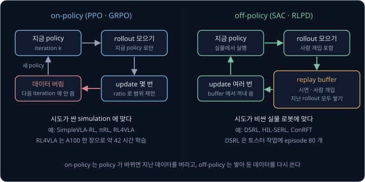

# VLA + RL

시연으로 fine-tuning 한 VLA 는 시연과 비슷한 장면에서는 잘 움직이지만, 컵을 놓치거나 물건이 조금 밀리면 그 상황을 바로잡지 못하고 하던
동작을 그대로 이어 가다 실패한다. 2025 년 5 월 RL4VLA 연구의 저자들도 OpenVLA 를 시연으로만 학습했을 때 이렇게 위치가 어긋난 채
동작을 계속하는 모습을 보고했다. 시연을 더 모아도 성공률은 어느 선에서 잘 오르지 않는데, 정답 action 을 더 주지 않고 로봇이 직접 해 본 성공과
실패만으로 이 VLA 를 더 낫게 만들 수 있을까?

RL fine-tuning 은 VLA 에게 작업을 여러 번 시도하게 하고 성공 여부를 reward 로 주어 더 학습한다. Physical Intelligence 는 2025 년 11 월
이 방법의 한 형태인 RECAP 으로 π0.6 을 학습해, 가장 어려운 작업 몇 가지에서 시간당 해낸 작업 수를 두 배 넘게 늘리고
실패율을 대략 절반으로 줄였다. 이렇게 학습한 모델은 업소용 기계로 에스프레소를 13 시간 동안 쉬지 않고 만들었다.

## 학습 목표

- 시연만으로 학습한 VLA 의 성공률이 시연의 질에 묶이고 회복 동작을 배우지 못하는 이유를 숫자로 설명할 수 있다
- 성공 여부만 주는 sparse reward 로 advantage 를 만드는 법과, reward 출처별 한계를 설명할 수 있다
- token VLA 에서는 PPO 의 ratio 가 바로 나오지만 flow matching VLA 에서는 그렇지 않은 이유와, 이를 피하는 네 가지 방법을 설명할 수 있다
- on-policy 와 off-policy 학습의 차이와, 실물 로봇에서 시도 비용·안전·사람의 개입을 다루는 방법을 설명할 수 있다

## 시연만으로 배운 VLA 의 한계

[π0](../pi0/README.md) 같은 VLA(Vision-Language-Action model)는 카메라 사진과 지시문을 받아 로봇의 action 을 내는 모델이다. VLA 를
사람이 로봇을 조종해 보여 준 시연으로 fine-tuning 할 때는 그 순간 사람이 낸 action 을 정답으로 삼는데, 이렇게 정답이 붙은 데이터로 하는
fine-tuning 을 **SFT**(supervised fine-tuning)라고 한다. 그래서 잘 배운 모델일수록 사람이 한 일을 그대로 다시 한다.

예로 드는 작업은 로봇 팔이 컵을 집어 상자에 넣는 일이다. VLA 는 action 여러 개를 묶은 action chunk 를 한 번에 내는데, 예로 든 팔은
chunk 하나를 실행하는 데 0.5 초가 걸린다. 작업을 처음부터 끝까지 한 번 시도한 기록을 episode 라고 하고, 이 예에서 episode 하나는
chunk 20 개라서 $20 \times 0.5 = 10$ 초다.

### 시연의 질이 정하는 상한

시연 100 개 가운데 70 개는 컵의 가운데를 잡았고 30 개는 가장자리를 잡았다고 하자. 가운데를 잡으면 100 번에 95 번 성공하고, 가장자리를
잡으면 들어 옮기다 자주 놓쳐 100 번에 50 번만 성공한다. SFT 한 policy 는 시연의 비율대로 가운데를 0.7 의 확률로 잡고 가장자리를 0.3 의
확률로 잡으므로, 성공률은 잡는 법마다 고를 확률에 그때의 성공률을 곱해 더한 $0.7 \times 0.95 + 0.3 \times 0.5 = 0.815$ 다.

시연을 따라 한 policy 는 늘 가운데를 잡는 policy(95%)보다 성공률이 13.5%p 낮다. 가장자리를 잡은 시연 30 개도 가운데를 잡은 시연과 똑같이
정답으로 쓰이므로, SFT 의 정답에는 가장자리를 잡으면 자주 실패한다는 정보가
들어가지 않는다. π\*0.6 논문의 저자들도 시연으로 하는 학습은 잘해야 시연 데이터만큼만 잘할 수 있다고 적었다.

> **오해** 시연을 더 모으면 policy 가 나아진다.
>
> **사실** 같은 사람들이 같은 습관으로 시연을 1000 개 더 모아도 가운데와 가장자리의 비율은 70 : 30 이고, 그대로 따라 한 policy 의 성공률도 81.5% 그대로다. 시연이 늘면 policy 가 시연을 더 정확히 따라 하게 될 뿐
> 시연 자체의 질은 그대로이고, 속도도 같아서 사람이 10 초 걸린 작업은 policy 도 10 초쯤 걸린다.

**확인 문제.** 시연 100 개 가운데 가운데 잡기가 40 개, 가장자리 잡기가 60 개라면 그대로 따라 한 policy 의 성공률은? (성공률은 위와 같이
95% 와 50%)

답 보기

$0.4 \times 0.95 + 0.6 \times 0.5 = 0.38 + 0.3 = 0.68$ 이라 68% 다. 시연이 가장자리 쪽으로 치우친 만큼 policy 도 나빠진다.

### 회복 동작이 없는 시연

[Behavior Cloning](../behavior-cloning/README.md) 에서 본 compounding error 도 그대로 남는다. policy 가 조금 다르게 움직이면 시연에 없던
자세에 들어가는데, 그 자세에서 무엇을 할지 배운 적이 없어 다음 행동도 어긋나고 이 어긋남이 쌓여 실패한다.

예를 들어 chunk 하나를 실행할 때마다 컵이 2% 의 확률로 집게 안에서 미끄러지고, policy 는 미끄러진 컵을 다시 잡는 법을 몰라 한 번
미끄러지면 끝까지 실패한다고 하자. 성공하려면 모든 chunk 에서 미끄러지지 않아야 하므로, 성공률은 미끄러지지 않을 확률 $1 - 0.02 = 0.98$ 을
chunk 수만큼 곱한 값이다. 미끄러짐의 80% 를 되돌릴 수 있으면 미끄러진 경우 가운데 20% 만 실패로 끝나서, chunk 하나에서 실패할 확률은
$0.02 \times 0.2 = 0.004$ 로 줄고 넘길 확률은 0.996 이 된다.

| episode 의 chunk 수 | 회복을 모를 때 | 미끄러짐의 80% 를 되돌릴 때 |
| --- | --- | --- |
| 10 | $0.98^{10} = 0.817$ | $0.996^{10} = 0.961$ |
| 20 | $0.98^{20} = 0.668$ | $0.996^{20} = 0.923$ |
| 40 | $0.98^{40} = 0.446$ | $0.996^{40} = 0.852$ |

시연하는 사람은 실수를 피하려 애쓰고 실수한 시연은 지우는 경우가 많아서, 회복 동작은 시연에 거의 담기지 않는다. RaC(2025 년 9 월)의
저자들이 DROID dataset 의 1% 표본을 살펴보니 회복 동작이 든 episode 는 3.68% 뿐이었다. [DAgger](../dagger/README.md) 는 policy 가 간
상태에서 사람에게 정답 action 을 물어 이 문제를 다뤘지만, RL fine-tuning 은 정답 대신 성공 여부만 주고 policy 가 직접 실수해 보며 배우게
한다.

**확인 문제.** chunk 마다 실패할 확률이 10% 인 policy 가 chunk 2 개짜리 작업을 하면 성공률은? 3 개짜리면?

답 보기

chunk 하나를 넘길 확률이 $1 - 0.1 = 0.9$ 라서 2 개면 $0.9 \times 0.9 = 0.81$ 이고 3 개면 $0.81 \times 0.9 = 0.729$ 다.

## RL fine-tuning

### SFT 다음의 reward 학습

reinforcement learning(RL)은 정답 action 대신 점수로 배운다. 행동한 뒤 받는 점수가 reward 이고, policy 가 직접 행동해 모은 기록이
rollout 이다. 시연으로 SFT 한 VLA 를 출발점으로 두고 RL 로 더 학습하는 것을 **RL fine-tuning** 이라고 하는데, 그 VLA 로 작업을 여러 번
시도해 성공하면 reward 1 을 받고 실패하면 0 을 받은 뒤 reward 가 큰 행동을 더 자주 하도록 VLA 를 고친다.

위 그림의 왼쪽은 [π0](../pi0/README.md) 까지 다룬 SFT 이고, 오른쪽 고리가 RL fine-tuning 이다. VLA 가 행동하는 environment 는
컴퓨터 속 가상 환경일 수도 있고 실물 로봇일 수도 있다. 앞 절의 두 한계에 RL 이 하는 일은 아래와 같다.

| 한계 | SFT 에서 생기는 이유 | RL fine-tuning 이 하는 일 |
| --- | --- | --- |
| 시연의 질이 정하는 상한 | 실패하기 쉬운 시연도 정답으로 쓴다 | 더 자주 성공하는 가운데 잡기의 확률을 올린다 |
| 회복 동작이 없는 시연 | 미끄러진 장면이 시연에 없다 | 미끄러진 뒤 우연히 다시 잡아 성공한 행동의 확률을 올린다 |

RL 에는 정답 action 없이 성공 여부만 있으면 되어서 사람이 매 순간 정답을 말해 줄 필요는 없지만, VLA 가 직접 많이 시도해야 한다.

### sparse reward 와 advantage

작업에 성공했을 때 episode 끝에만 1 을 주고 그 밖에는 모두 0 을 주는 reward 처럼 드문드문 받는 reward 를 **sparse reward** 라고 한다.
sparse reward 로는 어떤 행동이 좋았는지 하나하나 알 수 없어서, policy 는 성공한 episode 와 실패한 episode 의 차이에서만 배운다.

[Policy Gradient](../policy-gradient/README.md) 에서 본 advantage 는 reward 에서 baseline(평균 reward)을 뺀 값으로, update 의 방향과
크기를 정한다. 한 batch(한 번에 모아 학습에 쓰는 episode 묶음)의 평균 성공률을 baseline 으로 쓰면, episode 20 개 가운데 6 개가 성공한
batch 의 baseline 은 $6 \div 20 = 0.3$ 이다. 그러면 성공한 episode 의 advantage 는 $1 - 0.3 = +0.7$ 이고 실패한 episode 의 advantage 는
$0 - 0.3 = -0.3$ 이다.

성공률이 0% 면 모든 advantage 가 0 이라서 update 가 일어나지 않는다. 5% 나 95% 처럼 한쪽으로 치우치면 단서가 episode 하나에 몰려 그
하나가 우연이었는지 가리기 어려워서, 성공과 실패가 고루 섞인 batch 에서 더 많이 배운다. 2025 년 9 월 SimpleVLA-RL 의 저자들은 같은
시작 상황에서 모은 rollout 묶음이 모두 성공했거나 모두 실패하면 그 묶음을 버리고, 성공과 실패가 섞인 묶음만으로 batch 를 채웠다.

> **오해** RL 은 시연이 없어도 무엇이든 배운다.
>
> **사실** 아무렇게나 움직이는 policy 가 컵을 집어 상자에 넣을 확률은 0 에 가까워서, sparse reward 만으로는 배울 단서가 생기지 않는다. 그래서 먼저 SFT 로 성공률을 0 보다 확실히 크게 만든 뒤에 RL 을 한다.
> πRL(2025 년 10 월)의 저자들에 따르면 가상 환경의 로봇 팔 작업 benchmark 인 LIBERO 의 작업 40 개가 모두 0 보다 큰 성공률에서 출발하려면 SFT 에 시연이 최소 40 개 필요했다.

**확인 문제.** episode 10 개 가운데 2 개가 성공했다. baseline 과 성공·실패 episode 의 advantage 는?

답 보기

baseline 은 $2 \div 10 = 0.2$ 이고, 성공의 advantage 는 $1 - 0.2 = +0.8$ 이고 실패의 advantage 는 $0 - 0.2 = -0.2$ 다.

<b>심화: 끝에서 받은 reward 의 배분과 GAE</b>

reward 는 episode 끝에 한 번 오지만 VLA 는 chunk 20 개를 냈다. 성공에 어느 chunk 가 기여했는지 나눠 주는 문제를 credit assignment 라고
한다. [PPO](../ppo/README.md) 에서 본 critic 은 각 state 에서 앞으로 받을 reward 의 합을 예측한 값 $V(s)$ 를 내고, 이 작업에서 $V(s)$ 는
"지금 상황에서 결국 성공할 확률의 예측" 이다. 예측이 한 step 뒤에 얼마나 바뀌었는지를 재는 TD error 는 아래와 같다.

$$
\delta_t = r_{t+1} + \gamma\, V(s_{t+1}) - V(s_t)
$$

$\delta_t$ 는 chunk $t$ 의 TD error 이고, $r_{t+1}$ 은 chunk $t$ 를 실행한 직후 받은 reward 이며, $V(s_t)$ 는 chunk $t$ 를 고르기 직전
상황의 예측이다. 늦게 받는 reward 를 깎는 discount factor $\gamma$ 는 1 로 두고, episode 가 끝난 뒤의 예측은 0 이다. 계산을 줄이려고 chunk 4 개짜리
성공 episode 에서, 예로 든 critic 의 예측을 넣으면 아래와 같다.

| chunk $t$ | 하는 일 | $V(s_t)$ | $r_{t+1}$ | $V(s_{t+1})$ | $\delta_t$ |
| --- | --- | --- | --- | --- | --- |
| 0 | 컵으로 다가감 | 0.3 | 0 | 0.3 | $0 + 0.3 - 0.3 = 0$ |
| 1 | 컵을 잡음 | 0.3 | 0 | 0.8 | $0 + 0.8 - 0.3 = 0.5$ |
| 2 | 들어 옮김 | 0.8 | 0 | 0.9 | $0 + 0.9 - 0.8 = 0.1$ |
| 3 | 상자에 놓음 | 0.9 | 1 | 0 (끝남) | $1 + 0 - 0.9 = 0.1$ |

컵을 잡는 순간 예측이 0.3 에서 0.8 로 뛰었으므로, reward 는 마지막에 받았지만 가장 큰 TD error 0.5 는 컵을 잡은 chunk 1 이 받는다.
GAE(Generalized Advantage Estimation)는 이 TD error 들을 뒤에서부터 $\hat A_t = \delta_t + \gamma\lambda\,\hat A_{t+1}$ 로 섞는다.
$\gamma\lambda = 0.5$ 로 계산하면 아래와 같고, 마지막 chunk 뒤의 $\hat A_4$ 는 0 이다.

| 순서 | chunk $t$ | $\delta_t$ | $0.5 \times \hat A_{t+1}$ | $\hat A_t$ |
| --- | --- | --- | --- | --- |
| 1 | 3 | 0.1 | $0.5 \times 0 = 0$ | 0.1 |
| 2 | 2 | 0.1 | $0.5 \times 0.1 = 0.05$ | 0.15 |
| 3 | 1 | 0.5 | $0.5 \times 0.15 = 0.075$ | 0.575 |
| 4 | 0 | 0 | $0.5 \times 0.575 = 0.2875$ | 0.2875 |

$\lambda = 0$ 이면 TD error 그대로 $(0,\ 0.5,\ 0.1,\ 0.1)$ 이고, $\lambda = 1$ 이면 끝까지 받은 reward 에서 예측을 뺀 $1 - V(s_t)$ 인
$(0.7,\ 0.7,\ 0.2,\ 0.1)$ 이라서 critic 의 판단 없이 성공 하나를 앞의 chunk 모두가 비슷하게 나눠 가진다.

critic 은 처음에 엉터리 예측을 내기 때문에, RL 을 시작하기 전에 critic 만 먼저 학습시키기도 한다. OpenVLA 를 PPO 로 fine-tuning 한
VLA-RL(2025 년 5 월)의 저자들은 이것을 critic warmup 이라고 불렀는데, LIBERO-Spatial 에서 warmup 을 5 step 하면 성공률이 90.2% 였고 하지
않으면 80.0% 였다.

## reward 의 출처

성공하면 1 이라는 reward 도 누군가 성공을 판정해야 줄 수 있다.

| 출처 | 예 | 한계 |
| --- | --- | --- |
| simulator 의 판정 프로그램 | LIBERO·ManiSkill 의 성공 조건(SimpleVLA-RL, RL4VLA) | 실물 로봇에는 없다 |
| reward classifier | HIL-SERL: 카메라 이미지로 성공 여부를 맞히는 작은 모델 | 틀리면 틀린 쪽으로 배운다 |
| 사람의 판정 | π\*0.6: episode 마다 사람이 성공 여부를 표시 | 사람 손이 든다 |
| process reward model | VLA-RL: 작업의 중간 진행을 점수로 매기는 모델 | 학습한 모델이라 점수가 틀릴 수 있다 |

2024 년 10 월 HIL-SERL 의 저자들은 작업마다 로봇을 조종해 성공 장면 200 개와 실패 장면 1000 개를 모아(5 분쯤 걸린다) reward classifier
를 학습했고, 정확도는 대개 95% 를 넘었다. 그래도 컵을 상자 가장자리에
걸쳐 놓은 장면을 classifier 가 성공으로 잘못 판정하면 그 행동도 reward 1 을 받아 확률이 올라간다.

π\*0.6 의 reward 는 성공 여부 표시 하나로 만들되 빨리 끝낼수록 좋게 설계했다. step 마다 −1 을 주고, 마지막 step 에는 성공했으면 0 을
주고 실패했으면 큰 음수를 준다. 그러면 critic 은 성공까지 남은 step 수에 − 를 붙인 값을 예측하게 되어, 성공까지 200 step 남은 상태의
value 는 −200 이고 50 step 남은 상태의 value 는 −50 이다. 성공률이 이미 높은 작업에서도 더 빨리 끝내는 행동이 더 큰 reward 를 받는다.

중간 단계에도 점수를 주면 단서가 늘어난다. RL4VLA 는 맞는 물체를 잡아 쥐고 있으면 reward 0.1 을 주고 제자리에 놓으면 1.0 을 주었다.
VLA-RL(2025 년 5 월)은 process reward model 을 더해 LIBERO 가운데 물건의 위치 관계를 다루는 작업 10 개(LIBERO-Spatial)의 성공률을 85.8% 에서
90.2% 로 올렸다. 그러나 중간 점수를 잘못 정하면 엉뚱한 행동이 강해진다. 위 연구와 다른 가상의 설계로, 컵을 쥐고 있는 chunk 마다 0.1 을
주고 놓으면 1 을 준다고 해 보자.

| 행동 | 쥐고 있는 chunk | 쥐고 있는 동안의 reward | 놓기 reward | 합 |
| --- | --- | --- | --- | --- |
| chunk 1 에서 잡고 chunk 3 에 놓음 | 3 개 (1·2·3) | $3 \times 0.1 = 0.3$ | 1 | 1.3 |
| chunk 1 에서 잡고 끝까지 쥐고 있음 | 19 개 (1 ~ 19) | $19 \times 0.1 = 1.9$ | 0 | 1.9 |

컵을 놓지 않고 쥐고만 있는 policy 가 더 큰 reward 를 받으므로 RL 은 이 행동의 확률을 올린다. 이렇게 policy 가 reward 를 설계한 사람의
의도와 달리 reward 숫자만 키우는 행동을 찾아내는 것을 **reward hacking** 이라고 한다. 그래서 중간 점수는 작게 주거나 한 번만 주고, 최종 성공의 reward 가 늘 가장
크게 남도록 설계한다.

**확인 문제.** 같은 가상 설계에서 쥐고 있는 chunk 마다 0.02 를 준다면 두 행동의 reward 합은 각각 얼마이고, RL 은 어느 쪽을 키울까?

답 보기

놓는 행동은 $3 \times 0.02 + 1 = 1.06$, 쥐고만 있는 행동은 $19 \times 0.02 = 0.38$ 이라 RL 은 놓는 행동을 키운다.

## token VLA 의 ratio

[PPO](../ppo/README.md) 는 데이터를 모을 때의 옛 policy 와 지금 고치는 새 policy 가 같은 action 을 고를 확률의 비인 probability ratio
로 update 크기를 제한했다.

$$
r_t(\theta) = \frac{\pi_\theta(a_t \mid s_t)}{\pi_{\theta_\text{old}}(a_t \mid s_t)}
$$

$\pi_\theta(a_t \mid s_t)$ 는 parameter 가 $\theta$ 인 policy 가 state $s_t$ 에서 action $a_t$ 를 고를 확률이고, $\theta_\text{old}$ 는
데이터를 모을 때의 parameter 다. 이 식을 쓰려면 policy 가 실제로 낸 action 의 확률을 계산할 수 있어야 한다.

[RT-2 → OpenVLA](../vla-tokens/README.md) 에서 본 OpenVLA 는 action 의 숫자마다 값의 범위를 칸 256 개로 나누고, 숫자마다 칸에 짝지은
token 을 하나씩 고른다. 모델은 softmax 로 token 마다 확률을 내고, rollout 을 모을 때는 가장 확률이 큰 token 만 고르지 않고 이 확률대로
뽑아서 가끔 다른 action 도 해 본다. 뒤 자리의 token 은 앞 자리의 token 을 본 다음에 고르므로, action 의 확률은 자리마다 고른 token 의
확률을 차례로 곱한 값이다. 계산을 줄이려고 관절 세 개짜리 팔이 관절마다 token 하나를 낸다고 하고, rollout 을 모은 뒤 VLA 를 몇 번
고쳤더니 관절 1 token 의 확률만 0.5 에서 0.6 으로 바뀌었다고 하자. 관절 2, 3 token 의 확률이 0.8 과 0.25 로 그대로라면 action 의 확률은
$0.5 \times 0.8 \times 0.25 = 0.1$ 에서 $0.6 \times 0.8 \times 0.25 = 0.12$ 로 바뀌어 ratio 가 1.2 이고, 이 값은 자리별 ratio 의 곱
$1.2 \times 1 \times 1$ 과 같다.

token 이 많아지면 확률의 곱이 아주 작아지므로 실제로는 확률에 $\ln$ 을 씌운 log-probability 를 더해 계산한다. ratio 를 바로 구할 수
있으니 PPO 의 clip 도 그대로 쓸 수 있는데, clip 은 ratio 가 0.8 ~ 1.2($\epsilon = 0.2$ 일 때) 밖으로 나가는 쪽으로는 더 고치지 않아서 운
좋은 성공 하나 때문에 VLA 가 한 번에 크게 바뀌지 않는다.

언어 모델 학습에 쓰던 GRPO 도 token VLA 에 그대로 쓸 수 있다. GRPO 는 critic 없이, 같은 시작 상황에서 모은 episode 묶음(group)의 평균
reward 를 baseline 으로 쓴다. 8 번 시도해 3 번 성공했다면 평균이 $3 \div 8 = 0.375$ 라서, 성공한 episode 의 advantage 는 $+0.625$ 이고
실패한 episode 의 advantage 는 $-0.375$ 다.

- VLA-RL(2025 년 5 월): OpenVLA-7B 를 PPO 로 fine-tuning 해 LIBERO 작업 40 개의 평균 성공률을 76.5% 에서 81.0% 로 올렸다
- RL4VLA(2025 년 5 월): ManiSkill 의 물건 옮기기에서 OpenVLA-7B 를 PPO·GRPO·DPO 로 학습해 비교했더니 PPO 가 가장 나았다. SFT 와 비교하면
  처음 보는 물체에서는 성공률이 0.453 에서 0.714 로 올랐고, 로봇이 처음 놓인 자세를 바꾼 경우에는 0.339 에서 0.797 로 올랐다
- SimpleVLA-RL(2025 년 9 월): OpenVLA-OFT 를 0 또는 1 의 reward 와 GRPO 로 학습했다. 작업마다 시연을 1 개씩만 써서 SFT 한 모델로
  시작해, 여러 단계가 이어지는 LIBERO-Long 의 성공률을 17.3% 에서 91.7% 로 올렸다

SimpleVLA-RL 의 저자들은 RL 뒤에 시연에 없던 행동이 나왔다고도 보고했다. 캔을 정해진 냄비 옆으로 옮기는 작업의 시연은 모두 "잡고, 옮기고,
놓는" 순서였는데, RL 뒤의 policy 는 캔을 잡지 않고 밀어서 목표 자리에 넣었다. 저자들은 이것을 밀기(push)와 지름길(shortcut)을 합쳐
pushcut 이라고 불렀다. 시연을 따라 하기만 하는 SFT 로는 이런 행동이 나올 수 없다.

**확인 문제.** token 세 자리의 ratio 가 1.1, 1.0, 0.9 이면 action ratio 는? clip 범위가 0.8 ~ 1.2 라면 잘리는가?

답 보기

action ratio 는 자리별 ratio 의 곱이라 $1.1 \times 1.0 \times 0.9 = 0.99$ 다. 0.8 과 1.2 사이라 잘리지 않는다.

<b>심화: token VLA 의 clipped surrogate 계산</b>

PPO 는 sample 마다 $\min\big(r\hat A,\ \operatorname{clip}(r, 1-\epsilon, 1+\epsilon)\,\hat A\big)$ 를 계산한다. $\epsilon$ 은 보통 0.2 라서
clip 은 $r$ 을 0.8 과 1.2 사이로 자른 값이다. sparse reward 에서 성공 episode 의 advantage 를 $+0.7$ 로 두고 실패 episode 를 $-0.3$ 으로
두어 세 경우를 계산하면 아래와 같다.

| 경우 | 자리별 ratio | action ratio $r$ | $\hat A$ | $r\hat A$ | $\operatorname{clip}(r)\hat A$ | 고른 값 | gradient |
| --- | --- | --- | --- | --- | --- | --- | --- |
| 성공 | 1.2, 1, 1 | 1.2 | $+0.7$ | 0.84 | $1.2 \times 0.7 = 0.84$ | 0.84 | 흐름 |
| 성공 | 1.2, 1.05, 1.2 | 1.512 | $+0.7$ | 1.0584 | $1.2 \times 0.7 = 0.84$ | 0.84 | 0, 멈춤 |
| 실패 | 0.7 | 0.7 | $-0.3$ | $-0.21$ | $0.8 \times (-0.3) = -0.24$ | $-0.24$ | 0, 멈춤 |

둘째 줄은 성공한 action 의 확률을 이미 1.2 배 넘게 올렸으므로 더 올리지 않고, 셋째 줄은 실패한 action 의 확률을 이미 0.8 배 아래로
내렸으므로 더 내리지 않는다. SimpleVLA-RL 은 위쪽 경계만 1.28 로 넓혀 확률이 낮던 token 이 더 크게 오를 수 있게 했고, rollout 을 뽑는
softmax 의 temperature 도 1.0 에서 1.6 으로 올려 더 다양한 action 을 시도하게 했다. VLA-RL 에서는 temperature 를 1.5 에서 1.0 으로 낮추자
LIBERO-Spatial 의 성공률이 90.2% 에서 85.8% 로 떨어졌다.

log-probability 로 같은 ratio 를 구하면, 옛 확률은 $\ln 0.5 + \ln 0.8 + \ln 0.25 = -0.693 - 0.223 - 1.386 = -2.303$, 새 확률은
$\ln 0.6 + \ln 0.8 + \ln 0.25 = -0.511 - 0.223 - 1.386 = -2.120$ 이고 $e^{-2.120 - (-2.303)} = e^{0.183} \approx 1.2$ 다.

## flow matching VLA 의 확률

### 같은 noise 에서 같은 chunk

[π0](../pi0/README.md) 는 action 을 token 으로 고르지 않고, [Flow Matching](../flow-matching/README.md) 에서 본 것처럼 평균 0, 표준편차 1
인 Gaussian 에서 뽑은 무작위 숫자 noise $\epsilon$ 에서 출발해 network 가 낸 속도를 따라 Euler step 을 10 번 거쳐 action chunk 를 만든다.
이 계산에서 무작위로 정하는 것은 처음의 noise 하나뿐이라서, 같은 관측에 같은 noise 를 넣으면 늘 같은 chunk 가 나온다.

연속된 값에서는 정확히 한 값이 나올 확률이 0 이라서, PPO 에서 연속 action 을 다룰 때처럼 종 모양 곡선의 높이인 확률 밀도를 쓴다. action 의
확률 밀도는 그 action 을 만든 noise 의 높이를, noise 에서 action 으로 가며 공간이 늘어난 배수로 나눈 값이다. 관절 7 개짜리 팔의 action
50 개를 묶은 chunk 는 숫자 $50 \times 7 = 350$ 개라서, 이 배수를 알려면 출력 350 개 각각이 입력 350 개 각각에 따라 얼마나 변하는지를
나타내는 변화 비율 $350 \times 350 = 122{,}500$ 개가 필요하다. 속도를 내는 network 가 자리마다 다른 값을 내므로 이 계산을 Euler step 10 번마다
따로 해야 한다. πRL 저자들은 flow matching VLA 의 action log-likelihood 를 다루기 어렵다(intractable)고 적었고, π\*0.6 저자들도 같은 이유로 policy
gradient 방식의 학습이 어렵다고 적었다.

<b>심화: 1 차원 flow 의 확률 밀도</b>

1 차원으로 줄여 Euler step 한 번이 $a = 2\epsilon + 1$ 이 되는 예를 보자. noise 가 0 과 0.5 사이에 떨어질 확률 0.1915 는 그대로 action 이
1 과 2 사이에 떨어질 확률이 되는데, 폭 0.5 에 담겼던 확률이 폭 1 에 퍼졌으므로 높이는 절반이 된다. 그래서 action 1 의 높이는 noise 0 의
높이 0.3989 를 2 로 나눈 약 0.1995 다.

$$
p(a) = \frac{p(\epsilon)}{\text{공간이 늘어난 배수}}
$$

$p(a)$ 는 action $a$ 의 높이이고 $p(\epsilon)$ 은 그 action 을 만든 noise 의 높이다. 1 차원 직선에서는 배수가 기울기 2 하나라서 쉽다. 숫자가
여럿이면 배수는 출력과 입력의 변화 비율을 모두 모은 표인 Jacobian 의 determinant 가 된다.

> **오해** flow matching 의 loss 가 작으면 그 action 의 확률이 크다.
>
> **사실** flow matching loss 는 network 가 낸 속도와 정답 속도의 차이를 제곱한 값이라 action 의 확률 밀도와는 다른 값이다. 둘 사이에 관계가 있어서 Flow Matching Policy Gradients(FPO,
> 2025 년 7 월)는 같은 action 에서 잰 옛 모델과 새 모델의 loss 차이로 ratio 를 어림해 PPO 의 clip 을 썼지만, 이 값도 확률 자체가 아니라 어림값이다.

**확인 문제.** action 하나가 숫자 7 개이고 chunk 에 action 이 25 개 들어 있다면, chunk 의 확률 밀도를 구하는 데 필요한 변화 비율은 몇 개일까?

답 보기

chunk 의 숫자는 $25 \times 7 = 175$ 개이고, 출력 175 개 각각이 입력 175 개 각각에 따라 변하는 비율이 필요하므로 $175 \times 175 = 30{,}625$
개다. Euler step 마다 이만큼을 다시 구해야 한다.

### 확률 문제를 피하는 네 방법

flow matching VLA 를 RL 로 고치는 연구들은 이 문제를 네 가지 방법으로 피한다.

① step 마다 noise 를 넣는 방법은 Euler step 의 결과를 그대로 다음 값으로 쓰지 않고, 그 값을 평균으로 하는 종 모양 곡선에서 다음 값을
뽑는다. 그러면 step 마다 그 값이 뽑힐 높이가 정해져서, 경로 전체의 확률 밀도는 각 step 높이의 곱이 되고 ratio 도 각 step ratio 의 곱으로
구한다. 다만 마지막 action 에도 noise 가 섞이고, 로봇의 결정 하나에 denoising step 여러 개가 들어가 계산과 저장할 값이
늘어난다.

- DPPO(2024 년 9 월): VLA 가 아닌 작은 [Diffusion Policy](../diffusion-policy/README.md) 에 PPO 를 적용했다. 가상 환경에서 학습한 가구
  다리 조립 policy 를 실물 로봇에 그대로 옮겨 20 번 가운데 16 번 성공했는데, 비교한 Gaussian policy 는 가상 환경에서 88% 였지만 실물에서는
  한 번도 성공하지 못했다
- ReinFlow(2025 년 5 월): flow matching policy 의 경로에 학습하는 noise 를 넣어 정확한 likelihood 를 얻고 PPO 로 학습했다
- πRL(2025 년 10 월): 같은 방법을 π0 와 π0.5 에 적용했다. 시연을 조금만 써서 SFT 한 π0 의 LIBERO 평균 성공률이 57.6% 에서 97.6% 로
  올랐고, π0.5 는 77.1% 에서 98.3% 로 올랐다

<b>심화: noise 를 넣은 Euler 2 step 의 ratio</b>

표준편차 $\sigma = 0.1$ 인 종 모양 곡선에서 평균으로부터 $d$ 만큼 떨어진 점의 높이는 $\frac{1}{0.1\sqrt{2\pi}}\, e^{-d^2 / (2 \times 0.1^2)} = 3.9894 \times e^{-d^2/0.02}$
이다. $d$ 가 0, 0.05, 0.1 이면 높이는 3.9894, 3.5207, 2.4197 이다.

숫자 하나짜리 action 을 Euler step 2 번(step 길이 0.5)으로 만들고, 출발 noise 는 $x_0 = -0.5$ 다. step 1 에서 옛 policy 의 속도는
2.5 이고 새 policy 는 2.6 이며, step 2 에서는 둘 다 2.3 이라고 하자.

| step | 옛 policy 의 평균 | 새 policy 의 평균 | 뽑힌 점 | 옛 높이 | 새 높이 | step ratio |
| --- | --- | --- | --- | --- | --- | --- |
| 1 | $-0.5 + 0.5 \times 2.5 = 0.75$ | $-0.5 + 0.5 \times 2.6 = 0.8$ | 0.85 | 2.4197 ($d = 0.1$) | 3.5207 ($d = 0.05$) | 1.455 |
| 2 | $0.85 + 0.5 \times 2.3 = 2.0$ | $0.85 + 0.5 \times 2.3 = 2.0$ | 1.95 | 3.5207 ($d = 0.05$) | 3.5207 ($d = 0.05$) | 1 |

경로 전체의 ratio 는 $1.455 \times 1 = 1.455$ 이고, $\epsilon = 0.2$ 의 clip 으로 1.2 가 된다. log 로 계산하면 옛 경로는
$\ln 2.4197 + \ln 3.5207 = 0.8836 + 1.2586 = 2.1423$, 새 경로는 $1.2586 + 1.2586 = 2.5173$ 이고 $e^{2.5173 - 2.1423} = e^{0.375} \approx 1.455$
로 같다. 일반 식은 아래와 같다.

$$
\ln \pi_\theta(a^{0:K} \mid o) = \sum_{k=0}^{K-1} \ln \mathcal N\big(a^{k+1};\ a^k + \Delta\tau\, v_\theta(a^k, \tau_k, o),\ \sigma_k^2\big)
$$

- $a^k$ 는 $k$ 번째 step 의 값이다. $a^0$ 은 출발 noise 이고 $a^K$ 는 마지막 action 이다. 위 예에서 $K = 2$, $a^0 = -0.5$, $a^1 = 0.85$,
  $a^2 = 1.95$ 다
- $o$ 는 사진·지시문·관절 각도를 합친 관측이고, $\tau_k$ 는 $k$ 번째 step 의 flow 시각이다. $\Delta\tau$ 는 step 길이로, 위 예에서는 0.5 다
- $\mathcal N(x;\ \mu,\ \sigma^2)$ 은 평균 $\mu$, 표준편차 $\sigma$ 인 종 모양 곡선의 $x$ 에서의 높이이고, 평균 자리에 "Euler step 으로
  갔을 자리" 가 들어간다

πRL 은 noise 의 크기를 작은 network 가 내게 학습하는 Flow-Noise 와, Euler 적분을 noise 가 섞인 적분으로 바꾸는 Flow-SDE 두 방식을 썼다.

② **filtered BC** 는 지금 policy 로 rollout 을 모은 뒤 성공한 episode 만 골라 그 action 을 정답 삼아 다시 SFT 한다. 성공한 것만 걸러(filter)
behavior cloning(BC)을 한다는 뜻의 이름이고, loss 는 flow matching loss 를 그대로 쓴다. 컵 예에서 한 번 거르면 가운데 잡기의 비율이 0.7
에서 0.816 으로 오르고 성공률은 81.5% 에서 86.7% 로 오른다. 다만 실패한 episode 를 버리므로 가장자리를 잡으면 실패한다는 정보도 함께
버리고, 성공이 하나도 없으면 학습할 데이터도 없다. 2024 년 12 월 RLDG 의 저자들은 작업 하나만 잘하는 작은 policy 를
실물에서 RL 로 먼저 학습한 뒤 그 policy 가 모은 기록으로 OpenVLA 와 Octo 를 SFT 했는데, 사람의 시연으로 학습할 때보다 성공률이 최대 40%
높았다.

<b>심화: filtered BC 를 되풀이할 때의 변화</b>

가운데 0.7, 가장자리 0.3 의 policy 로 rollout 100 개를 모으면 평균적으로 가운데 잡기 $70 \times 0.95 = 66.5$ 개와 가장자리 잡기
$30 \times 0.5 = 15$ 개가 성공한다. 성공 81.5 개로 다시 학습하면 가운데 비율이 $66.5 \div 81.5 \approx 0.816$ 이 되어, 성공률이
$0.816 \times 0.95 + 0.184 \times 0.5 \approx 0.867$ 로 오른다. 이 계산을 round 마다 되풀이하면 아래와 같다.

| round | 가운데 비율 | 성공률 | 성공한 가운데 잡기 | 성공한 가장자리 잡기 | 다음 가운데 비율 |
| --- | --- | --- | --- | --- | --- |
| 0 (SFT) | 0.700 | 81.5% | 66.5 | 15.0 | $66.5 \div 81.5 = 0.816$ |
| 1 | 0.816 | 86.7% | 77.5 | 9.2 | $77.5 \div 86.7 = 0.894$ |
| 2 | 0.894 | 90.2% | 84.9 | 5.3 | 0.941 |
| 3 | 0.941 | 92.4% | 89.4 | 2.9 | 0.968 |
| 4 | 0.968 | 93.6% | 92.0 | 1.6 | 0.983 |
| 5 | 0.983 | 94.2% | | | |

성공률은 round 마다 오르지만 오르는 폭이 5.2, 3.5, 2.2, 1.2, 0.6%p 로 줄어 95% 에 천천히 다가간다. 좋은 행동의 비율이 오를수록 걸러
내는 차이가 작아지기 때문이다.

③ π0 의 무작위성은 전부 출발 noise 에 있으므로, VLA 는 그대로 두고 noise 를 고르는 작은 policy(**noise policy**)만 RL 로 학습할 수도 있다.
DSRL(Diffusion Steering via Reinforcement Learning, 2025 년 6 월)이 이 방법을 쓴다. noise policy 는 noise 의 평균을 내는 Gaussian policy 라서
확률 밀도가 곡선의 높이로 바로 나오고, VLA 의 확률은 필요 없다. DSRL 의 저자들은 noise policy 를 지난 데이터를 다시 쓰는
SAC([DQN → SAC](../off-policy/README.md))로 학습해, LIBERO 작업 하나에서 약 1 만 step 의 시도만으로 π0 의 성공률을 약 20% 에서 약 100% 로
올렸다. Franka 팔에 올린 π0 로 토스터를 켜는 작업에서는 episode 80 개(약 11,000 step)를 시도한 뒤 20 번 가운데 5 번이던 성공이 18 번으로
늘었고, 저자들은 이것을 실물에서 π0 를 RL 로 fine-tuning 한 첫 사례라고 적었다. 다만 VLA 가 원래
낼 수 있는 행동 안에서만 고르므로 시연에 아예 없던 동작은 어떤 noise 로도 나오지 않는다.

<b>심화: noise policy 로 바뀌는 성공률</b>

예를 들어 noise 가 0 보다 크면 오른쪽 길(성공률 90%)로 가고 작으면 왼쪽 길(성공률 60%)로 가는 VLA 가 있다고 하자.

| noise 를 뽑는 곡선 | noise 가 0 보다 클 확률 | 성공률 |
| --- | --- | --- |
| 기본: 평균 0, 표준편차 1 | 0.5 | $0.5 \times 0.9 + 0.5 \times 0.6 = 0.75$ |
| noise policy: 평균 1, 표준편차 1 | 0.8413 | $0.8413 \times 0.9 + 0.1587 \times 0.6 \approx 0.852$ |

평균이 1 인 곡선은 넓이의 84.13% 가 0 보다 오른쪽에 있어서, noise policy 가 평균을 0 에서 1 로 옮기면 성공률이 75% 에서 85.2% 로 오른다.
평균을 더 크게 옮기면 VLA 가 학습 때 거의 본 적 없는 noise 가 들어간다. 표준 Gaussian 에서 3 근처의 높이는 0.0044 로 0 근처 0.3989 의
100 분의 1 남짓이다.

④ π\*0.6 의 RECAP(RL with Experience and Corrections via Advantage-conditioned Policies)은 이름 그대로 경험과 사람의 수정을 데이터로
삼아, advantage 를 조건으로 받는 policy 를 학습한다. rollout 을 모아 critic 으로 action 마다 advantage 를 구하고, advantage 가 기준보다 크면
"Advantage: positive" 라는 글을 모델 입력에 붙이고 아니면 "Advantage: negative" 를 붙인다. 실패까지 포함한 모든 데이터를 이 글과 함께 SFT 처럼
학습하면 모델은 두 표시가 붙었을 때의 행동을 구분해 배우고, 실행할 때는 늘 positive 를 넣는다.

컵 예에서 잡기 직전 상태의 value(그 상황에서 기대할 수 있는 성공률) 0.815 를 기준으로 쓰면, 가운데 잡기(성공률 0.95)에는 positive 가
붙고 가장자리 잡기(0.5)에는 negative 가 붙는다.

성공한 81.5 개만 쓰는 filtered BC 와 달리 이 방법은 negative 가 붙은 rollout 까지 100 개를 모두 학습에 쓴다. π\*0.6 저자들이 보고한 내용은 아래와 같다.

- fine-tuning 때는 대개 rollout 의 약 40% 가 positive 를 받도록 작업마다 기준을 정했고, 사람이 넘겨받아 고친 구간에는 늘 positive 를 붙였다
- 상자 조립은 iteration 마다 자율 시도 600 번과 사람이 개입한 시도 360 번을 모아, 두 번째 iteration 뒤 처리량(시간당 성공한 작업 수)이
  두 배가 되었다. 티셔츠·반바지 개기는 개입 없이 자율 시도만으로 두 iteration 동안 처리량이 50% 늘었다
- 같은 데이터로 PPO 를 쓴 비교에서는 학습을 안정시키려고 update 범위를 아주 작게 잡아야 했고, 성능이 RECAP 에 크게 못 미쳤다

| 방법 | 행동의 확률 | VLA weight | 실패한 rollout 의 쓰임 | 예 |
| --- | --- | --- | --- | --- |
| ① noise 를 넣은 경로 | step 마다 높이의 곱으로 만든다 | 고친다 | 음수 advantage 로 쓴다 | DPPO, ReinFlow, πRL |
| ② filtered BC | 필요 없다 | 고친다 | 버린다 | RLDG 의 데이터 생성 |
| ③ 출발 noise 고르기 | 작은 noise policy 의 것만 | 그대로 둔다 | 쓴다 | DSRL |
| ④ advantage 조건 | 필요 없다 | 고친다 | negative 표시로 쓴다 | π\*0.6 (RECAP) |

**확인 문제.** 잡기 직전 상태의 value 가 0.6 이고 가운데 잡기의 성공률이 0.9, 가장자리 잡기가 0.3 이면 각 advantage 와 표시는?

답 보기

가운데 잡기는 $0.9 - 0.6 = +0.3$ 이라 positive 가 붙고, 가장자리 잡기는 $0.3 - 0.6 = -0.3$ 이라 negative 가 붙는다.

## on-policy 와 off-policy

모은 데이터를 얼마나 오래 쓰느냐에 따라 RL 은 둘로 나뉜다. **on-policy** 학습은 지금 policy 가 모은 rollout 으로 몇 번 update 한 뒤 그
데이터를 버리고 새 policy 로 다시 모은다. PPO 와 GRPO 가 여기에 속하는데, ratio 가 옛 policy 와 새 policy 의 차이를 재는 장치라서 policy
가 많이 바뀐 뒤의 데이터는 쓸 수 없다. **off-policy** 학습은 시연, 사람의 개입, 지난 rollout 을 replay buffer 에 모두 쌓아 두고 되풀이해
꺼내 쓴다. [DQN → SAC](../off-policy/README.md) 에서 본 SAC 와 HIL-SERL 이 쓰는 RLPD 가 여기에 속한다.

시도 하나가 싼 simulation 에서는 on-policy 로도 충분하지만, 시도 하나에 사람의 reset 이 드는 실물에서는 데이터를 버리는 비용이 크다.
π\*0.6 이 실물에서 쓴 반복 offline RL 은 둘의 중간이라, 데이터를 모으는 동안에는 학습하지 않다가 모으기를 마치면 그 작업에서 지금까지 모은
데이터 전체로 critic 과 policy 를 다시 학습한다.

> **오해** off-policy 는 데이터를 다시 쓰니 어떤 데이터를 넣어도 이득이다.
>
> **사실** buffer 의 데이터가 지금 policy 의 행동과 많이 다르면 critic 의 예측이 틀어질 수 있다. HIL-SERL 의 저자들은 사람이 길게 넘겨받아 성공까지 끌고 가는 개입을 자주 하면 critic 이 value 를 실제보다
> 크게 예측해 학습이 불안정해진다고 경고했다.

**확인 문제.** iteration 마다 episode 50 개를 모아 6 iteration 학습한다. 마지막 update 에 쓸 수 있는 episode 는 on-policy 와 off-policy 에서
각각 몇 개일까?

답 보기

on-policy 는 마지막 iteration 에 모은 50 개만 쓰고, off-policy 는 쌓아 둔 $50 \times 6 = 300$ 개를 모두 쓸 수 있다.

## 실물 로봇의 비용과 안전

### 시도 한 번의 비용

simulation 은 같은 environment 를 여러 개 동시에 실행하고, 성공 판정과 처음 자리로 되돌리는 reset 을 프로그램이 한다. 예를 들어 10 초짜리
episode 1000 개를 모으는 데 실물 로봇 한 대는 사람이 컵을 되돌려 놓는 reset 20 초를 더해 약 8.3 시간이 걸리지만, environment 64 개를
동시에 실행하는 simulation 은 160 초면 된다.

simulation 쪽 숫자는 simulator 가 실제 시간만큼 빠르게 계산한다는 가정이고, 실제로는 VLA 의 계산이 더 큰 부담이라 SimpleVLA-RL 은 80 GB
메모리의 A800 GPU 8 장으로 학습했다. 또 simulation 은 마찰·조명·카메라 이미지가 실물과 조금씩 다르다. SimpleVLA-RL 의 저자들은
simulation 데이터만으로 SFT 와 RL 을 한 뒤 Piper 팔 두 대에 그대로 올렸다. 작업 네 개의 평균 성공률은 SFT 만 한 모델의 17.5% 에서 38.5% 로
올라 RL 의 효과가 실물까지 이어졌지만, 성공률 자체는 여전히 낮았다.

실물에서 바로 RL 을 하는 연구는 대개 작업 하나를 적은 시도로 배운다. HIL-SERL 로 학습한 policy 는 대부분의 작업에서 1 ~ 2.5 시간 만에
작업마다 100 번 시험을 모두 성공했고, 같은 수의 episode 와 개입으로 학습한 HG-DAgger 기준선은 평균 49.7% 였다. ConRFT(2025 년 2 월)는
VLA 인 Octo 를 실물 작업 8 개에서 작업마다 15 ~ 90 분씩 RL 로 fine-tuning 해 평균 성공률을 39.4% 에서 96.3% 로 올렸다.

**확인 문제.** 실물 로봇에서 episode 하나가 15 초, reset 이 15 초라면 episode 200 개를 모으는 데 몇 분이 걸릴까?

답 보기

episode 하나에 $15 + 15 = 30$ 초라서 $200 \times 30 = 6000$ 초이고, $6000 \div 60 = 100$ 분이다.

### 사람의 개입

[DAgger](../dagger/README.md) 에서 본 HG-DAgger 는 policy 가 움직이다 위험해지면 사람이 넘겨받아 되돌리고, 사람이 조종한 구간을 정답으로
기록했다. 실물 RL 도 이 기록을 함께 쓴다.

사람이 넘겨받은 구간은 시연에 없던 회복 동작을 담은 정답 시연이 되고, policy 가 실행한 구간과 episode 의 성공 여부는 RL 의 데이터가 된다.
HIL-SERL 은 개입 구간을 시연 buffer 와 RL buffer 에 모두 넣고,
policy 가 실행한 구간은 RL buffer 에만 넣었다. RAM 꽂기 작업에서 개입 없이 학습하면 성공률이 48% 였고 개입을 쓰면 100% 였다. 저자들은
처음에는 자주 개입하고 policy 가 나아질수록 줄여 가라고 권했다.

π\*0.6 의 저자들은 사람의 수정이 큰 실수를 고치고 탐색을 돕지만, 숙련된 조종자도 개입의 질을 늘 같게 유지하지 못하고 전체 속도 같은
미묘한 부분까지 고치지는 못한다고 적었다. 앞에서 본 RaC 는 개입 규칙을 정해 모은 5 시간의 데이터로 셔츠 걸기 성공률 78.3% 를
냈는데, RL 없이 정답 시연으로만 배운 결과다.

**확인 문제.** chunk 30 개짜리 episode 에서 사람이 두 번, 한 번에 4 chunk 씩 넘겨받았다. 정답 시연으로 쓰는 chunk 와 policy 가 실행한
chunk 는 각각 몇 개일까?

답 보기

사람 구간은 $4 \times 2 = 8$ 개, policy 구간은 $30 - 8 = 22$ 개다.

### 안전장치와 평가

RL 은 안 해 본 행동을 시도해야 배우는데, 실물에서는 그 시도가 물건을 떨어뜨리거나 팔을 부딪치게 할 수 있다. 아래 세 연구는 다음 장치를
썼고, 셋 모두 학습하는 동안 사람이 지켜보다 위험할 때 넘겨받았다.

- HIL-SERL 은 접촉이 있는 작업에서 policy 의 목표가 지나치게 멀리 가지 않도록 제한하는 impedance controller 를 실시간 제어층에 두었다
- ConRFT 는 RL 중에도 시연을 따라 하는 BC loss 를 남겨 policy 가 급격히 바뀌지 않게 했고, VLA 의 이미지 encoder 와 transformer 는 고정한 채
  action head 만 학습했다
- π\*0.6 의 저자들은 실행할 때 positive 쪽으로 분포를 지나치게 몰면 동작이 과격해질 수 있다고 적었다

결과를 읽을 때는 평가 횟수도 봐야 한다. 작업마다 episode 20 개로 재면 성공 하나가 $1 \div 20 = 5$%p 라서 10%p 개선은 성공이 두 개 늘어난
것과 같다. HIL-SERL 은 작업마다 100 번 쟀고, ConRFT 와 DSRL 의 실물 실험은 20 번씩 쟀다.

## 남은 문제

여기서 다룬 연구는 모두 2024 년 9 월에서 2025 년 11 월 사이에 나왔고, 서로 다른 모델과 방법을 써서 어느 방법이 표준이 될지는 아직 정해지지
않았다.

- 실물에서 몇 시간 안에 배운 결과는 작업 하나씩이고, 많은 작업을 한 VLA 로 함께 실물 RL 하는 방법은 아직 없다
- 실물의 reward 는 사람이 판정하거나 작업마다 classifier 를 학습해야 하고, 판정이 틀리면 RL 은 틀린 쪽으로 배운다
- RLDG 의 저자들은 큰 VLA 를 RL 로 직접 fine-tuning 할 때의 어려움으로 불안정한 학습, 큰 계산량, pretraining 으로 얻은 능력의 손실을 꼽았다

## 정리

- 시연으로 SFT 한 VLA 는 시연을 그대로 따라 해서, 가운데 70 : 가장자리 30 의 예에서는 성공률이 81.5% 에 머문다. 회복을 모르면 chunk 마다
  2% 의 미끄러짐 때문에 20 chunk 짜리 작업의 성공률이 66.8% 로 떨어진다. RL fine-tuning 은 정답 action 없이 성공 여부만으로 이 한계를 넘으려 한다
- sparse reward 에서는 batch 의 평균 성공률을 baseline 으로 빼 advantage 를 만드는데, 성공률이 0% 면 배울 단서가 없어 SFT 를 먼저 한다.
  token VLA 는 action 의 확률이 token 확률의 곱이라 PPO·GRPO 를 그대로 쓰고, flow matching VLA 는 확률 밀도를 구하기 어려워 noise 를 넣은
  경로·filtered BC·noise 고르기·advantage 조건 학습으로 우회한다
- simulation 은 시도가 싸서 on-policy 학습을 쓰지만 실물과 차이가 남고, 실물은 reset·성공 판정·안전 때문에 비싸서 데이터를 다시 쓰는
  off-policy 학습과 사람의 개입을 함께 쓴다. 사람이 넘겨받은 구간은 회복 시연이 되고, 나머지 구간과 성공 여부는 RL 데이터가 된다

여기서 다룬 RL 은 실물이나 simulator 에서 직접 시도해야 데이터가 생긴다. 다음 장면을 예측하는 model 을 배워 그 안에서 행동을 미리 비교하고
실제 시도 횟수를 줄이는 방법은 [World Model](../world-model/README.md) 에서 다루고, 학습한 policy 를 실물 팔에서 실행하며 사람이 개입하는
수집을 붙이는 과정은 [Real Robot](../real-robot/README.md) 에서 다룬다.

## 참고 자료

- Physical Intelligence, [π\*0.6: a VLA That Learns From Experience](https://arxiv.org/abs/2511.14759) (2025) — RECAP 의 advantage 조건 학습
  (Section IV)과 reward 정의(Section V-C)를 본다. [블로그](https://www.physicalintelligence.company/blog/pistar06) 에 실물 영상이 있다
- H. Li 외, [SimpleVLA-RL](https://arxiv.org/abs/2509.09674) (2025) — 시연 1 개로 시작한 실험(Table 5), sim-to-real 결과(Table 6),
  pushcut(Section 6.1)을 본다
- G. Lu 외, [VLA-RL](https://arxiv.org/abs/2505.18719) (2025) — LIBERO 결과(Table 1)와 process reward model·critic warmup 의 효과(Table 2)를
  본다
- J. Liu 외, [What Can RL Bring to VLA Generalization? An Empirical Study](https://arxiv.org/abs/2505.19789) (2025) — RL4VLA. PPO·GRPO·DPO 비교와
  SFT 대비 일반화 결과(Table 1). [프로젝트 페이지](https://rlvla.github.io/)
- K. Chen 외, [πRL](https://arxiv.org/abs/2510.25889) (2025) — Flow-Noise 와 Flow-SDE 의 정의와 LIBERO 결과. 구현은
  [RLinf](https://github.com/RLinf/RLinf) 에 있다
- A. Ren 외, [Diffusion Policy Policy Optimization](https://arxiv.org/abs/2409.00588) (2024) — denoising step 을 RL 의 step 으로 보고 PPO 를
  거는 방법과 sim-to-real 결과(Section 5.4). [프로젝트 페이지](https://diffusion-ppo.github.io/)
- T. Zhang 외, [ReinFlow](https://arxiv.org/abs/2505.22094) (2025) — flow matching policy 에 학습하는 noise 를 넣어 likelihood 를 만드는 방법
- D. McAllister 외, [Flow Matching Policy Gradients](https://arxiv.org/abs/2507.21053) (2025) — likelihood 대신 flow matching loss 의 차이로
  ratio 를 어림하는 FPO
- A. Wagenmaker 외, [Steering Your Diffusion Policy with Latent Space Reinforcement Learning](https://arxiv.org/abs/2506.15799) (2025) — DSRL.
  π0 를 noise 공간에서 조종한 LIBERO·실물 결과(Section 5.5)를 본다
- J. Luo 외, [Precise and Dexterous Robotic Manipulation via Human-in-the-Loop Reinforcement Learning](https://arxiv.org/abs/2410.21845) (2024) —
  HIL-SERL. reward classifier 학습, 개입을 buffer 에 넣는 방식, 작업별 결과(Table 1)를 본다. LeRobot 의
  [HIL-SERL 문서](https://huggingface.co/docs/lerobot/hilserl) 에 실물 팔로 해 보는 방법이 있다
- Y. Chen 외, [ConRFT](https://arxiv.org/abs/2502.05450) (2025) — 실물에서 사람의 개입과 함께 Octo 를 RL 로 fine-tuning 한 연구. 작업별 결과가
  Table I 에 있다
- C. Xu 외, [RLDG](https://arxiv.org/abs/2412.09858) (2024) — 작업 전용 RL policy 가 모은 데이터로 범용 VLA 를 fine-tuning 해 사람 시연과
  비교한 연구
- J. Schulman 외, [Proximal Policy Optimization Algorithms](https://arxiv.org/abs/1707.06347) (2017) — clipped objective 의 원 논문
