# VLA + RL

## 학습 목표

- 사람의 시연을 따라 하도록만 학습한 로봇 모델이 시연보다 잘하지 못하고, 실수한 뒤 되돌아오는 법을 모르는 이유를 작은 숫자로 보일 수 있다
- 성공하면 1 점, 실패하면 0 점만 주는 점수로 다시 학습할 때 어떤 경우에 배울 것이 생기는지, 끝에서 한 번 받은 점수가 앞의 어느
  행동에 얼마나 나뉘는지 계산할 수 있다
- 행동을 단어처럼 하나씩 고르는 로봇 모델에서 PPO 가 쓰는 "새 확률 ÷ 옛 확률" 을 단어 확률의 곱으로 계산할 수 있다
- 무작위 숫자를 조금씩 고쳐 행동을 만드는 π0 같은 모델에서는 행동 하나의 확률을 바로 구하기 어려운 이유와, 이 문제를 피하는 네
  가지 방법을 그림으로 설명할 수 있다
- 컴퓨터 속 가상 환경과 실물 로봇에서 연습 데이터를 모을 때 드는 시간·사람 손·안전 문제와, 사람이 중간에 넘겨받은 기록을 학습에
  쓰는 방법을 설명할 수 있다
- 이 분야에서 아직 정답이 정해지지 않은 문제가 무엇인지 말할 수 있다

## 시연만으로 배운 VLA 의 한계

### π0 가 배운 것

[π0](../pi0/README.md) 는 VLA(Vision-Language-Action model)였다. VLA 는 카메라 사진과 "컵을 상자에 넣어" 같은 지시문을 받아 로봇의
action(행동 명령)을 내는 모델이다. π0 의 로봇 팔은 관절 6 개와 집게 하나라서 action 하나가 숫자 7 개이고, π0 는 action 50 개를
묶은 덩어리, 곧 action chunk 를 한 번에 만든다. Hz(헤르츠)는 1 초에 몇 번 일어나는지를 세는 단위라서 50 Hz 로봇은 1 초에 action 50 개를 쓰는데, π0 는 덩어리 50 개 가운데 앞의
25 개(0.5 초 분량)를 실행할 때마다 새 덩어리를 만들었다.

π0 는 사람이 직접 로봇을 조종해 보여 준 기록, 곧 시연으로 학습했다. 시연의 한 순간에서 사진·지시문·관절 각도를 꺼내고, 그 순간
사람이 실제로 낸 action chunk 를 정답으로 삼아 모델의 출력을 정답에 가깝게 고쳤다. 정답이 붙은 데이터로 하는 학습을 supervised
learning 이라고 하고, 이미 학습한 모델을 새 데이터로 조금 더 학습하는 것을 fine-tuning 이라고 하므로, 시연으로 하는 이 fine-tuning
을 SFT(supervised fine-tuning)라고 부른다.

이 강의는 같은 팔로 "컵을 집어 상자에 넣는" 작업을 예로 든다. 작업을 처음부터 끝까지 한 번 시도한 기록을 episode 라고 하는데,
여기서 episode 하나는 chunk 20 개를 실행하는 데 걸리는 $20 \times 0.5 = 10$ 초라고 하자. SFT 의 정답은 언제나 "사람이 그 순간 한
일" 이므로, SFT 한 모델은 아무리 잘 배워도 사람이 한 일을 그대로 다시 하게 된다. 이 성질에서 아래 두 한계가 나온다.

**확인 문제.** 50 Hz 로봇이 chunk 하나에서 action 25 개를 실행한다. chunk 12 개를 실행하는 데 몇 초가 걸릴까?

답 보기

action 하나가 $1 \div 50 = 0.02$ 초라서 chunk 하나는 $25 \times 0.02 = 0.5$ 초이고, 12 개면 $12 \times 0.5 = 6$ 초다.

### 시연의 질이 정하는 상한

시연을 모은 사람들이 컵을 잡는 법이 둘로 갈렸다고 하자. 시연 100 개 가운데 70 개는 컵의 가운데를 잡았고 30 개는 가장자리를
잡았다. 가운데를 잡으면 컵이 거의 미끄러지지 않아 100 번에 95 번 성공하고, 가장자리를 잡으면 들어 옮기다 자주 놓쳐 100 번에 50 번만
성공한다.

SFT 한 policy(상황을 보고 action 을 고르는 규칙)는 시연을 따라 하므로 가운데를 0.7, 가장자리를 0.3 의 확률로 잡는다. 확률 0.7 은
100 번 가운데 70 번꼴로 그렇게 한다는 뜻이다. 이 policy 의 성공률은 "잡는 법마다 고를 확률 × 그때의 성공률" 을 모두 더한 값이고,
이렇게 값마다 그 값이 나올 확률을 곱해 더한 것을 기댓값이라고 한다.

| 잡는 법 | 고를 확률 | 성공률 | 곱 |
| --- | --- | --- | --- |
| 가운데 | 0.7 | 0.95 | 0.665 |
| 가장자리 | 0.3 | 0.5 | 0.15 |
| 합 | 1 | | 0.815 |

성공률은 81.5% 다. 늘 가운데를 잡는 policy 라면 성공률이 95% 이므로, 시연을 그대로 따라 한 policy 는 그보다 13.5%p 낮다. %p
(퍼센트포인트)는 두 백분율의 차이를 나타내는 단위로, 95% 와 81.5% 의 차이는 $95 - 81.5 = 13.5$%p 다.

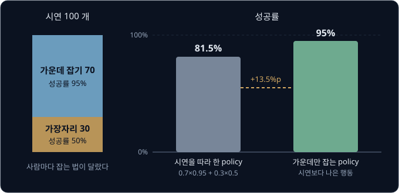

위 그림의 왼쪽은 시연의 구성이고, 오른쪽 두 막대는 그 시연을 따라 한 policy 와 가운데만 잡는 policy 의 성공률이다. SFT 의 정답에는
"가장자리를 잡으면 자주 실패한다" 는 정보가 들어 있지 않다. 30 개의 가장자리 시연도 성공한 시연과 똑같이 정답으로 쓰이기 때문이다.

**흔한 오해.** "시연을 더 모으면 policy 가 더 나아진다" 고 생각하기 쉽다. 같은 사람들이 같은 습관으로 시연을 1000 개 더 모으면
가운데와 가장자리의 비율은 여전히 70 : 30 이고, 그대로 따라 한 policy 의 성공률도 81.5% 그대로다. 시연이 늘어 나아지는 것은 policy
가 시연을 얼마나 정확히 따라 하느냐이지, 시연 자체의 질은 아니다. 속도도 마찬가지라서, 사람이 컵 하나를 넣는 데 10 초가 걸렸다면
그대로 따라 한 policy 도 10 초쯤 걸린다.

**확인 문제.** 시연 100 개 가운데 가운데 잡기가 40 개, 가장자리 잡기가 60 개라면, 그대로 따라 한 policy 의 성공률은? (성공률은 위와
같이 95% 와 50%)

답 보기

$0.4 \times 0.95 + 0.6 \times 0.5 = 0.38 + 0.3 = 0.68$ 이라 68% 다. 시연이 가장자리 쪽으로 치우친 만큼 policy 도 나빠진다.

### 회복을 모르는 policy

[Behavior Cloning](../behavior-cloning/README.md) 과 [DAgger](../dagger/README.md) 에서 본 compounding error 도 그대로 남아 있다.
policy 가 조금 다르게 움직이면 시연에 없던 자세에 들어가고, 그 자세에서는 무엇을 해야 할지 배운 적이 없어 다음 행동도 어긋나며,
어긋남이 쌓여 실패한다. 이렇게 작은 실수가 쌓여 커지는 것을 compounding error 라고 불렀다.

chunk 하나를 실행할 때마다 컵이 2% 의 확률로 집게 안에서 살짝 미끄러진다고 하자. 시연한 사람은 거의 미끄러뜨리지 않았으므로 시연에는
"미끄러진 컵을 다시 잡는 장면" 이 없고, policy 는 한 번 미끄러지면 끝까지 실패한다. 따라서 성공하려면 chunk 20 개 모두에서
미끄러지지 않아야 한다.

chunk 하나에서 미끄러지지 않을 확률은 $1 - 0.02 = 0.98$ 이다. chunk 둘을 연달아 넘길 확률은 $0.98 \times 0.98 = 0.9604$ 이고, 셋이면
여기에 0.98 을 한 번 더 곱한다. 같은 수를 여러 번 곱한 것을 거듭제곱이라고 하고, 0.98 을 20 번 곱한 값을 $0.98^{20}$ 으로 쓴다.

| episode 의 chunk 수 | 계산 | 성공률 |
| --- | --- | --- |
| 10 | $0.98^{10}$ | 0.817 |
| 20 | $0.98^{20}$ | 0.668 |
| 40 | $0.98^{40}$ | 0.446 |

작업이 길수록 성공률이 빠르게 떨어진다. 이번에는 policy 가 미끄러진 컵을 다시 잡는 법을 알아서, 미끄러진 경우의 80% 는 되돌린다고
하자. 그러면 chunk 하나에서 실패로 끝날 확률은 "미끄러짐 2%" 가운데 "되돌리지 못한 20%" 라서 $0.02 \times 0.2 = 0.004$, 곧 0.4% 이고,
chunk 20 개짜리 episode 의 성공률은 $0.996^{20} \approx 0.923$ 이다.

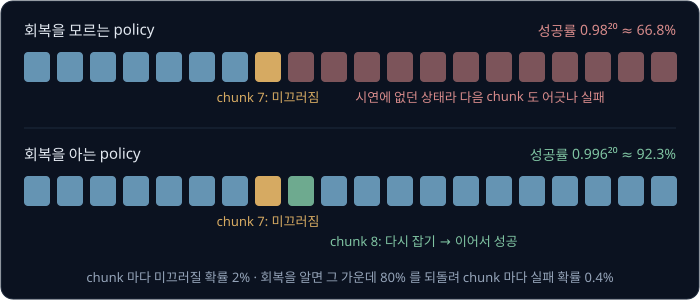

회복하는 법은 시연에 거의 담기지 않는다. 시연하는 사람은 실수를 피하려 애쓰고, 실수한 시연은 지워 버리는 경우가 많기 때문이다.
그래서 policy 가 직접 실수해 보고 그 결과로 배우는 길이 필요하다. DAgger 는 policy 가 간 상태에서 사람에게 정답을 물어 이 문제를
풀었는데, 이 강의의 방법은 정답 대신 "성공했는가" 만 알려 주어 같은 문제를 다룬다.

**확인 문제.** chunk 마다 실패할 확률이 10% 인 policy 가 chunk 2 개짜리 작업을 하면 성공률은? 3 개짜리면?

답 보기

chunk 하나를 넘길 확률이 0.9 라서 2 개면 $0.9 \times 0.9 = 0.81$, 3 개면 $0.81 \times 0.9 = 0.729$ 다.

### reward 로 하는 추가 학습

[Bandits & MDPs](../bandit-mdp/README.md) 와 [PPO](../ppo/README.md) 에서는 정답 대신 점수로 배우는 reinforcement learning(RL,
강화학습)을 다뤘다. 행동한 뒤 받는 점수가 reward 이고, policy 가 직접 행동해 모은 기록을 rollout 이라고 했다. 시연으로 SFT 한 VLA 를
출발점으로 두고, 그 VLA 로 작업을 여러 번 시도해 성공하면 reward 1, 실패하면 0 을 받은 뒤, reward 가 큰 행동을 더 자주 하도록 VLA
를 고치는 것을 RL fine-tuning 이라고 한다.

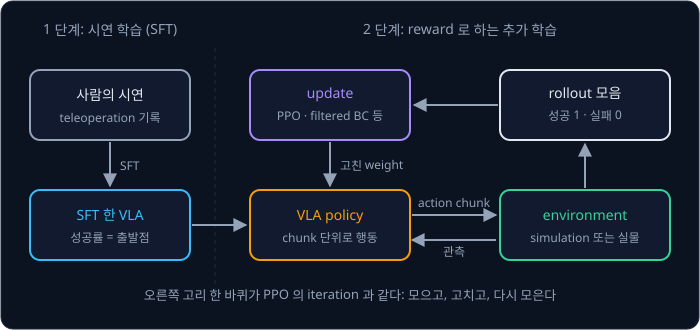

위 그림의 왼쪽은 [π0](../pi0/README.md) 까지 다룬 SFT 이고, 오른쪽 고리가 이 강의에서 더하는 부분이다. 오른쪽 고리 한 바퀴는 PPO 의
iteration(데이터를 모으고 고치는 한 바퀴)과 같다. VLA 가 행동하는 대상 세계, 곧 environment 는 컴퓨터 속의 가상 환경일 수도 있고
실물 로봇일 수도 있다.

앞 절의 두 한계에 RL 이 하는 일은 아래와 같다.

| 한계 | SFT 에서 생기는 이유 | RL fine-tuning 이 하는 일 |
| --- | --- | --- |
| 시연의 질이 상한 | 실패하기 쉬운 시연도 정답으로 쓴다 | 가운데 잡기가 더 자주 성공하므로 그 확률을 올린다 |
| 회복을 모름 | 미끄러진 장면이 시연에 없다 | 미끄러진 뒤 우연히 다시 잡아 성공한 행동의 확률을 올린다 |

RL 에는 정답 action 이 필요 없고 성공 여부만 있으면 된다. DAgger 처럼 사람이 매 순간 정답을 말해 줄 필요가 없으니 사람의 일은 줄지만,
그 대신 VLA 가 직접 많이 시도해야 한다. 그 시도를 어디서, 얼마나 모을지가 이 강의 뒤쪽의 문제다.

**확인 문제.** SFT 와 RL fine-tuning 에서 학습에 필요한 것을 하나씩 고르면? (가) 그 순간의 정답 action (나) 시도가 성공했는지

답 보기

SFT 는 (가) 정답 action 이 필요하고, RL fine-tuning 은 (나) 성공 여부만 있으면 된다.

**요약**

- SFT 한 VLA 는 시연을 그대로 따라 하므로, 가운데 70 : 가장자리 30 의 시연에서는 성공률이 81.5% 에 머물고 시연을 늘려도 그대로다
- 시연에 실수와 회복이 거의 없어서, chunk 마다 2% 로 미끄러지는 policy 는 20 chunk 에서 66.8% 로 떨어진다. 회복을 알면 92.3% 다
- RL fine-tuning 은 SFT 한 VLA 로 시도해 받은 성공 여부(reward)로 VLA 를 더 학습한다

## 성공 여부로 주는 reward

### sparse reward

이 강의의 reward 는 작업에 성공하면 episode 끝에 1, 그 밖에는 모두 0 이다. 이렇게 드문드문 받는 reward 를 sparse reward 라고 한다.
sparse 는 "드문" 이라는 뜻이다. sparse reward 는 어떤 행동이 좋았는지 하나하나 알려 주지 않으므로, policy 는 성공한 episode 와 실패한
episode 의 차이에서만 배운다.

[Policy Gradient](../policy-gradient/README.md) 에서 reward 에서 평균 reward 를 뺀 값, 곧 advantage 로 update(parameter 를 한 번 고치는 것)의 방향과 크기를 정했다. parameter 는 모델 안에서 학습으로 고치는 숫자다.
advantage 는 "이 결과가 평균보다 얼마나 나았나" 이고, 빼는 평균을 baseline 이라고 했다. 여기서는 한 batch(한 번에 모아 학습에 쓰는
episode 묶음)의 평균 성공률을 baseline 으로 쓰자. episode 20 개를 돌려 6 개가 성공했다면 baseline 은 $6 \div 20 = 0.3$ 이고, 성공한
episode 의 advantage 는 $1 - 0.3 = +0.7$, 실패한 episode 는 $0 - 0.3 = -0.3$ 이다.

성공률만 바꿔 같은 계산을 하면 아래와 같다.

| 성공률 | 20 개 가운데 성공 | baseline | 성공의 advantage | 실패의 advantage |
| --- | --- | --- | --- | --- |
| 0% | 0 | 0 | 없음 | $0 - 0 = 0$ |
| 5% | 1 | 0.05 | $+0.95$ | $-0.05$ |
| 30% | 6 | 0.3 | $+0.7$ | $-0.3$ |
| 95% | 19 | 0.95 | $+0.05$ | $-0.95$ |

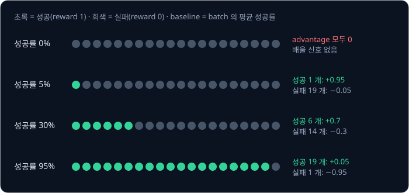

성공률이 0% 면 모든 episode 의 advantage 가 0 이라서 update 가 일어나지 않는다. 무엇을 하면 성공하는지 한 번도 본 적이 없으니
배울 단서가 없다. 5% 나 95% 처럼 한쪽으로 치우치면 batch 안의 단서가 episode 하나에 몰려서, 그 하나가 우연이었는지 가리기 어렵다.
성공과 실패가 고루 섞인 30% 근처의 batch 가 가장 많은 것을 알려 준다.

**흔한 오해.** "RL 은 시연이 없어도 무엇이든 배운다" 고 생각하기 쉽다. sparse reward 만으로는 성공률이 0% 인 작업에서 출발할 수 없다.
처음부터 아무렇게나 움직이는 policy 가 컵을 집어 상자에 넣을 확률은 0 에 가까우므로, 먼저 SFT 로 성공률을 0 보다 확실히 크게 만든
뒤에 RL 을 한다. 이것이 SFT 다음에 RL 을 두는 이유다.

**확인 문제.** episode 10 개 가운데 2 개가 성공했다. baseline 과, 성공·실패 episode 의 advantage 는?

답 보기

baseline 은 $2 \div 10 = 0.2$ 이고, 성공은 $1 - 0.2 = +0.8$, 실패는 $0 - 0.2 = -0.2$ 다.

### 끝에서 받은 reward 의 배분

reward 는 episode 끝에 한 번 오지만 VLA 는 chunk 20 개를 냈다. 성공에 어느 chunk 가 기여했는지를 나눠 주는 문제를 credit
assignment 라고 한다. credit 은 "공로" 라는 뜻이다.

[PPO](../ppo/README.md) 에서는 critic(평가하는 쪽 network)이 각 state(지금 상황)에서 앞으로 받을 reward 의 합을 예측한 값 $V(s)$ 와, 그 예측이 한 step 뒤에
얼마나 바뀌었는지를 재는 TD error 로 이 문제를 다뤘다. 이 작업에서 $V(s)$ 는 "지금 상황에서 결국 성공할 확률의 예측" 이다. 계산을
줄이려고 chunk 4 개짜리 성공 episode 로 보자. 늦게 받는 reward 를 깎는 discount factor $\gamma$("감마")는 1 로 둔다.

$$
\delta_t = r_{t+1} + \gamma\, V(s_{t+1}) - V(s_t)
$$

$\delta_t$("델타")는 chunk $t$ 의 TD error, $r_{t+1}$ 은 chunk $t$ 를 실행한 직후 받은 reward, $V(s_t)$ 는 chunk $t$ 를 고르기 직전 상황의
예측이다. 식은 "받은 reward 에 다음 상황의 예측을 더하고, 원래 상황의 예측을 뺀다" 로 읽는다. episode 가 끝난 뒤의 예측은 0 으로 둔다.

| chunk $t$ | 하는 일 | $V(s_t)$ | $r_{t+1}$ | $V(s_{t+1})$ | $\delta_t$ |
| --- | --- | --- | --- | --- | --- |
| 0 | 컵으로 다가감 | 0.3 | 0 | 0.3 | $0 + 0.3 - 0.3 = 0$ |
| 1 | 컵을 잡음 | 0.3 | 0 | 0.8 | $0 + 0.8 - 0.3 = 0.5$ |
| 2 | 들어 옮김 | 0.8 | 0 | 0.9 | $0 + 0.9 - 0.8 = 0.1$ |
| 3 | 상자에 놓음 | 0.9 | 1 | 0 (끝남) | $1 + 0 - 0.9 = 0.1$ |

컵을 잡는 순간 critic 의 예측이 0.3 에서 0.8 로 뛰었으므로, reward 는 마지막에 받았지만 가장 큰 TD error 0.5 는 컵을 잡은 chunk 1 이
받는다. critic 이 "컵을 제대로 잡으면 대개 성공한다" 를 배워 두었기 때문이다.

PPO 의 GAE(Generalized Advantage Estimation)는 이 TD error 들을 뒤에서부터 $\hat A_t = \delta_t + \gamma\lambda\,\hat A_{t+1}$ 로 섞었다.
$\lambda$("람다")는 0 과 1 사이의 수이고, $\gamma\lambda = 0.5$ 로 계산하면 아래와 같다. 마지막 chunk 뒤의 $\hat A_4$ 는 0 이다.

| 순서 | chunk $t$ | $\delta_t$ | $0.5 \times \hat A_{t+1}$ | $\hat A_t$ |
| --- | --- | --- | --- | --- |
| 1 | 3 | 0.1 | $0.5 \times 0 = 0$ | 0.1 |
| 2 | 2 | 0.1 | $0.5 \times 0.1 = 0.05$ | 0.15 |
| 3 | 1 | 0.5 | $0.5 \times 0.15 = 0.075$ | 0.575 |
| 4 | 0 | 0 | $0.5 \times 0.575 = 0.2875$ | 0.2875 |

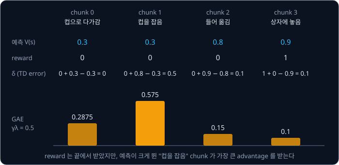

$\lambda$ 만 바꾸면 몫이 달라진다. $\lambda = 0$ 이면 TD error 그대로 $(0,\ 0.5,\ 0.1,\ 0.1)$ 이고, $\lambda = 1$ 이면 끝까지 받은 reward
에서 예측을 뺀 $1 - V(s_t)$, 곧 $(0.7,\ 0.7,\ 0.2,\ 0.1)$ 이다. $\lambda = 1$ 에서는 critic 의 판단 없이 성공 하나를 앞의 chunk 모두가
비슷하게 나눠 가진다.

critic 은 처음에 엉터리라서, RL 을 시작할 때는 critic 만 먼저 학습시키기도 한다. OpenVLA 를 PPO 로 fine-tuning 한 VLA-RL(2025) 논문은 이것을 critic warmup 이라고 불렀다.

**확인 문제.** 위 episode 에서 critic 의 예측이 $(0.3,\ 0.3,\ 0.6,\ 0.9)$ 였다면 네 chunk 의 TD error 는?

답 보기

$\delta_0 = 0 + 0.3 - 0.3 = 0$, $\delta_1 = 0 + 0.6 - 0.3 = 0.3$, $\delta_2 = 0 + 0.9 - 0.6 = 0.3$, $\delta_3 = 1 + 0 - 0.9 = 0.1$ 이다.
잡는 순간의 예측 상승이 줄어든 만큼 chunk 1 의 몫이 0.5 에서 0.3 으로 줄고, 옮기는 chunk 2 의 몫이 늘었다.

### 중간 점수를 더한 reward

성공 여부만으로는 단서가 적으니, 중간 단계에도 점수를 주고 싶어진다. 실제로 RL4VLA 라는 이름으로 알려진 연구(What Can RL Bring to VLA
Generalization?)는 맞는 물체를 잡아 쥐고 있으면 0.1, 제자리에 놓으면 1.0 의 reward 를 주었다. VLA-RL 은 사진과 글을 읽는 모델을
fine-tuning 해서 작업의 중간 진행을 점수로 매기게 했는데, 이렇게 진행 과정에 점수를 매기는 모델을 process reward model 이라고 한다.
VLA-RL 의 LIBERO-Spatial 실험에서 이 모델의 점수를 더하자 성공률이 85.8% 에서 90.2% 로 올랐다. LIBERO 는 [RT-2 → OpenVLA](../vla-tokens/README.md)
에서 본, 로봇 팔이 지시문에 따라 물건을 옮기는 작업들을 가상 환경에 모은 benchmark(성능을 재는 시험 모음)이고, LIBERO-Spatial 은 그
가운데 물건의 위치 관계를 다루는 작업 10 개의 묶음이다.

중간 점수는 잘못 정하면 엉뚱한 행동을 키운다. 위 연구와 다른 가상의 설계로, "컵을 쥐고 있는 chunk 마다 0.1" 을 주고 놓으면 1 을
준다고 해 보자.

| 행동 | 쥐고 있는 chunk | 쥐고 있는 동안의 reward | 놓기 reward | 합 |
| --- | --- | --- | --- | --- |
| chunk 1 에서 잡고 chunk 3 에 놓음 | 3 개 (1·2·3) | $3 \times 0.1 = 0.3$ | 1 | 1.3 |
| chunk 1 에서 잡고 끝까지 쥐고 있음 | 19 개 (1 ~ 19) | $19 \times 0.1 = 1.9$ | 0 | 1.9 |

컵을 놓지 않고 쥐고만 있는 policy 가 더 큰 reward 를 받으므로, RL 은 이 행동을 키운다. reward 를 준 사람의 의도와 다르게 reward
숫자만 키우는 행동을 찾아내는 것을 reward hacking 이라고 한다. 그래서 중간 점수는 작게 주거나 한 번만 주고, 최종 성공의 reward 가 늘
가장 크게 남도록 설계한다.

**확인 문제.** 같은 가상 설계에서 쥐고 있는 chunk 마다 0.02 를 준다면, 위 두 행동의 reward 합은 각각 얼마이고 어느 쪽을 키울까?

답 보기

놓는 행동은 $3 \times 0.02 + 1 = 1.06$, 쥐고만 있는 행동은 $19 \times 0.02 = 0.38$ 이라 놓는 행동을 키운다.

**요약**

- 성공하면 1, 그 밖에는 0 인 sparse reward 에서는 batch 의 평균 성공률을 baseline 으로 뺀 advantage 로 배우고, 성공률 0% 에서는 배울
  단서가 없어서 SFT 를 먼저 한다
- 끝에 한 번 받은 reward 는 critic 의 예측이 크게 바뀐 chunk 로 많이 나뉜다. 예측 $(0.3,\ 0.3,\ 0.8,\ 0.9)$ 에서 TD error 는
  $(0,\ 0.5,\ 0.1,\ 0.1)$ 이다
- 중간 점수는 단서를 늘리지만, 쥐고만 있어도 점수가 쌓이는 설계처럼 의도와 다른 행동을 키울 수 있다

## token VLA 의 ratio

### action token 의 확률

[PPO](../ppo/README.md) 는 데이터를 모을 때의 옛 policy 와 지금 고치는 새 policy 가 같은 action 을 고를 확률의 비, 곧 probability ratio
로 update 크기를 막았다.

$$
r_t(\theta) = \frac{\pi_\theta(a_t \mid s_t)}{\pi_{\theta_\text{old}}(a_t \mid s_t)}
$$

$\pi_\theta(a_t \mid s_t)$ 는 parameter(학습으로 고치는 숫자)가 $\theta$("세타")인 policy 가 state $s_t$ 에서 action $a_t$ 를 고를 확률이고,
$\theta_\text{old}$ 는 데이터를 모을 때의 parameter 다. 식은 "새 policy 가 이 action 을 고를 확률을, 옛 policy 가 고른 확률로 나눈다" 로
읽는다. 이 식을 쓰려면 policy 가 실제로 낸 action 의 확률을 계산할 수 있어야 한다.

[RT-2 → OpenVLA](../vla-tokens/README.md) 의 OpenVLA 는 관절 각도를 칸 256 개 가운데 하나로 바꾸고, 칸 번호마다 짝지은 단어 조각, 곧
token 을 하나씩 골랐다. 모델은 token 마다 점수를 내고, softmax(점수마다 $e^{\text{점수}}$ 를 구해 그 합으로 나누는 계산, $e$ 는 약 2.718)로 점수를 확률로
바꾼다. RL 에서 rollout 을 모을 때는 가장 확률이 큰 token 만 고르지 않고 이 확률대로 무작위로 뽑는다. 그래야 가끔 다른 action 도 해
보고 그 결과를 배울 수 있다.

action 하나는 token 7 개다. 관절 2 의 token 은 관절 1 의 token 을 본 다음에 고르므로, 7 개가 함께 나올 확률은 "관절 1 token 의 확률 ×
(관절 1 을 본 뒤) 관절 2 token 의 확률 × …" 처럼 차례로 곱한 값이다. 계산을 줄이려고 token 3 개만 보자. RT-2 → OpenVLA 의 cross-entropy
예에서 쓴 확률과 같은 값이다.

| 자리 | 고른 token | 그 token 의 확률 |
| --- | --- | --- |
| 관절 1 | 31,882 | 0.5 |
| 관절 2 | 31,917 | 0.8 |
| 관절 3 | 31,841 | 0.25 |
| 세 token 이 함께 나올 확률 | | $0.5 \times 0.8 \times 0.25 = 0.1$ |

token 이 많아지면 곱이 아주 작아진다. 확률 0.5 인 token 7 개의 곱은 $0.5^7 \approx 0.0078$ 이고, chunk 하나에 action 이 여러 개면 수십,
수백 개를 곱해야 한다. 그래서 실제로는 확률에 $\ln$ 을 씌워 더한다. $\ln$ 은 "$e$(약 2.718)를 몇 번 곱해야 그 수가 되는가" 를 나타내는
natural log 이고, $\ln(x \times y) = \ln x + \ln y$ 라서 곱이 합으로 바뀐다. 위 예에서는 $\ln 0.5 + \ln 0.8 + \ln 0.25 = -0.693 - 0.223 - 1.386 = -2.303$
이고, $e^{-2.303} \approx 0.1$ 로 곱과 같다. 확률에 $\ln$ 을 씌운 값을 log-probability 라고 했다.

**확인 문제.** 세 token 의 확률이 0.5, 0.5, 0.4 이면 action 의 확률은?

답 보기

$0.5 \times 0.5 \times 0.4 = 0.1$ 이다.

### token 확률로 만든 ratio 와 clip

rollout 을 모은 뒤 VLA 를 몇 번 고쳤더니 같은 token 들에 준 확률이 0.6, 0.8, 0.25 로 바뀌었다고 하자.

| 자리 | 옛 확률 | 새 확률 | 자리별 ratio |
| --- | --- | --- | --- |
| 관절 1 | 0.5 | 0.6 | $0.6 \div 0.5 = 1.2$ |
| 관절 2 | 0.8 | 0.8 | 1 |
| 관절 3 | 0.25 | 0.25 | 1 |
| action 전체 | 0.1 | 0.12 | $0.12 \div 0.1 = 1.2$ |

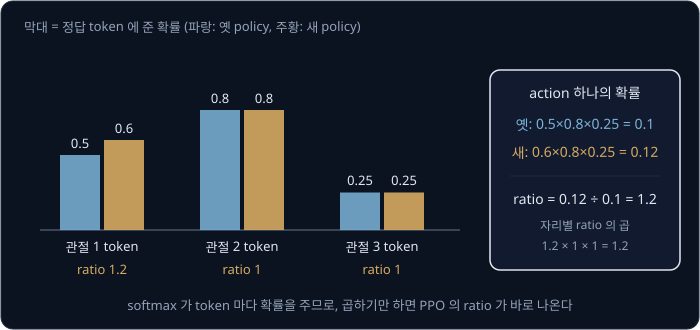

action 전체의 ratio 는 자리별 ratio 의 곱 $1.2 \times 1 \times 1 = 1.2$ 와 같다. PPO 강의에서 관절이 여럿인 연속 action 의 ratio 를 관절마다의
ratio 의 곱으로 만든 것과 같은 계산이다.

PPO 는 ratio 를 $1 - \epsilon$ 과 $1 + \epsilon$ 사이로 자른 clipped surrogate 를 썼다. $\epsilon$("엡실론")은 보통 0.2 이고, sample(모은 데이터 하나)마다
$\min\big(r\hat A,\ \operatorname{clip}(r, 0.8, 1.2)\,\hat A\big)$ 를 계산한다. $\min$ 은 둘 가운데 작은 값, $\operatorname{clip}(r, 0.8, 1.2)$ 는
$r$ 이 0.8 보다 작으면 0.8, 1.2 보다 크면 1.2, 그 사이면 그대로인 값이다. 앞 절의 sparse reward 에서 성공 episode 의 advantage 는 $+0.7$,
실패는 $-0.3$ 이었다. 숫자만 바꿔 세 경우를 계산하면 아래와 같다.

| 경우 | 자리별 ratio | action ratio $r$ | $\hat A$ | $r\hat A$ | $\operatorname{clip}(r)\hat A$ | 고른 값 | gradient |
| --- | --- | --- | --- | --- | --- | --- | --- |
| 성공 | 1.2, 1, 1 | 1.2 | $+0.7$ | 0.84 | $1.2 \times 0.7 = 0.84$ | 0.84 | 흐름 |
| 성공 | 1.2, 1.05, 1.2 | 1.512 | $+0.7$ | 1.0584 | $1.2 \times 0.7 = 0.84$ | 0.84 | 0, 멈춤 |
| 실패 | 0.7 | 0.7 | $-0.3$ | $-0.21$ | $0.8 \times (-0.3) = -0.24$ | $-0.24$ | 0, 멈춤 |

gradient 는 parameter 를 아주 조금 바꿨을 때 고른 값이 변하는 비율이다. 둘째 줄은 성공한 action 의 확률을 이미 1.2 배 넘게 올렸으므로
더 올리지 않고, 셋째 줄은 실패한 action 의 확률을 이미 0.8 배 아래로 내렸으므로 더 내리지 않는다. 수십억 parameter 로 어렵게 배운 VLA
가 운 좋은 성공 하나 때문에 한 번에 크게 바뀌지 않도록, PPO 의 clip 이 그대로 일한다.

**확인 문제.** token 세 자리의 ratio 가 1.1, 1.0, 0.9 이면 action ratio 는? advantage 가 $+0.5$ 일 때 clipped surrogate 의 값은?

답 보기

$1.1 \times 1.0 \times 0.9 = 0.99$ 이고, 0.8 과 1.2 사이라 자른 값도 0.99 다. 두 항이 모두 $0.99 \times 0.5 = 0.495$ 라서 0.495 이고
gradient 는 흐른다.

### token VLA 에 RL 을 쓴 연구

token 확률이 바로 나오므로, 언어 모델을 RL 로 학습하던 방법을 거의 그대로 옮길 수 있다. PPO 말고 언어 모델에서 쓰던 방법으로는 GRPO 와
DPO 가 있다. DPO 는 두 결과 가운데 나은 쪽을 고른 짝으로 배우는 방법이다. GRPO 는 critic 을 따로 두지 않는 방법으로, 같은 시작 상황에서 episode 를
여러 개 돌린 묶음(group)을 만들고 그 묶음의 평균 reward 를 baseline 으로 쓴다. 8 번 돌려 3 번 성공했다면 평균이 $3 \div 8 = 0.375$ 라서
성공은 $1 - 0.375 = +0.625$, 실패는 $0 - 0.375 = -0.375$ 를 advantage 로 쓰고, 묶음 안에서 reward 가 흩어진 정도로 한 번 더 나누기도
한다. 앞 절의 batch 평균 baseline 과 같은 생각이다.

아래 연구들은 논문에서 확인한 내용만 적었다.

- **VLA-RL (2025)** — OpenVLA-7B(parameter 약 70 억 개)를 PPO 로 fine-tuning 했다. reward 가 sparse 한 문제를 앞 절의 process reward
  model 로 보완했고, LIBERO 의 작업 40 개에서 평균 성공률이 SFT 한 OpenVLA 의 76.5% 에서 81.0% 로 올랐다
- **RL4VLA (2025, What Can RL Bring to VLA Generalization?)** — OpenVLA-7B 를 ManiSkill(로봇 작업용 가상 환경)의 물건 집어 옮기기 작업에서
  PPO·GRPO·DPO 로 비교했고, PPO 가 가장 나았다. SFT 와 비교하면 학습 때와 같은 조건의 성공률이 0.781 에서 0.938 로, 처음 보는 물체에서는
  0.453 에서 0.714 로, 로봇이 처음 놓인 자세를 바꾼 경우에는 0.339 에서 0.797 로 올랐다. 화면의 색·배경을 바꾼 시험에서는 SFT 와 비슷했다
- **SimpleVLA-RL (2025)** — OpenVLA 를 고친 OpenVLA-OFT 를 action token 을 내는 방식으로 두고 GRPO 로 fine-tuning 했다. reward 는 작업
  완료 여부의 0 또는 1 이다. 작업마다 시연을 1 개씩만 써서 SFT 한 모델로 시작해, 여러 단계가 이어지는 LIBERO-Long 묶음의 성공률을 17.3% 에서
  91.7% 로 올렸다

SimpleVLA-RL 은 시연에 없던 행동이 나오는 것도 보고했다. 캔을 정해진 냄비 옆으로 옮기는 작업의 시연은 모두 "잡고, 옮기고, 놓는" 순서였는데, RL
뒤의 policy 는 캔을 잡지 않고 밀어서 목표 자리에 넣었다. 논문은 이것을 pushcut(밀기 push 와 지름길 shortcut 을 합친 말)이라고 불렀다.
시연을 따라 하기만 하는 SFT 로는 나올 수 없는 행동이고, 시연의 질이 상한이라는 한계를 RL 이 넘은 예다.

**확인 문제.** GRPO 에서 같은 시작 상황으로 4 번 돌려 1 번 성공했다. baseline 과 성공·실패의 advantage 는? (흩어진 정도로 나누는
단계는 빼고 계산한다)

답 보기

baseline 은 $1 \div 4 = 0.25$ 이고, 성공은 $+0.75$, 실패는 $-0.25$ 다.

**요약**

- token VLA 는 softmax 가 token 마다 확률을 주므로, action 의 확률은 token 확률의 곱이고 실제로는 log-probability 의 합으로 계산한다
- ratio 는 자리별 ratio 의 곱이라 $(1.2,\ 1,\ 1) \to 1.2$, $(1.2,\ 1.05,\ 1.2) \to 1.512$ 이고, PPO 의 clip 을 그대로 쓴다
- VLA-RL·RL4VLA 는 OpenVLA 를 PPO 로, SimpleVLA-RL 은 OpenVLA-OFT 를 GRPO 로 fine-tuning 했다

## flow matching VLA 의 확률

### 같은 noise 에서 같은 행동

[π0](../pi0/README.md) 는 action 을 token 으로 고르지 않는다. [Flow Matching](../flow-matching/README.md) 에서처럼 표준 Gaussian
(평균 0, 표준편차 1 인 종 모양 곡선)에서 뽑은 무작위 숫자 noise $\epsilon$ 에서 출발해, action expert(π0 에서 속도를 내는 작은 모델)가
낸 속도 $v_\theta$ 를 따라 Euler step 을 10 번 밟아 action chunk 를 만든다. 표준편차는 곡선이 퍼진 정도이고, Euler step 은 지금 자리의
속도대로 조금 직진하는 계산이다. Flow Matching 강의의 기호로 noise 는 $x_0 = \epsilon$, 데이터는 $x_1$ 이고, 한 step 은
$x \leftarrow x + \Delta t \times v$ 다.

π0 강의의 두 칸짜리 예를 다시 보면, noise $(-0.5,\ 1.0)$ 에서 출발해 속도 $(2.5,\ -0.5)$ 로 0.1 씩 10 번 걸어 $(2.0,\ 0.5)$ 에 닿았다.
이 계산에는 무작위로 정하는 것이 처음의 noise 하나뿐이다. 같은 noise 를 넣으면 늘 같은 chunk 가 나오므로, chunk 가 무작위인 이유는
전부 출발 noise 에 있다.

**확인 문제.** π0 에 같은 사진·지시문·관절 각도와 같은 noise 를 두 번 넣으면 두 chunk 는 같을까?

답 보기

같다. Euler step 10 번은 정해진 계산이라 무작위인 부분이 없고, 출발 noise 가 같으면 결과도 같다.

### 행동 하나의 확률 밀도

연속된 값에서는 정확히 한 값이 나올 확률이 0 이라서, [PPO](../ppo/README.md) 의 연속 action 처럼 종 모양 곡선의 높이, 곧 확률 밀도를
썼다. 표준 Gaussian 의 높이는 0 에서 0.3989 였다. 그러면 π0 가 낸 action 의 높이는 얼마일까?

1 차원으로 줄여 Euler step 한 번이 $a = 2\epsilon + 1$ 이 되는 경우를 보자. step 길이가 1 이고 속도가 $v(x) = x + 1$ 이면
$a = \epsilon + 1 \times (\epsilon + 1) = 2\epsilon + 1$ 이다.

| noise $\epsilon$ | 0 | 0.5 | 1 |
| --- | --- | --- | --- |
| action $a = 2\epsilon + 1$ | 1 | 2 | 3 |

noise 가 0 과 0.5 사이에 떨어질 확률은 0.1915 다. 이 noise 들은 모두 action 1 과 2 사이로 가므로, action 이 1 과 2 사이에 떨어질
확률도 0.1915 다. 그런데 noise 쪽에서는 폭 0.5 에 담겼던 확률이 action 쪽에서는 폭 1 에 퍼졌다. 폭이 두 배로 늘었으니 높이는 절반이
되어, action 1 의 높이는 noise 0 의 높이 0.3989 를 2 로 나눈 약 0.1995 다.

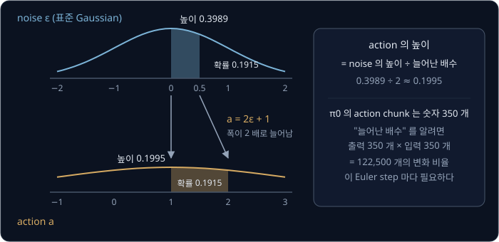

$$
p(a) = \frac{p(\epsilon)}{\text{늘어난 배수}}
$$

$p(a)$ 는 action $a$ 의 높이, $p(\epsilon)$ 은 그 action 을 만든 noise 의 높이다. 식은 "noise 의 높이를, 그 자리에서 공간이 늘어난 배수로
나눈다" 로 읽는다. 1 차원에서 직선 하나로 옮기면 배수가 곧 기울기 2 라서 쉽다.

π0 에서는 이 계산이 어렵다. chunk 하나가 숫자 350 개라서, "늘어난 배수" 를 알려면 출력 350 개 각각이 입력 350 개 각각에 따라 얼마나
변하는지, 곧 $350 \times 350 = 122{,}500$ 개의 변화 비율이 필요하다. 게다가 속도를 내는 action expert 는 자리마다 다른 값을 내는
neural network(곱하고 더하는 계산을 여러 층 쌓은 모델)라서, 이 계산을 Euler step 10 번마다 따로 해야 한다. πRL 논문은 flow matching 이 만든 action 의 log-likelihood(확률 밀도에
$\ln$ 을 씌운 값)를 "다루기 어렵다" 고 적었고, π\*0.6 논문도 flow matching 모델은 log-likelihood 를 쉽게 주지 않아서 [policy gradient](../policy-gradient/README.md)(확률의 gradient 로 policy 를 직접 고치는 방법)
를 쓰기 어렵다고 적었다.

**흔한 오해.** "flow matching 의 loss 가 작으면 그 action 의 확률이 크다" 고 생각하기 쉽다. flow matching loss 는 network 가 낸 속도와
정답 속도의 차이를 제곱한 값이고, 행동의 확률 밀도와는 다른 값이다. 둘 사이에 관계는 있어서, Flow Matching Policy Gradients(FPO, 2025)는
같은 action 에 대한 옛 모델과 새 모델의 loss 차이로 ratio 를 어림해 PPO 의 clip 을 그대로 썼다. 그래도 그것은 확률 자체가 아니라 어림값이다.

**확인 문제.** Euler step 한 번이 $a = 3\epsilon$ 이 되는 1 차원 flow 에서, action 0 의 높이는? (noise 0 의 높이는 0.3989)

답 보기

공간이 3 배로 늘었으므로 $0.3989 \div 3 \approx 0.133$ 이다.

**요약**

- π0 는 출발 noise 만 무작위이고, 같은 noise 에서는 Euler step 10 번을 지나 늘 같은 chunk 가 나온다
- action 의 확률 밀도는 noise 의 높이를 공간이 늘어난 배수로 나눈 값이다. $a = 2\epsilon + 1$ 이면 0.3989 가 0.1995 가 된다
- 숫자 350 개짜리 chunk 에서는 그 배수를 Euler step 마다 122,500 개의 변화 비율로 구해야 해서, PPO 의 ratio 를 바로 쓰기 어렵다

## 확률 문제를 다루는 네 가지 방법

flow matching VLA 를 RL 로 고치는 연구들은 이 문제를 서로 다른 방법으로 다룬다. 아래 그림에 네 갈래로 묶었다.

위 그림의 왼쪽 위는 앞에서 본 token VLA 이고, 오른쪽 아래 네 상자가 flow matching VLA 의 방법이다. ① 은 확률을 계산할 수 있게 noise 에서 action 을 만들어 내는
과정을 바꾸고, ② 와 ④ 는 확률 없이 SFT 와 같은 loss 로 학습하며, ③ 은 VLA 를 그대로 두고 확률을 계산하기 쉬운 작은 policy 를 따로 둔다.

### ① step 마다 noise 를 넣은 경로

Euler step 의 결과를 그대로 다음 자리로 쓰지 않고, 그 자리를 평균으로 하는 종 모양 곡선에서 다음 자리를 뽑는다. 그러면 step 마다
"이 점이 뽑힐 높이" 가 정해지고, 경로 전체의 확률 밀도는 step 마다의 높이를 곱한 값이 된다. PPO 강의에서 관절마다 따로 뽑은 action
의 확률 밀도가 관절마다의 높이의 곱이었던 것과 같은 계산이다.

표준편차 $\sigma$("시그마")를 0.1 로 두자. 평균에서 $d$ 만큼 떨어진 점의 높이는 Gaussian 식 $\frac{1}{\sigma\sqrt{2\pi}}\, e^{-d^2 / (2\sigma^2)}$ 에 $\sigma = 0.1$ 을 넣은
$\frac{1}{0.1\sqrt{2\pi}}\, e^{-d^2 / (2 \times 0.1^2)} = 3.9894 \times e^{-d^2/0.02}$ 이다. 여기의 $\pi$ 는 원주율 3.14159 다.

| 평균에서의 거리 $d$ | 0 | 0.05 | 0.1 |
| --- | --- | --- | --- |
| $d^2 \div 0.02$ | 0 | 0.125 | 0.5 |
| 높이 | 3.9894 | 3.5207 | 2.4197 |

계산을 줄이려고 숫자 하나짜리 action 을 Euler step 2 번(step 길이 0.5)으로 만든다. 출발 noise 는 $x_0 = -0.5$ 다.

| step | 옛 policy 의 평균 | 새 policy 의 평균 | 뽑힌 점 | 옛 높이 | 새 높이 | step ratio |
| --- | --- | --- | --- | --- | --- | --- |
| 1 | $-0.5 + 0.5 \times 2.5 = 0.75$ | $-0.5 + 0.5 \times 2.6 = 0.8$ | 0.85 | 2.4197 ($d = 0.1$) | 3.5207 ($d = 0.05$) | 1.455 |
| 2 | $0.85 + 0.5 \times 2.3 = 2.0$ | $0.85 + 0.5 \times 2.3 = 2.0$ | 1.95 | 3.5207 ($d = 0.05$) | 3.5207 ($d = 0.05$) | 1 |

옛 policy 의 속도는 step 1 에서 2.5, 새 policy 는 2.6 이고, step 2 에서는 둘 다 2.3 이다. 경로 전체의 ratio 는 step ratio 의 곱
$1.455 \times 1 = 1.455$ 이고, $\epsilon = 0.2$ 의 clip 으로 1.2 가 된다. 숫자만 바꿔 step 1 은 두 policy 가 같고 step 2 에서 새 policy
의 평균이 1.95 로 옮겨 왔다면, step 2 의 새 높이가 3.9894 가 되어 ratio 는 $1 \times (3.9894 \div 3.5207) \approx 1.133$ 이다.

실제로는 높이를 곱하는 대신 log 를 씌워 더한다. 위 예에서 옛 경로는 $\ln 2.4197 + \ln 3.5207 = 0.8836 + 1.2586 = 2.1423$, 새 경로는
$1.2586 + 1.2586 = 2.5173$ 이고, $e^{2.5173 - 2.1423} = e^{0.375} \approx 1.455$ 로 같은 ratio 가 나온다. 일반 식은 아래와 같다.

$$
\ln \pi_\theta(a^{0:K} \mid o) = \sum_{k=0}^{K-1} \ln \mathcal N\big(a^{k+1};\ a^k + \Delta\tau\, v_\theta(a^k, \tau_k, o),\ \sigma_k^2\big)
$$

- $a^k$ 는 $k$ 번째 step 의 값이고, $a^0$ 은 출발 noise, $a^K$ 는 마지막에 나온 action 이다. 위 예에서 $K = 2$ 이고 $a^0 = -0.5$,
  $a^1 = 0.85$, $a^2 = 1.95$ 다. $a^{0:K}$ 는 그 값들을 모두 늘어놓은 경로다
- $o$ 는 사진·지시문·관절 각도를 합친 관측, $\tau_k$("타우")는 $k$ 번째 step 의 flow 시각, $\Delta\tau$ 는 step 길이로 위 예의 0.5 다
- $\mathcal N(x;\ \mu,\ \sigma^2)$ 은 평균 $\mu$("뮤"), 표준편차 $\sigma$ 인 종 모양 곡선의 $x$ 에서의 높이다. 평균 자리에 "Euler step 으로
  갔을 자리" 가 들어간다
- $\sum$("시그마")는 $k = 0$ 부터 $K - 1$ 까지 모두 더하라는 기호다

식은 "step 마다 Euler step 으로 갔을 자리를 평균으로 하는 곡선에서 실제로 뽑힌 다음 점의 높이를 구해, 그 log 를 모두 더한다" 로 읽는다.
확률을 얻는 대가는 있다. 마지막 action 에도 noise 가 섞여 덜 정확해지고, 1 step 이던 RL 의 결정 하나가 denoising step(noise 를 걷어 내는 한 step, 여기서는 Euler step) $K$ 개를 품게 되어
계산과 저장할 값이 늘어난다.

이 방법을 쓴 연구는 아래와 같다.

- **DPPO (2024)** — VLA 가 아닌 작은 [Diffusion Policy](../diffusion-policy/README.md) 에 썼다. [DDPM](../ddpm/README.md) 의 denoising step 마다 다음 값을 종 모양 곡선에서 뽑으므로 확률이
  이미 있다. 로봇 step 이 바깥 고리, denoising step 이 안쪽 고리인 두 겹의 문제로 보고 PPO 를 걸었고, 가상 환경에서 학습한 가구 조립 작업
  policy 를 그대로 실물 로봇에 옮겨 20 번 가운데 16 번 성공했다
- **ReinFlow (2025)** — flow matching policy 의 결정적인 경로에 학습하는 noise 를 넣어 정확한 likelihood(확률 밀도)를 얻고 PPO 로 학습했다. VLA 가 아닌
  작은 flow matching policy 로, 가상 환경의 보행·조작 작업에서 시험했다
- **πRL (2025)** — 같은 생각을 π0 와 π0.5 에 썼다. noise 를 내는 작은 network 를 학습하는 Flow-Noise 와, Euler 적분을 noise 가 섞인 적분으로
  바꾸는 Flow-SDE 두 방식을 PPO 로 학습했다. 작업마다 시연을 조금만 써서 SFT 한 π0 의 LIBERO 평균 성공률이 57.6% 에서 97.6% 로, π0.5 는
  77.1% 에서 98.3% 로 올랐다

**확인 문제.** step 이 3 개이고 step ratio 가 1.1, 1.0, 1.2 이면 경로 전체의 ratio 는? clip($\epsilon = 0.2$) 뒤에는?

답 보기

$1.1 \times 1.0 \times 1.2 = 1.32$ 이고, 1.2 를 넘으므로 clip 뒤에는 1.2 다.

### ② filtered BC

가장 단순한 방법은 확률을 아예 쓰지 않는 것이다. 지금 policy 로 rollout 을 모은 뒤 성공한 episode 만 골라 그 action 을 정답 삼아 다시
SFT 한다. 성공한 것만 걸러(filter) behavior cloning(BC, 시연을 따라 하는 학습)을 하므로 filtered BC 라고 부른다. loss 는 [π0](../pi0/README.md)
의 flow matching loss 를 그대로 쓰고 데이터만 바꾼다.

가운데 0.7, 가장자리 0.3 의 policy 로 rollout 100 개를 모으면, 평균적으로 가운데 잡기 70 개 가운데 $70 \times 0.95 = 66.5$ 개, 가장자리
잡기 30 개 가운데 $30 \times 0.5 = 15$ 개가 성공한다. 성공 81.5 개만 모아 다시 학습하면 새 policy 가 가운데를 잡을 비율은
$66.5 \div 81.5 \approx 0.816$ 이 되고, 성공률은 $0.816 \times 0.95 + 0.184 \times 0.5 \approx 0.867$ 로 오른다. 이 과정을 round 라고 부르고
되풀이하면 아래와 같다.

| round | 가운데 비율 | 성공률 | 성공한 가운데 잡기 | 성공한 가장자리 잡기 | 다음 가운데 비율 |
| --- | --- | --- | --- | --- | --- |
| 0 (SFT) | 0.700 | 81.5% | 66.5 | 15.0 | $66.5 \div 81.5 = 0.816$ |
| 1 | 0.816 | 86.7% | 77.5 | 9.2 | $77.5 \div 86.7 = 0.894$ |
| 2 | 0.894 | 90.2% | 84.9 | 5.3 | 0.941 |
| 3 | 0.941 | 92.4% | 89.4 | 2.9 | 0.968 |
| 4 | 0.968 | 93.6% | 92.0 | 1.6 | 0.983 |
| 5 | 0.983 | 94.2% | | | |

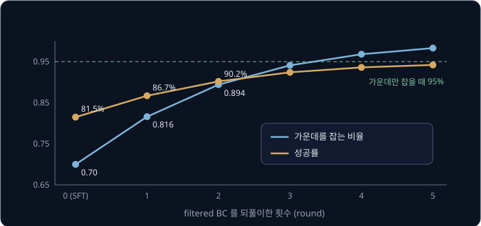

성공률은 round 마다 오르지만 오르는 폭이 5.2, 3.5, 2.2, 1.2, 0.6%p 로 줄어 95% 에 천천히 다가간다. 실패한 episode 는 버려지므로
"가장자리를 잡으면 실패한다" 는 정보는 쓰이지 않는다. [Policy Gradient](../policy-gradient/README.md) 의 말로 하면, filtered BC 는 성공에는
weight(곱하는 몫) 1, 실패에는 weight 0 을 주는 학습이라서 실패한 행동을 밀어내는 힘이 없다. 성공이 하나도 없으면 학습할 데이터도 없다.

RLDG(2024)는 이 생각을 다른 쪽으로 썼다. 작업 하나만 잘하는 작은 policy 를 실물 로봇에서 RL 로 먼저 학습한 뒤, 그 policy 가 성공한 기록으로
OpenVLA 와 Octo(공개된 범용 로봇 policy 모델) 같은 범용 policy 를 SFT 했다. 사람의 시연으로 학습한 것보다 성공률이 최대 40% 높았다고 보고했다.

**확인 문제.** 가운데 0.5, 가장자리 0.5 인 policy 로 rollout 100 개를 모아 filtered BC 를 한 번 하면, 다음 가운데 비율은 약 얼마일까?

답 보기

성공한 가운데 잡기는 $50 \times 0.95 = 47.5$ 개, 성공한 가장자리 잡기는 $50 \times 0.5 = 25$ 개다. 다음 비율은
$47.5 \div 72.5 \approx 0.655$ 다.

### ③ 출발 noise 를 고르는 policy

π0 의 무작위성은 전부 출발 noise 에 있었다. 그렇다면 VLA 는 그대로 두고 noise 를 고르는 작은 policy 만 RL 로 학습할 수 있다. 이것이
DSRL(Diffusion Steering via Reinforcement Learning, 2025)이다. steering 은 "방향을 조종한다" 는 뜻이다.

π0 강의의 봉우리가 둘인 시연을 다시 쓰자. 상자를 오른쪽으로 비켜 가는 시연(+2)과 왼쪽으로 비켜 가는 시연(−2)이 반반이었고, 1 차원으로
줄인 계산에서 noise 0.3 은 +2 로, −0.3 은 −2 로 갔다. 곧 noise 가 0 보다 크면 오른쪽, 작으면 왼쪽 길로 간다. 오른쪽 길은 90%, 왼쪽 길은
60% 성공한다고 하자.

| noise 를 뽑는 곡선 | noise 가 0 보다 클 확률 | 성공률 |
| --- | --- | --- |
| 기본 N(0, 1) | 0.5 | $0.5 \times 0.9 + 0.5 \times 0.6 = 0.75$ |
| noise policy N(1, 1) | 0.8413 | $0.8413 \times 0.9 + 0.1587 \times 0.6 \approx 0.852$ |
| noise policy N(2, 1) | 0.9772 | $0.9772 \times 0.9 + 0.0228 \times 0.6 \approx 0.893$ |

N(평균, 표준편차²) 는 그 평균과 표준편차를 가진 종 모양 곡선이다. 0 보다 클 확률은 곡선 아래 넓이에서 구한 값이고, 평균 1 인 곡선은
넓이의 84.13% 가 0 보다 오른쪽에 있다.

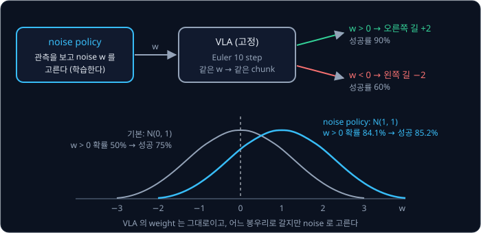

noise policy 는 관측을 보고 noise 의 평균을 내는 Gaussian policy 라서, 확률 밀도가 곡선의 높이로 바로 나온다. 옛 평균 0, 새 평균 0.5,
뽑은 noise 0.8 이면 PPO 강의의 계산 그대로 ratio 는 $0.3814 \div 0.2897 \approx 1.3165$ 다. VLA 의 확률은 필요 없다. DSRL 논문은 이 noise
policy 를 지난 데이터를 다시 쓰는 SAC([DQN → SAC](../off-policy/README.md))로 학습했다. π0 로 LIBERO 작업 하나를 시험해 성공률을 약 20%
에서 약 100% 로 올렸고, Franka 라는 실물 로봇 팔에서 π0 를 RL 로 fine-tuning 한 첫 사례라고 적었다.

이 방법은 VLA 가 원래 낼 수 있는 행동 안에서만 고른다. 시연에 아예 없던 동작은 어떤 noise 로도 나오지 않는다. noise 를 너무 크게 고르면
VLA 가 학습 때 본 적 없는 noise 가 들어간다. 표준 Gaussian 에서 3 근처의 높이는 0.0044 로 0 근처의 100 분의 1 남짓이라, VLA 는 그런
noise 에서 시작하는 연습을 거의 하지 않았다.

**확인 문제.** 오른쪽 길이 80%, 왼쪽 길이 40% 성공할 때, noise 가 0 보다 클 확률이 0.5 인 기본 noise 와 0.9 인 noise policy 의 성공률은?

답 보기

기본은 $0.5 \times 0.8 + 0.5 \times 0.4 = 0.6$, noise policy 는 $0.9 \times 0.8 + 0.1 \times 0.4 = 0.72 + 0.04 = 0.76$ 이다.

### ④ advantage 를 조건으로 넣는 학습

π\*0.6("파이 스타 0.6", 2025)은 Physical Intelligence 가 π0.5 의 뒤를 잇는 모델 π0.6 에 이 방법을 쓴 결과다. 방법의 이름은 RECAP(RL with
Experience and Corrections via Advantage-conditioned Policies)으로, "경험과 사람의 수정으로 하는, advantage 를 조건으로 받는 policy 의 RL"
이라는 뜻이다.

rollout 을 모아 critic 으로 chunk 마다 advantage 를 구한 뒤, advantage 가 기준보다 크면 "좋음", 아니면 "나쁨" 이라는 표시를 붙인다. 그리고
실패까지 포함한 모든 데이터를 이 표시와 함께 SFT 처럼 학습한다. 모델은 "좋음" 이 붙었을 때의 행동과 "나쁨" 이 붙었을 때의 행동을 구분해
배우고, 실행할 때는 늘 "좋음" 을 넣는다.

컵 예에서 잡기 직전 상태의 value 는 $V = 0.7 \times 0.95 + 0.3 \times 0.5 = 0.815$ 다. value 는 그 상황에서 앞으로 기대할 수 있는 성공률이다.
가운데 잡기의 advantage 는 $0.95 - 0.815 = +0.135$, 가장자리 잡기는 $0.5 - 0.815 = -0.315$ 다.

| 잡는 법 | 개수 | advantage | 붙는 표시 |
| --- | --- | --- | --- |
| 가운데 | 70 | $+0.135$ | 좋음 |
| 가장자리 | 30 | $-0.315$ | 나쁨 |

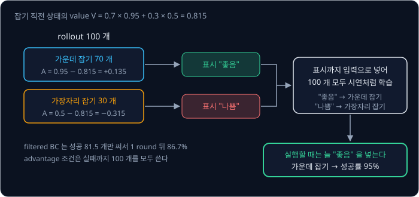

"좋음" 을 넣으면 모델은 가운데 잡기만 내고 성공률이 95% 가 된다. filtered BC 는 한 round 에 성공 81.5 개만 써서 86.7% 였는데, 이 방법은
"나쁨" 데이터까지 100 개를 모두 쓴다. 확률을 계산할 필요 없이 flow matching loss 로 학습하므로 π0 계열에 그대로 맞는다.

π\*0.6 논문에서 확인한 내용은 아래와 같다.

- critic 은 "성공까지 남은 step 수" 를 예측하고, reward 는 step 마다 −1, 성공하면 0, 실패하면 큰 음수다. 성공·실패의 판정만으로 reward 를 만든다
- 표시는 "Advantage: positive" 나 "Advantage: negative" 라는 글로 모델에 넣는다
- 데이터는 시연, 로봇이 스스로 한 시도, 실행 중 사람이 넘겨받아 고친 기록을 함께 쓴다
- 실제 가정에서의 빨래 개기, 상자 조립, 업소용 기계로 에스프레소 만들기를 해냈다. 가장 어려운 작업들에서 처리량(시간당 해낸 작업 수)이 두 배
  넘게 늘고 실패율은 대략 절반으로 줄었다
- flow matching 모델은 log-likelihood 를 쉽게 주지 않아 policy gradient 를 쓰기 어렵다는 이유로 PPO 대신 이 방법을 골랐고, 비교 실험에서
  PPO 보다 처리량이 높았다

**확인 문제.** 잡기 직전 상태의 value 가 0.6 이고 가운데 잡기의 성공률이 0.9, 가장자리 잡기가 0.3 이면 각 advantage 와 표시는?

답 보기

가운데는 $0.9 - 0.6 = +0.3$ 이라 "좋음", 가장자리는 $0.3 - 0.6 = -0.3$ 이라 "나쁨" 이다.

### 네 방법의 비교

| 방법 | 행동의 확률 | VLA weight 를 고치나 | 실패한 rollout 을 쓰나 | 예 |
| --- | --- | --- | --- | --- |
| ① noise 를 넣은 경로 | step 마다 높이의 곱으로 만든다 | 고친다 | 쓴다 (advantage 음수) | DPPO, ReinFlow, πRL |
| ② filtered BC | 필요 없다 | 고친다 | 버린다 | RLDG 의 데이터 생성 |
| ③ 출발 noise 고르기 | 작은 noise policy 의 것만 | 그대로 둔다 | 쓴다 | DSRL |
| ④ advantage 조건 | 필요 없다 | 고친다 | "나쁨" 표시로 쓴다 | π\*0.6 (RECAP) |

**요약**

- ① 은 Euler step 마다 종 모양 곡선에서 다음 점을 뽑아 경로의 확률을 만든다. step ratio 1.455 와 1 의 곱이 경로의 ratio 1.455 다
- ② filtered BC 는 성공만 다시 학습해 가운데 비율을 0.7 → 0.816 → 0.894 로 올리지만, 실패는 버리고 점점 느려진다
- ③ DSRL 은 VLA 를 그대로 두고 noise 를 골라 성공률을 75% 에서 85.2% 로 올리지만, VLA 가 낼 수 있는 행동 밖으로는 못 나간다
- ④ RECAP 은 advantage 표시를 붙여 실패까지 모두 학습하고, 실행할 때 "좋음" 을 넣는다

## simulation 과 실물 로봇

### simulation 의 대량 rollout

RL 은 시도를 많이 해야 한다. 컴퓨터 안에서 물리 법칙을 계산해 로봇을 움직여 보는 프로그램을 simulator, 그 안에서 돌리는 것을
simulation 이라고 하는데, simulation 은 같은 환경을 여러 개 동시에 돌릴 수 있고, 성공 판정과 처음 자리로 되돌려 놓는 reset 을
프로그램이 한다.

episode 하나가 10 초라고 가정하고 episode 1000 개를 모으는 시간을 비교하자.

| 어디서 | 계산 | 시간 |
| --- | --- | --- |
| 실물 로봇 1 대 | 실행 10 초 + 사람이 컵을 되돌려 놓는 reset 20 초 = 30 초, × 1000 | 30,000 초 ≈ 8.3 시간 |
| simulation, environment 64 개 동시 | $1000 \div 64 \approx 15.6$ 이라 16 번, × 10 초 | 160 초 |

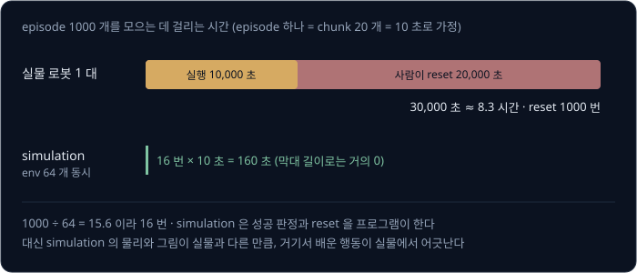

simulation 쪽 숫자는 simulator 가 실제 시간만큼 빠르게 돈다는 가정이다. 실제로는 VLA 계산이 더 큰 부담이 된다. π0 는 RTX 4090 에서
chunk 하나에 73 ms 가 걸리므로 chunk 20 개짜리 episode 하나에 VLA 계산만 $20 \times 73 = 1460$ ms 이고, 학습할 때는 gradient 계산까지 더해진다.
SimpleVLA-RL 은 80 GB 메모리의 GPU(곱셈·덧셈을 한꺼번에 많이 하는 계산 칩) 8 장으로 VLA 의 모든 parameter 를 학습했다.

simulation 의 약점은 실물과 다르다는 데 있다. 마찰·무게·조명·카메라 그림이 조금씩 달라서, simulation 에서 배운 행동이 실물에서 어긋난다.
[Sim-to-Real Locomotion](../sim2real-locomotion/README.md) 에서 본 것처럼 simulator 의 값을 episode 마다 바꿔 가며 학습하는 방법이 있지만,
물건을 집는 작업은 접촉이 복잡해서 이 차이를 줄이기가 더 어렵다.

**확인 문제.** environment 를 32 개 동시에 돌려 episode 1000 개를 모으면, 10 초짜리 episode 를 몇 번 돌려야 하고 몇 초가 걸릴까?

답 보기

$1000 \div 32 = 31.25$ 라서 32 번을 돌려야 하고, $32 \times 10 = 320$ 초가 걸린다.

### 실물에서의 비용과 안전

실물 로봇에서 RL 을 하면 simulation 이 공짜로 해 주던 일을 사람이나 다른 장치가 맡아야 한다.

- **reset** — episode 가 끝날 때마다 컵을 처음 자리에 되돌려 놓아야 한다. 위 계산에서 1000 번이다
- **성공 판정** — 컵이 상자에 들어갔는지 누군가 알려 줘야 reward 를 줄 수 있다. 사람이 판정하거나, 카메라 사진을 보고 성공 여부를 맞히는
  작은 모델, 곧 reward classifier 를 따로 학습한다. HIL-SERL(2024)은 작업마다 성공일 때만 reward 를 주는 classifier 를 학습했다
- **안전** — RL 은 지금까지 안 해 본 행동을 시도해야 배우는데, 실물에서는 그 시도가 물건을 떨어뜨리거나 팔을 부딪치게 할 수 있다. ① 처럼
  noise 를 더한 행동은 더 무작위로 움직인다

그래서 실물 RL 은 적은 시도로 배우는 데 집중한다. HIL-SERL 은 시연과 사람의 수정을 함께 쓰는 RL 로 작업마다 1 ~ 2.5 시간 학습해 성공률을
거의 100% 로 올렸고, ConRFT(2025)는 VLA 인 Octo 를 실물 작업 8 개에서 45 ~ 90 분 동안 RL 로 fine-tuning 해 평균 성공률 96.3% 를 얻었다.

**확인 문제.** 실물 로봇에서 episode 하나가 15 초, reset 이 15 초라면 episode 200 개를 모으는 데 몇 분이 걸릴까?

답 보기

episode 하나에 $15 + 15 = 30$ 초라서 $200 \times 30 = 6000$ 초, 곧 100 분이다.

### 사람이 개입한 데이터

[DAgger](../dagger/README.md) 의 HG-DAgger 에서는 policy 가 운전하다 위험해지면 사람이 넘겨받아 되돌리고, 사람이 운전한 구간만 정답으로
기록했다. LeRobot 의 human-in-the-loop 수집도 같은 방식으로, 사람이 leader 팔(로봇 팔과 똑같이 생긴 조종용 팔)로 로봇 팔을 넘겨받아 좋은 상태로 되돌리고(recovery) 올바른
동작을 이어서 보여 줬다(correction). 실물 RL 에서도 이 기록을 함께 쓴다.

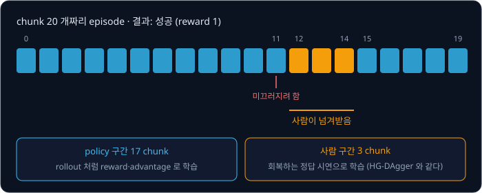

위 episode 에서 한 번의 개입이 두 가지 데이터를 남긴다. 사람이 넘겨받은 chunk 12 ~ 14 의 3 개는 "미끄러지려는 컵을 다시 잡는" 정답 시연이라
SFT 처럼 배울 수 있다. 시연에 없던 회복 동작이 바로 이것이다. policy 가 실행한 나머지 17 개와 episode 의 성공 여부는 RL 의 데이터가 된다.
사람이 넘겨받았다는 사실 자체를 "그 직전 policy 의 행동이 나빴다" 는 신호로 쓸 수도 있다.

개입은 안전도 지킨다. 사람이 위험한 순간에 넘겨받으면 policy 가 물건을 떨어뜨리기 전에 멈출 수 있다. ConRFT 와 HIL-SERL 은 학습하는 동안
사람이 개입해 안전하게 탐색하게 했고, π\*0.6 도 사람이 넘겨받아 고친 기록을 데이터에 넣었다.

**확인 문제.** chunk 30 개짜리 episode 에서 사람이 두 번, 한 번에 4 chunk 씩 넘겨받았다. 정답 시연으로 쓰는 chunk 와 policy 가 실행한 chunk 는
각각 몇 개일까?

답 보기

사람 구간은 $4 \times 2 = 8$ 개, policy 구간은 $30 - 8 = 22$ 개다.

### 성공률을 재는 횟수

RL 로 나아졌는지는 성공률로 잰다. 그런데 작업마다 episode 20 개로 재면 성공 하나가 $1 \div 20 = 5$%p 라서, 10%p 개선은 성공이 두 개 늘어난
것과 같다. 진짜 성공률이 50% 인 policy 도 동전을 20 번 던질 때 앞면이 꼭 10 번 나오지는 않듯이, 어떤 날은 12 번, 어떤 날은 8 번 성공한다.
그래서 작은 개선은 평가 episode 수를 늘리고 시작 자세를 고정해 같은 조건에서 다시 재야 확인할 수 있다.

**확인 문제.** 작업 하나를 episode 50 개로 재면 성공 하나는 몇 %p 일까?

답 보기

$1 \div 50 = 0.02$ 라서 2%p 다.

**요약**

- simulation 은 environment 64 개를 동시에 돌려 1000 episode 를 160 초에 모으지만, 실물 로봇 한 대는 reset 까지 30,000 초가 걸리고 실물과의
  차이가 남는다
- 실물에서는 reset, 성공 판정(reward classifier), 안전을 따로 해결해야 해서 적은 시도로 배우는 방법을 쓴다
- 사람이 넘겨받은 구간은 회복하는 정답 시연이 되고, 나머지 구간과 성공 여부는 RL 데이터가 된다

## 아직 정해지지 않은 문제

### 연구 흐름

이 강의에서 다룬 연구를 모으면 아래와 같다. 모두 2024 ~ 2025 년의 결과다.

| 연구 | 대상 모델 | 방법 | 확인한 결과 |
| --- | --- | --- | --- |
| DPPO (2024) | Diffusion Policy (VLA 아님) | denoising step 을 종 모양 곡선으로 보고 PPO | 가상 환경에서 학습해 실물 가구 조립 20 번 중 16 번 성공 |
| RLDG (2024) | OpenVLA, Octo | 작업 전용 RL policy 의 성공 데이터로 SFT | 사람 시연보다 성공률 최대 40% 높음 |
| ConRFT (2025) | Octo | 실물 RL + 사람 개입 | 실물 작업 8 개, 45 ~ 90 분에 평균 96.3% |
| VLA-RL (2025) | OpenVLA-7B | PPO + process reward model | LIBERO 40 개 평균 76.5% → 81.0% |
| RL4VLA (2025) | OpenVLA-7B | PPO (GRPO·DPO 와 비교) | 처음 보는 물체 0.453 → 0.714 |
| SimpleVLA-RL (2025) | OpenVLA-OFT | GRPO, 0/1 reward | 시연 1 개로 시작해 LIBERO-Long 17.3% → 91.7% |
| DSRL (2025) | π0 등 | 출발 noise 를 고르는 RL | LIBERO 작업 하나 약 20% → 약 100% |
| πRL (2025) | π0, π0.5 | noise 를 넣은 경로 + PPO | π0 57.6% → 97.6% |
| π\*0.6 (2025) | π0.6 | advantage 조건 (RECAP) | 어려운 작업의 처리량 두 배 이상, 실패율 대략 절반 |

같은 해에 나온 연구들이 서로 다른 모델, 서로 다른 방법을 쓴다. token VLA 에는 PPO 와 GRPO 가 함께 쓰이고, flow matching VLA 에는 네 갈래가
모두 시도되고 있다. 어느 방법이 표준이 될지는 아직 정해지지 않았다.

### 남은 문제

- **시도 횟수** — 가상 환경에서는 수천 번의 시도가 싸지만 실물에서는 비싸다. 실물에서 몇 시간 안에 배우는 결과(HIL-SERL, ConRFT)는 작업
  하나씩이고, 많은 작업을 한 VLA 로 함께 실물 RL 하는 방법은 아직 정해지지 않았다
- **실물의 reward** — 성공 판정을 사람이 하거나 reward classifier 를 작업마다 학습해야 한다. 판정이 틀리면 RL 은 틀린 판정을 따라
  배우고, 중간 점수를 주면 reward hacking 의 위험이 생긴다
- **flow matching VLA 의 확률** — 네 갈래가 각각 대가를 치른다. ① 은 noise 를 더하고 계산이 늘며, ② 는 실패를 버리고, ③ 은 VLA 밖으로 못
  나가고, ④ 는 advantage 를 판정하는 critic 이 정확해야 한다
- **넓게 아는 것과 한 작업을 잘하는 것** — RL 로 몇 개의 작업을 잘하게 만들면 VLA 가 원래 하던 다른 작업이나 지시를 알아듣는 능력이 줄어들
  수 있다는 우려가 일반적으로 있다. RL4VLA 는 처음 보는 물체·자세에서 RL 이 SFT 보다 나았다고 보고했지만, 더 넓은 작업에서 어떻게 되는지는
  계속 확인되고 있다
- **안전** — 실물에서 새 행동을 시도하는 일 자체가 위험하다. 지금은 사람이 지켜보다 넘겨받는 방식에 크게 기대고 있다
- **계산 비용** — 수십억 parameter 의 VLA 로 rollout 을 모으고 학습하려면 큰 GPU 여러 장이 든다

**확인 문제.** 실물 로봇에서 성공 판정을 reward classifier 가 하는데, classifier 가 실패한 episode 의 20% 를 성공으로 잘못 판정한다. 이때
RL 이 키울 수 있는 행동은 어떤 것일까?

답 보기

실제로는 실패지만 classifier 가 성공으로 보는 행동이다. 예를 들어 컵을 상자 가장자리에 걸쳐 놓는 행동을 classifier 가 성공으로 잘못 보면,
그 행동도 reward 1 을 받아 확률이 올라간다. 판정이 틀린 만큼 RL 은 틀린 쪽으로 배운다.

## 정리

- 시연으로 SFT 한 VLA 는 시연을 그대로 따라 한다. 가운데 70 : 가장자리 30 의 시연에서는 성공률이 81.5% 에 머물고, chunk 마다 2% 로
  미끄러지면서 회복을 모르면 20 chunk 에서 66.8% 로 떨어진다. RL fine-tuning 은 성공 여부만으로 이 두 한계를 넘으려 한다
- reward 가 성공 1, 실패 0 뿐이면 batch 의 평균 성공률을 baseline 으로 빼서 advantage 를 만들고, 성공률 0% 에서는 배울 단서가 없어 SFT 를
  먼저 한다. 끝에서 받은 reward 는 critic 의 예측이 크게 바뀐 chunk, 예를 들어 컵을 잡은 chunk 로 많이 나뉜다
- token VLA 는 action 의 확률이 token 확률의 곱이라 PPO 의 ratio 가 바로 나온다. $(0.5,\ 0.8,\ 0.25) \to (0.6,\ 0.8,\ 0.25)$ 이면 ratio 는
  $0.12 \div 0.1 = 1.2$ 다. VLA-RL·RL4VLA 는 OpenVLA 를 PPO 로, SimpleVLA-RL 은 GRPO 로 학습했다
- flow matching VLA 는 같은 noise 에서 늘 같은 chunk 를 내고, action 의 확률 밀도를 알려면 공간이 늘어난 배수를 숫자 350 개에 대해 step
  마다 구해야 해서 ratio 를 바로 쓰기 어렵다
- 그래서 ① step 마다 noise 를 넣어 경로의 확률을 만들거나(DPPO·ReinFlow·πRL), ② 성공만 다시 학습하거나(filtered BC), ③ 출발 noise 를
  고르거나(DSRL), ④ advantage 표시를 붙여 학습한다(π\*0.6 의 RECAP)
- simulation 은 시도가 싸지만 실물과 다르고, 실물은 reset·성공 판정·안전 때문에 비싸다. 사람이 넘겨받은 구간은 회복 시연이 되고, 나머지는
  RL 데이터가 된다

이 강의의 내용은 아직 교과서처럼 굳은 지식이 아니다. 여기 실은 연구가 모두 2024 ~ 2025 년에 나왔고, 같은 문제를 서로 다른 방법으로 풀고
있으며, 실물에서 많은 작업을 한 번에 RL 로 다듬는 방법, 실물의 reward, 안전, 넓은 능력을 지키는 방법은 여전히 열려 있다. 이 문제들을 따라가려면
참고 자료의 논문과 그 뒤에 나오는 연구를 직접 읽어야 한다.

이 강의는 커리큘럼의 마지막 강의다. 아래 그림은 앞의 강의들이 이 자리까지 어떻게 이어졌는지를 보여 준다.

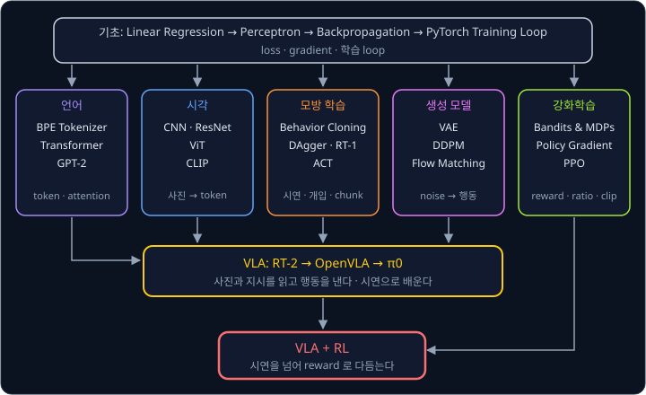

[Linear Regression](../linear-regression/README.md) 에서 직선 하나의 loss 와 gradient 로 시작한 계산은 [PyTorch Training Loop](../pytorch-mlp/README.md)
까지 이어져 모든 갈래의 학습 방법이 되었다. [Transformer](../transformer/README.md) 와 [GPT-2](../gpt/README.md) 는 token 을 하나씩 내는
틀을, [CLIP](../clip/README.md) 은 사진과 글을 함께 읽는 법을, [Behavior Cloning](../behavior-cloning/README.md)·[DAgger](../dagger/README.md)·
[ACT](../act/README.md) 는 시연과 사람의 개입, action chunk 를, [Flow Matching](../flow-matching/README.md) 은 noise 에서 행동을 만드는 법을
주었다. 이것들이 [RT-2 → OpenVLA](../vla-tokens/README.md) 와 [π0](../pi0/README.md) 의 VLA 로 모였고, [Policy Gradient](../policy-gradient/README.md)
와 [PPO](../ppo/README.md) 의 ratio·clip·GAE 가 그 VLA 를 시연 너머로 다듬는 도구가 되었다.

## 참고 자료

- G. Lu 외, [VLA-RL](https://arxiv.org/abs/2505.18719) (2025) — OpenVLA-7B 를 PPO 로 fine-tuning 하고 process reward model 로 sparse reward 를
  보완한 연구. 3 절이 PPO 설정, Table 1 이 LIBERO 40 개 작업의 결과다
- J. Liu 외, [What Can RL Bring to VLA Generalization? An Empirical Study](https://arxiv.org/abs/2505.19789) (2025) — RL4VLA. OpenVLA 에 PPO·GRPO·DPO
  를 비교하고 SFT 와 일반화를 견준 연구. [RL4VLA 프로젝트 페이지](https://rlvla.github.io/) 에 그림으로 요약돼 있다
- H. Li 외, [SimpleVLA-RL](https://arxiv.org/abs/2509.09674) (2025) — OpenVLA-OFT 를 0/1 reward 와 GRPO 로 학습한 연구. 시연 1 개로 시작한 실험과
  pushcut 이 실려 있다. [공개 코드](https://github.com/PRIME-RL/SimpleVLA-RL) 의 README 로 필요한 GPU 규모를 가늠할 수 있다
- A. Ren 외, [Diffusion Policy Policy Optimization](https://arxiv.org/abs/2409.00588) (2024) — denoising step 을 종 모양 곡선의 step 으로 보고
  PPO 를 거는 두 겹의 문제. [DPPO 프로젝트 페이지](https://diffusion-ppo.github.io/) 에 실물 영상이 있다
- T. Zhang 외, [ReinFlow](https://arxiv.org/abs/2505.22094) (2025) 와 K. Chen 외, [πRL](https://arxiv.org/abs/2510.25889) (2025) — flow 의 적분
  step 에 noise 를 넣어 likelihood 를 만드는 방법. πRL 의 Table 1 이 π0·π0.5 의 LIBERO 결과다. [ReinFlow 프로젝트 페이지](https://reinflow.github.io/)
- D. McAllister 외, [Flow Matching Policy Gradients](https://arxiv.org/abs/2507.21053) (2025) — likelihood 대신 flow matching loss 의 차이로 PPO 의
  ratio 를 어림하는 FPO. [프로젝트 페이지](https://flowreinforce.github.io/)
- A. Wagenmaker 외, [Steering Your Diffusion Policy with Latent Space Reinforcement Learning](https://arxiv.org/abs/2506.15799) (2025) — DSRL 논문.
  [프로젝트 페이지](https://diffusion-steering.github.io/) 에 π0 를 noise 공간에서 조종한 LIBERO·실물 결과가 있다
- Physical Intelligence, [π\*0.6: a VLA That Learns From Experience](https://arxiv.org/abs/2511.14759) (2025) — RECAP 의 advantage 조건 학습, critic
  의 설계, 사람의 개입을 쓰는 방법. [블로그](https://www.physicalintelligence.company/blog/pistar06) 에 실물 영상이 있다
- C. Xu 외, [RLDG](https://arxiv.org/abs/2412.09858) (2024) — 작업 전용 RL policy 가 모은 데이터로 범용 VLA 를 fine-tuning 해 사람 시연과 비교한 연구
- Y. Chen 외, [ConRFT](https://arxiv.org/abs/2502.05450) (2025) — 실물에서 사람의 개입과 함께 VLA 를 RL 로 fine-tuning 한 연구.
  [프로젝트 페이지](https://cccedric.github.io/conrft/)
- J. Luo 외, [Precise and Dexterous Robotic Manipulation via Human-in-the-Loop Reinforcement Learning](https://arxiv.org/abs/2410.21845) (2024) —
  HIL-SERL. reward classifier 와 사람의 개입으로 실물에서 몇 시간 안에 배우는 RL 시스템. LeRobot 의 [HIL-SERL 문서](https://huggingface.co/docs/lerobot/hilserl)
  에 SO-101 같은 팔로 해 보는 방법이 있다
- J. Schulman 외, [Proximal Policy Optimization Algorithms](https://arxiv.org/abs/1707.06347) (2017) 와 OpenAI Spinning Up
  [PPO](https://spinningup.openai.com/en/latest/algorithms/ppo.html) — clipped objective 의 원 논문과 짧은 해설
- J. Schulman 외, [High-Dimensional Continuous Control Using Generalized Advantage Estimation](https://arxiv.org/abs/1506.02438) (2015) —
  critic 으로 advantage 를 구하는 GAE
- [RLinf](https://github.com/RLinf/RLinf) — πRL 과 π0 용 DSRL 구현이 들어 있는 VLA RL 코드 모음. 실제 학습 설정을 볼 때 연다
- LeRobot [LIBERO 문서](https://huggingface.co/docs/lerobot/libero) — LIBERO 가상 환경의 설치와 평가 방법
