# RT-2 → OpenVLA

## 학습 목표

- 사진과 글을 함께 읽도록 인터넷 데이터로 미리 학습한 모델에 로봇 행동을 내게 한 모델이 무엇인지, 그리고 글만 읽는 언어 모델·
  사진과 글을 읽는 모델과 어떤 관계인지 그림으로 설명할 수 있다
- 관절 각도 7 개를 칸 256 개 가운데 몇 번 칸인지로 바꾸고, 그 칸 번호를 언어 모델의 단어 번호로 바꾼 뒤, 모델이 단어를 말하듯
  하나씩 낸 번호를 다시 각도로 되돌리는 계산을 손으로 할 수 있다
- 칸으로 자르는 방식 때문에 손끝 위치가 몇 mm 어긋나는지, 번호를 하나씩 내는 방식 때문에 1 초에 몇 번밖에 움직이지 못하는지를
  숫자로 보일 수 있다
- 처음 보는 물체 이름이나 다른 말투의 지시는 해내지만 시연에 없던 새 손동작은 해내지 못하는 이유를 설명할 수 있다
- 작은 모델이 지시를 무시하고 그 장면에서 자주 본 작업을 하는 실패가 왜 생기는지, 모델 크기와 함께 어떻게 달라지는지 설명할 수 있다
- 여러 로봇의 시연을 모은 학습 데이터로 만든 모델도 처음 보는 로봇에는 추가 학습이 필요한 이유를 설명할 수 있다

## VLA 의 정의

### RT-1 이 다루지 못한 지시

[RT-1](../rt1/README.md) 은 부엌 로봇 13 대로 모은 시연 약 13 만 개로 학습해, 사진 6 장과 "pick iced tea can" 같은 지시 문장을 받아
action 11 개를 내는 policy 였다. policy 는 관측(로봇이 센서로 받은 값)을 받아 action(로봇이 낼 명령)을 내는 규칙이고, 시연은 사람이
직접 해 보인 기록이다. RT-1 은 학습한 지시를 97% 해냈고, 동작과 물체를 각각 본 적이 있는 새 조합의 지시도 76% 해냈다.

그런데 RT-1 이 아는 것은 시연 13 만 개에 나온 것뿐이다. 책상에 바나나와 콜라 캔이 있고 "바나나를 집어" 라고 해도, 시연에 바나나가
한 번도 나오지 않았다면 RT-1 은 어느 것이 바나나인지 알 길이 없다. "콜라 캔을 숫자 3 이 적힌 종이 위로 옮겨" 나 "콜라 캔을 Taylor
Swift 사진 쪽으로 옮겨" 처럼 숫자를 읽거나 사람 얼굴을 알아봐야 하는 지시도 마찬가지다. 사람이라면 인터넷이나 책에서 이미 배운
상식이지만, 로봇 시연에는 그런 장면이 거의 없다.

인터넷에는 사진과 글이 수십억 개 있고, 그 안에는 바나나 사진, 숫자 3, 유명인의 얼굴이 아주 많이 나온다. 로봇 시연을 수백만 개
더 모으는 것보다 이 상식을 이미 배운 모델을 가져와 로봇을 움직이게 만드는 편이 훨씬 싸다. Google 이 2023년에 발표한 RT-2 가 이
생각을 처음 크게 시험한 모델이다. RT-2 논문은 RT-1 과 같은 로봇 시연을 쓰면서, 학습한 지시의 성공률은 RT-1 과 비슷하게(RT-1 92%,
RT-2 91%) 유지하고 처음 보는 물체·배경·장소에서의 평균 성공률을 32% 에서 62% 로 끌어올렸다.

**확인 문제.** RT-2 논문에서 처음 보는 물체·배경·장소의 평균 성공률은 RT-1 이 32%, RT-2 가 62% 였다. 차이는 몇 %p 이고, RT-2 는
RT-1 의 대략 몇 배일까? (%p 는 퍼센트끼리의 차이를 나타내는 단위다)

답 보기

$62 - 32 = 30$%p 이고, $62 \div 32 \approx 1.9$ 라서 약 2 배다. 학습한 지시에서는 92% 와 91% 로 거의 같았으니, 차이는 처음 보는
상황에서 생겼다.

### LLM 과 VLM

RT-2 가 가져온 "상식을 이미 배운 모델" 이 무엇인지부터 짚는다. [GPT-2](../gpt/README.md) 에서 language model 은 앞에 나온 token(글을
자른 조각)들을 받아, vocabulary(쓸 수 있는 token 을 모두 모아 번호를 붙인 목록)의 token 마다 "다음에 올 확률" 을 매기는 모델이었다.
token 마다 붙인 번호를 token id 라고 한다. "빨간 컵" 다음에 "집어" 가 올 확률이 0.6 이라는 식의 확률표를 내고, 그 표에서 하나를 골라
붙이기를 되풀이하며 글을 쓴다. 엄청난 양의 글로 학습한 거대한 language model 을 LLM(large language model)이라고 부른다.

LLM 은 글만 읽는다. 사진을 보여 주려면 사진을 LLM 이 읽을 수 있는 token 으로 바꾸는 부분이 앞에 붙어야 한다. 이 부분이 image
encoder 다. [ViT](../vit/README.md) 에서 본 것처럼 image encoder 는 사진을 작은 조각(patch)으로 잘라 조각마다 숫자 묶음(vector) 하나를
만들고, 이 vector 를 LLM 의 token 과 같은 길이로 맞춰 지시문 token 앞에 놓는다. 이렇게 사진 조각에서 나온 token 을 image token 이라고
부른다. ViT 강의의 PaliGemma 는 224×224 사진을 한 변 14 pixel(사진을 이루는 작은 점)짜리 patch $16 \times 16 = 256$ 개로 잘라 image token 256 개를 만들었다.

image encoder 와 LLM 을 이어 붙여 사진과 글을 함께 받아 글을 내는 모델을 VLM(Vision-Language Model)이라고 한다. vision 은 사진,
language 는 글이다. VLM 에게 사진 한 장과 "사진 속 과일은 몇 개야?" 를 주면 "바나나 두 개" 같은 글이 나온다. VLM 은 인터넷에서 모은
사진·글 쌍으로 학습해서 사진 속 물체의 이름, 글자, 사람 얼굴, 색과 위치 관계 같은 상식을 담고 있다. image encoder 로는 [CLIP](../clip/README.md)
에서 본 SigLIP 처럼 사진과 설명 글의 짝을 맞히며 학습한 것이 흔히 쓰인다.

위 그림은 이 강의에 나오는 모델 이름들의 관계를 아래에서 위로 쌓은 것이다. [Transformer](../transformer/README.md) 는 token 목록을 받아
서로를 참고하게 하는 neural network(곱하고 더하는 계산을 층층이 쌓아 학습하는 모델) 구조의 이름이고, 그 위에서 다음 token 맞히기로 글을 학습하면 LLM, 사진 입구를 붙여 사진·글로 더 학습하면
VLM 이 된다. 맨 위 층이 이 강의의 주제다.

**확인 문제.** 아래 세 모델은 각각 LLM, VLM 가운데 무엇일까? (가) 글을 받아 다음 글을 쓰는 GPT-2 (나) 사진과 질문을 받아 답을 글로
쓰는 PaliGemma (다) 글만 받아 글을 쓰는 Llama 2

답 보기

(가) 와 (다) 는 글만 다루므로 LLM 이고, (나) 는 image encoder 가 붙어 사진도 받으므로 VLM 이다.

### VLA

VLM 은 글을 낼 뿐이라서 그대로는 로봇을 움직이지 못한다. VLM 이 사진과 지시문을 받아 로봇의 행동까지 내도록 로봇 시연으로 더 학습한
모델을 VLA(Vision-Language-Action model)라고 부른다. action 은 행동이다. 이 강의에서는 VLA 를 아래처럼 정의한다.

- **몸통** — 인터넷 데이터로 미리 학습한 VLM(image encoder + LLM)을 그대로 가져온다
- **입력** — 카메라 사진과 지시문을 받는다. 모델에 따라 로봇의 관절 각도 같은 로봇 상태도 함께 받는다
- **출력** — 로봇이 할 action 을 낸다
- **학습** — 사진에서 action 까지를 한 덩어리 모델로 보고, 로봇 시연을 정답 삼아 한꺼번에 학습한다

입력에서 출력까지를 중간에 사람이 정한 단계 없이 한 모델로 학습하는 방식을 end-to-end 라고 한다. end 는 "끝" 이라서 "입력 끝에서
출력 끝까지" 라는 뜻이다. VLA 에서는 사진을 읽는 부분, 지시문을 읽는 부분, action 을 내는 부분이 하나의 network 로 이어져 있어서,
시연의 action 과 다르게 냈다는 벌점이 사진을 읽는 부분까지 거슬러 올라가 모두를 함께 고친다.

RT-2 와 OpenVLA 는 VLM 에 새 부품을 거의 붙이지 않고 action 을 VLM 의 vocabulary 에 있는 token 으로 바꿔 냈다. VLM 은 원래 다음 token
을 고르는 모델이니, action 을 token 으로 쓰면 글을 쓰듯 action 을 쓸 수 있다. 이 방법이 이 강의의 주제다.

| 모델 | 발표 | 몸통 VLM | parameter 수 | action |
| --- | --- | --- | --- | --- |
| RT-2 | Google, 2023 | PaLI-X 또는 PaLM-E | 55B, 12B, 5B | token 8 개 |
| OpenVLA | Stanford 등, 2024 | Prismatic-7B (SigLIP + DINOv2 + Llama 2) | 7B | token 7 개 |

parameter 는 학습으로 정하는 숫자들이고, B 는 billion(10 억)의 첫 글자다. 55B 는 parameter 550 억 개, 7B 는 70 억 개다. RT-2 는
공개되지 않았고, OpenVLA 는 같은 방식을 70 억 개 크기로 다시 만들어 weight(학습한 parameter 값)와 코드를 모두 공개했다. OpenVLA 의
image encoder 는 [CLIP](../clip/README.md) 의 SigLIP 과 또 다른 ViT 구조의 image encoder 인 DINOv2 를 함께 쓰고, LLM 은 Meta 의
Llama 2 7B 다. 사진은 224×224 한 장을 받는다.

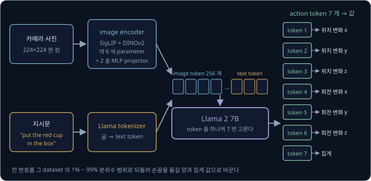

위 그림의 왼쪽에서 사진과 지시문이 각각 token 줄이 되어 한 줄로 이어지고, 가운데의 Llama 2 가 그 뒤에 action token 7 개를 하나씩
붙인다. 오른쪽에서 action token 7 개가 숫자 7 개로 바뀌어 로봇에게 간다. 이 강의의 다음 큰 절이 오른쪽 끝, 곧 action 과 token 을
오가는 계산을 다룬다.

**확인 문제.** "사진과 지시문을 받아 action 을 내지만, 인터넷 데이터로 미리 학습한 부분 없이 로봇 시연만으로 처음부터 학습한 모델" 은
이 강의의 정의에서 VLA 일까?

답 보기

이 강의의 정의로는 VLA 가 아니다. 몸통이 인터넷 데이터로 미리 학습한 VLM 이어야 하는데 그 부분이 없다. RT-1 이 이런 모델이다. 다만
글 명령을 받아 행동을 내기만 하면 넓게 VLA 라고 부르는 사람도 있어서, [Real Robot](../real-robot/README.md) 에서 본 것처럼 이름의
경계는 흐릿하다.

### multimodal 입력

VLA 의 설명에는 "multimodal 입력을 받는다" 는 말이 자주 나온다. modality 는 시각·언어·촉각처럼 정보를 받아들이는 감각의 종류이고,
multi 는 "여럿" 이라는 뜻이다. 그래서 multimodal 입력은 종류가 다른 입력 여럿을 함께 받는다는 뜻이다. VLA 는 사진(시각)과 지시문(언어)을
받고, 모델에 따라 관절 각도(로봇 상태)까지 받는다.

| 입력 | modality | 예 | token 이 되는 방법 |
| --- | --- | --- | --- |
| 카메라 사진 | 시각 | 224×224 사진 한 장 | image encoder 가 patch 마다 image token 을 만든다 |
| 지시문 | 언어 | "put the red cup in the box" | tokenizer 가 글을 text token 으로 자른다 |
| 로봇 상태 | 몸의 감각 | 관절 각도 7 개 | 숫자를 vector 로 바꿔 token 하나로 넣는다 (모델마다 다르다) |

OpenVLA 는 사진 한 장과 지시문만 받고 로봇 상태는 받지 않는다. OpenVLA 논문도 이를 한계로 적고, 여러 장의 사진과 로봇 상태를 받게
넓히는 것을 앞으로의 과제로 꼽았다. 뒤에 나올 [π0](../pi0/README.md) 는 사진 여러 장, 지시문, 관절 각도를 함께 받는다.

multimodal 이라는 단어는 다른 뜻으로도 쓰인다. [Behavior Cloning](../behavior-cloning/README.md) 과 [RT-1](../rt1/README.md) 에서는 같은
장면에 정답 action 이 여럿이라 action 분포(값마다 얼마나 자주 나오는지)의 봉우리가 여럿인 경우를 multimodal 이라고 불렀다. 그때의
modal 은 통계의 mode(가장 자주 나온 값)에서 왔다.

| 쓰는 곳 | 뜻 | 예 |
| --- | --- | --- |
| multimodal 입력, multimodal 모델 (CLIP, VLA) | 입력의 종류가 여럿이다 | 사진과 지시문과 관절 각도를 함께 받는다 |
| multimodal 시연, multimodal 분포 (behavior cloning, RT-1, ACT) | 같은 장면에 정답 action 이 여럿이다 | 상자를 왼쪽으로도 오른쪽으로도 피한다 |

이 강의에서 multimodal 은 언제나 첫째 뜻, 곧 입력의 종류가 여럿이라는 뜻이다.

**확인 문제.** (가) "OpenVLA 는 사진과 지시문을 받는 multimodal 모델이다" (나) "컵을 왼손잡이처럼 잡은 시연과 오른손잡이처럼 잡은
시연이 섞여 action 분포가 multimodal 이다" 에서 multimodal 은 각각 어느 뜻일까?

답 보기

(가) 는 입력의 종류가 여럿이라는 뜻이고, (나) 는 같은 장면에 정답 action 이 여럿이라 봉우리가 여럿이라는 뜻이다.

### 모듈식 구성과의 차이

[Real Robot](../real-robot/README.md) 에서는 VLA 와 비슷해 보이지만 VLA 라고 부르지 않는 구성을 봤다. 물체 이름을 받아 사진에서 그
물체를 찾아 주는 인식기가 "blue cube 는 사진의 (220, 240) 에 있다" 같은 위치를 내고, 작은 policy 가 그 위치와 관절 각도만 받아 움직이는
(b) 모듈식 구성이다. 인식기도 인터넷 사진·글로 미리 학습했지만, 글은 인식기에서 멈추고 policy 에는 위치 숫자만 간다.

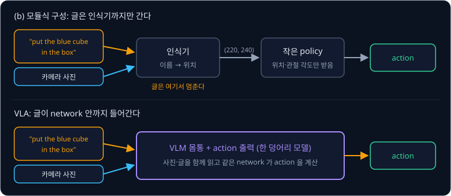

위 그림의 위쪽 줄에서 주황색 지시문 화살표는 인식기에서 끝나고, 아래쪽 줄에서는 VLM 을 지나 action 까지 이어진다. 그래서 VLA 에서는
"뒤집어 놓아", "살살 쥐어" 같은 지시가 어떻게 움직일지를 정하는 계산에도 영향을 줄 수 있다. (b) 는 인식기와 policy 를 따로 학습해 이어
붙인 것이라 이 강의의 정의(사전학습 VLM 을 몸통으로 action 까지 한 덩어리로 학습)에 맞지 않는다.

**확인 문제.** (b) 구성에 "파란 큐브를 뒤집어 놓아" 라고 말하면 "뒤집어" 라는 말은 어디까지 전해질까? VLA 라면?

답 보기

(b) 에서는 인식기가 "blue cube" 의 위치만 내므로 "뒤집어" 는 policy 에 닿지 않는다. VLA 에서는 지시문 전체가 action 을 계산하는
network 에 들어가므로 "뒤집어" 도 계산에 쓰인다. 다만 시연에 뒤집는 동작이 있어야 실제로 뒤집을 수 있다는 점은 뒤의 큰 절에서 다룬다.

**요약**

- LLM 은 다음 token 을 맞히도록 글로 학습한 모델이고, image encoder 를 붙여 사진·글로 학습하면 VLM, 그 VLM 이 로봇 시연으로 action
  까지 내게 학습하면 VLA 다
- VLA 는 사진·지시문(·로봇 상태)이라는 multimodal 입력을 받아 action 을 내는 한 덩어리 모델이고, 이때 multimodal 은 "입력의 종류가
  여럿" 이라는 뜻이다
- RT-2(55B 등)와 OpenVLA(7B)는 action 을 vocabulary 의 token 으로 바꿔 VLM 이 글을 쓰듯 action 을 쓰게 했다

## 행동의 token 표현

### 7 개의 action 값

[Behavior Cloning](../behavior-cloning/README.md) 의 로봇 팔은 관절 6 개와 집게 하나를 가졌고, 매 순간 관절 6 개의 목표 각도와 집게를
벌리는 각도, 모두 숫자 7 개를 action 으로 냈다. 이 강의는 이 팔의 action 으로 계산한다. 어떤 순간에 시연에서 기록한 action 이 아래와
같았다고 하자.

| 차원 | 뜻 | 값 |
| --- | --- | --- |
| 1 | 관절 1 각도 | 10.3° |
| 2 | 관절 2 각도 | 45.8° |
| 3 | 관절 3 각도 | −30.6° |
| 4 | 관절 4 각도 | 60.2° |
| 5 | 관절 5 각도 | 0° |
| 6 | 관절 6 각도 | −12.7° |
| 7 | 집게 각도 | 30.4° |

숫자 하나하나를 action 의 차원이라고 부른다. 각도는 10.3° 처럼 소수점 아래까지 아무 값이나 될 수 있는 연속된 값이다. 그런데 LLM 은
vocabulary 에 있는 token 가운데 하나를 고르는 모델이라서, 10.3 같은 연속된 값을 그대로 내지 못한다. 그래서 각도를 정해진 개수의
번호 가운데 하나로 바꿔야 한다.

실제 OpenVLA 의 action 도 숫자 7 개지만 뜻은 조금 다르다. OpenVLA 는 관절 각도 대신 손끝(end-effector, 팔 끝의 집게 부분)을 앞뒤·좌우·
위아래로 옮길 거리 3 개, 손끝을 돌릴 각도 3 개, 집게 여닫기 1 개를 낸다. RT-2 는 여기에 "작업을 끝낼지" 를 나타내는 숫자 하나를 더해
8 개를 낸다. 숫자를 번호로 바꾸는 계산은 어느 쪽에나 똑같이 쓸 수 있어서, 이 강의는 손으로 따라가기 쉬운 관절 각도로 계산한다.

**확인 문제.** OpenVLA 가 1 초에 action 을 6 번 낸다면, 1 초 동안 내는 숫자는 모두 몇 개일까? RT-2 처럼 한 번에 8 개를 낸다면?

답 보기

$6 \times 7 = 42$ 개다. 한 번에 8 개라면 $6 \times 8 = 48$ 개다.

### 칸 256 개로 나누기

[RT-1](../rt1/README.md) 에서 연속된 값의 범위를 같은 폭의 칸(bin) 여러 개로 나누고 값 대신 칸 번호를 쓰는 binning 을 배웠다. 관절
1 의 범위를 $-128$° ~ $+128$° 로 정하고 칸 256 개로 나누면 칸 폭은 $256 \div 256 = 1$° 이고, 10.3° 는 아래처럼 138 번 칸이 된다.

1. 범위의 왼쪽 끝에서 떨어진 거리를 구한다. $10.3 - (-128) = 138.3$ 이다
2. 그 거리가 칸 폭의 몇 배인지 구한다. $138.3 \div 1 = 138.3$ 이다
3. 소수점 아래를 버린다. 138 번 칸이다

세 단계를 기호로 쓰면 RT-1 강의의 식과 같다.

$$
b = \left\lfloor \frac{a - a_{\min}}{\Delta} \right\rfloor, \qquad \Delta = \frac{a_{\max} - a_{\min}}{K}
$$

- $a$ 는 칸으로 바꿀 값으로, 관절 1 의 10.3° 다
- $a_{\min}$ 과 $a_{\max}$ 는 범위의 왼쪽 끝과 오른쪽 끝으로, $-128$° 와 $+128$° 다
- $K$ 는 칸의 개수로, 256 이다
- $\Delta$ 는 칸 하나의 폭으로, 그리스 문자 delta(델타)의 대문자다. 여기서는 1° 다
- $\lfloor \ \rfloor$ 는 소수점 아래를 버리는 내림이고 floor(바닥)라고 읽는다. $\lfloor 138.3 \rfloor = 138$ 이다
- $b$ 는 구한 칸 번호로, 0 부터 255 사이의 정수다

식은 "값이 범위의 왼쪽 끝에서 떨어진 거리를 칸 폭으로 나누고, 소수점 아래를 버린다" 로 읽는다. 범위를 벗어난 값은 가장 가까운 끝값으로
잘라(clip) 0 번이나 255 번 칸에 넣는다.

관절 6 개는 모두 같은 범위 $-128$° ~ $+128$° 를 쓰고, 집게는 범위가 0° ~ 64° 라서 칸 폭이 $64 \div 256 = 0.25$° 다. 7 개를 모두
바꾸면 아래와 같다.

| 차원 | 값 $a$ | 범위 | 칸 폭 $\Delta$ | $(a - a_{\min}) \div \Delta$ | 칸 번호 $b$ |
| --- | --- | --- | --- | --- | --- |
| 관절 1 | 10.3 | $-128$ ~ $128$ | 1 | 138.3 | 138 |
| 관절 2 | 45.8 | $-128$ ~ $128$ | 1 | 173.8 | 173 |
| 관절 3 | $-30.6$ | $-128$ ~ $128$ | 1 | 97.4 | 97 |
| 관절 4 | 60.2 | $-128$ ~ $128$ | 1 | 188.2 | 188 |
| 관절 5 | 0 | $-128$ ~ $128$ | 1 | 128.0 | 128 |
| 관절 6 | $-12.7$ | $-128$ ~ $128$ | 1 | 115.3 | 115 |
| 집게 | 30.4 | 0 ~ 64 | 0.25 | 121.6 | 121 |

집게는 $30.4 \div 0.25 = 121.6$ 이라 121 번 칸이다. 이렇게 action 하나가 0 ~ 255 사이의 정수 7 개가 되었다.

**확인 문제.** 범위 $-128$° ~ $+128$°, 칸 256 개일 때 관절 각도 $-40.2$° 는 몇 번 칸일까?

답 보기

$-40.2 - (-128) = 87.8$ 이고 칸 폭이 1 이라 $87.8 \div 1 = 87.8$, 내리면 87 번 칸이다.

### 분위수로 정하는 범위

칸 폭은 범위를 얼마로 잡느냐에 따라 달라진다. 범위를 시연에 나온 가장 작은 값에서 가장 큰 값까지로 잡으면 간단하지만, 드물게 튀는
값이 하나만 있어도 범위가 크게 넓어진다.

어떤 관절의 시연 값이 거의 모두 $-10$° ~ $+10$° 사이에 있는데, 센서 오류로 $+200$° 가 한 번 기록됐다고 하자.

| 범위를 정하는 법 | 범위 | 칸 폭 ($K = 256$) | 최대 오차 (칸 폭의 절반) |
| --- | --- | --- | --- |
| 가장 작은 값 ~ 가장 큰 값 | $-10$ ~ $200$ | $210 \div 256 \approx 0.82$° | 약 0.41° |
| 아래 1% 와 위 1% 를 뺀 범위 | $-10$ ~ $10$ | $20 \div 256 \approx 0.078$° | 약 0.039° |

가장 큰 값까지 범위를 잡으면 칸 256 개 가운데 대부분이 아무 값도 들어오지 않는 $+10$° ~ $+200$° 에 쓰이고, 실제 값이 모인
$-10$° ~ $+10$° 에는 $20 \div 0.82 \approx 24$ 칸만 남는다. 칸이 10 배 넘게 성글어진다.

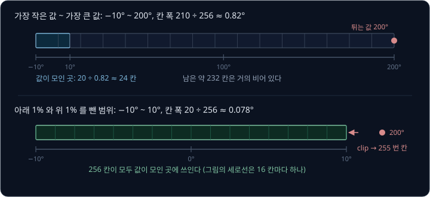

값들을 작은 것부터 줄 세웠을 때 아래에서 몇 % 자리에 있는 값을 분위수(quantile)라고 한다. 값이 100 개라면 아래에서 1 번째 근처가
1% 분위수, 99 번째 근처가 99% 분위수다. RT-2 는 가장 작은 값 ~ 가장 큰 값을 범위로 썼고, OpenVLA 는 그 대신 학습 데이터에서 차원마다 1% 분위수와
99% 분위수 사이를 256 칸으로 나눴다. 논문은 그 이유를 "드물게 튀는 action 이 범위를 크게 넓혀 칸을 성글게 만드는 것을 피하려고" 라고
적었다. 범위 밖으로 나간 1% 의 값은 clip 해서 가장자리 칸에 넣는다.

**확인 문제.** 어떤 차원의 값이 대부분 0 ~ 64 사이에 있는데 튀는 값 576 이 하나 섞여 있다. 가장 작은 값 ~ 가장 큰 값(0 ~ 576)으로
256 칸을 나누면 칸 폭은 몇일까? 0 ~ 64 로 나누면?

답 보기

$576 \div 256 = 2.25$ 이고, $64 \div 256 = 0.25$ 다. 튀는 값 하나 때문에 칸 폭이 9 배가 된다.

### vocabulary 의 드문 token 자리

칸 번호 0 ~ 255 를 LLM 이 낼 수 있게 하려면 칸 번호마다 vocabulary 의 token 하나를 짝지어야 한다. OpenVLA 의 LLM 인 Llama 2 의
vocabulary 에는 token 이 32,000 개 있고, token id 는 0 부터 31,999 까지다.

새 token 256 개를 vocabulary 에 더하는 방법도 있지만, OpenVLA 논문에 따르면 Llama 의 tokenizer 는 새로 더할 token 자리를 100 개만
마련해 두어 256 개에 모자랐다. 그래서 OpenVLA 는 RT-2 를 따라, 이미 있는 token 가운데 가장 드물게 쓰이는 256 개를 action 용으로
덮어썼다. Llama 의 tokenizer 에서는 vocabulary 의 끝쪽 token 이 가장 드물게 쓰여서, 맨 끝 256 개인 31,744 번 ~ 31,999 번이 그 자리다.
$32{,}000 - 256 = 31{,}744$ 이다.

드문 token 을 고르는 이유는 원래 뜻을 잃어도 손해가 적기 때문이다. "the", "cup" 처럼 자주 쓰는 token 을 action 으로 덮어쓰면 VLM 이
글을 이해하는 능력이 망가지지만, 거의 나오지 않는 token 은 원래 뜻을 잃어도 지시문을 읽는 데 지장이 거의 없다.

이 강의에서는 칸 번호 $b$ 를 token id $31{,}744 + b$ 로 짝짓는다. 0 번 칸은 31,744, 255 번 칸은 31,999 다.

$$
\text{token id} = 31{,}744 + b
$$

식은 "칸 번호에 31,744 를 더하면 action token 의 id 가 된다" 로 읽는다. OpenVLA 의 공개 코드는 action 을 먼저 $-1$ ~ $1$ 로 맞춘 뒤 칸을
나누고, 칸 번호가 클수록 id 가 작아지게 거꾸로 짝짓는 등 세부가 조금 다르다. 칸 하나와 id 하나가 빠짐없이 짝지어지기만 하면 원리는
같다.

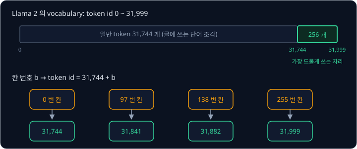

위 그림의 긴 막대가 vocabulary 전체이고, 오른쪽 끝의 초록 부분이 action token 256 개다. 아래 줄에서 칸 번호 138 은 31,882 로 바뀐다.
앞 절의 7 개를 모두 바꾸면 아래와 같다.

| 차원 | 칸 번호 $b$ | token id $31{,}744 + b$ |
| --- | --- | --- |
| 관절 1 | 138 | 31,882 |
| 관절 2 | 173 | 31,917 |
| 관절 3 | 97 | 31,841 |
| 관절 4 | 188 | 31,932 |
| 관절 5 | 128 | 31,872 |
| 관절 6 | 115 | 31,859 |
| 집게 | 121 | 31,865 |

action token 256 개는 7 개 차원이 함께 쓴다. 31,882 라는 token 은 첫째 자리에 나오면 관절 1 의 138 번 칸이고, 일곱째 자리에 나오면
집게의 138 번 칸이다. 같은 token 이라도 몇 번째로 나왔는지가 어느 차원인지를 정한다.

RT-2 는 몸통 VLM 에 따라 두 방법을 썼다. PaLI-X 는 1000 까지의 정수마다 token 이 따로 있어서, 칸 번호 138 을 그냥 글자 "138" 의 token
으로 냈다. PaLM-E 에는 그런 token 이 없어서 OpenVLA 처럼 가장 드물게 쓰이는 token 256 개를 덮어썼다.

**확인 문제.** 칸 번호 200 은 token id 몇 번일까? token id 31,800 은 몇 번 칸일까?

답 보기

$31{,}744 + 200 = 31{,}944$ 번이다. 거꾸로 $31{,}800 - 31{,}744 = 56$ 이라 56 번 칸이다.

### action token 7 개의 생성

이제 VLA 가 action 을 내는 과정을 따라간다. [GPT-2](../gpt/README.md) 의 autoregressive 생성처럼, 모델이 낸 token 을 입력 끝에 붙여
다시 넣기를 되풀이한다. autoregressive 는 "앞에서 낸 출력을 다시 입력으로 넣어 하나씩 만든다" 는 뜻이다.

1. image token 과 지시문 token 을 넣으면, LLM 이 마지막 자리에서 vocabulary 32,000 개 token 마다 점수를 낸다. 이 점수를 logits 라고
   한다
2. action token 256 개를 뺀 나머지 31,744 개의 점수를 $-\infty$(음의 무한대)로 바꾼다. $-\infty$ 는 어떤 수보다도 작은 값이라서 이
   token 들은 절대 뽑히지 않는다
3. 남은 256 개 가운데 점수가 가장 큰 token 을 고른다. 가장 큰 값의 자리를 고르는 일을 argmax 라고 한다. 관절 1 자리에서 31,882 가
   나왔다고 하자
4. 31,882 를 입력 끝에 붙이고 다시 넣어 관절 2 의 token 을 고른다. 이렇게 7 번 되풀이한다

2 단계가 없으면 모델이 "cup" 같은 일반 단어를 낼 수도 있다. 학습이 잘 되면 action 자리에서 일반 단어의 점수는 낮아지지만, 혹시 모를
일을 막으려고 action token 밖의 점수를 아예 막는다. 점수 상위 k 개만 남기는 top-k sampling 과 뒤의 token 을 못 보게 가리는 causal mask 도
같은 식으로 점수를 $-\infty$ 로 바꾼다.

| 단계 | 넣는 입력 | 고른 token id | 칸 번호 |
| --- | --- | --- | --- |
| 1 | image token, 지시문 token | 31,882 | 138 |
| 2 | 위 입력 + 31,882 | 31,917 | 173 |
| 3 | 위 입력 + 31,917 | 31,841 | 97 |
| 4 | 위 입력 + 31,841 | 31,932 | 188 |
| 5 | 위 입력 + 31,932 | 31,872 | 128 |
| 6 | 위 입력 + 31,872 | 31,859 | 115 |
| 7 | 위 입력 + 31,859 | 31,865 | 121 |

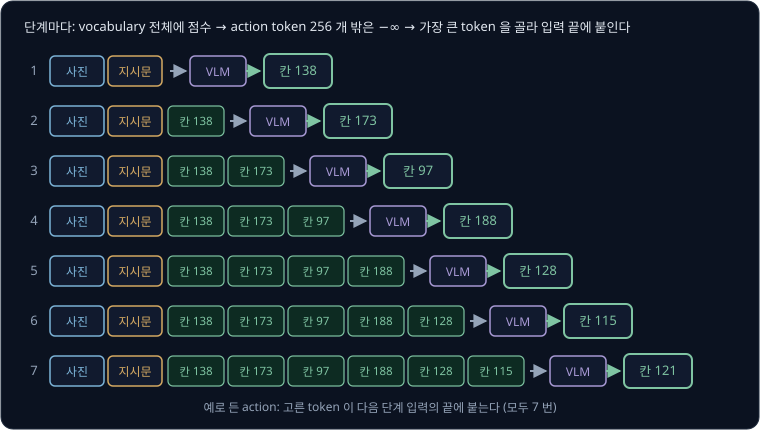

위 그림에서 단계마다 고른 token 이 오른쪽 아래로 내려가 다음 단계 입력 끝에 붙는다. 사람이 "빨간 컵을 집어" 라는 문장을 한 단어씩
말하듯, 모델은 action 을 token 7 개로 한 개씩 말한다.

차원을 하나씩 차례로 고르면 앞에서 고른 차원을 보고 다음 차원을 고를 수 있다. [RT-1](../rt1/README.md) 에서 차원마다 따로 고르면 시연에
없던 조합이 나올 수 있다고 했는데, 이 방식에서는 관절 1 을 138 번 칸으로 고른 것을 보고 관절 2 를 고르므로 그 문제가 줄어든다. RT-1 은
1 초에 3 번 action 을 내야 해서 이 방식을 빼고 11 개 차원을 한 번에 냈다. 이 방식의 대가는 뒤의 약점 절에서 숫자로 본다.

**확인 문제.** 어떤 단계에서 logits 가 일반 token "cup" 9.1, action token 31,882 7.4, action token 31,883 7.9 였다. action token 밖의
점수를 막고 argmax 로 고르면 어느 token 이 나오고, 몇 번 칸일까?

답 보기

"cup" 은 $-\infty$ 로 막혀 빠진다. 남은 둘 가운데 7.9 가 더 크므로 31,883 이 나오고, $31{,}883 - 31{,}744 = 139$ 번 칸이다. 막지 않았다면
점수가 가장 큰 "cup" 이 나와 action 으로 쓸 수 없었다.

### token 에서 다시 값으로

로봇에게는 각도를 보내야 하므로, 고른 token id 를 거꾸로 칸 번호로, 칸 번호를 각도로 바꾼다. 칸 번호는 id 에서 31,744 를 빼면 되고,
각도는 [RT-1](../rt1/README.md) 에서처럼 그 칸의 가운데 값을 쓴다.

$$
\hat a = a_{\min} + (b + 0.5) \times \Delta
$$

$\hat a$ 는 "a 햇" 이라고 읽고, 칸 번호에서 되돌린 값이다. $b + 0.5$ 는 "칸 $b$ 개를 다 지나고 다음 칸의 절반까지" 라는 뜻이다. 관절
1 의 31,882 는 $31{,}882 - 31{,}744 = 138$ 번 칸이고, $-128 + 138.5 \times 1 = 10.5$° 다.

| 차원 | token id | 칸 번호 $b$ | 되돌린 값 $\hat a$ | 원래 값 $a$ | 오차 $\hat a - a$ |
| --- | --- | --- | --- | --- | --- |
| 관절 1 | 31,882 | 138 | 10.5 | 10.3 | $+0.2$ |
| 관절 2 | 31,917 | 173 | 45.5 | 45.8 | $-0.3$ |
| 관절 3 | 31,841 | 97 | $-30.5$ | $-30.6$ | $+0.1$ |
| 관절 4 | 31,932 | 188 | 60.5 | 60.2 | $+0.3$ |
| 관절 5 | 31,872 | 128 | 0.5 | 0 | $+0.5$ |
| 관절 6 | 31,859 | 115 | $-12.5$ | $-12.7$ | $+0.2$ |
| 집게 | 31,865 | 121 | 30.375 | 30.4 | $-0.025$ |

집게는 $0 + 121.5 \times 0.25 = 30.375$° 다. 되돌린 값은 원래 값이 아니라 칸의 가운데 값이라서, 관절은 최대 0.5°(칸 폭 1° 의 절반),
집게는 최대 0.125° 만큼 어긋날 수 있다.

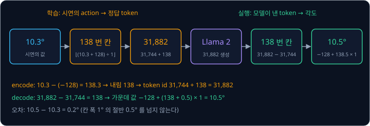

위 그림은 관절 1 하나로 값 → 칸 → token id → 생성 → token id → 칸 → 값을 한 바퀴 돈 것이다. 왼쪽 절반은 학습할 때 시연의 action 을
정답 token 으로 바꾸는 길이고, 오른쪽 절반은 실행할 때 모델이 낸 token 을 각도로 바꾸는 길이다.

숫자만 바꿔 다른 순간의 action 으로 한 번 더 해 본다.

| 차원 | 값 $a$ | 칸 번호 $b$ | token id | 되돌린 값 $\hat a$ |
| --- | --- | --- | --- | --- |
| 관절 1 | 11.6 | 139 | 31,883 | 11.5 |
| 관절 2 | 44.2 | 172 | 31,916 | 44.5 |
| 관절 3 | $-31.4$ | 96 | 31,840 | $-31.5$ |
| 관절 4 | 59.7 | 187 | 31,931 | 59.5 |
| 관절 5 | 2.8 | 130 | 31,874 | 2.5 |
| 관절 6 | $-12.1$ | 115 | 31,859 | $-12.5$ |
| 집게 | 28.9 | 115 | 31,859 | 28.875 |

관절 6 과 집게가 똑같이 31,859 가 되었다. 같은 115 번 칸이지만, 여섯째 자리의 31,859 는 관절 범위로 되돌려 $-128 + 115.5 = -12.5$° 가
되고 일곱째 자리의 31,859 는 집게 범위로 되돌려 $115.5 \times 0.25 = 28.875$° 가 된다. 몇 번째 자리인지가 어느 범위로 되돌릴지를 정한다.

**확인 문제.** 관절 자리(범위 $-128$° ~ $+128$°)에서 token id 31,800 이 나왔다. 몇 도로 되돌릴까? 같은 id 가 집게 자리(0° ~ 64°)에서
나왔다면?

답 보기

$31{,}800 - 31{,}744 = 56$ 번 칸이다. 관절이면 $-128 + 56.5 \times 1 = -71.5$° 이고, 집게면 $0 + 56.5 \times 0.25 = 14.125$° 다.

### 학습 방법

학습은 [GPT-2](../gpt/README.md) 와 같은 다음 token 맞히기다. 시연의 한 순간에서 사진을 image token 으로, 지시문을 text token 으로
바꾸고, 그 뒤에 그 순간 action 의 정답 token 7 개(앞의 31,882 ~ 31,865)를 붙인다. 모델은 7 개 자리마다 앞의 모든 token 을 보고 다음
token 의 확률을 낸다.

벌점은 정답 token 이 받은 확률로 매긴다. log 는 어떤 수가 $e$(약 2.718)를 몇 제곱한 값인지를 묻는 계산이라서, $e^{-0.693} \approx 0.5$
이므로 $\log 0.5 \approx -0.693$ 이다. 확률 $p$ 에 대해 $-\log p$ 를 벌점으로 쓰면, 확률이 1 에 가까울수록 벌점은 0 에 가깝고 확률이
작을수록 벌점이 커진다. $-\log 1 = 0$, $-\log 0.5 \approx 0.693$, $-\log 0.25 \approx 1.386$ 이다. 이 벌점을
cross-entropy 라고 한다. 차원 3 개로 줄여 계산하면 아래와 같다.

| 자리 | 정답 token | 모델이 정답에 준 확률 | cross-entropy $-\log p$ |
| --- | --- | --- | --- |
| 관절 1 | 31,882 | 0.5 | 0.693 |
| 관절 2 | 31,917 | 0.8 | 0.223 |
| 관절 3 | 31,841 | 0.25 | 1.386 |
| 평균 | | | 0.767 |

평균은 $(0.693 + 0.223 + 1.386) \div 3 = 2.302 \div 3 \approx 0.767$ 이다. 정답 확률이 가장 낮은 관절 3 자리가 벌점을 가장 크게 보태므로,
학습은 그 자리의 점수를 가장 크게 고친다.

image token 과 지시문 token 자리에서는 벌점을 계산하지 않는다. 그 자리의 다음 token 을 맞히는 것은 사진과 지시문을 따라 쓰는 일이라 로봇이
배울 필요가 없다. OpenVLA 논문도 cross-entropy 를 action token 자리에서만 계산한다고 적었다. 식으로 쓰면 아래와 같다.

$$
L = -\frac{1}{7}\sum_{d=1}^{7} \log p_\theta\big(t_d \mid \text{사진},\ \text{지시문},\ t_1, \dots, t_{d-1}\big)
$$

- $d$ 는 몇 번째 action 자리인지를 가리키고, 1 부터 7 까지 바꿔 가며 더한다. $\Sigma$ 는 sigma(시그마)라고 읽고 "모두 더하라" 는 기호다
- $t_d$ 는 $d$ 번째 자리의 정답 token 으로, 관절 1 자리라면 31,882 다
- $p_\theta(\ \mid\ )$ 는 parameter 가 $\theta$(theta, 세타)인 모델이 세로선 오른쪽을 보고 정답 token 에 준 확률이다. 세로선 $\mid$ 는
  "~ 를 보고" 라고 읽는다. 위 표의 0.5, 0.8, 0.25 다
- 오른쪽의 $t_1, \dots, t_{d-1}$ 은 그 자리보다 앞의 정답 token 들이다. 학습 때는 모델이 고른 token 대신 시연의 정답 token 을 앞에 넣는다

식은 "action 자리 7 개마다 정답 token 확률의 $-\log$ 를 구해 평균한다" 로 읽는다. OpenVLA 는 이 학습을 GPU(곱셈·덧셈 수천 개를 동시에
하는 계산 칩) 64 장으로 14 일 동안 했고, 학습 데이터를 27 번 되풀이해 보았다.

**확인 문제.** action 자리 2 개에서 정답 token 의 확률이 1 과 0.25 였다. 두 자리의 cross-entropy 평균은? ($-\log 0.25 \approx 1.386$)

답 보기

$-\log 1 = 0$ 이고 $-\log 0.25 \approx 1.386$ 이라 평균은 $(0 + 1.386) \div 2 = 0.693$ 이다. 이미 확률 1 을 준 자리는 벌점에 아무것도
보태지 않는다.

**요약**

- 연속된 action 7 개를 차원마다 칸 256 개로 나눠 칸 번호로 바꾸고, OpenVLA 는 범위를 1% ~ 99% 분위수로 잡아 튀는 값 때문에 칸이 성글어지는
  것을 막는다
- 칸 번호는 Llama 2 vocabulary 의 가장 드문 token 256 개(31,744 ~ 31,999)에 짝지어지고, 모델은 action 밖의 점수를 $-\infty$ 로 막은 채
  token 7 개를 하나씩 생성한다. 10.3° → 138 번 칸 → 31,882 → 138 번 칸 → 10.5° 처럼 값은 칸의 가운데로 되돌아온다
- 학습은 action token 7 자리에서만 cross-entropy 를 계산하는 다음 token 맞히기다

## action token 방식의 약점

### 칸으로 자르는 정밀도 손실

칸의 가운데 값으로 되돌리면 관절마다 최대 0.5° 가 어긋난다. 0.5° 는 작아 보이지만, 팔 끝에서는 길이로 바뀐다. 관절에서 손끝까지가
30 cm(300 mm)인 팔이 관절 하나를 0.5° 더 돌리면, 손끝은 반지름 300 mm 인 원 위를 그만큼 움직인다.

원 한 바퀴의 둘레는 $2 \times 3.14 \times \text{반지름}$ 이다. 한 단계씩 계산하면 아래와 같다.

1. 둘레: $2 \times 3.14 \times 300 = 1{,}884$ mm
2. 0.5° 는 한 바퀴 360° 의 몇 분의 1 인지: $0.5 \div 360 \approx 0.00139$
3. 손끝이 움직이는 길이: $1{,}884 \times 0.5 \div 360 \approx 2.6$ mm

관절 하나에서 손끝이 2.6 mm 어긋날 수 있고, 관절이 여러 개라 오차가 같은 방향으로 겹치면 더 커진다. 컵을 집는 데는 문제가 없지만,
구멍에 핀을 꽂거나 케이블 커넥터를 끼우는 작업처럼 1 mm 안쪽으로 맞춰야 하는 일에는 부족하다.

| 칸 개수 $K$ | 칸 폭 (범위 256°) | 최대 각도 오차 | 30 cm 끝의 최대 어긋남 |
| --- | --- | --- | --- |
| 16 | 16° | 8° | $1{,}884 \times 8 \div 360 \approx 41.9$ mm |
| 256 | 1° | 0.5° | $1{,}884 \times 0.5 \div 360 \approx 2.6$ mm |

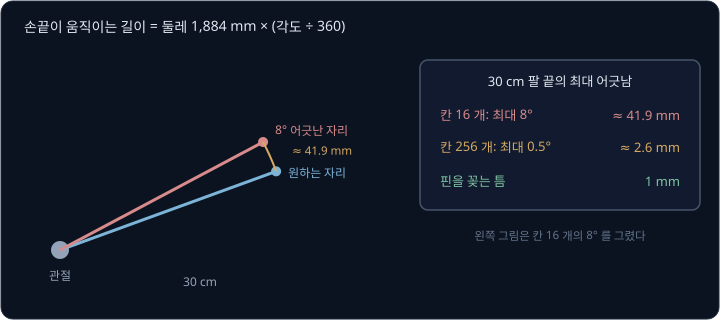

칸을 더 잘게 나누면 오차는 줄지만, 칸 하나가 vocabulary 의 token 하나라서 덮어쓸 token 이 그만큼 늘고, 칸마다 정답이 나온 시연 수는
줄어 칸 하나하나의 확률을 배우기가 어려워진다. RT-1 과 RT-2, OpenVLA 는 모두 256 을 골랐다.

**확인 문제.** 관절에서 손끝까지 60 cm 인 팔에서 관절 하나가 0.5° 어긋나면 손끝은 대략 몇 mm 어긋날까? ($2 \times 3.14 \times 600 = 3{,}768$)

답 보기

$3{,}768 \times 0.5 \div 360 \approx 5.2$ mm 다. 팔이 두 배로 길면 같은 각도 오차에 손끝은 두 배 어긋난다.

### 하나씩 생성하는 속도

학습을 마친 모델에 입력을 넣어 출력을 계산하는 일을 추론(inference)이라고 한다. VLA 의 추론에서 action token 7 개는 하나씩 차례로
만든다. 다음 token 을 고르려면 앞 token 이 있어야 해서 7 개를 한꺼번에 계산할 수 없고, 그래서 action 하나를 내려면 70 억 개짜리 LLM 을
7 번 차례로 돌려야 한다.

OpenVLA 논문은 NVIDIA 의 게임용 GPU 인 RTX 4090 한 장에서 OpenVLA 가 1 초에 약 6 번 action 을 냈다고 적었다. 1 초에 몇 번 일어나는지를
세는 단위가 Hz(헤르츠)라서 약 6 Hz 다. RT-2 논문은 가장 큰 55B 모델을 Google 의 계산 서버에 올려 1 ~ 3 Hz, 5B 모델은 약 5 Hz 로 돌렸다.
로봇이 action 하나를 받아 움직이는 한 번을 step 이라고 부르므로, 6 Hz 는 1 초에 step 6 번이다. 아래 표의 ms 는
1000 분의 1 초다.

| 모델 | 1 초에 내는 action 수 | action 하나에 걸리는 시간 |
| --- | --- | --- |
| RT-2 (55B) | 1 ~ 3 번 | 약 0.33 ~ 1 초 |
| OpenVLA (7B) | 약 6 번 | 약 $1 \div 6 \approx 0.167$ 초 = 167 ms |
| 목표 50 Hz | 50 번 | $1 \div 50 = 0.02$ 초 = 20 ms |

빨래 개기처럼 손을 빠르고 섬세하게 움직이는 작업은 50 Hz 처럼 빠른 주기로 제어하는 경우가 많다. OpenVLA 논문도 50 Hz 로 도는 두 팔
로봇 ALOHA 를 예로 들며 추론 속도를 높이는 것을 과제로 꼽았다. 6 Hz 로 50 Hz 를 맞추려면 $50 \div 6 \approx 8.3$ 배 빨라져야 한다.

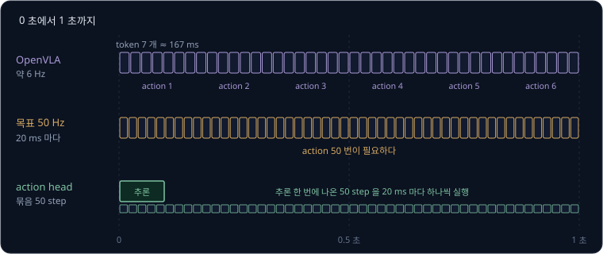

위 그림의 위 줄에서 작은 칸 7 개가 token 하나씩이고, 7 개가 모여야 action 하나가 된다. 가운데 줄의 50 Hz 는 같은 1 초에 action 이 50 번
필요하다.

**흔한 오해.** GPU 가 빠르면 token 7 개도 한 번에 나올 것이라고 생각하기 쉽다. GPU 는 token 하나를 고르는 계산 안의 곱셈들을 동시에 할 뿐,
"관절 2 의 token 은 관절 1 의 token 을 보고 고른다" 는 순서는 바꾸지 못한다. 계산 한 번에 0.02 초가 걸린다고 하면, 7 번 차례로 해야 해서
action 하나에 $7 \times 0.02 = 0.14$ 초가 걸리고 1 초에 약 7 번밖에 action 을 내지 못한다.

**확인 문제.** 계산 한 번에 0.01 초가 걸리는 VLA 가 action 하나에 token 7 개를 하나씩 낸다면 1 초에 action 을 몇 번 낼 수 있을까?
RT-2 처럼 token 8 개라면?

답 보기

7 개면 action 하나에 $7 \times 0.01 = 0.07$ 초라서 $1 \div 0.07 \approx 14.3$, 약 14 번이다. 8 개면 $8 \times 0.01 = 0.08$ 초라서
$1 \div 0.08 = 12.5$, 12 번 남짓이다.

### 별도 action head 방식

두 약점은 모두 "action 을 vocabulary 의 token 으로 낸다" 는 데서 나온다. 칸으로 자르니 정밀도를 잃고, token 이니 하나씩 낸다. 그래서
VLM 은 사진과 지시문을 읽는 데만 쓰고, action 은 VLM 옆에 따로 붙인 network 가 연속된 숫자 그대로 내게 하는 방식이 나왔다. action 을
내는 이 별도 부분을 action head 라고 부르고, 모델에 따라 action expert 라고도 부른다. head 는 network 의 맨 끝에서 원하는 출력을 만드는
부분이라는 뜻이다.

action head 는 각도 7 개를 10.3, 45.8 처럼 숫자 그대로 내므로 칸 폭 때문에 생기는 오차가 없다. 또 한 번 계산할 때 지금 action 하나가
아니라 앞으로 여러 step 의 action 묶음(action chunk)을 한꺼번에 낼 수 있다. [π0](../pi0/README.md) 는 PaliGemma 옆에 action expert 를 두고
flow matching(무작위 숫자에서 시작해 조금씩 고쳐 원하는 값을 만드는 생성 방법)으로 앞으로 50 step 분의 action 을 한 번에 만들어, 최대
50 Hz 로 로봇을 움직였다. π0 논문은 action 을 하나씩 칸 token 으로 내는 OpenVLA 가 action chunk 를 지원하지 못해 빠르고 섬세한 작업에서
고전했다고 적었다.

| 방식 | action 의 형태 | 추론 한 번에 나오는 것 | 정밀도 |
| --- | --- | --- | --- |
| action token (RT-2, OpenVLA) | 칸 번호의 token | action 하나 (token 7 개를 7 번에 걸쳐) | 칸 폭의 절반까지 오차 |
| 별도 action head (π0 등) | 연속된 숫자 | action 여러 step 묶음 | 칸 때문에 생기는 오차가 없다 |

**확인 문제.** action head 가 추론 한 번에 0.1 초를 쓰고 앞으로 50 step 분의 action 을 낸다. 이 묶음을 1 초에 50 step 씩 실행하면 묶음
하나로 몇 초를 버틸 수 있고, 그동안 추론을 몇 번 더 할 시간이 있을까?

답 보기

50 step 을 1 초에 50 step 씩 실행하므로 묶음 하나로 1 초를 버틴다. 추론 한 번이 0.1 초라 그 1 초 동안 $1 \div 0.1 = 10$ 번 할 시간이
있다. 그래서 묶음을 다 쓰기 전에 다음 묶음을 넉넉히 준비할 수 있다.

**요약**

- 칸 256 개로 자르면 관절마다 최대 0.5° 가 어긋나고, 30 cm 팔 끝에서는 약 2.6 mm 다. 1 mm 안쪽으로 맞춰야 하는 작업에는 부족하다
- token 을 하나씩 내야 해서 OpenVLA 는 RTX 4090 에서 약 6 Hz, RT-2 55B 는 1 ~ 3 Hz 로 움직였고, 50 Hz 제어에는 한참 못 미친다
- 그래서 [π0](../pi0/README.md) 처럼 VLM 옆에 별도 action head 를 두어 연속된 action 묶음을 한 번에 내는 방식이 나왔다

## 텍스트가 하는 일과 못 하는 일

### 인터넷 지식이 행동까지 오는 길

VLM 몸통이 인터넷에서 배운 지식은 지시문 token 과 image token 이 같은 LLM 을 지나며 서로를 참고하는 길로 로봇의 행동까지 온다. "바나나를 집어" 라는 지시가 들어오면, VLM 이 인터넷 사진·글에서 배운 "바나나는 노랗고 길쭉하다" 는 지식 덕분에 바나나가 있는
구역의 image token 과 "바나나" token 이 강하게 이어진다. 그 결과가 action token 을 고르는 계산에 들어가서, 팔이 바나나 쪽으로 뻗는 칸이
높은 점수를 받는다.

이때 시연에서 배운 것은 "지시문이 가리키는 물체 쪽으로 손을 뻗어 집는 동작" 이고, 인터넷에서 배운 것은 "지시문의 단어가 사진의 어느
물체를 가리키는지" 다. 둘이 한 network 안에서 이어지므로, 시연에 바나나가 한 번도 없어도 바나나를 집을 수 있다.

RT-2 논문은 로봇 시연에 없던 지식이 필요한 지시로 이를 시험했다. "콜라 캔을 숫자 3 쪽으로 옮겨" 처럼 숫자·기호를 알아봐야 하는 지시,
"사과를 같은 색 컵으로 옮겨" 처럼 추론이 필요한 지시, "콜라 캔을 안경 쓴 사람 쪽으로 옮겨" 처럼 사람을 알아봐야 하는 지시다.

| 모델 | 기호 이해 | 추론 | 사람 알아보기 | 평균 |
| --- | --- | --- | --- | --- |
| RT-1 | 16% | 16% | 20% | 17% |
| RT-2 (PaLM-E 12B) | 36% | 43% | 43% | 40% |
| RT-2 (PaLI-X 55B) | 82% | 46% | 53% | 60% |

RT-1 은 로봇 시연에서 배운 것만 알아서 평균 17% 에 그쳤고, RT-2 의 55B 모델은 60% 를 해냈다. 로봇 시연은 두 모델이 같으므로, 차이는 VLM
몸통이 인터넷에서 가져온 지식에서 왔다.

**확인 문제.** RT-2 (PaLI-X 55B) 의 평균 60% 는 RT-1 의 평균 17% 의 대략 몇 배일까?

답 보기

$60 \div 17 \approx 3.5$ 배다. RT-2 논문도 가장 좋은 RT-2 가 RT-1 의 3 배가 넘는 평균 성공률을 냈다고 적었다.

### 일반화되는 지시

학습 데이터에 그대로 없던 경우에도 잘 해내는 능력을 일반화(generalization)라고 한다. VLA 에서 텍스트와 인터넷 지식 덕분에 일반화되는
지시는 크게 세 가지다.

| 일반화의 종류 | 시연에 있던 것 | 처음 받은 지시 | 되는 이유 |
| --- | --- | --- | --- |
| 처음 보는 물체 이름 | "사과를 집어" | "바나나를 집어" | VLM 이 바나나가 사진 어디 있는지 안다. 집는 동작은 시연에 있다 |
| 같은 지시의 다른 표현 | "사과를 집어" | "사과 좀 들어 줄래?" | VLM 이 두 문장이 같은 뜻인 것을 안다 |
| 배운 동작의 조합 | "컵을 집어", "상자 위에서 놓아" | "컵을 집어서 상자에 넣어" | 집기와 위에서 놓기가 각각 시연에 있다 |

세 경우 모두 손이 할 동작은 시연에 이미 있다. 바뀐 것은 어느 물체로 갈지, 어떤 순서로 이을지, 어떤 말을 알아들을지뿐이고, 그 부분을
VLM 의 지식이 메운다.

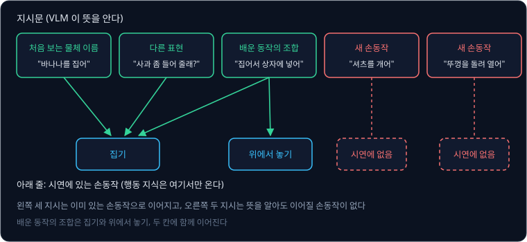

위 그림의 왼쪽 세 칸은 아래 줄 "시연에 있는 손동작" 칸과 이어져 있고, 오른쪽 두 칸은 이어질 손동작 칸이 비어 있다.

**확인 문제.** 시연에 "컵을 집어" 와 "상자 위에서 놓아" 는 있고 "망고" 는 한 번도 나오지 않았다. "망고를 집어서 상자에 넣어" 는 위 표의
어느 일반화들이 함께 필요할까?

답 보기

망고라는 처음 보는 물체 이름과, 집기와 위에서 놓기라는 배운 동작의 조합이 함께 필요하다. 손동작은 모두 시연에 있으므로 해낼 가능성이
있다.

### 일반화되지 않는 새 손동작

반대로 셔츠 개기, 병뚜껑 돌려 열기처럼 시연에 한 번도 없던 손동작은 지시문만으로 나오지 않는다. VLM 은 "셔츠를 개다" 가 무슨 뜻인지
글로는 알고, 셔츠를 갠 사진도 봤을 것이다. 그러나 VLM 이 인터넷에서 본 것은 사진과 글이지, 관절 7 개를 어느 순서로 몇 도씩 움직여야
셔츠가 개어지는지를 담은 action 이 아니다.

action token 을 고르는 확률은 학습할 때 시연에서 각 칸이 정답으로 나온 비율을 배운 것이다. 셔츠를 개는 관절 각도의 순서는 어느 시연에서도
정답으로 나온 적이 없으니, 모델이 그 순서의 칸들에 높은 점수를 줄 근거가 없다. 행동에 대한 지식은 로봇 시연 데이터에서만 온다.

RT-2 논문도 한계 절에 이를 적었다. 인터넷 데이터로 미리 학습한 VLM 덕분에 의미와 시각 개념의 일반화는 좋아졌지만, 로봇이 새로운 움직임을
할 수 있게 된 것은 아니며, 로봇의 물리적 기술은 여전히 로봇 데이터에 있던 기술의 범위에 머문다고 했다. 대신 그 기술들을 새로운 방식으로
쓰는 법을 배운다고 덧붙였다. [RT-1](../rt1/README.md) 에서 본 "시연에 없는 동작은 하지 못한다" 는 한계가, VLM 을 붙여도 그대로 남는다.

**흔한 오해.** VLM 이 셔츠 개는 법을 글로 설명할 수 있으니 VLA 도 셔츠를 갤 수 있을 것이라고 생각하기 쉽다. 글로 설명하는 능력은 VLM 이
인터넷의 글에서 배운 것이고, 관절을 움직이는 능력은 로봇 시연에서만 배운다. 두 능력이 한 network 에 있어도, 시연에 없던 관절 각도의 순서가
글에서 저절로 생기지는 않는다.

**확인 문제.** 어떤 VLA 의 시연에 집기, 옮기기, 서랍 열기만 있다. "컵을 서랍 앞으로 옮겨" 와 "병뚜껑을 돌려 열어" 가운데 해낼 가능성이
높은 것은 무엇이고, 그 이유는?

답 보기

"컵을 서랍 앞으로 옮겨" 다. 집고 옮기는 동작이 시연에 있고, 컵과 서랍이 어디 있는지는 VLM 이 안다. 병뚜껑을 돌리는 손목 동작은 시연에
없어서 지시를 이해해도 그 action 을 낼 근거가 없다.

### 농구공 덩크의 해석

2025년 Google DeepMind 는 Gemini 2.0 위에 만든 VLA 인 Gemini Robotics 를 발표했다. Google 블로그에 따르면 연구진이 장난감 농구 골대와
공을 놓고 두 팔 로봇 ALOHA 에게 "slam dunk" 를 하라고 하자, 농구나 그 장난감에 관련된 것을 한 번도 본 적 없는 로봇이 공을 집어 골대에
넣었다. "새 작업 이름" 을 듣고 처음 보는 동작을 해낸 것처럼 보인다.

이 장면은 앞의 표로 해석할 수 있다. 덩크를 동작으로 나누면 공을 집고, 골대 위로 옮기고, 위에서 놓는 것이다. 집기와 옮기기, 위에서
놓기는 로봇 시연에 흔한 동작이다. 새로 필요한 것은 "slam dunk 는 공을 골대 위에서 아래로 넣는 것" 이라는 지식과 "사진의 이 주황색 공과
이 링이 농구공과 골대" 라는 인식인데, 둘 다 VLM 이 인터넷에서 배울 수 있는 것이다. 그래서 이 데모는 새 손동작이 텍스트에서 생긴 것이라기보다,
처음 듣는 작업 이름을 이미 배운 동작의 조합으로 풀어낸 예로 읽는 편이 정확하다. DeepMind 가 이렇게 설명한 것은 아니고, 앞의 원리를
데모에 대어 본 해석이다.

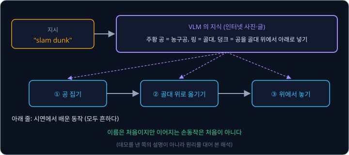

위 그림의 위쪽 상자가 VLM 이 지식으로 하는 일이고, 아래쪽 세 상자가 시연에서 배운 동작이다. 덩크라는 이름은 처음이지만 아래쪽 상자들은
처음이 아니다.

**확인 문제.** 같은 로봇에게 "농구공을 손가락 끝으로 빙글빙글 돌려" 라고 하면 덩크처럼 해낼 수 있을까?

답 보기

어렵다. 공을 손가락 끝에서 돌리는 동작은 집기·옮기기·놓기의 조합으로 나눌 수 없는 새 손동작이고, 시연에 없다면 VLM 이 뜻을 알아도 그
action 을 낼 근거가 없다.

### 움직임을 새로 만드는 듯한 착각

VLA 를 보면 텍스트가 움직임을 만들어 내는 것처럼 느껴질 때가 많다. 그 이유는 궤적(손끝이 지나가는 길)이 매번 장면에 맞춰 새로 계산되기
때문이다. 컵이 책상 왼쪽에 있으면 팔은 왼쪽으로, 오른쪽에 있으면 오른쪽으로 뻗는다. 관절 각도의 숫자는 장면마다 다르고, 정확히 같은 숫자의
순서가 시연에 있었던 것도 아니다.

| 컵의 위치 | 관절 1 의 칸 번호 (예) | 되돌린 각도 |
| --- | --- | --- |
| 왼쪽 | 98 | $-29.5$° |
| 가운데 | 128 | 0.5° |
| 오른쪽 | 158 | 30.5° |

위 표처럼 컵이 어디 있느냐에 따라 관절 1 의 칸이 매번 달라진다. 이 숫자들은 시연을 그대로 꺼낸 것이 아니라 그 장면을 보고 새로 고른
값이라서, 처음 보는 자리의 컵도 집을 수 있다. 하지만 바뀌는 것은 "어디로" 이고 "어떤 종류의 움직임인지" 는 시연에서 배운 집기 그대로다.
새로운 숫자를 내는 것과 새로운 종류의 동작을 하는 것은 다르다.

이 착각은 두 가지 일이 한꺼번에 보여서 생긴다. 하나는 장면에 맞춰 매번 새로 계산되는 궤적이고, 다른 하나는 처음 듣는 지시에 맞는 물체를
고르는 VLM 의 지식이다. 둘이 겹치면 처음 보는 일을 하는 것처럼 보이지만, 동작의 종류는 여전히 시연이 정한다.

**확인 문제.** 시연에서는 컵이 늘 책상 가운데 근처에 있었다. 처음으로 책상 오른쪽 끝에 놓인 컵을 집었다면, 이것은 새 손동작을 만든 것일까?

답 보기

아니다. 집기라는 동작의 종류는 시연에 있었고, 바뀐 것은 손을 뻗는 자리뿐이다. 장면에 맞춰 관절 각도를 새로 계산했을 뿐이다. 다만 시연에서
컵이 그 근처에 한 번도 없었다면, 처음 보는 자리라서 [Behavior Cloning](../behavior-cloning/README.md) 에서 본 것처럼 실패할 수도 있다.

**요약**

- 인터넷 지식은 지시문의 단어와 사진 속 물체를 잇는 데 쓰여, 처음 보는 물체 이름·다른 표현·배운 동작의 조합을 해내게 한다. RT-2 55B 는
  시연에 없던 지식이 필요한 지시에서 RT-1 의 17% 보다 높은 60% 를 해냈다
- 행동에 대한 지식은 로봇 시연에서만 오므로, 셔츠 개기나 뚜껑 돌려 열기처럼 시연에 없던 손동작은 텍스트만으로 나오지 않는다
- "slam dunk" 같은 새 작업 이름은 집기·옮기기·위에서 놓기의 조합으로 풀 수 있어서 가능했고, 궤적이 장면마다 새로 계산되기 때문에 새
  동작을 만드는 듯한 착각이 생긴다

## 작은 VLA 의 language grounding

### language grounding

"파란 컵을 집어" 라는 지시를 따르려면 "파란 컵" 이라는 말이 사진 속 어느 물체인지 알아야 하고, 그 물체 쪽으로 action 을 내야 한다. 이렇게
말을 실제 장면의 물체와 행동에 연결하는 능력을 language grounding 이라고 한다. ground 는 "땅", 동사로는 " ~ 에 바탕을 두다" 라는
뜻이라서, 말을 실제 세계에 바탕을 두게 한다는 데서 이름이 왔다.

책상에 빨간 컵과 파란 컵이 함께 있을 때 지시에 따라 다른 컵을 집으면 language grounding 이 된 것이다. 지시가 바뀌어도 늘 같은 컵을 집으면
지시를 무시한 것이다.

**확인 문제.** 책상에 사과와 바나나가 있다. "사과를 집어" 에도 "바나나를 집어" 에도 로봇이 사과를 집었다. language grounding 이 됐다고 할
수 있을까?

답 보기

아니다. "바나나" 라는 말을 사진 속 바나나에 연결하지 못했다. 사과를 집는 동작 자체는 잘 했어도 지시와 상관없이 같은 일을 했다.

### 지시를 무시하는 실패

VLA 의 흔한 실패 가운데 하나가 지시를 무시하고 그 장면에서 자주 본 작업을 하는 것이다. 빨간 컵과 파란 컵이 있는 장면에서 "파란 컵을 집어"
라고 해도 빨간 컵을 집는다.

이유는 시연 데이터의 모양에 있다. 같은 장면의 시연 100 개 가운데 95 개가 "빨간 컵을 집어" 이고 5 개만 "파란 컵을 집어" 라고 하자. 계산을
줄이려고 action 을 "빨간 컵으로 간다" 와 "파란 컵으로 간다" 두 가지로만 보고, 지시문을 전혀 읽지 않고 사진만 보는 모델을 생각한다.

| 모델 | 지시가 "빨간 컵" 일 때 | 지시가 "파란 컵" 일 때 | 시연 100 개 가운데 맞힌 수 |
| --- | --- | --- | --- |
| 지시를 무시하고 늘 빨간 컵 | 맞음 (95 개) | 틀림 (5 개) | 95 |
| 지시를 읽고 따름 | 맞음 (95 개) | 맞음 (5 개) | 100 |

지시를 무시해도 95% 를 맞힌다. cross-entropy 로 봐도 같다. 처음에 두 방향에 0.5 씩 확률을 주면 벌점은 $-\log 0.5 \approx 0.693$ 이다.
지시를 무시하고 빨간 쪽에 0.95, 파란 쪽에 0.05 를 주면 시연 100 개의 평균 벌점은 아래와 같다.

$$
0.95 \times (-\log 0.95) + 0.05 \times (-\log 0.05) \approx 0.95 \times 0.051 + 0.05 \times 2.996 \approx 0.049 + 0.150 = 0.199
$$

지시를 읽지 않고도 벌점이 0.693 에서 0.199 로, 처음의 약 $0.199 \div 0.693 \approx 0.29$ 배까지 내려간다. 나머지 0.199 를 없애려면 지시를
읽어야 하지만, 그 신호는 시연 5 개에서만 온다. 학습은 벌점을 가장 쉽게 줄이는 쪽으로 먼저 움직이므로, 사진만 보고 그 장면에서 가장 흔한
작업을 고르는 모델이 되기 쉽다.

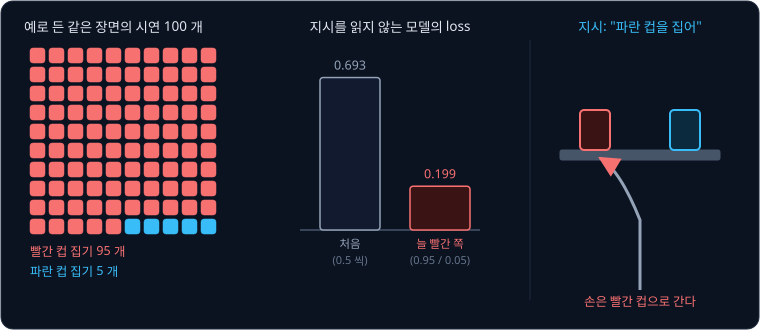

이 실패는 실제 연구에서도 확인됐다. LIBERO 는 Franka 팔이 지시문에 따라 하는 작업들을 simulation(컴퓨터 안의 가상 환경)에 모아 둔
benchmark(성능을 재는 시험 모음)다. 2025년의 LIBERO-Plus 연구는 LIBERO 의 시연으로 fine-tuning 한 공개 VLA 들을 시험했는데,
fine-tuning 은 이미 학습한 모델의 weight 에서 출발해 새 데이터로 조금 더 학습하는 것이다. 지시문을 아예 비워도 OpenVLA 를 개선한 OpenVLA-OFT 의
물체 작업 성공률은 거의 그대로였고, "pick up the alphabet soup" 를 같은 장면의 다른 물체인 "pick up the tomato sauce" 로 바꾸자 모델은
여전히 원래 물체를 집으려 해서 성공률이 거의 0 으로 떨어졌다. 같은 해의 LIBERO-PRO 연구도 OpenVLA 와 π0 계열 모델이 지시문을 망가뜨리거나
의미 없는 token 으로 바꿔도 같은 action 을 낸다고 보고했다. 두 연구 모두, 이 모델들이 지시보다 장면과 action 의 짝을 외워 쓴다고 결론지었다.

**확인 문제.** 어떤 장면의 시연 50 개 가운데 40 개가 "서랍 열기", 10 개가 "서랍 닫기" 다. 지시를 무시하고 늘 "서랍 열기" 를 하는 모델은 시연
50 개 가운데 몇 개를 맞힐까? 몇 % 일까?

답 보기

40 개를 맞혀 $40 \div 50 = 0.8$, 곧 80% 다. 지시를 무시해도 80% 를 맞히니, 지시를 읽게 만드는 신호는 "닫기" 시연 10 개에서만 온다.

### VLM 크기와 일반화

지시를 따르고 처음 보는 것을 다루는 능력은 몸통 VLM 의 크기와도 관계가 있다. RT-2 논문은 같은 로봇 데이터로 몸통 PaLI-X 의 크기와 학습
방법만 바꿔, 처음 보는 물체·배경·장소의 평균 성공률을 쟀다.

| 몸통 크기 | 학습 방법 | 처음 보는 상황 평균 |
| --- | --- | --- |
| 5B | VLM 의 weight 없이 처음부터 | 9% |
| 5B | VLM 에서 출발해 로봇 데이터로 fine-tuning | 42% |
| 5B | VLM 에서 출발해 로봇 + 인터넷 데이터로 co-fine-tuning | 44% |
| 55B | VLM 에서 출발해 로봇 데이터로 fine-tuning | 52% |
| 55B | VLM 에서 출발해 로봇 + 인터넷 데이터로 co-fine-tuning | 63% |

VLM 의 weight 에서 출발한 넷과 달리 첫 줄은 VLM 의 weight 를 쓰지 않았다. 같은 학습 방법끼리 비교하면 5B 에서 55B 로 키웠을
때 42% → 52%, 44% → 63% 로 올랐다. VLM 의 weight 없이 처음부터 학습한 5B 는 9% 에 그쳐서, 크기만 크고 인터넷 지식이 없으면 소용이 없다는
것도 보인다.

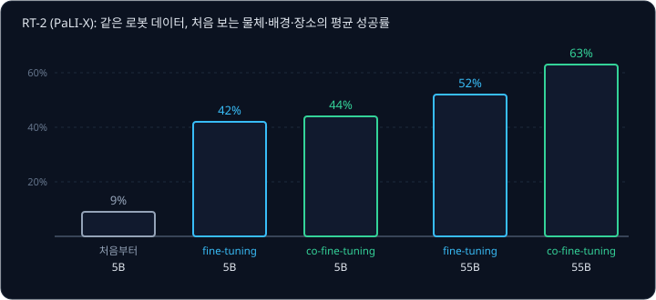

이 강의에 나온 모델의 크기는 아래와 같다.

| 모델 | parameter 수 | 몸통 |
| --- | --- | --- |
| RT-2 | 55B (5B, 12B 도 있다) | PaLI-X, PaLM-E |
| OpenVLA | 7B | Prismatic-7B (Llama 2 7B) |
| SmolVLA | 0.45B | SmolVLM-2 |

SmolVLA 는 2025년 Hugging Face 가 노트북에서도 돌릴 수 있게 만든 VLA 다. 0.45B 는 4 억 5 천만 개로, OpenVLA 의 약 15 분의 1, RT-2 55B 의
약 120 분의 1 이다. 작은 VLM 은 담을 수 있는 지식이 적어서, 일반적인 경향으로는 처음 보는 물체 이름이나 드문 표현을 알아듣는 힘도 약하다.
SmolVLA 논문도 몸통 VLM 이 주로 문서 읽기와 글자 인식 위주로 학습된 것이라 로봇 장면에 가장 맞는지는 분명하지 않다고 적었고, 로봇 데이터와
더 넓은 사진·글 데이터를 함께 학습하면 지시를 따르는 능력이 나아질 수 있다고 했다. 다만 앞 절의 LIBERO 연구에서 7B 인 OpenVLA 계열도 지시를
무시했듯이, 크기만 키운다고 이 실패가 사라지지는 않는다. 시연 데이터에 같은 장면의 다른 지시가 얼마나 고르게 있는지가 함께 중요하다.

OpenVLA 논문도 VLM 이 없는 작은 policy 와 비교하며 비슷한 관찰을 적었다. 처음부터 로봇 데이터로만 학습한 RT-1-X(3,500 만 개)와 Octo
(9,300 만 개)는 방해 물체가 있을 때 지시와 다른 물체를 집는 일이 잦았다.

**확인 문제.** 위 표에서 co-fine-tuning 끼리 비교하면 5B 에서 55B 로 키웠을 때 몇 %p 올랐을까? fine-tuning 끼리라면?

답 보기

co-fine-tuning 은 $63 - 44 = 19$%p, fine-tuning 은 $52 - 42 = 10$%p 올랐다. 두 방법 모두 큰 모델이 처음 보는 상황에서 더 잘했다.

### 인터넷 데이터를 섞는 co-fine-tuning

VLM 을 로봇 데이터로만 fine-tuning 하면, 로봇 데이터에 맞추는 동안 인터넷에서 배운 지식이 조금씩 지워질 수 있다. 로봇 데이터의 지시문은
"pick ~", "move ~ near ~" 처럼 단조롭고, 사진도 비슷한 부엌 장면이 되풀이되기 때문이다. 그래서 RT-2 는 로봇 데이터에 원래 VLM 이 배운
인터넷 데이터(사진에 대한 질문과 답, 사진 설명 등)를 섞어 함께 학습했다. 이것을 co-fine-tuning 이라고 하고, co 는 "함께" 라는 뜻이다.

앞 절의 표에서 같은 크기끼리 비교하면 co-fine-tuning 이 fine-tuning 보다 좋았다. 5B 는 42% → 44% 로 2%p, 55B 는 52% → 63% 로 11%p 올랐다.
RT-2 논문은 인터넷 데이터를 함께 보면 로봇 action 만 볼 때보다 넓은 시각 개념을 계속 접해서 더 일반화되는 policy 가 나온다고 설명했다.

OpenVLA 는 로봇 데이터만으로 fine-tuning 했고, 논문의 한계 절에서 "인터넷 데이터를 함께 학습하면 VLA 성능이 크게 좋아지는가" 와 "몸통 VLM
의 크기가 VLA 성능에 어떤 영향을 주는가" 를 아직 충분히 살피지 못한 질문으로 남겼다.

**확인 문제.** 로봇 데이터의 지시문이 모두 "pick X" 꼴이다. 로봇 데이터만으로 오래 fine-tuning 한 VLA 가 "X 좀 건네줄래?" 같은 표현에 약해질
수 있는 이유는?

답 보기

학습하는 동안 "pick X" 꼴의 문장만 보면서 weight 가 그 꼴에 맞춰 바뀌어, 인터넷에서 배운 다양한 표현을 알아듣는 능력이 지워질 수 있다.
co-fine-tuning 처럼 인터넷 데이터를 섞으면 그 능력을 계속 쓰게 되어 덜 지워진다.

**요약**

- language grounding 은 지시의 말을 장면의 물체와 행동에 연결하는 능력이고, 같은 장면에 한 작업의 시연이 몰려 있으면 지시를 무시해도
  벌점이 0.693 에서 0.199 로 내려가 지시를 무시하는 모델이 되기 쉽다
- RT-2 에서 같은 로봇 데이터로 몸통을 5B 에서 55B 로 키우면 처음 보는 상황 평균이 44% 에서 63% 로 올랐고, 인터넷 데이터를 섞는
  co-fine-tuning 이 로봇 데이터만 쓰는 fine-tuning 보다 좋았다
- RT-2 55B, OpenVLA 7B, SmolVLA 0.45B 로 갈수록 몸통이 작아지고, 작은 몸통은 대체로 지식이 적지만 데이터의 고른 정도도 함께 중요하다

## 학습 데이터와 새 로봇

### Open X-Embodiment

VLA 를 학습하려면 로봇 시연이 많이, 그리고 다양하게 필요하다. 로봇 한 종류로 몇 곳에서 모은 시연만으로는 장면과 작업이 다양하지 않아서,
여러 연구실이 모은 데이터를 한 형식으로 합친 것이 Open X-Embodiment 다. embodiment 는 "몸" 이라는 뜻으로, 로봇의 생김새와 관절 구성을
가리킨다. X 는 여러 종류의 몸을 가로지른다(cross)는 뜻이다.

| 항목 | 규모 |
| --- | --- |
| 참여 기관 | 21 곳 |
| 로봇 종류 | 22 가지 (팔 하나짜리부터 두 팔 로봇, 네 발 로봇까지) |
| 시연 | 100 만 개 이상 |
| skill | 527 가지 |

여기서 시연 하나는 작업 하나를 처음부터 끝까지 한 번 한 기록(trajectory)이고, skill 은 "집기", "서랍 열기" 처럼 동작의 종류다. OpenVLA 는 이 가운데 카메라가
로봇 밖에서 장면을 찍고 팔 하나의 손끝을 움직이는 데이터만 골라, 시연 97 만 개로 학습했다. 데이터마다 섞는 비율도 조절해서, 장면과 작업이
다양한 데이터를 더 자주 보게 했다.

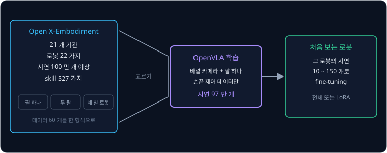

위 그림의 왼쪽이 여러 로봇의 데이터를 모은 것이고, 가운데 깔때기가 OpenVLA 가 고른 부분이다. 오른쪽은 다음 절에서 다룬다.

**확인 문제.** 시연 97 만 개를 14 일 동안 27 번 되풀이해 보았다면, 하루에 시연을 대략 몇 개씩 본 셈일까? (만 단위로 어림한다)

답 보기

모두 $97 \times 27 = 2{,}619$ 만 개를 봤고, $2{,}619 \div 14 \approx 187$ 이라 하루에 약 187 만 개다.

### 처음 보는 로봇의 문제

여러 로봇의 데이터로 학습했어도, 처음 보는 로봇에 그대로 올리면 잘 움직이지 않는 경우가 많다. action 숫자 7 개의 뜻이 로봇마다 다르기
때문이다.

| 달라지는 것 | 예 |
| --- | --- |
| 숫자의 뜻 | 한 로봇은 손끝을 옮길 거리, 다른 로봇은 관절 각도를 낸다 |
| 숫자의 범위 | 같은 31,882 라도 데이터마다 1% ~ 99% 분위수 범위가 달라 되돌린 값이 다르다 |
| 관절 구성 | 관절 7 개인 Franka 팔과 관절이 더 적은 SO-101 팔은 같은 손끝 위치에 필요한 각도가 다르다 |
| 카메라 | 카메라의 위치와 각도가 달라 사진 속 물체의 자리가 달라진다 |
| 제어 주기 | 1 초에 5 번 움직이는 로봇과 15 번 움직이는 로봇은 한 step 에 움직일 양이 다르다 |

action token 방식에서는 숫자의 범위 문제가 특히 크다. 관절 범위 $-128$° ~ $+128$° 인 로봇에서 31,882(138 번 칸)는 10.5° 지만, 같은 칸을
범위 $-64$° ~ $+64$° 인 로봇에 그대로 쓰면 칸 폭이 $128 \div 256 = 0.5$° 라서 $-64 + 138.5 \times 0.5 = 5.25$° 가 된다. 모델은 같은 token 을
냈는데 로봇은 전혀 다른 각도로 움직인다.

그래서 OpenVLA 논문은 처음 보는 로봇 설정에 쓰려면 그 로봇의 시연으로 fine-tuning 하는 방법을 함께 시험했다. 논문은 Franka 팔을 새로 꾸민
설정 두 가지에서, 작업마다 시연 10 ~ 150 개로 fine-tuning 해 일곱 가지 작업을 시험했다. 같은 데이터로 처음부터 학습한 Diffusion
Policy 는 지시가 하나뿐인 좁은 작업에서 강했고, 여러 물체 가운데 지시가 가리키는 것을 골라야 하는 작업에서는 fine-tuning 한 OpenVLA 가
더 좋았다.

**확인 문제.** 범위 $-128$° ~ $+128$° 로 학습한 모델이 token 31,872(128 번 칸)를 냈다. 이 token 을 범위 $0$° ~ $+256$° 인 다른 로봇에서
그대로 되돌리면 몇 도가 될까? 원래 로봇에서는?

답 보기

다른 로봇은 칸 폭이 $256 \div 256 = 1$° 라서 $0 + 128.5 \times 1 = 128.5$° 다. 원래 로봇에서는 $-128 + 128.5 = 0.5$° 다. 같은 token 인데
128° 나 차이 난다.

### fine-tuning 과 LoRA

fine-tuning 은 이미 학습한 모델의 weight 에서 출발해 새 데이터로 조금 더 학습하는 것이었다. 처음부터 학습하는 것보다 데이터와 시간이 훨씬
적게 든다. OpenVLA 를 처음 학습하는 데는 GPU 64 장으로 14 일이 걸렸지만, 논문의 fine-tuning 은 GPU 8 장으로 작업마다 5 ~ 15 시간이 걸렸다.

parameter 70 억 개를 모두 고치는 대신, 작은 parameter 묶음을 따로 붙여 그것만 학습하는 방법도 있다. LoRA(Low-Rank Adaptation)가 대표적인
방법이다. 원래 weight 는 그대로 두고 옆에 붙인 작은 행렬(숫자를 가로세로 칸에 늘어놓은 표) 두 개만 학습하므로 고칠 숫자가 크게 준다. OpenVLA 논문에서 LoRA 는 전체 parameter 의
1.4% 만 학습하고도 성공률 68.2% 를 내서, 전체를 고친 69.7% 와 거의 같았다. 논문은 이런 방법으로 일반 소비자용 GPU 에서도 OpenVLA 를
fine-tuning 할 수 있다고 적었다.

| 단계 | 데이터 | 학습하는 것 | 드는 계산 |
| --- | --- | --- | --- |
| VLM 사전학습 | 인터넷 사진·글 | VLM 전체 | 아주 크다 |
| VLA 학습 (OpenVLA) | Open X-Embodiment 시연 97 만 개 | VLM 전체 + action token | GPU 64 장으로 14 일 |
| 새 로봇 fine-tuning | 그 로봇의 시연 10 ~ 150 개 | 전체 또는 LoRA 의 작은 행렬 | 전체면 GPU 8 장으로 5 ~ 15 시간, LoRA 면 학습할 숫자가 1.4% |

SmolVLA 논문도 사전학습 데이터를 SO-100 이라는 한 종류의 로봇에서만 모았다는 것을 한계로 꼽았다. 다른 로봇으로 fine-tuning 하면 쓸 수는
있지만, 처음 보는 로봇에 잘 옮겨 가려면 여러 종류 로봇의 데이터로 학습하는 것이 중요할 것이라고 적었다.

**확인 문제.** 어떤 행렬이 $1{,}000 \times 1{,}000$ 칸이라 숫자 100 만 개다. LoRA 처럼 이 행렬은 고정하고 옆에 $1{,}000 \times 8$ 행렬과
$8 \times 1{,}000$ 행렬을 붙여 그 둘만 학습하면, 학습할 숫자는 몇 개일까? 원래의 몇 분의 1 일까?

답 보기

$1{,}000 \times 8 + 8 \times 1{,}000 = 8{,}000 + 8{,}000 = 16{,}000$ 개다. $1{,}000{,}000 \div 16{,}000 = 62.5$ 라서 약 62 분의 1 이다.

**요약**

- Open X-Embodiment 는 21 개 기관, 22 가지 로봇, 100 만 개 이상의 시연을 모은 데이터이고, OpenVLA 는 그 가운데 팔 하나·바깥 카메라 데이터
  97 만 개로 학습했다
- 로봇마다 action 숫자의 뜻·범위·관절 구성·카메라·제어 주기가 달라서, 같은 token 31,882 도 로봇에 따라 다른 각도가 된다
- 그래서 처음 보는 로봇에는 그 로봇의 시연 10 ~ 150 개로 fine-tuning 하고, LoRA 는 작은 행렬만 학습해 계산을 크게 줄인다

## 정리

- VLA 는 인터넷 데이터로 미리 학습한 VLM(image encoder + LLM)을 몸통으로, 사진·지시문(·로봇 상태)이라는 multimodal 입력을 받아 action 을
  내도록 로봇 시연으로 end-to-end 학습한 한 덩어리 모델이다. 글이 인식기에서 멈추는 모듈식 구성과 달리 지시문이 action 을 계산하는 network
  안까지 들어간다
- RT-2 와 OpenVLA 는 action 을 vocabulary 의 token 으로 바꿨다. 관절 1 의 10.3° 는 범위 $-128$° ~ $+128$° 의 256 칸에서 138 번 칸이 되고,
  Llama 2 의 가장 드문 token 자리에 짝지어 31,882 가 된다. 모델은 action 밖의 점수를 $-\infty$ 로 막고 token 7 개를 하나씩 생성하며, 31,882
  는 다시 138 번 칸의 가운데 10.5° 로 돌아온다. OpenVLA 는 칸의 범위를 1% ~ 99% 분위수로 잡는다
- 학습은 action token 7 자리에서만 cross-entropy 를 계산하는 다음 token 맞히기다
- 칸으로 자르면 관절마다 최대 0.5°, 30 cm 팔 끝에서 약 2.6 mm 가 어긋나고, token 을 하나씩 내서 OpenVLA 는 약 6 Hz, RT-2 55B 는 1 ~ 3 Hz
  로 움직인다. 50 Hz 제어에 필요한 20 ms 에 한참 못 미친다
- 텍스트와 인터넷 지식은 처음 보는 물체 이름, 같은 지시의 다른 표현, 배운 동작의 조합을 일반화한다. 행동 지식은 로봇 시연에서만 오므로 셔츠
  개기 같은 새 손동작은 나오지 않고, "slam dunk" 는 집기·옮기기·위에서 놓기의 조합으로 읽을 수 있다
- 같은 장면에 한 작업의 시연이 몰리면 지시를 무시해도 벌점이 크게 줄어, 모델이 그 장면에서 자주 본 작업을 하게 된다. RT-2 에서는 인터넷 데이터를
  섞는 co-fine-tuning 끼리 비교할 때 몸통을 5B 에서 55B 로 키우자 처음 보는 상황의 성공률이 44% 에서 63% 로 올랐다
- Open X-Embodiment 처럼 여러 로봇의 데이터로 학습해도 로봇마다 action 의 뜻과 범위가 달라서, 처음 보는 로봇에는 그 로봇의 시연으로
  fine-tuning 해야 한다

action token 방식은 VLM 의 구조를 거의 바꾸지 않고 로봇을 움직이게 했지만, 칸 때문에 정밀도를 잃고 token 을 하나씩 내느라 느리다.
[π0](../pi0/README.md) 에서는 VLM 옆에 action expert 를 따로 두고, [Flow Matching](../flow-matching/README.md) 으로 연속된 action 묶음을 한 번에
만들어 이 두 약점을 다룬다. action 묶음을 한꺼번에 내는 생각은 [ACT](../act/README.md) 에서, 시연을 넘어 스스로 시도하며 VLA 를 더 학습하는
방법은 [VLA + RL](../vla-rl/README.md) 에서 다룬다.

## 참고 자료

- Anthony Brohan et al., [RT-2: Vision-Language-Action Models Transfer Web Knowledge to Robotic Control](https://arxiv.org/abs/2307.15818)
  (2023) — 3.2 절이 action 을 token 으로 바꾸는 방법과 co-fine-tuning 이다. 4.2 절과 Table 7 이 기호 이해·추론·사람 알아보기 결과, 4.3 절과
  Table 8 이 몸통 크기와 학습 방법의 비교, 5 절이 "새 움직임은 배우지 못한다" 는 한계다
- [RT-2 project page](https://robotics-transformer2.github.io/) — 처음 보는 물체와 기호, 사람을 다루는 지시를 로봇이 수행하는 영상
- Moo Jin Kim et al., [OpenVLA: An Open-Source Vision-Language-Action Model](https://arxiv.org/abs/2406.09246) (2024) — 3.2 절이 1% ~ 99%
  분위수로 나눈 256 칸과 드문 token 256 개를 덮어쓰는 방법, 3.3 절이 Open X-Embodiment 에서 데이터를 고른 방법, 3.5 절이 학습 규모와 약 6 Hz
  의 추론 속도, 5.2 ~ 5.3 절이 새 로봇 fine-tuning 과 LoRA, 6 절이 한계다. [project page](https://openvla.github.io/)
- OpenVLA 의 [`action_tokenizer.py`](https://github.com/openvla/openvla/blob/main/prismatic/vla/action_tokenizer.py) — 칸 번호와 vocabulary 끝
  token 을 짝짓는 공식 구현. 칸 번호를 거꾸로 짝짓는 세부를 확인할 수 있다
- Open X-Embodiment Collaboration, [Open X-Embodiment: Robotic Learning Datasets and RT-X Models](https://arxiv.org/abs/2310.08864) (2023) —
  22 가지 로봇, 100 만 개 이상의 시연을 모은 데이터의 구성과, 여러 로봇의 데이터로 함께 학습한 RT-1-X·RT-2-X 의 결과
- Kevin Black et al., [π0: A Vision-Language-Action Flow Model for General Robot Control](https://arxiv.org/abs/2410.24164) (2024) — 별도
  action expert 와 50 step action chunk 로 최대 50 Hz 제어를 한 모델. 관련 연구 절에서 action token 방식과의 차이를 설명한다
- Mustafa Shukor et al., [SmolVLA: A Vision-Language-Action Model for Affordable and Efficient Robotics](https://arxiv.org/abs/2506.01844) (2025)
  — 0.45B 크기의 VLA. 5.1 절의 한계에 몸통 VLM 과 한 종류 로봇 데이터의 문제가 정리돼 있다
- Andrés Marafioti et al., [SmolVLM: Redefining small and efficient multimodal models](https://arxiv.org/abs/2504.05299) (2025) — SmolVLA 의
  몸통인 작은 VLM 의 image encoder, image token 수, 학습 데이터
- Senyu Fei et al., [LIBERO-Plus: In-depth Robustness Analysis of Vision-Language-Action Models](https://arxiv.org/abs/2510.13626) (2025) — 4.1 ~
  4.2 절이 지시문을 비우거나 목표 물체를 바꿨을 때 VLA 가 지시를 무시하는 실험이다
- Xueyang Zhou et al., [LIBERO-PRO: Towards Robust and Fair Evaluation of Vision-Language-Action Models Beyond Memorization](https://arxiv.org/abs/2510.03827)
  (2025) — 망가진 지시문에도 같은 action 을 내는 OpenVLA·π0 계열의 결과와, 장면과 action 을 외워 쓴다는 해석
- Bo Liu et al., [LIBERO: Benchmarking Knowledge Transfer for Lifelong Robot Learning](https://arxiv.org/abs/2306.03310) (2023) — 위 두 연구가
  바탕으로 쓴 simulation benchmark 의 작업 구성
- Google, [How we built the new family of Gemini Robotics models](https://blog.google/products/gemini/how-we-built-gemini-robotics/) (2025) —
  ALOHA 로봇이 처음 본 장난감 농구 골대에 "slam dunk" 를 한 데모의 경위
- Edward J. Hu et al., [LoRA: Low-Rank Adaptation of Large Language Models](https://arxiv.org/abs/2106.09685) (2021) — 원래 weight 를 고정하고
  작은 행렬 두 개만 학습하는 방법. peft 의 [LoRA 개념 문서](https://huggingface.co/docs/peft/main/en/conceptual_guides/lora) 가 그림으로 짧게
  설명한다
- Stanford SAIL blog, [MiniVLA: A Better VLA with a Smaller Footprint](https://ai.stanford.edu/blog/minivla/) — 0.5B 급 LLM 으로 OpenVLA 를
  줄인 사례
- [nanoVLM](https://github.com/huggingface/nanoVLM) — image encoder 와 작은 LLM 을 잇는 VLM 의 구조를 짧은 코드로 볼 수 있다
