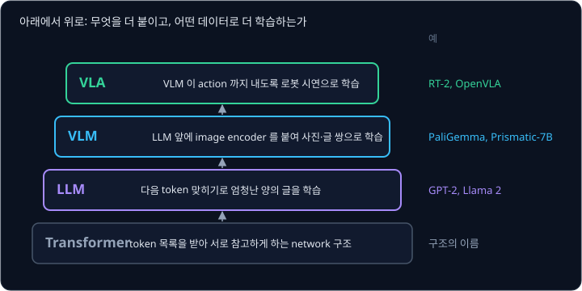
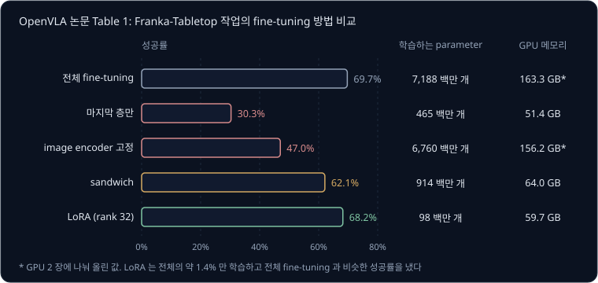

# RT-2 → OpenVLA

[RT-1](../rt1/README.md) 은 부엌 로봇의 시연 약 13 만 개로 학습해 시연에 있던 지시를 97% 해냈지만, 시연에 한 번도 나오지 않은 바나나나
숫자 3 이 적힌 종이, 유명인의 사진이 지시에 나오면 그것이 사진 속 어느 물체인지 알 방법이 없다. 인터넷에는 이런 물체와 글자, 사람 얼굴이
담긴 사진과 글이 수십억 쌍 있는데, 그 데이터로 미리 배운 모델이 로봇 팔까지 움직이게 할 수는 없을까?

Google DeepMind 가 2023 년에 발표한 RT-2 는 사진과 글을 함께 읽는 모델에게 로봇의 행동을 글자처럼 token 으로 쓰게 했다. RT-1 과 같은
로봇 시연으로 학습했는데도 처음 보는 물체·배경·장소에서의 평균 성공률이 62% 로 RT-1 의 32% 보다 높았다. Stanford 등이 2024 년에 같은
방식을 parameter 70 억 개 크기로 다시 만든 OpenVLA 는 weight 와 학습 코드를 모두 공개했다.

## 학습 목표

- 인터넷 데이터로 학습한 VLM 위에 만든 VLA 의 구조와, RT-2 와 OpenVLA 가 action 을 token 으로 바꾸는 방법을 설명할 수 있다
- 인터넷 데이터를 섞는 co-fine-tuning 과 모델 크기가 일반화에 주는 효과를 설명하고, 인터넷 지식으로 일반화되는 지시와 그렇지 않은 지시를 구분할 수 있다
- OpenVLA 를 새 로봇에 fine-tuning 하는 이유와 LoRA 로 계산을 줄이는 방법을 설명할 수 있다
- 칸으로 자른 action 의 정밀도, token 을 하나씩 내는 속도, 한 번에 한 step 만 내는 출력의 한계를 숫자로 보일 수 있다

## VLM 과 VLA

[GPT-2](../gpt/README.md) 같은 language model 은 앞의 token 들을 받아 다음 token 의 확률표를 낸다. 아주 많은 글로 학습한 큰 language
model 은 LLM(large language model)이라고 부른다. LLM 앞에 사진을 token 으로 바꾸는 image encoder 를 붙이고 인터넷의 사진·글 쌍으로 더
학습하면 사진과 지시문을 함께 받아 글을 쓰는 VLM(Vision-Language Model)이 되는데, VLM 은 사진 속 물체의 이름, 글자, 사람 얼굴, 색과
위치 관계를 인터넷 데이터에서 배운다. 이 VLM 이 사진과 지시문을 받아 로봇의 action(행동 명령)까지 내도록 로봇 시연으로 더 학습한 모델이
**VLA**(Vision-Language-Action model)다.

RT-2 논문은 새 parameter 를 더하지 않고 VLM 이 action 을 글처럼 쓰도록 학습한 모델을 VLA 라고 불렀다. 사진을 읽는 부분부터 action 을
내는 부분까지 한 network 라서, 시연의 action 과 얼마나 다른지 잰 loss 로 image encoder 까지 함께 고칠 수 있다.
[Real Robot](../real-robot/README.md) 에서는 인식기가 물체 위치만 넘기고 작은 policy 가 그 위치로 움직였지만, VLA 에서는 지시문 token 이
action 을 계산하는 network 안까지 들어간다.

| 모델 | 바탕 VLM | image encoder | language model | 전체 크기 |
| --- | --- | --- | --- | --- |
| RT-2-PaLI-X | PaLI-X | ViT-22B | encoder-decoder 32B (50 층) | 55B (5B 판도 있다) |
| RT-2-PaLM-E | PaLM-E | ViT-4B | decoder-only LLM | 12B |
| OpenVLA | Prismatic-7B | SigLIP + DINOv2 (약 6 억) | Llama 2 7B | 7B |

B 는 billion(10 억)이라서 55B 는 parameter 550 억 개이고 7B 는 70 억 개다. RT-2 는 weight 를 공개하지 않았다. 로봇은 Google 의 cloud
TPU 에 올린 RT-2 를 네트워크로 불러 썼다. OpenVLA 저자들이 RT-2 를 여러 로봇의 데이터로 학습한 55B 의 RT-2-X 와 과제 29 개에서
비교했더니, OpenVLA 는 parameter 가 7 분의 1 인데도 성공률이 16.5%p 높았다.

**확인 문제.** "사진과 지시문을 받아 action 을 내지만, 인터넷 데이터로 미리 학습한 부분 없이 로봇 시연만으로 처음부터 학습한 모델" 은 이
강의의 정의로 VLA 일까?

답 보기

1. 이 강의의 VLA 는 인터넷의 사진·글로 학습한 VLM 을 출발점으로 삼는다
2. 이 모델에는 그 출발점이 없으므로 VLA 가 아니다. RT-1 이 이런 모델이다
3. 다만 지시문을 받아 action 을 내는 모델을 넓게 VLA 라고 부르는 경우도 있어서, 이름의 경계는 논문마다 조금씩 다르다

## action token

language model 은 vocabulary(쓸 수 있는 token 의 목록)에서 token 하나를 고를 수만 있고, "관절을 10.3° 로" 의 10.3 같은 실수를 직접 적어 내지
못한다. 그래서 RT-2 와 OpenVLA 는 [RT-1](../rt1/README.md) 에서 본 binning 처럼 action 값의 범위를 같은 폭의 칸(bin) 256 개로 나누고, 칸
번호마다 vocabulary 의 token 하나를 짝지었다. 차원마다 칸 번호 하나가 token 하나라서 action 하나는 차원 수만큼의 token 이 된다.

| 모델 | action 의 숫자 | 칸 번호에 짝지은 token |
| --- | --- | --- |
| RT-2-PaLI-X | 8 개 (손끝 위치·회전 변화 6, 집게 1, 끝내기 1) | 1000 까지의 정수마다 token 이 따로 있어서, 138 번 칸은 정수 "138" 의 token |
| RT-2-PaLM-E | 8 개 | 가장 덜 쓰이는 token 256 개를 덮어씀 |
| OpenVLA | 7 개 (손끝 위치 변화 3, 회전 변화 3, 집게 1) | Llama tokenizer 에서 가장 덜 쓰이는 token 256 개(vocabulary 의 마지막 256 개)를 덮어씀 |

RT-2 논문의 학습 예시는 "Q: what action should the robot take to [지시]? A:" 꼴의 질문에 "1 128 124 136 121 158 111 255" 같은 숫자 8 개의 답을
붙인 것이다. OpenVLA 논문에 따르면 Llama tokenizer 에는 새 token 을 더할 자리가 100 개뿐이라 256 개에 모자랐다. 그래서 OpenVLA 는 RT-2
처럼 이미 있는 token 가운데 가장 덜 쓰이는 256 개를 action token 으로 덮어썼다. 자주 쓰는 "the", "cup" 을 덮어쓰면 지시문을 읽는 능력이
망가지지만, 거의 나오지 않는 token 은 원래 뜻을 잃어도 손해가 적다. 이 강의에서는 칸에 짝지은 token 을 "138 번 칸의 token" 처럼 칸
번호로 부른다. token 을 만드는 방식 자체는 [BPE Tokenizer](../tokenizer/README.md) 에서 다룬다.

[Behavior Cloning](../behavior-cloning/README.md) 의 로봇 팔은 관절 6 개와 집게, 모두 7 개의 값을 action 으로 낸다. 예를 들어 이 팔의
관절 1 범위를 −128° ~ +128° 로 잡고 256 칸으로 나누면 칸 폭은 $256 \div 256 = 1$° 다. 10.3° 는 왼쪽 끝에서 $10.3 + 128 = 138.3$ 칸
떨어져 있어 138 번 칸이 되고, 모델이 138 번 칸의 token 을 내면 그 칸의 가운데 값 $-128 + 138.5 \times 1 = 10.5$° 로 되돌린다.

action token 256 개는 7 개 차원이 함께 쓰므로, 같은 138 번 칸의 token 도 첫째 자리에 나오면 관절 1 의 범위로 되돌리고 일곱째 자리에 나오면
집게의 범위로 되돌린다.

칸 폭은 범위를 어떻게 잡느냐에 따라 달라지는데, 시연의 최솟값 ~ 최댓값으로 잡으면 드물게 튄 값 하나가 범위를 크게 넓힌다.
분위수(quantile)는 값들을 작은 것부터 줄 세웠을 때 아래에서 몇 % 자리에 있는 값이다. 어떤 관절의 시연 값이 거의 모두 −10° ~ +10° 인데 센서
오류로 +200° 가 한 번 기록됐다면, 두 방법으로 잡은 범위는 아래처럼 다르다.

| 범위를 정하는 방법 | 범위 | 칸 폭 (256 칸) | 값이 모인 −10° ~ +10° 에 쓰이는 칸 |
| --- | --- | --- | --- |
| 최솟값 ~ 최댓값 | −10° ~ 200° | $210 \div 256 \approx 0.82$° | $20 \div 0.82 \approx 24$ 칸 |
| 1% ~ 99% 분위수 | −10° ~ 10° | $20 \div 256 \approx 0.078$° | 256 칸 |

OpenVLA 논문에 따르면 RT-2 는 최솟값 ~ 최댓값을 썼고, OpenVLA 는 학습 데이터에서 차원마다 1% 분위수와 99% 분위수 사이를 256 칸으로 나눠
튀는 값 때문에 칸이 성글어지는 것을 막았다. 범위 밖의 값은 가장 가까운 끝으로 잘라(clip) 0 번이나 255 번 칸에 넣는다.

<b>심화: 칸 번호의 식과 7 개 차원의 왕복</b>

값 $a$ 를 칸 번호 $b$ 로 바꾸는 식과 되돌리는 식은 아래와 같다.

$$
b = \left\lfloor \frac{a - a_{\min}}{\Delta} \right\rfloor, \qquad \Delta = \frac{a_{\max} - a_{\min}}{K}, \qquad \hat a = a_{\min} + (b + 0.5)\,\Delta
$$

- $a_{\min}$, $a_{\max}$ 는 범위의 양 끝이고, $K$ 는 칸의 개수(256), $\Delta$ 는 칸 폭이다
- $\lfloor\ \rfloor$ 는 소수점 아래를 버리는 내림이다. $\lfloor 138.3 \rfloor = 138$ 이다
- $\hat a$ 는 칸 번호에서 되돌린 값으로, 칸의 가운데라서 원래 값과 최대 $\Delta \div 2$ 만큼 다르다

예로 든 action 하나를 7 개 차원 모두 바꾸면 아래와 같다. 관절 6 개는 범위 −128° ~ +128°(칸 폭 1°)이고, 집게는 범위 0° ~ 64° 라서 칸 폭이
$64 \div 256 = 0.25$° 다.

| 차원 | 값 $a$ | $(a - a_{\min}) \div \Delta$ | 칸 번호 $b$ | 되돌린 값 $\hat a$ | 어긋남 $\hat a - a$ |
| --- | --- | --- | --- | --- | --- |
| 관절 1 | 10.3 | 138.3 | 138 | 10.5 | $+0.2$ |
| 관절 2 | 45.8 | 173.8 | 173 | 45.5 | $-0.3$ |
| 관절 3 | $-30.6$ | 97.4 | 97 | $-30.5$ | $+0.1$ |
| 관절 4 | 60.2 | 188.2 | 188 | 60.5 | $+0.3$ |
| 관절 5 | 0 | 128.0 | 128 | 0.5 | $+0.5$ |
| 관절 6 | $-12.7$ | 115.3 | 115 | $-12.5$ | $+0.2$ |
| 집게 | 30.4 | 121.6 | 121 | 30.375 | $-0.025$ |

관절은 최대 0.5° 어긋나고 집게는 최대 0.125° 어긋날 수 있다. 다른 순간의 action 으로 한 번 더 바꾸면 관절 6 과 집게가 같은 115 번 칸이 된다.

| 차원 | 값 $a$ | 칸 번호 $b$ | 되돌린 값 $\hat a$ |
| --- | --- | --- | --- |
| 관절 1 | 11.6 | 139 | 11.5 |
| 관절 2 | 44.2 | 172 | 44.5 |
| 관절 3 | $-31.4$ | 96 | $-31.5$ |
| 관절 4 | 59.7 | 187 | 59.5 |
| 관절 5 | 2.8 | 130 | 2.5 |
| 관절 6 | $-12.1$ | 115 | $-12.5$ |
| 집게 | 28.9 | 115 | 28.875 |

둘 다 115 번 칸의 token 이지만, 여섯째 자리의 token 은 관절 범위로 $-128 + 115.5 \times 1 = -12.5$° 가 되고 일곱째 자리의 token 은 집게
범위로 $0 + 115.5 \times 0.25 = 28.875$° 가 된다.

**확인 문제.** 어떤 차원의 값이 대부분 0 ~ 64 사이에 있는데 튀는 값 576 이 하나 섞여 있다. 최솟값 ~ 최댓값(0 ~ 576)으로 256 칸을 나누면 칸
폭은 몇일까? 0 ~ 64 로 나누면?

답 보기

1. 0 ~ 576 의 칸 폭: $576 \div 256 = 2.25$
2. 0 ~ 64 의 칸 폭: $64 \div 256 = 0.25$
3. 튀는 값 하나 때문에 칸 폭이 $2.25 \div 0.25 = 9$ 배가 된다

## action token 의 생성과 학습

action token 은 [GPT-2](../gpt/README.md) 에서 본 autoregressive 생성으로 나온다. 모델이 고른 token 을 입력 끝에 붙여 다시 넣기를 7 번
되풀이하므로, 관절 2 의 token 은 관절 1 의 token 을 보고 고른다. RT-2 논문에 따르면 로봇 action 을 묻는 질문에서는 action token 만
나오도록 출력을 제한한다. 단계마다 모델이 vocabulary 전체에 점수(logit)를 내면 action token 256 개 밖의 점수를 $-\infty$ 로 바꿔서, "cup"
같은 일반 단어가 action 자리에 나오지 못하게 한다. OpenVLA 의 공식 예제는 남은 token 가운데 점수가 가장 큰 token 을 고르는 greedy
decoding 을 쓴다.

위 그림처럼 7 단계가 모두 끝나야 action 하나가 완성된다. [RT-1](../rt1/README.md) 은 1 초에 3 번 action 을 내려고 차례로 고르는 방식을
빼고 11 개 차원을 한 번에 냈지만, 그러면 차원마다 따로 골라서 관절 1 과 관절 2 가 시연에 없던 조합으로 나올 수 있다. 차례로 고르면 앞에서
고른 차원을 보고 다음 차원을 고르므로 이 문제가 줄어드는 대신, [action token 방식의 약점](#action-token-방식의-약점) 에서 보듯 느려진다.

학습은 language model 과 같은 다음 token 맞히기다. 시연의 한 순간에서 사진과 지시문 뒤에 그 순간 action 의 정답 token 7 개를 붙이고, 자리마다
정답 token 이 받은 확률 $p$ 로 cross-entropy $-\log p$ 를 계산한다. OpenVLA 논문에 따르면 이 loss 는 action token 자리에서만 계산하는데,
지시문 자리의 다음 token 을 맞히는 것은 지시문을 따라 쓰는 일이라 로봇이 배울 필요가 없다. OpenVLA 가 같은 데이터를 27 번 되풀이해 본
이유와 학습 규모는 [GPT-2](../gpt/README.md) 에서 다룬다.

<b>심화: action 자리의 cross-entropy</b>

$\log$ 는 $e$(약 2.718)를 몇 제곱하면 그 수가 되는지를 구하는 계산이다. $e^{-0.693} \approx 0.5$ 이므로 $\log 0.5 \approx -0.693$ 이다.
정답 확률이 1 이면 $-\log 1 = 0$ 이고, 정답 확률이 작을수록 loss 가 커진다. 차원 3 개로 줄여 계산하면 아래와 같다.

| 자리 | 정답 token | 모델이 정답에 준 확률 | cross-entropy $-\log p$ |
| --- | --- | --- | --- |
| 관절 1 | 138 번 칸의 token | 0.5 | 0.693 |
| 관절 2 | 173 번 칸의 token | 0.8 | 0.223 |
| 관절 3 | 97 번 칸의 token | 0.25 | 1.386 |
| 평균 | | | $(0.693 + 0.223 + 1.386) \div 3 \approx 0.767$ |

정답 확률이 가장 낮은 관절 3 자리가 loss 를 가장 크게 보태므로, 학습은 그 자리의 점수를 가장 크게 고친다. 7 자리로 쓰면 아래 식이다.

$$
L = -\frac{1}{7}\sum_{d=1}^{7} \log p_\theta\big(t_d \mid \text{사진},\ \text{지시문},\ t_1, \dots, t_{d-1}\big)
$$

- $d$ 는 몇 번째 action 자리인지이고, $t_d$ 는 그 자리의 정답 token 이다
- $p_\theta(\ \mid\ )$ 는 parameter 가 $\theta$ 인 모델이 세로선 오른쪽을 보고 정답 token 에 준 확률이다
- 학습 때는 앞자리 $t_1, \dots, t_{d-1}$ 에 모델이 고른 token 대신 시연의 정답 token 을 넣는다

**확인 문제.** 어떤 action 자리에서 logit 이 일반 token "cup" 9.1, 138 번 칸의 token 7.4, 139 번 칸의 token 7.9 였다. action token 밖의
점수를 막고 가장 큰 token 을 고르면 무엇이 나올까?

답 보기

1. "cup" 은 action token 이 아니라서 점수가 $-\infty$ 로 바뀌어 빠진다
2. 남은 둘 가운데 7.9 > 7.4 라서 139 번 칸의 token 이 나온다
3. 막지 않았다면 점수가 가장 큰 "cup" 이 나와 각도로 되돌릴 수 없었다

## co-fine-tuning

fine-tuning 은 이미 학습한 모델의 weight 에서 출발해 새 데이터로 조금 더 학습하는 것이다. VLM 을 로봇 데이터로만 fine-tuning 하면 로봇
데이터에 맞추는 동안 인터넷에서 배운 개념이 조금씩 잊힐 수 있다. RT-2 가 쓴 RT-1 의 로봇 데이터는 로봇 13 대로 17 개월 동안 모은 부엌
시연인데, 지시문은 "pick", "open", "place into" 같은 동사와 "7up can", "drawer" 같은 물체 이름으로만 되어 있다. 동작도 집기·옮기기·세워
놓기·서랍 열고 닫기·그릇에 넣고 꺼내기 같은 skill 이 전부다.

그래서 RT-2 는 원래 VLM 이 배운 인터넷 데이터를 로봇 데이터와 한 batch 안에 섞어 함께 학습했고, 이 방법을 "함께" 라는 뜻의 co 를 붙여
**co-fine-tuning** 이라고 부른다. 인터넷 데이터는 사진 질문 답하기와 사진 설명인데, 대부분은 109 개 언어의 사진·글 쌍 약 100 억 개에서
사진과 글이 잘 맞는 상위 10% 만 남긴 WebLI 약 10 억 개다. 로봇 데이터의 비중은 RT-2-PaLI-X 에서 학습 예시의 약 50% 였고 RT-2-PaLM-E
에서는 약 66% 였다.

RT-2 논문은 같은 로봇 데이터로 PaLI-X 의 크기와 학습 방법만 바꿔 처음 보는 물체·배경·장소의 평균 성공률을 쟀다.

| 크기 | 학습 방법 | 처음 보는 상황 평균 |
| --- | --- | --- |
| 5B | VLM 의 weight 없이 처음부터 | 9% |
| 5B | 로봇 데이터로만 fine-tuning | 42% |
| 5B | co-fine-tuning | 44% |
| 55B | 로봇 데이터로만 fine-tuning | 52% |
| 55B | co-fine-tuning | 63% |

같은 구조를 VLM 의 weight 없이 처음부터 학습하면 9% 에 그쳐서, parameter 가 많아도 인터넷 지식이 없으면 처음 보는 상황을 다루지 못한다. 같은
크기에서는 co-fine-tuning 이 로봇 데이터만 쓴 fine-tuning 보다 좋았고, 같은 학습 방법에서는 55B 가 5B 보다 좋았다. 저자들은 인터넷 데이터를
fine-tuning 동안 계속 보여 주면 VLM 이 배운 개념을 잊지 않기 때문이라고 해석했다.

OpenVLA 는 로봇 데이터만으로 fine-tuning 했다. OpenVLA 논문의 BridgeData V2 평가에서 RT-2-X 가 OpenVLA 보다 앞선 범주는 처음 보는 물체
이름과 인터넷 개념을 다루는 semantic generalization 하나뿐이었다. 저자들은 RT-2-X 가 더 큰 인터넷 데이터로 학습했고 co-fine-tuning 으로 그
지식을 지켰기 때문으로 보았고, 인터넷 데이터를 함께 학습하면 VLA 가 얼마나 나아지는지는 앞으로 살펴볼 질문으로 꼽았다.

**확인 문제.** 위 표에서 co-fine-tuning 끼리 비교하면 5B 에서 55B 로 키웠을 때 몇 %p 올랐을까? 55B 에서 fine-tuning 을 co-fine-tuning 으로
바꾸면?

답 보기

1. 크기: $63 - 44 = 19$%p 올랐다
2. 학습 방법: $63 - 52 = 11$%p 올랐다
3. 5B 에서는 학습 방법을 바꿔도 $44 - 42 = 2$%p 라서, co-fine-tuning 의 효과는 큰 모델에서 더 크게 나타났다

## 인터넷 지식으로 일반화되는 지시

학습 데이터에 그대로 없던 경우도 해내는 능력을 일반화(generalization)라고 한다. RT-2 논문은 로봇 시연에 없던 지식이 필요한 지시로 이를 쟀다.
"move apple to 3" 처럼 숫자·기호를 알아봐야 하는 지시, "move the apple to cup with same color" 나 스페인어 "mueve la manzana al vaso verde" 처럼
추론이나 다른 언어가 필요한 지시, "move the coke can to the person with glasses" 처럼 사람을 알아봐야 하는 지시다.

| 모델 | 기호 이해 | 추론 | 사람 알아보기 | 평균 |
| --- | --- | --- | --- | --- |
| RT-1 | 16% | 16% | 20% | 17% |
| RT-2-PaLM-E (12B) | 36% | 43% | 43% | 40% |
| RT-2-PaLI-X (55B) | 82% | 46% | 53% | 60% |

로봇 시연은 세 모델이 같으므로 차이는 VLM 이 인터넷에서 가져온 지식에서 왔다. 추론 가운데 산수 문제("move banana near the sum of two plus
one")는 12B 의 PaLM-E 판이 35% 로 55B 의 PaLI-X 판(25%)보다 나았다. 저자들은 PaLM-E 의 pretraining 데이터 구성이 주로 사진으로 학습한
PaLI-X 와 달라서 계산에 더 강하기 때문으로 보았다.

위 그림 왼쪽의 세 지시는 손이 할 동작이 이미 시연에 있고, 바뀐 것은 어느 물체로 갈지, 어떤 순서로 이을지, 어떤 말을 알아들을지뿐이다.
시연에서는 지시문이 가리키는 물체 쪽으로 손을 뻗어 집는 동작을 배우고, 인터넷 데이터에서는 지시문의 단어가 사진의 어느 물체를 가리키는지를
배운다. 둘이 한 network 안에서 이어지므로 시연에 바나나가 없어도 바나나를 집을 수 있다.

오른쪽 두 지시에서는 VLM 이 "셔츠를 개다" 의 뜻을 알고 갠 셔츠 사진도 봤겠지만, 관절을 어느 순서로 몇 도씩 움직여야 셔츠가 개어지는지를
담은 action 은 인터넷에 없다. RT-2 논문도 한계 절에서 인터넷 데이터 덕분에 의미와 시각 개념의 일반화는 좋아졌지만 로봇이 새로운 움직임을
하게 된 것은 아니며, 이미 배운 skill 을 새로운 방식으로 쓸 뿐이라고 적었다. 부록에 따르면 RT-2 는 손잡이처럼 물체의 특정 부분을 잡는 일,
수건으로 닦는 것 같은 도구 사용, 수건 개기처럼 정밀한 동작을 잘 하지 못했다.

**흔한 오해.** VLA 가 처음 보는 자리의 컵도 집으니 새 동작을 만들어 낸다고 생각하기 쉽다. 컵이 왼쪽에 있으면 관절 1 이 98 번 칸이 되고
오른쪽에 있으면 158 번 칸이 되는 것처럼 장면마다 다른 숫자가 나오지만, 바뀐 것은 손을 뻗는 자리일 뿐 집기라는 동작의 종류는 시연에서
배운 그대로다.

인터넷 지식이 있어도 시연 데이터가 치우치면 지시를 아예 읽지 않는 모델이 되기도 한다. 같은 장면의 시연 대부분이 한 작업이면, 지시를
무시하고 그 작업만 해도 loss 가 크게 줄기 때문이다. 2025 년에 나온 LIBERO-Plus 연구는 simulation benchmark 인 LIBERO 의 시연으로
fine-tuning 한 공개 VLA 들을 시험했다. OpenVLA 의 개선판인 OpenVLA-OFT 는 지시문을 아예 비워도 물체 과제 묶음의 성공률이 거의 그대로였다.
"pick up the alphabet soup" 를 같은 장면의 다른 물체를 가리키는 "pick up the tomato sauce" 로 바꾸자 원래 물체를 집으러 갔고, 성공률은
거의 0 으로 떨어졌다. 저자들은 이 모델들이 지시보다 장면과 action 의 짝을 외워 쓴다고 해석했다.

<b>심화: 지시를 무시해도 loss 가 줄어드는 계산</b>

같은 장면의 시연 100 개 가운데 95 개는 "빨간 컵을 집어" 이고 5 개는 "파란 컵을 집어" 라고 하자. 설명을 위해 action 을 "빨간 컵으로" 와 "파란 컵으로"
두 가지로만 보고, 지시문을 전혀 읽지 않는 모델을 생각한다. 처음에 두 방향에 0.5 씩 확률을 주면 cross-entropy 는 $-\log 0.5 \approx 0.693$ 이다.
지시를 무시하고 빨간 쪽에 0.95, 파란 쪽에 0.05 를 주면 시연 100 개의 평균 loss 는 아래와 같다.

$$
0.95 \times (-\log 0.95) + 0.05 \times (-\log 0.05) \approx 0.95 \times 0.051 + 0.05 \times 2.996 \approx 0.049 + 0.150 = 0.199
$$

지시를 읽지 않고도 loss 가 0.693 에서 0.199 로 처음의 약 $0.199 \div 0.693 \approx 0.29$ 배가 된다. 나머지를 줄이려면 지시를 읽어야 하지만 그
신호는 시연 5 개에서만 오므로, 학습은 사진만 보고 그 장면에서 가장 흔한 작업을 고르는 쪽으로 먼저 움직이기 쉽다. 같은 장면에서 지시만 다른
시연이 고르게 있어야 이 실패가 줄어든다.

**확인 문제.** 어떤 VLA 의 시연에 집기, 옮기기, 서랍 열기만 있다. "컵을 서랍 앞으로 옮겨" 와 "병뚜껑을 돌려 열어" 가운데 해낼 가능성이 높은 것은
무엇이고, 그 이유는?

답 보기

1. "컵을 서랍 앞으로 옮겨" 는 집고 옮기는 동작이 시연에 있고, 컵과 서랍이 사진 어디에 있는지는 VLM 이 안다
2. "병뚜껑을 돌려 열어" 는 뜻은 알아도 손목을 돌리는 동작이 시연에 없어서 그 action 을 낼 근거가 없다
3. 그래서 앞의 지시가 해낼 가능성이 높다

## OpenVLA 의 구조와 학습 데이터

OpenVLA 는 Prismatic-7B 라는 VLM 에서 출발한다. Prismatic-7B 는 약 6 억 parameter 의 image encoder, 2 층 MLP projector, Llama 2 7B 로
되어 있다. image encoder 는 [CLIP](../clip/README.md) 에서 본 SigLIP 과 설명 글 없이 사진만으로 학습한 DINOv2 를 함께 쓰고, 사진의 patch 마다
두 encoder 의 출력을 이어 붙인다. projector 는 이 출력을 Llama 2 의 token 하나와 같은 크기의 숫자 묶음으로 바꿔 image token 을 만든다. 두
encoder 의 출력 크기와 DINOv2 를 빼거나 encoder 를 고정했을 때의 결과는 [ViT](../vit/README.md) 에서 다룬다.

입력은 224×224 사진 한 장과 지시문이고, 출력은 손끝(end-effector, 팔 끝의 집게 부분)을 옮길 양 6 개와 집게 값 1 개의 action token 7 개다.
관절 각도 같은 로봇 상태는 받지 않는다.

저자들은 바탕 VLM 도 비교했다. BridgeData V2 의 싱크대 장면에서 여러 물체 가운데 지시한 물체를 골라야 하는 과제 다섯 개에서는 LLaVA 의
평균 성공률이 IDEFICS-1 보다 35%p 높았고, Prismatic 은 물체가 하나인 과제와 여러 개인 과제 모두에서 LLaVA 보다 10%p 쯤 높았다. 저자들은
SigLIP 과 DINOv2 를 함께 쓴 덕분에 공간 추론이 나아졌다고 보았다. 사진 크기도 224 와 384 를 비교했는데 성공률 차이는 없고 384 는 학습
시간이 3 배 걸려서, 저자들은 224 를 골랐다.

학습 데이터인 Open X-Embodiment 는 21 개 기관이 로봇 22 가지로 모은 dataset 60 개를 한 형식으로 합친 것으로, 시연(trajectory, 작업 하나를
처음부터 끝까지 한 기록)이 100 만 개가 넘고 skill 은 527 가지다. embodiment 는 로봇의 생김새와 관절 구성을 뜻하고, X 는 여러 몸을
가로지른다(cross)는 뜻이다.

저자들은 입력과 출력의 모양을 맞추려고 로봇 밖에 놓인 카메라가 하나 이상 있고 팔 하나의 손끝을 움직이는 데이터만 남겼다. dataset 마다
섞는 비율은 여러 로봇 데이터로 학습한 공개 policy 인 Octo 의 설정을 따라 장면과 작업이 다양한 데이터를 더 자주 보게 했고, 그렇게 고른
시연 97 만 개로 학습했다. OpenVLA 가 76.3% 를 낸 WidowX 과제 8 개에서 같은 Prismatic 을 BridgeData V2 하나로만 학습한 판은 45.6% 에
그쳤고, 저자들은 여러 로봇 데이터의 다양한 장면과 작업이 일반화에 꼭 필요하다고 보았다. 처음부터 로봇 데이터로만 학습한
RT-1-X(3,500 만 parameter)와 Octo(9,300 만 parameter)는 방해 물체가 있으면 엉뚱한 물체를 집는 일이 잦았다.

**확인 문제.** OpenVLA 는 시연 97 만 개를 A100 GPU 64 장으로 14 일 동안 27 번 되풀이해 보았다. 하루에 시연을 대략 몇 개씩 본 것일까? (만
단위로 어림한다)

답 보기

1. 모두 본 시연: $97 \times 27 = 2{,}619$ 만 개
2. 하루에 본 시연: $2{,}619 \div 14 \approx 187$ 만 개

## 새 로봇 fine-tuning 과 LoRA

여러 로봇의 데이터로 학습했어도 처음 보는 로봇에 그대로 올리면 잘 움직이지 않는 경우가 많다. action 숫자 7 개의 뜻과 범위, 카메라 위치, 1 초에
명령을 보내는 횟수가 로봇마다 다르기 때문이다. 칸의 범위가 특히 문제다. 범위 −128° ~ +128° 로 배운 138 번 칸(10.5°)을 범위 −64° ~ +64°
인 로봇에서 되돌리면, 칸 폭이 $128 \div 256 = 0.5$° 라서 $-64 + 138.5 \times 0.5 = 5.25$° 가 된다. 모델은 같은 token 을 냈는데 로봇은 다른
각도로 움직인다. 그래서 OpenVLA 의 공식 예제에서는 action 을 되돌릴 때 `unnorm_key="bridge_orig"` 처럼 어느 dataset 의 범위를 쓸지 고른다.
학습에 없던 로봇이라면 고를 범위가 없으므로 그 로봇의 시연으로 fine-tuning 해야 한다.

OpenVLA 논문은 Franka 팔을 두 가지로 꾸며 이를 시험했다. 책상에 고정해 1 초에 5 번 명령하는 Franka-Tabletop 과 DROID dataset 의 구성으로
1 초에 15 번 명령하는 Franka-DROID 에서, 작업마다 시연 10 ~ 150 개로 모든 parameter 를 fine-tuning 했다. A100 8 장으로 작업마다 5 ~ 15
시간이 걸렸다. 같은 데이터로 처음부터 학습한 Diffusion Policy 는 "Put Carrot in Bowl" 처럼 지시가 하나뿐인 좁은 작업에서 강했고, 여러 물체
가운데 지시가 가리키는 것을 골라야 하는 작업에서는 OpenVLA 가 더 좋았다. 모든 작업에서 50% 이상을 낸 방법은 OpenVLA 뿐이었다.

**LoRA**(Low-Rank Adaptation)는 parameter 70 억 개를 모두 고치지 않고 작은 행렬만 따로 붙여 학습하는 방법이다. 원래 weight 행렬은 그대로 두고, 그
옆에 가로로 긴 행렬과 세로로 긴 행렬 두 개를 붙여 둘의 곱만큼만 weight 를 고친다. 두 행렬의 얇은 쪽 크기를 rank 라고 하며, rank 가 작을수록 학습할
숫자가 적다. OpenVLA 논문은 SigLIP 하나만 쓰는 조금 작은 OpenVLA 로 fine-tuning 방법 다섯 가지를 비교했다.

성공률은 마지막 층만 고치면 30.3% 이고 image encoder 를 고정하면 47.0% 라서, 새 장면에 맞게 사진을 읽는 부분까지 고쳐야 했다. sandwich 는
image encoder, token embedding, 마지막 층만 고치는 방법이다. LoRA 는 전체 parameter 의 약 1.4%($97.6 \div 7{,}188.1 \approx 0.014$)만
학습하고도 68.2% 를 내서 전체 fine-tuning 의 69.7% 와 비슷했다. rank 를 32 에서 64 로 키워도 성공률은 같았다. 논문에 따르면 LoRA 로는
A100 한 장으로 작업마다 10 ~ 15 시간이면 fine-tuning 이 끝나서, 계산량이 전체 fine-tuning 의 8 분의 1 이다. 공식 저장소의 LoRA 예제는
rank 32, batch 16, learning rate 0.0005 로 GPU 메모리 약 72 GB 를 쓴다.

실행할 때의 메모리는 weight 를 적은 bit 로 저장하는 quantization 으로 줄인다. OpenVLA 논문에서 weight 의 숫자 하나를 16 bit(bfloat16)에서
4 bit 로 줄여 저장하자 GPU 메모리가 16.8 GB 에서 7.0 GB 로 줄었고, BridgeData V2 과제 8 개의 성공률은 71.3% 와 71.9% 로 비슷했다.

<b>심화: LoRA 의 행렬 크기</b>

원래 weight 행렬을 $W$ 라고 하면 LoRA 는 $W$ 를 고정하고 $W + BA$ 를 쓴다. $W$ 가 $d \times k$ 일 때 $B$ 는 $d \times r$, $A$ 는 $r \times k$ 이고,
$r$ 이 rank 다. 학습하는 숫자는 $B$ 와 $A$ 의 $r(d + k)$ 개뿐이다. LoRA 논문은 $B$ 를 0 으로 시작해서 학습 첫 step 의 출력이 원래 모델과 같게
하고, 학습이 끝난 뒤 $BA$ 를 $W$ 에 더해 두면 실행 때 계산이 늘지 않는다고 적었다.

| 항목 | 값 |
| --- | --- |
| 원래 행렬 $W$ | $1{,}000 \times 1{,}000$, 숫자 100 만 개 |
| 붙인 행렬 $B$, $A$ ($r = 8$) | $1{,}000 \times 8$ 과 $8 \times 1{,}000$ |
| 학습하는 숫자 | $8{,}000 + 8{,}000 = 16{,}000$ 개 |
| 원래와의 비 | $1{,}000{,}000 \div 16{,}000 = 62.5$, 약 62 분의 1 |

Llama 2 7B 에서 token 하나를 나타내는 숫자 4,096 개로 계산하면 $4{,}096 \times 4{,}096$ 행렬 하나는 약 1,678 만 개이고, rank 32 의 $B$, $A$ 는
$32 \times (4{,}096 + 4{,}096) = 262{,}144$ 개라서 약 1.6% 다.

**확인 문제.** 범위 −128° ~ +128° 로 학습한 모델이 128 번 칸의 token 을 냈다. 원래 로봇에서는 몇 도이고, 범위 0° ~ +256° 인 다른 로봇에서 같은
범위 계산 없이 그대로 되돌리면 몇 도일까?

답 보기

1. 원래 로봇: 칸 폭 1° 라서 $-128 + 128.5 \times 1 = 0.5$°
2. 다른 로봇: 칸 폭 $256 \div 256 = 1$° 라서 $0 + 128.5 \times 1 = 128.5$°
3. 같은 token 인데 128° 차이가 난다

## action token 방식의 약점

칸의 가운데 값으로 되돌리면 칸 폭 1° 일 때 관절마다 최대 0.5° 가 어긋난다. 관절에서 손끝까지 30 cm 인 팔이면 손끝은 반지름 300 mm 인 원 위를
움직이므로, 둘레 $2 \times 3.14 \times 300 = 1{,}884$ mm 의 $0.5 \div 360$ 만큼인 약 2.6 mm 가 어긋난다. 컵을 집는 데는 문제가 없지만, 구멍에
핀을 꽂거나 커넥터를 끼우는 작업처럼 1 mm 안쪽으로 맞춰야 하는 일에는 부족하다.

| 칸 개수 | 칸 폭 (범위 256°) | 최대 각도 오차 | 30 cm 끝의 최대 어긋남 |
| --- | --- | --- | --- |
| 16 | 16° | 8° | $1{,}884 \times 8 \div 360 \approx 41.9$ mm |
| 256 | 1° | 0.5° | $1{,}884 \times 0.5 \div 360 \approx 2.6$ mm |

칸을 더 잘게 나누면 오차는 줄지만, 덮어쓸 token 이 그만큼 늘고 칸마다 정답으로 나온 시연 수가 줄어 확률을 배우기 어려워진다. RT-1, RT-2,
OpenVLA 는 모두 256 칸을 썼다.

속도도 약점인데, action 하나에 token 7 개를 하나씩 내려면 parameter 70 억 개짜리 모델을 7 번 차례로 계산해야 한다. OpenVLA 논문에 따르면
OpenVLA 는 RTX 4090 한 장에서 1 초에 약 6 번 action 을 내서, 한 번에 약 $1 \div 6 \approx 0.167$ 초가 걸린다. RT-2 는 cloud TPU 에 올린 55B
판이 1 초에 1 ~ 3 번 action 을 냈고, 5B 판은 약 5 번 냈다. 손을 빠르고 섬세하게 움직이는 로봇은 20 ms 마다 명령을 보내는 50 Hz 로 제어하기도
하는데, OpenVLA 논문도 50 Hz 로 움직이는 두 팔 로봇 ALOHA 를 예로 들며 추론 속도를 높이는 것을 과제로 꼽았다. 1 초에 약 6 번 내는 action
으로 50 Hz 를 맞추려면 $50 \div 6 \approx 8.3$ 배 빨라져야 한다.

**흔한 오해.** GPU 가 빠르면 token 7 개도 한 번에 나온다고 생각하기 쉽다. GPU 는 token 하나를 고르는 계산 안의 곱셈을 동시에 할 뿐이고,
관절 2 의 token 을 관절 1 의 token 을 보고 고르는 순서는 바꾸지 못한다. 계산 한 번에 0.02 초가 걸리면 action 하나에 $7 \times 0.02 = 0.14$
초라서 1 초에 약 7 번밖에 action 을 내지 못한다.

또 추론 한 번에는 지금 step 의 action 하나만 나온다. 앞으로 여러 step 의 action 을 묶어 내는 [ACT](../act/README.md) 의 action chunk 를 쓸
수 없어서, 느린 추론 사이에 로봇이 기다려야 하고 움직임도 매끄럽지 않다. OpenVLA 논문은 정밀한 작업에서 Diffusion Policy 의 궤적이 더
매끄럽고 정확했다며 action chunking 을 앞으로 시도할 방향으로 꼽았다. 같은 논문의 LIBERO 실험에서는 시연에 섞인 거의 움직이지 않는 action
을 지우지 않으면, OpenVLA 같은 한 step policy 가 그 action 을 따라 하다 어떤 자세에서 멈춰 버렸다.

OpenVLA 의 제1 저자 Moo Jin Kim 등은 2025 년 OpenVLA-OFT 에서 속도와 한 step 출력의 약점을 고쳤다. token 을 하나씩 고르지 않고 7 개 자리를
계산 한 번에 함께 내는 parallel decoding 에, 앞으로 8 step 의 action 을 한 묶음으로 내는 action chunking 을 더하자 A100 에서 1 초에 내는
action 수가 4.2 개에서 108.8 개로 26 배 늘었다. 여기에 칸 token 대신 연속된 숫자를 내는 출력과 손목 카메라·로봇 상태 입력까지 더한
OpenVLA-OFT 는 LIBERO 네 과제 묶음의 평균 성공률을 76.5% 에서 97.1% 로 올렸다. action 을 연속된 숫자로 한꺼번에 만드는 다른 방법은
[π0](../pi0/README.md) 에서 다룬다.

**확인 문제.** 계산 한 번에 0.01 초가 걸리는 VLA 가 action 하나에 token 7 개를 하나씩 낸다면 1 초에 action 을 몇 번 낼 수 있을까? RT-2 처럼
token 8 개라면?

답 보기

1. token 7 개: action 하나에 $7 \times 0.01 = 0.07$ 초, $1 \div 0.07 \approx 14.3$ 이라 약 14 번
2. token 8 개: action 하나에 $8 \times 0.01 = 0.08$ 초, $1 \div 0.08 = 12.5$ 라서 12 번 남짓

## 정리

- VLA 는 인터넷의 사진·글로 학습한 VLM 이 로봇 시연으로 action 까지 내게 학습한 모델이다. RT-2 와 OpenVLA 는 action 의 차원마다 값을 256 칸으로
  나누고 칸 번호를 token 에 짝지어, VLM 이 글을 쓰듯 action token 을 하나씩 쓰게 했다. OpenVLA 는 칸 범위를 1% ~ 99% 분위수로 잡고, Llama
  tokenizer 에서 가장 덜 쓰이는 token 256 개(vocabulary 의 마지막 256 개)를 덮어쓴다
- 인터넷 지식은 처음 보는 물체 이름, 다른 표현, 배운 동작의 조합을 해내게 해서 RT-2 55B 는 시연에 없던 지식이 필요한 지시에서 RT-1 의 17% 보다
  높은 60% 를 냈다. 인터넷 데이터를 섞는 co-fine-tuning 과 큰 모델이 이 일반화를 키우지만, 시연에 없던 새 손동작은 인터넷 지식만으로 나오지 않는다
- OpenVLA 는 Prismatic-7B 를 Open X-Embodiment 의 시연 97 만 개로 학습했고, 새 로봇에는 그 로봇의 시연 10 ~ 150 개로 fine-tuning 하며 LoRA 는
  parameter 약 1.4% 만 학습해 전체 fine-tuning 과 비슷한 성공률을 낸다. 칸 폭 때문에 관절마다 최대 0.5° 가 어긋나고, token 을 하나씩 내느라
  RTX 4090 에서 1 초에 약 6 번만 action 을 내며, 한 번에 한 step 의 action 만 낸다

다음 강의 [π0](../pi0/README.md) 에서는 VLM 옆에 action 을 따로 내는 action expert 를 두고 [Flow Matching](../flow-matching/README.md) 으로
앞으로 50 step 의 action 을 연속된 숫자 그대로 한 번에 만들어, 칸 token 의 정밀도 손실과 하나씩 내는 속도의 한계를 함께 피하는 구조를 다룬다.

## 참고 자료

- Anthony Brohan et al., [RT-2: Vision-Language-Action Models Transfer Web Knowledge to Robotic Control](https://arxiv.org/abs/2307.15818)
  (2023) — action 을 token 으로 바꾸는 방법과 co-fine-tuning, 출력 제한(3.2 절), cloud TPU 에서의 실행 주기(3.3 절), 기호·추론·사람 알아보기
  결과(Table 7), 크기와 학습 방법의 비교(Table 8), 새 움직임은 배우지 못한다는 한계(5 절, 부록 G)
- [RT-2 project page](https://robotics-transformer2.github.io/) — 처음 보는 물체와 기호, 사람을 다루는 지시를 로봇이 수행하는 영상
- Moo Jin Kim et al., [OpenVLA: An Open-Source Vision-Language-Action Model](https://arxiv.org/abs/2406.09246) (2024) — Prismatic-7B 의 구성(3.1 절),
  1% ~ 99% 분위수 256 칸과 가장 덜 쓰이는 token 256 개(3.2 절), 데이터 선택(3.3 절), 설계 실험(3.4 절), 새 로봇 fine-tuning(5.2 절), LoRA 와
  fine-tuning 방법 비교(5.3 절, Table 1), quantization(5.4 절), 한계(6 절), LIBERO 실험(부록 E)
- [openvla/openvla](https://github.com/openvla/openvla) — 공식 저장소. README 에 `predict_action` 추론 예제와 LoRA fine-tuning 명령이 있다
- Open X-Embodiment Collaboration, [Open X-Embodiment: Robotic Learning Datasets and RT-X Models](https://arxiv.org/abs/2310.08864) (2023) —
  22 가지 로봇의 데이터 60 개를 합친 dataset 의 구성과, 여러 로봇의 데이터로 함께 학습한 RT-1-X·RT-2-X 의 결과
- Edward J. Hu et al., [LoRA: Low-Rank Adaptation of Large Language Models](https://arxiv.org/abs/2106.09685) (2021) — weight 를 고정하고 작은 행렬
  두 개만 학습하는 방법(4 절). peft 의 [LoRA 개념 문서](https://huggingface.co/docs/peft/main/en/conceptual_guides/lora) 가 그림으로 짧게 설명한다
- Moo Jin Kim, Chelsea Finn, Percy Liang, [Fine-Tuning Vision-Language-Action Models: Optimizing Speed and Success](https://arxiv.org/abs/2502.19645)
  (2025) — parallel decoding 과 action chunking 으로 OpenVLA 를 빠르게 만든 OpenVLA-OFT. Table II 가 1 초에 내는 action 수의 비교다
- Senyu Fei et al., [LIBERO-Plus: In-depth Robustness Analysis of Vision-Language-Action Models](https://arxiv.org/abs/2510.13626) (2025) — 지시문을
  비우거나 목표 물체를 바꿨을 때 VLA 가 지시를 무시하는 실험(4.1 ~ 4.2 절)
