# World Model

RL 로 로봇을 학습하면 같은 동작을 실제로 수없이 해 봐야 한다. 2022 년 6 월 DayDreamer 실험에서 4 다리 로봇 A1 을 실제 바닥 위에서 SAC 로
1 시간 학습했더니, 로봇은 뒤집힌 자세에서 몸을 굴리는 것까지만 배우고 일어서지도 걷지도 못했다. 실제로 움직여 보기 전에 그 결과를 컴퓨터
안에서 먼저 계산해 볼 수 있다면, 같은 1 시간으로 더 많이 배울 수 있을까?

world model 은 행동을 넣으면 다음 장면을 예측하도록 데이터로 배운 모델로, 행동을 실제로 하기 전에 그 안에서 미리 비교해 고를 수 있게 해
준다. 같은 실험에서 world model 을 쓰는 Dreamer 로 학습한 A1 은 1 시간 만에 몸을 굴려 일어나 걸었다.

## 학습 목표

- world model 이 무엇을 받아 무엇을 예측하는지, model-free RL 과 무엇이 다른지 설명할 수 있다
- latent 위의 dynamics·reward model 로 행동열 후보를 상상 속에서 비교하는 planning(CEM·MPC)과, Dreamer 처럼 상상 속에서 policy 를
  학습하는 방식을 숫자로 설명할 수 있다
- 예측 위에 예측을 쌓을 때 오차가 커지고 planner 가 model 의 틀린 곳을 따라가는 이유와, 실제 시스템이 이를 줄이는 방법을 설명할 수 있다
- Genie·Cosmos·DreamGen·V-JEPA 2 같은 최근 영상 world model 이 로봇에 쓰이는 방식과 한계를 설명할 수 있다

## world model 의 입력과 출력

**world model** 은 지금 상태와 행동을 받아 다음 상태를 예측하는 모델이고, 대개 reward 도 함께 예측한다. 이름의 world 는 로봇이 움직이는 바깥 환경을 뜻하고, model 은 그 환경이 어떻게 변하는지 흉내 내는 계산을 뜻한다.

예를 들어 칸 0 부터 칸 7 까지 여덟 칸인 레일 위에 로봇이 있고, 칸 4 에 충전기가 있다고 하자. 로봇은 step 마다 action $+1$(오른쪽 한 칸),
$0$(그대로), $-1$(왼쪽 한 칸) 가운데 하나를 고르고, 실제 환경에서는 고른 만큼 정확히 움직인다. reward 는 움직인 뒤의 칸 $s'$ 이
충전기에서 떨어진 칸 수에 마이너스를 붙인 $r = -|s' - 4|$ 라서, 충전기에 있으면 0 이고 세 칸 떨어져 있으면 $-3$ 이다. 로봇은 자기 칸
번호를 직접 알지 못하고, 로봇이 있는 칸만 밝기 1 이고 나머지는 0 인 8 칸짜리 카메라 이미지 $o_t$ 만 본다. $o$ 는 관측(observation)의 첫
글자이고 $t$ 는 몇 번째 step 인지를 뜻한다.

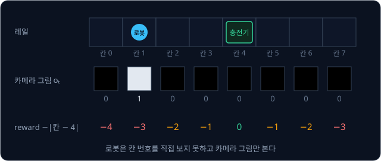

로봇이 칸 1 에 있을 때 world model 에 $+1$ 을 넣으면 다음 이미지에서 로봇이 칸 2 에 있고 reward 가 $-2$ 라고 예측해야 하고, 같은 이미지에
$-1$ 을 넣으면 칸 0 과 reward $-4$ 를 예측해야 한다. 입력에 늘 행동이 들어가고 출력은 늘 미래라서, 같은 장면이라도 넣은 행동이 다르면
예측도 달라진다.

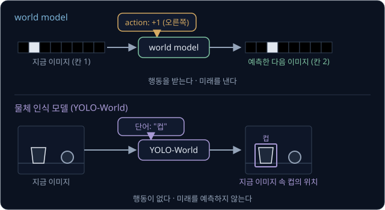

이름에 world 가 들어가도 행동을 받지 않거나 미래를 내지 않으면 world model 이 아니다.

| 이름 | 입력 | 출력 | 차이 |
| --- | --- | --- | --- |
| world model | 지금 장면과 행동 | 다음 장면과 reward | 데이터로 배운다 |
| YOLO-World (2024 년 1 월) | 이미지와 물체 이름 | 지금 이미지 속 물체의 위치 | 행동도 미래도 없는 object detection 모델이다 |
| 물리 simulator | 지금 상태와 행동 | 다음 상태 | 하는 일은 같지만 사람이 질량·마찰을 넣은 물리 식으로 만든다 |
| world frame | 없음 | 없음 | 방에 고정한 기준 좌표계의 이름이다 |

## model-free 와 model-based

[Bandits & MDPs](../bandit-mdp/README.md) 에서는 환경을 state, action, transition(다음 state 로 옮겨 가는 규칙), reward 로 적었는데,
world model 은 이 가운데 transition 과 reward 를 데이터로 배운다. [Policy Gradient](../policy-gradient/README.md) 와
[DQN → SAC](../off-policy/README.md) 에서 본 방법은 이런 규칙을 배우지 않고, 실제로 해 보고 받은 reward 만으로 policy 를 고쳤다. 이렇게
환경의 model 없이 배우는 RL 을 **model-free RL** 이라고 하고, world model 을 배워 쓰는 RL 은 **model-based RL** 이라고 한다. model-free 에도
policy network 라는 neural network 는 있으므로, 이름의 model 은 neural network 가 아니라 환경의 model 을 가리킨다.

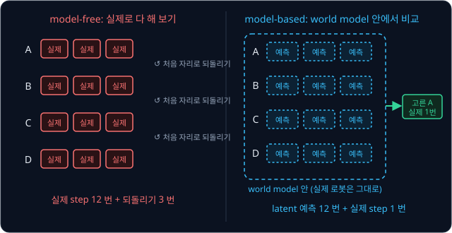

세 step 짜리 행동 후보 넷을 비교하려면 model-free 쪽은 넷을 모두 실제로 해 보면서 후보 하나가 끝날 때마다 로봇을 처음 자리로 되돌려야
하지만, model-based 쪽은 같은 비교를 world model 안에서 끝내고 고른 행동 하나만 실제로 한다. 또 world model 은 환경의 규칙을 배우므로 어떤 policy 로 모은 transition 이든 계속 학습에 쓸 수 있다.

같은 성능에 이르는 데 실제 경험이 얼마나 적게 드는지를 **sample efficiency** 라고 한다. PlaNet(2018 년 11 월) 논문에 따르면 이미지만 보는
cheetah 달리기 과제에서 PlaNet 은 episode 1,000 개로 662 점을 냈고, model-free 방법인 D4PG 는 episode 100,000 개로 524 점을 냈다.

## latent 와 encoder

레일 이미지에서 중요한 정보는 로봇의 칸 번호 하나뿐이라서, world model 이 다음 이미지의 숫자 여덟 개를 모두 예측할 필요는 없다.
[VAE](../vae/README.md) 에서 본 encoder 처럼 이미지를 숫자 몇 개로 줄이고 그 숫자 위에서 예측하는데, 줄인 숫자를 **latent** $z$ 라고
부른다. 계산을 쉽게 하려고 이 예에서는 encoder 가 낸 latent 가 마침 칸 번호와 같다고 두지만, 실제로 학습한 latent 는 칸 번호를 늘이거나
뒤집은 값이 되기 쉽다.

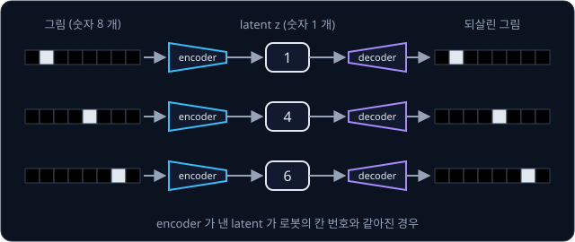

[DQN → SAC](../off-policy/README.md) 에서 다룬 `Pendulum-v1` 을 진자의 각도 대신 가로 64,
세로 64 pixel 의 컬러 이미지만 보고 푼다면, pixel 하나에 빨강·초록·파랑 밝기 세 숫자가 있으니 이미지 한 장은
$64 \times 64 \times 3 = 12{,}288$ 개의 숫자다. PlaNet 은 이런 64×64 이미지를 숫자 30 개짜리 latent 로 줄여 그 위에서 예측하는데, 30 개면
$12{,}288 \div 30 \approx 410$ 분의 1 이다.

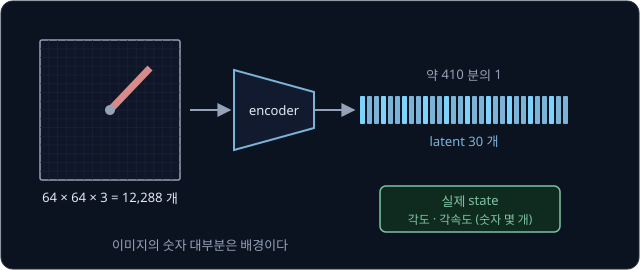

다만 이미지 한 장에는 속도가 담기지 않아서, 공이 칸 2 에 찍힌 이미지 한 장만으로는 공이 오른쪽으로 굴러가는 중인지 왼쪽으로 굴러가는
중인지 알 수 없다(아래 심화).

<b>심화: 이미지 두 장으로 구하는 속도</b>

앞 이미지에서 칸 1, 지금 이미지에서 칸 2 였다면 공은 step 마다 $2 - 1 = +1$ 칸씩 오른쪽으로 가는 중이라 다음 이미지에서는 칸 3 에 있을
것이다. 앞 이미지가 칸 3 이었다면 속도가 $2 - 3 = -1$ 이라 다음은 칸 1 이다. 지금 이미지는 똑같이 칸 2 인데 다음 칸은 3 과 1 로 갈린다.

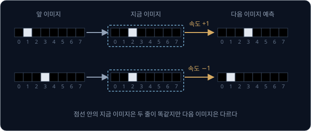

그래서 PlaNet 과 Dreamer 가 쓰는 **RSSM**(recurrent state-space model)은 latent 를 두 부분으로 나눈다. 확정된 부분은 지난 이미지들을
차례로 요약해 두어서 속도처럼 한 장에 안 보이는 정보를 담고, 분포에서 뽑는 무작위 부분은 미래가 하나로 정해지지 않는 경우를 담는다. 확정된
부분은 RNN(recurrent neural network)으로 계산하는데, RNN 은 지난 입력의 요약을 숫자 몇 개로 저장해 두었다가 새 입력이 올 때마다 그 요약을
고치는 network 다. PlaNet 에서는 무작위 부분이 앞의 숫자 30 개이고 확정된 부분이 숫자 200 개다. 저자들은 둘 중 한 부분만 쓴 model 보다
둘을 함께 쓴 RSSM 의 planning 성능이 높았다고 보고했다.

## dynamics model 과 reward model

지금 latent 와 action 을 받아 다음 latent 를 예측하는 부분을 **dynamics model** $f$ 라고 하고, latent 를 받아 reward 를 예측하는 부분은
**reward model** $g$ 라고 한다. 레일 로봇의 실제 규칙은 지금 칸에 action 만큼 더하는 것인데, 이 규칙을 모른다고 치고 식의 모양만 정해 두면
아래와 같다.

$$
\hat z_{t+1} = f(z_t, a_t) = z_t + w \times a_t, \qquad \hat r_{t+1} = g(\hat z_{t+1}) = -\,|\hat z_{t+1} - 4|
$$

모자(hat)를 씌운 $\hat z_{t+1}$ 과 $\hat r_{t+1}$ 은 다음 step 의 latent 와 reward 를 예측한 값이고, $w$ 는 action 1 에 latent 가 얼마나
움직이는지를 나타내는 weight 다. world model 은 로봇이 실제로 움직여 본 기록을 맞히도록 $w$ 를 학습한다. 지금 latent, action, 실제 다음
latent 를 적은 기록 한 줄을 transition 이라고 하고, 이런 기록을 모은 묶음을 dataset 이라고 한다. 레일의 기록으로 배우면 $w = 1$ 이
되므로(아래 심화), $z_t = 1$ 에서 $a_t = +1$ 을 넣으면 $\hat z_{t+1} = 1 + 1 \times 1 = 2$, $\hat r_{t+1} = -|2 - 4| = -2$ 다.

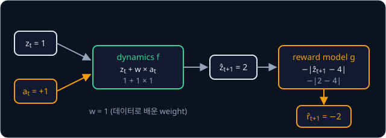

<b>심화: dataset 으로 배우는 w</b>

처음에는 world model 이 없으므로 무작위 action 으로 기록을 모은다. 예로 든 transition 넷이 아래와 같다고 하자.

| 지금 $z_t$ | action $a_t$ | 실제 다음 $z_{t+1}$ | 실제 변화 $z_{t+1} - z_t$ |
| --- | --- | --- | --- |
| 1 | $+1$ | 2 | $+1$ |
| 2 | $+1$ | 3 | $+1$ |
| 3 | $-1$ | 2 | $-1$ |
| 2 | $0$ | 2 | $0$ |

예측한 변화는 $w \times a_t$ 이고, 예측과 실제의 차이를 제곱해 평균한 MSE 를 loss 로 둔다. 몇 가지 $w$ 를 넣어 보면 아래와 같다.

| $w$ | 예측 변화 | 오차 (예측 − 실제) | 오차의 제곱 | MSE |
| --- | --- | --- | --- | --- |
| 0 | $0, 0, 0, 0$ | $-1, -1, 1, 0$ | $1, 1, 1, 0$ | $3 \div 4 = 0.75$ |
| 1 | $1, 1, -1, 0$ | $0, 0, 0, 0$ | $0, 0, 0, 0$ | $0$ |
| 2 | $2, 2, -2, 0$ | $1, 1, -1, 0$ | $1, 1, 1, 0$ | $3 \div 4 = 0.75$ |

loss 가 $w = 1$ 에서 0 으로 가장 작으므로 gradient descent 로 학습하면 $w = 1$ 이 된다. 실제 world model 의 $f$ 는 숫자 하나가 아니라
weight 가 수백만 개인 neural network 이지만, 기록된 transition 의 다음 latent 를 맞히도록 loss 를 줄인다는 원리는 같다. reward model 도 기록된
실제 reward 와 예측의 차이를 줄이도록 학습한다.

dynamics model 은 자기가 낸 예측을 다시 입력으로 받을 수 있다. 칸 1 의 이미지를 encoder 에 넣어 $z_0 = 1$ 을 얻은 뒤 action $+1$ 을 세 번
넣으면 latent 2, 3, 4 와 reward $-2, -1, 0$ 을 차례로 예측하는데, 둘째 step 부터 넣는 latent 는 실제 이미지에서 온 값이 아니라 바로 앞
step 의 예측이다.

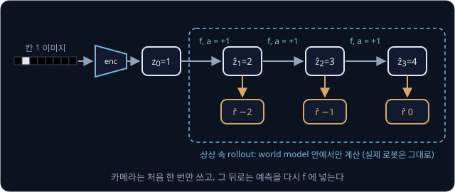

action 을 차례로 넣어 여러 step 을 이어 계산하는 것을
rollout 이라고 하는데, world model 안에서만 하는 rollout 은 따로 **상상 속 rollout**(imagination)이라고 부른다. Dreamer(2019 년 12 월) 논문
제목의 "Latent Imagination" 이 latent 안에서 하는 이 rollout 이다. 중간에 실제 관측으로 고치지 않고 처음 정한 action 만 넣어 끝까지 가므로
이 계산은 **open-loop** 다. 결과를 다시 재서 고치는 [PID Control](../pid-control/README.md) 에서 본 feedback loop 는 closed-loop 다.

<b>심화: world model 의 일반 식</b>

encoder, dynamics model, reward model 을 기호로 모으면 아래와 같다.

$$
z_t = \text{encoder}_\phi(o_t),\qquad \hat z_{t+1} = f_\psi(z_t, a_t),\qquad \hat r_{t+1} = g_\psi(\hat z_{t+1})
$$

$\phi$(파이)는 encoder 의 weight 전체이고 $\psi$(프사이)는 dynamics model 과 reward model 의 weight 전체인데, 레일 예에서 $\psi$ 는 $w$
하나였다. 레일 예에서는 $o_t = (0, 1, 0, 0, 0, 0, 0, 0)$, $z_t = 1$, $a_t = +1$, $\hat z_{t+1} = 2$, $\hat r_{t+1} = -2$ 다.

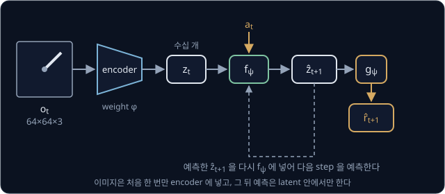

위 그림은 같은 구조를 Pendulum 에 쓴 모습이다. 이미지는 처음에 한 번만 encoder 에 넣고, 점선처럼 예측한 $\hat z_{t+1}$ 을 다시 $f$ 에 넣어
그 뒤의 예측을 모두 latent 안에서 한다. PlaNet 과 Dreamer 는 latent 에서 이미지를 되살리는 decoder 도 함께 학습해서, 되살린 이미지와 실제
이미지의 차이(reconstruction loss)로 latent 에 이미지의 정보가 담기게 한다.

## 상상 속 planning

world model 이 있으면 앞으로 할 행동 몇 개를 줄지은 행동열(action sequence) 후보를 world model 안에서 rollout 해 보고, 예측 reward 합이 가장
큰 후보를 고를 수 있다. 이 일을 **planning** 이라고 하고, 몇 step 앞까지 내다보는지를 horizon $H$ 라고 한다. 로봇이 칸 1 에 있고 $H = 3$ 일
때 후보 넷을 $w = 1$ 인 world model 로 비교하면 아래와 같다.

| 후보 | 행동열 | 예측 latent | 예측 reward | 합 |
| --- | --- | --- | --- | --- |
| A | $(+1, +1, +1)$ | $2, 3, 4$ | $-2, -1, 0$ | $-3$ |
| B | $(+1, +1, 0)$ | $2, 3, 3$ | $-2, -1, -1$ | $-4$ |
| C | $(+1, 0, 0)$ | $2, 2, 2$ | $-2, -2, -2$ | $-6$ |
| D | $(0, 0, 0)$ | $1, 1, 1$ | $-3, -3, -3$ | $-9$ |

합이 가장 큰 후보는 셋째 step 에 충전기에 닿는 A($-3$)다. 같은 후보로 칸 3 에서 출발하면 한 칸 가서 멈추는 C 가 합 0 으로 가장 좋고, A 는
충전기를 지나쳐 $-3$ 이 된다(아래 심화). 출발 자리에 따라 가장 좋은 후보가 바뀌므로 planning 은 지금 자리에서 매번 새로 해야 한다.

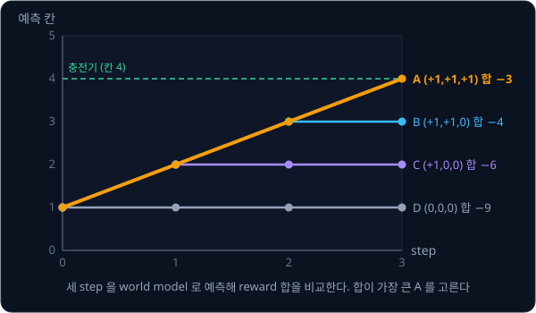

**흔한 오해.** "planning 은 가능한 모든 행동열 가운데 가장 좋은 것을 찾는다." planning 은 만들어 본 후보 안에서만 고르므로, 위 표에 A 가
없었다면 B 를 골랐을 것이다. 행동이 셋이고 $H = 3$ 이면 행동열이 $3 \times 3 \times 3 = 27$ 개라 모두 넣어 볼 수 있지만, 행동이 연속된
숫자이거나 $H$ 가 길면 모두 넣어 볼 수 없어서 후보를 잘 만드는 방법이 따로 필요하다.

<b>심화: 칸 3 에서의 planning 과 planning 의 식</b>

같은 후보 넷으로 칸 3 에서 출발하면 아래와 같다.

| 후보 | 행동열 | 예측 latent | 예측 reward | 합 |
| --- | --- | --- | --- | --- |
| A | $(+1, +1, +1)$ | $4, 5, 6$ | $0, -1, -2$ | $-3$ |
| B | $(+1, +1, 0)$ | $4, 5, 5$ | $0, -1, -1$ | $-2$ |
| C | $(+1, 0, 0)$ | $4, 4, 4$ | $0, 0, 0$ | $0$ |
| D | $(0, 0, 0)$ | $3, 3, 3$ | $-1, -1, -1$ | $-3$ |

이 비교를 기호로 쓰면 아래와 같다.

$$
a^*_{0:H} = \arg\max_{a_{0:H}} \sum_{k=0}^{H-1} \hat r_{k+1},\qquad \hat z_0 = z_0,\quad \hat z_{k+1} = f(\hat z_k, a_k),\quad \hat r_{k+1} = g(\hat z_{k+1})
$$

$a_{0:H}$ 는 step 0 부터 $H$ 바로 전까지의 행동열로 표의 행동열 열이고, $\sum_{k=0}^{H-1}$ 은 $k$ 를 0 부터 $H - 1$ 까지 바꿔 가며 모두
더한다는 뜻이라서 표의 합 열이 이 값이다. $\arg\max$ 는 그 값을 가장 크게 만드는 것을 고른다는 뜻이고, 별표는 고른 결과라는 표시다. 위
표라면 $H = 3$, $z_0 = 3$ 이고 $a^*$ 는 C 의 $(+1, 0, 0)$ 이다. [Bandits & MDPs](../bandit-mdp/README.md) 에서 본 return 은 늦게 받는
reward 를 discount factor $\gamma$ 로 깎아 더했지만, 여기서는 horizon 이 짧아서 깎지 않고 그대로 더했다.

**확인 문제.** 로봇이 칸 5 에 있고($z_0 = 5$, $w = 1$) 후보가 $(-1, 0, 0)$ 과 $(-1, -1, 0)$ 둘일 때, 각 후보의 예측 reward 합과 고를 후보는?

답 보기

reward 는 예측 latent 에서 4 를 빼고 부호를 뗀 뒤 마이너스를 붙인 값이다.

| 후보 | 예측 latent | 예측 reward | 합 |
| --- | --- | --- | --- |
| $(-1, 0, 0)$ | $5 - 1 = 4$, 4, 4 | $0, 0, 0$ | $0$ |
| $(-1, -1, 0)$ | $4$, $4 - 1 = 3$, 3 | $0, -1, -1$ | $-2$ |

답: 합이 큰 $(-1, 0, 0)$ 을 고른다. 충전기에 닿은 뒤 그대로 있는 쪽이 지나쳐 가는 쪽보다 낫다.

## CEM

Pendulum 의 토크는 $-2$ 부터 2 사이의 아무 실수나 될 수 있어서 행동열을 모두 적어 볼 수 없다. **CEM**(cross-entropy method)은 후보를
정규분포 $\mathcal N(\mu, \sigma^2)$ 에서 무작위로 뽑되, 점수가 좋았던 후보 근처로 분포를 옮겨 가며 여러 번 다시 뽑는다. 정규분포의 평균
$\mu$ 는 어디쯤에서 뽑을지를 정하고, 표준편차 $\sigma$ 는 얼마나 넓게 뽑을지를 정한다. CEM 은 아래를 되풀이한다.

1. 지금 분포에서 후보를 여러 개 뽑는다
2. 후보마다 world model 로 점수를 매긴다
3. 점수가 가장 좋은 몇 개를 고른다. 이렇게 고른 후보를 elite 라고 한다
4. elite 의 평균과 표준편차를 새 $\mu$, $\sigma$ 로 삼는다

손으로 계산할 수 있게 레일 로봇의 action 을 잠시 연속된 숫자로 바꾸고(1.5 면 한 칸 반) $H = 1$ 로 둔다. 칸 1 에서 action $a$ 의 점수는
$-|1 + a - 4| = -|a - 3|$ 이라 정답은 $a = 3$ 이다. 처음 분포를 $\mathcal N(0, 2^2)$ 로 넓게 잡고 반복마다 후보 4 개를 뽑아 상위 2 개를
elite 로 쓰는데, 아래 표의 뽑힌 값은 예로 정한 것이다.

| 반복 | 분포 | 뽑은 후보 | 점수 $-\lvert a - 3 \rvert$ | elite | 새 $\mu$ | 새 $\sigma$ |
| --- | --- | --- | --- | --- | --- | --- |
| 1 | $\mathcal N(0, 2^2)$ | $-2, -1, 1, 2$ | $-5, -4, -2, -1$ | $1, 2$ | 1.5 | 0.5 |
| 2 | $\mathcal N(1.5, 0.5^2)$ | $1, 1.5, 2, 2.5$ | $-2, -1.5, -1, -0.5$ | $2, 2.5$ | 2.25 | 0.25 |
| 3 | $\mathcal N(2.25, 0.25^2)$ | $2, 2.25, 2.5, 2.75$ | $-1, -0.75, -0.5, -0.25$ | $2.5, 2.75$ | 2.625 | 0.125 |

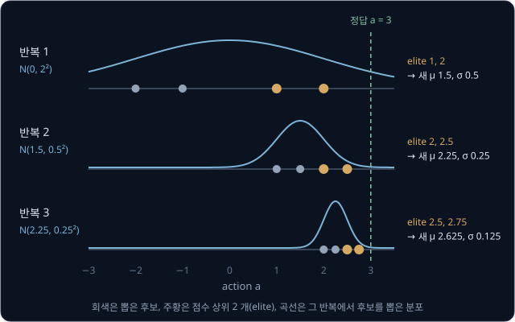

$\mu$ 는 3 에 다가가고 $\sigma$ 는 좁아져서 좋은 값 근처를 점점 촘촘하게 뒤지고, 반복을 마치면 마지막 $\mu$ 를 계획으로 쓴다. $H$ 가 1
보다 크면 step 마다 $\mu$ 와 $\sigma$ 를 하나씩 둔다. CEM 은 후보를 뽑는 분포만 고치고 world model 의 weight 는 그대로 두며, gradient 없이
점수 비교만으로 좋은 쪽을 찾는다.

<b>심화: elite 의 평균과 표준편차</b>

반복 1 의 elite 는 1 과 2 다. 새 $\mu$ 는 둘의 평균 $(1 + 2) \div 2 = 1.5$ 이고, 새 $\sigma$ 는 각 elite 가 평균에서 떨어진 거리를 제곱해
평균한 값(분산)의 제곱근이다. 두 elite 는 1.5 에서 $-0.5$, $+0.5$ 떨어져 있으므로 분산은 $(0.25 + 0.25) \div 2 = 0.25$ 이고 표준편차는
$\sqrt{0.25} = 0.5$ 다. 반복 2 의 elite 2 와 2.5 는 평균 2.25 에서 $\mp 0.25$ 떨어져 있어서 분산이 $0.0625$ 이고 표준편차가 0.25 다. Pendulum 처럼
action 에 범위가 있으면 뽑은 값이 범위를 넘을 때 가장자리 값($-2$ 나 2)으로 자른다.

PlaNet 은 실제 step 하나를 고를 때마다 $H = 12$, 후보 1,000 개, 반복 10 번, elite 100 개로 CEM 을 실행했다. 그러면 실제 step 하나에
latent 예측이 $1{,}000 \times 10 \times 12 = 120{,}000$ 번 든다. 예측마다 이미지의 숫자 12,288 개를 내야 한다면 감당하기 어렵지만, PlaNet 의
latent 는 $200 + 30 = 230$ 개라서 후보 1,000 개를 한 묶음(batch)으로 쌓아 GPU 에서 한꺼번에 계산할 수 있다.

**확인 문제.** 어떤 반복에서 elite 가 3 과 5 였다. 새 $\mu$ 와 $\sigma$ 는?

답 보기

1. 평균: $\mu = (3 + 5) \div 2 = 4$
2. 평균에서 떨어진 거리: $3 - 4 = -1$, $5 - 4 = +1$
3. 분산: $\big((-1)^2 + 1^2\big) \div 2 = 1$, 표준편차: $\sigma = \sqrt 1 = 1$

답: $\mu = 4$, $\sigma = 1$ 이고, 다음 반복은 $\mathcal N(4, 1^2)$ 에서 뽑는다.

## 예측 오차의 누적

데이터가 적거나 카메라 이미지에 잡음이 있어서, world model 이 action 하나에 한 칸 반 간다고 잘못 배워 $w = 1.5$ 가 되었다고 하자. 칸 1 에서
$+1$ 을 세 번 넣어 open-loop 로 rollout 하면 예측은 2.5, 4, 5.5 로 실제 칸 2, 3, 4 에서 0.5, 1, 1.5 만큼 벗어난다. 예측 위에 다시 예측을
쌓으면 앞 step 의 오차를 고치지 못한 채 새 오차가 더해지기 때문이다. 셋째 step 에서 로봇은 실제로
충전기에 있지만 world model 은 충전기를 한 칸 반 지나쳤다고 예측한다. 이렇게 오차가 rollout 을 따라 쌓이는 것을 **compounding error** 라고
한다.

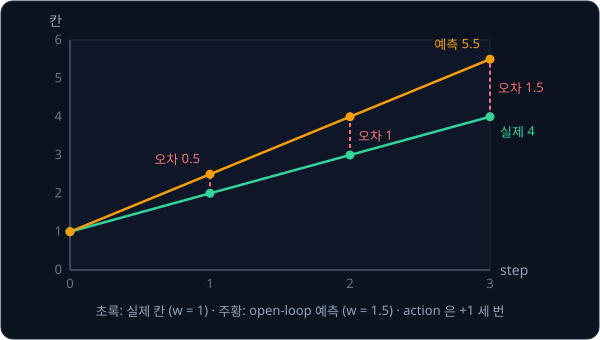

오차가 다음 예측의 입력으로 들어가 그 자체로 더 큰 오차를 낳으면 더 빨리 커진다(아래 심화). 실제 world model 의 오차에는 같은 양씩 쌓이는 몫과
입력을 거쳐 불어나는 몫이 섞여 있어서, 한 step 예측이 꽤 정확해도 긴 rollout 은 크게 틀어질 수 있다.

<b>심화: 입력으로 되먹임되는 오차의 계산</b>

실제로는 제자리에 있는 로봇을 두고 world model 이 "그대로 두면 latent 가 1.2 배가 된다"($\hat z_{t+1} = 1.2 \times z_t$)고 배웠다고 하자. 칸 1
에서 시작하면 아래와 같다.

| step | 실제 칸 | 예측 ($1.2 \times$ 앞 예측) | 오차 | 오차가 매번 0.2 씩 늘 때 |
| --- | --- | --- | --- | --- |
| 1 | 1 | $1.2$ | $0.2$ | $0.2$ |
| 2 | 1 | $1.2 \times 1.2 = 1.44$ | $0.44$ | $0.4$ |
| 3 | 1 | $1.44 \times 1.2 = 1.728$ | $0.728$ | $0.6$ |
| 4 | 1 | $1.728 \times 1.2 \approx 2.074$ | $1.074$ | $0.8$ |
| 5 | 1 | $2.074 \times 1.2 \approx 2.488$ | $1.488$ | $1.0$ |

step 2 의 예측 1.44 는 이미 0.2 만큼 틀린 1.2 를 받아 다시 1.2 배를 한 값이다. 그래서 앞의 오차 0.2 도 1.2 배가 되어 $0.2 \times 1.2 = 0.24$
가 되고, 여기에 새 오차 0.2 가 더해진다($0.24 + 0.2 = 0.44$). step 마다 앞의 오차가 1.2 배씩 불어나므로, 마지막 열처럼 같은 양씩 늘 때보다
빨리 커진다.

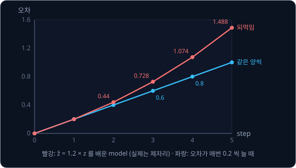

예측이 틀리면 planning 도 틀리는데, $w = 1.5$ 인 world model 로 칸 1 에서 앞의 후보 넷을 비교하면 아래와 같다.

| 후보 | 행동열 | 예측 latent ($w = 1.5$) | 예측 reward | 예측 합 | 실제 합 ($w = 1$) |
| --- | --- | --- | --- | --- | --- |
| A | $(+1, +1, +1)$ | $2.5, 4, 5.5$ | $-1.5, 0, -1.5$ | $-3$ | $-3$ |
| B | $(+1, +1, 0)$ | $2.5, 4, 4$ | $-1.5, 0, 0$ | $-1.5$ | $-4$ |
| C | $(+1, 0, 0)$ | $2.5, 2.5, 2.5$ | $-1.5, -1.5, -1.5$ | $-4.5$ | $-6$ |
| D | $(0, 0, 0)$ | $1, 1, 1$ | $-3, -3, -3$ | $-9$ | $-9$ |

planner 는 B 가 두 번만 움직여도 충전기에 닿는다는 예측을 믿고 B 를 고르지만, 실제로 B 를 하면 칸 3 에서 멈춰 합이 $-4$ 로 A 의 $-3$ 보다
나쁘다. planner 는 예측 점수가 가장 높은 행동을 고르므로, model 이 점수를 실제보다 높게 예측하는 행동이 있으면 그 행동을 고르게 된다.

Ha 와 Schmidhuber 의 World Models(2018 년 3 월)에서도 학습한 controller 가 world model 의 틀린 곳을 따라갔다. 저자들은 VizDoom 게임의 world
model 이 만든 가상 환경 안에서만 controller 를 학습했는데, 가상 환경의 무작위성을 낮춘 설정($\tau = 0.1$)에서는 괴물이 불덩이를 한 번도 쏘지
않았다. 그 안에서 학습한 controller 는 가상 환경에서 대부분 만점인 2100 점을 냈지만, 실제 게임에서는 무작위 policy 보다도 점수가 낮았다.

그래서 실제 시스템은 상상 속 rollout 을 짧게 두고, 그 너머는 value(앞으로 받을 reward 합의 예측)로 대신한다. 학습에는 **multi-step loss** 를
쓰기도 한다. 실제 이미지에서 얻은 $z_0$ 하나에서 출발해 action 만 주고 여러 step 을 펼친 뒤, 펼친 예측마다 실제 latent 와 비교하는 loss 다.
한 step 씩만 배우면 학습 때는 늘 실제 latent 에서 출발하지만 planning 때는 자기 예측 위에 다시 예측하는데, multi-step loss 는 이 차이를
학습 단계에서부터 loss 에 넣는다. 다만 아래 표의 PlaNet 과 Dreamer 는 multi-step loss 를 최종 agent 에 넣지 않았다.

| 시스템 | 상상 속 rollout 길이 | 여러 step 을 펼친 학습 |
| --- | --- | --- |
| PlaNet (2018 년 11 월) | planning horizon 12 | latent 분포에 맞춘 multi-step loss 인 latent overshooting 을 제안했지만 RSSM 에서는 성능이 조금 떨어져 최종 agent 에서 뺐다 |
| Dreamer (2019 년 12 월) | imagination horizon 15, 그 너머는 critic 의 value | latent overshooting 이 필요 없었다고 보고했다 |
| TD-MPC2 (2023 년 10 월) | planning horizon 3, 그 너머는 value | 3 step 을 펼쳐 먼 step 일수록 작은 weight 로 더한 loss |
| V-JEPA 2-AC (2025 년 6 월) | planning horizon 1 (로봇 실험) | 한 step loss 에 2 step rollout loss 를 더한 loss |

<b>심화: 한 step loss 와 multi-step loss</b>

칸 1, 2, 3, 4 를 지난 기록 하나로 $w = 1.5$ 의 두 loss 를 비교하면 아래와 같다(오차의 제곱을 더하기만 한다).

| step | 실제 | 한 step 예측 (실제에서 출발) | 제곱 오차 | 여러 step 예측 (예측에서 출발) | 제곱 오차 |
| --- | --- | --- | --- | --- | --- |
| 1 | 2 | $1 + 1.5 = 2.5$ | 0.25 | 2.5 | 0.25 |
| 2 | 3 | $2 + 1.5 = 3.5$ | 0.25 | 4 | 1 |
| 3 | 4 | $3 + 1.5 = 4.5$ | 0.25 | 5.5 | 2.25 |
| 합 | | | 0.75 | | 3.5 |

한 step loss 는 0.75 지만 multi-step loss 는 3.5 로, rollout 에서 실제로 생기는 오차를 그대로 loss 에 담는다. $w = 1.2$ 면 한 step loss 는
$0.04 \times 3 = 0.12$ 이고 multi-step loss 는 $0.04 + 0.16 + 0.36 = 0.56$ 이다. multi-step loss 를 줄이도록 배운 world model 은 오차가 쌓여
커지는 쪽을 특히 피하게 되므로 긴 rollout 에서 덜 틀어진다. V-JEPA 2 저자들은 예측을 다시 입력으로 넣는 rollout loss 를 더해 rollout 중의
오차 누적을 줄였다고 설명한다.

**확인 문제.** $w = 0.8$ 인 world model 로 칸 0 에서 $+1$ 을 네 번 넣으면 넷째 step 의 예측과 오차는 얼마일까?

답 보기

| step | 예측 (앞 예측 + 0.8) | 실제 칸 | 오차 |
| --- | --- | --- | --- |
| 1 | $0 + 0.8 = 0.8$ | 1 | $-0.2$ |
| 2 | $0.8 + 0.8 = 1.6$ | 2 | $-0.4$ |
| 3 | $1.6 + 0.8 = 2.4$ | 3 | $-0.6$ |
| 4 | $2.4 + 0.8 = 3.2$ | 4 | $-0.8$ |

답: 넷째 step 의 예측은 3.2 이고 오차는 $3.2 - 4 = -0.8$ 이다. step 마다 $-0.2$ 씩 쌓였다.

## MPC

$w = 1.5$ 인 world model 로 고른 B 를 끝까지 그대로 실행하면 로봇은 칸 3 에서 멈춘다. 그런데 B 의 첫 action 만 하고 카메라를 다시 보면
로봇이 칸 2.5 가 아니라 칸 2 에 있다는 것을 알 수 있어서, 그 자리에서 다시 계획하면 틀린 예측이 쌓이기 전에 바로잡을 수 있다.
**MPC**(model predictive control)는 이것을 매 step 되풀이한다.

1. 지금 카메라 이미지를 encoder 에 넣어 latent 를 얻는다
2. 그 latent 에서 길이 $H$ 의 행동열을 planning 한다
3. 행동열의 첫 action 하나만 실제로 한다
4. 다음 step 에서 1 로 돌아간다

MPC 는 매 step 실제 관측을 다시 보므로 closed-loop 다. 같은 틀린 world model 과 후보 넷으로 칸 1 에서 MPC 를 하면 아래와 같다.

| 실제 step | 실제 칸 | 예측 합 A / B / C / D | 고른 후보 | 실행한 첫 action | 다음 실제 칸 |
| --- | --- | --- | --- | --- | --- |
| 0 | 1 | $-3$ / $-1.5$ / $-4.5$ / $-9$ | B | $+1$ | 2 |
| 1 | 2 | $-4$ / $-2.5$ / $-1.5$ / $-6$ | C | $+1$ | 3 |
| 2 | 3 | $-6$ / $-4.5$ / $-1.5$ / $-3$ | C | $+1$ | 4 |
| 3 | 4 | $-9$ / $-7.5$ / $-4.5$ / $0$ | D | $0$ | 4 |

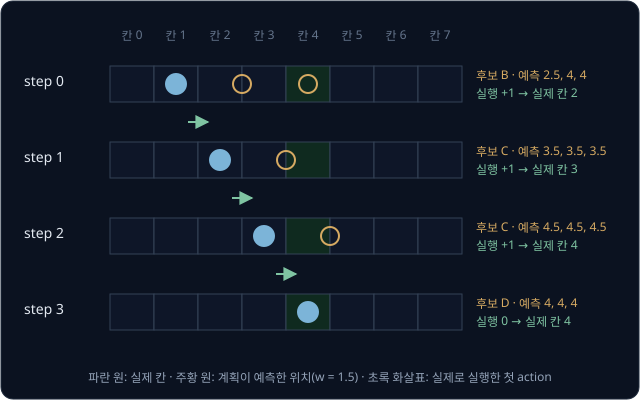

world model 은 끝까지 $w = 1.5$ 로 틀렸지만 로봇은 세 step 만에 충전기에 도착해 머문다. 처음 세 step 의 실제 reward 합은
$-2 - 1 + 0 = -3$ 으로, B 를 끝까지 실행한 $-2 - 1 - 1 = -4$ 보다 좋고 정확한 world model 로 고른 A 와 같다. 다만 MPC 가 막는 것은 틀린 예측이
여러 step 쌓이는 일뿐이라서, model 이 크게 틀리면 첫 action 부터 엉뚱한 쪽을 고른다.

대신 실제 step 마다 planning 을 처음부터 다시 하므로 계산이 많아서, PlaNet 설정이면 실제 step 하나에 latent 예측이
$1{,}000 \times 10 \times 12 = 120{,}000$ 번 든다. PlaNet 과 V-JEPA 2-AC 도 이 방식을 쓰는데, V-JEPA 2-AC 는 CEM 으로 찾은 행동열의 첫
action 만 Franka 로봇 팔에서 실행한 뒤 다시 계획한다.

**확인 문제.** $w = 1.5$ 인 world model 로 로봇이 칸 6 에 있을 때 후보 $(-1, 0, 0)$ 과 $(-1, -1, 0)$ 의 예측 합을 구하고, MPC 가 실행할 첫
action 과 그 뒤의 실제 칸을 답해 보자.

답 보기

예측 latent 는 앞 값에 $1.5 \times$ action 을 더한 값이고, reward 는 $-|\text{예측} - 4|$ 다.

| 후보 | 예측 latent | 예측 reward | 합 |
| --- | --- | --- | --- |
| $(-1, 0, 0)$ | $6 - 1.5 = 4.5$, 4.5, 4.5 | $-0.5, -0.5, -0.5$ | $-1.5$ |
| $(-1, -1, 0)$ | 4.5, $4.5 - 1.5 = 3$, 3 | $-0.5, -1, -1$ | $-2.5$ |

답: $(-1, 0, 0)$ 을 골라 첫 action $-1$ 만 실행하고, 실제 로봇은 한 칸 움직여 칸 5 에 간다. 다음 step 에는 칸 5 의 이미지에서 다시 계획한다.

<b>심화: model 오차와 planner 한계의 구분</b>

MPC agent 의 성능이 낮을 때 원인은 world model 이 틀린 것일 수도 있고, planner(후보 수, 반복 횟수, horizon)가 모자란 것일 수도 있다. 둘을
가르려면 같은 planner 에 world model 대신 진짜 환경의 식을 넣어 실행해 본다. 정답 model 을 넣은 이 기준을 oracle 이라고 하는데, 레일 예라면
$w = 1.5$ 대신 $w = 1$ 을 넣은 planner 다.

PlaNet 저자들도 같은 CEM($H = 12$, 후보 1,000 개, 반복 10 번, elite 100 개)에 진짜 simulator 를 넣은 결과를 성능의 상한으로 함께 보고했다.

| 과제 | PlaNet (배운 model, episode 1,000 개) | CEM + 진짜 simulator |
| --- | --- | --- |
| Cheetah Run | 662 | 656 |
| Finger Spin | 700 | 825 |
| Cup Catch | 930 | 993 |

Finger Spin 에서 벌어진 125 점은 같은 planner 에 진짜 simulator 를 넣으면 메워지므로 배운 model 탓이다. Cheetah Run 은 PlaNet 이 이미 상한과
비슷해서, model 을 고쳐도 같은 planner 로는 더 오르기 어렵다. oracle 도 과제를 못 풀면 world model 보다 planner 부터 고쳐야 한다.

## 데이터 수집 반복

world model 은 dataset 에 있던 상황에서만 믿을 만하다. 처음 dataset 을 무작위 action 으로 모았더니 로봇이 칸 0 ~ 3 만 다녔다고 하자. reward
model 이 본 reward 는 그 네 칸의 $-4, -3, -2, -1$ 뿐인데, 이 네 점은 직선 $\hat r = z - 4$ 위에 정확히 놓인다. reward model 이 이 직선을
배우면 데이터가 있는 칸에서는 오차가 0 이지만, 직선을 칸 4 너머로 이으면 칸 6 에서 $+2$ 를 예측한다. 실제 reward 는 칸 4 에서 가장 크고 다시
작아져서 칸 6 에서는 $-2$ 다.

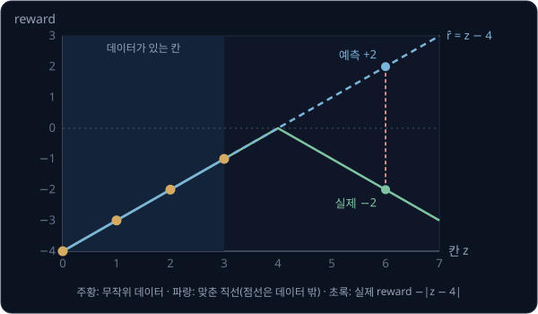

이 world model 로 칸 3 에서 계획하면 충전기를 지나쳐 달려가는 A 의 예측 합이 $0 + 1 + 2 = 3$ 으로 가장 커서 planner 는 A 를 고른다(실제
합은 $0 - 1 - 2 = -3$). 하지만 A 를 실제로 해 본 기록(칸 4, 5, 6 의 reward $0, -1, -2$)을 dataset 에 더해 다시 학습하면 reward model 이 칸 4
너머의 reward 를 배우고, planner 는 다음에 합 0 인 C 를 고른다. 그래서 model-based RL 은 무작위 action 으로 처음 dataset 을 모은 뒤, dataset 으로 world model 을
학습하는 일과 planner 로 실제 episode 를 더 모아 dataset 에 더하는 일을 번갈아 되풀이한다.

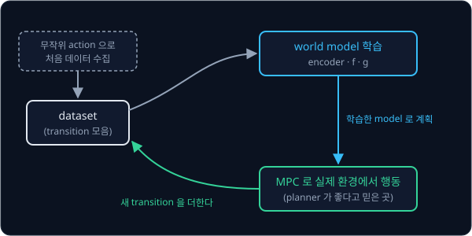

planner 로 모은 데이터는 planner 가 예측 점수가 높다고 고른 행동의 결과라서, model 이 맞았다면 좋은 행동의 데이터가 쌓이고 틀렸다면 그 잘못된
예측을 고칠 데이터가 쌓인다. PlaNet 저자들은 무작위 action 의 episode 5 개로 시작해, world model 을 100 번 고칠 때마다 planner 가 고른 action
에 표준편차 0.3 의 noise 를 더해 episode 를 하나씩 더 모았다.

무작위 데이터에는 중요한 상황이 드물게 나온다. Gymnasium 의 `Pendulum-v1` 식으로 무작위 토크를 넣은 200 step 짜리 episode 2,000 개를 계산해
보면, 진자가 똑바로 선 자세에서 20° 안쪽에 있던 step 은 전체의 약 4% 다. 무작위 데이터로만
배운 world model 은 진자를 세우는 데 꼭 필요한 선 자세 근처를 거의 보지 못하므로, planner 가 진자를 위로 데려가 모은 episode 가 그 근처의
데이터를 채운다.

## 상상 속 policy 학습과 Dreamer

Dreamer 는 MPC 처럼 실제 step 마다 planning 하지 않고, world model 안의 상상 속 rollout 으로 policy 를 미리 학습해 둔다.
[Policy Gradient](../policy-gradient/README.md) 에서 본 actor-critic 처럼 latent 를 받아 action 을 내는 actor 와 latent 의 value 를 예측하는
critic 을 둔다. dataset 의 latent 에서 출발해 actor 가 낸 action 을 $f$ 에 넣어 15 step 을 상상하고, 15 step 너머의 reward 는 critic 의
value 로 대신한다. 학습이 끝나면 실제 step 마다 encoder 와 actor 를 한 번씩만 계산하면 action 이 나온다.

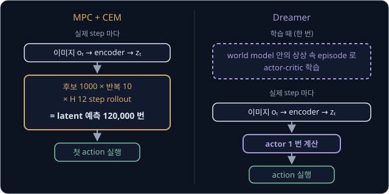

Dreamer 논문에 따르면 이미지만 보는 연속 제어 과제 20 개에서 Dreamer 는 environment step 500 만 번 뒤 평균 823 점을 냈고, model-free 방법
D4PG 는 1 억 step 뒤 786 점이었다. 2023 년 1 월의 DreamerV3 는 같은 설정 하나로 150 개가 넘는 과제에서 분야별 전용 방법보다 좋은 결과를 냈다.
저자들에 따르면 DreamerV3 는 사람의 데이터 없이 처음부터 Minecraft 에서 다이아몬드를 캔 첫 알고리즘이기도 하다.

DayDreamer(2022 년 6 월)의 저자들은 simulator 없이 실제 로봇 네 대에서 Dreamer 를 학습했다. 로봇이 움직이는 동안 한 thread 는 world model 과
actor-critic 을 계속 학습하고, 다른 thread 는 actor 로 행동을 냈다. 4 다리 로봇은 1초에 20 번 명령을 받으므로 1 시간이면 실제 step 이
$20 \times 3{,}600 = 72{,}000$ 번이다.

| 로봇 | 과제 | 명령 주기 | 저자들이 보고한 결과 |
| --- | --- | --- | --- |
| A1 4 다리 로봇 | 뒤집힌 자세에서 일어나 걷는 일 | 20 Hz | 1 시간 만에 걸었다. 같은 시간 동안 SAC 는 몸을 굴리는 데서 멈췄다 |
| UR5 팔 | 카메라 이미지를 보고 물체 여러 개를 다른 통에 옮기는 일 | 2 Hz | 8 시간 뒤 1분에 2.5 개로 사람의 조종에 가까워졌다 |
| XArm 팔 | 카메라 이미지를 보고 부드러운 물체를 옮기는 일 | 약 0.5 Hz | 10 시간 만에 1분에 3.1 개로 사람과 비슷해졌다 |
| Sphero 바퀴 로봇 | 카메라 이미지만 보고 목표 위치로 가는 일 | 2 Hz | 2 시간 만에 목표 근처에 머물렀다 |

**흔한 오해.** "Dreamer 는 실제 환경 없이 상상만으로 학습한다." Dreamer 의 actor 는 상상 속 episode 로 배우지만, 그 상상을 만드는 world model
은 실제로 모은 transition 으로 학습하고 actor 가 실제로 움직일 때마다 새 transition 으로 다시 고친다. 실제 데이터가 줄어들 뿐 없어지지는
않는다.

## 영상 world model

여기까지 본 world model 은 로봇 한 대의 기록으로 배운 작은 model 이지만, 최근에는 인터넷과 로봇의 영상 수만 ~ 수천만 시간으로 다음 장면을
pixel 그대로 그려 내는 큰 영상 생성 모델을 world model 로 쓴다. 지금까지의 영상과 행동(또는 글 지시)을 받아 다음 영상을 내므로 하는 일은
레일 로봇의 world model 과 같지만, 이미지 한 장이 8 pixel 이 아니라 Genie 의 160×90 만 해도 14,400 pixel 이다.

| 시스템 | 발표 | 입력과 출력 | 규모와 특징 |
| --- | --- | --- | --- |
| Genie | 2024 년 2 월, Google DeepMind | 첫 이미지와 latent action 을 받아 다음 frame 을 낸다 | 2D 게임 영상 3 만 시간, 11B parameter. RT-1 로봇 영상으로 2.5B model 도 따로 학습했다 |
| Genie 3 | 2025 년 8 월, Google DeepMind | 글 설명으로 만든 세상을 1초에 24 frame, 720p 로 그리며 실시간으로 조작하게 한다 | 몇 분 동안 일관되며, SIMA agent 를 그 안에서 시험했다 |
| Cosmos | 2025 년 1 월, NVIDIA | 지난 영상과 글 또는 action 을 받아 앞으로의 영상을 낸다 | 원본 영상 약 2,000 만 시간에서 고른 clip 약 1 억 개로 학습했고 weight 를 공개했다 |
| DreamGen | 2025 년 5 월, NVIDIA | 첫 장면과 글 지시를 받아 로봇 영상을 낸다 | 공개 영상 생성 모델을 로봇 시연으로 fine-tuning 해 policy 학습 데이터를 만든다 |

인터넷 영상에는 어떤 버튼을 눌렀는지 같은 action 기록이 없어서, Genie 는 연속한 두 frame 사이의 변화를 8 가지 중 하나로 분류하는 model 을
함께 학습해 그 8 가지를 action 처럼 쓴다. Cosmos 저자들은 로봇 팔 영상 dataset Bridge 의 7 차원 action(손끝 위치·회전의 변화와 gripper)으로
fine-tuning 한 model 도 만들었고, 이런 model 의 쓰임으로 policy 평가, RL 의 학습 환경, planning, 학습 데이터 생성을 든다.

DreamGen 은 이 가운데 학습 데이터 생성을 실제 humanoid 로 보였다. 저자들은 공개 영상 생성 모델을 GR1 humanoid 의 pick-and-place 시연 2,884
개로 fine-tuning 한 뒤, 첫 장면과 "물을 부어라" 처럼 시연에 없던 지시문을 주어 로봇 영상을 만들었다. 만든 영상에는 action 이 없으므로 연속한
frame 에서 그 사이의 action 을 계산하는 **IDM**(inverse dynamics model)으로 action 을 붙이고, 이 영상과 action 으로
[GR00T](../groot/README.md) N1 policy 를 학습했다.

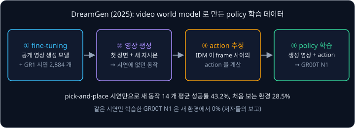

pixel 을 그리는 world model 도 물리를 틀리게 그린다. Cosmos 저자들은 자기들의 model 이 모두 물리 법칙을 지키는 데 어려움을 겪는다고
밝혔고, frame 을 하나씩 이어 그리는 autoregressive model 에서는 물체가 아래에서 갑자기 나타나는 실패를 보고했다. Google DeepMind 도 Genie 3
가 몇 시간이 아니라 몇 분 동안의 연속 상호작용만 지원한다고 밝혔다.

## representation 공간의 예측

pixel 을 그리는 world model 은 배경 무늬처럼 행동과 상관없는 것까지 예측해야 해서 계산이 많다. 그래서 decoder 없이 latent(representation)만
예측하는 world model 이 나왔는데, 다음 latent 를 맞히라는 loss 만 두면 쓸모없는 답으로 loss 를 0 으로 만들 수 있다. encoder 가 어떤 이미지든
$z = 0$ 을 내고 dynamics 가 늘 0 을 내면, 예측과 정답이 늘 같아 loss 는 0 이지만 latent 에는 아무 정보도 없다. 모든 입력이 한 점으로 모이는 이
현상을 **collapse** 라고 한다.

reward 를 함께 예측하면 칸 1 로 가는 transition(reward $-3$)과 칸 4 로 가는 transition(reward 0)을 latent 가 구별해야 reward 오차가 줄어서
collapse 를 막을 수 있다. 정답 쪽 latent 를 만드는 encoder 에 gradient 를 흘리지 않거나 천천히 따라오는 복사본을 쓰는 방법, encoder 를 아예
고정해 두는 방법도 있다. TD-MPC2(2023 년 10 월)는 decoder 없이 다음 latent, reward, value 를 예측하는 world model 위에서 MPC 로 계획해, 같은
설정 하나로 과제 104 개를 학습했다. 저자들은 parameter 317M 인 agent 하나가 과제 80 개를 함께 수행하도록 학습하기도 했다.

V-JEPA 2(2025 년 6 월)의 저자들은 인터넷 영상 100 만 시간 이상으로 action 없이 representation 을 예측하도록 encoder 를 pretraining 했다. 그
뒤 encoder 를 고정하고, 공개 로봇 dataset DROID 에서 고른 Franka 팔 영상 62 시간 미만으로 action 을 받는 predictor(약 300M parameter)를 학습해
V-JEPA 2-AC 를 만들었다. action 은 1초에 4 장씩 뽑은 frame 사이에서 손끝 위치·자세와 gripper 가 바뀐 양을 적은 7 차원 vector 다. 목표는 goal
이미지로 주고, CEM 으로 상상한 representation 과 goal 이미지의 representation 사이 거리가 가장 작아지는 action 을 찾는다.

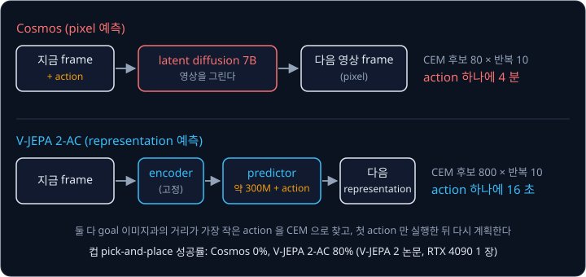

V-JEPA 2 저자들은 같은 DROID 데이터로 action 을 받게 fine-tuning 한 Cosmos 와 이 방식을 비교했다. 두 model 모두 데이터를 모은 적 없는
실험실의 Franka 팔에서 시험했고, pick-and-place 에는 goal 이미지 말고도 중간 목표 이미지 두 장을 함께 주었다. 컵 pick-and-place 의
성공률은 Cosmos 가 0% 였고 V-JEPA 2-AC 는 80% 였다. action 하나를 고르는 시간도 V-JEPA 2-AC 는 후보를 10 배 더 뽑고도 16 초로, Cosmos 의
4 분(240 초)보다 $240 \div 16 = 15$ 배 짧았다. 저자들에 따르면 Cosmos 로는 pick-and-place 한 번에 1 시간이 넘게 걸린다. 저자들은 예측을 이어 갈수록 representation 예측이 부정확해지고 horizon 이 길어지면 후보
행동열의 수가 지수적으로 늘어난다는 한계도 밝혔는데, 그래서 실험은 약 16 초 앞까지만 예측하면 되는 과제로 한정했다.

## 정리

- world model 은 지금 상태(latent)와 action 으로 다음 상태와 reward 를 예측하고, 그 안에서 행동열 후보를 비교하거나(CEM·MPC) policy 를
  학습해(Dreamer) 실제 시도를 줄인다. DayDreamer 의 A1 은 실제 step 약 72,000 번(1 시간)으로 걷기를 배웠다
- 예측 위에 예측을 쌓으면 오차가 쌓이고($w = 1.5$ 면 0.5, 1, 1.5) planner 는 model 이 틀린 곳을 따라간다. 실제 시스템은 상상 속 rollout 을
  짧게 두고(PlaNet 12, Dreamer 15, TD-MPC2 3 step) 그 너머를 value 로 대신한다. MPC 로 매 step 다시 계획하고, planner 로 모은 데이터로 world
  model 을 다시 학습한다
- 영상 world model(Genie, Cosmos)은 pixel 을 그려 학습 데이터 생성(DreamGen)과 평가에 쓰이고, V-JEPA 2-AC 는 representation 만 예측해 같은
  Franka 실험에서 action 하나를 16 초에 골랐다(Cosmos 는 4 분)

world model 은 아직 정해진 표준 구현이 없어서, pixel 을 그릴지 representation 만 예측할지, planning 을 할지 policy 를 학습할지, 몇 step 을
펼쳐 학습할지에 따라 결과가 크게 달라진다. 시연으로 배운 VLA 를 world model 대신 simulator 나 실제 로봇에서 받은 reward 로 더 학습하는 방법은
[VLA + RL](../vla-rl/README.md) 에서 다룬다.

## 참고 자료

- David Ha, Jürgen Schmidhuber, [World Models](https://arxiv.org/abs/1803.10122) (2018) — 상상 속 controller 학습. 4.5 절에 world model 의
  틀린 곳을 이용한 VizDoom 사례가 있다
- Danijar Hafner 외, [Learning Latent Dynamics for Planning from Pixels](https://arxiv.org/abs/1811.04551) (2019) — PlaNet. RSSM 과 CEM·MPC.
  부록 A 에 CEM 설정이 있고, 표 1 에 진짜 simulator 를 넣은 상한이 있다
- Danijar Hafner 외, [Dream to Control](https://arxiv.org/abs/1912.01603) (2020)·[Mastering Diverse Domains through World Models](https://arxiv.org/abs/2301.04104)
  (2023) — Dreamer 와 DreamerV3. latent 안에서 actor-critic 을 학습하는 방법
- Philipp Wu 외, [DayDreamer](https://arxiv.org/abs/2206.14176) (2022) — Dreamer 를 실제 로봇 네 대에서 simulator 없이 학습한 실험. 3 절에
  로봇별 설정과 결과가 있다
- Nicklas Hansen 외, [TD-MPC2](https://arxiv.org/abs/2310.16828) (2023) — decoder 없는 latent world model 과 MPC. 식 (3) 이
  multi-step loss 다
- Jake Bruce 외, [Genie](https://arxiv.org/abs/2402.15391) (2024)·Google DeepMind, [Genie 3](https://deepmind.google/discover/blog/genie-3-a-new-frontier-for-world-models/)
  (2025) — action 기록 없는 영상에서 latent action 을 배우는 영상 world model 과 그 후속
- NVIDIA, [Cosmos World Foundation Model Platform for Physical AI](https://arxiv.org/abs/2501.03575) (2025) — world foundation model 의
  쓰임(2.1 절)과 로봇 조작용 fine-tuning(6.2 절)
- Joel Jang 외, [DreamGen](https://arxiv.org/abs/2505.12705) (2025) — 영상 world model 로 만든 영상에 IDM 으로 action 을 붙여 policy 를 학습하는
  네 단계
- Mido Assran 외, [V-JEPA 2](https://arxiv.org/abs/2506.09985) (2025) — representation 공간에서 계획하는 V-JEPA 2-AC. 4 절과 표 3 에 Cosmos 와의
  비교가 있다
- Gymnasium, [Pendulum 환경 소스](https://github.com/Farama-Foundation/Gymnasium/blob/main/gymnasium/envs/classic_control/pendulum.py) —
  `Pendulum-v1` 의 운동 식, reward, 시작 상태
