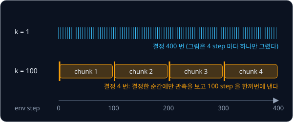
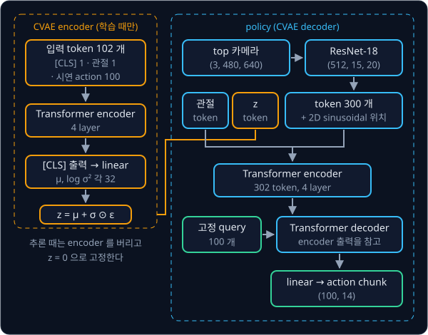
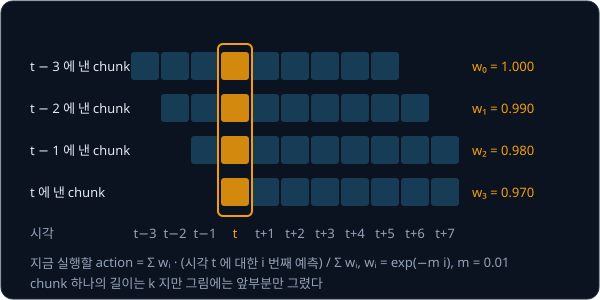

# ACT

## 배경

### action chunking

[Behavior Cloning](../behavior-cloning/README.md) 에서 본 compounding error 는 episode 가 길수록 커진다. 50 Hz 로 제어하는
양팔 조작은 사람 시연 한 번이 400–700 step 이라 한 step 씩 action 을 내는 policy 에게 특히 불리하고, 사람 시연에는 같은
장면에서 잠깐 멈추거나 속도가 달라지는 흔들림까지 섞여 있다. Zhao 등은 ALOHA(2023)에서 policy 가 한 번에 앞으로 $k$ step 의
action 을 묶어 내게 했는데, 이 묶음을 action chunk 라 한다. 이렇게 하면 policy 가 결정을 내리는 횟수가 $T$ 에서 $T/k$ 로 줄어
오차가 쌓일 기회도 그만큼 줄어든다. 이 과제의 transfer-cube episode 는 400 step 이라 $k = 1$ 이면 결정이 400 번, $k = 100$
이면 4 번이다.



### 시연의 흔들림과 CVAE

이 policy 가 ACT(Action Chunking with Transformers)이고, 시연의 흔들림을 다루기 위해 CVAE(conditional VAE)로 학습한다. 같은
장면에서도 시연마다 달라지는 움직임의 "방식"을 style 변수 $z$ 라는 작은 벡터(32 차원)에 담는다는 발상이다.

- encoder $q_\phi(z \mid a_{t:t+k}, \bar o_t)$ 는 학습 때만 쓴다. 시연의 action chunk $a_{t:t+k}$ 와 관절 위치 $\bar o_t$ 를 보고
  $z$ 의 평균 $\mu$ 와 log 분산 $\log\sigma^2$ 을 낸다. 이미지는 보지 않는다
- decoder 이자 policy 인 $\pi_\theta(\hat a_{t:t+k} \mid o_t, z)$ 는 카메라 이미지와 관절 위치 $o_t$, 그리고 $z$ 를 받아 $k$ step 의
  action $\hat a_{t:t+k}$ 를 낸다

학습 때는 [VAE](../vae/README.md) 의 reparameterization 으로 $z = \mu + \sigma \odot \epsilon$, $\epsilon \sim \mathcal{N}(0, I)$ 를
뽑아 decoder 에 넣고, 아래 loss 를 줄인다.

$$
\mathcal{L} = \big\lVert \hat a_{t:t+k} - a_{t:t+k} \big\rVert_1
+ \beta\, D_{\mathrm{KL}}\!\big(q_\phi(z \mid a_{t:t+k}, \bar o_t)\ \big\Vert\ \mathcal{N}(0, I)\big)
$$

첫 항은 예측한 (100, 14) action 과 시연의 차이를 절댓값으로 잰 L1 이고, episode 끝을 넘어 padding 으로 채운 자리는 뺀다. 둘째
항은 encoder 가 낸 분포가 표준 정규분포에서 얼마나 먼지를 재는 KL divergence 로, 대각 Gaussian 이면
$\frac{1}{2}\sum_j(\mu_j^2 + \sigma_j^2 - \log\sigma_j^2 - 1)$ 이다. 한 차원에서 $\mu = 0.5$, $\sigma = 1$ 이면 0.125 가 된다.
$\beta = 10$ 은 두 항의 비중이다.

### ACT 의 구조

CVAE encoder 는 BERT 처럼 맨 앞에 [CLS] token 을 두고, 관절 위치 token 1 개와 시연 action token 100 개를 더한 102 개 token 을
4 층 Transformer encoder 에 넣는다. [CLS] 자리의 출력 하나를 linear 로 바꿔 $\mu$ 와 $\log\sigma^2$ (각 32 차원)을 얻는다.

policy 는 카메라마다 [ResNet](../resnet/README.md) 의 ResNet-18 을 거친 feature map 을 token 으로 편다. 480×640 이미지는
ResNet-18 의 마지막 층에서 (512, 15, 20) feature map 이 되어 cell 300 개가 token 300 개가 되고, Transformer 가 위치를 알 수 있게
cell 마다 2D sinusoidal positional embedding 을 더한다. 여기에 관절 위치 token 과 $z$ token 을 붙인 302 개 token 이 4 층
[Transformer](../transformer/README.md) encoder 로 들어간다. decoder 는 학습하는 고정 query 100 개가 encoder 출력을 참고하게 해
100 개 출력을 한 번에 내고, linear 로 (100, 14) action chunk 를 만든다. 고정 query 로 출력 집합을 한 번에 내는 구조는 물체
검출 모델 DETR 에서 왔다.



논문 모델은 약 80M parameter 이고, 대부분의 과제를 시연 50 개만으로 처음부터 학습했다.

### 추론과 temporal ensembling

추론 때는 encoder 를 버리고 $z = 0$ 으로 고정한다. 가장 단순한 실행은 $k$ step 마다 한 번 추론해 chunk 를 끝까지 실행하는
방식이다. 매 step 추론하면 지금 시각 $t$ 를 덮는 예측이 여러 개 생기는데, 이 예측들을 $w_i = \exp(-m\,i)$ 로 가중 평균하는 것이
temporal ensembling 이다. $w_0$ 이 가장 오래된 예측의 weight 다. $m = 0.01$ 이고 예측이 4 개라면 weight 는 1, 0.990, 0.980,
0.970 이고, 합이 1 이 되게 나누면 0.254, 0.251, 0.249, 0.246 이라 거의 고르게 섞인다. 이렇게 하면 chunk 가 바뀌는 순간의
끊김이 줄어 움직임이 더 매끄러워진다.



### transfer-cube 과제

이번 과제에서는 ACT 를 직접 짜서 gym-aloha 의 transfer-cube 과제로 학습하고, 같은 데이터로 학습한 LeRobot ACT 와 성공률을
비교한다. transfer-cube 는 오른팔이 빨간 큐브를 집어 왼팔 gripper 로 건네는 과제다. 팔 하나가 관절 6 개와 gripper 1 개라
관절 위치와 action 은 양팔 합쳐 14 차원이고, 50 fps 로 400 step(8 초) 동안 돈다. gym-aloha 는 오른쪽 gripper 가 큐브에 닿으면
reward 1, 들어 올리면 2, 왼쪽 gripper 가 닿으면 3, 왼쪽 gripper 가 큐브를 테이블에서 떼어 쥐면 4 를 주고, 4 를 성공으로 친다.

## 목표

- action sequence 를 $z$ 로 압축하는 CVAE encoder 를 만든다
- ResNet-18 feature map·관절·$z$ 를 받는 Transformer encoder-decoder policy 를 $k = 100$ 으로 만든다
- L1 + $\beta$·KL 로 `lerobot/aloha_sim_transfer_cube_human` 에 학습한다
- gym-aloha 50 episode 성공률을 재고 chunk 크기 $k = 1, 10, 100$ 을 비교한다
- (보너스) temporal ensembling 을 붙인다

**직접 짤 것**: CVAE encoder, feature map 의 2D positional embedding, encoder-decoder policy, loss, chunk 실행 루프,
temporal ensembling.
**가져다 써도 되는 것**: [VAE](../vae/README.md) 의 reparameterization, [Transformer](../transformer/README.md) 의 layer,
[ResNet](../resnet/README.md) 의 ResNet-18 과 torchvision ImageNet weight, `LeRobotDataset`, gym-aloha, 비교용
`lerobot-train --policy.type=act`.

## 준비물

- Python 3.12, numpy, torch, torchvision, matplotlib, pytest
- `lerobot[aloha]` — gym-aloha (MuJoCo) 와 비교용 `lerobot-train` 명령이 함께 설치된다. 화면 없는 서버에서는 `MUJOCO_GL=egl`
- dataset: `lerobot/aloha_sim_transfer_cube_human` (50 episode, 20,000 frame, 50 fps, top camera 480×640, 14 차원 state·action)
- VAE·Transformer·ResNet 과제의 코드
- 8 GB GPU 로 충분하다 (LeRobot 의 hardware guide 기준 ACT 는 batch 8 에서 2–6 GB). 논문은 RTX 2080 Ti 11 GB 에서 과제당 약
  5 시간 학습했다

## 진행 순서

1. `data.py` 에서 `delta_timestamps` 로 현재 관측과 이후 100 step action 을 한 샘플로 묶고, episode 끝을 넘는 자리는 padding
   mask 로 표시한다. batch 하나의 action 이 (B, 100, 14), mask 가 (B, 100) 인지 확인한다
2. `cvae.py` 의 `StyleEncoder` 에 관절 위치와 action sequence 를 받아 $\mu, \log\sigma^2$ 를 내는 CVAE encoder 를 짠다. padding
   자리는 attention 에서 가린다
3. `backbone.py` 에 ResNet-18 feature map 을 2D sinusoidal positional embedding 과 함께 token 으로 펴는 backbone 을 짠다.
   480×640 이미지 한 장이 token 300 개가 되는지 확인한다
4. `act.py` 의 `ACTPolicy` 에 image token·관절 token·$z$ token 을 encoder 에, $k$ 개 query 를 decoder 에 넣는 policy 를
   조립하고 출력이 (B, 100, 14) 인지 확인한다
5. `act_loss` 에 padding 자리를 뺀 L1 과 $\beta = 10$ 의 KL 을 짜고, `train.py` 로 학습하며 두 항을 따로 기록한다
6. `eval_aloha.py` 의 `main` 에서 $k$ step 마다 한 번 추론해 chunk 를 실행하는 rollout 으로 gym-aloha
   `AlohaTransferCube-v0` 50 episode 성공률을 재고, forward 한 번의 시간도 함께 재서 `results/` 에 저장한다
7. $k = 1, 10, 100$ 으로 각각 학습해 성공률을 비교하고 `results/` 의 표에 더한다
8. 같은 데이터·step 으로 LeRobot ACT 를 학습하고 같은 50 episode 로 평가한다

## 시작점

아래 파일은 모두 리포에 들어 있다.

```text
act/
├── pyproject.toml    # 이 과제의 Python 버전과 패키지
├── uv.lock
├── data.py           # padding mask 가 붙은 chunk dataset
├── backbone.py       # ResNet-18 trunk + 2D sinusoidal positional embedding
├── cvae.py           # StyleEncoder
├── act.py            # ACTPolicy, act_loss
├── train.py          # 학습
└── eval_aloha.py     # chunk 실행, TemporalEnsembler
```

class·method·함수는 몸통이 `raise NotImplementedError` 인 stub 이고, 이름과 signature 는 그대로 둔 채 몸통을 채운다.
`data.py` 와 `backbone.py` 에는 정해진 signature 가 없어서 함수와 module 을 직접 정한다. 앞 과제의 코드는 파일마다 첫머리에서
그 과제 폴더를 `sys.path` 에 더해 import 해 두었다. [backbone.py](backbone.py) 는 ResNet 과제의 `resnet18`·
`load_torchvision_weights` 를, [cvae.py](cvae.py) 는 Transformer 과제의 `EncoderLayer` 를, [act.py](act.py) 는 `EncoderLayer`·
`DecoderLayer` 와 VAE 과제의 `kl_normal` 을, [train.py](train.py) 는 VAE 과제의 `reparameterize` 를 가져온다.
채점용 test 는 없어서 평가 기준은 학습 기록과 `results/` 에 저장한 rollout 결과로 확인한다. 패키지는 `pyproject.toml` 에 있고,
이 폴더에서 `uv run` 을 처음 실행할 때 `.venv/` 에 설치된다.

```bash
cd projects/act
uv run python train.py
uv run python eval_aloha.py
uv run lerobot-train --policy.type=act --policy.push_to_hub=false \
  --dataset.repo_id=lerobot/aloha_sim_transfer_cube_human \
  --env.type=aloha --env.task=AlohaTransferCube-v0 \
  --steps=<내 학습과 같은 step 수> --output_dir=outputs/lerobot_act
```

## 평가 기준

- [ ] 학습 중 L1 과 KL 을 따로 기록하고, $z = 0$ 일 때와 $z \sim \mathcal{N}(0, I)$ 일 때의 chunk 를 같은 그림에 그려 $z$ 가 실제로 무엇을 바꾸는지 확인한다
- [ ] 같은 50 episode 초기 상태에서 내 ACT 의 성공률이 같은 데이터·step 으로 학습한 LeRobot ACT 의 80% 이상이다 (LeRobot 이 공개한 `lerobot/act_aloha_sim_transfer_cube_human` 은 500 episode 성공률 83.0%)
- [ ] $k = 1$ 의 성공률이 $k = 100$ 보다 뚜렷하게 낮다
- [ ] 한 번의 forward 가 20 ms (50 Hz 제어 주기) 안에 끝난다
- [ ] (선택) $m = 0.01$ temporal ensembling 을 켜고 매 step 추론했을 때 성공률과 관절 궤적의 jerk 변화를 잰다

## 생각해 볼 질문

1. chunk 크기를 1 로 줄이면 성공률이 떨어지는 이유를 Behavior Cloning 의 compounding error 와 연결해 설명할 수 있는가?
2. CVAE 없이 L1 만으로 학습하면 같은 장면에서 멈췄다 가는 시연과 바로 가는 시연이 섞일 때 어떤 action 이 나오는가?
3. 추론 때 $z$ 를 prior 의 평균인 0 으로 고정하는 선택은 무엇을 얻고 무엇을 포기하는가?

## 힌트

<details>
<summary>episode 끝의 chunk</summary>

episode 마지막 100 step 안쪽의 샘플은 미래 action 이 모자라다. `LeRobotDataset` 은 `delta_timestamps` 가 episode 를
넘으면 가장 가까운 frame 으로 채우고 `action_is_pad` mask 를 함께 돌려주므로, 그 mask 로 L1 에서 padding 자리를 빼고
CVAE encoder 의 attention 에서도 가린다.

</details>

<details>
<summary>decoder 층 수와 학습 길이</summary>

원 구현은 decoder 를 7 층으로 적었지만 코드 bug 로 첫 층 출력만 쓰였고, LeRobot 은 그 동작에 맞춰 `n_decoder_layers=1`
을 기본값으로 둔다. 원 저장소 README 는 ACT 가 멈칫거리거나 떨리면 더 오래 학습하라고 하는데, loss 가 평평해진 뒤에도
성공률과 부드러움이 계속 좋아지기 때문이다.

</details>

<details>
<summary>temporal ensembling 의 버퍼</summary>

시각 $t$ 에 낸 chunk 는 $t$ 부터 $t+k-1$ 까지의 예측이다. 시각마다 그 시각을 덮는 예측을 모아 두는 버퍼를 두고, 오래된
예측일수록 $w_0$ 쪽 weight 를 받도록 정렬한 뒤 평균한다. $m$ 이 클수록 오래된 예측의 비중이 커져 새 관측이 늦게 반영되고,
$m$ 이 작을수록 빨리 반영된다.

</details>

## 참고 자료

- Tony Z. Zhao et al., [Learning Fine-Grained Bimanual Manipulation with Low-Cost Hardware](https://arxiv.org/abs/2304.13705) (2023) —
  Section IV 의 ACT 구조(Fig. 4)와 temporal ensembling(Fig. 5), Appendix D 의 hyperparameter
- [ALOHA project page](https://tonyzhaozh.github.io/aloha/) — 실물 시연 영상과 하드웨어 구성
- Nicolas Carion et al., [End-to-End Object Detection with Transformers](https://arxiv.org/abs/2005.12872) (2020) — 고정 query 로
  출력 집합을 한 번에 내는 DETR. ACT 의 encoder-decoder 와 2D sinusoidal positional embedding 이 여기서 왔다
- Kihyuk Sohn et al., [Learning Structured Output Representation using Deep Conditional Generative Models](https://papers.nips.cc/paper_files/paper/2015/hash/8d55a249e6baa5c06772297520da2051-Abstract.html) (2015) —
  조건부 VAE(CVAE)의 원 논문
- Diederik P. Kingma, Max Welling, [Auto-Encoding Variational Bayes](https://arxiv.org/abs/1312.6114) (2013) — reparameterization 과
  Gaussian KL 식
- 원 구현 [tonyzhaozh/act](https://github.com/tonyzhaozh/act) 의 [`detr_vae.py`](https://github.com/tonyzhaozh/act/blob/main/detr/models/detr_vae.py) — 막혔을 때만 연다
- LeRobot [ACT 문서](https://huggingface.co/docs/lerobot/act)와 [구현](https://github.com/huggingface/lerobot/tree/main/src/lerobot/policies/act) — 구현은 막혔을 때만 연다
- [gym-aloha](https://github.com/huggingface/gym-aloha) — action·observation 정의와 성공 기준(reward 4)
- [lerobot/act_aloha_sim_transfer_cube_human](https://huggingface.co/lerobot/act_aloha_sim_transfer_cube_human) model card — 학습·평가 명령과 원 구현 대비 결과

## 남은 한계

ACT 는 과제마다 처음부터 학습하고 언어 지시도 일반 상식도 없어서, 시연에 없던 물체나 지시를 다루지 못한다. [Real Robot](../real-robot/README.md) 에서는
직접 모은 시연으로 ACT 를 실물 팔에 올려 보고, [π0](../pi0/README.md) 는 action chunk 생성을 사전학습된 VLM 위에 붙인다.
