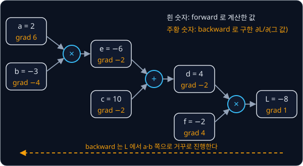
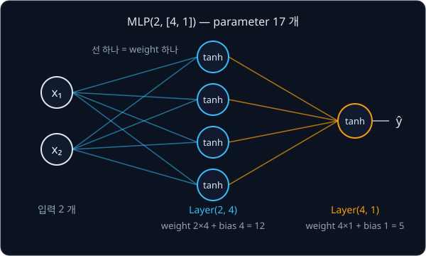

# Backpropagation

## 배경

perceptron 을 두 층으로 쌓으면 XOR 를 표현할 수 있지만, hidden 층의 weight 를 얼마나 고쳐야 하는지 알려 주는 규칙이
없었다. 1986년 Rumelhart·Hinton·Williams 는 step 대신 미분 가능한 activation 을 쓰고 chain rule 로 loss 의 gradient 를
출력에서 입력 쪽으로 거꾸로 전파하면, 모든 층의 weight 를 한꺼번에 학습시킬 수 있음을 보였다. 이 방법이
backpropagation 이다.

### step function 과 미분 가능한 activation

[NumPy Warm-up](../warmup/README.md) 의 gradient descent 는 loss $L$ 을 weight $w$ 로 미분한 $\partial L / \partial w$ 를 보고
weight 를 고쳤다. [Perceptron](../perceptron/README.md) 의 step function $\mathbb{1}[z > 0]$ 은 $z = 0$ 을 뺀 모든 곳에서
기울기가 0 이라, step 을 거친 출력의 오차를 앞 층의 weight 로 미분하면 늘 0 이 나와 앞 층 weight 를 고칠 정보가 없다.

그래서 step 대신 매끄럽게 변하는 activation 을 쓰는데, 이 과제에서는 tanh 를 쓴다.

$$
\tanh(z) = \frac{e^{2z} - 1}{e^{2z} + 1}, \qquad \frac{d}{dz}\tanh(z) = 1 - \tanh^2(z)
$$

$z$ 는 perceptron 에서처럼 weight 를 곱해 더한 값이고, tanh 의 출력은 −1 과 1 사이다. 몇 점에서 값과 기울기를 비교하면 아래와 같다.

| $z$ | step $\mathbb{1}[z > 0]$ | step 의 기울기 | $\tanh(z)$ | tanh 의 기울기 $1 - \tanh^2(z)$ |
| --- | --- | --- | --- | --- |
| −2 | 0 | 0 | −0.9640 | 0.0707 |
| −0.5 | 0 | 0 | −0.4621 | 0.7864 |
| 0 | 0 | 정의되지 않음 | 0 | 1 |
| 0.5 | 1 | 0 | 0.4621 | 0.7864 |
| 2 | 1 | 0 | 0.9640 | 0.0707 |

tanh 는 모든 점에서 기울기가 0 보다 커서, 출력의 오차가 어느 쪽으로 얼마나 바뀌어야 하는지가 입력 쪽으로 전해진다.

### computational graph

$L = (a \cdot b + c) \cdot f$ 같은 계산은 곱셈·덧셈처럼 작은 연산으로 쪼갤 수 있다. 연산을 node 로, 값이 흘러가는 길을
화살표로 그린 그림이 computational graph 다. $a = 2$, $b = -3$, $c = 10$, $f = -2$ 를 넣고 왼쪽에서 오른쪽으로 계산하는 것이
forward 다.

$$
e = a \cdot b = -6, \qquad d = e + c = 4, \qquad L = d \cdot f = -8
$$



### local derivative 와 chain rule

각 연산은 자기 출력을 자기 입력으로 미분한 값, 즉 local derivative 만 안다. $out = x + y$ 이면
$\partial out / \partial x = 1$ 이고, $out = x \cdot y$ 이면 $\partial out / \partial x = y$ 다.

chain rule 은 이 local derivative 를 곱해 멀리 있는 값의 gradient 를 구하는 규칙이다. $L$ 이 $e$ 를 거쳐 $a$ 에 닿으면

$$
\frac{\partial L}{\partial a} = \frac{\partial L}{\partial e} \cdot \frac{\partial e}{\partial a}
$$

이다. 위 graph 에서 $L$ 부터 거꾸로 따라가면 아래 순서로 모든 gradient 가 나온다. 출발점은 $\partial L / \partial L = 1$ 이다.

| 값 | 그 값을 쓴 연산 | gradient 계산 | 결과 |
| --- | --- | --- | --- |
| $d$, $f$ | $L = d \cdot f$ | $\partial L/\partial d = f$, $\partial L/\partial f = d$ | $-2$, $4$ |
| $e$, $c$ | $d = e + c$ | $\partial L/\partial d \cdot 1$ | $-2$, $-2$ |
| $a$, $b$ | $e = a \cdot b$ | $\partial L/\partial e \cdot b$, $\partial L/\partial e \cdot a$ | $6$, $-4$ |

$\partial L / \partial a = 6$ 은 $a$ 를 조금 키우면 $L$ 이 그 6 배만큼 커진다는 뜻이다. $a$ 를 2 에서 2.001 로 바꾸면 $L$ 은
−8 에서 −7.994 가 된다.

어떤 값 $x$ 가 $y_1, \dots, y_k$ 여러 곳에 쓰였다면 $x$ 의 gradient 는 경로마다 들어온 gradient 를 모두 더한 값이다.

$$
\frac{\partial L}{\partial x} = \sum_{j=1}^{k} \frac{\partial L}{\partial y_j}\,\frac{\partial y_j}{\partial x}
$$

### reverse-mode automatic differentiation

gradient 를 거꾸로 전하려면 어떤 값의 gradient 를 쓰기 전에 그 값을 쓴 연산들에서 gradient 가 모두 들어와 있어야 한다.
모든 node 가 자기를 만든 입력보다 뒤에 오도록 줄 세운 순서를 topological order 라고 한다. 위 graph 라면
$a, b, e, c, d, f, L$ 이 그런 순서 중 하나이고, 이 순서를 뒤집어 $L$ 부터 한 번 훑으면 모든 gradient 가 채워진다.

graph 를 한 번 거꾸로 훑으면 parameter 가 몇 개든 scalar loss 하나의 gradient 를 forward 와 비슷한 비용으로 모두 얻는다. 이
방식이 reverse-mode automatic differentiation 이고, PyTorch 의 `loss.backward()` 가 하는 일이다.

### Value 엔진

이 과제는 숫자 하나를 감싸는 `Value` class 로 이 엔진을 직접 짠다. `Value` 하나는 아래 다섯 가지를 담는다.

| 속성 | 뜻 | 위 예의 `e` |
| --- | --- | --- |
| `data` | forward 로 계산한 값 | −6 |
| `grad` | backward 로 채울 $\partial L / \partial(\text{이 값})$. 처음은 0 | −2 |
| `_prev` | 이 값을 만든 입력 `Value` 들 | $\{a, b\}$ |
| `_op` | 이 값을 만든 연산 이름 | `'*'` |
| `_backward` | `grad` 를 입력들의 `grad` 로 전하는 함수 | $a$ 에 $-2 \cdot b$, $b$ 에 $-2 \cdot a$ 를 더한다 |

`e = a * b` 를 실행하면 `__mul__` 이 `data` 를 계산하고 `_prev`·`_op`·`_backward` 를 붙인 새 `Value` 를 돌려준다. 마지막에
`L.backward()` 를 부르면 topological order 의 역순으로 `_backward` 가 하나씩 불려 모든 `grad` 가 채워진다.

### Neuron·Layer·MLP

neuron 하나는 perceptron 에서 step 을 tanh 로 바꾼 것이다. 입력 $x_1, \dots, x_n$ 마다 weight 를 곱해 더하고 bias 를 더한
뒤 tanh 를 통과시킨다.

$$
out = \tanh\Big(\sum_{i=1}^{n} w_i x_i + b\Big)
$$

같은 입력을 받는 neuron 여러 개를 나란히 둔 것이 layer 이고, layer 의 출력을 다음 layer 의 입력으로 이어 쌓은 것이
MLP(multi-layer perceptron)다. 입력과 출력 사이의 layer 를 hidden layer 라고 한다.



XOR 를 학습시킬 때는 출력이 −1 과 1 사이인 tanh 에 맞춰 정답을 0·1 대신 −1·+1 로 둔다. loss 는 네 점의 squared error 합
$L = \sum_k (\hat y_k - y_k)^2$ 이다. 모든 parameter 가 `Value` 이므로 `L.backward()` 한 번으로 17 개 parameter 의
gradient 가 모두 나오고, 각 parameter 를 gradient 의 반대 방향으로 조금씩 옮기는 것을 되풀이한다.

## 목표

- 값·gradient·자기를 만든 연산과 입력을 기억하는 `Value` 로 scalar autograd 엔진을 만든다
- `+`·`*`·`**`·`exp`·`tanh`·`relu` 의 local derivative 와 `backward()` 를 짠다
- 같은 식의 gradient 를 `torch.autograd` 와 비교한다
- 엔진 위에 `Neuron`·`Layer`·`MLP` 를 쌓아 XOR 네 점을 모두 맞힌다

**직접 짤 것**: `Value` 의 연산과 backward, topological sort, MLP, 학습 loop.
**가져다 써도 되는 것**: 검산용 `torch.autograd`, graph 를 그려 보는 graphviz, 그림용 matplotlib.

## 준비물

- Python 3.12, matplotlib, pytest
- torch — gradient 검산용이라 CPU 판으로 충분하다
- graphviz — 만든 graph 를 그림으로 그려 볼 때 쓴다(선택). pip 패키지는 `pyproject.toml` 에 들어 있고, 그림을 실제로
  만들려면 [시스템 Graphviz](https://graphviz.org/download/)(macOS 는 `brew install graphviz`)도 설치한다
- GPU 불필요

## 진행 순서

1. `engine.py` 에서 `Value` 의 `__add__`·`__mul__` forward 를 짠다. 결과 `Value` 에 `data`·`_prev`·`_op` 가 맞게 들어가면
   `test_1_engine.py` 의 `test_add_and_mul_remember_their_inputs` 를 통과한다
2. 각 연산이 결과 `Value` 에 local derivative 로 입력의 `grad` 를 채우는 `_backward` 함수를 달게 한다
3. 출력에서 시작하는 topological sort 를 짜고, 그 역순으로 `_backward` 를 부르는 `backward()` 를 짠다. 위
   computational graph 예에서 `a.grad` 가 6, `b.grad` 가 −4 면 맞다
4. `**`·`exp`·`tanh`·`relu` 를 추가하고 `-`·`/`·`__radd__` 같은 나머지는 이미 있는 연산의 조합으로 만든다. 여기까지 하면
   `test_1_engine.py` 가 모두 통과한다
5. `test_2_vs_torch.py` 의 식들이 `torch`(float64) 와 같은 gradient 를 내는지 확인하고, 직접 고른 식으로도 비교해 본다
6. `nn.py` 에 `Neuron`·`Layer`·`MLP` 와 모든 weight 를 모아 주는 `parameters()`·`zero_grad()` 를 짠다. `test_3_nn.py` 로
   확인한다
7. `train_xor.py` 에서 target 을 −1·+1 로 둔 XOR 네 점에 squared error 로 MLP 를 학습시키는 `train_xor` 를 짠다.
   `test_4_xor.py` 가 통과하면 네 점을 모두 맞힌 것이다
8. `train_xor.py` 의 `__main__` 에서 학습된 MLP 의 decision boundary 를 2D 평면에 그려 `results/xor_boundary.png` 로 저장한다

## 시작점

아래 파일은 모두 리포에 들어 있다.

```text
autograd/
├── pyproject.toml   # 이 과제의 Python 버전과 패키지
├── uv.lock
├── engine.py        # Value 의 stub
├── nn.py            # Neuron, Layer, MLP 의 stub
├── train_xor.py     # train_xor 의 stub. decision boundary 그림은 직접 짠다
└── tests/           # 채점용 test. 고치지 않는다
    ├── conftest.py
    ├── test_1_engine.py     # Value 의 연산과 backward
    ├── test_2_vs_torch.py   # torch.autograd 와 비교
    ├── test_3_nn.py         # Neuron, Layer, MLP
    └── test_4_xor.py        # XOR 네 점
```

[engine.py](engine.py)·[nn.py](nn.py)·[train_xor.py](train_xor.py) 의 함수는 몸통이 `raise NotImplementedError` 인
stub 이고, docstring 에 수식과 변수의 대응, 손으로 따라 할 수 있는 숫자 예시가 있다. test 파일은 진행 순서대로 번호가
붙어 있어서 `-x` 로 돌리면 지금 채울 함수에서 멈춘다.

패키지는 `pyproject.toml` 에 있고, 이 폴더에서 `uv run` 을 처음 실행할 때 `.venv/` 에 설치된다.

```bash
cd projects/autograd
uv run pytest tests -x       # 1~7단계
uv run python train_xor.py   # 8단계
```

## 평가 기준

- [ ] `uv run pytest tests` 가 모두 통과한다. micrograd README 첫머리 예시의 값(24.7041·138.8338·645.5773), 세 식에서
  `torch.autograd`(float64) 와 1e-6 이내로 같은 gradient, `a + a`·`a * a` 의 gradient 2 와 $2a$, hidden 4 개짜리 MLP 의 XOR
  네 점을 이 test 들이 확인한다
- [ ] (선택) 직접 고른 식을 `tests/` 밖의 test 파일(예: `test_my_expr.py`)에서 `torch.autograd` 와 비교한다
- [ ] (선택) sklearn `make_moons` 100 점을 학습시키고 decision boundary 를 그린다

## 생각해 볼 질문

1. 한 값이 식에 두 번 쓰이면 gradient 를 덮어쓰지 않고 더해야 한다. 그 이유를 위의 합 공식으로 설명할 수 있는가?
2. parameter 가 1만 개이고 loss 가 scalar 하나일 때 입력 쪽에서 출발하는 forward-mode 대신 출력 쪽에서 출발하는 reverse-mode 를 쓰는 이유는?
3. perceptron 의 step function 을 그대로 두고 backpropagation 을 하면 어떤 일이 생기는가?

## 힌트

<details>
<summary>topological sort</summary>

DFS 로 한 node 의 `_prev` 를 모두 방문한 뒤에 그 node 를 목록에 넣으면 목록에서 입력은 앞에, 출력은 뒤에 온다.
`backward()` 는 이 목록을 뒤집어 돈다. 이미 방문한 node 는 set 으로 걸러야 같은 node 의 `_backward` 가 두 번 불리지 않는다.

</details>

<details>
<summary>step 이 갈수록 update 가 커질 때</summary>

`_backward` 는 `+=` 로 gradient 를 쌓기 때문에 update 전에 모든 parameter 의 `grad` 를 0 으로 되돌려야 한다. `zero_grad` 를
빼먹으면 이전 step 의 gradient 가 계속 더해진다.

</details>

<details>
<summary>XOR 가 수렴하지 않을 때</summary>

hidden 이 2개뿐이면 초기값에 따라 local minimum 에 자주 걸린다. hidden 을 4개 이상으로 늘리거나 seed 를 바꿔 보고,
초기 weight 가 너무 커서 `tanh` 가 처음부터 ±1 에 붙어 있지 않은지 확인한다.

</details>

## 참고 자료

- David E. Rumelhart, Geoffrey E. Hinton, Ronald J. Williams, [Learning representations by back-propagating errors](https://www.nature.com/articles/323533a0)
  (1986) — hidden unit 의 weight 를 chain rule 로 학습시킨 원 논문. 네 쪽 분량이다
- Atılım Güneş Baydin et al., [Automatic Differentiation in Machine Learning: a Survey](https://jmlr.org/papers/v18/17-468.html)
  (2018) — forward-mode 와 reverse-mode 를 같은 예제로 나란히 보여 주는 3장이 이 과제와 맞닿아 있다
- Andrej Karpathy, [The spelled-out intro to neural networks and backpropagation: building micrograd](https://www.youtube.com/watch?v=VMj-3S1tku0)
  — 이 과제와 같은 scalar 엔진을 처음부터 만드는 영상. 개념을 잡는 용도로 보고, 코드는 보지 않고 짠다
- 3Blue1Brown, [Backpropagation, intuitively](https://www.youtube.com/watch?v=Ilg3gGewQ5U)·[Backpropagation calculus](https://www.youtube.com/watch?v=tIeHLnjs5U8)
  — gradient 가 층을 거슬러 전해지는 모습을 그림으로 보여 주는 두 영상
- Stanford CS231n, [Backpropagation, Intuitions](https://cs231n.github.io/optimization-2/) — 덧셈·곱셈·max gate 가 gradient 를
  어떻게 나눠 주는지 정리한 강의 노트
- Christopher Olah, [Calculus on Computational Graphs: Backpropagation](https://colah.github.io/posts/2015-08-Backprop/) —
  경로 합 공식과 forward-mode·reverse-mode 의 차이를 graph 그림으로 설명한다
- Michael Nielsen, [Neural Networks and Deep Learning — Chapter 2](http://neuralnetworksanddeeplearning.com/chap2.html) —
  backpropagation 의 네 식을 행렬로 유도한다. 다음 과제의 tensor 버전으로 넘어갈 때 다시 읽기 좋다
- PyTorch, [Autograd mechanics](https://docs.pytorch.org/docs/stable/notes/autograd.html) — `torch.autograd` 가 graph 를 기록하고
  backward 하는 방식. 검산할 때 쓰는 도구의 동작을 확인하는 용도
- [karpathy/micrograd](https://github.com/karpathy/micrograd) — 참고 구현. 막혔을 때만 연다

## 남은 한계

숫자 하나마다 Python 객체를 만들기 때문에 MNIST 처럼 weight 가 수십만 개인 모델은 너무 느리다. 같은 계산을 tensor 단위로
묶어 처리하는 방법은 [PyTorch Training Loop](../pytorch-mlp/README.md) 에서 다룬다.
